<!--STATUS
state: LIVE
updated: 2026-11-05 (§2i one thumbnail pipeline for both pickers, CE-4268 — DESIGN) · 2026-11-03 (§2h the gallery as built, CE-4142; §2f accepted 2026-11-01)
build-state: BUILT — all slices on Editor, CGF, SimHost and IG; Stride mode 2 deferred (CE-1030). Approved by the user 2026-10-07 (all leans, §2–§2e); CE-1031 is the terrain owner's follow-up; §2f–§2h the thumbnail gallery (CE-4142) BUILT `2026-11-03` GL1–GL4 — ⏳ the PNG snapshots (director stills) and G8 smart tactical symbols (CE-4169) are later
current-answer: §2 every decision D1–D10 in its final wording (+ retired ids) · §2a–§2e the measured basis and the shapes (SpawnHeight, wire fields) · ⭐ §2f THE THUMBNAIL GALLERY G1–G10 (mockup docs/designs/add-entity-picker/) · §2h the gallery AS BUILT (read it before §2g: it lists where the build deviates) · §3 diagrams · §5 slices and as-built
stale-below: nothing — superseded revisions removed 2026-11-01; full history at commit de422e11b (`git show de422e11b:docs/DESIGN_Add_Entity_Picker.md`)
known-rot: (2026-10-19, CE-3271) §2e / §5 "NetworkSpawningSystem resolves" — SUPERSEDED: 8b now only ASKS (a replicated SpawnLevelRequest) and SpawnLevelSystem resolves it on the node that owns the position (Q94 D, R-3018) — docs/blueprints/Architect_Question_94_Brain_Geometry_Sites.md §5.2a. The rule (SpawnHeight.Apply, level 0 = ground) is unchanged.
known-rot: (2026-10-31, CE-259ax) §2e's "eleven direct SpawnEntityCommand publishers" was measured 2026-10-07; CE-259ax routed them through CreateEntityRequestSystem (docs/DESIGN_Scenario_Entity_Keys.md §00c)
known-conflict: none
related-designs:
  - docs/DESIGN_Scenario_Macros.md — §14.2 SR-180: a PlacementResolver (nearest suitable spot on the navmesh, per mobility layer) beside D6b's SpawnHeight — the same creating-node intent pattern, extended to x, y; offered to Add Entity too
  - docs/blueprints/Architect_Question_108_Run_Mode_Picker.md — D26 OWNS the generic picker's extensions (P1 side pane … P5 image cache) that §2f's gallery is built on, shared with the scenario picker (D25)
  - blueprints/Architect_Question_94_Brain_Geometry_Sites.md — §5.2a owns WHERE the level is resolved (the position's owner, CE-3271); this doc owns the rule and the wire fields
  - docs/DESIGN_Orders_Params_Entity_Classes.md — C2 (CE-2138): the picker path from the class chain; DisNames.json deleted
  - DESIGN_Building_Interiors.md — resolves CE-1031 (ground inside buildings); storeys become levels through SurfacesAt
  - designs/gizmos-1/canvas-context-menu-design.md — owns HOW the empty-map menu is built (JSON in
    CanvasContextMenuState, per-subsystem CanvasMenuUpdateSystem). This doc adds the "Add Entity" submenu.
  - DESIGN_Entity_Authoring_Surface.md — owns THE creation call (RequestEntityCreation) and §5b "the request is sent
    per host". This doc chooses the type and arms the tool; the tool's drop calls it.
  - DESIGN_Entity_Creation_Unification.md — owns the creation pipeline every host runs (EntityCreationPack).
  - designs/main-toolbar-1/ASSET-PICKER-UX-DESIGN.md — owns "adopt NodeEdit's PickerWindow (Tree layout), build no
    parallel picker" and DEC-14/15 (icons by IconKey; open with OpenPicker). Reused.
  - designs/tkb-1/DESIGN.md — owns the TKB schema; this doc adds VisualDefinitionDto.IconName and
    TkbMasterDto.HideFromPalette.
  - UX/UX_Feature_Tool_Model.md — owns the placement tools (EntityPlacementGizmo; area/route/zone PointSequenceGizmo).
    This doc makes every pick arm one of them and adds always-multi placement (right-click/Esc ends), the ground level and north heading.
  - UX/UX_Issues.md#uxi-12 — "Spawn UI ×4"; the spawn panels STAY and call this picker (slice S4).
  - DESIGN_Terrain_World.md §7 W8 — owns "no ground clamp; the movement model sets Z = SurfaceZ(x, y, zHint = current Z)"
    (user ruling). §2a here only chooses an entity's BIRTH Z / level; it adds no clamp step.
  - DESIGN_Node_Roles_And_Policies.md — owns the role list (Map2D = IG only) and R-138/R-140; §2a D9 gates on capabilities.
  - blueprints/Blueprint_Issues_Tracker.md CE-1024 — the named geopoint; a "Map Graphics" point type when it exists.
-->

# Add Entity — one grouped type picker, always followed by a placement tool *(CE-1017)*

> 🔒 **User, `2026-10-06/07`:** *"Empty map context menu now shows just 'Measurement Tool'. It should show 'Add Entity'
> which should open the generic picker filled with entity types, grouped by hierarchical entity category using DIS
> Entity Type categorization (Kind → Country → Category etc.)"* · *"This should feel intuitive to the user. Good
> grouping, incremental filter, ideally also entity 3D model icon (TKB defines icon name, assumes some new icon library
> dedicated for entities)."*
>
> 🔒 **Rulings, `2026-10-07`:** *"hand-made PNGs first, snap to terrain. Facing North. No unknown side. Existing spawn
> panels should not go away. They just should call the new grouping picker instead of showing plain selector popup.
> Grouping should include special area entities and map symbol entities. Some entity kinds like the areas need their
> own placement tool started when that kind of entity selected (independently on clicked point). Likely unifying that to
> always call a placement tool instead of immediately placing the entity? The placement tool could then easily allow for
> multi-placement if shift is pressed when click placing. Some of those entities like areas also do not have any concept
> of hostile or friendly or neutral, so they might need extra submenu."*

## 1. What exists — the measured basis

### INVENTORY *(codebase-memory graph + grep, `2026-10-07`)*

| query | total | what it found |
|---|---:|---|
| `search_graph name_pattern=".*(Picker\|Spawn\|Placement).*" label=Interface` | 7 | `IPickerSource<T>`, `IPickerRegistry`, `IPickerRenderContext` (NodeEditor.Core) · `IPickerSourceAdapter` · `IPickerListSource` · `ISpatialPickerContext` · **`ISpawnController`** |
| `search_graph ".*(Spawn\|Placement\|EntityType\|Tkb).*(Panel\|Window\|Picker\|…)"` label=Class | 10 | **`SpawnerPanel`** (Editor, CGF, ExCon) · `SimHostSpawnPanel` · `ExConSpawnerWindow` · `SpawnerPanelWindow` · tests |
| `search_graph ".*Picker.*"` label=Class (paged) | 107 (≈35 non-test) | one real picker window: **`PickerWindow`** (NodeEditor.UI); sources: node/variable/type/asset/recipe/terrain; combos elsewhere |
| `search_graph ".*Icon.*"` label=Class | 50 | `IIconProvider`/`IconHandle`, `IconAtlas`, `SilkIconProvider`, `MenuIconRenderer`, `IconsFontAwesome6`, `MilStd2525Renderer` (placeholder shapes) — **no entity icon library, no thumbnail renderer** |
| `search_graph "TkbCatalogEntry\|.*TkbCatalog.*"` | 13 | `NedTkbCatalog`, `UrbanCombatTkbCatalog` (the real types, in C#) · `TkbCatalogEntry(TkbId, Name)` |

### Claim table — what this design rests on

| claim | code — how it IS | design — how it was MEANT |
|---|---|---|
| the empty-map menu has one item, built in one live place | ✅ `CanvasMenuUpdateSystem.cs:26` writes `[{"id":200,"label":"Measurement Tool"}]` each frame; `SharedContextMenuPopulator.PopulateEmptyMapMenu` (`:70`) has **no production caller** | ✅ `canvas-context-menu-design.md` L96: *"Place Entity for the editor can be added later without changing the architecture"* |
| the menu action carries no clicked point | ✅ `GizmoMenuActionEvent{AnchorId, ActionId}` → `GlobalActionHandler(view, Entity)` | ✅ same doc §5.6 (canvas target = `Entity.Null`); ⛔ no doc discusses a position |
| …but the point is already delivered, to selection | ✅ empty-space right-click emits `Started` with `worldPos3` + `MapMouseButton.Right` (`GizmoMap.Presentation/Layers/DebugGizmoLayer.cs`, empty-space branch of the right-click handler), consumed by `SelectionInteractionSystem` | ✅ `UX_Feature_Selection.md` §2.3 (empty-space clear) |
| the spawn type lists are hand-written, not the TKB | ✅ `ScenarioSpawnerCatalog.Default` (14 entries) and ExCon's own 9-entry array (`ExConSubsystem.cs:501`) | ⭐ `UXR-83`: *"No shared UI role has two implementations… spawn UI has four"* |
| one generic picker exists, with tree + fuzzy filter + icons | ✅ `PickerWindow` + `PickerEntry(Id, Name, Description, Category "A/B/C", Keywords, IconTextureId, Tag, IconKey, IsEnabled)`; `PickerTreeBuilder` splits `Category` into folders; fuzzy tiers + highlights; Recent/Favourites (in-memory) | ✅ `ASSET-PICKER-UX-DESIGN.md` D1 *"Adopt NodeEdit's picker (PickerLayout.Tree); do NOT build a parallel picker"* |
| the Tree layout has no preview pane and does not fold single-child folders | ✅ `Layouts/TreeLayout.cs` (Description only as a disabled-row tooltip, `:332`); Grid has an 80 px detail strip | ⛔ searched, none found |
| the shared map library can reach `PickerWindow` | ⛔ **not today**: only `Hrot.Editor.AiShared`/`Blueprints`/`BTree`/`Hsm` editors reference `NodeEditor.UI`; ✅ but `NodeEditor.UI` depends only on `NodeEditor.Core` + ImGui.NET, so `Hrot.Presentation` may reference it with no cycle | ⛔ searched, none found |
| DIS data is too thin to group by on its own | ✅ `NedTkbCatalog.cs:56-237`: Country **0** on every type; platoons are Kind 1/Domain 1 like tanks; `UrbanCombatTkbCatalog` sets **no** DisType; the JSON loader never copies `TkbMaster.DisType` into `template.DisType` | ✅ `tkb-1/DESIGN.md` L313 `GetEntitiesByCategory` *"for editor tree building"* (`CategoryPath`) |
| no DIS name table exists | ✅ names only in comments (`DISEntityType.cs:14-15`) | ⛔ searched `docs/`+`.dev/`, none found |
| no icon field, no entity icon library | ✅ `VisualDefinitionDto{SymbolCode, ModelPath, ColorHex, Scale, ShowLabel, MapShapeName}`; no thumbnail code anywhere | ⛔ only `tkb-design-ideas.md` L1299 (a model browser *idea*) |
| creation ends in one call | ✅ `EntityCreation.RequestEntityCreation` (`EntityCreation.cs:183`) — today **only the debug API** calls it; `ScenarioSpawnAdapter` builds `EntityCreationRequest` itself | ✅ `DESIGN_Entity_Authoring_Surface.md` (one method; §5b per-host send) |
| the spawner already asks for force | ✅ `SpawnerPanel` Friend/Hostile radio → `{Affiliation}` JSON; `eForceIdentifier {UNKNOWN, FRIENDLY, OPPOSING, NEUTRAL}` | ⛔ no design rule on default force |
| placement faces EAST today, not north | ✅ `EntityPlacementGizmo.cs:217` `Rotation = Quaternion.Identity`; `SimTransform` (`SimComponents.cs:25-27`): *"yaw: 0=X axis direction (east), +90=Y axis direction (north)"* ⇒ north = yaw +90° about Z | ⛔ searched, none found |
| placement does not snap to terrain | ✅ `EntityPlacementGizmo.cs:216` `Position = (x, y, 0f)`; `TerrainWorld.SurfaceZ(x, y, zHint)` exists (`TerrainWorld.cs:98`) and the loaded terrain is an ECS managed singleton (`TerrainResidency.cs:256`) — no Hrot production caller of `SurfaceZ` yet | ✅ `DESIGN_Terrain_World.md` (the surface query) |
| Shift+click does nothing today | ✅ `EntityPlacementGizmo.OnMouseEvent` tests `button == MapMouseButton.Left` exactly, and a Shift click carries `MapMouseButton.ShiftMask` (`MapMouseButton.cs:12`) ⇒ no match; `autoPopOnPlace` removes the tool after one drop (`:157`) | ⛔ searched, none found |
| areas, routes and zones have their own tools | ✅ `ScenarioSpawnAdapter.StartAreaAuthoringMode` / `StartRouteAuthoringMode` / `StartZoneAuthoringMode` → `PointSequenceGizmo` (`ScenarioSpawnAdapter.cs:29-30,279`); `AreaAuthoringArm`. **`TacGraphic_FireLine` (8801) has no template and no tool** | ✅ `ISpawnController` doc (zone = same mechanism as area, `TkbType` is the discriminator) |
| the spawn panels that choose a TKB type | ✅ `SpawnerPanel` combo (Editor, CGF, ExCon) · ExCon ORBAT "Unit Type" combo (`OrbatPanel.cs:355,370`) · IG `MiniExConPanel` typed numeric "TKB Type" field (`:85-128`). `SimHostSpawnPanel` picks a `VehicleClass`, **not** a TKB type ⇒ out of scope | ✅ `UXI-12` (four spawn UIs) |

## 2. Decisions *(✅ approved by the user `2026-10-07` — all leans; the rulings are marked 🔒)*

| # | decision | ⭐ lean / 🔒 ruling | rejected (one line each) |
|---|---|---|---|
| **D1** | which picker | ⭐ **`PickerWindow`, Tree layout**, opened at the mouse; `Hrot.Presentation` references `NodeEditor.UI` (it depends only on `NodeEditor.Core` + ImGui.NET — no cycle); each host runs ONE `PickerRegistry` | a new popup — the asset-picker rule forbids it · a host-side picker interface — exists only to dodge a project reference |
| **D2** | grouping | ⭐ `Category` = **DIS names, unknown (0) levels skipped**, single-child chains **folded** into one row (generic `PickerTreeBuilder` option); composite units under **`Units`**; 🔒 **map graphics included** under **`Map Graphics`**: 🔒 *"map symbol entities"* = **every tactical graphic (overlay) the map draws** — `Area`, `Route`, `Terrain Zone`, `Fire Line` (shown **disabled**, *"no placement tool yet"*) — **+ the named GeoPoint** (`CE-1024`); all side-less (§2a quote); no DIS ⇒ `CategoryPath` ⇒ `Other` | raw DIS levels — every country is 0 today, so the tree would read *"Country 0"* · point symbols only — the user: *"By map symbol entities I meant any kind of tactical graphics"* (§2a) |
| **D3** | icons | 🔒 **hand-made PNGs first**: `VisualDefinitionDto.IconName` → `Assets/EntityIcons/<IconName>.png` (64×64) packed by **`EntityIconLibrary`** into one atlas, `IIconProvider` keys `entity/<IconName>`; fallback **IconName → generic glyph per DIS kind/domain or graphic kind → none** | runtime 3D render — a renderer in every host for a 16 px icon · 2525 symbols — the renderer is a placeholder |
| **D3c** | big icon | ⭐ Tree layout gains an optional **preview pane** (64 px icon, name, DIS string, description); rows keep a line-height icon | 64 px rows — five visible rows |
| **D4** | what a pick does | 🔒 **always arms a placement tool — never creates directly**, independent of the clicked point. The tool comes from the type's **`PlacementTool`**: `Point` (`EntityPlacementGizmo`) by default; `Area`, `Route`, `Zone` (the existing `PointSequenceGizmo` tools) for those graphics — a small **`PlacementToolRegistry`** keyed by TKB type in `Hrot.Presentation` | create at the right-clicked point, immediately (`CanvasContextMenuState.AnchorWorld` from `SelectionInteractionSystem`) — areas cannot be created that way, and two behaviours confuse · a TKB field for the tool — tools are editor UI, the TKB is shared sim data |
| **D5** | multi-placement | 🔒 **physical entities only; areas, routes, zones single** (they keep their finish-then-end behaviour). 🔒 **APPROVED `2026-10-07`: always multi** for physical entities: each click places, **right-click / Esc ends**; a cursor hint reads *"click: place · right-click/Esc: done"*. ⭐ The ghost shows the type's icon + name (not the numeric `tkbType`) | Shift+click keeps the tool armed (+ a "+" badge) — a modifier the user must discover and hold; always-multi costs at most one Esc · Shift+Enter arms the tool — moot once every pick arms one (D4) · a "count" field — the user places, not counts |
| **D6** | sides | 🔒 **no Unknown.** ⭐ Menu: **`Add Entity ▸ Friendly… · Hostile… · Neutral… · ─ · Map Graphics…`**. The three side items open the picker filtered to side-bearing types and pass the side to the tool; **`Map Graphics…`** opens it filtered to side-less types. `HasSide` comes from `PlacementToolRegistry` (graphics and point symbols: false; everything else: true) | Friendly / Hostile / Neutral only — areas have no side (the user: *"they might need extra submenu"*) · a side toggle in the picker — `PickerWindow` has no header controls · one picker with a per-row side question — a second dialog after every pick |
| **D6b** | landing pose | 🔒 **face north**: `Rotation` = yaw **+90°** about Z (the transform's yaw 0 is EAST). 🔒 **height: the request carries a LEVEL INTENT `SpawnHeight { Mode, Level }` (§2b, §2c) and the CREATING node resolves it** from its own `TerrainWorld`, ignoring the sent Z; Add Entity sends `OnLevel`, level 0 = the ground; with no terrain the sent Z stays. Wire + in-process shapes: §2e. Applies to every point placement, the spawn panels' included | `Quaternion.Identity` — measured to face east · the issuer snaps `Z = SurfaceZ(x, y, zHint: 0)` — fails issuers without terrain (MCP / debug-API lat-lon spawns, `CreateEntityCommand` with an unreferenced `Altitude`, hand-written scenarios) and splits the level vocabulary from "move to level", which MUST run on the owner · a continuous clamp step — contradicts W8 (a second writer of `Position`) · `SurfacePlacement { Top \| Index n (0 = lowest) }` with default `Top` — replaced by the user's level scheme (0 = ground, ±n, explicit modes; §2b) |
| **D6c** | "move to level" (later) | ⭐ an owner-routed entity command `MoveToSurfaceLevel(n)` using `SurfacesAt`, offered in the entity's Details as a list *"0 Ground 0.0 m · +1 Deck 3.2 m · +2 Roof 9.6 m · −1 Basement −3.0 m"*; the movement model then keeps it there (zHint = new Z) | a free Z field — the user wants floors, not metres |
| **D7** | which types | ⭐ **built from the TKB**: templates carrying a `TkbMasterDto`, minus **`TkbMasterDto.HideFromPalette`** (sensor children, internal parts), **plus** the `PlacementToolRegistry` graphics (they carry no master). Replaces the two hand-written catalogs | keep the hand-written lists — they disagree (14 vs 9) and list `Infantry_Officer`, which has no template |
| **D8** | search | ⭐ fuzzy match over `Category/Name` + keywords (DIS numbers and names, `CustomName`, model name); Recent first | name substring (today's panel) |
| **D9** | where the picker is used | 🔒 **the spawn panels stay and call this picker** instead of their combos: `SpawnerPanel` (Editor, CGF, ExCon — its side radio gains *Neutral*, its Draw Area/Route/Zone buttons stay), ExCon ORBAT *New Unit* (opened rooted at `Units`), IG `MiniExConPanel` (replaces the typed number). 🔒 **APPROVED `2026-10-07`: the map menu is offered by CAPABILITY, not the `Map2D` bit** (TKB + terrain + the creation pack + the shared spawn adapter + a `PickerRegistry`), **installed by `MapInteractionPack` on every ECS map host at once** — Editor, CGF, IG, SimHost (§2b); Stride mode 2 deferred (`CE-1030`, §2c); ExCon keeps its remote route through an IG; ReplayBrowser gets none. ⭐ **Enabled in Preview** (R-1012, §5 S3). `SimHostSpawnPanel` picks a `VehicleClass`, not a TKB type — unchanged | retire the panels (UXI-12) — overruled: *"Existing spawn panels should not go away"* · the literal `Map2D` role — would offer it on IG only, not on Editor/CGF · Editor + CGF first, the other hosts "later" — the user: *"sooner, not later"* (§2b) · greyed in Preview — the user: *"When preview, adding new entities is diabled.in the menu, i need it enabled"* (R-1012) |
| **D10** | the create call | ⭐ the point tool's drop goes through `ScenarioSpawnAdapter` → **`EntityCreation.RequestEntityCreation`** (its first UI caller); ExCon's send path (`CMD_PLACE_ENTITY` → IG) is unchanged, per `DESIGN_Entity_Authoring_Surface.md` §5b | a fifth hand-built `EntityCreationRequest` |

**Retired decision ids**

| id | replaced by |
|---|---|
| **D2b** (DIS names in a data table, `DisNames.json`) | R-280 (behaviors, `2026-10-12`): names are hard-coded and come from the shared entity class table — `Architect_Question_90_Unit_Orders_Carry_Capacity.md` §2.3p; as built in §5 S0 *names* |

## 2a. Ground placement, map graphics, which hosts — the measured basis *(user, `2026-10-07`, 2nd round)*

> 🔒 **User:** *"if we press Shift during placement it needs to change the symbol … Alternatively we could keep the
> placement mode of the usual single-click-to-place entities always in multi-placement with right/ESC to cancel"* ·
> *"How the snap to terrain works in case of multi-story buildings and multi-level grounds? lean: highest surface for
> now, later … 'move to height level' … The ground-clamping is likely not done on the issuer side … but as part of entity
> spawn process on the node owning the entity … the spawn request should somehow also contain the request for
> ground-clamping (… the height level index …) and ignoring the height coordinate provided"* · *"Add Entity menu should
> be available on any Map2d role host which has enough information available"* · *"By map symbol entities I meant any
> kind of tactical graphics (overlays) that are drawn by the map. named GeoPoint is similar kind."* · *"Areas, routes and
> zones should not support multi-placement mode, only 'physical' entities (platform) should."*

⇒ D5 (always multi, physical only), D6b (a level intent resolved by the creating node), D9 (capability, not `Map2D`), D2 (every tactical graphic).

### Claim table — ground placement *(measured `2026-10-07`)*

| claim | code — how it IS | design — how it was MEANT |
|---|---|---|
| nothing clamps at spawn | ✅ `CreateEntityRequestSystem.cs:260-266` takes the `SimTransform` as given; SimHost spawners hard-code Z=0 (`SimHostScenarioManager.cs:105,154,…`) | ✅ `DESIGN_Terrain_World.md` W8 *"no ground clamp … spawns at Z=0 settle on the first movement tick"* |
| the movement model is the only runtime Z writer, and it keeps the CURRENT level | ✅ `CarKinematicsSystem.cs:303-310` `z = SurfaceZ(x, y, tf.Position.Z)`; `SurfaceZ` takes the highest surface ≤ `zHint + 0.6 m`, else the lowest (`TerrainWorld.cs:90-130`) | ✅ W8 + user ruling (Terrain_World §7): *"entity movement model clamps them to ground height or on top of building or to building floor"* |
| ⇒ the birth Z SELECTS the level the entity then keeps | ✅ follows from the two rows above (zHint = current Z) | ⛔ no doc says it — this is the gap |
| entities without a movement model never settle | ✅ only `CarKinematicsSystem` writes Z; `LinearKinematics` was not built | ⚠ W8 lists `LinearKinematicsSystem` as intended |
| no "levels at (x,y)" API | ✅ the per-candidate loop is private inside `SurfaceZ`; inputs public (`Prisms`, `Walkables`, `GroundZ`) | ⛔ searched, none found |
| the request has room for a level intent | ✅ `EntityCreationRequest.InitialComponents` / `InitialAttributesJson`; wire `CreateEntityRequest.Flags` uses bit 0 only (`GenericMessages.cs:158-193`); ⛔ no field today | ⛔ searched, none found |
| every ECS map host has terrain | ✅ `RoleLoadRequirements.UniversalParts = {KnowledgeBase, Terrain}` (`:39`) — Editor, CGF, IG, SimHost load it; ExCon (not ECS) does not, and places through an IG (`CMD_PLACE_ENTITY`) | ✅ Terrain_World W3 *"the world becomes a universal load part"* |
| `Map2D` is IG's role only | ✅ `NodeRole.Map2D` passed only by `IgApplication.cs:1034`/`IgNodeBootstrapper`; Editor, CGF, SimHost draw a map without it | ✅ `DESIGN_Node_Roles_And_Policies.md:112` *"presentation only, no simulation logic"*; `DESIGN_Stride_Node_Modes.md` §6.3 *"the 2-D map is a surface, not a node role"* |

## 2b. The level scheme, and every map host at once *(user, `2026-10-07`, 3rd round)*

> 🔒 **User:** *"specify the desired 'height level' as int 0=ground floor (good default, same as usual ground clamps),
> -1 = first underground, +1 = first above ground floor, whatever above existing floors is the 'put highest as
> possible', similarly also in underground direction … some special values for using given z-coordinate and let the
> motion model clamp and also for 'treat z-coordinate as height above the specified level'"* · *"SimHost/Stride needs
> the creation pipeline and the tools and the picker sooner, not later — there should be nothing preventing it, we
> should be unifying and sharing to high extents."*

📐 **What the terrain model allows** (`TerrainWorld.cs`): the ground is ONE flat plane `GroundZ`; `TerrainWalkable`
slabs and ramps carry their own Z, **above or below** `GroundZ`; a `TerrainPrism` (building, wall) is **solid** — its
roof is walkable, its interior is not, and the ground is not a surface inside its footprint (`SurfaceZ` skips
`GroundZ` when `insideSolid`); `Floors` is a label only in v1.

### D6b — `SpawnHeight { Mode, Level }`

| field | values | meaning |
|---|---|---|
| `Level` *(int, default **0**)* | `0` | 🔒 **always the ground plane, `GroundZ`** — in the open AND inside a building footprint; the roof is an explicit `+n` (§2c) |
| | `+n` / `−n` | the n-th surface above / below `GroundZ` (slabs, ramps, roofs; basement slabs, tunnel floors); past the end ⇒ the **highest** / **lowest**; surfaces within 0.3 m of `GroundZ` merge into level 0 (a ramp foot meeting the ground is not a second level) |
| `Mode` | ⭐ **`OnLevel`** *(Add Entity's default)* | `Z = level surface`; the sent Z is **ignored** |
| | **`AboveLevel`** | `Z = level surface + sent Z` — 🔒 for the rare multi-domain cases (§2c): a parachutist (level 0, +800 m), a submarine (level 0, −50 m) |
| | **`Absolute`** *(when the field is absent — today's behaviour)* | the sent Z is used as is; the motion model clamps per W8 |

⭐ **Explicit `Mode` + `Level`, not magic `Level` values** — a reserved int (say `int.MinValue` for "absolute") reads
like a real level in logs and every reader must know the sentinel.

⚠ **`AboveLevel` only survives for entities whose motion model does not ground-clamp** — a car's `SurfaceZ(x, y,
zHint = current Z)` drops it back to the highest surface ≤ its Z + 0.6 m, i.e. the ground. That is W8 working as
ruled, not a defect; it is the mode for air platforms.

**One function serves everything:** `TerrainWorld.SurfacesAt(x, y) → float[]` (ascending, merged) plus
`ResolveLevel(x, y, level)` — used by the creating node, by the placement ghost (so the preview stands where the
entity will), and later by *"Move to level"* (D6c), whose list labels levels the same way.

Rejected: level 0 = *"the lowest surface at or above `GroundZ − StepHeight`"* (the roof inside a solid footprint) — the user: level 0 is always the ground (§2c).

### D9 — every ECS map host in the same slices *(capability gating APPROVED)*

🔒 **No host is "later".** Measured: `MapInteractionPack.Build` is ALREADY called by **five** hosts (Editor
`EditorSubsystem.cs:1928`, CGF `CgfSubsystem.cs:1374`, IG `IgApplication.cs:806`, SimHost `SimHostApp.cs:404`,
ReplayBrowser `ReplayBrowserSubsystem.cs:191`). ⭐ **Add Entity is installed BY that pack** — the menu item, the
shared spawn adapter (`ScenarioSpawnAdapter`), the picker host (`PickerRegistry` drawn each frame) and the entity
icon library — so a host gets all of it by the call it already makes. A host that lacks the creation pipeline
(ReplayBrowser) gets no item, by capability, not by a host check. *(As built: §5 "One wiring".)*

| host | what it must gain | note |
|---|---|---|
| Editor, CGF | nothing new beyond the pack | already have adapter, picker, creation pack |
| **IG** | the shared adapter replaces `MapCommandController`'s own placement gizmo | already ruled: `DESIGN_Entity_Authoring_Surface.md` §5b.2 ① |
| **SimHost** | adapter + picker + icons, via the pack | has creation pack, terrain, TKB, canvas menu |
| **Stride mode 2** | ⚠ the pack itself: it reuses `SimHostVisualization` but has **no gizmo registry** (`StrideNodeShell.cs:751`, `CE-253`/`CE-254`), **no** `CanvasMenuUpdateSystem`, and its TKB load is **unconfirmed** | deferred — `CE-1030` (§2c) |
| Stride mode 1 | nothing (hosts the Editor) | |
| ExCon | unchanged — places through an IG (`CMD_PLACE_ENTITY`) | not an ECS host |
| ReplayBrowser | no item (no creation pipeline; read-only) | |

⚠ An owner-0 request needs an arbiter (CGF or Editor) in the cluster; IG, SimHost and Stride are not arbiters ⇒ when
none is present the host creates with `owner = self` (R-138: every node can create).

## 2c. Level 0 is always the ground *(user, `2026-10-07`, 4th round)*

> 🔒 **User:** *"can level 0 be always ground level; even inside a solid building (buildings are not usually solid in
> real world) — if we want placing on the roof, we select that option explicitly. 'Above level' should be possible for
> some rare cases like parachuter and similar multi-domain entities. Submarines can use negative height and level=0.
> Stride can be left out for now, but pls record it as a task so we don't forget."*

⇒ §2b's `Level 0` and `AboveLevel` rows. `AboveLevel` holds only while the entity's own motion model does not ground-clamp it (W8).

### ⚠ The consequence, measured — v1 buildings are SOLID in movement and navigation

| claim | code | design |
|---|---|---|
| inside a footprint the ground is not a surface | ✅ `TerrainWorld.SurfaceZ`: `if (!insideSolid) Consider(GroundZ, …)` — and with every candidate above reach it returns the LOWEST, i.e. the **roof** | ✅ `TerrainPrism`: *"Storeys, for the label only in v1 (a prism is solid)"* |
| ⇒ a ground vehicle placed at level 0 inside a building is **lifted onto the roof on its first movement tick** | ✅ `CarKinematicsSystem.cs:303-310` (`zHint = current Z = GroundZ`) | ✅ W8 — working as ruled for a solid prism |
| the navmesh has no ground inside a building | ✅ `TerrainWorldMesh` adds roof + walls only; rail `Mesh_GroundSkipsBuildingsAndWater_ButKeepsTheGarageGroundFloor` | ✅ `DESIGN_Terrain_World.md` §2 (prism = solid) |

⇒ **Placement can honour level 0 inside a building only if the terrain stops treating buildings as solid at ground
level.** ⭐ **Filed as `CE-1031`, not done here** — it changes movement (`SurfaceZ` keeps `GroundZ` inside a
`Building` prism; walls stay solid), navigation (ground-floor polygons inside buildings, with doors to reach them) and
the `Floors` label (storeys becoming real slabs). That is the terrain owner's design (`DESIGN_Terrain_World.md`,
backend lane; resolved by `DESIGN_Building_Interiors.md`), and it is the same change "buildings are not usually solid in real world" asks for. **Until it lands**,
Add Entity at level 0 inside a footprint places on the ground and the motion model lifts a ground vehicle to the roof;
the ghost shows a warning *"inside a solid building — will settle on the roof"* so it is not a surprise.

### Stride mode 2 — deferred, recorded

🔒 Left out for now; recorded as **`CE-1030`** (the Stride node gains the pack: gizmo registry first — `CE-253`/`CE-254`
— then canvas menu, picker, icons; confirm its TKB load).

## 2d. How the spawn request encodes the height request — measured *(user asked, `2026-10-07`)*

> 🔒 **User:** *"how the entity spawn encodes the height request?"*

### Claim table *(measured)*

| claim | code — how it IS | design |
|---|---|---|
| the request crosses the wire as descriptors + JSON + a flags word | ✅ `CreateEntityRequestDescriptorBuilder.Build` sends `dtEntityMaster`, `dtWorldPos` (the anchor `SimTransform` as lat/lon/**alt**), overlay/route descriptors, `InitialAttributesJson`; every other `InitialComponents` entry is DROPPED (`:43-143`); `Flags` (Int64) has ONE bit used — `Transient = 1L<<0` (`NedEntityCreationRequestEgress.cs:36`) | ⛔ none on height |
| attribute records exist on the wire but nothing uses them at creation | ✅ `CreateEntityRequest.InitialAttributeRecords` read/written only by tests; records are the UPDATE path (`UpdateEntityAttributeRequestSystem.cs:240`) and their interpreter writes components | ⛔ |
| a request field consumed at creation is the established pattern | ✅ `PreAllocatedNetworkId` / `IsTransient` are request fields, never carried components (`StagingEntityExtractor.cs:258,378`; `NetworkSpawningSystem.cs:196`) | ✅ |
| the resolution point exists | ✅ `CreateEntityRequestSystem.ProcessPendingRequest`: after the transform is extracted (`:264-272`), before `SpawnEntityCommand` is published (`:324`), only on the node servicing the request (`:183`); TKB children inherit the parent transform (`:455`) | ✅ §2b (creating node resolves) |

⇒ the decision is §2e. Rejected (one line each): a component — the descriptor builder drops it on the wire, and it would linger on the entity ·
an attribute record — both ends unbuilt and the record model is for component attributes · a JSON key — JSON routes land on components and
need a strip step · two fields packed into the `Flags` word (bits 1-2 mode, 8-15 level) — the user: explicit fields for clarity (§2e) ·
resolving in `CreateEntityRequestSystem` — measured eleven direct `SpawnEntityCommand` publishers that bypass it (§2e).

## 2e. Explicit fields on the wire, and the in-process shapes *(user, `2026-10-07`)*

> 🔒 **User:** *"CreateEntityRequest is not limited in size so much, we can specify the level number and the flags (byte
> sized enum) as separate fields for clarity. what the in-process fdp bus event would look like?"*

📐 **Measured — creation has TWO in-process stages, and many callers skip the first:**
`EntityCreationRequest` (a queued request object, `EntityLifecycleInterfaces.cs:26`, not a bus event) → serviced by
`CreateEntityRequestSystem` (local, or forwarded on the DDS topic `CreateEntityRequest`) → it publishes the FDP bus
event **`SpawnEntityCommand`** (managed struct, `NetworkSpawning/Events/SpawnEntityCommand.cs:19`), consumed by
`NetworkSpawningSystem` (`:99`), which sets `InitialTransform` (`:201`). **Eleven** production sites publish
`SpawnEntityCommand` DIRECTLY (`SimHostScenarioManager` ×6, `CgfSubsystem.cs:647`, `MiniExConPanelState.cs:123`,
`AreaAuthoringArm.cs:129`, `EntityPlacementGizmo.cs:208`, `ScenarioSpawnAdapter.cs:419`) and never pass
`CreateEntityRequestSystem`.

⇒ ⭐ **Resolve in `NetworkSpawningSystem`, from a field on the bus event**, so every path gets it (resolving in `CreateEntityRequestSystem`
would miss every direct publisher).

```csharp
// shared value type (Fdp.Core or Fdp.Toolkits.NetworkSpawning) — the one vocabulary
public enum SpawnHeightMode : byte { Absolute = 0, OnLevel = 1, AboveLevel = 2 }
public readonly record struct SpawnHeight(SpawnHeightMode Mode, short Level);  // Level 0 = ground, +n above, -n below

// ① the queued request (in-process) — EntityCreationRequest gains
public SpawnHeight? SpawnHeight { get; init; }          // null = Absolute (today)

// ② the DDS topic "CreateEntityRequest" (GenericMessages.cs:158) gains two explicit fields
public byte  SpawnHeightMode;   // SpawnHeightMode; 0 = Absolute = today's behaviour
public short SpawnLevel;        // used when SpawnHeightMode != Absolute

// ③ the FDP bus event SpawnEntityCommand gains
public SpawnHeight? SpawnHeight;   // set only by the CREATOR; replica/ghost ingress never sets it
```

| ⭐ lean | rejected (one line each) |
|---|---|
| **Explicit fields** on the topic (`byte SpawnHeightMode`, `short SpawnLevel`) — readable in `ddsmonitor`, no bit packing (🔒 user) | bits in `Flags` — the user asked for separate fields |
| the "above level" height stays the sent Z (`dtWorldPos` altitude / `InitialTransform.Z`) | a third field for the offset — the Z is already there and otherwise unused in that mode |
| **`CreateEntityRequestSystem` copies** the request's `SpawnHeight` into the `SpawnEntityCommand` it publishes (parent AND TKB children, so children resolve to the same level at their own x,y) | |
| **`NetworkSpawningSystem` resolves** when `SpawnHeight` is set: `Z = TerrainWorld.ResolveLevel(x, y, Level)` (+ sent Z for `AboveLevel`) before writing `SimTransform`; no terrain singleton ⇒ the sent Z. Direct publishers (the placement gizmo, SimHost scenario manager, …) set the field themselves | resolving in `CreateEntityRequestSystem` — eleven direct publishers bypass it |
| ✅ verified while building (§5 S2): no replica/ghost ingress path sets the field (it is creator-only by construction — the wire field travels only on the request topic, never on replication descriptors) | |

## 2f. The THUMBNAIL GALLERY — ✅ ACCEPTED `2026-11-01` (user: *"G points accepted with one note"* — the note is G8) *(CE-4142; user `2026-11-01`: "design the new add entity picker with the thumbnails … some grouping of the thumbnails into few groups, like soldiers, vehicles, aircraft, tactical symbols, these groups could be selected on left side from a list, and on right side there could be the grid of thumbnails, each with short line of description … A fresh look on the problematics might be useful.")* — leans

📐 Mockup: [`docs/designs/add-entity-picker/`](designs/add-entity-picker/README.md). ⭐ Built as a SOURCE of the one generic picker on its
extensions P1–P5 (`Architect_Question_108_Run_Mode_Picker.md` D26, CE-4168) — ⛔ no entity-only picker.

**The fresh look, in one paragraph.** Today's tree mirrors the DIS hierarchy (4–7 levels: Kind ▸ Domain ▸ Country ▸ Category …); an author
thinks *"I want an IFV"*, not *"Platform ▸ Land ▸ Russia ▸ Armored fighting vehicle"*. ⇒ ⭐ a SHORT list of user-meaning groups on the left,
ONE more level as chips inside a group, pictures on the right, search that ignores groups — and the DIS tree stays one toggle away (List).

| # | decision | lean | measured basis |
|---|---|---|---|
| **G1** | the GROUPS | ⭐ ~10 curated groups (Recent & favourites · Soldiers · Ground vehicles · Aircraft · Weapon systems · Units · Civilians · Tactical symbols · Areas & routes · Props), each = a list of `DisTypeMask`s (+ *Units* = DIS Kind 11, *Tactical symbols* / *Areas & routes* = `PlacementToolRegistry.Graphics`) in ONE data file beside the thumbnails (`assets/thumbnails/groups.json`); a type in no group lands in *Other* (shown only when non-empty) | the masks and their `Specificity` exist (`DisTypeMask`, `Fdp.Core`; `EntityClassTable` uses them); the catalogue already groups by DIS path (`EntityTypeCatalog.cs:35`) |
| **G2** | inside a group | ⭐ CHIPS for the NEXT DIS level below the group's masks (Tanks · IFV / APC · Trucks …), named by `DisNameTable`; *All* first; no deeper folders | `DisNameTable.Path` names every level (CE-2138) |
| **G3** | a TILE | ⭐ thumbnail (default 160 × 92, a size slider) + the name + ONE line: the TKB master's short description if set, else *class · main weapon* composed from the TKB | `EntityTypeEntry{Name, Category, DisText, IconName}` (`EntityTypeCatalog.cs:19`) — the one line is new data or composed |
| **G4** | which THUMBNAIL | the TKB type's explicit thumbnail → the most specific `DisTypeMask` match in `assets/thumbnails/map.json` → today's DIS glyph (`assets/icons/_tank.png` …) on a dashed tile (*no thumbnail yet*) — CE-4142's precedence | 18 icons in `assets/icons/` today; `EntityIconLibrary` packs icons |
| **G5** | the SIDE | ⭐ chosen ONCE at the top (Friendly · Hostile · Neutral), tinting the preview; the map menu's *Add Entity ▸ Friendly / Hostile / Neutral* opens the gallery with it preset | D6 (`HasSide`) |
| **G6** | the SIDE PANE (P1) | big picture, description, facts from the TKB (crew / seats, speed, weapons, DIS), *with crew* (D4 / unit composition), **Place on map** (placing several is always on — D5; `2026-11-01` the Shift dropped, user: *"Yes"*); drag a tile onto the map (the picker's `AllowsDragOut`) | D4, D5 |
| **G7** | SEARCH | over ALL groups (name, role line, DIS text, keywords — D8's fuzzy match); tiles show their group; the sidebar shows per-group counts and fades empty ones | D8 |
| **G8** | TACTICAL SYMBOLS | 🔒 (user, `2026-11-01`: *"The tactical symbols, they might have their own type, which determines how they are drawn. Sometimes are smart, meaning they are not just a set of lines clicked by the user, but they offer some handle points, and when the user moves them, the shape draws itself according to its own internal logic. This is not yet implemented, but it means that we can show thumbnails also for the tactical symbols."*): ⭐ every tactical symbol is a TYPE that owns its drawing (a *smart* graphic: handle points the user drags, the shape drawn by the type's own logic — CE-4169, not built); ⇒ its THUMBNAIL is that type drawn at its DEFAULT handles, made by the SAME automatic snapshot pipeline as every other thumbnail (one mechanism, G4's precedence unchanged); the side colour is applied in the side pane's live preview and at placement | the map draws graphics today (`MilStd2525Renderer` placeholder shapes, the tactical-graphics layer); the film's graphics are a closed enum (`GraphicKind { Ring, Arrow, Route, Area, Label }`, `Map3D/Director/FilmGraphics.cs:10`) — no typed / smart graphic exists yet |
| **G9** | LIST ⇄ THUMBNAILS | one toggle + the tile size, remembered per picker (P4); List = today's tree rows with a small thumbnail | the Tree and Grid layouts exist |
| **G10** | RECENT & FAVOURITES | the first group: the last 8 placed + ☆ starred types (F on a tile) | the picker's `RecentStore` (CE-4098) |

⭐ **Cost:** thumbnails load lazily on first show and are cached (P5); a group of ~30 tiles is the usual page. ✅ decided `2026-11-01` (user: *"The thumbnail PNG, of course, will be a snapshot. Very likely doable automatically through the film director's capture, yes - You as an AI model has the full API via AI debug HTTP already available for that."*): the PNGs are SNAPSHOTS made AUTOMATICALLY through the film director's capture (`POST /director/stills` over the ai-debug HTTP API — one placed entity per type, framed, rendered, written to `assets/thumbnails/`), runnable by an AI session; ⛔ open: the tile size default.

## 2g. The gallery as built ON THE ONE PICKER — the UML *(ui, `2026-11-02` — build-state: READY-TO-BUILD; G1–G10 are §2f's, accepted)*

**INVENTORY** — `search_graph .*(EntityType|EntityIcon|DisTypeMask|DisName|PlacementTool|Thumbnail|Gallery).* Class` → 9: `EntityTypeCatalog`,
`EntityTypeEntry`, `EntityIconLibrary`, `DisTypeMask`, `DisNameTable`, `PlacementToolRegistry`, `TkbEntityTypes`, `DISEntityType`,
`DisEntityTypeTranslator` — ⛔ no thumbnail map, no group table, no gallery (coverage unchecked: `check_index_coverage` is not on the CLI).
The picker side (built `2026-11-02`, CE-4168): `PickerRequest.ShowSidePane / DrawPane / Actions / LayoutChoices / DefaultSize`,
`PickerEntry.ImageKey`, `PickerImageCache` wired once in `EntityAuthoring.CreatePickers`, `RecentStore`, `FavoritesStore`; the Wide layout's
240 px category sidebar (`WideLayout.cs:20-60`); the Grid layout has NO sidebar. The TKB visual's `IgVisualDef.IconName` (`IgVisualDef.cs:45`).

*What the class diagram shows that §2f's table could not: the gallery adds only DATA (two JSON files and their readers) and ONE generic
picker option (a group sidebar for the Grid, the Wide layout's own sidebar shared) — every other box already exists.*

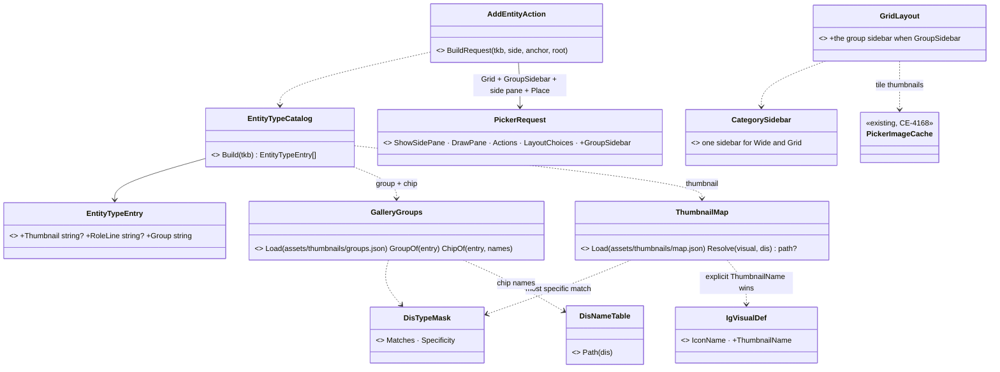

*What the sequence shows: the thumbnail precedence (G4) is decided ONCE when the catalogue is built, so a tile only asks the cache for a path;
the picker stays generic — the group and the chip ride in `PickerEntry.Category` as `"Ground vehicles/Tanks"`.*

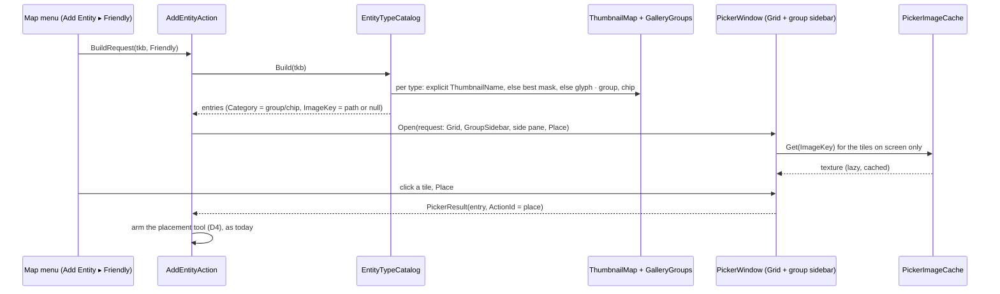

*Who builds it — every map host already composes the Add Entity picker through `EntityAuthoring` (D9), so the gallery reaches all of them at
once; the thumbnails folder is read where the icons folder is read today.*

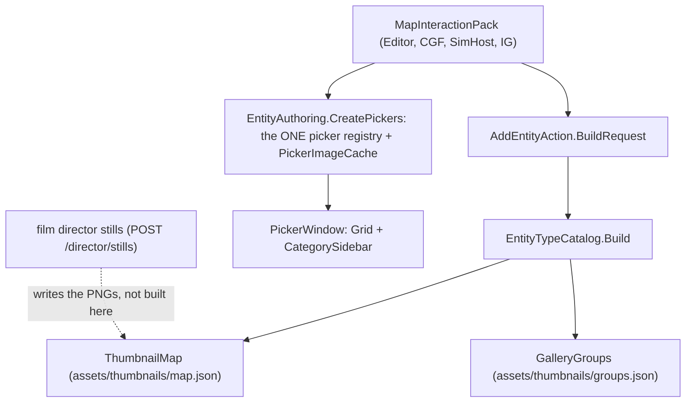

| slice | scope | done when |
|---|---|---|
| **GL1** | `GalleryGroups` + `groups.json` (G1's ten groups as masks) + chips (G2) + `EntityTypeEntry.Group`/`Category = group/chip` | every TKB type lands in exactly one group (or *Other*); a rail over the shipped TKB |
| **GL2** | `ThumbnailMap` + `map.json` + `IgVisualDef.ThumbnailName` (G4 precedence) → `PickerEntry.ImageKey` | explicit beats mask beats glyph; most specific mask wins (rail) |
| **GL3** | `CategorySidebar` shared by Wide and Grid; `PickerRequest.GroupSidebar`; tile line (G3); size slider + List ⇄ Thumbnails (G9, P4) | Wide unchanged; the Grid shows groups left, chips on top, tiles right |
| **GL4** | the Add Entity request: side preset (G5), side pane facts + *Place on map* (G6), search across groups (G7), Recent & favourites first (G10) | the live editor shows it (xvfb screenshot) |
| ⏳ | the PNGs themselves (snapshot run through the director's stills) and G8's smart tactical symbols (CE-4169) | — later; until then tiles show today's glyph on a dashed tile |

## 2h. The gallery AS BUILT *(ui, `2026-11-03` — CE-4142 GL1–GL4; supersedes §2g's "READY-TO-BUILD" where a row says Deviation)*

📸 Live (xvfb, editor): *Add Entity ▸ Friendly…* opens the 1100 × 700 gallery — ten groups with counts (empty ones faded), chips on top, 160 px tiles
(dashed glyph tile while no PNG exists), the side pane with *Placed as / Speed / Weapons / DIS*, *Place on map*. Rendered to the session scratchpad, not committed.

| decision | as built | deviation |
|---|---|---|
| **G1** groups | `assets/thumbnails/groups.json` → `GalleryGroups` (`Hrot.Presentation/AddEntity/GalleryGroups.cs`): a side-bearing type lands in the group of the MOST SPECIFIC matching mask (`DisTypeMask.Specificity`; tie ⇒ first listed), a graphic in the group listing its tool, else *Other*. Shipped masks: Soldiers `3` · Civilians `3.1.*.2` · Ground vehicles `1.1` · Weapon systems `1.1.*.50` · Aircraft `1.2` · Units `11.1`,`11` · Props `2,4-9` · Tactical symbols tool `None` · Areas & routes tools `Area,Route,Zone`. Rail: every type of the shipped TKB is in exactly one group, none in *Other* | ➕ `groups.json` carries an optional `"chips"` level per group (`next`·`kind`·`domain`·`category`·`none`); a broken file is REFUSED (`GalleryData.TryLoad` → null ⇒ Add Entity offers the old DIS tree, never a one-group gallery) |
| **G2** chips | `GalleryGroups.ChipOf`: the first NAMED level (Domain, Category — a country is never a chip) below the winning mask, named by `DisNameTable`; the picker shows the chip row when a group has ≥ 2 chips | Soldiers chips are the category names *Infantry (HROT)* / *Security Force (HROT)* — the class table's own names |
| **G3** tile line | `EntityRoleLine`: `TkbMasterDto.ShortDescription` (➕ new, empty = compose) else *class · main weapon* (class from `EntityClassTable`, weapon = first mount's category in words) | the weapon is the mount's CATEGORY (*Tank gun*), not the weapon template's name — a mount holds a GUID, not a name |
| **G4** thumbnail | `ThumbnailMap` (`map.json`): explicit `ThumbnailName` (➕ on `IgVisualDef` and `VisualDefinitionDto`, copied by `NedTkbBuilder`) → most specific mask → null (glyph on a dashed tile); decided once in `EntityTypeCatalog.Build`; `PickerEntry.ImageKey` = the full path | an explicit name whose file is missing falls through to the mask. `map.json` ships EMPTY, no PNGs |
| **G5** side | the menu item presets it (title, pane's *Placed as*) | no tint on the preview |
| **G6** pane | the picker's default pane content + `AddEntityPane` rows; footer action *Place on map* (id `place`, default; Enter / double-click take it) arms exactly the tool the tree pick armed | *with crew* and drag-onto-map are not built |
| **G7** search | `ToPickerEntries(gallery: true)` adds group, chip and tile line to the keywords; while the search box has text the group filter is off and tiles show their group | — |
| **G9** toggle | `LayoutChoices [Tree, Grid]` (*List* ⇄ *Thumbnails*); tile width slider remembered per context in `PickerViewStore` (`TileWidths`) | *List* shows the GROUP ▸ CHIP tree (the picker entry's `Category`), not the DIS path; the DIS path stays in the keywords and the *DIS* fact |
| **G10** recent | the first group is virtual (`PickerGroupSidebar.RecentGroup`): the rows that are recent or starred; the picker's own `RecentStore`; `F` over a tile (or right-click) stars it | the star store is the picker's in-memory `FavoritesStore` — not persisted across restarts |
| **§2g classes** | `CategorySidebar` (NodeEditor.UI) moved out of `WideLayout` — Wide unchanged (rail); `PickerRequest.GroupSidebar` (`PickerGroupSidebar(Order, RecentGroup)`); the Grid draws the gallery only when it is set | the gallery request is `AddEntityAction.BuildRequest(…, gallery)`; the tree request stays for `SpawnerPanel` and the rooted *New Unit* request. The pack forwards the data (`EntityAuthoringInputs.Gallery`, default `GalleryData.Shipped` = the NAS `assets/thumbnails`, seeded from the repository's) — railed on the constructed pack |

⏳ Not built: the PNG snapshots (a director-stills run writes them and fills `map.json`) · G8 smart tactical symbols (CE-4169) · persisted favourites.

## 2i. ONE thumbnail pipeline for BOTH pickers — CE-4268 *(ui, `2026-11-05`; build-state: DESIGN — confirms §2f's "director stills" and changes only WHERE they live)*

🔒 User, `2026-11-05`: *"the scenarios and entities need their thumbnails to be shown in their pickers (some defaults only shown there)"*.
📐 Measured `2026-11-05`: **0 of 127** scenarios have a `preview.png` (`ScenarioPaneFacts.cs:75` looks beside `scenario.json`); entity types: `assets/thumbnails/map.json`
has **no rules and no PNG** — §2f's director-stills run was never made, so every tile is G4's fallback glyph.

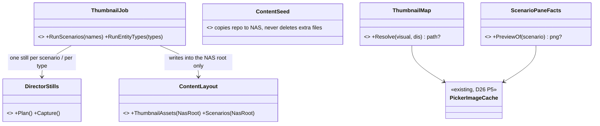
*What the picture shows: nothing new reads an image — both pickers already read the paths; the one new piece WRITES them, through the stills job that exists.*

| ⭐ decision | why |
|---|---|
| the PNGs are written into the **NAS root** (`ContentLayout.ThumbnailAssets(NasRoot)` for types, `<NasRoot>/scenarios/<name>/preview.png` for scenarios) — ⛔ never the repository | the user's "no screenshots in git"; the seed copies repo → NAS file by file and **never deletes** an extra file (`ContentSeed.cs`), so a generated image survives restarts; the pickers already read the NAS paths |
| a **hand-authored** image wins: a `preview.png` / thumbnail committed in the repo is seeded over the NAS copy and is never overwritten by the job (the job skips a path the seed owns) | R-132 (one producer per slot) |
| a scenario's still = its start, framed on its entities (the drafter's overview camera) through `POST /director/stills` with an inline take; an entity type's = one entity of the type placed on flat ground in a studio scenario, framed by its bounds (§2f's plan) | the stills job, seek and capture exist (CE-4059); ⛔ no second renderer |
| run on demand (`POST /thumbnails/generate {scenarios?, types?}`) and from a script for the whole catalogue; a missing image keeps today's fallback | generation needs a window (Xvfb on a server) — not part of a picker's open |

⛔ **Rejected:** committing generated PNGs (the user's rule) · a render at picker-open time (needs the 3-D view, seconds per tile) · a second offscreen renderer beside the stills job.

## 3. Diagrams

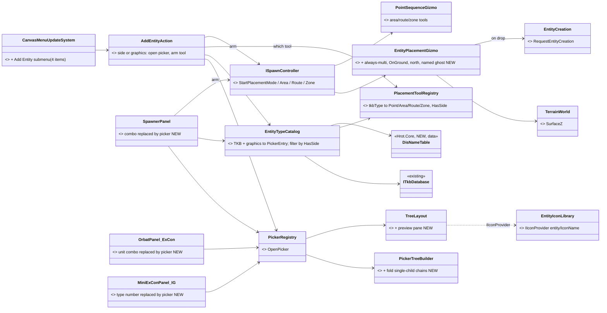
*What it shows:* every entry point — the map menu and the three panels — ends in the same two calls: the picker, then
`ISpawnController` to arm the tool the type needs. Nothing creates an entity except the tool's drop.

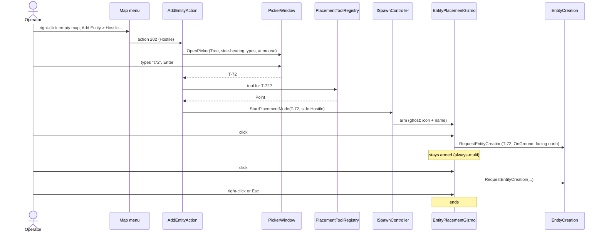
*What it shows:* the clicked point plays no part; the tool owns placement. A `Map Graphics…` pick of *Area* takes the
same path to `StartAreaAuthoringMode` instead.

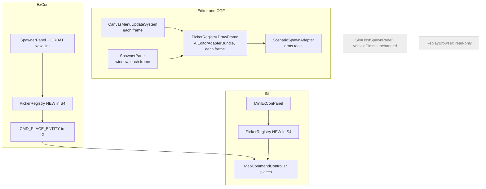
*What it shows:* which host runs which piece each frame. ExCon and IG have no `PickerRegistry` today — S4 adds one;
ExCon's placement still happens on IG through its existing command. Grey boxes are panels that stay as they are: SimHost's VehicleClass roamer panel (SimHost itself now gets the picker through the map menu — §5 S3 as built); the ReplayBrowser is read-only.

#### S2 engine half — the birth-height path *(as built, backend `2026-10-07`)*

```mermaid
classDiagram
    direction LR
    class SpawnHeight { <<Fdp.Toolkits NetworkSpawning, NEW>> Mode, Level; Apply(levelZ, sentZ); FromWire(mode, level) }
    class SpawnHeightMode { <<enum, NEW>> Absolute=0, OnLevel=1, AboveLevel=2 }
    class EntityCreation { <<Hrot.Common, existing>> RequestEntityCreation(+ spawnHeight NEW) }
    class EntityCreationRequest { <<Hrot.Core, existing>> + SpawnHeight? NEW }
    class CreateEntityRequest_topic { <<NED wire, existing>> + byte SpawnHeightMode, short SpawnLevel NEW }
    class NedEntityCreationRequestEgress { <<existing>> writes the two fields NEW }
    class SpawnEntityCommandEgressTranslator { <<existing>> writes the two fields NEW }
    class NedCgfEntityLifecycleAdapters { <<ingress, existing>> FromWire NEW }
    class CreateEntityRequestSystem { <<Hrot.Common, existing>> copies to parent + TKB children NEW }
    class SpawnEntityCommand { <<bus event, existing>> + SpawnHeight? NEW }
    class NetworkSpawningSystem { <<Fdp.Toolkits, existing>> step 8b resolves NEW }
    class TerrainWorld { <<Fdp.Toolkits, existing>> + SurfacesAt, ResolveLevel NEW }
    SpawnHeight --> SpawnHeightMode
    EntityCreation --> EntityCreationRequest : enqueue
    EntityCreationRequest --> NedEntityCreationRequestEgress : addressed elsewhere
    NedEntityCreationRequestEgress --> CreateEntityRequest_topic
    SpawnEntityCommandEgressTranslator --> CreateEntityRequest_topic
    CreateEntityRequest_topic --> NedCgfEntityLifecycleAdapters
    NedCgfEntityLifecycleAdapters --> EntityCreationRequest
    EntityCreationRequest --> CreateEntityRequestSystem : serviced locally
    CreateEntityRequestSystem --> SpawnEntityCommand : publish
    SpawnEntityCommand --> NetworkSpawningSystem
    NetworkSpawningSystem --> TerrainWorld : ResolveLevel
```
*What it shows:* there is ONE resolution point (`NetworkSpawningSystem`, after every component override, so a transform
carried in `InitialComponents` is resolved too) and every route reaches it, including the eleven direct
`SpawnEntityCommand` publishers, which set the field themselves. `TerrainWorld.ResolveLevel` is the same call the
placement ghost uses (S2 UI half). Every other `CreateEntityRequest` writer (IG adapter, ExCon writers, translation
helper) leaves the fields 0 = `Absolute` = today.

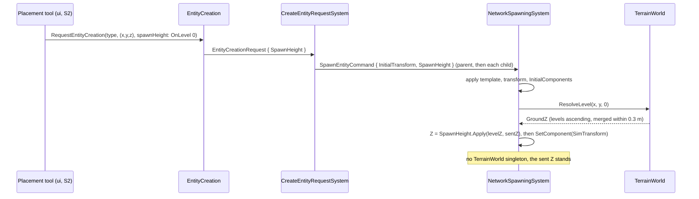
*What it shows:* the resolution happens on the CREATING node only; replicas take the owner's replicated Z, because no
ghost/replica ingress sets `SpawnEntityCommand.SpawnHeight`.

## 4. Open questions

None. *"Map symbol entities"* is answered by D2 (every tactical graphic + the named GeoPoint); multi-placement for area / route / zone
tools by D5 (single). Still open in §2f: the tile-size default.

## 5. Slices

| slice | content | depends |
|---|---|---|
| **S0 data** | DisType (with country) on the 15 built-in templates; JSON loader copies `TkbMaster.DisType`; `IconName`, `HideFromPalette`; `DisNameTable` | — |
| **S1 picker** | `EntityTypeCatalog` + `PlacementToolRegistry`; fold + preview pane + keywords; `Hrot.Presentation` → `NodeEditor.UI` | S0 |
| **S2 tool + level** | `EntityPlacementGizmo`: always-multi for physical types (right-click/Esc ends), north, icon+name ghost at the resolved level; `TerrainWorld.SurfacesAt`/`ResolveLevel`; `SpawnHeight` in the request, resolved by the creating node; drop → `RequestEntityCreation` | — |
| **S3 menu, every map host** | `Add Entity ▸ Friendly/Hostile/Neutral/Map Graphics`, installed by `MapInteractionPack` on Editor, CGF, IG (onto the shared adapter), SimHost; Stride mode 2 deferred → `CE-1030` | S1, S2 |
| **S4 panels** | `SpawnerPanel`, ExCon ORBAT *New Unit*, IG `MiniExConPanel` call the picker; ExCon + IG get a `PickerRegistry`; retire both hand-written catalogs | S1 |
| **S5 icons** | `EntityIconLibrary`, fallback glyphs, hand-made PNGs for the built-in types and graphics | S1 |

### ✅ S0 as built *(backend, `2026-10-07`)*

| item | as built |
|---|---|
| DIS text form | `DISEntityType.ToString()` / `TryParse` — `Kind.Domain.Country.Category.Subcategory.Specific.Extra`; fewer fields leave the rest 0 (`FDP/Engine/Fdp.Core/DISEntityType.cs`) |
| loader | `TkbDeserializer.ParseAndRegister` copies a non-empty `TkbMaster.DisType` into `template.DisType`; a malformed string throws `TkbFormatException` naming the file (like a missing `$guid`) |
| one value, two places | `NedTkbBuilder.WithDisType` also writes the master's `DisType` text, so `template.DisType` and `TkbMasterDto.DisType` cannot disagree on built-in types |
| built-in types | the **13 physical** types carry a country: 8 in `NedTkbCatalog` (T-72 = Russia 222, the rest United States 225) and the **5 urban** types (`UrbanCombatTkbCatalog`, which had DIS 0 before). Map graphics (Fire Line, Route, Area, Terrain Zone) stay DIS 0 — they group under *Map Graphics* (D2) |
| ⚠ HMMWV category | **6** (small wheeled utility vehicle, SISO-REF-010), was 3 (armored utility vehicle — wrong) |
| ⚠ side effect: map layers | the 5 urban types now have a non-zero DIS ⇒ `MapLayerRegistry` puts them in the **Ground** layer (and the car/APC in **Vehicles**) — before, DIS 0 kept them out of every DIS layer. Intended: they are land entities |
| icons | `VisualDefinitionDto.IconName` / `IgVisualDef.IconName`, copied by `WithVisual`; built-in names `m1_abrams`, `m2_bradley`, `hmmwv`, `t72`, `rifleman`, `tank_platoon`, `infantry_squad` (S5 draws the PNGs) |
| palette | `TkbMasterDto.HideFromPalette` (default false) |
| names | ⭐ *(CE-2138, R-280, `2026-10-12`)* `Hrot.Core.Tkb.DisNameTable` is built from the hard-coded `EntityClassTable` (a level name IS a class pinning exactly that level, e.g. `Tank = 1.1.*.1`) and `CountryTable`; the first build's embedded `DisNames.json` and its `EmbeddedResource` are deleted (D2b retired). `Path(dis)` unchanged = named `Kind › Domain › Country › Category`, 0 levels skipped, unknown numbers read `Category 7`; a golden (`EntityTypeCatalogTests.CE2138_*`) pins every built-in type's folder and every name the JSON held |
| rails | `TkbDeserializerTests.CE1017_*` (3) · `DisFilterTests.CE1017_DisText_*` · `NedTkbBuilderVisualTests.CE1017_*` (2) |

### ✅ S2 engine half as built *(backend, `2026-10-07`)* — the UI half (the tool, the ghost) is the ui lane's

| item | as built |
|---|---|
| shapes | exactly §2e: `SpawnHeightMode`/`SpawnHeight` in `Fdp.Toolkit.NetworkSpawning` (`FDP/Toolkits/Fdp.Toolkits/NetworkSpawning/SpawnHeight.cs`), `EntityCreationRequest.SpawnHeight`, `SpawnEntityCommand.SpawnHeight`, topic fields `SpawnHeightMode`/`SpawnLevel` (appended last) |
| the call the tool makes | `EntityCreation.RequestEntityCreation(…, spawnHeight: SpawnHeight.OnGround)` — a new LAST optional parameter, so no caller changes |
| levels | `TerrainWorld.SurfacesAt(x, y, out groundIndex)` / `ResolveLevel(x, y, level)`: ground is ALWAYS present and ALWAYS level 0; prism roofs and slab/ramp heights at (x, y) add levels; within `LevelMergeDistance` (0.3 m) of the ground ⇒ merged into level 0; any other close cluster stands at its **highest** member (decided while building — the design said only "merge"; the higher surface never puts an entity inside the thicker one) |
| resolution | `NetworkSpawningSystem` step 8b, AFTER `InitialTransform` and `InitialComponents`; only when the mode is not `Absolute`, the entity has a `SimTransform` and a `TerrainWorld` singleton is resident |
| ✅ §2e's "to verify" | no replica/ghost ingress sets the field: its only writers are `CreateEntityRequestSystem` (copying the request, both publish sites) and future direct creators. `NedCgfEntityLifecycleAdapters` is the topic's ONLY reader |
| rails | `TerrainWorldTests.CE1017_*` (2) · `SpawnSystemTests.CE1017_*` (3) · `CreateEntityRequestSystemTests.CE1017_*` (2) · `NedEntityCreationRequestEgressRails.CE1017_*` (wire round trip) · `SpawnEntityCommandEgressTranslatorTests.CE1017_*` · ⭐ integration: `Hrot.SimHost.Integration.Tests` `EntityCreationFlowTests.CE1017_*` (the real SimHost pipeline over a deck; 📌 its first version, inside a SOLID building, showed §2c live — level 0 resolved to the ground and the tank's motion model lifted it to the roof within five ticks) |
| ⚠ until `CE-1031` | inside a solid building footprint, level 0 places on the ground and a ground vehicle's motion model then lifts it to the roof (§2c) — unchanged here |

### ✅ S2 UI half as built *(ui, `2026-10-07`)*

| item | as built |
|---|---|
| always-multi | `ScenarioSpawnAdapter.ArmPlacement` arms `EntityPlacementGizmo` with `autoPopOnPlace: false` — every click places, right-click/Esc ends; the ghost shows *"click: place · right-click/Esc: done"* |
| modifiers | Shift/Ctrl/Alt are masked off a click, so a modified click places like a plain one (D5: no Shift mode) |
| heading | `EntityPlacementGizmo.FacingNorth` = yaw +90° (Identity faces east) on every command |
| level | every command carries `SpawnHeight.OnGround`; the adapter copies it into `EntityCreationRequest` |
| ghost label | the TKB template's name (`displayName`), not the type number |
| ⚠ deviation | the ghost does NOT call `ResolveLevel` — the 2D map draws no Z, so it would change nothing visible. The 3D ghost belongs to Stride mode 2 (`CE-1030`). IG got always-multi when it moved onto the shared adapter ("One wiring", below) |
| rails | `EntityPlacementGizmoTests.CE1017_*` (4) |

### ✅ S1 as built *(ui, `2026-10-07`)*

| item | as built |
|---|---|
| picker | `PickerRequest.FoldSingleChildFolders` (a folder whose only content is one sub-folder merges into one row `A › B`, keeping the deepest `FullPath`) and `PickerRequest.ShowPreview` (pane under the Tree: 64 px icon by `IconKey`, name, category, description). Both default off; `TreeLayout` now keys folders by the builder's `FullPath` |
| catalog | `Hrot.UI.Common.AddEntity.EntityTypeCatalog.Build(ITkbDatabase)` — D7 + D2 exactly; composites under `Units/<country>` (decided while building: the DIS path of a unit stops at the country, so `Units` alone would mix nations). Description = `DIS <text>` or the disabled reason |
| tools | `PlacementToolRegistry` — Area / Route / Terrain Zone; Fire Line listed DISABLED (*"No placement tool yet."*); `Arm(spawn, type, side)` is the one mapping onto `ISpawnController`, side as `{"Affiliation":"FORCE_…"}` (the shape `SpawnerPanel` and the ghost already read) |
| icons | key `entity/<IconName>`, else `entity/_point` / `_area` / `_route` / `_zone` — S5 serves them |
| reference | `Hrot.Presentation` → `NodeEditor.UI` (same ImGui.NET 1.91.6.1 as every host) |
| rails | `EntityTypeCatalogTests` (10) · `PickerTreeBuilderTests.CE1017_Fold_*` (2) |

### ✅ S3 as built — Editor and CGF *(ui, `2026-10-07`)*

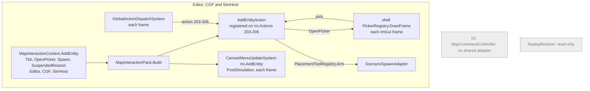
*What it shows:* the submenu exists only where all three dependencies resolve, and they resolve at CALL time (both hosts
build the pickers and the adapter after the map). Grey hosts pass no `AddEntity`, so their menu has no item rather than a
dead one (D9).

| item | as built |
|---|---|
| ids | `GlobalActionIds.AddEntityFriendly/Hostile/Neutral = 203/204/205`, `AddMapGraphic = 206` |
| menu | `CanvasMenuUpdateSystem(AddEntityAction?)` puts `Add Entity ▸ Friendly… · Hostile… · Neutral… · ─ · Map Graphics…` before *Measurement Tool* while the action is available; ⭐ **CE-1226 (R-1012, `2026-10-20`): enabled in Preview**; an entity added there lives until Stop (leaving Preview rewinds the world and the id allocator). The suspension mechanism (`EntityAuthoringInputs.SuspendedReason`) stays for other reasons (none set today) |
| ⚠ deviation | the picker opens CENTRED, not at the mouse: the action handler runs in a system, outside the ImGui frame, and the menu event carries no screen position |
| ✅ IG | on the shared surface — see "One wiring" below |
| ✅ SimHost *(🔒 user: "both cgf and simhost and editor of course should")* | 📐 it had neither a spawn adapter nor a picker; a windowed SimHost now gets both — and the Spawn tool — through the one wiring ("One wiring", below). A headless SimHost builds neither ⇒ no submenu |
| rails | `AddEntityActionTests` (8): hostile item → Tree picker → T-72 pick arms a hostile point tool; map graphics → area tool; cancel arms nothing; suspended opens nothing; menu shows / greys / omits / follows late availability |

### ✅ One wiring — `EntityAuthoring`, built by the map pack for every host *(ui, `2026-10-07`)*

> 🔒 **User:** *"Do we share unified code across simhost and cgf and ig and editor? We should."*
> 📐 **Measured before:** the LOGIC was shared (catalog, tool registry, action, icons, adapter type) but the WIRING was
> copied per host — **3** hand-built `ScenarioSpawnAdapter`s, **5** picker registries with two different icon setups,
> **4** `CanvasMenuUpdateSystem` registrations, **3** Add Entity service blocks — and **IG on none of them**.

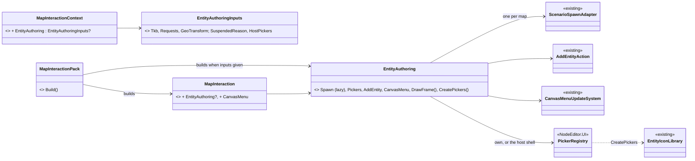
*What it shows:* everything entity authoring needs is constructed in ONE place from three host inputs; a host's whole
share is the inputs, scheduling `mi.CanvasMenu`, and drawing `mi.EntityAuthoring.DrawFrame()` (or its own shell registry).

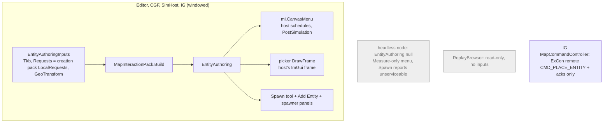
*What it shows:* the four map hosts run the same objects; what stays host-specific is only IG's remote-command service
(acking ExCon's requests), which is protocol, not authoring.

| item | as built |
|---|---|
| IG | joins through the shared adapter. 📐 Equivalent requests: the adapter enqueues onto the SAME `LocalRequests` with `OwnerAppInstanceId = 0` (untargeted) — exactly what `IgEntityCreationRequests.FromSpawnCommand` writes. IG's toolbar Spawn tool, never serviced on IG, now arms too. IG's Mini ExCon opens its picker in the map's registry |
| Editor, CGF | `_spawnAdapter = mi.EntityAuthoring.Spawn`; their shell registry (asset pickers live there) is adopted through `HostPickers` and built with `EntityAuthoring.CreatePickers(silk, theme)` |
| SimHost | the pack's own registry, drawn in `OnDrawUI` (no hand wiring) |
| pickers | `EntityAuthoring.CreatePickers(hostIcons?, theme?)` is the one factory (ExCon too) |
| headless | every host passes `null` when headless — no submenu, Spawn reports unserviceable, as before |
| rails | `EntityAuthoringPackTests` (5) · `TheScenarioWindowsAreSharedTests.EveryWindowedMapHostUsesTheOneEntityAuthoringWiring` (Editor, CGF, SimHost, IG — and none hand-builds an adapter, canvas menu or icon picker) |

### ✅ S4 as built — the spawn panels call the picker *(ui, `2026-10-07`)*

| host / panel | as built |
|---|---|
| `SpawnerPanel` (Editor, CGF, ExCon) | optional `Tkb` + `OpenPicker`: with them the "Entity Type" control is a button that opens the grouped picker for the panel's side, and a pick selects the type AND arms the tool (D4). Without them the flat combo stays. **Neutral** radio added (D6); the side radios now come first because the picker opens per side |
| lists | `ScenarioSpawnerCatalog` (hand-written, 14) is **deleted**; Editor and CGF take `EntityTypeCatalog.SpawnerEntries(tkb)`; ExCon's own 9-entry literal (cross-lane edit, backend's file) is replaced the same way, and its ORBAT unit list is the catalog's `Units` folder |
| ExCon TKB | ⚠ ExCon holds no cluster TKB, so it lists `HrotEnvironment.CreateTkb()` — the built-in default a node boots with. A TKB file loaded into the cluster later is NOT reflected in ExCon's picker |
| IG Mini ExCon | `SetPicker(tkb, openPicker)` + a *Choose…* button beside the raw type number; the pick SETS the type (this panel spawns at coordinates — it arms no tool). ⚠ Bug fixed on the way: its Affiliation combo listed *Unknown/Friend/Hostile/Neutral* over `ForceId` (Neutral=0, Friend=1, Hostile=2), so "Unknown" was Neutral and "Neutral" wrote 3 |
| ExCon ORBAT *New Unit* *(built `2026-10-16`, ui)* | optional `Tkb` + `OpenPicker` like the spawner: *New Unit…* opens the picker **rooted at `Units`** (`AddEntityAction.BuildRequest(…, rootFolder)` — only entries under the folder are offered), friendly, and a pick selects the type and arms the placement tool at once; the combo is the fallback |
| rails | `SpawnerPanelPickerTests` (3) · `MiniExConPanelPickerTests` (2) · `OrbatPanelPickerTests` (2) · `TheScenarioWindowsAreSharedTests.TheEditorAndCgfTakeTheirSpawnerCatalogFromTheTkb` |

### ✅ S5 as built — entity icons *(ui, `2026-10-07`)*

| item | as built |
|---|---|
| art | 17 **hand-drawn SVG icons** (`Hrot/Engine/Hrot.Presentation/Assets/EntityIcons/src/*.svg`, 128×128, side profile facing right, light body gradient + dark outline so they read on the dark theme, every type drawn as itself: M1 wedge turret + skirts, T-72 dome turret + fuel drums + IR light, Bradley box hull + TOW launcher, HMMWV, rifleman, platoon/squad in a unit frame with NATO echelon dots), rasterized to 128 px PNGs by `scripts/render-entity-icons.py` (cairosvg) and embedded in `Hrot.Presentation`. Edit an SVG, re-run the script. Rejected: Pillow-drawn placeholders (`scripts/gen-entity-icons.py`, deleted) — two sources of art; the SVGs are the one source |
| names | the 7 built-in `IconName`s + fallbacks by tool (`_point`, `_area`, `_route`, `_zone`, `_fireline`) and by what a type IS when its TKB names no icon (`_person` = DIS Life Form, `_tank`/`_afv`/`_wheeled` = land categories 1/2/3·6·7·81, `_unit` = composite) — so the 5 urban types show pictures with no data change. Map graphics name their glyph in `PlacementToolRegistry` |
| `EntityIconLibrary : IIconProvider` | serves `entity/<name>`: `<app>/Assets/EntityIcons/<name>.png` first (TKB authors add art without a rebuild), then the embedded PNG, then `_point`; uploads lazily through raylib, cached; texture id 0 (headless GL) ⇒ no icon, no crash; every other key goes to the host's provider (silk atlas) |
| hosts | Editor and CGF: `EntityIconLibrary(silk)` on the shell pickers; SimHost, ExCon, IG: `PickerRegistry.SetIcons(EntityIconLibrary())` (new overload — those hosts have no editor theme or silk provider, so folders draw without icons) |
| rails | `EntityIconLibraryTests` (6) — including *every icon key the built-in catalog asks for has embedded art*, which caught Fire Line asking for `_none` |

**Acceptance (S3):** right-click empty map → *Add Entity ▸ Hostile…* → type `t7` → Enter → click three times, right-click
⇒ three hostile T-72s on the ground, facing north, the tool ended; the picker showed `Platform › Land › Russia › Tank ›
T-72` with an icon. *Map Graphics… → Area* ⇒ the area tool is armed, no side asked.
