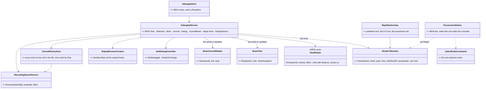
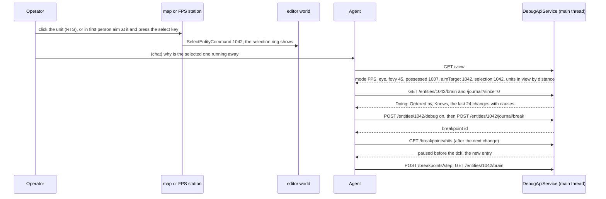
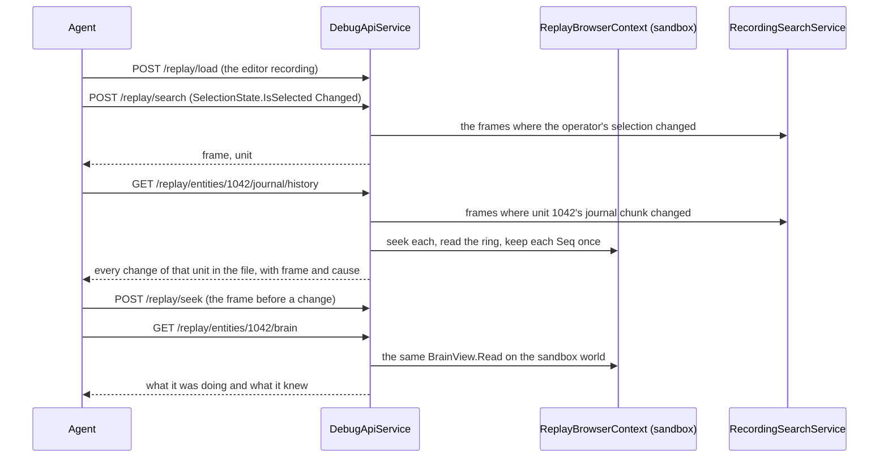
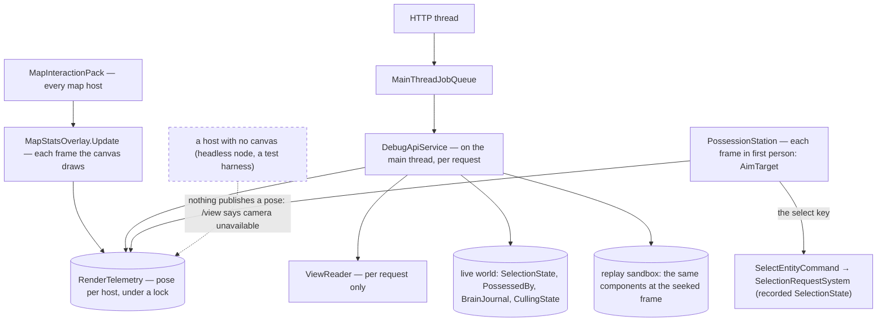

<!--STATUS
state: LIVE
updated: 2026-10-23 (new — R-1029; value review the same day: marks, POST /selection, one-shot EQS and /replay/view withdrawn, the FPS crosshair target added, the catalog regenerated with every route change — R-1030)
build-state: BUILT 2026-10-23 — CE-1262, CE-1263, CE-1264, CE-1265, CE-1266, CE-1268 (as-built §10); the brain / journal / debug / journal-break routes with CE-1248, CE-1249, CE-1257, CE-1258
current-answer: §10 AS-BUILT (read first) · §1 what · §2 INVENTORY + claim table · §3 classes · §4 sequences · §5 modules · §6 THE ROUTE TABLE (live and replay) · §7 decisions AV-1…AV-13 · §8 slices · §9 acceptance
stale-below: nothing
known-rot: none
known-conflict: none
related-designs:
  - docs/DESIGN_Entity_Brain_View.md — OWNS what the brain view, the journal and "Debug this unit" ARE (§1–§10); this doc owns how an agent reaches them over HTTP
  - docs/designs/ai-debug-api/DESIGN.md — OWNS the AI debug HTTP API and its endpoint groups (historical intent; G = breakpoints, K = traces); every route here joins one of its groups
  - docs/MCP_Integration.md — OWNS the trunk as-built of that API (enablement by HROT_DEBUG_API_PORT, the MCP server); the catalog regeneration in AV-11 lands there
  - docs/blueprints/DESIGN_Cluster_Ai_Debug_Surface.md — OWNS the per-perspective resolution of the AI debug routes on a --mode all host (Q54-2); the new reads follow it
  - docs/RUNBOOK_Cluster_Debugging_Over_Http.md — OWNS how to launch and drive a node over HTTP; the new routes get a line there when built
  - docs/designs/replay-browser-2/DESIGN.md — OWNS the replay browser, its sandbox world and the recording search (RecordingSearchService) the replay routes reuse
  - docs/blueprints/DESIGN_Editor_Entity_Selection_Source.md — OWNS the viewport selection (SelectEntityCommand → SelectionRequestSystem) that /selection reads and writes
  - docs/DESIGN_Entity_Control.md — OWNS possession and the FPS station whose eye and zoom /view reports
  - docs/DESIGN_Sensors_And_Doctrine.md — OWNS the sensors and target memory that the existing /entities/{id}/sensors and /memory routes read
-->

# Agent Shared View — the agent sees what the operator sees, and debugs what the operator debugs

🔒 **User, `2026-10-23`:** *"I need the new decision history ring and maybe even the aggregated brain view be made easily accessible to
via ai debug HTTP api to ai agents diagnosing the live run. Imagine I am playing the game live (with ai agent connected via ai debug
http) and see some weird behavior. I need to have a way to mark the entities for the ai so it knows what i am talking about. So the ai
should be able to read what i am looking at currently (read the current camera, both in FPS mode or free flight mode) to identify what
entities i have in view (it should also be able to use eqs query or read the sensors of the currently possessed entity), also what
entities are selected"* · on the proposal: *"ok write it! turning "Debug this unit" ON as well the other debugging means need to be
available to the ai debug http as well. For the analysis of what has happened and why it will be useful the ai agent can analyze the
recording of already finished exercise (assume single recording file from the editor for simplicity, no cluster wide stuff) via the
replay browser tool - it likely already has lots of features exposed so i am just asking how to add the routes to the new debugging
features you are planning"*.

## 1. What

| the agent asks | live | after the exercise (one editor recording) |
|---|---|---|
| *what is the operator looking at?* | `GET /view` — mode, camera, possessed unit, the crosshair target, selection, the units in view | — (withdrawn, AV-7) |
| *which unit does the operator mean?* | `GET /selection` (RTS / free flight) · `/view`'s `aimTarget` (first person: what the crosshair rests on) · `/view`'s `debugged` | `GET /replay/selection` at a frame · `POST /replay/search` for when the selection changed |
| *what is it doing and why?* | `GET /entities/{id}/brain`, `/journal?since=` | `GET /replay/entities/{id}/brain`, `/journal`, `/journal/history` |
| *stop when it changes its mind* | `POST /entities/{id}/debug`, `POST /entities/{id}/journal/break`, then the existing `/breakpoints/*` and `/sim/step` | `GET /replay/entities/{id}/journal/history` lists every change; `POST /replay/seek` to each |
| *find the moment X happened* | — | `POST /replay/search {condition}` |

⭐ Every route is a thin shell over a reader the UI already uses (the brain view's `BrainView.Read`, the journal, the breakpoint
manager, the selection). ⭐ A replay route is the SAME reader pointed at the replay sandbox world.

## 2. INVENTORY *(2026-10-23 — `scripts/cbm.sh` + grep + reads; `check_index_coverage` is not reachable through the CLI, so coverage is not proven)*

| query | total | what matters |
|---|---|---|
| route strings in `Hrot.Editor/DebugApi` (grep `"/(replay\|breakpoints\|sim\|entities\|…)`) | 70+ | exist: `/entities/{id}/{trace,utility,sensors,memory,slots,squad,possess,focus,state}`, `/trace/observe`, `/breakpoints{,/hits,/continue,/step,/{id}}`, `/sim/{pause,play,step,state,timescale}`, `/perception/los`, `/annotations`, `/diagnostics/render`, `/replay/{load,seek,step,status,entities,unload}`. ⛔ **none:** `/view`, `/camera`, `/selection`, `/marks`, `/eqs`, `/entities/{id}/brain`, `/journal`, `/replay/search` |
| `DebugApiRouteDocs` (`RouteDoc(` count) | 156 | every route carries a RouteDoc; a route without one reddens a C# rail; `gen-catalog.mjs` projects them into the MCP catalog |
| read `RenderTelemetry` + grep `RenderTelemetry.Camera(` | 1 writer | `MapStatsOverlay.Update` publishes mode (2D / 3D / FPS), eye, forward, yaw, pitch, distance, height, viewport EVERY frame under a lock; the overlay is added by `MapInteractionPack` (`:523`) ⇒ on every map host. ⛔ no FOV, no 2-D view rectangle, one process-wide slot |
| `MapLayers` record + `AttachMapLayers` call sites | 1 + 5 hosts | Editor, CGF, SimHost, IG, ReplayBrowser; the editor keeps only `.GizmoLayer` (`EditorSubsystem.cs:2629`) |
| `PossessionStation` (read) | 1 | `AimTarget` / `AimAt` — the unit and point the crosshair rests on, every frame (CE-1078); `LockedTarget`; ⛔ in first person LMB FIRES (or designates with binoculars up, CE-1219) — **no selection is possible there** |
| `FocusEntity` / `AddAnnotation` (read) | 2 | the agent already POINTS BACK: `POST /entities/{id}/focus` centres the operator's camera (`CenterOnEntityCommand`), `POST /annotations` draws a sphere / anchor / line |
| `GetEntitySensors` (read) | 1 | lists every sensor of a unit with its last answer — EQS sensors included (`EqsSensor`, `EqsCognitiveBuffer`) |
| `tools/ai-debug-mcp/tool-catalog.mjs` vs the route table | — | ⛔ STALE today: none of the 10 `/director/*` routes is in it; `EveryRouteIsDocumentedTests` checks RouteDocs, nothing checks the catalog |
| `CullingState` (read) | 1 | per entity `IsVisible` this frame in the 2-D viewport — "in view" in 2-D is already computed |
| `SelectionState` / `SelectEntityCommand` (read) | 2 | `SelectionState { IsSelected, IsPrimarySelection }`, `NoScenario` (recorded); `SelectEntityCommand { NetworkId }` → `SelectionRequestSystem` (the one writer, CE-051) |
| `DataBreakpointManager.AddBreakpoint` (read) | 1 | `SearchPredicateDto` condition + optional filter entity + threshold — the journal break is one of these (Brain View BV-28) |
| `RecordingSearchService` (read) | 1 | `ExecuteSearch(fdpPath, predicate, entityFilter)` — frame-step scan for component predicates, event scan for `TransientEvent`; ⛔ not exposed over HTTP |
| replay routes in `DebugApiService` (read `:2740-2850`) | 6 | `_replayContext` (a `ReplayBrowserContext`, `SandboxRepo`) + `_replayExtraction` (an extraction service over a network map built from the sandbox at the seeked frame) |

| claim | code — how it IS | design — how it was MEANT |
|---|---|---|
| a camera pose is published every frame on every map host | `MapStatsOverlay.Update` → `RenderTelemetry.Camera` | CE-1145 (render telemetry for the agent) |
| reading the live camera from the HTTP thread is banned | routes hop through `MainThreadJobQueue` | [ai-debug-api DESIGN](designs/ai-debug-api/DESIGN.md) line 141 |
| the replay routes already read a separate sandbox world at a seeked frame | `LoadReplay` / `SeekReplay` / `ListReplayEntities` | replay-browser-2 |
| possession, selection, the brain journal and brain events are recorded | `PossessedBy` and `SelectionState` are `NoScenario`; the journal is `NoScenario` (BV-9); `RecorderSystem` skips only `NoReplay` | Checkpoint M4 classification |
| the recorded camera is incomplete | the camera entity (TKB 7201) is written only after 0.5 s still and never in FPS | — searched, none (a later improvement, not needed here: AV-7) |
| perspective-dependent routes resolve through the active perspective on a `--mode all` host | Q54-2 as built | [Cluster AI debug surface](blueprints/DESIGN_Cluster_Ai_Debug_Surface.md) §2 |
| EQS runs only inside sensors | `EqsSolverSystem` serves sensor requests | — no one-shot query designed (AV-10) |

## 3. Classes

*What the picture shows that prose hid:* the only new mechanism is `ViewReader`'s frustum test (plus one key in first person that
feeds the EXISTING selection); everything else is an existing reader called with either the live world or the replay sandbox — which is what makes "the same
route over a recording" nearly free.

## 4. Sequences

### 4a. "Look at that one" — live

### 4b. "What happened and why" — after the exercise

*What the sequences show that prose hid:* the live and the replay paths call the SAME readers in the same order — the agent's
procedure is identical, only the world differs; the replay adds one thing the live run cannot have, the whole-file history.

## 5. Modules — who calls it each frame

*What the picture shows that prose hid:* nothing new runs every frame except two extra fields in a publish that already happens; the
view is computed only when the agent asks. The dashed edge is the case `/view` must report honestly — a headless node has no camera.

## 6. THE ROUTE TABLE

⭐ All editor routes, main-thread through `MainThreadJobQueue`, one `RouteDoc` each, classified in `CapabilityManifest` (the
replay ones under `/replay`, the debug ones editor-only like `/breakpoints`). Ids are network ids, as everywhere in the API.

### 6a. Live

| route | returns / does | reuses | slice |
|---|---|---|---|
| `GET /view` | `{mode: 2D\|3D\|FPS, camera: {eye, forward, yawDeg, pitchDeg, fovyDeg, viewport, rect2D?}, possessed: id?, aimTarget: id?, lockedTarget: id?, zoomFovDeg?, selection: [ids], primary: id?, debugged: id?, inView: [{id, name, type, distance, screen: [x,y], inFront}]}`; `?los=true` adds a line-of-sight flag per unit from the eye; `?limit=` (default 50) | `RenderTelemetry` (AV-1), `CullingState` in 2-D, `ViewReader` frustum in 3-D (AV-2), `/perception/los`'s ray | `CE-1262` |
| `GET /selection` | the primary and all selected | `SelectionState` (AV-4) | `CE-1263` |
| *(no route)* first-person select key | selects the unit under the crosshair, so `GET /selection` names it after you leave first person too | `PossessionStation.AimTarget` → `SelectEntityCommand` (AV-5) | `CE-1264` |
| `GET /entities/{id}/brain` | the `BrainSnapshot` as JSON (or `onBrainNode: false` and where to look) | `BrainView.Read` (BV-8) | `CE-1248` (already filed) |
| `GET /entities/{id}/journal?since=` | the entries after `Seq`, oldest first, names resolved; `gap: true` when more than 24 were written since | the journal (BV-27) | `CE-1249` (scope added) |
| `POST /entities/{id}/debug {on}` | "Debug this unit" on / off | `UnitDebugController` (BV-26) | `CE-1257` |
| `POST /entities/{id}/journal/break {kinds?}` | a breakpoint id; hits come through the EXISTING `GET /breakpoints/hits` (with the new entries), resume through `/breakpoints/continue` / `/step`, remove through `DELETE /breakpoints/{id}` | `JournalBreakArm` over `DataBreakpointManager` (BV-28) | `CE-1258` |
| already there, named in `/view` | `/entities/{id}/sensors` (every EQS sensor's last answer included), `/memory`, `/utility`, `/trace`, `/slots`, `/squad` for the possessed or selected unit; `/entities/{id}/focus` and `/annotations` for the agent to point back | — | — |

### 6b. Over one editor recording *(after `POST /replay/load`; every read is at the frame of the last seek / step)*

| route | returns / does | reuses | slice |
|---|---|---|---|
| `GET /replay/entities/{id}/brain` | the same `BrainSnapshot` from the sandbox | `BrainView.Read(sandbox)` (AV-6) | `CE-1265` |
| `GET /replay/entities/{id}/journal?since=` | the ring as it was at that frame | the journal reader on the sandbox | `CE-1265` |
| `GET /replay/entities/{id}/journal/history?from=&to=` | EVERY entry of that unit in the file (or the frame range), each once, with its frame | `JournalHistoryScan` (AV-8) | `CE-1265` |
| `GET /replay/selection` | the selection at that frame | `SelectionState` on the sandbox | `CE-1265` |
| `POST /replay/search {condition, networkId?}` | the frames (and units) where the condition holds | `RecordingSearchService.ExecuteSearch` — the same `SearchPredicateDto` breakpoints take (AV-9) | `CE-1266` |

## 7. Decisions *(approved 2026-10-23 on the proposal — R-1029; value review the same day, on the user's question "if this has no real value and can be obtained from other sources by the AI agent … no need for it (this question might be asked also for other parts...)")*

| id | decision | ⭐ lean | rejected — one line each |
|---|---|---|---|
| **AV-1** | where the camera comes from | ⭐ extend the per-frame publish that exists on every map host (`MapStatsOverlay.Update` → `RenderTelemetry.Camera`): add the vertical FOV (the possession station's zoom FOV when zoomed), the 2-D view rectangle and the possessed unit; key the slot by host so two canvases in one process (the editor map and the replay browser) do not overwrite each other | a probe seam through the `MapLayers` record in each host — five hosts, five forwarding rails, for a publish that already exists · read the camera from the HTTP thread — banned |
| **AV-2** | "in view" | ⭐ 2-D: `CullingState.IsVisible` (already computed each frame); 3-D and FPS: `ViewReader` tests each unit against the published frustum on the main thread, sorted by distance, with its screen point; occlusion only on `?los=true` (one ray per unit) | occlusion always — a ray per unit per request for an answer usually not needed |
| **AV-3** | what the possessed unit perceives | ⭐ `/view` names it; the agent calls the existing `/entities/{id}/sensors` and `/memory` | a perception block inside `/view` — duplicates two routes |
| **AV-4** | selection | ⭐ `GET /selection` only; the agent points back with the existing `/entities/{id}/focus` and `/annotations` | `POST /selection` — **withdrawn in the value review**: `/focus` + `/annotations` already show the operator a unit · write `SelectionState` directly — bypasses `SelectionRequestSystem` |
| **AV-5** | how the operator says "this one" *(revised 2026-10-23 — user: "it is for telling ai what i am looking at, is that about aiming at entity in fps mode when no entity selection possible?")* | ⭐ **the selection is the pointer** — in RTS / free flight a click selects (already recorded, `SelectionState` is `NoScenario`), the note goes in the chat. ⭐ **First person is the one gap** — LMB fires there, so: `/view` reports `aimTarget` (what the crosshair rests on, already computed each frame) and one first-person key SELECTS the unit under the crosshair through `SelectEntityCommand`, so the pointer survives moving the aim and leaving first person; the key is picked at build against the station's keys | a separate "Mark for AI" (event, log, badge) — **withdrawn in the value review**: the selection already does it, recorded · `aimTarget` alone — the aim moves before the agent asks |
| **AV-6** | one reader, two worlds | ⭐ every reader takes the world (and network map) as an argument; a replay route passes `_replayContext.SandboxRepo` and the map `BuildReplayExtractionService` builds at the seek | a replay copy of each reader — two implementations (ruling 9) |
| **AV-7** | the camera in a recording — ⛔ **WITHDRAWN in the value review** (`/replay/view`): the after-action questions are about units — the brain, the journal, the selection — and the recorded camera is partial (still for 0.5 s, never in first person) | ~~the possessed unit's eye when possessed (recorded); else the recorded camera entity's last pose, reported with `cameraAge`~~ | ~~record the camera every frame~~ |
| **AV-8** | the whole-file history of a unit | ⭐ `JournalHistoryScan`: candidate frames from `RecordingSearchService` (`PropertyMatch BrainJournal.Seq Changed` with the unit as filter — chunk-granular, a superset, fine offline), seek each, read the ring, keep each `Seq` once; every change dirties the chunk and the recorder writes that frame, so no entry is skipped | step every frame of the file — the same answer, slower · trust a single read at the end — the ring holds 24 |
| **AV-9** | general search over the recording | ⭐ `POST /replay/search` exposes `RecordingSearchService.ExecuteSearch` with the condition DTO breakpoints already take — one condition language for "stop when" live and "find when" afterwards | a route per question — the predicate DTO already covers them |
| **AV-10** | EQS from the agent — ⛔ **WITHDRAWN in the value review** | ⭐ none: `/entities/{id}/sensors` already returns every EQS sensor's last answer for any unit (the possessed one included); a one-shot "what if" query would need the solver outside the sensor tick for a tuning question, not a diagnosis | a one-shot `POST /eqs/query` — no question it answers that the unit's own sensors do not |
| **AV-11** | the catalog *(revised 2026-10-23 — 🔒 user: "regenerating of the docs must be part of every ai debug http change, no way as some time later" — R-1030)* | ⭐ **every commit that adds or changes a route regenerates `tools/ai-debug-mcp` (`gen-catalog.mjs`) and the skill in the SAME commit**, beside its `RouteDoc` and `CapabilityManifest` row; ⭐ enforced by a new C# rail beside `EveryRouteIsDocumentedTests`: every route's tool name appears in `tool-catalog.mjs` (no node, no build of the editor) — red the moment a route lands without regeneration; ⭐ the catalog is regenerated NOW (the `/director/*` routes are missing today) | one regeneration sweep after the routes — the user ruled it out · rely on `gen-catalog.mjs --check` by hand — nothing runs it, which is how it went stale |
| **AV-13** | the value test for every route here | ⭐ a route is built only when no existing route answers its question — the value review withdrew four (marks, `POST /selection`, one-shot EQS, `/replay/view`) | — |
| **AV-12** | scope | ⭐ the editor process and one editor recording; on a `--mode all` host the live reads follow the active perspective (Q54-2) and a brain-less one answers `onBrainNode: false` (BV-6); no cluster-wide merge of recordings | merge node recordings — the user ruled it out for now |

## 8. Slices

| slice | owner | what | tracker |
|---|---|---|---|
| **V1** | ui | AV-1 publish fields; `ViewReader`; `GET /view` | `CE-1262` |
| **V2** | ui | `GET /selection` | `CE-1263` |
| **V3** | ui | the first-person select key (aim + key → `SelectEntityCommand`) | `CE-1264` |
| **V4** | ui | the replay twins (brain, journal, history, selection) | `CE-1265` |
| **V5** | ui | `POST /replay/search` | `CE-1266` |
| ~~V6~~ | — | withdrawn (AV-10) | `CE-1267` |
| **V7** | ui | regenerate the catalog now; the catalog rail (AV-11); from then on every route slice regenerates in its own commit | `CE-1268` |

⭐ Order: V7 first (the rail then guards every later slice); V1–V3 need nothing from the brain work; the brain / journal / debug routes ride on `CE-1248`, `CE-1249`, `CE-1257`,
`CE-1258`; V4 needs `CE-1248` + `CE-1249`; each slice's commit carries its regenerated catalog (R-1030).

## 9. Acceptance

| | rail / check |
|---|---|
| V1 | `ViewReader` on a fixture: units inside / outside a frustum, sorted by distance, screen points; 2-D uses `CullingState`; two hosts in one process keep their own pose; first person reports `aimTarget`; `/view` on a headless host says the camera is unavailable |
| V2 | `GET /selection` lists primary and all |
| V3 | in first person, aim at a unit and press the key: it becomes the primary selection (the ring shows after leaving first person); aiming at nothing selects nothing |
| V4 | over a recorded fixture: brain and journal at a seek match the live reads at that frame; the history lists every entry once in order; `/replay/selection` matches the live selection at that frame |
| V5 | a component condition and an event condition each return the right frames over a recorded fixture |
| V7 | the catalog rail is red on a route missing from `tool-catalog.mjs` (red-proved by deleting one entry) and green after regeneration; the `/director/*` tools appear |
| live | `pc-defend-house`: select a defender (and once in first person with the key), the agent finds it in `/selection` / `/view`, reads its brain, arms the journal break, steps through one change |

## 10. AS-BUILT *(2026-10-23)*

| route / item | where | ⚠ deviation |
|---|---|---|
| `GET /view` (CE-1262) | `Hrot.Presentation/Map3D/ViewTelemetry.cs` (`ViewSnapshot`, `ViewTelemetry` keyed by world, `ViewReader`), published by `MapStatsOverlay.Update` (the pack hands it the 2-D camera and the possession station); `DebugApiService.View.cs` | ⚠ a **new per-world store** (`ViewTelemetry`), not more fields on the process-wide `RenderTelemetry` — keying by world is what keeps two canvases apart. ⚠ **no `?los=true`**: `explain_line_of_sight` with the possessed unit as observer already answers it (AV-13). ⚠ also reports `debugged` |
| `GET /selection` (CE-1263) | `DebugApiService.View.cs` (`SelectionOf(world, map)`, shared with the replay twin) | — |
| first-person select key (CE-1264) | `PossessionStation.SelectKey` = **I**, publishes `SelectEntityCommand` for `AimTarget` | — |
| replay twins (CE-1265) | `DebugApiService.Brain.cs`: `/replay/entities/{id}/brain`, `/journal`, `/journal/history`, `/replay/selection` — the live readers on `SandboxRepo` | ⚠ **the history walks the recording with `StepForward`** and keeps each `Seq` once, then restores the seek — not `RecordingSearchService`: over a recording `Changed` has no baseline and matches every frame, so the search bought nothing |
| `POST /replay/search` (CE-1266) | `DebugApiService.Brain.cs` `SearchReplay` → `RecordingSearchService` over the loaded file | — |
| catalog (CE-1268, R-1030) | `EveryRouteIsDocumentedTests.EveryToolIsInTheGeneratedCatalog`; `tools/ai-debug-mcp/tool-catalog.mjs` + `SKILL.md` regenerated with each route change | — |

⭐ Rails: `TheBrainAndViewRoutesAnswerTests` (brain, journal `?since` + gap, debug, view in front / behind + selection) and the catalog rail (red-proved by renaming a catalog entry). ⚠ The replay twins and `/replay/search` have no rail on a recorded fixture yet — a live check over an editor recording is owed.

