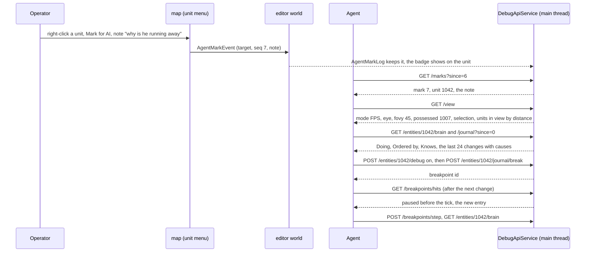
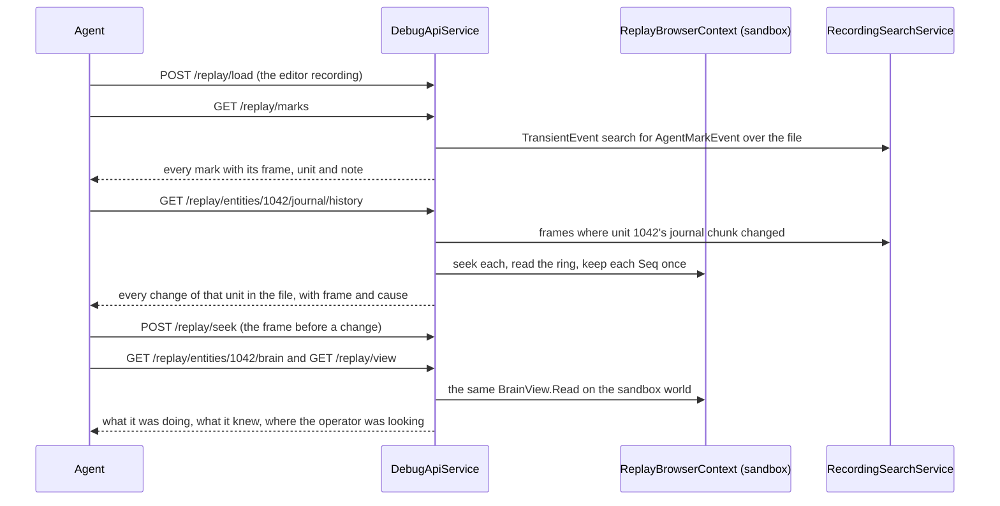
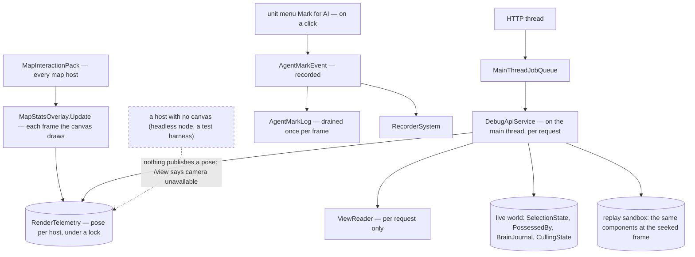

<!--STATUS
state: LIVE
updated: 2026-10-23 (new — R-1029)
build-state: READY-TO-BUILD — approved 2026-10-23 on the proposal ("ok write it!"); nothing built yet
current-answer: §1 what · §2 INVENTORY + claim table · §3 classes · §4 sequences · §5 modules · §6 THE ROUTE TABLE (live and replay) · §7 decisions AV-1…AV-12 · §8 slices · §9 acceptance
stale-below: nothing
known-rot: none
known-conflict: none
related-designs:
  - docs/DESIGN_Entity_Brain_View.md — OWNS what the brain view, the journal and "Debug this unit" ARE (§1–§10); this doc owns how an agent reaches them over HTTP
  - docs/designs/ai-debug-api/DESIGN.md — OWNS the AI debug HTTP API and its endpoint groups (historical intent; G = breakpoints, K = traces); every route here joins one of its groups
  - docs/MCP_Integration.md — OWNS the trunk as-built of that API (enablement by HROT_DEBUG_API_PORT, the MCP server); the catalog regeneration in AV-11 lands there
  - docs/blueprints/DESIGN_Cluster_Ai_Debug_Surface.md — OWNS the per-perspective resolution of the AI debug routes on a --mode all host (Q54-2); the new reads follow it
  - docs/RUNBOOK_Cluster_Debugging_Over_Http.md — OWNS how to launch and drive a node over HTTP; the new routes get a line there when built
  - docs/designs/replay-browser-2/DESIGN.md — OWNS the replay browser, its sandbox world and the recording search (RecordingSearchService) the replay routes reuse
  - docs/blueprints/DESIGN_Editor_Entity_Selection_Source.md — OWNS the viewport selection (SelectEntityCommand → SelectionRequestSystem) that /selection reads and writes
  - docs/DESIGN_Entity_Control.md — OWNS possession and the FPS station whose eye and zoom /view reports
  - docs/DESIGN_Sensors_And_Doctrine.md — OWNS the sensors and target memory that the existing /entities/{id}/sensors and /memory routes read
-->

# Agent Shared View — the agent sees what the operator sees, and debugs what the operator debugs

🔒 **User, `2026-10-23`:** *"I need the new decision history ring and maybe even the aggregated brain view be made easily accessible to
via ai debug HTTP api to ai agents diagnosing the live run. Imagine I am playing the game live (with ai agent connected via ai debug
http) and see some weird behavior. I need to have a way to mark the entities for the ai so it knows what i am talking about. So the ai
should be able to read what i am looking at currently (read the current camera, both in FPS mode or free flight mode) to identify what
entities i have in view (it should also be able to use eqs query or read the sensors of the currently possessed entity), also what
entities are selected"* · on the proposal: *"ok write it! turning "Debug this unit" ON as well the other debugging means need to be
available to the ai debug http as well. For the analysis of what has happened and why it will be useful the ai agent can analyze the
recording of already finished exercise (assume single recording file from the editor for simplicity, no cluster wide stuff) via the
replay browser tool - it likely already has lots of features exposed so i am just asking how to add the routes to the new debugging
features you are planning"*.

## 1. What

| the agent asks | live | after the exercise (one editor recording) |
|---|---|---|
| *what is the operator looking at?* | `GET /view` — mode, camera, possessed unit, selection, marks, the units in view | `GET /replay/view` at the seeked frame |
| *which unit does the operator mean?* | `GET /selection`, `GET /marks?since=` | `GET /replay/marks` (the whole file) |
| *what is it doing and why?* | `GET /entities/{id}/brain`, `/journal?since=` | `GET /replay/entities/{id}/brain`, `/journal`, `/journal/history` |
| *stop when it changes its mind* | `POST /entities/{id}/debug`, `POST /entities/{id}/journal/break`, then the existing `/breakpoints/*` | `GET /replay/entities/{id}/journal/history` lists every change; `POST /replay/seek` to each |
| *find the moment X happened* | — | `POST /replay/search {condition}` |

⭐ Every route is a thin shell over a reader the UI already uses (the brain view's `BrainView.Read`, the journal, the breakpoint
manager, the selection). ⭐ A replay route is the SAME reader pointed at the replay sandbox world.

## 2. INVENTORY *(2026-10-23 — `scripts/cbm.sh` + grep + reads; `check_index_coverage` is not reachable through the CLI, so coverage is not proven)*

| query | total | what matters |
|---|---|---|
| route strings in `Hrot.Editor/DebugApi` (grep `"/(replay\|breakpoints\|sim\|entities\|…)`) | 70+ | exist: `/entities/{id}/{trace,utility,sensors,memory,slots,squad,possess,focus,state}`, `/trace/observe`, `/breakpoints{,/hits,/continue,/step,/{id}}`, `/sim/{pause,play,step,state,timescale}`, `/perception/los`, `/annotations`, `/diagnostics/render`, `/replay/{load,seek,step,status,entities,unload}`. ⛔ **none:** `/view`, `/camera`, `/selection`, `/marks`, `/eqs`, `/entities/{id}/brain`, `/journal`, `/replay/search` |
| `DebugApiRouteDocs` (`RouteDoc(` count) | 156 | every route carries a RouteDoc; a route without one reddens a C# rail; `gen-catalog.mjs` projects them into the MCP catalog |
| read `RenderTelemetry` + grep `RenderTelemetry.Camera(` | 1 writer | `MapStatsOverlay.Update` publishes mode (2D / 3D / FPS), eye, forward, yaw, pitch, distance, height, viewport EVERY frame under a lock; the overlay is added by `MapInteractionPack` (`:523`) ⇒ on every map host. ⛔ no FOV, no 2-D view rectangle, one process-wide slot |
| `MapLayers` record + `AttachMapLayers` call sites | 1 + 5 hosts | Editor, CGF, SimHost, IG, ReplayBrowser; the editor keeps only `.GizmoLayer` (`EditorSubsystem.cs:2629`) |
| `CullingState` (read) | 1 | per entity `IsVisible` this frame in the 2-D viewport — "in view" in 2-D is already computed |
| `SelectionState` / `SelectEntityCommand` (read) | 2 | `SelectionState { IsSelected, IsPrimarySelection }`, `NoScenario` (recorded); `SelectEntityCommand { NetworkId }` → `SelectionRequestSystem` (the one writer, CE-051) |
| `DataBreakpointManager.AddBreakpoint` (read) | 1 | `SearchPredicateDto` condition + optional filter entity + threshold — the journal break is one of these (Brain View BV-28) |
| `RecordingSearchService` (read) | 1 | `ExecuteSearch(fdpPath, predicate, entityFilter)` — frame-step scan for component predicates, event scan for `TransientEvent`; ⛔ not exposed over HTTP |
| replay routes in `DebugApiService` (read `:2740-2850`) | 6 | `_replayContext` (a `ReplayBrowserContext`, `SandboxRepo`) + `_replayExtraction` (an extraction service over a network map built from the sandbox at the seeked frame) |

| claim | code — how it IS | design — how it was MEANT |
|---|---|---|
| a camera pose is published every frame on every map host | `MapStatsOverlay.Update` → `RenderTelemetry.Camera` | CE-1145 (render telemetry for the agent) |
| reading the live camera from the HTTP thread is banned | routes hop through `MainThreadJobQueue` | [ai-debug-api DESIGN](designs/ai-debug-api/DESIGN.md) line 141 |
| the replay routes already read a separate sandbox world at a seeked frame | `LoadReplay` / `SeekReplay` / `ListReplayEntities` | replay-browser-2 |
| possession, selection, the brain journal and brain events are recorded | `PossessedBy` and `SelectionState` are `NoScenario`; the journal is `NoScenario` (BV-9); `RecorderSystem` skips only `NoReplay` | Checkpoint M4 classification |
| the recorded camera is incomplete | the camera entity (TKB 7201) is written only after 0.5 s still and never in FPS | — searched, none (a later improvement, not needed here: AV-7) |
| perspective-dependent routes resolve through the active perspective on a `--mode all` host | Q54-2 as built | [Cluster AI debug surface](blueprints/DESIGN_Cluster_Ai_Debug_Surface.md) §2 |
| EQS runs only inside sensors | `EqsSolverSystem` serves sensor requests | — no one-shot query designed (AV-10) |

## 3. Classes

```mermaid
classDiagram
  class DebugApiHost { <<exists, changed>> NEW routes, each a RouteDoc }
  class DebugApiService { <<exists, changed>> NEW View · Selection · Marks · Brain · Journal · Debug · JournalBreak · replay twins · ReplaySearch }
  class RenderTelemetry { <<exists, changed>> Camera(host, mode, pose, fovy, viewRect2D, possessed) per host }
  class MapStatsOverlay { <<exists, changed>> publishes fovy, the 2-D rect, the possessed unit }
  class ViewReader {
    <<NEW, pure>>
    InView(world, camera, filter) units with distance, screen xy
  }
  class AgentMarkEvent { <<NEW, recorded event>> Target · Seq · Note · By }
  class AgentMarkLog { <<NEW>> ring of marks for GET /marks?since }
  class AgentMarkGizmo { <<NEW>> a badge on a marked unit for 30 s }
  class BrainView { <<Brain View P1>> Read(world, unit) BrainSnapshot }
  class BrainJournalReader { <<Brain View P2>> Since(world, unit, seq) }
  class UnitDebugController { <<Brain View BV-26>> SetDebugged · BreakOnChange }
  class ReplayBrowserContext { <<exists>> SandboxRepo at the seeked frame }
  class JournalHistoryScan { <<NEW>> every entry of one unit in the file, once each by Seq }
  class RecordingSearchService { <<exists>> ExecuteSearch(fdp, predicate, filter) }
  DebugApiHost --> DebugApiService
  MapStatsOverlay --> RenderTelemetry
  DebugApiService --> RenderTelemetry : last pose
  DebugApiService --> ViewReader
  DebugApiService --> AgentMarkLog
  AgentMarkLog ..> AgentMarkEvent
  AgentMarkGizmo ..> AgentMarkEvent
  DebugApiService --> BrainView : live world or sandbox
  DebugApiService --> BrainJournalReader : live world or sandbox
  DebugApiService --> UnitDebugController
  DebugApiService --> ReplayBrowserContext
  DebugApiService --> JournalHistoryScan
  JournalHistoryScan --> RecordingSearchService
  DebugApiService --> RecordingSearchService
```

*What the picture shows that prose hid:* the only new mechanisms are the mark (an event, a ring, a badge) and `ViewReader`'s frustum
test; everything else is an existing reader called with either the live world or the replay sandbox — which is what makes "the same
route over a recording" nearly free.

## 4. Sequences

### 4a. "Look at that one" — live

### 4b. "What happened and why" — after the exercise

*What the sequences show that prose hid:* the live and the replay paths call the SAME readers in the same order — the agent's
procedure is identical, only the world differs; the replay adds one thing the live run cannot have, the whole-file history.

## 5. Modules — who calls it each frame

*What the picture shows that prose hid:* nothing new runs every frame except two extra fields in a publish that already happens; the
view is computed only when the agent asks. The dashed edge is the case `/view` must report honestly — a headless node has no camera.

## 6. THE ROUTE TABLE

⭐ All editor routes, main-thread through `MainThreadJobQueue`, one `RouteDoc` each, classified in `CapabilityManifest` (the
replay ones under `/replay`, the debug ones editor-only like `/breakpoints`). Ids are network ids, as everywhere in the API.

### 6a. Live

| route | returns / does | reuses | slice |
|---|---|---|---|
| `GET /view` | `{mode: 2D\|3D\|FPS, camera: {eye, forward, yawDeg, pitchDeg, fovyDeg, viewport, rect2D?}, possessed: id?, zoomFovDeg?, selection: [ids], primary: id?, marks: [recent], inView: [{id, name, type, distance, screen: [x,y], inFront}]}`; `?los=true` adds a line-of-sight flag per unit from the eye; `?limit=` (default 50) | `RenderTelemetry` (AV-1), `CullingState` in 2-D, `ViewReader` frustum in 3-D (AV-2), `/perception/los`'s ray | `CE-1262` |
| `GET /selection` · `POST /selection {networkId}` | the primary and all selected · select one | `SelectionState`; `SelectEntityCommand` (AV-4) | `CE-1263` |
| `GET /marks?since=` · `DELETE /marks` | the marks after a seq, newest first · clear | `AgentMarkLog` (AV-5) | `CE-1264` |
| `GET /entities/{id}/brain` | the `BrainSnapshot` as JSON (or `onBrainNode: false` and where to look) | `BrainView.Read` (BV-8) | `CE-1248` (already filed) |
| `GET /entities/{id}/journal?since=` | the entries after `Seq`, oldest first, names resolved; `gap: true` when more than 24 were written since | the journal (BV-27) | `CE-1249` (scope added) |
| `POST /entities/{id}/debug {on}` | "Debug this unit" on / off | `UnitDebugController` (BV-26) | `CE-1257` |
| `POST /entities/{id}/journal/break {kinds?}` | a breakpoint id; hits come through the EXISTING `GET /breakpoints/hits` (with the new entries), resume through `/breakpoints/continue` / `/step`, remove through `DELETE /breakpoints/{id}` | `JournalBreakArm` over `DataBreakpointManager` (BV-28) | `CE-1258` |
| `POST /eqs/query {querier, query, params}` | one EQS answer for a unit, outside its sensors | — needs its own design (AV-10) | `CE-1267` |
| already there, named in `/view` | `/entities/{id}/sensors`, `/memory`, `/utility`, `/trace`, `/slots`, `/squad` for the possessed or a marked unit; `/annotations` and `/entities/{id}/focus` for the agent to point back | — | — |

### 6b. Over one editor recording *(after `POST /replay/load`; every read is at the frame of the last seek / step)*

| route | returns / does | reuses | slice |
|---|---|---|---|
| `GET /replay/entities/{id}/brain` | the same `BrainSnapshot` from the sandbox | `BrainView.Read(sandbox)` (AV-6) | `CE-1265` |
| `GET /replay/entities/{id}/journal?since=` | the ring as it was at that frame | the journal reader on the sandbox | `CE-1265` |
| `GET /replay/entities/{id}/journal/history?from=&to=` | EVERY entry of that unit in the file (or the frame range), each once, with its frame | `JournalHistoryScan` (AV-8) | `CE-1265` |
| `GET /replay/view` | the possessed unit and its eye at that frame; else the recorded camera entity's last pose, with `cameraAge` | `PossessedBy` + the camera entity (AV-7) | `CE-1265` |
| `GET /replay/selection` | the selection at that frame | `SelectionState` on the sandbox | `CE-1265` |
| `GET /replay/marks` | every mark in the file with its frame | `RecordingSearchService` TransientEvent search (AV-5) | `CE-1265` |
| `POST /replay/search {condition, networkId?}` | the frames (and units) where the condition holds | `RecordingSearchService.ExecuteSearch` — the same `SearchPredicateDto` breakpoints take (AV-9) | `CE-1266` |

## 7. Decisions *(approved 2026-10-23 on the proposal — R-1029)*

| id | decision | ⭐ lean | rejected — one line each |
|---|---|---|---|
| **AV-1** | where the camera comes from | ⭐ extend the per-frame publish that exists on every map host (`MapStatsOverlay.Update` → `RenderTelemetry.Camera`): add the vertical FOV (the possession station's zoom FOV when zoomed), the 2-D view rectangle and the possessed unit; key the slot by host so two canvases in one process (the editor map and the replay browser) do not overwrite each other | a probe seam through the `MapLayers` record in each host — five hosts, five forwarding rails, for a publish that already exists · read the camera from the HTTP thread — banned |
| **AV-2** | "in view" | ⭐ 2-D: `CullingState.IsVisible` (already computed each frame); 3-D and FPS: `ViewReader` tests each unit against the published frustum on the main thread, sorted by distance, with its screen point; occlusion only on `?los=true` (one ray per unit) | occlusion always — a ray per unit per request for an answer usually not needed |
| **AV-3** | what the possessed unit perceives | ⭐ `/view` names it; the agent calls the existing `/entities/{id}/sensors` and `/memory` | a perception block inside `/view` — duplicates two routes |
| **AV-4** | selection | ⭐ `GET` reads `SelectionState`; `POST` sends `SelectEntityCommand` — the one writer — so the operator sees the agent's pick; one unit per call (the command carries one id) | write `SelectionState` directly — bypasses `SelectionRequestSystem` |
| **AV-5** | marks | ⭐ **Mark for AI…** on the map unit menu (and on the selection), an optional note; a recorded `AgentMarkEvent` (target, seq, note, by operator); `AgentMarkLog` keeps the last 64 for `GET /marks?since=`; a badge on the unit for 30 s; the replay finds them with the event search. The menu letter is picked at build against the unit menu's own letters (M, B, K, V, G are taken) | a component on the unit — a managed note and an unmark that removes it · marks only in process memory — lost to the recording |
| **AV-6** | one reader, two worlds | ⭐ every reader takes the world (and network map) as an argument; a replay route passes `_replayContext.SandboxRepo` and the map `BuildReplayExtractionService` builds at the seek | a replay copy of each reader — two implementations (ruling 9) |
| **AV-7** | the camera in a recording | ⭐ the possessed unit's eye when possessed (recorded); else the recorded camera entity's last pose, reported with `cameraAge` (it is written only when still, never in FPS); no recorder change now | record the camera every frame — not needed for "what was the operator looking at" when possession covers FPS |
| **AV-8** | the whole-file history of a unit | ⭐ `JournalHistoryScan`: candidate frames from `RecordingSearchService` (`PropertyMatch BrainJournal.Seq Changed` with the unit as filter — chunk-granular, a superset, fine offline), seek each, read the ring, keep each `Seq` once; every change dirties the chunk and the recorder writes that frame, so no entry is skipped | step every frame of the file — the same answer, slower · trust a single read at the end — the ring holds 24 |
| **AV-9** | general search over the recording | ⭐ `POST /replay/search` exposes `RecordingSearchService.ExecuteSearch` with the condition DTO breakpoints already take — one condition language for "stop when" live and "find when" afterwards | a route per question — the predicate DTO already covers them |
| **AV-10** | EQS from the agent | ⭐ filed as its own item: a one-shot query needs the solver callable outside the sensor tick and a design note of its own; the sensors route answers the possessed unit's EQS today | fold it into this design — a solver change hidden in an HTTP item |
| **AV-11** | the catalog | ⭐ each new route ships its `RouteDoc` and `CapabilityManifest` row (the C# rails redden otherwise); one sweep regenerates `tools/ai-debug-mcp` (`gen-catalog.mjs`, `--check`) and the skill — it also clears the tools that are stale today (film, director, layers) | hand-edit the catalog — the rot `gen-catalog.mjs` exists to stop |
| **AV-12** | scope | ⭐ the editor process and one editor recording; on a `--mode all` host the live reads follow the active perspective (Q54-2) and a brain-less one answers `onBrainNode: false` (BV-6); no cluster-wide merge of recordings | merge node recordings — the user ruled it out for now |

## 8. Slices

| slice | owner | what | tracker |
|---|---|---|---|
| **V1** | ui | AV-1 publish fields; `ViewReader`; `GET /view` | `CE-1262` |
| **V2** | ui | `GET` / `POST /selection` | `CE-1263` |
| **V3** | ui | marks: the menu items, `AgentMarkEvent`, `AgentMarkLog`, the badge, `GET` / `DELETE /marks` | `CE-1264` |
| **V4** | ui | the replay twins (brain, journal, history, view, selection, marks) | `CE-1265` |
| **V5** | ui | `POST /replay/search` | `CE-1266` |
| **V6** | behaviors or ui | a one-shot EQS query — design note first | `CE-1267` |
| **V7** | ui | catalog + skill regeneration, after the routes above land | `CE-1268` |

⭐ Order: V1–V3 need nothing from the brain work; the brain / journal / debug routes ride on `CE-1248`, `CE-1249`, `CE-1257`,
`CE-1258`; V4 needs `CE-1248` + `CE-1249`.

## 9. Acceptance

| | rail / check |
|---|---|
| V1 | `ViewReader` on a fixture: units inside / outside a frustum, sorted by distance, screen points; 2-D uses `CullingState`; two hosts in one process keep their own pose; `/view` on a headless host says the camera is unavailable |
| V2 | `POST /selection` selects through `SelectionRequestSystem` (the selection ring appears on the map); `GET` lists primary and all |
| V3 | a menu click publishes one recorded event; `GET /marks?since=` returns it once; the badge draws (frame rail); the mark survives a replay load |
| V4 | over a recorded fixture: brain and journal at a seek match the live reads at that frame; the history lists every entry once in order; `/replay/view` names the possessed unit at an FPS frame |
| V5 | a component condition and an event condition each return the right frames over a recorded fixture |
| V7 | `gen-catalog.mjs --check` green; the skill names the new tools |
| live | `pc-defend-house`: mark a defender, the agent finds it in `/marks`, reads its brain, arms the journal break, steps through one change |
