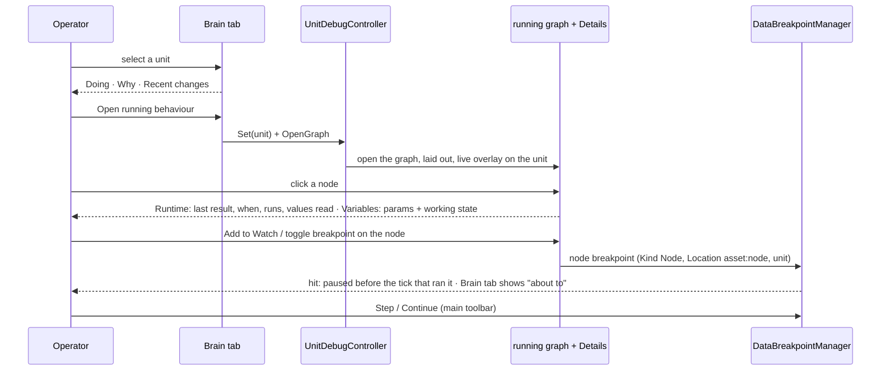
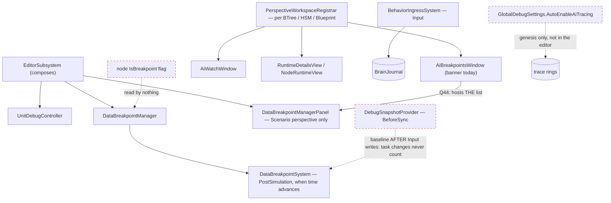

<!--STATUS
state: LIVE
updated: 2026-10-25 (DBG-1 and DBG-5 reshaped by the user: the deeper views are Brain-tab EXPANDERS, the variables are the inspector's read-only dump — Brain View §12b, R-1037)
build-state: DESIGN — the leans in §6 await the user's approval (CE-1270)
current-answer: ⚠ DBG-1 / DBG-5 reshaped 2026-10-25 (Brain View §12b) · §1 the workflow · §2 INVENTORY · §3 claim table (the measured root causes) · §4 diagrams · §5 the views, one per question · §6 decisions with leans · §7 slices → tracker rows
stale-below: nothing
known-rot: none
known-conflict: docs/blueprints/BTree_Editor_NodeEditor_Host_Design.md §12.7 and docs/blueprints/HSM_Editor_NodeEditor_Host_Design.md §13.5 design the Runtime pane as kernel internals (stack, registers, timers, RNG); DBG-4 below demotes those to a collapsed "Kernel" section — the host designs are not yet updated
related-designs:
  - docs/DESIGN_Unit_Camera.md — Follow on the debugged unit (UC-2): watch it from far away down to its own eyes
  - docs/DESIGN_Director_Timeline_Editor.md — the shared Timeline (R-4073, TE-21): the exercise lanes over a recording's cached index, a pinned unit's trace lanes, seek through the transport; handed to ui as batches/HANDOFF_Coordinator_To_Ui_Director_Timeline.md
  - docs/DESIGN_Entity_Brain_View.md — OWNS the Brain tab, the brain journal, "Debug this unit" (UnitDebugController), the running graph of a C# behaviour (§9) and the journal break (§10); this design is the workflow AROUND them
  - docs/DESIGN_Agent_Shared_View.md — OWNS the AI debug HTTP routes; every view here gets its route there (R-1029)
  - docs/blueprints/Architect_Question_44_Breakpoint_UI_Unification.md — OWNS the breakpoint family (R-97, approved, not built): one list, all kinds, Kind column, hit count column; DBG-6 builds it
  - docs/blueprints/DESIGN_Variable_Watch_Pinning.md — OWNS the Watch window's pinned variables (shared across perspectives, staged edits); DBG-5 feeds it
  - docs/blueprints/DESIGN_Details_Panel_View_Switching.md — OWNS the Details panel's view registry (the Runtime view `details.runtime.*`, rank 50) the per-node views register in
  - docs/blueprints/Architect_Question_32_Variable_Details_And_Values_ANSWERS.md — OWNS how a live value is shown and written (one Value column, writes only while paused, staged)
  - docs/blueprints/BTree_Editor_NodeEditor_Host_Design.md — OWNS the BTree canvas, its tidy-tree layout, overlay (§12.4) and Runtime pane (§12.7)
  - docs/blueprints/HSM_Editor_NodeEditor_Host_Design.md — OWNS the HSM canvas, the statechart layout (§3.4), overlay (§13.4) and Runtime pane (§13.5)
  - docs/designs/breakpoints-1/DESIGN.md — OWNS DataBreakpointManager: predicates, the three snapshots, pause-and-rewind
  - docs/designs/behav-diag-1/DESIGN.md — OWNS the BTree / HSM trace rings the per-node history reads
  - docs/designs/utility-ai/Utility_AI_Design_v1_1.md — §9 OWNS UtilityDecisionLog ("why did it pick this"), filled only while observed
  - docs/DESIGN_Sensors_And_Doctrine.md — §7.6 OWNS EDITING a unit's task / SOP / ROE (the AI tab); the SOP view here only reads
-->

# Behaviour debugging — one workflow *(CE-1270)*

🔒 **User, `2026-10-23`:** *"the whole concept of debugging needs thinking to be made usefull and practical- now there are scattered
bits ands pieaces bit it is unusable overall"* — after a first visual pass that filed `CE-1271`…`CE-1290`
([tracker](blueprints/Blueprint_Issues_Tracker.md)).

## 1. The workflow — what a person debugging a behaviour asks, in order

| # | the question | the answer today | ⭐ the answer proposed |
|---|---|---|---|
| ① | **what is it doing?** | Brain tab *Doing* | unchanged |
| ② | **why that, and not something else?** | *Why this choice* — raw decision ids; empty for every unit that is not utility-driven, with a hint that does not help (CE-1280, CE-1283) | one line per option with names; for an HSM / BTree-driven unit, *"decided by its graph — Open running behaviour"* |
| ③ | **what does it know / hold?** | the parameters and working state are decoded ONLY in the ECS entity inspector | a **Variables** view beside the running graph: parameters + working state, each row *Add to Watch* (CE-1286) |
| ④ | **where in its logic is it?** | the running graph: C# BTree stacked in one spot, HSM cramped, nodes snap back (CE-1273…1276) | laid out, movable, honestly read-only |
| ⑤ | **what did this node do?** | Runtime tab: kernel internals or *"No live BTree state"* (CE-1279) | Runtime for the **selected node**: last result, when, how often, the values it read |
| ⑥ | **what made it change?** | Recent changes (scrolls with the panel, no menu — CE-1281) | own scroll region, row menu (open that behaviour, break on this kind) |
| ⑦ | **stop me when …** | journal break never fires (CE-1284), node breakpoints never break (CE-1291), the breakpoint list is unusable (CE-1285) | one breakpoint list (Q44), every kind fires |
| ⑧ | **what is its SOP doing?** | the SOP's name only (CE-1278) | *Open SOP* — the SOP is a BTree: the same running graph, its firing row lit |

⭐ **The organising rule (DBG-1, reshaped `2026-10-25`): the Brain tab is the hub, and its "deeper views" are its own EXPANDERS.**
Everything about ONE unit — ①②③⑥, its settings, every running behaviour's params and variables, its blueprints — is a section of the tab
([Brain View §12b](DESIGN_Entity_Brain_View.md), R-1037). Only what cannot be a section opens elsewhere, and all of it EXISTS: the running
graph's canvas with its per-node Runtime (④⑤), and the cross-unit Breakpoints list and Watch window (⑦). ⛔ No new panel, view or perspective.

## 2. INVENTORY *(2026-10-23 — `scripts/cbm.sh search_graph` (Class) + grep + reads; `check_index_coverage` is not reachable through the CLI, so coverage is not proven)*

| query | total | the debugging surfaces |
|---|---|---|
| `.*Breakpoint.*` | 58 | `DataBreakpointManagerPanel` (the one real list) · `AiBreakpointsWindow` (a COUNT BANNER, one per perspective) · BTree / HSM / Blueprint gutter + context menu · `BreakpointConditionSummarizer` · `DataBreakpointManager` / `DataBreakpointSystem` / `DebugSnapshotProvider` |
| `.*Watch.*` | 49 | `AiWatchWindow` (pinned variables + `IsWatch` breakpoints, per perspective) · Blueprints `WatchPanelWindow` (pin watches; its only adder is disabled) · `FdpEntityWatchWindow` (all components of one entity) · `VariableWatchGesture` |
| `.*Debug.*` | 185 | `UnitDebugController` · `AiDebugSessionPump` · `BTreeDebugSession` / `HsmDebugSession` / `BlueprintDebugSession` · `AiDebugCommands` · `GlobalDebugSettings` · `UtilityDebugFlags` |
| `.*Runtime.*` | 40 | `RuntimeDetailsView` (Details, rank 50) hosting `BTreeRuntimeInspectorPane` / `HsmRuntimeInspectorPane` / `BlueprintRuntimeInspectorPane` · `BTreeRuntimeOverlayRenderer` / `HsmRuntimeOverlayRenderer` |
| `.*Trace.*` | 75 | `TraceTimelineWindow` (draws *"No trace data."*) · BTree / HSM / Utility lane providers · `EditorAiTracerCoordinator` |
| `.*Perspective.*` | 14 | `PerspectiveWorkspaceRegistrar` builds Breakpoints, Watch, Trace Timeline, Blackboard and Details for EACH of BTree / HSM / Blueprint |
| `.*Sop.*(Window\|Panel\|View\|Tab)` | 0 | ⛔ no SOP view; SOPs are BTree assets (`Assets/BTrees/Library/Sop/*.btree.json`) |
| reads | — | `RootParamsProjection` + `StatefulWorkingStateProjection` decode a running behaviour's parameters and working state — called only from `BlueprintBlackboardRendererBase.cs:116,119` (the ECS inspector) |

## 3. Claim table — the measured root causes

| claim | code — how it IS | design — how it was MEANT |
|---|---|---|
| **the journal break misses task changes** (CE-1284) | `BehaviorIngressSystem` writes `TaskStarted` / `TaskPaused` / `TaskCleared` / SOP entries in **`SystemPhase.Input`** (`:38`, writes `:139,269,271`); the `Changed` baseline is copied in **`BeforeSync`** (`DebugSnapshotProvider.cs:16`), AFTER Input ⇒ the baseline already holds the new `Seq`; `DataBreakpointSystem` compares in `PostSimulation` (`:22`) ⇒ "unchanged". Only Simulation-phase writers (end, move, utility, HSM regions) can fire | Brain View BV-28: *"compares the unit's field with the same unit in the pre-tick copy"* — the copy was assumed to precede every writer. ⚠ my CE-1258 rail wrote outside the phase order, so it stayed green |
| **BTree / HSM node breakpoints never break** (CE-1291) | `IsBreakpoint` is stored on the asset node and drawn (`HsmAsset.cs:1326`); no runtime path reads it; `RaiseBreakpointHit` has no production caller (both sessions) | BTree host §12.3, HSM host §13.3: the session raises a hit; never wired (BV-31 withdrew stepping, not breaking) |
| **the ORBAT row menu is empty** (CE-1271) | `ScenarioOrbatAdapter.cs:113` puts `EntityId: idx` (= `entity.Index`); `MapEntityMenuHandler.PopulateMenuFor` (`:56-60`) looks it up as a NETWORK id ⇒ miss | `OrbatNodeViewModel.cs:8`: *"The network entity ID."* |
| **"why this choice" is empty for a commander** (CE-1283) | `UtilityScorer.ChooseOption` is reached only from `UtilityNodes` and `UtilityBlueprintBridge`; the platoon / squad commander behaviours are HSMs with polled guards — no utility call ⇒ nothing to log, ever | Utility AI §9: the log is the utility reasoner's; it never claimed to cover an HSM |
| **a global "observe everything" switch half-exists** | `GlobalDebugSettings.AutoEnableAiTracing` (`:32`) is read only at genesis by `AiDiagnosticsTkbTranslator` (SimHost, CGF), BTree / HSM tiers only; not registered in the editor; nothing sets it | ⛔ searched `docs/` + `.dev/`, no design for a runtime toggle |
| **code-built graph nodes snap back** (CE-1275) | a drop is `ChangeParentMultiple` → `BTreeCommandSink.Apply` refuses every command on a code-built asset but `isBreakpoint` (`:53-55`) → `ResetToIdle` clears the drag override, silently | Brain View BV-19: *"read-only"* meant the BEHAVIOUR, not where its boxes sit |
| **"read-only" canvases still offer Add / wiring** (CE-1276) | NodeEdit's `CanvasRenderer` / `CanvasInput` have no read-only concept; `BTreeNodeContextMenuProvider` always offers *Add Decorator* | — |
| **the Blackboard window edits a read-only graph** (CE-1277) | `BlackboardAuthoringWindow.cs:556` derives read-only from the LOAD state only; `AddVariable` mutates the asset directly (`BehaviorTreeAsset.cs:344`), bypassing the sink | R-1028: a code-built graph is shown, never edited |
| **the Runtime tab shows kernel internals** (CE-1279) | `BTreeRuntimeInspectorPane`: running GUID, stack, `r0..r3`, async handles; `HsmRuntimeInspectorPane`: phase, microstep, queue, timers, RNG. Nothing per node. The OVERLAY already has per-node last result + time (`BTreeRuntimeOverlayRenderer.cs:87-104`) | BTree host §12.7 / HSM host §13.5 designed exactly those internals — the user-facing view was never designed |
| **the breakpoint condition prints ±1.79E+308** (CE-1285) | `BreakpointConditionSummarizer.cs:15,30` ignores `PropertyPath` / `Operator` and prints the default `NumericPredicateDto` bounds | Q44 (R-97): one list, all kinds, a readable Location cell |

## 4. Diagrams

*What the picture shows that prose hid:* nothing new pauses the world or stores a breakpoint — node breakpoints become one more
condition the existing manager pauses on, and the per-node Runtime view reads the same trace rings the overlay already draws.
The two new readers (node runtime, variables) are views over data that already exists.

*What the picture shows that prose hid:* the operator never leaves the unit — every step is reached from the previous one, and
the pause lands where the Brain tab already explains it (BV-29).

*What the picture shows that prose hid:* the three dashed edges are why "stop me when" does nothing today — none of them is a
missing feature, each is a wire that was never connected or connects one phase too late.

## 5. The views, one per question

| view | where | shows | reached from |
|---|---|---|---|
| **Brain tab** (hub) | Details on the map selection | Doing · Why · Recent changes · Squad · SOP · links | the map / ORBAT selection |
| **running graph** | its BTree / HSM perspective | the graph, laid out, live overlay | *Open running behaviour*, *Open SOP*, a Recent-changes row |
| **Runtime (node)** | Details beside the graph | the selected node's last result, time, run count, the values it read; *Kernel* collapsed | selecting a node |
| ~~**Variables**~~ ⛔ *`2026-10-25`: not a view* | ⭐ the Brain tab's *Running behaviours* expanders (§12b BV-42…BV-44) | every running behaviour's parameters + variables — task, SOP, hosted children, blueprints — as the inspector's read-only dump | the Brain tab itself |
| **Watch** | every perspective (shared content) | pinned variables | *Add to Watch* on any variable row |
| **Breakpoints** | one list, every perspective | every kind: node, data, journal; hits | the toolbar's Debug menu; a node's gutter adds to it |

## 6. Decisions — ⭐ the leans, for approval

| id | decision | ⭐ lean | rejected — one line each |
|---|---|---|---|
| **DBG-1** | where debugging starts | ⭐ ✅ *(user, `2026-10-25`)* the **Brain tab is the hub and its deeper views are its EXPANDERS** (Brain View §12b); only the existing graph canvas, the Breakpoints list and the Watch open elsewhere | a new Debug perspective — one more place · new panels per question — the user's ruling |
| **DBG-2** | observing units | ⭐ keep *Debug this unit* (one unit, pins everything) **plus a global "Observe all brain units" toggle** (Debug menu + Brain tab) that arms the trace rings and utility logs on every brain unit while on — `AutoEnableAiTracing` made a live toggle, registered in the editor. ⭐ For a unit with no utility reasoner the tab says *"decided by its graph"* with the link. ⚠ Gizmo pinning on *Debug this unit*: measure what draws for a commander; drop the step if nothing does | per-unit only — the user's complaint · arm everything always — trace rings on every unit cost memory and tick time in every run |
| **DBG-3** | C#-built graphs | ⭐ laid out when opened (BTree: the host's tidy tree; HSM: a layered layout that spreads by state count and transition crossings), **moves allowed as view state** (kept per session, never saved into the behaviour), the canvas hides Add / wiring / Delete when read-only and says why on an attempt; the Blackboard window honours read-only | refuse moves — boxes are not behaviour · save positions into an asset — there is no asset |
| **DBG-4** | the Runtime tab | ⭐ **per selected node**: last result and when (trace ring), how often it ran in the ring, for a condition its last value, for an HSM state *active since / entered N times / last transition in and out with its guard*; nothing selected ⇒ the running path by NAME. The kernel internals move into a collapsed **Kernel** section | keep internals as the default — that is the complaint · remove them — the HSM / BTree developer still needs them |
| **DBG-5** | parameters and working state | ⭐ ✅ *(user, `2026-10-25`)* **the inspector's dump, read-only, one expander per running behaviour** (task, SOP, hosted children, blueprints) through ONE `BehaviourStateReader` the inspector also uses (Brain View §12b BV-42…BV-45); edits through *Add to Watch* / the Watch window | a Variables view beside the graph — a new view · the asset-variable table — cannot show a C# behaviour · sliders on variables — the user: *"let the variables as they are, no sliders there"* |
| **DBG-6** | breakpoints | ⭐ **build Q44** (approved R-97): `DataBreakpointManagerPanel` becomes THE list, `AiBreakpointsWindow` hosts it; one row type with `Kind` (Node / Data / Journal) and a readable `Location`; plus the approved CE-1285 shape (resizable columns, row menu Delete / Enable / Edit / Go to, click selects the unit, double-click edits) | two lists — Q44-A ruled it |
| **DBG-7** | node breakpoints that break | ⭐ a `NodeBreakpointEvaluator` after the tick: for the debugged unit (and every unit while *Observe all* is on) it reads the BTree / HSM trace ring; a node or state marked `IsBreakpoint` that ran this tick ⇒ a hit through the manager (same pause and rewind, BV-29) | breaking inside the kernel — a brain tick cannot be split (BV-31) and it is an ExtDeps change |
| **DBG-8** | the journal break | ⭐ take the `Changed` baseline **before Input** — split it out of `DebugSnapshotProvider` into a `PreFrame` copy of the compared fields only (the rewind snapshot stays at `BeforeSync`); a rail that runs the real phase order | move the whole snapshot to PreFrame — the rewind would then replay Input and lose its events · compare against the previous tick's post-tick copy — no such copy exists except on a hit |
| **DBG-9** | the SOP | ⭐ *Open SOP* opens the SOP's BTree (it is one) on the debugged unit; the session reads the SOP slot when the open document is the unit's SOP, so the firing row is lit | a dedicated SOP table view — a second rendering of a BTree |
| **DBG-10** | Brain tab text | ⭐ *Why*: one line per decision, option names, winner first (CE-1280) · *Recent changes*: a fixed-height child region, row menu *Open that behaviour* / *Break on this kind* (CE-1281) · *Squad*: one line per member with its current order, the name a link that selects the member (CE-1282) | — |
| **DBG-11** | the HTTP side | ⭐ every view above gets its route in the Agent Shared View design, over the same readers (R-1029) | — |

## 7. Slices → tracker rows *(order = the lean; each its own commit, rails red-proved)*

| slice | rows | why this order |
|---|---|---|
| **S1 — make "stop me" work** | CE-1284 (DBG-8), CE-1291 (DBG-7), CE-1285 + Q44 (DBG-6) | the debugger's core promise is broken in three places; everything else is nicer views |
| **S2 — the graph** | CE-1273, CE-1274, CE-1275, CE-1276, CE-1277 (DBG-3) | the graph is where ③④⑤ happen |
| **S3 — the node and its data** | CE-1279 (DBG-4), CE-1286 (DBG-5) | |
| **S4 — the hub** | CE-1280, CE-1281, CE-1282 (DBG-10), CE-1283 (DBG-2), CE-1278 (DBG-9) | |
| **separately (bugs)** | CE-1271 (the ORBAT id), CE-1272 (to reproduce) | ✅ both fixed `2026-10-23` |
| **the joint with the Timeline** *(coordinator handoff, R-4075)* | CE-1302 (R1) | ⭐ the Trace Timeline and the director's Timeline are ONE panel: the debugged unit is the focused unit (its swimlane = its trace lanes), the Brain lane (BV-30, CE-1259) is the index's Behaviour lane, a journal entry is a timeline event a click seeks to. ⭐ DBG-6's breakpoint list edits conditions in the SAME existing condition editor the timeline's anchors use (R-4072) — one editor for breakpoints, search and anchors |
