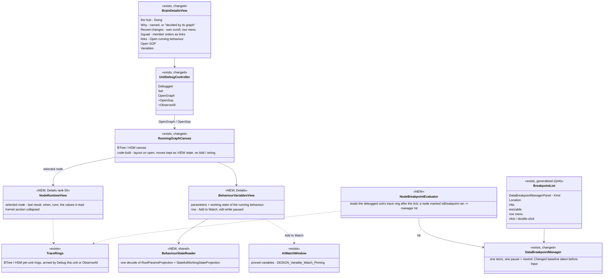
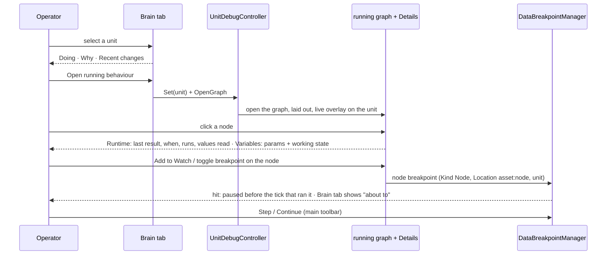
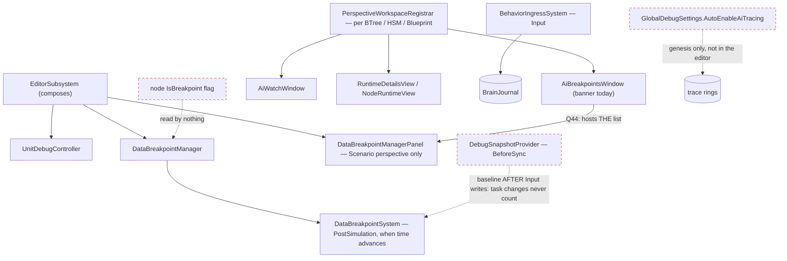
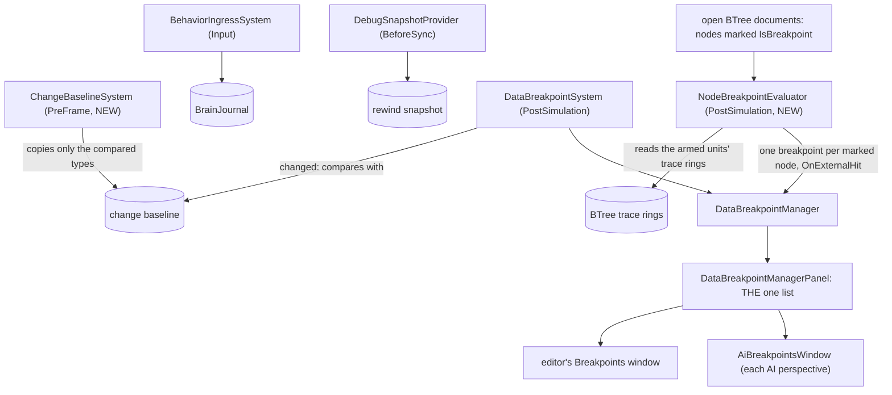
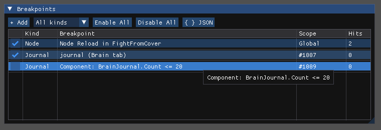
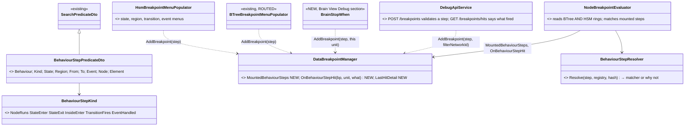
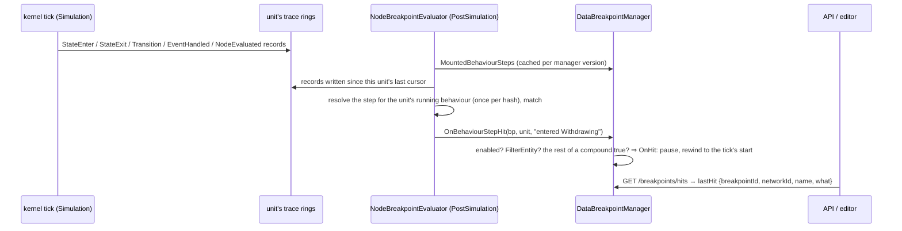
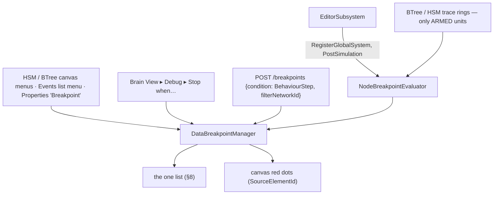
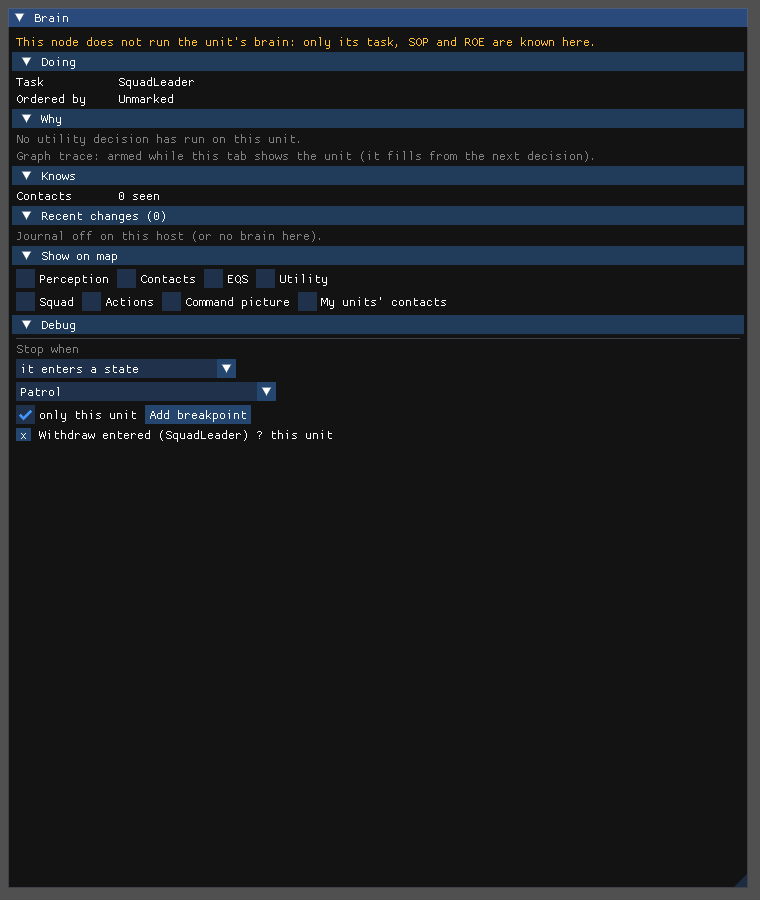

<!--STATUS
state: LIVE
updated: 2026-10-25 (§9 behaviour breakpoints: five kinds, three entry points, CE-1323) · 2026-10-25 (DBG-1 and DBG-5 reshaped by the user: the deeper views are Brain-tab EXPANDERS, the variables are the inspector's read-only dump — Brain View §12b, R-1037)
build-state: BUILT S1 2026-10-25 (DBG-6, DBG-7, DBG-8 — as-built §8) · §9 BUILDING (CE-1323); the rest of §6 DESIGN
current-answer: §9 behaviour breakpoints (DBG-9…DBG-13, CE-1323) · §8 AS-BUILT S1 ("stop me" works: DBG-8, DBG-7, DBG-6) · ⚠ DBG-1 / DBG-5 reshaped 2026-10-25 (Brain View §12b) · §1 the workflow · §2 INVENTORY · §3 claim table (the measured root causes) · §4 diagrams · §5 the views, one per question · §6 decisions with leans · §7 slices → tracker rows
stale-below: nothing
known-rot: none
known-conflict: docs/blueprints/BTree_Editor_NodeEditor_Host_Design.md §12.7 and docs/blueprints/HSM_Editor_NodeEditor_Host_Design.md §13.5 design the Runtime pane as kernel internals (stack, registers, timers, RNG); DBG-4 below demotes those to a collapsed "Kernel" section — the host designs are not yet updated
related-designs:
  - docs/DESIGN_Unit_Camera.md — Follow on the debugged unit (UC-2): watch it from far away down to its own eyes
  - docs/DESIGN_Director_Timeline_Editor.md — the shared Timeline (R-4073, TE-21): the exercise lanes over a recording's cached index, a pinned unit's trace lanes, seek through the transport; handed to ui as batches/HANDOFF_Coordinator_To_Ui_Director_Timeline.md
  - docs/DESIGN_Entity_Brain_View.md — OWNS the Brain tab, the brain journal, "Debug this unit" (UnitDebugController), the running graph of a C# behaviour (§9) and the journal break (§10); this design is the workflow AROUND them
  - docs/DESIGN_Agent_Shared_View.md — OWNS the AI debug HTTP routes; every view here gets its route there (R-1029)
  - docs/blueprints/Architect_Question_44_Breakpoint_UI_Unification.md — OWNS the breakpoint family (R-97, approved, not built): one list, all kinds, Kind column, hit count column; DBG-6 builds it
  - docs/blueprints/DESIGN_Variable_Watch_Pinning.md — OWNS the Watch window's pinned variables (shared across perspectives, staged edits); DBG-5 feeds it
  - docs/blueprints/DESIGN_Details_Panel_View_Switching.md — OWNS the Details panel's view registry (the Runtime view `details.runtime.*`, rank 50) the per-node views register in
  - docs/blueprints/Architect_Question_32_Variable_Details_And_Values_ANSWERS.md — OWNS how a live value is shown and written (one Value column, writes only while paused, staged)
  - docs/blueprints/BTree_Editor_NodeEditor_Host_Design.md — OWNS the BTree canvas, its tidy-tree layout, overlay (§12.4) and Runtime pane (§12.7)
  - docs/blueprints/HSM_Editor_NodeEditor_Host_Design.md — OWNS the HSM canvas, the statechart layout (§3.4), overlay (§13.4) and Runtime pane (§13.5)
  - docs/designs/breakpoints-1/DESIGN.md — OWNS DataBreakpointManager: predicates, the three snapshots, pause-and-rewind
  - docs/designs/behav-diag-1/DESIGN.md — OWNS the BTree / HSM trace rings the per-node history reads
  - docs/designs/utility-ai/Utility_AI_Design_v1_1.md — §9 OWNS UtilityDecisionLog ("why did it pick this"), filled only while observed
  - docs/DESIGN_Sensors_And_Doctrine.md — §7.6 OWNS EDITING a unit's task / SOP / ROE (the AI tab); the SOP view here only reads
-->

# Behaviour debugging — one workflow *(CE-1270)*

🔒 **User, `2026-10-23`:** *"the whole concept of debugging needs thinking to be made usefull and practical- now there are scattered
bits ands pieaces bit it is unusable overall"* — after a first visual pass that filed `CE-1271`…`CE-1290`
([tracker](blueprints/Blueprint_Issues_Tracker.md)).

## 1. The workflow — what a person debugging a behaviour asks, in order

| # | the question | the answer today | ⭐ the answer proposed |
|---|---|---|---|
| ① | **what is it doing?** | Brain tab *Doing* | unchanged |
| ② | **why that, and not something else?** | *Why this choice* — raw decision ids; empty for every unit that is not utility-driven, with a hint that does not help (CE-1280, CE-1283) | one line per option with names; for an HSM / BTree-driven unit, *"decided by its graph — Open running behaviour"* |
| ③ | **what does it know / hold?** | the parameters and working state are decoded ONLY in the ECS entity inspector | a **Variables** view beside the running graph: parameters + working state, each row *Add to Watch* (CE-1286) |
| ④ | **where in its logic is it?** | the running graph: C# BTree stacked in one spot, HSM cramped, nodes snap back (CE-1273…1276) | laid out, movable, honestly read-only |
| ⑤ | **what did this node do?** | Runtime tab: kernel internals or *"No live BTree state"* (CE-1279) | Runtime for the **selected node**: last result, when, how often, the values it read |
| ⑥ | **what made it change?** | Recent changes (scrolls with the panel, no menu — CE-1281) | own scroll region, row menu (open that behaviour, break on this kind) |
| ⑦ | **stop me when …** | journal break never fires (CE-1284), node breakpoints never break (CE-1291), the breakpoint list is unusable (CE-1285) | one breakpoint list (Q44), every kind fires |
| ⑧ | **what is its SOP doing?** | the SOP's name only (CE-1278) | *Open SOP* — the SOP is a BTree: the same running graph, its firing row lit |

⭐ **The organising rule (DBG-1, reshaped `2026-10-25`): the Brain tab is the hub, and its "deeper views" are its own EXPANDERS.**
Everything about ONE unit — ①②③⑥, its settings, every running behaviour's params and variables, its blueprints — is a section of the tab
([Brain View §12b](DESIGN_Entity_Brain_View.md), R-1037). Only what cannot be a section opens elsewhere, and all of it EXISTS: the running
graph's canvas with its per-node Runtime (④⑤), and the cross-unit Breakpoints list and Watch window (⑦). ⛔ No new panel, view or perspective.

## 2. INVENTORY *(2026-10-23 — `scripts/cbm.sh search_graph` (Class) + grep + reads; `check_index_coverage` is not reachable through the CLI, so coverage is not proven)*

| query | total | the debugging surfaces |
|---|---|---|
| `.*Breakpoint.*` | 58 | `DataBreakpointManagerPanel` (the one real list) · `AiBreakpointsWindow` (a COUNT BANNER, one per perspective) · BTree / HSM / Blueprint gutter + context menu · `BreakpointConditionSummarizer` · `DataBreakpointManager` / `DataBreakpointSystem` / `DebugSnapshotProvider` |
| `.*Watch.*` | 49 | `AiWatchWindow` (pinned variables + `IsWatch` breakpoints, per perspective) · Blueprints `WatchPanelWindow` (pin watches; its only adder is disabled) · `FdpEntityWatchWindow` (all components of one entity) · `VariableWatchGesture` |
| `.*Debug.*` | 185 | `UnitDebugController` · `AiDebugSessionPump` · `BTreeDebugSession` / `HsmDebugSession` / `BlueprintDebugSession` · `AiDebugCommands` · `GlobalDebugSettings` · `UtilityDebugFlags` |
| `.*Runtime.*` | 40 | `RuntimeDetailsView` (Details, rank 50) hosting `BTreeRuntimeInspectorPane` / `HsmRuntimeInspectorPane` / `BlueprintRuntimeInspectorPane` · `BTreeRuntimeOverlayRenderer` / `HsmRuntimeOverlayRenderer` |
| `.*Trace.*` | 75 | `TraceTimelineWindow` (draws *"No trace data."*) · BTree / HSM / Utility lane providers · `EditorAiTracerCoordinator` |
| `.*Perspective.*` | 14 | `PerspectiveWorkspaceRegistrar` builds Breakpoints, Watch, Trace Timeline, Blackboard and Details for EACH of BTree / HSM / Blueprint |
| `.*Sop.*(Window\|Panel\|View\|Tab)` | 0 | ⛔ no SOP view; SOPs are BTree assets (`Assets/BTrees/Library/Sop/*.btree.json`) |
| reads | — | `RootParamsProjection` + `StatefulWorkingStateProjection` decode a running behaviour's parameters and working state — called only from `BlueprintBlackboardRendererBase.cs:116,119` (the ECS inspector) |

## 3. Claim table — the measured root causes

| claim | code — how it IS | design — how it was MEANT |
|---|---|---|
| **the journal break misses task changes** (CE-1284) | `BehaviorIngressSystem` writes `TaskStarted` / `TaskPaused` / `TaskCleared` / SOP entries in **`SystemPhase.Input`** (`:38`, writes `:139,269,271`); the `Changed` baseline is copied in **`BeforeSync`** (`DebugSnapshotProvider.cs:16`), AFTER Input ⇒ the baseline already holds the new `Seq`; `DataBreakpointSystem` compares in `PostSimulation` (`:22`) ⇒ "unchanged". Only Simulation-phase writers (end, move, utility, HSM regions) can fire | Brain View BV-28: *"compares the unit's field with the same unit in the pre-tick copy"* — the copy was assumed to precede every writer. ⚠ my CE-1258 rail wrote outside the phase order, so it stayed green |
| **BTree / HSM node breakpoints never break** (CE-1291) | `IsBreakpoint` is stored on the asset node and drawn (`HsmAsset.cs:1326`); no runtime path reads it; `RaiseBreakpointHit` has no production caller (both sessions) | BTree host §12.3, HSM host §13.3: the session raises a hit; never wired (BV-31 withdrew stepping, not breaking) |
| **the ORBAT row menu is empty** (CE-1271) | `ScenarioOrbatAdapter.cs:113` puts `EntityId: idx` (= `entity.Index`); `MapEntityMenuHandler.PopulateMenuFor` (`:56-60`) looks it up as a NETWORK id ⇒ miss | `OrbatNodeViewModel.cs:8`: *"The network entity ID."* |
| **"why this choice" is empty for a commander** (CE-1283) | `UtilityScorer.ChooseOption` is reached only from `UtilityNodes` and `UtilityBlueprintBridge`; the platoon / squad commander behaviours are HSMs with polled guards — no utility call ⇒ nothing to log, ever | Utility AI §9: the log is the utility reasoner's; it never claimed to cover an HSM |
| **a global "observe everything" switch half-exists** | `GlobalDebugSettings.AutoEnableAiTracing` (`:32`) is read only at genesis by `AiDiagnosticsTkbTranslator` (SimHost, CGF), BTree / HSM tiers only; not registered in the editor; nothing sets it | ⛔ searched `docs/` + `.dev/`, no design for a runtime toggle |
| **code-built graph nodes snap back** (CE-1275) | a drop is `ChangeParentMultiple` → `BTreeCommandSink.Apply` refuses every command on a code-built asset but `isBreakpoint` (`:53-55`) → `ResetToIdle` clears the drag override, silently | Brain View BV-19: *"read-only"* meant the BEHAVIOUR, not where its boxes sit |
| **"read-only" canvases still offer Add / wiring** (CE-1276) | NodeEdit's `CanvasRenderer` / `CanvasInput` have no read-only concept; `BTreeNodeContextMenuProvider` always offers *Add Decorator* | — |
| **the Blackboard window edits a read-only graph** (CE-1277) | `BlackboardAuthoringWindow.cs:556` derives read-only from the LOAD state only; `AddVariable` mutates the asset directly (`BehaviorTreeAsset.cs:344`), bypassing the sink | R-1028: a code-built graph is shown, never edited |
| **the Runtime tab shows kernel internals** (CE-1279) | `BTreeRuntimeInspectorPane`: running GUID, stack, `r0..r3`, async handles; `HsmRuntimeInspectorPane`: phase, microstep, queue, timers, RNG. Nothing per node. The OVERLAY already has per-node last result + time (`BTreeRuntimeOverlayRenderer.cs:87-104`) | BTree host §12.7 / HSM host §13.5 designed exactly those internals — the user-facing view was never designed |
| **the breakpoint condition prints ±1.79E+308** (CE-1285) | `BreakpointConditionSummarizer.cs:15,30` ignores `PropertyPath` / `Operator` and prints the default `NumericPredicateDto` bounds | Q44 (R-97): one list, all kinds, a readable Location cell |

## 4. Diagrams

*What the picture shows that prose hid:* nothing new pauses the world or stores a breakpoint — node breakpoints become one more
condition the existing manager pauses on, and the per-node Runtime view reads the same trace rings the overlay already draws.
The two new readers (node runtime, variables) are views over data that already exists.

*What the picture shows that prose hid:* the operator never leaves the unit — every step is reached from the previous one, and
the pause lands where the Brain tab already explains it (BV-29).

*What the picture shows that prose hid:* the three dashed edges are why "stop me when" does nothing today — none of them is a
missing feature, each is a wire that was never connected or connects one phase too late.

## 5. The views, one per question

| view | where | shows | reached from |
|---|---|---|---|
| **Brain tab** (hub) | Details on the map selection | Doing · Why · Recent changes · Squad · SOP · links | the map / ORBAT selection |
| **running graph** | its BTree / HSM perspective | the graph, laid out, live overlay | *Open running behaviour*, *Open SOP*, a Recent-changes row |
| **Runtime (node)** | Details beside the graph | the selected node's last result, time, run count, the values it read; *Kernel* collapsed | selecting a node |
| ~~**Variables**~~ ⛔ *`2026-10-25`: not a view* | ⭐ the Brain tab's *Running behaviours* expanders (§12b BV-42…BV-44) | every running behaviour's parameters + variables — task, SOP, hosted children, blueprints — as the inspector's read-only dump | the Brain tab itself |
| **Watch** | every perspective (shared content) | pinned variables | *Add to Watch* on any variable row |
| **Breakpoints** | one list, every perspective | every kind: node, data, journal; hits | the toolbar's Debug menu; a node's gutter adds to it |

## 6. Decisions — ⭐ the leans, for approval

| id | decision | ⭐ lean | rejected — one line each |
|---|---|---|---|
| **DBG-1** | where debugging starts | ⭐ ✅ *(user, `2026-10-25`)* the **Brain tab is the hub and its deeper views are its EXPANDERS** (Brain View §12b); only the existing graph canvas, the Breakpoints list and the Watch open elsewhere | a new Debug perspective — one more place · new panels per question — the user's ruling |
| **DBG-2** | observing units | ⭐ keep *Debug this unit* (one unit, pins everything) **plus a global "Observe all brain units" toggle** (Debug menu + Brain tab) that arms the trace rings and utility logs on every brain unit while on — `AutoEnableAiTracing` made a live toggle, registered in the editor. ⭐ For a unit with no utility reasoner the tab says *"decided by its graph"* with the link. ⚠ Gizmo pinning on *Debug this unit*: measure what draws for a commander; drop the step if nothing does | per-unit only — the user's complaint · arm everything always — trace rings on every unit cost memory and tick time in every run |
| **DBG-3** | C#-built graphs | ⭐ laid out when opened (BTree: the host's tidy tree; HSM: a layered layout that spreads by state count and transition crossings), **moves allowed as view state** (kept per session, never saved into the behaviour), the canvas hides Add / wiring / Delete when read-only and says why on an attempt; the Blackboard window honours read-only | refuse moves — boxes are not behaviour · save positions into an asset — there is no asset |
| **DBG-4** | the Runtime tab | ⭐ **per selected node**: last result and when (trace ring), how often it ran in the ring, for a condition its last value, for an HSM state *active since / entered N times / last transition in and out with its guard*; nothing selected ⇒ the running path by NAME. The kernel internals move into a collapsed **Kernel** section | keep internals as the default — that is the complaint · remove them — the HSM / BTree developer still needs them |
| **DBG-5** | parameters and working state | ⭐ ✅ *(user, `2026-10-25`)* **the inspector's dump, read-only, one expander per running behaviour** (task, SOP, hosted children, blueprints) through ONE `BehaviourStateReader` the inspector also uses (Brain View §12b BV-42…BV-45); edits through *Add to Watch* / the Watch window | a Variables view beside the graph — a new view · the asset-variable table — cannot show a C# behaviour · sliders on variables — the user: *"let the variables as they are, no sliders there"* |
| **DBG-6** | breakpoints | ⭐ **build Q44** (approved R-97): `DataBreakpointManagerPanel` becomes THE list, `AiBreakpointsWindow` hosts it; one row type with `Kind` (Node / Data / Journal) and a readable `Location`; plus the approved CE-1285 shape (resizable columns, row menu Delete / Enable / Edit / Go to, click selects the unit, double-click edits) | two lists — Q44-A ruled it |
| **DBG-7** | node breakpoints that break | ⭐ a `NodeBreakpointEvaluator` after the tick: for the debugged unit (and every unit while *Observe all* is on) it reads the BTree / HSM trace ring; a node or state marked `IsBreakpoint` that ran this tick ⇒ a hit through the manager (same pause and rewind, BV-29) | breaking inside the kernel — a brain tick cannot be split (BV-31) and it is an ExtDeps change |
| **DBG-8** | the journal break | ⭐ take the `Changed` baseline **before Input** — split it out of `DebugSnapshotProvider` into a `PreFrame` copy of the compared fields only (the rewind snapshot stays at `BeforeSync`); a rail that runs the real phase order | move the whole snapshot to PreFrame — the rewind would then replay Input and lose its events · compare against the previous tick's post-tick copy — no such copy exists except on a hit |
| **DBG-9** | the SOP | ⭐ *Open SOP* opens the SOP's BTree (it is one) on the debugged unit; the session reads the SOP slot when the open document is the unit's SOP, so the firing row is lit | a dedicated SOP table view — a second rendering of a BTree |
| **DBG-10** | Brain tab text | ⭐ *Why*: one line per decision, option names, winner first (CE-1280) · *Recent changes*: a fixed-height child region, row menu *Open that behaviour* / *Break on this kind* (CE-1281) · *Squad*: one line per member with its current order, the name a link that selects the member (CE-1282) | — |
| **DBG-11** | the HTTP side | ⭐ every view above gets its route in the Agent Shared View design, over the same readers (R-1029) | — |

## 7. Slices → tracker rows *(order = the lean; each its own commit, rails red-proved)*

| slice | rows | why this order |
|---|---|---|
| **S1 — make "stop me" work** | CE-1284 (DBG-8), CE-1291 (DBG-7), CE-1285 + Q44 (DBG-6) | the debugger's core promise is broken in three places; everything else is nicer views |
| **S2 — the graph** | CE-1273, CE-1274, CE-1275, CE-1276, CE-1277 (DBG-3) | the graph is where ③④⑤ happen |
| **S3 — the node and its data** | CE-1279 (DBG-4), CE-1286 (DBG-5) | |
| **S4 — the hub** | CE-1280, CE-1281, CE-1282 (DBG-10), CE-1283 (DBG-2), CE-1278 (DBG-9) | |
| **separately (bugs)** | CE-1271 (the ORBAT id), CE-1272 (to reproduce) | ✅ both fixed `2026-10-23` |
| **the joint with the Timeline** *(coordinator handoff, R-4075)* | CE-1302 (R1) | ⭐ the Trace Timeline and the director's Timeline are ONE panel: the debugged unit is the focused unit (its swimlane = its trace lanes), the Brain lane (BV-30, CE-1259) is the index's Behaviour lane, a journal entry is a timeline event a click seeks to. ⭐ DBG-6's breakpoint list edits conditions in the SAME existing condition editor the timeline's anchors use (R-4072) — one editor for breakpoints, search and anchors |

## 8. AS-BUILT — S1 "stop me" works *(CE-1284, CE-1291, CE-1285, `2026-10-25`)*

*What the picture shows that prose hid:* the three dashed edges of §4's module diagram are now connected. The change baseline is taken
BEFORE Input, the node flag is read, and the AI perspectives draw the same list as the editor. Nothing new pauses the world: every
hit goes through the one manager.

| piece | where | matches §6 / deviates |
|---|---|---|
| **DBG-8:** `ChangeBaselineSystem` copies, in PreFrame, only the component types the mounted "changed" conditions compare (`DataBreakpointManager.ChangedComponentMask`); the manager compares against it (`ChangeBaseline`); the rewind snapshot stays at BeforeSync; one `MirrorWorld` recipe builds both copies | `Hrot.Diagnostics.Breakpoints/ChangeBaselineSystem.cs`, `DataBreakpointManager.cs`, `EditorSubsystem.cs` | ✅ DBG-8 — rail `TheChangedConditionIsPerEntityTests.CE1284_AWriteInInput_*` runs the real phase order |
| **DBG-7:** `NodeBreakpointEvaluator` (PostSimulation): one manager breakpoint per BTree node marked in an open document (tag `btree:<hash>:<visualId>`, removed when unmarked), and a hit when an armed unit's trace ring shows the node ran | `Hrot.Editor/Debugging/NodeBreakpointEvaluator.cs` | ✅ DBG-7 for BTree — ⚠ **HSM states not yet** (the HSM trace ring needs the same reader); a unit must be traced (its Brain tab open, the debug switch, observe-all) |
| **DBG-6:** `DataBreakpointManagerPanel` is THE list: Kind column (Node / Journal / Data, `BreakpointKind.Of`) and filter, resizable columns, a readable name (`BreakpointConditionSummarizer`, ⛔ no raw ±1.79E+308), the unit by network id, a row menu (Enable/Disable · Show condition · Select the unit · Delete), click selects the unit, double-click shows the condition; ⛔ the "- Remove" button gone; `AiBreakpointsWindow` hosts the same panel (⛔ the count banner and its "open the other window") | `Hrot.Presentation/Panels/Breakpoints/DataBreakpointManagerPanel.cs`, `Hrot.Diagnostics.Breakpoints/BreakpointKind.cs`, `BreakpointConditionSummarizer.cs`, `AiBreakpointsWindow.cs` | ✅ Q44-A, Q44-C, CE-1285 — ⚠ *Edit* shows the condition (read-only): editing it belongs to the ONE condition editor (R-4072, the timeline's), not yet hosted here · ⚠ Q44-B (`IsWatch` retired) not built |

📷 `AiBreakpointsWindowDumpsItsCountsTests.CE1285_TheOneList_Draws`:

## 9. Behaviour breakpoints — five kinds, one condition, three ways in *(CE-1323, ui, `2026-10-25` — build-state: BUILDING)*

🔒 **User, `2026-10-25`:** *"ok go ahead with all five. make sure there are ways how to set the breakpoints from the editor as well as
from the ai debug api (and that ai debug api can find out that the breakpoint fired)"* · *"(not from the editor only - form the UI on the
brain node)"* · *"and can we have the breakpoints conditional? liek firing just for certain entity?"*

### 9.1 INVENTORY *(`scripts/cbm.sh search_graph` `.*Breakpoint.*` Class → 60, Interface → 2; grep `TraceBufferScanPredicateDto`, `IsBreakpoint`; `check_index_coverage` not reachable through the CLI)*

| what exists | where | state, measured |
|---|---|---|
| the one manager + list | `DataBreakpointManager`, `DataBreakpointManagerPanel` (§8) | ✅ — `Breakpoint.FilterEntity` exists (per-unit), honoured by the component path (`DataBreakpointSystem.cs:93`), ⛔ **not** by `OnExternalHit` (`DataBreakpointManager.cs:967`) |
| HSM state menu "Break on Enter / Exit / Conditional" | `HsmBreakpointMenuPopulator.cs:31` | ⛔ builds a `TraceBufferScanPredicateDto` — a scan of the WHOLE ring for ANY record with that state index: ① it stays true while the record is in the 63-record ring ⇒ breaks again every tick after a continue; ② it checks no behaviour ⇒ index 3 of every HSM on every unit; ③ reached from the gutter dot, whose provider passes a stub state with `FlatIndex = 0` (`HsmBreakpointContextMenuProvider.cs:28`) |
| BTree node menu (run / success / failure) | `BTreeBreakpointMenuPopulator.cs` | ⛔ the same scan, the same three defects |
| `IsBreakpoint` on HSM states and transitions (Properties "Breakpoint") | `HsmAsset.cs:1257, 1432, 1454`, `HsmFacets.cs:118, 202` | ⛔ stored and drawn, read by nothing at run time (§3) |
| the gutter draws manager breakpoints by `SourceElementId` — states AND transition lines | `HsmBreakpointGutterRenderer.cs` | ✅ — a new kind with `sourceElementId` shows its red dot for free |
| the transition line's right-click | `CanvasRenderer.cs:743` (NodeEdit) | ⛔ fixed items only (Break Link, Select, Reroute): no host hook |
| HSM run-time names | `MachineMetadata` (state / event names, state stable ids, transition visual ids) + `HsmDefinitionBlob` (parents, regions, transitions) via `BehaviorRegistry.TryGetDefinition` | ✅ — enough to resolve every kind WITHOUT an open document (a C#-built commander has none) |
| the HSM trace ring, default tier | `HsmTraceWorkingMemory1024`, `TraceLevel.Tier1` = Transitions · Events · StateChanges (`HsmRunner.cs:323`) | ✅ every record the five kinds need is written by default |
| `HsmDebugSession` session breakpoints | `HsmDebugSession`, `HsmBreakpointHit` | ⚠ a SECOND, session-local breakpoint list with no run-time raise — left as is; ⛔ not extended (one list, R-97) |

### 9.2 Diagrams

*What it shows that prose hid: there is ONE new condition and ONE reader; the three ways in (canvas, Brain View, API) only differ in how
they fill the same DTO, so a breakpoint set from the API shows its red dot on the canvas and its row in the one list.*

*What it shows that prose hid: only records written SINCE the unit's cursor count — so a continue replays the tick, the cursor is
already at its end, and the same arrival does not stop twice (the defect of the whole-ring scan).*

*What it shows that prose hid: nothing reads a ring for a unit that is not armed (Brain tab viewed, Debug this unit, observe-all) — a
breakpoint on an unarmed unit is silent. ⇒ a step breakpoint scoped to a unit arms that unit's traces (DBG-12).*

### 9.3 Decisions *(taken under the user's "go ahead with all five"; each line can be overturned)*

| # | decision | ⭐ as decided | rejected — one line each |
|---|---|---|---|
| **DBG-9** | one condition for all five (+ the BTree node) | `BehaviourStepPredicateDto {Behaviour, Kind, …}` named by **names** (state, from / to, event) or the element's id; resolved per running behaviour by `BehaviourStepResolver` against the registry — so it works on a C#-built behaviour with no document | a predicate per kind — five copies of the matcher · the whole-ring `TraceBufferScan` — refires, no behaviour, index-only (§9.1) |
| **DBG-10** | the kinds | **state: on enter / on exit · anything inside entered** (a composite, or one region of a parallel state) **· transition fires** (by from / to, an event narrows it; a global transition has no from) **· event handled** (dequeued, consumed or deferred — even when no transition used it) **· BTree node runs** | "guard checked" — Tier-3 tracing only (§ answer to the user); later |
| **DBG-11** | conditional | **per unit** = the breakpoint's existing `FilterEntity` (all three ways in set it); **any other condition** = a `Compound(And)` of the step and component predicates (the existing "conditional" shape) — the manager evaluates the rest on the unit at the hit | a new filter field — `FilterEntity` exists |
| **DBG-12** | which units are read | the armed units only (§8); a step breakpoint scoped to ONE unit **arms that unit** while it exists | arm every unit while any step breakpoint exists — the trace cost on 1000 units |
| **DBG-13** | the menus that exist | **ROUTED** to the new condition (HSM state menu; ⚠ the BTree node menu NOT yet — §9.4); the Properties "Breakpoint" flag keeps meaning "on enter" / "fires" and is synced as a step (the BTree flag already was, §8); the gutter dot's menu gets the real state | delete the scan menus — they are the entry points users know |
| **DBG-14** | the transition line's menu | a host hook in NodeEdit, `ILinkContextMenuProvider` (the twin of `INodeContextMenuProvider`), items after the built-in ones | a dot on the label only — the user asked for the line |

### 9.4 AS-BUILT *(CE-1323, `2026-10-25`)*

| piece | where | matches §9.2 / deviates |
|---|---|---|
| `BehaviourStepPredicateDto` + `BehaviourStepKind` (`$type` `BehaviourStep`) | `Fdp.Toolkits/ReplayBrowser/Search/SearchPredicateDto.cs` (cross-lane, a new arm) | ✅ |
| the manager mounts it alone or as the step of an AND compound (the rest compiled); `MountedBehaviourSteps`, `OnBehaviourStepHit(bp, unit, what)` (enabled · `FilterEntity` · the rest), `LastHitDetail`; ⭐ `OnExternalHit` now honours `FilterEntity` too | `DataBreakpointManager.cs`, `IDataBreakpointManager.cs` (default members: the dozen test doubles compile unchanged) | ✅ |
| `BehaviourStepResolver` — names or element id → state set / descendants (a region by its slot) / (from, to, event) triples (a global: any source; "(or its twin)" when the trace cannot tell) / event id / node indices; a miss says what the machine has | `Hrot.Editor/Debugging/BehaviourStepResolver.cs` | ✅ |
| `NodeBreakpointEvaluator` widened: BTree AND HSM rings, records since each unit's cursor; cursors kept at the ring's end even with no breakpoint (⭐ the rail caught the first tick after an add being skipped); ticked "Breakpoint" flags of open BTree / HSM documents synced as steps; a unit-scoped step arms that unit (only what it armed is disarmed) | `NodeBreakpointEvaluator.cs`, `EditorSubsystem.MarkedSteps` | ✅ DBG-12 |
| canvas: the state's right-click (Add Breakpoint ▸ on enter / on exit / anything inside / each region; the conditional) — on the state itself and on its gutter dot (⭐ the dot's menu now finds the real state: it used a stub with state index 0); a transition LINE's right-click "Break when it fires" through NodeEdit's new `ILinkContextMenuProvider`; an Events row "Break when handled"; an existing one offers "Remove breakpoint: …"; real submenus (the collector flattened them) | `HsmBreakpointMenuPopulator.cs` (`HsmBreakpointSteps`), `HsmBreakpointContextMenuProvider.cs`, `HsmNodeContextMenuProvider.cs`, `HsmEventsWindow.cs`, NodeEdit `ILinkContextMenuProvider` + `CanvasRenderer` | ✅ DBG-13 / 14 for HSM — ⚠ **deviation:** the BTree node menu (activation / completion / abort) still builds the whole-ring scan — its "completion" and "abort" need an outcome field the step does not have yet; follow-up. A node ticked as "Breakpoint" in a BTree document IS a step (`NodeRuns`) |
| Brain tab ▸ Debug ▸ **Stop when …**: kind · the running behaviour's element (from the registry) · "only this unit" (on by default) · Add; the breakpoints on this behaviour for this unit, each with ✕ | `Hrot.Editor.AiShared/Shell/BrainStopWhen.cs`, `EntityBrainView.DrawDebugControls` | ✅ |
| API: `POST /breakpoints` checks a step against the behaviour (400 lists its states / events), names it, and gives the canvas its element; `GET /breakpoints` adds `kind` and `filterNetworkId`; `GET /breakpoints/hits` → `lastHit {name, conditionSummary, what}`; route docs + skill §C1 | `DebugApiService.cs`, `DebugApiRouteDocs.cs`, `tools/ai-debug-mcp/skill-parts/30-workflows.md` | ✅ |

Rails: `Hrot.Editor.Tests` `NodeBreakpointEvaluatorTests` — `CE1323_EachKind_StopsOnItsStep_AndSaysWhatItSaw`, `CE1323_OneArrival_StopsOnce_NotAgainAfterAContinue`,
`CE1323_ForOneUnit_OrWithACondition`, `CE1323_AWrongName_SaysWhatTheMachineHas` · `Hrot.Editor.AiShared.Tests` `TheBrainViewTests.CE1323_*` ·
E2E `Hrot.SystemTests` `BehaviourBreakpointTests` on `hsm-channel-e2e` ✅ — the API refuses a state the machine lacks (the 400 lists Driving,
Firing), sets "Firing entered" on the Open=false Bradley, the guard is flipped live (CE-1320), the run pauses with `lastHit.what = "entered
Firing"`, and a continue does not stop again.

📷 `TheBrainViewTests.CE1323_TheDebugSection_StopWhen_Draws`:

