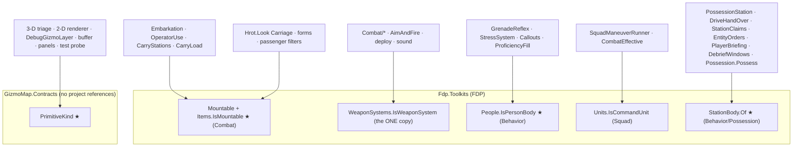
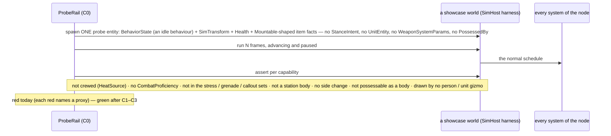

<!--STATUS
state: LIVE
updated: 2026-11-27 (rev 1.3 — C0–C4 built; the probe's expected list is empty; two rename-only items deferred) · 2026-11-27 (rev 1.2 — C1 built: `Mountable` + `Items.IsMountable`, the probe's F1 rows green) · 2026-11-27 (rev 1.1 — C0 built: the probe ratchet, 4 proxy rows confirmed) · 2026-11-27 (rev 1 — inventory of four proxy families, the vocabulary, the target components, slices C0–C4 with leans)
build-state: DESIGN (awaiting the user's nod on §4's leans)
current-answer: §2 (the diagrams) · §3 (the vocabulary) · §4 (the decisions per family) · §5 (the slices and their gates)
stale-below: nothing yet
known-rot: none
known-conflict: designs/devices/DESIGN_Simulated_Devices.md §3.3 D-73 (`PossessedBy Mode = Operated`) — compatible with §4.3's lean (body = a MODE, one helper), and built AFTER this design
related-designs:
  - designs/devices/DESIGN_Simulated_Devices.md — the YARDSTICK: its audit rows (R3-1, R4-1, R5-5, D-73, R6-1, R6-7, R7-5, R3-4, R5-4) seeded this inventory; it is built after this design (user, `2026-11-27`)
  - designs/weapons/DESIGN_Weapon_Systems.md — OWNS `WeaponSystemParams`, `ControllerOf`, mounting; §4.1's split (`Mountable`) changes its §3 classDiagram and §9 as-built
  - DESIGN_Entity_Control.md — OWNS possession (`PossessedBy`, the station, riding, hand-over); §4.3 makes the BODY explicit inside it
  - blueprints/DESIGN_Paused_And_Stepped_Execution.md — OWNS the pause / step-window contract (§1, BUILT); nothing here changes it
  - blueprints/DESIGN_Occurrence_Scoped_Storage.md — the precedent ruling *"a tier component is not a proxy for 'is a brain'"*
  - DESIGN_Role_Affinity_Ownership.md — the rule *"gate each system on a component it ALREADY requires"* and its warning that adding a filter NARROWS a query
  - DESIGN_Civilians_And_Crowd_Control.md — OWNS `NotAUnit.Is` (CE-4239), the one gizmo-side "not a unit" predicate
  - designs/animals/DESIGN_Animals.md — AR-1: *"Pedestrian makes a cow a PERSON"* — the ~40 Pedestrian sites audited once already
  - designs/airborne/DESIGN_Airborne_Insertion.md — §9: where `IsPerson` must NOT move (a parachutist would become untouchable)
  - DESIGN_Gizmo_Anchor_Identity.md — OWNS `AssertHasIdentity` (§6.8), the one shape classifier that is already shared
-->

# Capability components — one component per capability, every system asks for the capability it needs

🔒 User, `2026-11-27`: *"I thought that the entity actually is what the components say about it … what components there are defines what the
system can do about the entity, even without knowing what it is"* · *"I would rather start doing the ECS right now, and once we feel that it's right
and that it's easy to extend, then it's time to start implementing the whole device stuff"* · *"with the goal not implementing the design of
devices at any cost, but with primarily the goal of fixing and refactoring the ECS usage … these two contribute to each other"*.

⭐ **The decision in one line:** an entity has no type — but every system must ask for the component that MEANS the capability it needs. Today
four families ask a **proxy** (a component that only correlates with the capability): "is a weapon" for *item*, "has a brain" for *person / unit*,
"possessed" for *the human's body*, and eight hand-kept shape lists for *meta primitive*. This design gives each capability one component or one
owning predicate, moves every site to it, and proves it with a **composition probe** (C0) that is red today and green when done. Behaviour does not
change (except two latent bugs, named).

## 0. The proven solution

ECS practice: **a component is a capability, a query asks for capabilities** — never for an entity "kind", and never for a component that merely
co-occurs with the wanted one. The test of a clean ECS is *composition*: a new combination of existing components (here: an item that runs a
behaviour) must be handled correctly by every system without editing them. ⭐ Adopted as is; the measured reason it fits here: the four families
below all failed exactly that test when the devices design composed a new entity (§1).

The repo already applies it once — **`Locomotions.IsVehicle`**, *"CE-1373 — the ONE rule"* (`Locomotion.cs:92`; `VehicleCover.cs:29` and
`PathRequests.cs:58` delegate to it) — and has the ruling against proxies (`DESIGN_Occurrence_Scoped_Storage.md`: *"a tier component is not a proxy
for 'is a brain'"*). This design extends that pattern; it invents nothing.

## 1. INVENTORY — the queries run (`2026-11-27`)

Five read-only sweeps (four code families + the design corpus), each with `scripts/cbm.sh` AND grep, counts reconciled; the coordinator
spot-checked each family. ⚠ `check_index_coverage` is unavailable through the CLI — every count is a lower bound for its text patterns.

| family | queries | total | proxy sites (the work) |
|---|---|---|---|
| **F1** weapon-as-item | `search_graph(".*IsWeaponSystem.*", Method)` → 2 (in-degree 14 + 15); `search_code("IsWeaponSystem", 300)` → 41 matches; grep: 32 call sites + direct `WeaponSystemParams` checks | 50 classified | **25 ITEM** (2 unsure) · 22 FIRE · 1 BOTH · 2 OTHER |
| **F2** brain-as-person | `search_code` `With<`/`HasComponent<`/`Has<`/`typeof(BehaviorState)` (37 / 194 / 7 / 71, `has_more:false`); grep incl. 23 qualified-name sites | 217 | **10** (4 PERSON · 6 UNIT) · 166 BRAIN · 29 AUTH · 12 OTHER |
| **F3** possession-as-body | `search_code("PossessedBy", 300)` → 447 matches (page truncated, `has_more:true`); grep: 101 lines / 25 production files | ~45 readers + writers | 21 CONTROL · **10 BODY · 8 PLAYER-UNIT · 5 SIDE** · 2 writers + 5 request paths · **6 one-entity assumptions** |
| **F4** meta-shape lists | `search_code` per meta value (34 / 40 / 25 / 17 / 20 / 18, all `eq`); `search_graph(".*Primitive.*", Class)` → 64, `.*Gizmo.*Buffer.*` → 1, `.*Triage.*` → 1 | 18 classifying sites | the "protected + anchor (+ pick)" predicate ×4 · "skip 10–14" ×2 · the anchor / mask pass ×3 · 2 describers · 2 buffers · 2 receivers |
| **duplicate predicates** | `search_graph("Is(Person\|Unit\|Item\|WeaponSystem\|Human\|Vehicle\|Actor)\\w*", Method)` → 25 | — | `IsWeaponSystem` ×2 (identical) · `IsUnit` ×7 with 4 meanings · `IsPerson` ×3 with 3 rules · `IsVehicle` ×3 → ✅ already ONE |
| **design corpus** | content grep over `docs/` then `.dev/` (terms: IsWeaponSystem, MountKinds, Mountable, PersonCarrier, With<BehaviorState>, PossessedBy, meta primitive, IsProtected, WhenTimeAdvances, step window …) | 13 documents | no project-wide ruling and no tracker row for any family; the precedents in §0 and the STATUS `related-designs` |

## 2. The diagrams

### 2a. The target — one owner per capability

```mermaid
classDiagram
  class WeaponSystemParams { <<existing, shrinks>> fire facts only — NeedsOperator · FireWhileCarried · Charge · Pack/DeploySeconds … }
  class Mountable { <<NEW, unmanaged, NoScenario>> MountKinds · Portable · CarrySpeedFactor — "can be carried / mounted / boarded / manned" }
  class Items { <<NEW owner predicate>> IsMountable(e) — has Mountable }
  class WeaponSystems { <<existing>> IsWeaponSystem(e) — the ONE copy (Embarkation's deleted) }
  class People { <<NEW owner predicate>> IsPersonBody(e) — has StanceIntent, not an animal }
  class Units { <<owner, existing code>> IsCommandUnit(e) — has UnitEntity (CombatEffective's copy kept, the other delegates) }
  class PossessedBy { <<existing>> StationNodeId · Mode · Epoch — CONTROL }
  class StationBody { <<NEW owner helper, as built>> Driven(w, station) — what it drives (camera) · Own(w, station) — the human's body (side, briefing) · StationOf · IsBodyMode }
  class PrimitiveKind { <<NEW, GizmoMap.Contracts>> Of(in p) → Geometry · Meta · Panel · PickTarget · IsProtected(p) }
  class DebugPrimitiveTriage3D { <<existing, shared>> uses PrimitiveKind }
  class DebugPrimitiveRenderer2D { <<existing>> uses PrimitiveKind — its hand twin deleted }
  class DebugPrimitiveBuffer { <<existing>> IsProtected → PrimitiveKind.IsProtected (adds SpatialAnchor) }
  Items ..> Mountable : asks
  WeaponSystems ..> WeaponSystemParams : asks
  StationBody ..> PossessedBy : reads Mode
  DebugPrimitiveTriage3D ..> PrimitiveKind
  DebugPrimitiveRenderer2D ..> PrimitiveKind
  DebugPrimitiveBuffer ..> PrimitiveKind
```

*What the picture shows that prose hid: every capability has exactly ONE box a system may ask — and none of the owners is a new "entity type": each
is a component (`Mountable`, `StanceIntent`, `UnitEntity`, `PossessedBy`) or a one-line predicate over one. `People` and `Units` add no component at
all; they name the one that already exists.*

### 2b. The module view — who owns each capability, who asks

*What the picture shows that prose hid: each owner sits in the LOWEST assembly all its askers already reference — `PrimitiveKind` in
`GizmoMap.Contracts` (no project references) (the enum's home), the rest in `Fdp.Toolkits` — so no slice adds a project reference.*

### 2c. The probe — how C0 finds the proxies the inventory missed

## 3. The vocabulary — what each word means from now on

| word | means | the ONE thing a system asks | ⛔ never ask |
|---|---|---|---|
| **item** | a thing (not a man) that can be carried, mounted, boarded, manned, dropped | `Items.IsMountable` (has `Mountable`) | `WeaponSystemParams` |
| **weapon system** | a thing that fires | `WeaponSystems.IsWeaponSystem` | — |
| **brain** | runs a behaviour | `BehaviorState` (166 sites already right) | — |
| **person body** | a body with stances (walks, crouches, is stressed, reacts) | `People.IsPersonBody` (has `StanceIntent`, not an animal — already the de-facto test: `StanceRequest.CanCarry`, the stress query) | `BehaviorState` |
| **command unit** | a body-less unit in the chain of command (squad, platoon) | `Units.IsCommandUnit` (has `UnitEntity`) | — |
| **controlled by a station** | a station's input drives it | `PossessedBy` present | — |
| **the station's body** | the entity the human is IN (camera, hand-over, side, briefing) | `StationBody.Of(view, station)` | "the first / newest `PossessedBy`" |
| **meta primitive** | a primitive that is not drawn geometry | `PrimitiveKind.Of(p)` | a hand-kept shape list |

⚠ Out of the vocabulary on purpose: `IsUnit` in `MapLayerRegistry` / `UnitDis` (a DIS-kind test on a TYPE) and `AreaEffectSystem.IsPerson` /
`StochasticUnitFill.IsPerson` / `PhysicsColliderReaders.IsPerson` — each answers a DIFFERENT question (a fragment target, a TKB type, a collider).
They are **renamed to say what they test** (§4.2), not merged — the airborne design rules that the collider rule must not change (§9 there).

## 4. The decisions — per family

### 4.1 F1 — the item (`Mountable`) · slice C1

| claim | code | design |
|---|---|---|
| the mount facts live inside the weapon's FIRE parameters | ✅ `WeaponSystemComponents.cs:24, :31` (`Portable`, `MountKinds`) | `DESIGN_Weapon_Systems.md` §3 |
| 25 sites ask "is it a weapon" meaning "is it an item" | ✅ F1 sweep, spot-checked (`CarryLoad.cs:27-29`, `OperatorUse.cs:298-299`) | Devices R3-1 / R4-1 |
| `CarrySpeedFactor` is read under an item test | ✅ `CarryLoad.cs:29` | — |
| the two `IsWeaponSystem` are the same test | ✅ `Embarkation.cs:324`, `WeaponSystems.cs:32-33` | — |
| one writer; no wire topic; goldens hash the component | ✅ `WeaponSystemTkbTranslator` (`WeaponSystemComponents.cs:76-98`); NED has no WSP topic; `scenarios/**/golden.json` (30+) | — |

| # | decision (lean) | why |
|---|---|---|
| CC-1 | ⭐ **`Mountable { MountKinds, Portable, CarrySpeedFactor }`** — unmanaged, `NoScenario`, its own `ComponentId`; written by the SAME translator from `WeaponSystemDto` (the DTO keeps its fields — authoring unchanged); every weapon type gets it | the item facts become their own capability; a device later writes it from its own DTO |
| CC-2 | ⭐ **the 25 ITEM sites + the 6 field reads ask `Items.IsMountable`**; the 22 FIRE sites keep `IsWeaponSystem`; `StationWeaponBehavior` (BOTH) asks both, each for its half; the 4 unsure sites: `Embarkation:512 / :569`, `RaycastSolverSystem:251`, `HitModel:72` → ITEM (*"a mounted / carried thing"*); `SopConditions:137`, `FireFromSeatBehavior:100` → FIRE (*"my host is a mannable weapon"*) | ruling 9; the reads follow the meaning, not today's coincidence |
| CC-3 | ⭐ **one `IsWeaponSystem`**: `Embarkation.IsWeaponSystem` delegates to `WeaponSystems.IsWeaponSystem` (17 callers move with a Roslyn rename, never text) | the `IsVehicle` precedent |
| CC-4 | the duplicated deploy-time lookup (`EntityBodyLayer3D.cs:1648` = `WeaponSystemComponents.cs:176`) calls the one `Deployment` helper | found on the way |
| CC-5 | ⚠ `Charges.cs:85` WRITES `WeaponSystemParams.Charge = 0` at run time, on a component documented as a type fact — **recorded, not fixed here** (a tracker row; it is not a proxy) | out of scope, named |
| — | **expected golden movement (the diff shape the gate checks):** every `golden.json` that hashes `WeaponSystemParams` changes that line and GAINS a `Mountable` line — nothing else; the composition snapshots gain `Mountable`; the three read declarations (`BrainReads.cs:49`, `WeaponDispatcherSystem.cs:144`, `SquadCoordinationSystem.cs:226`) add it | a behaviour-preserving split moves only these |

### 4.2 F2 — person and unit · slice C2

| claim | code | design |
|---|---|---|
| 207 of 217 `BehaviorState` sites mean the brain (incl. 29 authority gates) | ✅ F2 sweep | Devices SD-6′ |
| 10 mean person or unit | ✅ `GrenadeReflex.cs:372`, `StressSystem.cs:68, :490`, `Callouts.cs:194`, `HeatSourceSystem.cs:175-177`, `ProficiencyFillSystem.cs:65`, `MineBreadcrumbs.cs:101`, `BrainSettings.cs:82, :143`, `WeaponAmmoMirrorSystem.cs:50` | — |
| `StanceIntent` is already the de-facto person test | ✅ `StanceRequest.CanCarry`; `StressSystem.cs:490` | — |
| no component named Person / Soldier / Crew exists | ✅ `search_graph` (Class / Interface / Enum) | — |
| adding a filter NARROWS a query | — | `DESIGN_Role_Affinity_Ownership.md` |

| # | decision (lean) | why |
|---|---|---|
| CC-6 | ⭐ **`People.IsPersonBody(e)` = has `StanceIntent` and is not an animal** (`!Animals.IsAnimal`) — no new component; the PERSON sites (grenade reflex, stress ×2, callouts) ask it in their query (they already need the brain AND the body) | names the existing capability; ✅ measured: a FREEZING animal gets `StanceIntent` (`AnimalTkbTranslator.cs:77-78`, CE-4649 AN-21b) — AR-1's lesson, hence the exclusion |
| CC-7 | ⛔ **CORRECTED by measurement (`2026-11-27`)** — two of the "UNIT" sites are NOT proxies: **`HeatSourceSystem.IsCrewed`** is asked ONLY of engine vehicles (`HeatSourceSystem.cs:94`, `crewed = engine && IsCrewed(…)`) and its rule is deliberate — *"an AI vehicle is ONE entity with its own brain ⇒ the brain is the crew"* (`:169-173`; `DESIGN_Thermal_Drivers.md` as-built) ⇒ unchanged (the earlier lean — crew = occupants — would have made every AI vehicle go cold); **`ProficiencyFill`** needs a SIDE (`EntityInfo`) and a device carries none (devices R7-4 / R7-5 take the side from the operator's body) ⇒ unchanged. The probe dropped its `EntityInfo` and the "crewed" row (C0 had composed them, not the engine). `MineBreadcrumbs` (a harmless trail), `BrainSettings` (UI) and `WeaponAmmoMirror` stay | measured, not assumed |
| CC-8 | ⭐ **`IsUnit` (UnitEntity) — one copy**: `SquadManeuverRunner.IsUnit` delegates to `CombatEffective.IsUnit`, renamed `Units.IsCommandUnit` (Roslyn) | duplicate |
| CC-9 | ⭐ **the three `IsPerson` are RENAMED to what they test**, not merged: `AreaEffectSystem.IsPerson` → `IsUnshieldedBody`, `StochasticUnitFill.IsPerson` → `IsPedestrianType`, `PhysicsColliderReaders.IsPerson` stays the collider's (airborne §9) with its doc saying so | three questions, three names — no reader confuses them for `IsPersonBody` |

### 4.3 F3 — control vs body · slice C3

| claim | code | design |
|---|---|---|
| `PossessedBy` carries four meanings: 21 CONTROL, 10 BODY, 8 PLAYER-UNIT, 5 SIDE | ✅ F3 sweep, spot-checked | Entity Control §8d |
| the "station's body" is computed SIX ways | ✅ `DriveHandOver.HeldHere` (newest non-Riding `Epoch`, `:192-209`), `StationClaims.TrySideOf` (`:50-67`), `EntityOrders.ReleaseOtherFps` (`:245`), `DriveHandOver.ReleaseOrphanRiders` (`:155`), `PlayerBriefing.cs:110-114` and `DebriefWindows.cs:46-47` (the FIRST `PossessedBy` in the world, any station), `Possession.ReleaseKilled` (`:290-297`) | — |
| the one writer assumes a body: `Possess` assigns the operator behaviour | ✅ `Possession.cs:370-384` | — |
| `Mode` already replicates as a byte | ✅ egress `:139` / ingress `:122` | — |

| # | decision (lean) | why |
|---|---|---|
| CC-10 | ⭐⭐ **`PossessedBy` stays the CONTROL component; the BODY is its MODE** and has ONE owner, **`StationBody`** — ⚠ AS BUILT it answers TWO questions (the code had two concepts, §4.3 had merged them): **`Driven(w, station)`** = what the station DRIVES (the camera, the HUD, the hand-over: the newest-`Epoch` body hold that is not `Riding` — `HeldHere`'s rule) and **`Own(w, station)`** = the human's OWN body (his side, briefing, debrief: the `Riding` soldier, else `Driven`); plus `StationOf` (the one station rule `EntityOrders.StationFor` delegates to) and `IsBodyMode` (`None`, `Fps`, `Riding` — every mode today; `None` = a hold written without a mode, which `Possess` stores as `Fps`). 0 B per call (the holds query cached per world) | ⛔ rejected: a separate `StationBody` component — it would duplicate the station id and the epoch and need its own replication, for a fact the mode already carries (ruling 9) |
| CC-11 | ⭐ the 10 BODY sites ask `StationBody`; the 5 SIDE sites take the side from `StationBody.Of` (not from "the last held entity"); the 8 PLAYER-UNIT sites are classified one by one in C3 (`HullBreakGate` already tests `Mode == Fps` — the model) | each asks what it means |
| CC-12 | ⭐ `Possess` assigns the operator behaviour only for a BODY mode (`IsBodyMode`) — the write path stops assuming every hold is a body | today identical (every mode is a body mode); it is what lets a later non-body mode exist |
| CC-13 | ⚠ **a probable existing defect**: `PlayerBriefing` / `DebriefWindows` take the first `PossessedBy` in the world, ignoring the station ⇒ on a node with two seats (Q114) a player may be briefed with another's unit. **Measured first** (a two-seat rail); if red, `StationBody.Of(this station)` is the fix — the one behaviour change C3 makes, named | found by the sweep |

### 4.4 F4 — the meta primitive · slice C4

| claim | code | design |
|---|---|---|
| 18 production sites classify shapes; the same predicate is retyped ×4 | ✅ F4 sweep (`DebugPrimitiveBuffer.cs:68-71, :84, :99, :276`; `GizmoLayerProbe.cs:40`) | CE-1071 |
| `IsProtected` omits `SpatialAnchor`; every caller adds it by hand; an anchor arriving when the buffer is full is DROPPED (eviction only for `IsProtected`) | ✅ `:68-71`, `AppendRaw :225-232` | — |
| the 2-D renderer is a hand twin of the 3-D triage | ✅ `DebugPrimitiveRenderer2D.cs:88-126` vs `DebugPrimitiveTriage3D.cs:106-131` | `DESIGN_Gizmo_Renderer_Seam.md` |
| `GizmoMap.Contracts` is the lowest assembly every reader references; it has no project references | ✅ `GizmoMap.Contracts.csproj:17` | — |

| # | decision (lean) | why |
|---|---|---|
| CC-14 | ⭐ **`PrimitiveKind`** in `GizmoMap.Contracts`, beside the enum: `Of(in p)` → `Geometry` · `Meta` (10–14) · `Panel` (7) · `PickTarget` (Box2D + anchor id + alpha 0), `IsProtected(in p)` (meta + panel + anchor + pick target). `IsPickTarget` moves down; the buffer's `IsProtected` / `RefusedByLayer` / `StoreProtectedWhenFull` / `MoveDefaultLayer`, the 2-D renderer, the 3-D triage, the menu pick and the test probe ask it | one implementation; a new meta shape is ONE line |
| CC-15 | the 2-D renderer and `DebugGizmoLayer.FillAnchors2D` use the triage's shared anchor / mask pass (three copies → one) | duplicate |
| CC-16 | ⚠ **one behaviour change, named**: anchors become protected ⇒ an anchor arriving when the buffer is full now EVICTS a plain primitive instead of being dropped (and `MoveDefaultLayer` stops moving pick targets) — both bugs | found by the sweep |
| CC-17 | ⛔ **NOT in C4**: merging `DebugPrimitiveBuffer` (662 lines) and `GizmoPrimitiveBuffer` (257) and retiring `DebugPrimitivesIngressTranslator` (tests only) — larger, and the devices design's SD-C already owns the receiver; filed as rows | scope fence |

## 5. The slices — each behaviour-preserving, each gated by the touched features' own suites

| slice | builds | gates (T-1: the feature's own suites first) | worker |
|---|---|---|---|
| **C0** the probe — ✅ BUILT `2026-11-27` | `Hrot/Runner/Hrot.ClusterRunner.Integration.Tests/CapabilityProbeTests.cs` on `EditorHarness` (the SimHost + CGF packs in one offline kernel, production behaviours): a RATCHET — the rows that answer wrongly today are listed in `ExpectedProxies` with their family, so the suite stays green; a NEW proxy or a FIXED row fails it (the fixing slice removes its row). As built: 4 proxy rows (F1 possessable, F1 offered Embark, F2 crewed, F2 side proficiency) + 3 guard rows (stress, stance, alive). ⚠ Deviations: no parallel-check flags yet (a second run under `HROT_PARALLEL_SIM=1` is C1's gate); the station-body rows are C3's two-seat rail; the probe gains `Mountable` in C1 | its own run; expected reds listed in the rail | Opus (judgement: what "touched" means per system) |
| **C1** item — ✅ BUILT `2026-11-27` (`Mountable` = component id **218**, a toolkit hole — the coordinator block is full and 108 is the convoy lane's; the probe's two F1 rows flipped. 🔒 user: *"Each feature has its unit test that must suffice"* ⇒ gated by the feature suites only, NO scenario runs: ⚠ the next nightly shows the **30 goldens that hash `WeaponSystemParams`** differing — a KNOWN hash-only movement (the component lost three fields; `Mountable` appears), re-captured then, not a regression. ⚠ The composition snapshots (`TheHostCompositionIsFrozenTests`) were ALREADY stale before C1 — e.g. editor 168 → 220 systems — not regenerated here) | CC-1 … CC-4 | embarkation / carry / operator-use / weapon-system suites (`Fdp.Toolkits.Tests` Combat + Behavior, `EmbarkNodesTests`), the scenario regression suite (T3, background) with the golden diff shape of §4.1, composition snapshots, `stepped-hash.py --threads 1,4,8` on one weapons scenario | Sonnet (mechanical, Roslyn renames) ; ⭐ as built: `Mountable` = `GlobalComponentIds` **108** (a free Vis2D-block hole — lane blocks full, 500–511 test-only); `StationWeaponBehavior`'s `IsWeapon` is item-only (both uses are "a thing in a carry station") ⇒ `Items.IsMountable`; `WeaponDeployment.FractionOf(repo, weapon, now)` added for CC-4; the probe's two F1 rows flipped and left `ExpectedProxies` |
| **C2** person / unit — ✅ BUILT `2026-11-27` (`FDP/Toolkits/Fdp.Toolkits/Behavior/People.cs` — `People.IsPersonBody` = a stance and not an animal; `GrenadeDangerSystem` and `StressModel.Feels` ask it; `SquadManeuverRunner.IsUnit` delegates to `CombatEffective.IsUnit`. ⭐ NAMED behaviour change: a freezing animal no longer gets the grenade reaction — rail `C2_AFreezingAnimalBesideAGrenade_IsNoPerson…`, red-proved. CC-7 corrected (§4.2): `IsCrewed` / `ProficiencyFill` unchanged. ⚠ DEFERRED, rename-only (no capability effect): CC-8's rename to `Units.IsCommandUnit` and CC-9's three `IsPerson` renames — each a Roslyn rename, filed as one tracker row. The probe's expected list is EMPTY) | CC-6 … CC-9 | grenade reflex, stress, squad manoeuvre, animals (SimHost 498/498), the same under the parallel checks (36/36), the probe | Opus |
| **C3** control vs body — ✅ BUILT `2026-11-27` (`FDP/Toolkits/Fdp.Toolkits/Behavior/Possession/StationBody.cs`; routed: `DriveHandOver.HeldHere`, `StationClaims.TrySideOf`, `EntityOrders.StationFor` / `ReleaseOtherFps`, `PossessionSystem.Possess` / `ReleaseKilled`, `WeaponSystems.IsPossessed`, `PlayerBriefing`, `DebriefWindows`. CC-13 CONFIRMED by reading: on a player node `PossessedBy` replicates for EVERY station, so the briefing / debrief could name another player's unit even without two seats on one node — fixed, rail `TheBriefing_NamesThisStationsOwnBody_NotAnotherPlayersUnitThatIsHeldFirst`. PLAYER-UNIT readers classified: `EntityOrders.TryAddress` (CONTROL — keeps refusing orders to any held entity), `HullBreakGate` (already `Fps`), `SquadRoster` (harmless), `HeatSource.IsCrewed` → C2) | CC-10 … CC-13 | the possession suites (Entity Control, `DriveHandOver`, seat switch, deploy flow), `ClusterRunner` possession integration, the player-station showcase run over HTTP (runbook) | Opus |
| **C4** meta primitive — ✅ BUILT `2026-11-27` (`GizmoMap.Contracts/Primitives/PrimitiveKind.cs`: `PrimitiveClass`, `Of`, `ClassOfShape` (explicit switch, throws on an unknown shape), `IsMeta` / `IsPanel` / `IsPickTarget` / `IsProtected` (meta + panel, anchors included) / `IsLayerExempt`; re-exported in `Fdp.Diagnostics.Contracts/TypeForwards.cs`. Pointed at it: the buffer's `IsProtected` / `IsPickTarget` (kept as forwarders — ~10 test callers) / `RefusedByLayer` / eviction-skip / `MoveDefaultLayer` / both overflow checks, the 3-D triage skip + panel exemption, `GizmoMap.Presentation` `DebugPrimitiveRenderer2D` skip + panel exemption, `FindTopmostInteractivePrimitive` (`IsMeta \|\| IsPanel`, equivalent: only Box2D / Sphere can hit), `GizmoLayerProbe.IsDrawing` (`Of == Geometry`). ⚠ Deviation CC-15: the three anchor passes (triage `TriagedPrimitive3D`, 2-D renderer `SpatialAnchorEntry`, `FillAnchors2D` `Vector2`) fill THREE different value types, so a shared pass would need a generic callback in the hot path — left as is, only the SKIP is shared; filed for a later slice. CC-16 both fixes in, rails in `DebugPrimitiveBufferLayerTests` (red-proved) and `PrimitiveKindTests`) | CC-14 … CC-16 | the gizmo frame rails under `xvfb-run -a`, `DebugPrimitiveBuffer` tests, the Stride renderer tests, 0 B per steady frame (R-2084) | Sonnet (after the classifier's table is fixed here) |
| **done when** | C0's probe is green; no item-meaning `IsWeaponSystem`, no person-meaning `BehaviorState`, no body computed outside `StationBody`, no shape list outside `PrimitiveKind` — kept so by a grep rail; the devices design's audit rows (R3-1, R4-1, R5-5, D-73's readers, R6-7, R7-5, R3-4, R5-4) shrink to nothing | — | — |

⭐ Order: C0 → C1 → C3 → C2 → C4 (C1 and C3 unblock the devices design most; C4 is independent and may run in parallel on the ui lane).

## 6. Rules this respects

- **Ruling 9** — one implementation per concept: one `IsWeaponSystem`, one `IsCommandUnit`, one body rule, one shape classifier.
- **Seam law** — `StanceIntent`, `UnitEntity`, `PossessedBy.Mode`, the shared triage and `Locomotions.IsVehicle`'s pattern are reused; the only new component is `Mountable`.
- **No rush removals** — the three `IsPerson` are renamed, not merged; the buffer merge and the receiver retirement are out of scope.
- **New components** — `Mountable` is unmanaged and `NoScenario` (recorded).
- **Never text-rename a symbol** — every rename goes through Roslyn (preview → apply → grep).
- **A feature works when its scenarios pass** — every slice runs the scenario regression suite; C1's golden movement has a stated shape.

## 9. Open questions

| # | question | ⭐ lean |
|---|---|---|
| Q-1 | which lane builds it | backend: C0–C3; ui: C4 — cross-lane allowed |
| Q-5 | ✅ measured: a FREEZING animal (the rabbit) has a brain (`BehaviorProfileDto`, `AnimalTkbCatalog.cs:84`), health (`:81`) and `StanceIntent` ⇒ today it passes every filter of `GrenadeDangerSystem` (`GrenadeReflex.cs:372-390`) and would get `React(EvadeGrenade)` and a "grenade!" callout | ⭐ C2 excludes it through `People.IsPersonBody` — a NAMED behaviour change (a latent bug) |
| ~~Q-2~~ | do animals carry `StanceIntent`? | ✅ answered: freezing animals do (`AnimalTkbTranslator.cs:77-78`) ⇒ CC-6 excludes animals |
| Q-3 | `HeatSourceSystem.IsCrewed` (CC-7) changes which entities glow? | measured by the probe and a thermal rail; the lean is that today's set is unchanged (every brain today is a person body or a crewed vehicle) |
| Q-4 | `Charges.cs:85` writes a type-fact component at run time (CC-5) | a tracker row; not part of this cleanup |
