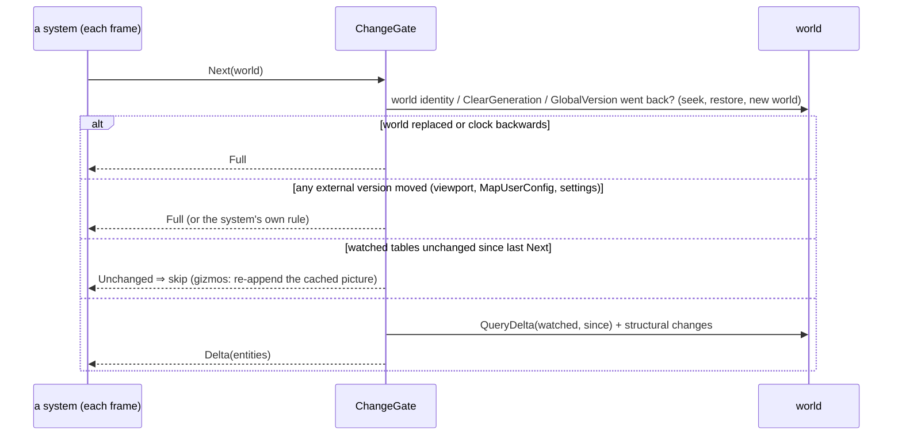
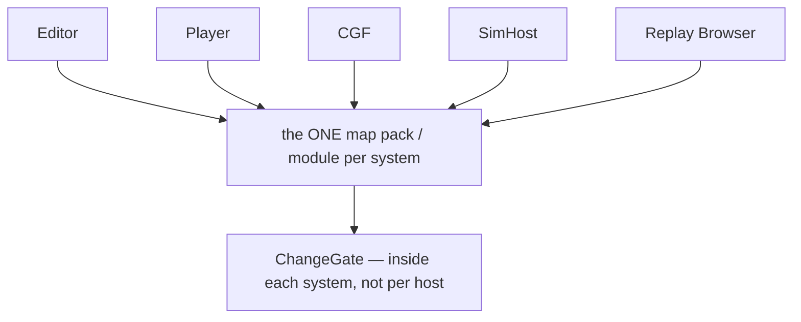

<!--STATUS
state: LIVE
build-state: READY-TO-BUILD (G1–G5) · G6 is backend's (E1)
updated: 2026-11-11
current-answer: §2 the picture · §3 the build order · §4 leans
stale-below: nothing
known-rot: none
known-conflict: none
related-designs:
  - DESIGN_Replay_Playback_Performance.md — §4 Q2 (user: "yes, do Q2 change-gating next") — the measurement that made this item
  - DESIGN_Egress_Change_Detection.md — OWNS egress gating (E1 `EgressVisitGate`, hazards H1–H8); egress is NOT re-gated here (G6 = finish E1)
  - DESIGN_Evaluation_Cost_And_Cadence.md — §10 CE-2402 the gizmo hold (why a gizmo pass may never be skipped whole: the buffer clears each frame)
  - DESIGN_Map_View_Filter.md — §6 the view filter + the one match pass; R-1049 D-5 (CullingState fed from the same snapshot) decides G4
  - blueprints/batches/MEASURE_Ui_Replay_Frame_Cost.md — §7 the costs (same in live and replay)
-->

# DESIGN — per-frame systems that skip work when their inputs did not change: ONE shared gate, parametrised per system

🔒 User, `2026-11-11`: *"yes, do Q2 change-gating next"* · *"the systems are likely shared with all other nodes so let's make it reusable and non-breaking
for the others, we want unified and shared (parametrizable) solution, not duplication"*.

## 1. What runs every frame although nothing changed *(MEASURE §7: the same in live paused, replay paused, replay playing; 5 647 entities)*

| system | ms | inputs (per entity · global) | why it re-runs today |
|---|---|---|---|
| `StatelessGizmoSystem` | ~40 (≈ 90 % per-rule `Draw`) | any component a rule reads · the view snapshot | the buffer is CLEARED each frame and feeds the hit-test ⇒ it must be re-filled, never skipped |
| `MapLayerAssignmentSystem` | 4.4 | DIS type, `MapOverlayStyle` presence, `TkbIdentity` | full walk; already writes only on change |
| `StyleResolutionSystem` | 3.0 (+77 KB) | `VisualData`, `EntityInfo`, `MapSymbolOverride`, `Health`, `NetworkIdentity` · `MapUserConfig` flags | full walk AND an unconditional `SetComponent` ⇒ every `ResolvedStyle` chunk dirty every frame (recorder, view copy) |
| `MapCullingSystem` | 2.5 | `SimTransform` · the viewport (4 floats + zoom) | full walk + unconditional write |
| `CycloneEgressSystem` | 3.7 | per translator | ⭐ has its OWN gate (E1) — out of scope here |

## 2. The picture

*What the picture shows that prose hid: four systems ask ONE gate the same question with different parameters — none keeps its own "last version" logic;
egress is deliberately absent (it already has E1).*

*The gate lives INSIDE the system class every host already composes ⇒ every node gets it by construction; no host wires anything.*

## 3. Rules that keep it non-breaking

| rule | |
|---|---|
| ⭐ **opt-in by declaration** | a system / gizmo rule that declares no inputs runs every frame exactly as today |
| ⭐ **when in doubt, Full** | world replaced, `ClearGeneration` changed, `GlobalVersion` went backwards (seek / restore), an external version moved ⇒ a full pass — the precedent's rule |
| ⭐ **deterministic** | the gate reads world versions only, never wall-clock (CE-4044: a wall-clock slice broke the determinism golden) |
| **write only on change** | a system writes a component only when the value differs — so a gate does not dirty the next system's inputs |
| **managed components** | watched only through `SetManagedComponent` (immutable records, CLAUDE.md) — an in-place mutation is invisible to any version gate (already a rule) |
| **a switch** | `HROT_CHANGE_GATE=0` forces Full everywhere (measure / bisect), like `HROT_EGRESS_GATE` |

## 4. Build order (each measured before → after, rails per item)

| # | what | gate |
|---|---|---|
| **G1** | `ChangeGate` in Fdp.Toolkits: Watch / WatchExternal / Next → Unchanged · Delta · Full; 0 B steady | rails: each branch; seek / restore ⇒ Full; a structural add / remove ⇒ in Delta; red-proved |
| **G2** | `MapLayerAssignmentSystem` on the gate | `MapPresentationParityRails …FollowsAChange_OnTheNextFrame` stays green; the determinism golden unchanged; ms before → after |
| **G3** | `StyleResolutionSystem`: write only on change, then the gate (+ `MapUserConfig` flags as an external version) | the style rails; ms + the `ResolvedStyle` chunks no longer dirty when nothing changed |
| **G4** | `MapCullingSystem`: first read R-1049 D-5 — if `CullingState` should be fed from the view snapshot, retire the second in-view test instead of gating it (one implementation); else gate on the viewport + `SimTransform` and write only on change | the culling rails |
| **G5** | gizmos: measure per rule (`HROT_FRAME_STATS=1` → `GizmoRuleTimings`) on the 1 000-man scene; the top rules declare `Inputs` (+ view-dependent?) ⇒ held rules re-append their cached primitives (`GizmoPictureCache`, extending CE-2402's hold from "age" to "inputs unchanged"); undeclared rules unchanged | the gizmo frame rails (map identical with the gate on / off — a pixel / primitive-list equivalence rail); ms before → after |
| G6 | egress: finish E1 coverage | backend's design — a NOTE with the measured 3.7 ms, not built here |

## 5. INVENTORY *(2026-11-11)*

`search_graph` Class `.*(StatelessGizmoSystem|MapLayerAssignmentSystem|StyleResolutionSystem|MapCullingSystem|CycloneEgressSystem).*` (113, first 50 read — all five found) ·
grep `GlobalVersion|GetChunkVersion|QueryDelta|HasChanges|EgressVisitGate|IStatelessGizmo`. Precedents: `CycloneNetworkCleanupSystem.cs:168-237` (QueryDelta + full scan on
ClearGeneration / clock backwards), `RulesWindow.cs:329-338` (`HasChanges(since)`), `NavigationIntentBridgeSystem.cs:198-348`, `DataBreakpointSystem.cs:91-97`,
`EgressVisitGate` (egress only). ⛔ No shared system-level gate exists — each precedent keeps its own last-version field (the duplication G1 ends; the precedents may adopt it later).
