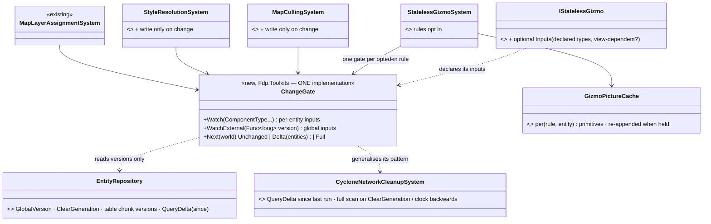
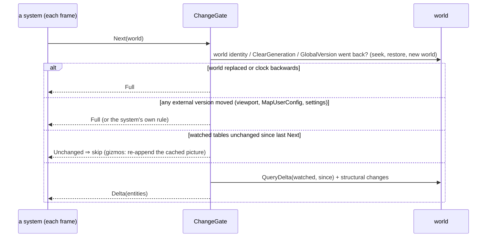
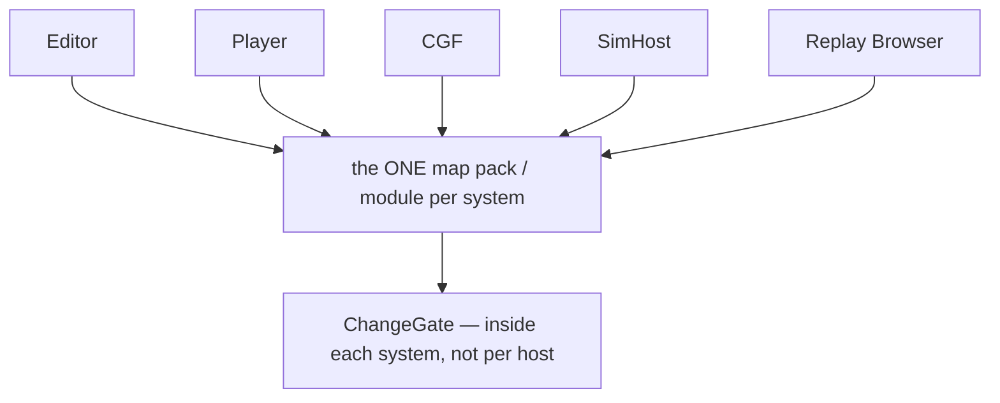

<!--STATUS
state: LIVE
build-state: BUILT G1–G5 (2026-11-11, ui; see §4a) · G6 is backend's (E1) · remaining: more rules declare Inputs (§4a G5)
updated: 2026-11-11
current-answer: §4a AS BUILT (what shipped, measured) · §2 the picture · §3 rules · §4 the original plan
stale-below: §4 table "gate" column wording where §4a says it deviated (marked SUPERSEDED there)
known-rot: none
known-conflict: none
related-designs:
  - DESIGN_Replay_Playback_Performance.md — §4 Q2 (user: "yes, do Q2 change-gating next") — the measurement that made this item
  - DESIGN_Egress_Change_Detection.md — OWNS egress gating (E1 `EgressVisitGate`, hazards H1–H8); egress is NOT re-gated here (G6 = finish E1)
  - DESIGN_Evaluation_Cost_And_Cadence.md — §10 CE-2402 the gizmo hold (why a gizmo pass may never be skipped whole: the buffer clears each frame)
  - DESIGN_Map_View_Filter.md — §6 the view filter + the one match pass; R-1049 D-5 (CullingState fed from the same snapshot) decides G4
  - blueprints/batches/MEASURE_Ui_Replay_Frame_Cost.md — §7 the costs (same in live and replay)
-->

# DESIGN — per-frame systems that skip work when their inputs did not change: ONE shared gate, parametrised per system

🔒 User, `2026-11-11`: *"yes, do Q2 change-gating next"* · *"the systems are likely shared with all other nodes so let's make it reusable and non-breaking
for the others, we want unified and shared (parametrizable) solution, not duplication"*.

## 1. What runs every frame although nothing changed *(MEASURE §7: the same in live paused, replay paused, replay playing; 5 647 entities)*

| system | ms | inputs (per entity · global) | why it re-runs today |
|---|---|---|---|
| `StatelessGizmoSystem` | ~40 (≈ 90 % per-rule `Draw`) | any component a rule reads · the view snapshot | the buffer is CLEARED each frame and feeds the hit-test ⇒ it must be re-filled, never skipped |
| `MapLayerAssignmentSystem` | 4.4 | DIS type, `MapOverlayStyle` presence, `TkbIdentity` | full walk; already writes only on change |
| `StyleResolutionSystem` | 3.0 (+77 KB) | `VisualData`, `EntityInfo`, `MapSymbolOverride`, `Health`, `NetworkIdentity` · `MapUserConfig` flags | full walk AND an unconditional `SetComponent` ⇒ every `ResolvedStyle` chunk dirty every frame (recorder, view copy) |
| `MapCullingSystem` | 2.5 | `SimTransform` · the viewport (4 floats + zoom) | full walk + unconditional write |
| `CycloneEgressSystem` | 3.7 | per translator | ⭐ has its OWN gate (E1) — out of scope here |

## 2. The picture

*⭐ As built (§4a): `GizmoPictureCache` is `RulePicture` inside `StatelessGizmoSystem` (one per declared rule, whole-rule picture); the gate also guards the system's MATCH PASS.*

*What the picture shows that prose hid: four systems ask ONE gate the same question with different parameters — none keeps its own "last version" logic;
egress is deliberately absent (it already has E1).*

*The gate lives INSIDE the system class every host already composes ⇒ every node gets it by construction; no host wires anything.*

## 3. Rules that keep it non-breaking

| rule | |
|---|---|
| ⭐ **opt-in by declaration** | a system / gizmo rule that declares no inputs runs every frame exactly as today |
| ⭐ **when in doubt, Full** | world replaced, `ClearGeneration` changed, `GlobalVersion` went backwards (seek / restore), an external version moved ⇒ a full pass — the precedent's rule |
| ⭐ **deterministic** | the gate reads world versions only, never wall-clock (CE-4044: a wall-clock slice broke the determinism golden) |
| **write only on change** | a system writes a component only when the value differs — so a gate does not dirty the next system's inputs |
| **managed components** | watched only through `SetManagedComponent` (immutable records, CLAUDE.md) — an in-place mutation is invisible to any version gate (already a rule) |
| **a switch** | `HROT_CHANGE_GATE=0` forces Full everywhere (measure / bisect), like `HROT_EGRESS_GATE` |

## 4. Build order (each measured before → after, rails per item)

| # | what | gate |
|---|---|---|
| **G1** | `ChangeGate` in Fdp.Toolkits: Watch / WatchExternal / Next → Unchanged · Delta · Full; 0 B steady | rails: each branch; seek / restore ⇒ Full; a structural add / remove ⇒ in Delta; red-proved |
| **G2** | `MapLayerAssignmentSystem` on the gate | `MapPresentationParityRails …FollowsAChange_OnTheNextFrame` stays green; the determinism golden unchanged; ms before → after |
| **G3** | `StyleResolutionSystem`: write only on change, then the gate (+ `MapUserConfig` flags as an external version) | the style rails; ms + the `ResolvedStyle` chunks no longer dirty when nothing changed |
| **G4** | `MapCullingSystem`: first read R-1049 D-5 — if `CullingState` should be fed from the view snapshot, retire the second in-view test instead of gating it (one implementation); else gate on the viewport + `SimTransform` and write only on change | the culling rails |
| **G5** | gizmos: measure per rule (`HROT_FRAME_STATS=1` → `GizmoRuleTimings`) on the 1 000-man scene; the top rules declare `Inputs` (+ view-dependent?) ⇒ held rules re-append their cached primitives (`GizmoPictureCache`, extending CE-2402's hold from "age" to "inputs unchanged"); undeclared rules unchanged | the gizmo frame rails (map identical with the gate on / off — a pixel / primitive-list equivalence rail); ms before → after |
| G6 | egress: finish E1 coverage | backend's design — a NOTE with the measured 3.7 ms, not built here |

## 4a. ✅ AS BUILT `2026-11-11` (ui, CE-1480; shas in the tracker row) — measured, deviations SUPERSEDE the plan text above

**Measured** — `scale-rig-demo-city-1000-2s` loaded in the editor (5 648 entities), **live paused (edit mode)**, Linux 4 cores, `xvfb`, `HROT_FRAME_STATS=1`; ms per tick from `GET /diagnostics/architecture` (`recentAvgMs`),
the SAME build with `HROT_CHANGE_GATE=0` (before) and `=1` (after). ⚠ Replay-paused was not re-measured (no recording of this build; the MEASURE doc §7 found the same cost in all four states).

| system | before (`HROT_CHANGE_GATE=0`) | after | what made it skip |
|---|---|---|---|
| `MapLayerAssignmentSystem` | 1.76 ms | **0.007** | gate: DIS type / `MapOverlayStyle` / `TkbIdentity` unchanged |
| `StyleResolutionSystem` | 2.82 ms · 75 KB | **0.010 · 0 KB** | gate + write only when the style differs |
| `MapCullingSystem` | 1.25 ms | **0.003** | gate (positions + viewport `Version`) — after three paused systems stopped re-stamping `SimTransform` (below) |
| `StatelessGizmoSystem` | 19.4 ms | **11.9** | match pass skipped + 3 rules re-appended |
| gizmo group (`TogglablePostSimulationGroup`) | 24.6 ms | **14.8** | |
| editor render frame (mean) | 180 ms | **~141** | update 57 → 34 ms (draw 84 → 75 is software GL, not representative) |

| state | |
|---|---|
| **G1** ✅ `ChangeGate` (`Fdp.Toolkits/World/ChangeGate.cs`, 14 rails, 6 branches red-proved) | **deviations:** ① **any structural change anywhere (`StructuralChanges`) ⇒ Full** — a component REMOVAL / an entity destroy moves no chunk version, so it cannot be told apart; a world where entities are created every frame therefore stays Full (no worse than today). ② **a world whose `GlobalVersion` did not advance between two calls ⇒ Full (`StaticClock`)** — a write made after the run is indistinguishable from the ones seen; the kernel ticks every frame (live, paused, replay), so this is the answer for an unticked test world, which keeps every existing rail on today's behaviour. ③ **`Delta` + `Entities()` is exact only when every watched type is a REQUIRED component of the query** (`QueryDelta` reads the query's own tables) — only `MapCullingSystem` uses it; the others treat Delta as Full. ④ a gate that declares nothing answers Full. SUPERSEDES the plan's "`Delta(entities)` for every system" |
| **G2** ✅ `MapLayerAssignmentSystem` | gated for the DEFAULT registry only (a custom registry — tests — may read anything ⇒ undeclared). Watches `MapOverlayStyle`, `TkbIdentity`, `MapDisplayComponent`; ⛔ **not `SimTransform`** (the predicates never read it — watching it kept the gate open). Rail `…DefaultRegistry_SkipsAnUnchangedWorld_AndFollowsEveryInput` (masks equal the ungated system's over still / DIS-type / component-added / value-changed / seek) beside the existing `…FollowsAChange_OnTheNextFrame` (green). Determinism: the scenario golden does not read this system's cadence any more than before (CE-4044's fix — a full pass every frame writing on change — is the SAME function; the gate only skips a pass whose inputs did not move) — see §4a gates row |
| **G3** ✅ `StyleResolutionSystem` | write only when the built style differs (byte compare), gate on `NetworkIdentity` / `VisualData` / `EntityInfo` / `MapSymbolOverride` / `Health` / `ResolvedStyle`, `MapUserConfig.ForceHostile` + `HideLabels` as an external version (compare-with-last-seen), the query is built once. Rail `CE1480_G3_…` (still ⇒ no walk and no `ResolvedStyle` chunk stamped; Health / VisualData / override value change ⇒ that entity next frame; flags; seek), 3 mutations red-proved |
| **G4** ✅ `MapCullingSystem` | ⭐ **D-5 NOT built, on purpose**: [Map View Filter §6 D-5](DESIGN_Map_View_Filter.md) says `CullingState` is fed from `MapViewSnapshot` (right in 3-D) — but the snapshot is per map buffer (`MapInteractionPack.ViewOf(buffer)`), the culling module is registered by the editor AND the player (no map, headless) with only a `MapCameraViewport`, and the snapshot's margin (40 m / 256 px) would change what `IsVisible` means for its readers (view telemetry, performance metrics) — that is D-5's own step (plumb a snapshot to the module; decide the margin; retire the rectangle). **This gate is the "else" branch:** it watches `SimTransform` + the viewport's new `Version` (moves only when one of the five values actually changes) and writes only on change, so D-5 swaps the external for the snapshot's `Version` and nothing else changes. `MapCullingModule [TickMode(WhenTimeAdvances)]` vs the system's `EveryFrame`: **the system's wins** — the module is `Direct` (`ExecutionPolicy.Synchronous`), and a direct module's systems are each gated by their OWN mode (`SystemScheduler.ExecuteSystem`, `moduleGoverns` false); the module's mode only governs its empty `Tick`. So culling ran every frame including paused (it must: a pan while paused re-tests) and now skips when nothing moved. ⭐ **Found and fixed with it (cross-lane, stated): three paused systems stamped the `SimTransform` chunk every frame with no change** — `GroundClampWhilePausedSystem` (backend), `UnitCentroidSystem`, `EmbarkedStateSystem` (behaviors): `GetComponentRW` stamps the chunk version, so culling (and the recorder, and the view copy) saw "changed" forever; each now reads first and takes the write reference only when the value differs (rail `GroundClampWhilePausedTests`; the Embarked / UnitCentroid suites green). Rail `CE1480_G4_…` (still ⇒ no walk, no `CullingState` stamped; entity moves ⇒ Delta, followed; pan ⇒ Full; zoom ⇒ LOD; seek), 3 mutations red-proved |
| **G5** ✅ gizmos — **deviation from the plan text: rule-level, not per-entity** | ⭐ **the per-rule table** (HROT_FRAME_STATS `gizmo rules`, same scene, before = gate off, ms per frame · entities): `(match pass)` **5.87** · 5 648 — `EntityPresentationGizmo` **1.79** · 1 647 — `EqsSensorGizmo` **1.49** · 2 000 — `HearingGizmo` **1.16** · global — `EntityCardFrameGizmo` **1.04** · 1 139 — `EntityRotationGizmo` **0.98** · 1 647 — `OverheadMarkGizmo` **0.91** — `MissionPresentationGizmo` **0.82** — `EntityEditorLabelGizmo` **0.71** — `CommandPictureAbsentGizmo` **0.56**. The match pass is the single largest line (and no rule's): **① the match pass is skipped** while the entity set (structural clock), the active-rule signature, the view (`IGizmoViewFilter.Version`, new; `MapViewSnapshot` publishes it — it moves only when the view actually changes) and, with a filter on, positions did not move (−5.9 ms). **② `IStatelessGizmo.Inputs` (new, optional, default null = today):** component types whose VALUES the picture reads + "depends on the view" + an optional external version; a declared rule is drawn fresh only when an input moved, otherwise the primitives it drew are re-appended (`RulePicture`, inside `StatelessGizmoSystem` — one per declared rule). **Declared: `EntityCardFrameGizmo`, `EntityNameGizmo`, `EntityRotationGizmo`** (via `Seeable.Inputs(...)`, which adds what `Seeable.OnMap` reads). ⛔ **Not declared yet, and why:** `EntityPresentationGizmo` (the biggest: it reads ~12 things — footprint, `PhysicalPresence`, `ChargeMarker`, terrain-object keys, settings, the view for doors — a wrong declaration would freeze a wrong picture), `EqsSensorGizmo`, `OverheadMarkGizmo`, `MissionPresentationGizmo`, `EntityEditorLabelGizmo`, `HearingGizmo`, `HealthBarGizmo` (reads a setting — needs a settings version): each needs its dependency set read end to end first; the mechanism is in place and each is a one-line `Inputs` + a rail. **Safety rules built in:** a held picture is only captured on a frame that drew EVERY entity fresh with no input moving (the CE-2402 hold's older pictures are never frozen); a view-dependent rule is never held when the filter publishes no version; no hold with a selection predicate or a frame budget. Rails `ChangeGatedGizmoTests` (primitive list gated == ungated over still / value change / born / destroyed / seek / pan; the hold case; a rule switched on with nothing else changed), 7 mutations red-proved. **ms: gizmo system 19.4 → 11.9; render frame mean ~180 → ~141** |
| **G5b** ✅ the remaining rules, one at a time (`2026-11-11`, ui) | **Declared (each read end to end — Draw + every helper — with its own equivalence rail `DeclaredGizmoInputsTests` over still / pan / each change / seek, red-proved by dropping one input):** `EntityPresentationGizmo` (NetworkIdentity, SimTransform, Health, VehicleParams, ObstacleShape, ResolvedStyle, EntityInfo, IsEmbarkedTag + Seeable's types + the settings registry `Version` + the map view; ⚠ the TKB-database singleton (DIS fallback) is not watched — constant per loaded scenario) · `EntityEditorLabelGizmo` (NetworkIdentity, BehaviorState, IsEmbarkedTag + Seeable + `BehaviorRegistry.DefinitionCount`) · `HealthBarGizmo` (Health, NetworkIdentity + the settings `Version`) · `CommandPictureAbsentGizmo` (SimTransform, UnitSubordinate over the whole table, + the layer state: new `GizmoInputs.ReadsLayerState` ⇐ `DebugPrimitiveBuffer.LayersVersion`) · and rails added for the three declared earlier (`EntityCardFrameGizmo`, `EntityNameGizmo`, `EntityRotationGizmo`). New seams: `GizmoSettingsRegistry.Version`, `StatelessGizmoSystem.HonourDeclaredInputs` (the ungated reference of the rails). **NOT declared, with the reason:** `OverheadMarkGizmo` — reads sim time (`HitModel.Now`) and fades the speech mark over its last 0.5 s · `EqsSensorGizmo` — a wall-clock (`Stopwatch`) verdict cache refreshed on a budget · `HearingGizmo` — a GLOBAL rule (`IGlobalStatelessGizmo`, outside the per-entity mechanism) and fades by `DebugTraceClock` · `ActionStatusGizmo` — reads `GlobalTime.TotalTime` · `MissionPresentationGizmo` — resolves each task's place through the live reference scope (`AuthoredRules.ScopeOf` / `MapPreviews.PlaceOf`: names and other entities, unbounded) and the plan object is mutated outside a chunk version · `HillAttackGizmo` — reads its parameters through a raw pointer into the occurrence store (`RootParamsAccess.TryGetRootBytesInView`; the component set behind it is not versioned per slot) · `AuthoredRouteGizmo` — `RouteGizmo.PointOf` + `RoutePlan` (managed) + the trajectory cache not read end to end yet (⇒ next). **Measured (gate `0` → `1`, same scene and method as above):** gizmo system **21.1 → 11.3 ms**, group 25.2 → 14.4, editor update 49.9 → 40.4 ms; `EntityPresentationGizmo`, `EntityEditorLabelGizmo`, `HealthBarGizmo` fall off the per-rule table (< 0.3 ms). ⚠ `CommandPictureAbsentGizmo` still shows 0.61 ms with the gate on — something moves its inputs every frame (the `UnitSubordinate` table or the layer mask); not run down. The rest of the table is the undeclarable rules above (≈ 6 ms) plus ~25 rules under 0.4 ms each |
| **G6** | not built here (backend's E1); measured on the same scene: `CycloneEgressSystem` 1.9 ms paused |

**Gates (`2026-11-11`, ui; base `c59a6857f`; every touched test project built before its run, `--no-build` after)**

| gate | result |
|---|---|
| `Fdp.Toolkits.Tests` (whole) | 4 874 pass · 2 red, both known (`S0_EveryNodeIdMember_IsANodeId`, `TakeCheckpointIntent_HasRequestIdAndLabel`); new: `ChangeGateTests` 14, `ChangeGatedGizmoTests` 6, `GroundClampWhilePausedTests` 1 — every one red-proved by a compiling mutation (G1 6 branches, G5 7) |
| `Hrot.Player.Tests` (whole) | 349 pass · 1 skip · 0 red (`StyleResolutionSystemTests`, `MapCullingSystemTests` incl. the two new rails) |
| `Hrot.SimHost.Tests` (whole) | 2 660 pass · 10 red: 9 reproduced IDENTICALLY at the base in a clean worktree (`CE454_TheSquadLayerRunsThroughTheRealCgfPack`, `ShippedTreesAreCSharpTests` ×6, `NoHost_ReferencesAnotherHost…`, `CE4208_EveryDdsType…`), the 10th (`LoadPhaseChainTests.CE3345`) passes alone — flaky; `MapPresentationParityRails` 15/15 |
| `Hrot.Presentation.Tests` (whole, `xvfb-run -a`) | 2 059 pass · 5 red: 4 known (CE1039, CE1380, CE4388_CachedWireSphere, CE1227) + `TheBuildingDamagePlanTests…OnADisplayNode`, which passes alone (display-node flake under the full run) |
| `Hrot.ClusterRunner.Tests` (`TheMapIsNotSelectionGatedRails`, `CgfSubsystemTests`) | 7 pass · 1 red `CE1446_TheKernelRunsItsSystemsInTheSharedBootstrappersOrder` (a `MacroExpansionSystem` position — not this work; one of the known six) |
| `Hrot.Editor.Tests` (`TheWorldChangeCheckOnTheEditorTests`, `TheEditorRunsTheOrchestratorCoreTests`) · `Hrot.SimHost.Integration.Tests` (`EntityLifecycleIntegrationTests`) | 17 / 17 · 2 / 2 |
| `Hrot.SystemTests` `TheMapsAgreeOnBothHostsRails` | both map-conformance cases pass on this build (`Each_hosts_map_marks_…` once red under the wrapper script, green alone) |
| `Hrot.ClusterRunner.Integration.Tests` | ⚠ **no map / presentation-parity rail exists there** (grep for the five systems' components: none) — not run |
| scenario determinism (CE-4044: `--verify bt-grenade-posture`) | the golden is stale for 3 units' behaviour components at t=0 (`Behavior`, `Roe`, `Sop`, …) — **reproduced identically in 3 fresh processes, and byte-identical with `HROT_CHANGE_GATE=0` vs `1`** ⇒ the gates change nothing in the world; no map component (`MapDisplayComponent`, `CullingState`, `ResolvedStyle`) is in the diff |

## 5. INVENTORY *(2026-11-11)*

`search_graph` Class `.*(StatelessGizmoSystem|MapLayerAssignmentSystem|StyleResolutionSystem|MapCullingSystem|CycloneEgressSystem).*` (113, first 50 read — all five found) ·
grep `GlobalVersion|GetChunkVersion|QueryDelta|HasChanges|EgressVisitGate|IStatelessGizmo`. Precedents: `CycloneNetworkCleanupSystem.cs:168-237` (QueryDelta + full scan on
ClearGeneration / clock backwards), `RulesWindow.cs:329-338` (`HasChanges(since)`), `NavigationIntentBridgeSystem.cs:198-348`, `DataBreakpointSystem.cs:91-97`,
`EgressVisitGate` (egress only). ⛔ No shared system-level gate exists — each precedent keeps its own last-version field (the duplication G1 ends; the precedents may adopt it later).
