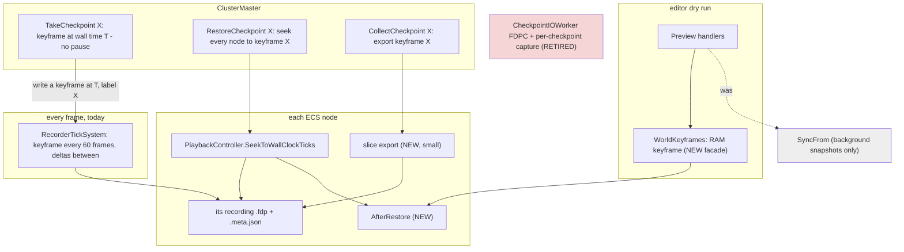
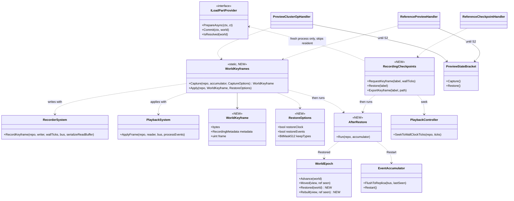
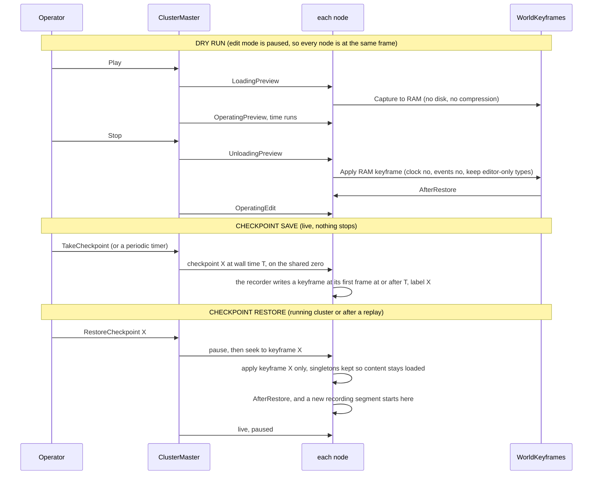

<!--STATUS
state: LIVE
build-state: DESIGN (⏳ the decisions in §5 carry leans awaiting the user; §6 measurements come first)
updated: 2026-10-22 (§1a cluster-wide coverage measured) · 2026-10-22 (R-3044 — a checkpoint IS a named keyframe the flight recorder writes on request; restore seeks straight to it; §0/§2/§3/§4/D2/D3/M5/B3 updated) · 2026-10-22 (REVISED after the user's correction — R-3042 a checkpoint never stops the cluster, it is a mark in the running recording; R-3043 a restore keeps what is loaded, it is a seek; §0/§2/§4/D3/D10 rewritten, the pause-first lean moved to HISTORY) · 2026-10-22 (created — backend; CE-3299; R-3039, R-3040, R-3041; resolves the critical review F1–F12 of Paused and Stepped §7g.0c)
current-answer: §0 the decision · §2–§4 the diagrams · §5 decisions with leans · §6 what is measured before any build · §8 build order
stale-below: nothing
known-rot: none
known-conflict: docs/designs/mgmt-1/DESIGN.md §9.1/§9.3 still DESCRIBE the SyncFrom snapshot and the .dds supplement as the mechanism — both carry SUPERSEDED / WITHDRAWN banners pointing here (R-3040, R-3041).
related-designs:
  - docs/blueprints/DESIGN_Paused_And_Stepped_Execution.md — §7g (R-3039 system memory in components; R-3040 the recorder; R-3041 no network buffers) and §7g.0c the review this resolves. It owns the STATE rules; this owns the SAVE/RESTORE mechanism.
  - docs/designs/mgmt-1/DESIGN.md — §9 checkpoints and dry runs (the operator contract), §8.12 Always Recording, §8.10 lifecycle during replay.
  - docs/designs/replay-and-modules/DESIGN.md — §2.1d go live from recorded state (re-derive, do not restore, protocol state), §2.1m the ELM participant (built), §2.1l the rewind seam.
  - docs/DESIGN_Cluster_Load_Phase.md — the load chain a checkpoint restore runs through (ILoadPartProvider, the world boundary).
  - docs/DESIGN_Deterministic_Network_Ids.md — §2b the preview participants (allocator, entity map, ELM) this narrows.
  - docs/blueprints/DESIGN_Time_Architecture.md — §12a who writes the clock across a Stop.
  - docs/DESIGN_Distributed_Scenario_Persistence.md — the SCENARIO save (JSON, ownership-gated); checkpoints are out of its scope and stay so.
-->
# Checkpoint and dry-run restore — **one mechanism: the flight-recorder keyframe**

## 0. The decision

🔒 **User, verbatim (`2026-10-22`):** *"Saving a checkpoint cannot stop a cluster. Checkpoint is something that happens while everything else is running. The system can be creating checkpoints on the fly at regular intervals. and it should not interfere with the running simulation. The similar is like flight recorder also doesn't stop the cluster just to record state every frame."* · *"Restoring a checkpoint is allowed, but it shouldn't reload everything from scratch. What is already loaded should stay loaded."*

⭐⭐ **The running flight recording IS the checkpoint stream** (R-3040, R-3042, R-3043). Every node already records its live world — a keyframe every 60
frames and deltas between, each frame stamped with the frame-locked `GlobalTime.TotalWallTicks` — without pausing anything ("Always Recording",
mgmt-1 §8.12). ⇒ **a checkpoint is a TIME** in that recording (a named mark; periodic checkpoints cost nothing — the keyframes are already
there); **a restore is a SEEK** of every node's own recording to that time — the cluster replay seek that already lines nodes up from one
shared zero (`ProcessSeekReplayIntent`, R-4012) — then the after-restore step and live, paused. A seek applies keyframe + deltas and keeps
every singleton, so **terrain, TKB and navmesh stay loaded**; only a fresh process (after a crash) runs the load chain first, which skips
whatever is resident (`TerrainLoadStep:55`, `KnowledgeBaseLoadStep:99`). The **dry run** keeps its own RAM keyframe (Play captures, Stop
applies). `SyncFrom` stays the every-frame background snapshot. No network buffers (R-3041). Complete only for state in the ECS (R-3039; D1).

⭐⭐⭐ **`R-3044` (`2026-10-22`) — A CHECKPOINT IS A NAMED KEYFRAME THE FLIGHT RECORDER WRITES ON REQUEST.** 🔒 User, verbatim: *"So whenever we need to save a checkpoint, we could basically just force the flight recorder to write a keyframe."* · *"I think to design doesn't prevent saving everything, and it is what is already done, so I think that holds. So I think yes, please write this as a ruling."*
- **save:** the master sends *checkpoint X at wall time T* (T a moment ahead, on the shared zero); each node's recorder writes a KEYFRAME on its
  first frame with `TotalWallTicks ≥ T` and labels it X — no pause, one keyframe the recorder would have written within 60 frames anyway; every
  node lands within one frame of T.
- **restore:** every node seeks its own recording STRAIGHT TO the keyframe labelled X (a pure keyframe apply — no deltas after it), then
  `AfterRestore`, a new recording segment, live paused. Content stays loaded (R-3043).
- **periodic:** the regular keyframes (every 60 frames) already allow a restore to any second; a forced keyframe adds an exact, named instant.
- **collect (bug report):** export that one keyframe as a one-frame recording (readable by the existing replay code).
- **design basis — the recorder records the FULL state:** [replay-and-modules §2.3](designs/replay-and-modules/DESIGN.md) *"Every Brain/Muscle node
  records its full ECS state — both owned components and unowned ghost components"*; going live from a recording is shipped (`PrepareLive`).
  📐 In code the only exclusion is a `NoReplay`/`Transient` marking — D1.

## 1. INVENTORY — what already exists (codebase-memory `search_graph`, `2026-10-22`; all `has_more: false`)

| query (`label: Class`) | total | the production classes this design touches |
|---|---|---|
| `.*(Checkpoint\|Snapshot).*` | 71 | `CheckpointIOWorker` (the `'FDPC'` writer, read by nothing) · `ReferenceCheckpointHandler` · `TakeCheckpointIntent` · `SharedSnapshotProvider` / `SnapshotPool` (background snapshots — untouched) |
| `.*(Recorder\|Playback\|Replay)(Controller\|System\|Module\|Handler\|Manager).*` | 15 | `RecorderSystem` · `PlaybackSystem` · `PlaybackController` · `EcsRecordReplayController` · `ReplayModule` · `EpisodeRecorderModule` (+ by grep: `AsyncRecorder`, `RecorderTickSystem`, `RecordingModule`) |
| `.*(Preview\|DryRun\|Rewind\|Rewindable).*` | 45 | `PreviewClusterOpHandler` (editor) · `ReferencePreviewHandler` (SimHost / IG / CGF) · `PreviewStateBracket` + `PreviewParticipants` (allocator, entity map ×2, ELM) · `EditorPreviewController` / `EditorPreviewAdapter` |
| `.*LoadPhase.*\|.*LoadStep.*` | 10 | `LoadPhaseChain` · `ILoadPartProvider` · `ScenarioLoadStep` · `TerrainLoadStep` · `KnowledgeBaseLoadStep` · `WorldBoundaryReset` |
| by grep (seams) | — | `EventAccumulator` (`FlushToReplica`, `Restart`) · `WorldEpoch` · `NetworkEntityMap.RebuildFromWorld` · `MasterSyncController.SnapAndPause` · `ClusterMaster.FanOutNodeOp(TakeSnapshot)` |

⇒ **Nothing new is needed to WRITE or READ a world** — both exist and replay uses them. New: one load part, one options record, one
"world restored" signal, and the cluster's pause-then-save order.

### 1a. ⭐ CLUSTER-WIDE, NOT EDITOR-ONLY — measured `2026-10-22` (user: *"make sure"*)

| host | records (`EcsRecordReplayController`) | starts recording at live load (`ReferenceLiveLoadHandler`) | answers the cluster seek (`ReferenceReplayLoadHandler`) | dry run on its own world |
|---|---|---|---|---|
| SimHost · IG · traffic node · Stride node (all through `NodeBootstrapper.BuildOrchestration`) | ✅ `NodeBootstrapper.cs:276` — every ECS host, every role (R-4011; R-4003 for IG) | ✅ | ✅ | ✅ `ReferencePreviewHandler(world, …)` `:335` |
| CGF (`CgfSubsystem`) | ✅ `CgfSubsystem.cs:1067` | ✅ | ✅ | ✅ `:1260` |
| editor (`EditorSubsystem`) | ✅ `:1605` | ✅ `:1851` | ✅ `:1841` | ✅ `PreviewClusterOpHandler` `:701` |
| ExCon | ⛔ none — no ECS world (R-4011) | — | — | `ReferencePreviewHandler(liveRepo: null)` — nothing to rewind |

⇒ the recording every checkpoint is a keyframe of, the seek every restore is, and the dry run run on **every ECS host of the cluster**.
⚠ `CgfApplication` (a CGF "skeleton", `liveRepo: null` dry run) is constructed by no production code — not touched here.

## 2. Modules — who calls what (only the recorder runs every frame, and it already does)

*What the picture shows that prose hid:* a checkpoint SAVE's only arrow goes to the recorder that already runs every frame — it asks for one
extra keyframe, labelled; nothing else in the running world is touched. Every arrow that touches the world is a RESTORE (a seek, or the dry run's
Stop), and both land on the same after-restore step.

## 3. Classes

*What the picture shows that prose hid:* the NEW classes are a dry-run facade, a checkpoint-as-mark helper, an options record and one step — every arrow out of
them lands on a class that exists; `WorldEpoch` gains a SECOND count (`Restored`) so a restore never reads as "the world ended" (which makes
`CycloneNetworkCleanupSystem` delete every owned entity on the wire, `:52`).

## 4. Sequences

*What the picture shows that prose hid:* the save touches no node — the nodes were already recording; only the RESTORE pauses (it replaces the
world, so it cannot run under a moving simulation), and it reaches every node through the replay seek that already aligns them by one
shared wall-clock zero. A restore then FORKS the recording: the frames after the mark stay intact for another restore.

## 5. Decisions — one per review finding (Paused and Stepped §7g.0c); ⏳ leans await the user

| # | finding | ⏳ lean | rejected — one line |
|---|---|---|---|
| **D1** | F1: `NoReplay`/`Transient` components with sim meaning are not in a keyframe (`SubordinateOrders`, `AirPath`, `PausedTask`, `TrafficCar`, `MissionAdapterState`, `OutgoingGrantsPending`, …) | M4 classifies all 86 types: **sim state ⇒ recordable** (drop `NoReplay`); protocol ⇒ re-derived (`GhostStateTracker`, `PendingNetworkAck`, R-3039 class B); network shadows ⇒ republished (`NetworkTransform`, `NetworkVelocity`); events stay out | record everything — protocol progress restored as-is deadlocks (replay §2.1d) |
| **D2** | F2: a keyframe re-injects recorded events | dry-run exit: `restoreEvents: false`. ⏳ Checkpoint: keyframe X records the UNCONSUMED step window (the `EventAccumulator` content since the last step — as `ReferenceCheckpointHandler` flushes it today); the restore puts it INTO THE ACCUMULATOR after `Restart`, never into the bus | inject into the bus buffers (re-processing) · drop all events (a step's pending orders lost) |
| **D3** | F3: nodes captured at different frames | ⭐ **R-3042 + R-3044**: no pause; the master names a wall time T a moment ahead on the shared zero (R-4012) and each node's recorder writes keyframe X at its first frame with `TotalWallTicks ≥ T` — within one frame on every node; the residual skew is R-3041's accepted loss | ⛔ pause the cluster — ruled out (R-3042) · write on receipt — skew = message latency, avoidable at no cost |
| **D4** | F4: no reset fires after a keyframe apply | `AfterRestore`: ELM re-arm (exists) → `NetworkEntityMap.RebuildFromWorld` (exists) → `WorldEpoch.Restored` (NEW count; R-3039 class A/B fields reset through `Rebuilt`) → `EventAccumulator.Restart` (+ D2) → a forced keyframe in the running recording (D8) | reuse `Moved` — makes the network cleanup delete every owned entity on the wire |
| **D5** | F5: the clock | `restoreClock`: dry-run exit **false** (Time Architecture §12a owns the Stop), checkpoint restore **true** | one rule for both — Stop would rewind time behind the time system's back |
| **D6** | F6: `NoPreview` vs `NoReplay` | M4 diffs the sets; ONE recorded set if they agree; editor-only state moves to D12's keep list | two filters in the recorder |
| **D7** | F7: recordability is decided at registration, unregistered ⇒ silently not recorded | a rail: every registered component and singleton type has an EXPLICIT `DataPolicy`; M1 lists what a keyframe holds per host | trust the default |
| **D8** | F8: `GlobalVersion` goes back to the recorded tick | apply under `max(live, recorded) + 1` (versions only grow); ⭐ **a restore starts a new recording segment** (a fork) — the frames after the mark stay intact for another restore, the new segment begins with a keyframe | let it go back — the always-on recorder skips changes until its next keyframe · overwrite the recording past the mark — loses the other branch |
| **D9** | F9: a fixed 32 MB recorder buffer | M2 measures the largest world; the buffer grows when a keyframe does not fit | a bigger constant |
| **D10** | F10: a fresh process — content and node ids | ⭐ **a restore keeps what is loaded (R-3043)**: in a running process the seek keeps every singleton (`Clear` spares them) — 📐 terrain, TKB, navmesh stay; only a fresh process runs the load chain first, which skips resident content (`TerrainLoadStep:55`, `KnowledgeBaseLoadStep:99`). ⏳ Node ids: the recordings are per node, so each node restores its OWN recording — ids match by construction; in a fresh cluster the master grants each node the id its recording carries | a restore as a full load from Idle — reloads content and stops everything |
| **D11** | F11: the oracle masks the ids that hide the trajectory pool | R1 compares unmasked once S2 puts the pool in the ECS; until then it compares what a trajectory id POINTS AT | keep masking — the oracle passes over the bug it exists for |
| **D12** | F12: editor-only `Transient` state wiped at Stop | `keepTypes` at dry-run exit: editor/debug types are neither cleared nor overwritten (M4 lists them) | restore them from the keyframe — the Stop would undo the operator's view settings |
| **D13** | (R-3044) a labelled keyframe must outlive recording clean-up | ⏳ a recording trim never deletes a labelled keyframe (nor the frames a restore needs before it — none: a keyframe stands alone) | label in a side file — a second index that can drift from the recording |

## 6. Measure first (M1–M4) — nothing in §8 starts before these

| # | what | how | decides |
|---|---|---|---|
| M1 | what a keyframe holds on each host — components and singletons, recordable or not | a test-only walk of `ComponentTypeRegistry` after each host's composition | D7, D1 |
| M2 | keyframe size and capture time on the largest scenario (300 civilians; `uc-urban-battle`) — the recorder already pays it every 60 frames | `WorldKeyframes.Capture` timed in the editor harness | D9 |
| M3 | apply time on the same world | the same | the dry-run Stop (accepted by the user; recorded) |
| M5 | a forced keyframe mid-run: its extra cost on the recorder frame, and the step-window events it carries | force one on a recorded `uc-urban-battle` | D2, R-3042's "does not interfere" |
| M4 | the 86 `NoReplay`/`Transient` types, each classed: sim state / protocol / network shadow / event / editor-only; and `NoPreview` vs `NoReplay` | read + `search_graph` per type | D1, D6, D12 |

## 7. Rails

| rail | proves |
|---|---|
| **R1 — the oracle** (in-process, then live): a stepped run to T1 → checkpoint → on to T2 = capture A; restore into a FRESH process → step to T2 = capture B; A ≡ B in full component state (`scripts/determinism-probe.py --compare`) | the whole contract; ⚠ red until R-3039 S1/S2 land — each red names the next violator |
| dry run: Play → Stop → Play again equals the first Play, step by step | D1, D2, D4, D12 |
| a restore never moves `WorldEpoch.Moved` (no delete on the wire) and always moves `Restored` | D4 |
| a checkpoint save changes nothing in the running world and costs no frame time beyond the recorder's | D3 (R-3042) |
| a restore in a running process loads no content (terrain / TKB / navmesh untouched) | D10 (R-3043) |
| the clock is untouched by Stop and restored by a checkpoint | D5 |
| every registered type carries an explicit `DataPolicy` | D7 |

## 8. Build order

**B0** M1–M5 → **B1** `AfterRestore` (+ `WorldEpoch.Restored`) and `WorldKeyframes` for the dry run → **B2** the dry run moves (both preview
handlers; `SyncFrom` leaves them; `PreviewStateBracket` keeps only the allocator until S2) → **B3** checkpoints as labelled keyframes (`RecorderTickSystem` takes a *keyframe at T, label X* request; the label → frame index goes into
the recording's metadata; `CheckpointIOWorker`'s `'FDPC'` capture retires; `CollectCheckpoint` exports keyframe X) → **B4**
`RestoreCheckpoint X` = pause → every node seeks to keyframe X → `AfterRestore` → a new recording segment → live paused; a fresh process loads first → **B5** R1
live. ⚠ R1 stays red until R-3039's S1/S2 (Paused and Stepped §7g.1) land — that red is the work list, not a failure of this design.

## ⛔ HISTORY

- `2026-10-22`: a checkpoint was a MARK (a time) and a restore applied keyframe + deltas up to it. ⛔ SUPERSEDED by R-3044 — a forced, labelled keyframe; the restore applies it alone.

- `2026-10-22` (first version, same day): the save PAUSED the cluster so every node captured one frame, and a restore was a LOAD from Idle
  through a `CheckpointLoadPart`. ⛔ SUPERSEDED by the user (R-3042: a save never stops the cluster; R-3043: a restore keeps what is loaded).
