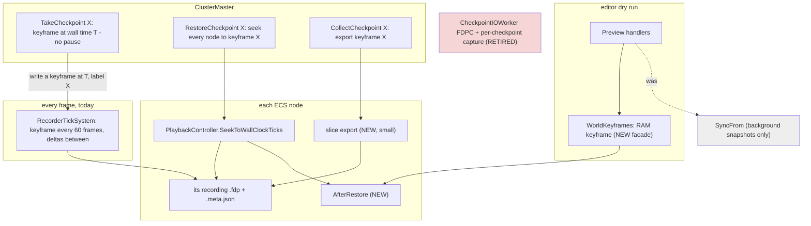
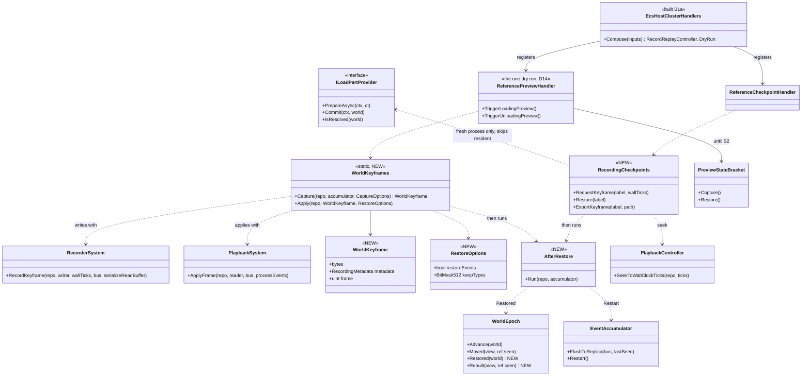
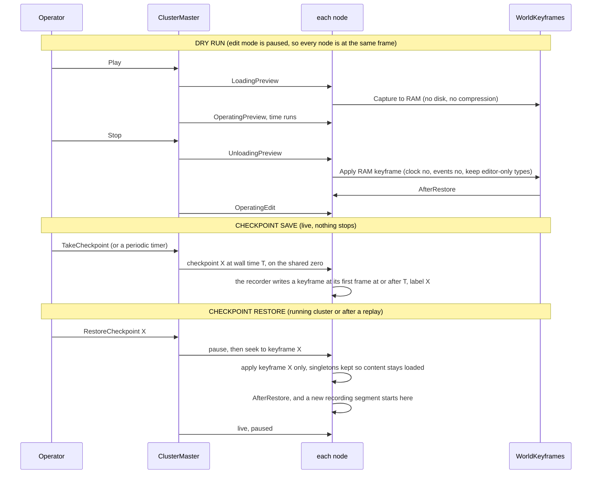

<!--STATUS
state: LIVE
build-state: BUILDING (B1a + B1 built 2026-10-22 — §1b and §1c as-built)
updated: 2026-10-22 (D18 APPROVED, R-3047 — a branch copies its history up to the branch point into a new master-minted exercise) · 2026-10-22 (D18 — a branch never overwrites history: the master mints the branch's exercise id, the recorder refuses an existing file; CE-3300) · 2026-10-22 (D17 the recorder's CHECKPOINTING MODE (R-3045); D5 CORRECTED — the clock is moved by SnapTo in both, never from the keyframe; D13 WITHDRAWN — no in-recording trim exists; D1–D4, D6–D12, D14–D16 APPROVED (R-3046)) · 2026-10-22 (§6b M4 classified: 9 sim-state types to make recordable, ReplicatedBrainIntent and GhostStateTracker watch items) · 2026-10-22 (§6a M1–M3 measured: keyframes 4–8 MiB, 19–31 ms capture, 36 ms apply; singletons ignore DataPolicy — D7 rewritten) · 2026-10-22 (§1b unified? U1–U3 measured, D14–D16, B1a first) · 2026-10-22 (§1a cluster-wide coverage measured) · 2026-10-22 (R-3044 — a checkpoint IS a named keyframe the flight recorder writes on request; restore seeks straight to it; §0/§2/§3/§4/D2/D3/M5/B3 updated) · 2026-10-22 (REVISED after the user's correction — R-3042 a checkpoint never stops the cluster, it is a mark in the running recording; R-3043 a restore keeps what is loaded, it is a seek; §0/§2/§4/D3/D10 rewritten, the pause-first lean moved to HISTORY) · 2026-10-22 (created — backend; CE-3299; R-3039, R-3040, R-3041; resolves the critical review F1–F12 of Paused and Stepped §7g.0c)
current-answer: §0 the decision · §2–§4 the diagrams · §5 decisions with leans · §6 what is measured before any build · §8 build order
stale-below: nothing
known-rot: none
known-conflict: docs/designs/mgmt-1/DESIGN.md §9.1/§9.3 still DESCRIBE the SyncFrom snapshot and the .dds supplement as the mechanism — both carry SUPERSEDED / WITHDRAWN banners pointing here (R-3040, R-3041).
related-designs:
  - docs/blueprints/DESIGN_Paused_And_Stepped_Execution.md — §7g (R-3039 system memory in components; R-3040 the recorder; R-3041 no network buffers) and §7g.0c the review this resolves. It owns the STATE rules; this owns the SAVE/RESTORE mechanism.
  - docs/designs/mgmt-1/DESIGN.md — §9 checkpoints and dry runs (the operator contract), §8.12 Always Recording, §8.10 lifecycle during replay.
  - docs/designs/replay-and-modules/DESIGN.md — §2.1d go live from recorded state (re-derive, do not restore, protocol state), §2.1m the ELM participant (built), §2.1l the rewind seam.
  - docs/DESIGN_Cluster_Load_Phase.md — the load chain a checkpoint restore runs through (ILoadPartProvider, the world boundary).
  - docs/DESIGN_Deterministic_Network_Ids.md — §2b the preview participants (allocator, entity map, ELM) this narrows.
  - docs/blueprints/DESIGN_Time_Architecture.md — §12a who writes the clock across a Stop.
  - docs/DESIGN_Distributed_Scenario_Persistence.md — the SCENARIO save (JSON, ownership-gated); checkpoints are out of its scope and stay so.
-->
# Checkpoint and dry-run restore — **one mechanism: the flight-recorder keyframe**

## 0. The decision

🔒 **User, verbatim (`2026-10-22`):** *"Saving a checkpoint cannot stop a cluster. Checkpoint is something that happens while everything else is running. The system can be creating checkpoints on the fly at regular intervals. and it should not interfere with the running simulation. The similar is like flight recorder also doesn't stop the cluster just to record state every frame."* · *"Restoring a checkpoint is allowed, but it shouldn't reload everything from scratch. What is already loaded should stay loaded."*

⭐⭐ **The running flight recording IS the checkpoint stream** (R-3040, R-3042, R-3043). Every node already records its live world — a keyframe every 60
frames and deltas between, each frame stamped with the frame-locked `GlobalTime.TotalWallTicks` — without pausing anything ("Always Recording",
mgmt-1 §8.12). ⇒ **a checkpoint is a TIME** in that recording (a named mark; periodic checkpoints cost nothing — the keyframes are already
there); **a restore is a SEEK** of every node's own recording to that time — the cluster replay seek that already lines nodes up from one
shared zero (`ProcessSeekReplayIntent`, R-4012) — then the after-restore step and live, paused. A seek applies keyframe + deltas and keeps
every singleton, so **terrain, TKB and navmesh stay loaded**; only a fresh process (after a crash) runs the load chain first, which skips
whatever is resident (`TerrainLoadStep:55`, `KnowledgeBaseLoadStep:99`). The **dry run** keeps its own RAM keyframe (Play captures, Stop
applies). `SyncFrom` stays the every-frame background snapshot. No network buffers (R-3041). Complete only for state in the ECS (R-3039; D1).

⭐⭐⭐ **`R-3044` (`2026-10-22`) — A CHECKPOINT IS A NAMED KEYFRAME THE FLIGHT RECORDER WRITES ON REQUEST.** 🔒 User, verbatim: *"So whenever we need to save a checkpoint, we could basically just force the flight recorder to write a keyframe."* · *"I think to design doesn't prevent saving everything, and it is what is already done, so I think that holds. So I think yes, please write this as a ruling."*
- **save:** the master sends *checkpoint X at wall time T* (T a moment ahead, on the shared zero); each node's recorder writes a KEYFRAME on its
  first frame with `TotalWallTicks ≥ T` and labels it X — no pause, one keyframe the recorder would have written within 60 frames anyway; every
  node lands within one frame of T.
- **restore:** every node seeks its own recording STRAIGHT TO the keyframe labelled X (a pure keyframe apply — no deltas after it), then
  `AfterRestore`, a new recording segment, live paused. Content stays loaded (R-3043).
- **periodic:** the regular keyframes (every 60 frames) already allow a restore to any second; a forced keyframe adds an exact, named instant.
- **collect (bug report):** export that one keyframe as a one-frame recording (readable by the existing replay code).
- ⭐⭐ **THERE IS NO CHECKPOINT MECHANISM OUTSIDE THE FLIGHT RECORDER** (R-3044, R-3045): no checkpoint stream, writer, file format or
  capture of its own. A checkpoint is a recorder keyframe; periodic checkpoints are the recorder's keyframes; a session that wants ONLY restore
  points runs the recorder in its **checkpointing mode** (D17). The `'FDPC'` checkpoint writer retires.
- **design basis — the recorder records the FULL state:** [replay-and-modules §2.3](designs/replay-and-modules/DESIGN.md) *"Every Brain/Muscle node
  records its full ECS state — both owned components and unowned ghost components"*; going live from a recording is shipped (`PrepareLive`).
  📐 In code the only exclusion is a `NoReplay`/`Transient` marking — D1.

## 1. INVENTORY — what already exists (codebase-memory `search_graph`, `2026-10-22`; all `has_more: false`)

| query (`label: Class`) | total | the production classes this design touches |
|---|---|---|
| `.*(Checkpoint\|Snapshot).*` | 71 | `CheckpointIOWorker` (the `'FDPC'` writer, read by nothing) · `ReferenceCheckpointHandler` · `TakeCheckpointIntent` · `SharedSnapshotProvider` / `SnapshotPool` (background snapshots — untouched) |
| `.*(Recorder\|Playback\|Replay)(Controller\|System\|Module\|Handler\|Manager).*` | 15 | `RecorderSystem` · `PlaybackSystem` · `PlaybackController` · `EcsRecordReplayController` · `ReplayModule` · `EpisodeRecorderModule` (+ by grep: `AsyncRecorder`, `RecorderTickSystem`, `RecordingModule`) |
| `.*(Preview\|DryRun\|Rewind\|Rewindable).*` | 45 | `PreviewClusterOpHandler` (editor) · `ReferencePreviewHandler` (SimHost / IG / CGF) · `PreviewStateBracket` + `PreviewParticipants` (allocator, entity map ×2, ELM) · `EditorPreviewController` / `EditorPreviewAdapter` |
| `.*LoadPhase.*\|.*LoadStep.*` | 10 | `LoadPhaseChain` · `ILoadPartProvider` · `ScenarioLoadStep` · `TerrainLoadStep` · `KnowledgeBaseLoadStep` · `WorldBoundaryReset` |
| by grep (seams) | — | `EventAccumulator` (`FlushToReplica`, `Restart`) · `WorldEpoch` · `NetworkEntityMap.RebuildFromWorld` · `MasterSyncController.SnapAndPause` · `ClusterMaster.FanOutNodeOp(TakeSnapshot)` |

⇒ **Nothing new is needed to WRITE or READ a world** — both exist and replay uses them. New: one load part, one options record, one
"world restored" signal, and the cluster's pause-then-save order.

### 1a. ⭐ CLUSTER-WIDE, NOT EDITOR-ONLY — measured `2026-10-22` (user: *"make sure"*)

| host | records (`EcsRecordReplayController`) | starts recording at live load (`ReferenceLiveLoadHandler`) | answers the cluster seek (`ReferenceReplayLoadHandler`) | dry run on its own world |
|---|---|---|---|---|
| SimHost · IG · traffic node · Stride node (all through `NodeBootstrapper.BuildOrchestration`) | ✅ `NodeBootstrapper.cs:276` — every ECS host, every role (R-4011; R-4003 for IG) | ✅ | ✅ | ✅ `ReferencePreviewHandler(world, …)` `:335` |
| CGF (`CgfSubsystem`) | ✅ `CgfSubsystem.cs:1067` | ✅ | ✅ | ✅ `:1260` |
| editor (`EditorSubsystem`) | ✅ `:1605` | ✅ `:1851` | ✅ `:1841` | ✅ `PreviewClusterOpHandler` `:701` |
| ExCon | ⛔ none — no ECS world (R-4011) | — | — | `ReferencePreviewHandler(liveRepo: null)` — nothing to rewind |

⇒ the recording every checkpoint is a keyframe of, the seek every restore is, and the dry run run on **every ECS host of the cluster**.
⚠ `CgfApplication` (a CGF "skeleton", `liveRepo: null` dry run) is constructed by no production code — not touched here.

### 1b. 🔴 UNIFIED AND SHARED? — measured `2026-10-22` (user: *"and that the implementation across hosts is unified and shared, no duplications"*)

| # | duplication | evidence | ⏳ lean (D14–D16) |
|---|---|---|---|
| **U1** | **two dry-run handlers for one concept** — `ReferencePreviewHandler` (nodes, through the cluster's 2PC) and `PreviewClusterOpHandler` (editor, called directly by `EditorPreviewController`, on no slave) | `NodeBootstrapper.cs:335`, `CgfSubsystem.cs:1260` vs `EditorSubsystem.cs:701`; already recorded as diverging — [Deterministic Network Ids §2b](DESIGN_Deterministic_Network_Ids.md) *"one concept, already diverging"* | **D14**: B2 builds ONE dry-run handler (in `Fdp.Toolkits` Orchestration) that both entry points call; the other is deleted. ⛔ never two keyframe paths |
| **U2** | **the editor builds its recorder by hand, twice** — `new EcsRecordReplayController(...)` instead of `ForNode` (*"the ONE composition every ECS host uses"*, P5a / R-4011), and a SECOND instance on the same world for the debug API | `EditorSubsystem.cs:1605`, `:2362` vs `NodeBootstrapper.cs:276`, `CgfSubsystem.cs:1067` | **D15**: the editor uses `ForNode` (so its seeks clear and gate the ELM like every host), ONE instance shared with the debug API |
| **U3** | **the cluster-handler set is composed in three hand-written places** — `NodeBootstrapper.BuildOrchestration` (SimHost, IG, traffic, Stride), `CgfSubsystem`, `EditorSubsystem` each register replay-load, live-load, prefetch, load chain and dry run. ⛔ **The checkpoint handler is registered in only ONE** — CGF and the editor take no checkpoint today | `ReferenceCheckpointHandler` only at `NodeBootstrapper.cs:308`; `ReferenceReplayLoadHandler` / `ReferenceLiveLoadHandler` / `ReferencePrefetchHandler` / `LoadPhaseChain.FromRoles` each at the three sites | **D16**: ONE shared composition ("the cluster handlers of an ECS host": recorder controller, replay load, live load, checkpoint keyframe request, dry run, prefetch, load chain) called by all three hosts; a rail asserts every ECS host's slave holds the same set — the pattern of `EveryEcsHostComposesTheLoadPhaseChainRails` |

⇒ the CLASSES are shared; the COMPOSITION is not, and that is where the editor and CGF already drifted (no checkpoint, no ELM gate). ⭐ D16 comes FIRST in the build (B1a), so every later step changes one place.

✅ **BUILT `2026-10-22` (B1a) — as-built:**

| | |
|---|---|
| **D16** | `EcsHostClusterHandlers.Compose(EcsHostClusterHandlerInputs)` (`Hrot.Network.Orchestration`, beside `EcsRecordReplayController`) registers, in ONE order: replay load → checkpoint (where a worker is given — ⏳ B3 makes it every host's) → dry run → prefetch → terrain/zone ops → the host's scenario handlers (episode load) → load chain → scenario save + archive → live load. `NodeBootstrapper` (SimHost, IG, traffic, Stride), `CgfSubsystem` and `EditorSubsystem` call it; each keeps only its OWN pieces (the load providers, the episode handler, the diagnostics dump). Rail: `EveryEcsHostComposesOneClusterHandlerSetRails` (the constructed order + a source scan that no root builds a member by hand). ⚠ **Deviation:** the replay handler is now registered even when a host passes no replay groups — the old conditional only a test ever exercised (every production host passes them); `NodeBootstrapperReplayTests` rewritten to pin the new rule. CGF's episode handler moved ahead of the load chain (they claim disjoint ops — `StartEpisode`/`StopEpisode` vs `Prepare*`) |
| **D15** | the editor's recorder comes from the composition (`ForNode` — the ELM is gated during replay and cleared at a seek; the replay handler gets the world-replacement hook); the debug API's `/recording/*` drives the SAME instance (⛔ was a second `new EcsRecordReplayController` on the same world) and refuses to start while a cluster run is recording (it would orphan that recording) |
| **D14** | ONE dry-run class: `ReferencePreviewHandler` (Fdp.Toolkits) gains `TriggerLoadingPreview` / `TriggerUnloadingPreview` (the editor's toolbar) and keeps the first capture when a second arrives (two entry points now reach it); `PreviewClusterOpHandler` DELETED. The editor's slave holds the same instance its toolbar drives ⇒ a dry run started by the cluster master now rewinds the editor's world too (it was unclaimed there). `includeTransient` stays a constructor input until B2 (the editor's copy took Transient types — HN-016). `EditorPreviewAdapter` (test-only, edit-1 §4.G) ROUTED onto it, not deleted. Its tests re-homed: `ReferencePreviewHandlerTests` (the deleted twin's suite was the only one either handler had) |

### 1c. ✅ B1 — as-built `2026-10-22` (the keyframe facade, the after-restore step, D7)

| | |
|---|---|
| **`WorldKeyframes`** (`Fdp.Toolkits/Replay`) | `Capture(repo)` = `RecorderSystem.RecordKeyframe` into RAM (no events); `Apply(repo, keyframe, RestoreOptions)` = `PlaybackSystem.ApplyFrame` on a copy whose header tick is rewritten to `max(live, recorded) + 1` — ⭐ D8 without touching the reader (versions only grow; the keyframe is reused unchanged). `RestoreOptions.RestoreEvents` off by default (D2). ⚠ **Deviation:** `CaptureOptions` / `keepTypes` (D12) NOT built here — they belong to B2, where the dry run's type set is decided against the determinism rails |
| **`AfterRestore.Run(repo, accumulator?)`** | entity map `RebuildFromWorld` → `WorldEpoch.Restored` → `EventAccumulator.Restart`. ⏳ The ELM re-arm stays with the dry run's participant (it already re-derives) until S2; the running recording's forced keyframe is B4 |
| **`WorldEpoch`** | ⚠ **Deviation from §3's names:** `Restored(world)` bumps `RestoreCount` and a `Generation`; ⭐ **`Moved` now watches `Generation`** (a boundary OR a restore — the ~70 per-id caches clear on both, with no call-site change) and the NEW **`Ended`** watches the world number only. `CycloneNetworkCleanupSystem` (the one reaction that acts on the wire) moved to `Ended`; `WorldBoundaryProbe` accepts either. ⛔ §3's `Rebuilt` was not added — `Moved` IS it |
| **D7 — root cause found and fixed** | 🔴 `ComponentTypeRegistry.GetOrRegisterManaged` (the ONLY registration a singleton gets — `SetSingleton*` → `ManagedComponentType<T>.ID`) set every type recordable/snapshotable/saveable and IGNORED `[DataPolicy]`: that is why `WorldEpoch` (`Transient`) and `StaticObstacleBakery` (already `NoReplay`!) were flagged recordable (§6a M1). ⚠ For a MANAGED singleton the flag did not reach the bytes — it has no table version, so no keyframe carries it (measured, pinned by a rail); an unmanaged one is versioned and was recorded. It now reads the attribute at first registration. `[DataPolicy]` may sit on an interface (a service singleton is keyed by one); `NoScenario \| NoReplay` added to `ITkbDatabase`, `INavmeshProvider`, `ICoverProvider`, `IGeographicTransform`, `IPathRegistry`, `NetworkEntityMap`, `CanvasContextMenuState`. ⚠ Replays are affected too, intentionally: a seek no longer replaces the loaded TKB / navmesh / entity map with a deserialized copy. ⏳ The "every registered type has an explicit policy" rail is not built |

### 1d. ⚠ A recording must name the same event types in every process — CE-3302 (`2026-10-22`)

A checkpoint (B3) is a recorder keyframe, and an export is read by ANOTHER process. 🔴 Measured: a managed event's type id was `FullName.GetHashCode()`, which .NET randomises per process, and the recorder writes that id into each frame's event block (`RecorderSystem.cs:740`) ⇒ events in a recording named different types once re-read elsewhere. ✅ Fixed: `Fdp.Core.StableHash` (FNV-1a) for the bus, the command buffer and the blueprint event fallback; rail `NoIdFromAProcessRandomisedHashTests`. ⚠ Keyframes for restore do not carry events (`RestoreOptions.RestoreEvents` defaults to false), so B1 was not exposed; recordings and exports are.

## 2. Modules — who calls what (only the recorder runs every frame, and it already does)

*What the picture shows that prose hid:* a checkpoint SAVE's only arrow goes to the recorder that already runs every frame — it asks for one
extra keyframe, labelled; nothing else in the running world is touched. Every arrow that touches the world is a RESTORE (a seek, or the dry run's
Stop), and both land on the same after-restore step.

## 3. Classes

*What the picture shows that prose hid:* the NEW classes are a dry-run facade, a checkpoint-as-mark helper, an options record and one step — every arrow out of
them lands on a class that exists; `WorldEpoch` gains a SECOND count (`Restored`) so a restore never reads as "the world ended" (which makes
`CycloneNetworkCleanupSystem` delete every owned entity on the wire, `:52`).

## 4. Sequences

*What the picture shows that prose hid:* the save touches no node — the nodes were already recording; only the RESTORE pauses (it replaces the
world, so it cannot run under a moving simulation), and it reaches every node through the replay seek that already aligns them by one
shared wall-clock zero. A restore then FORKS the recording: the frames after the mark stay intact for another restore.

## 5. Decisions — one per review finding (Paused and Stepped §7g.0c); ✅ D1–D4, D6–D12, D14–D16 APPROVED by the user `2026-10-22` (*"The other leans accepted."*, R-3046); D5 corrected; D13 withdrawn; D17 added

| # | finding | ⏳ lean | rejected — one line |
|---|---|---|---|
| **D1** | F1: `NoReplay`/`Transient` components with sim meaning are not in a keyframe (`SubordinateOrders`, `AirPath`, `PausedTask`, `TrafficCar`, `MissionAdapterState`, `OutgoingGrantsPending`, …) | M4 classifies all 86 types: **sim state ⇒ recordable** (drop `NoReplay`); protocol ⇒ re-derived (`GhostStateTracker`, `PendingNetworkAck`, R-3039 class B); network shadows ⇒ republished (`NetworkTransform`, `NetworkVelocity`); events stay out | record everything — protocol progress restored as-is deadlocks (replay §2.1d) |
| **D2** | F2: a keyframe re-injects recorded events | dry-run exit: `restoreEvents: false`. ⏳ Checkpoint: keyframe X records the UNCONSUMED step window (the `EventAccumulator` content since the last step — as `ReferenceCheckpointHandler` flushes it today); the restore puts it INTO THE ACCUMULATOR after `Restart`, never into the bus | inject into the bus buffers (re-processing) · drop all events (a step's pending orders lost) |
| **D3** | F3: nodes captured at different frames | ⭐ **R-3042 + R-3044**: no pause; the master names a wall time T a moment ahead on the shared zero (R-4012) and each node's recorder writes keyframe X at its first frame with `TotalWallTicks ≥ T` — within one frame on every node; the residual skew is R-3041's accepted loss | ⛔ pause the cluster — ruled out (R-3042) · write on receipt — skew = message latency, avoidable at no cost |
| **D4** | F4: no reset fires after a keyframe apply | `AfterRestore`: ELM re-arm (exists) → `NetworkEntityMap.RebuildFromWorld` (exists) → `WorldEpoch.Restored` (NEW count; R-3039 class A/B fields reset through `Rebuilt`) → `EventAccumulator.Restart` (+ D2) → a forced keyframe in the running recording (D8) | reuse `Moved` — makes the network cleanup delete every owned entity on the wire |
| **D5** ✅ *(corrected `2026-10-22`)* | F5: the clock | ⭐ **one rule for both, and it is not the keyframe:** the kernel rewrites `GlobalTime` every frame from the time controller (`ModuleHostKernel.cs:496–500`, [Time Architecture §12a](blueprints/DESIGN_Time_Architecture.md)), so a keyframe's clock is overwritten on the next frame and decides nothing. The clock is MOVED by the time system's one discontinuity, `ITimeCommands.SnapTo(position)`: the dry-run Stop snaps to the position captured at Play (✅ built for the editor, `CE-3156`; ⚠ the cluster twin `ReferencePreviewHandler` has the gap — closed by D14's one handler), the checkpoint restore snaps to the keyframe's recorded time (the seek path already does, `ReplaySeekProcessManager`) | ⛔ *the first lean — "Stop skips the clock, a restore applies it"* — wrong on both halves: neither applies the keyframe's clock, both snap |
| **D6** | F6: `NoPreview` vs `NoReplay` | M4 diffs the sets; ONE recorded set if they agree; editor-only state moves to D12's keep list | two filters in the recorder |
| **D7** | F7: recordability is decided at registration — 📐 **confirmed for singletons (§6a)**: `ITkbDatabase`, `INavmeshProvider`, `NetworkEntityMap`, `WorldEpoch` (marked `Transient`) … are all recorded | ⭐ singletons honour `DataPolicy` like components (the recorder reads the policy, not only the registry default); content / service singletons are `NoReplay`; a rail: every registered component AND singleton has an explicit policy | trust the default — it records the TKB and the navmesh provider into every keyframe |
| **D8** | F8: `GlobalVersion` goes back to the recorded tick | apply under `max(live, recorded) + 1` (versions only grow); ⭐ **a restore starts a new recording segment** (a fork) — the frames after the mark stay intact for another restore, the new segment begins with a keyframe | let it go back — the always-on recorder skips changes until its next keyframe · overwrite the recording past the mark — loses the other branch |
| **D9** | F9: a fixed 32 MB recorder buffer | M2 measures the largest world; the buffer grows when a keyframe does not fit | a bigger constant |
| **D10** | F10: a fresh process — content and node ids | ⭐ **a restore keeps what is loaded (R-3043)**: in a running process the seek keeps every singleton (`Clear` spares them) — 📐 terrain, TKB, navmesh stay; only a fresh process runs the load chain first, which skips resident content (`TerrainLoadStep:55`, `KnowledgeBaseLoadStep:99`). ⏳ Node ids: the recordings are per node, so each node restores its OWN recording — ids match by construction; in a fresh cluster the master grants each node the id its recording carries | a restore as a full load from Idle — reloads content and stops everything |
| **D11** | F11: the oracle masks the ids that hide the trajectory pool | R1 compares unmasked once S2 puts the pool in the ECS; until then it compares what a trajectory id POINTS AT | keep masking — the oracle passes over the bug it exists for |
| **D12** | F12: editor-only `Transient` state wiped at Stop | `keepTypes` at dry-run exit: editor/debug types are neither cleared nor overwritten (M4 lists them) | restore them from the keyframe — the Stop would undo the operator's view settings |
| **D13** ⛔ *(withdrawn `2026-10-22`)* | (R-3044) a labelled keyframe must outlive recording clean-up | 📐 **no trim inside a recording exists.** The only clean-up is `ExerciseRetention.Prune`, at `ClusterRunner` start-up, deleting WHOLE old exercise directories (keep the newest 20) — and only for a scratch staging root (the platform temp directory); anywhere else only when asked (`--keep-exercises N` / `FDP_KEEP_EXERCISES`), because recordings are user data, deleted by the operator only (file-sync-1). A checkpoint lives INSIDE its exercise's recording, so it goes when that exercise goes — by design; no rule needed | a rule protecting keyframes from a trim that does not exist |
| **D14–D16** ✅ | (§1b) unification | one dry-run handler · the editor's recorder through `ForNode` · one shared host composition + rail | (see §1b) |
| **D17** ✅ (R-3045) | the recorder's **CHECKPOINTING MODE** (user: *"It's basically a checkpointing mode"*) | a recording mode beside FULL (today): **keyframes only, every N seconds of simulation time** (e.g. 15 s), no per-frame deltas — `RecorderTickSystem`'s fixed 60-frame interval becomes the mode's setting. Restore points every N s; named checkpoints stay exact (R-3044 forces a keyframe); the restore path is unchanged. ⚠ No smooth replay — the after-action review, the replay browser and the film director's later replay need FULL. FULL stays the default for exercises; checkpointing mode is chosen per session | a separate checkpoint stream (R-3044: none outside the recorder) |
| **D18** ✅ (R-3047) | 🔴 **a branch can OVERWRITE history** (user: *"There might be some trimming when we are switching from replay to live. In such a case, we are overwriting the old history. So the old history is lost."*) — 📐 measured: going live from a replay (and so a checkpoint restore, which is a seek + go-live) records to the exercise id the REQUEST carries — the master forwards `intent.ExerciseId` unchanged (`ClusterMaster.cs:1311`), the node records to it (`ReferenceReplayLoadHandler.cs:255–257`), and the recorder opens with `FileMode.Create` (`AsyncRecorder.cs:117`) ⇒ a request carrying the REPLAYED exercise's id truncates its recording; an empty id sends every branch to one folder. ✅ The operator panel happens to send `Guid.NewGuid()` — safe by luck, not by rule | ⭐ **APPROVED `2026-10-22`:** ① the MASTER mints the branch's exercise id (mgmt-1 step 10: *"New ExerciseId = Drill_999_Branch1"*); the requester's id is ignored on a branch ② ⭐ **each node COPIES its history up to the branch point into the new exercise, then appends the live frames** — a byte copy, no decoding (`FrameMetadata.FilePosition` / sizes index every frame): the header + every frame up to the last one at or before T + the `.meta.json`, done while the branch is frozen (`LiveBranchProcessManager`); the new recording also records its parent (exercise id + branch time) as provenance ⇒ every exercise is SELF-CONTAINED and replays straight through the branch; deleting the parent breaks nothing ③ the recorder never overwrites: `FileMode.CreateNew`, a loud failure on an existing file ④ rails: two branches from one replay leave its recording byte-identical; the branch replays seamlessly across T. 📐 As-is: the branch starts EMPTY at T (its first frame is a keyframe, `RecorderTickSystem.cs:38–39`); the cost of the copy (≈ disk speed, the shared prefix stored twice) is unmeasured | trust every caller to send a fresh id — one HTTP client with the wrong id deletes an exercise |

## 6. Measure first (M1–M4) — nothing in §8 starts before these

| # | what | how | decides |
|---|---|---|---|
| M1 | what a keyframe holds on each host — components and singletons, recordable or not | a test-only walk of `ComponentTypeRegistry` after each host's composition | D7, D1 |
| M2 | keyframe size and capture time on the largest scenario (300 civilians; `uc-urban-battle`) — the recorder already pays it every 60 frames | `WorldKeyframes.Capture` timed in the editor harness | D9 |
| M3 | apply time on the same world | the same | the dry-run Stop (accepted by the user; recorded) |
| M5 | a forced keyframe mid-run: its extra cost on the recorder frame, and the step-window events it carries | force one on a recorded `uc-urban-battle` | D2, R-3042's "does not interfere" |
| M4 | the 86 `NoReplay`/`Transient` types, each classed: sim state / protocol / network shadow / event / editor-only; and `NoPreview` vs `NoReplay` | read + `search_graph` per type | D1, D6, D12 |

### 6a. 📐 MEASURED `2026-10-22` — M1, M2, M3 (throwaway probe in the in-process cluster harness, `uc-urban-battle` live, 600 frames after spawn; Debug build, four hosts in one process — absolute times are high)

| host | live entities | keyframe (raw, uncompressed) | capture (median of 5) | components NOT recorded but in use | singletons NOT recorded |
|---|---|---|---|---|---|
| SimHost | 731 | 6.2 MiB | 20 ms | `NetworkTransform`/`NetworkVelocity` (555), `ReportLifecycleOnActive` (555), **`SensorCapability` (68)**, **`AirPath` (1)**, `WorldSurveyRequest` (1) | `TerrainDefinition`, `TerrainWorld`, `TrafficFrame`, `TrafficNetCache` |
| CGF | 759 | 7.8 MiB | 31 ms | `NetworkTransform` (555), `NetworkVelocity` (40), `EgressPublicationState` (97), **`MissionAdapterState` (45)**, **`SensorCapability` (68)**, **`PausedTask` (3)**, **`SubordinateOrders` (3)**, `BehaviorStartRecord` (34), `SopStartRecord` (36), `SquadDrillTrace` (3), `SensorConfigPayload` (1), `WorldSurvey*` (1+1) | the same four + `ScenarioDescriptionResident` |
| IG | 589 | 3.8 MiB | 19 ms | `NetworkTransform`/`NetworkVelocity` (555), `ReportLifecycleOnActive` (555) | the same four |

| finding | ⇒ |
|---|---|
| ⭐ **M3: applying the SimHost keyframe in place took 36 ms**; 731 entities before and after; 30 more frames ran without an exception | the restore cost is small — the dry-run Stop and a checkpoint restore are tens of ms per host |
| ⭐ **M2: 4–8 MiB raw and 19–31 ms per keyframe per host** — well inside the 32 MiB buffer (F9) at this size; the recorder already pays this every 60 frames | a forced checkpoint keyframe (R-3044) costs ONE such capture on the frame it lands — the same hitch the recorder already takes once a second; ⚠ M2 in a Release build is still owed before calling R-3042's "does not interfere" measured |
| 🔴 **M1: singletons ignore `DataPolicy`.** ⚠ **Corrected `2026-10-22` (B1):** "recorded" below is the REGISTRY's recordable flag, not keyframe bytes — 📐 a MANAGED singleton set by `SetSingletonManaged` stamps no table version, and the recorder writes a singleton only when its version is past the keyframe's base, so it is in NO keyframe (rail `WorldKeyframesTests.ManagedSingleton_SetBySetSingletonManaged_IsNotInAKeyframe`); only versioned (unmanaged) singletons are. The flag was still wrong (root cause in §1c) and is fixed. Flagged recordable on every host: `ITkbDatabase`, `INavmeshProvider`, `ICoverProvider`, `IGeographicTransform`, `IPathRegistry`, `RoadNetworkHolder`, `StaticObstacleBakery`, `NetworkEntityMap`, `WorldEpoch` (marked `Transient`!), `CanvasContextMenuState` (editor UI); recordability is the REGISTRATION default (F7, confirmed) | a keyframe restore would REPLACE loaded content and services with deserialized copies — against R-3043. **D7 becomes:** singletons honour `DataPolicy` like components; content and service singletons are `NoReplay`; a rail fails on any singleton without an explicit policy. ⚠ Replays restore these today too — what that does to a live navmesh provider is unmeasured |
| 🔴 **M1: sim state in use, not recorded** — `SubordinateOrders`, `PausedTask`, `MissionAdapterState`, `AirPath`, and `SensorCapability` (68 sensors) | D1's list, now measured in use; M4 classifies |

### 6b. 📐 M4 — the `NoReplay` / `Transient` types, classified (`2026-10-22`; full table: [appendix](DESIGN_Checkpoint_And_Dry_Run_Restore_M4_Classification.md))

103 types carry `NoReplay`: **57 events** (out of scope — events are not state) and **46 components / singletons** (31 per-entity, 15 singletons). Of the 46:

| class | count | ⇒ restore treatment | the types |
|---|---|---|---|
| 🔴 **SIM-STATE** | 9 | **make recordable** (drop `NoReplay`) — D1 | `PausedTask` · `SubordinateOrders` · `BehaviorStartRecord` (the running task's restart text — `SopActions.cs:82`) · `SopStartRecord` · `AirPath` · `MissionAdapterState` · `SensorCapability` (per-sensor range / FOV and the default to undo an override) · `SensorConfigPayload` · `WorldSurveyRequest` |
| PROTOCOL | 18 | re-derived by `AfterRestore` (D4) | incl. `GhostStateTracker` — ⚠ a restored ghost is never timed out until re-derived |
| NET-SHADOW | 5 | refilled by the owners' republish (egress reads an absent `EgressPublicationState` as "publish everything") | `NetworkTransform`, `NetworkVelocity`, `EgressPublicationState`, … ⚠ **`ReplicatedBrainIntent` is NOT refilled** — the owner republishes only on change, so a hand-over before the next change starts no brain ⇒ `AfterRestore` forces a republish of it |
| EDITOR-DEBUG | 4 | kept across a dry-run Stop (D12 `keepTypes`) | |
| ONE-SHOT | 9 | nothing — absent is the normal state | |
| UNCLEAR | 1 | settle by a run: restore with live SUMO traffic, shoot a pre-restore replica | `TrafficCar` (added only when the replica is created) |

⭐ **Singletons are never cleared by a restore** (`Clear` empties component tables and the bus only) — so the 15 `NoReplay` singletons survive in place; the singleton problem is the OPPOSITE one (§6a: content singletons ARE recorded and would be overwritten — D7). ⭐ **`NoPreview` vs `NoReplay`** (D6): 4 types are `NoPreview`-only and stay recorded (`LightweightRound`, `Lifespan`, `EffectAnchor`, `EffectFlight`); 19 are `NoReplay` without `NoPreview` — the sets differ, so D6's lean (one rule) needs these 23 decided one by one.

## 7. Rails

| rail | proves |
|---|---|
| **R1 — the oracle** (in-process, then live): a stepped run to T1 → checkpoint → on to T2 = capture A; restore into a FRESH process → step to T2 = capture B; A ≡ B in full component state (`scripts/determinism-probe.py --compare`) | the whole contract; ⚠ red until R-3039 S1/S2 land — each red names the next violator |
| dry run: Play → Stop → Play again equals the first Play, step by step | D1, D2, D4, D12 |
| a restore never moves `WorldEpoch.Moved` (no delete on the wire) and always moves `Restored` | D4 |
| a checkpoint save changes nothing in the running world and costs no frame time beyond the recorder's | D3 (R-3042) |
| a restore in a running process loads no content (terrain / TKB / navmesh untouched) | D10 (R-3043) |
| the clock is untouched by Stop and restored by a checkpoint | D5 |
| every registered type carries an explicit `DataPolicy` | D7 |

## 8. Build order

**B0** M1–M5 → **B1a** D16 one shared host composition + D15 the editor's recorder through `ForNode` + its rail → **B1** `AfterRestore` (+ `WorldEpoch.Restored`) and `WorldKeyframes` for the dry run → **B2** the dry run moves into ONE handler (D14 — both entry points; `SyncFrom` leaves them; `PreviewStateBracket` keeps only the allocator until S2) → **B3** checkpoints as labelled keyframes (`RecorderTickSystem` takes a *keyframe at T, label X* request; the label → frame index goes into
the recording's metadata; `CheckpointIOWorker`'s `'FDPC'` capture retires; `CollectCheckpoint` exports keyframe X) → **B4**
`RestoreCheckpoint X` = pause → every node seeks to keyframe X → `AfterRestore` → a new recording segment → live paused; a fresh process loads first → **B5** R1
live. ⚠ R1 stays red until R-3039's S1/S2 (Paused and Stepped §7g.1) land — that red is the work list, not a failure of this design.

## ⛔ HISTORY

- `2026-10-22`: a checkpoint was a MARK (a time) and a restore applied keyframe + deltas up to it. ⛔ SUPERSEDED by R-3044 — a forced, labelled keyframe; the restore applies it alone.

- `2026-10-22` (first version, same day): the save PAUSED the cluster so every node captured one frame, and a restore was a LOAD from Idle
  through a `CheckpointLoadPart`. ⛔ SUPERSEDED by the user (R-3042: a save never stops the cluster; R-3043: a restore keeps what is loaded).
