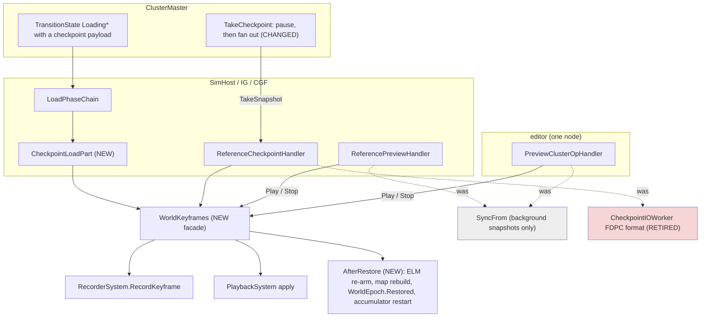
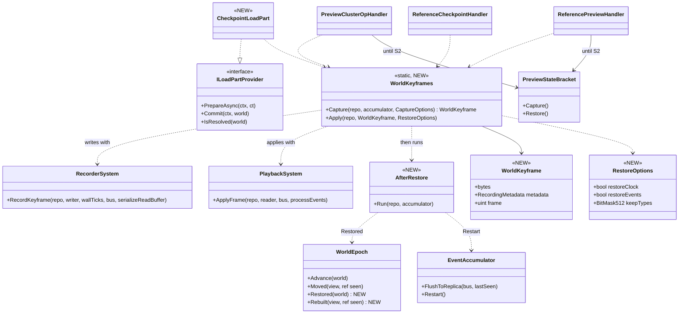
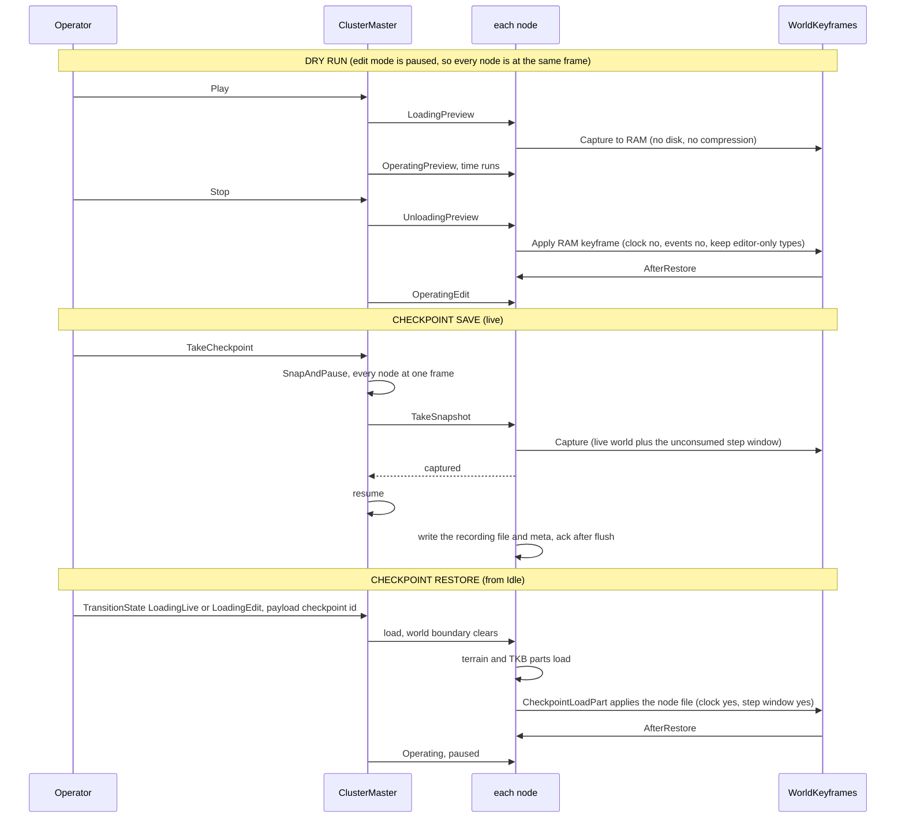

<!--STATUS
state: LIVE
build-state: DESIGN (⏳ the decisions in §5 carry leans awaiting the user; §6 measurements come first)
updated: 2026-10-22 (created — backend; CE-3299; R-3039, R-3040, R-3041; resolves the critical review F1–F12 of Paused and Stepped §7g.0c)
current-answer: §0 the decision · §2–§4 the diagrams · §5 decisions with leans · §6 what is measured before any build · §8 build order
stale-below: nothing
known-rot: none
known-conflict: docs/designs/mgmt-1/DESIGN.md §9.1/§9.3 still DESCRIBE the SyncFrom snapshot and the .dds supplement as the mechanism — both carry SUPERSEDED / WITHDRAWN banners pointing here (R-3040, R-3041).
related-designs:
  - docs/blueprints/DESIGN_Paused_And_Stepped_Execution.md — §7g (R-3039 system memory in components; R-3040 the recorder; R-3041 no network buffers) and §7g.0c the review this resolves. It owns the STATE rules; this owns the SAVE/RESTORE mechanism.
  - docs/designs/mgmt-1/DESIGN.md — §9 checkpoints and dry runs (the operator contract), §8.12 Always Recording, §8.10 lifecycle during replay.
  - docs/designs/replay-and-modules/DESIGN.md — §2.1d go live from recorded state (re-derive, do not restore, protocol state), §2.1m the ELM participant (built), §2.1l the rewind seam.
  - docs/DESIGN_Cluster_Load_Phase.md — the load chain a checkpoint restore runs through (ILoadPartProvider, the world boundary).
  - docs/DESIGN_Deterministic_Network_Ids.md — §2b the preview participants (allocator, entity map, ELM) this narrows.
  - docs/blueprints/DESIGN_Time_Architecture.md — §12a who writes the clock across a Stop.
  - docs/DESIGN_Distributed_Scenario_Persistence.md — the SCENARIO save (JSON, ownership-gated); checkpoints are out of its scope and stay so.
-->
# Checkpoint and dry-run restore — **one mechanism: the flight-recorder keyframe**

## 0. The decision

Four operations — **dry run enter, dry run exit, checkpoint save, checkpoint restore** — save and restore the world as a flight-recorder
**keyframe** (`RecorderSystem.RecordKeyframe` / `PlaybackSystem`), never with `SyncFrom` (R-3040). `SyncFrom` stays the every-frame
background-module snapshot, minimal and fast. A checkpoint restore is a **load** whose content step applies the keyframe instead of building
the scenario. No network buffers are captured; what was in flight is lost (R-3041). A restore is complete only for state in the ECS
(R-3039) — §5 D1 adds the components the recorder skips today.

## 1. INVENTORY — what already exists (codebase-memory `search_graph`, `2026-10-22`; all `has_more: false`)

| query (`label: Class`) | total | the production classes this design touches |
|---|---|---|
| `.*(Checkpoint\|Snapshot).*` | 71 | `CheckpointIOWorker` (the `'FDPC'` writer, read by nothing) · `ReferenceCheckpointHandler` · `TakeCheckpointIntent` · `SharedSnapshotProvider` / `SnapshotPool` (background snapshots — untouched) |
| `.*(Recorder\|Playback\|Replay)(Controller\|System\|Module\|Handler\|Manager).*` | 15 | `RecorderSystem` · `PlaybackSystem` · `PlaybackController` · `EcsRecordReplayController` · `ReplayModule` · `EpisodeRecorderModule` (+ by grep: `AsyncRecorder`, `RecorderTickSystem`, `RecordingModule`) |
| `.*(Preview\|DryRun\|Rewind\|Rewindable).*` | 45 | `PreviewClusterOpHandler` (editor) · `ReferencePreviewHandler` (SimHost / IG / CGF) · `PreviewStateBracket` + `PreviewParticipants` (allocator, entity map ×2, ELM) · `EditorPreviewController` / `EditorPreviewAdapter` |
| `.*LoadPhase.*\|.*LoadStep.*` | 10 | `LoadPhaseChain` · `ILoadPartProvider` · `ScenarioLoadStep` · `TerrainLoadStep` · `KnowledgeBaseLoadStep` · `WorldBoundaryReset` |
| by grep (seams) | — | `EventAccumulator` (`FlushToReplica`, `Restart`) · `WorldEpoch` · `NetworkEntityMap.RebuildFromWorld` · `MasterSyncController.SnapAndPause` · `ClusterMaster.FanOutNodeOp(TakeSnapshot)` |

⇒ **Nothing new is needed to WRITE or READ a world** — both exist and replay uses them. New: one load part, one options record, one
"world restored" signal, and the cluster's pause-then-save order.

## 2. Modules — who calls what (none of this runs every frame)

*What the picture shows that prose hid:* every entry point is an OPERATION (Play, Stop, a checkpoint op, a load), so the cost is per
operation, never per frame; and all four funnel into one facade — the two handlers that today hold a `SyncFrom` rewind and the writer nobody
reads are the dead edges (dashed / red).

## 3. Classes

*What the picture shows that prose hid:* the NEW classes are a facade, an options record, a load part and one step — every arrow out of
them lands on a class that exists; `WorldEpoch` gains a SECOND count (`Restored`) so a restore never reads as "the world ended" (which makes
`CycloneNetworkCleanupSystem` delete every owned entity on the wire, `:52`).

## 4. Sequences

*What the picture shows that prose hid:* the save is two-phase on time — the keyframe is TAKEN while the cluster is paused (cheap, one frame
for all), the file is WRITTEN after resume (slow, off-thread, ack deferred as today); and a restore never meets a running cluster — it is
a load from Idle, so the world boundary has already cleared the world and every load-time reset has already fired.

## 5. Decisions — one per review finding (Paused and Stepped §7g.0c); ⏳ leans await the user

| # | finding | ⏳ lean | rejected — one line |
|---|---|---|---|
| **D1** | F1: `NoReplay`/`Transient` components with sim meaning are not in a keyframe (`SubordinateOrders`, `AirPath`, `PausedTask`, `TrafficCar`, `MissionAdapterState`, `OutgoingGrantsPending`, …) | M4 classifies all 86 types: **sim state ⇒ recordable** (drop `NoReplay`); protocol ⇒ re-derived (`GhostStateTracker`, `PendingNetworkAck`, R-3039 class B); network shadows ⇒ republished (`NetworkTransform`, `NetworkVelocity`); events stay out | record everything — protocol progress restored as-is deadlocks (replay §2.1d) |
| **D2** | F2: a keyframe re-injects recorded events into the current buffers | dry-run exit: `restoreEvents: false`. Checkpoint: capture the **unconsumed step window** (`EventAccumulator` since the last step — the save happens paused, D3) and restore it INTO THE ACCUMULATOR after `Restart`, never into the bus | inject the bus buffers (re-processing) · drop all events (a step's pending orders lost) |
| **D3** | F3: nodes snapshot when the command arrives — different frames | the master pauses first (`MasterSyncController.SnapAndPause`, as `LiveBranchProcessManager` does), fans out `TakeSnapshot`, resumes once every node CAPTURED (not written) | per-node "at frame N" scheduling — new machinery for what a pause already gives |
| **D4** | F4: no reset fires after a keyframe apply | `AfterRestore`: ELM re-arm (exists) → `NetworkEntityMap.RebuildFromWorld` (exists) → `WorldEpoch.Restored` (NEW count; R-3039 class A/B fields reset through `Rebuilt`) → `EventAccumulator.Restart` (+ D2) → a forced keyframe in the running recording (D8) | reuse `Moved` — makes the network cleanup delete every owned entity on the wire |
| **D5** | F5: the clock | `restoreClock`: dry-run exit **false** (Time Architecture §12a owns the Stop), checkpoint restore **true** | one rule for both — Stop would rewind time behind the time system's back |
| **D6** | F6: `NoPreview` vs `NoReplay` | M4 diffs the sets; ONE recorded set if they agree; editor-only state moves to D12's keep list | two filters in the recorder |
| **D7** | F7: recordability is decided at registration, unregistered ⇒ silently not recorded | a rail: every registered component and singleton type has an EXPLICIT `DataPolicy`; M1 lists what a keyframe holds per host | trust the default |
| **D8** | F8: `GlobalVersion` goes back to the recorded tick | apply under `max(live, recorded) + 1` (versions only grow) and force a keyframe in the running recording | let it go back — the always-on recorder skips changes until its next keyframe |
| **D9** | F9: a fixed 32 MB recorder buffer | M2 measures the largest world; the buffer grows when a keyframe does not fit | a bigger constant |
| **D10** | F10: a fresh process — content and node ids | restore is a LOAD (content parts run first; the metadata gains the scenario id and TKB hash beside the terrain name); ⏳ **the master grants the checkpoint's node ids to the same roles** (the metadata records id ↔ role) | remap every owner id inside the data — touches every authority component |
| **D11** | F11: the oracle masks the ids that hide the trajectory pool | R1 compares unmasked once S2 puts the pool in the ECS; until then it compares what a trajectory id POINTS AT | keep masking — the oracle passes over the bug it exists for |
| **D12** | F12: editor-only `Transient` state wiped at Stop | `keepTypes` at dry-run exit: editor/debug types are neither cleared nor overwritten (M4 lists them) | restore them from the keyframe — the Stop would undo the operator's view settings |

## 6. Measure first (M1–M4) — nothing in §8 starts before these

| # | what | how | decides |
|---|---|---|---|
| M1 | what a keyframe holds on each host — components and singletons, recordable or not | a test-only walk of `ComponentTypeRegistry` after each host's composition | D7, D1 |
| M2 | keyframe size and capture time on the largest scenario (300 civilians; `uc-urban-battle`) | `WorldKeyframes.Capture` timed in the editor harness | D9, D3's pause length |
| M3 | apply time on the same world | the same | the dry-run Stop (accepted by the user; recorded) |
| M4 | the 86 `NoReplay`/`Transient` types, each classed: sim state / protocol / network shadow / event / editor-only; and `NoPreview` vs `NoReplay` | read + `search_graph` per type | D1, D6, D12 |

## 7. Rails

| rail | proves |
|---|---|
| **R1 — the oracle** (in-process, then live): a stepped run to T1 → checkpoint → on to T2 = capture A; restore into a FRESH process → step to T2 = capture B; A ≡ B in full component state (`scripts/determinism-probe.py --compare`) | the whole contract; ⚠ red until R-3039 S1/S2 land — each red names the next violator |
| dry run: Play → Stop → Play again equals the first Play, step by step | D1, D2, D4, D12 |
| a restore never moves `WorldEpoch.Moved` (no delete on the wire) and always moves `Restored` | D4 |
| the save captures every node at one frame | D3 |
| the clock is untouched by Stop and restored by a checkpoint | D5 |
| every registered type carries an explicit `DataPolicy` | D7 |

## 8. Build order

**B0** M1–M4 → **B1** `WorldKeyframes` + `RestoreOptions` + `AfterRestore` (+ `WorldEpoch.Restored`) → **B2** the dry run moves (both
preview handlers; `SyncFrom` leaves them; `PreviewStateBracket` keeps only the allocator until S2) → **B3** checkpoint save (pause-first;
`CheckpointIOWorker` writes a recording file + `.meta.json`; `'FDPC'` retires) → **B4** `CheckpointLoadPart` + the restore load → **B5** R1
live, on a scenario set touching every mechanism. ⚠ R1 stays red until R-3039's S1/S2 (Paused and Stepped §7g.1) land — that red is the
work list, not a failure of this design.
