<!--STATUS
state: LIVE
build-state: BUILDING (B1a, B1, B2, B3, B4, D1, D7, D17, B5 built 2026-10-22 — §1b, §1c, §1f, §1g, §1h, §1i, §1j, §1k, §1l, §1m, §6b as-built; CE-3315, CE-3316 (+ D2's checkpoint half), CE-3318 fixed from R1's reds)
updated: 2026-10-22 (D2's checkpoint half BUILT with §1l — unconsumed events delivered at the restore's snap, deviating from "into the accumulator"; §1m: the resume waits for the first step) · 2026-10-22 (§1m CE-3318 BUILT — a restore numbers its next path where the straight run did) · 2026-10-22 (§1l CE-3316 BUILT — a checkpoint on a quiet step; a restore resumes the slow modules' slots) · 2026-10-22 (B5 BUILT — R1 runs in the editor verifier, §1k; 2 of 4 pilot scenarios restore to the same run; CE-3315, CE-3316 filed, CE-3317 fixed) · 2026-10-22 (D7 BUILT — every registrable type declares its DataPolicy, §1j; D17 BUILT — the checkpointing mode, §1i) · 2026-10-22 (D1 BUILT — the 9 SIM-STATE types are recorded, §6b) · 2026-10-22 (B4 BUILT — §1h: the two-phase restore round, a branch that copies its history, CE-3300 closed, CE-3312 filed) · 2026-10-22 (D18 APPROVED, R-3047 — a branch copies its history up to the branch point into a new master-minted exercise) · 2026-10-22 (D18 — a branch never overwrites history: the master mints the branch's exercise id, the recorder refuses an existing file; CE-3300) · 2026-10-22 (D17 the recorder's CHECKPOINTING MODE (R-3045); D5 CORRECTED — the clock is moved by SnapTo in both, never from the keyframe; D13 WITHDRAWN — no in-recording trim exists; D1–D4, D6–D12, D14–D16 APPROVED (R-3046)) · 2026-10-22 (§6b M4 classified: 9 sim-state types to make recordable, ReplicatedBrainIntent and GhostStateTracker watch items) · 2026-10-22 (§6a M1–M3 measured: keyframes 4–8 MiB, 19–31 ms capture, 36 ms apply; singletons ignore DataPolicy — D7 rewritten) · 2026-10-22 (§1b unified? U1–U3 measured, D14–D16, B1a first) · 2026-10-22 (§1a cluster-wide coverage measured) · 2026-10-22 (R-3044 — a checkpoint IS a named keyframe the flight recorder writes on request; restore seeks straight to it; §0/§2/§3/§4/D2/D3/M5/B3 updated) · 2026-10-22 (REVISED after the user's correction — R-3042 a checkpoint never stops the cluster, it is a mark in the running recording; R-3043 a restore keeps what is loaded, it is a seek; §0/§2/§4/D3/D10 rewritten, the pause-first lean moved to HISTORY) · 2026-10-22 (created — backend; CE-3299; R-3039, R-3040, R-3041; resolves the critical review F1–F12 of Paused and Stepped §7g.0c)
current-answer: §0 the decision · §2–§4 the diagrams · §5 decisions with leans · §6 what is measured before any build · §8 build order
stale-below: nothing
known-rot: none
known-conflict: docs/designs/mgmt-1/DESIGN.md §9.1/§9.3 still DESCRIBE the SyncFrom snapshot and the .dds supplement as the mechanism — both carry SUPERSEDED / WITHDRAWN banners pointing here (R-3040, R-3041).
related-designs:
  - DESIGN_Thermal_And_Acoustic_Sensing.md — OWNS the sound ring (§8.3); §8.3a makes hearing survive a restore (CE-3315: the world carries the sound count)
  - DESIGN_Scenario_Regression.md — OWNS the editor verifier R1 runs on (a fresh process per run, one step per frame, full component snapshots, the golden compare); §1k adds the checkpoint around it
  - docs/blueprints/DESIGN_Paused_And_Stepped_Execution.md — §7g (R-3039 system memory in components; R-3040 the recorder; R-3041 no network buffers) and §7g.0c the review this resolves. It owns the STATE rules; this owns the SAVE/RESTORE mechanism.
  - docs/designs/mgmt-1/DESIGN.md — §9 checkpoints and dry runs (the operator contract), §8.12 Always Recording, §8.10 lifecycle during replay.
  - docs/designs/replay-and-modules/DESIGN.md — §2.1d go live from recorded state (re-derive, do not restore, protocol state), §2.1m the ELM participant (built), §2.1l the rewind seam.
  - docs/DESIGN_Cluster_Load_Phase.md — the load chain a checkpoint restore runs through (ILoadPartProvider, the world boundary).
  - docs/DESIGN_Deterministic_Network_Ids.md — §2b the preview participants (allocator, entity map, ELM) this narrows.
  - docs/blueprints/DESIGN_Time_Architecture.md — §12a who writes the clock across a Stop.
  - docs/DESIGN_System_State_Inventory.md — R-3039 S4: the system state a keyframe does NOT carry (its §2 C/X list is what keeps R1 red).
  - docs/DESIGN_Distributed_Scenario_Persistence.md — the SCENARIO save (JSON, ownership-gated); checkpoints are out of its scope and stay so.
-->
# Checkpoint and dry-run restore — **one mechanism: the flight-recorder keyframe**

## 0. The decision

🔒 **User, verbatim (`2026-10-22`):** *"Saving a checkpoint cannot stop a cluster. Checkpoint is something that happens while everything else is running. The system can be creating checkpoints on the fly at regular intervals. and it should not interfere with the running simulation. The similar is like flight recorder also doesn't stop the cluster just to record state every frame."* · *"Restoring a checkpoint is allowed, but it shouldn't reload everything from scratch. What is already loaded should stay loaded."*

⭐⭐ **The running flight recording IS the checkpoint stream** (R-3040, R-3042, R-3043). Every node already records its live world — a keyframe every 60
frames and deltas between, each frame stamped with the frame-locked `GlobalTime.TotalWallTicks` — without pausing anything ("Always Recording",
mgmt-1 §8.12). ⇒ **a checkpoint is a TIME** in that recording (a named mark; periodic checkpoints cost nothing — the keyframes are already
there); **a restore is a SEEK** of every node's own recording to that time — the cluster replay seek that already lines nodes up from one
shared zero (`ProcessSeekReplayIntent`, R-4012) — then the after-restore step and live, paused. A seek applies keyframe + deltas and keeps
every singleton, so **terrain, TKB and navmesh stay loaded**; only a fresh process (after a crash) runs the load chain first, which skips
whatever is resident (`TerrainLoadStep:55`, `KnowledgeBaseLoadStep:99`). The **dry run** keeps its own RAM keyframe (Play captures, Stop
applies). `SyncFrom` stays the every-frame background snapshot. No network buffers (R-3041). Complete only for state in the ECS (R-3039; D1).

⭐⭐⭐ **`R-3044` (`2026-10-22`) — A CHECKPOINT IS A NAMED KEYFRAME THE FLIGHT RECORDER WRITES ON REQUEST.** 🔒 User, verbatim: *"So whenever we need to save a checkpoint, we could basically just force the flight recorder to write a keyframe."* · *"I think to design doesn't prevent saving everything, and it is what is already done, so I think that holds. So I think yes, please write this as a ruling."*
- **save:** the master sends *checkpoint X at wall time T* (T a moment ahead, on the shared zero); each node's recorder writes a KEYFRAME on its
  first frame with `TotalWallTicks ≥ T` and labels it X — no pause, one keyframe the recorder would have written within 60 frames anyway; every
  node lands within one frame of T.
- **restore:** every node seeks its own recording STRAIGHT TO the keyframe labelled X (a pure keyframe apply — no deltas after it), then
  `AfterRestore`, a new recording segment, live paused. Content stays loaded (R-3043).
- **periodic:** the regular keyframes (every 60 frames) already allow a restore to any second; a forced keyframe adds an exact, named instant.
- **collect (bug report):** export that one keyframe as a one-frame recording (readable by the existing replay code).
- ⭐⭐ **THERE IS NO CHECKPOINT MECHANISM OUTSIDE THE FLIGHT RECORDER** (R-3044, R-3045): no checkpoint stream, writer, file format or
  capture of its own. A checkpoint is a recorder keyframe; periodic checkpoints are the recorder's keyframes; a session that wants ONLY restore
  points runs the recorder in its **checkpointing mode** (D17). The `'FDPC'` checkpoint writer retires.
- **design basis — the recorder records the FULL state:** [replay-and-modules §2.3](designs/replay-and-modules/DESIGN.md) *"Every Brain/Muscle node
  records its full ECS state — both owned components and unowned ghost components"*; going live from a recording is shipped (`PrepareLive`).
  📐 In code the only exclusion is a `NoReplay`/`Transient` marking — D1.

## 1. INVENTORY — what already exists (codebase-memory `search_graph`, `2026-10-22`; all `has_more: false`)

| query (`label: Class`) | total | the production classes this design touches |
|---|---|---|
| `.*(Checkpoint\|Snapshot).*` | 71 | `CheckpointIOWorker` (the `'FDPC'` writer, read by nothing) · `ReferenceCheckpointHandler` · `TakeCheckpointIntent` · `SharedSnapshotProvider` / `SnapshotPool` (background snapshots — untouched) |
| `.*(Recorder\|Playback\|Replay)(Controller\|System\|Module\|Handler\|Manager).*` | 15 | `RecorderSystem` · `PlaybackSystem` · `PlaybackController` · `EcsRecordReplayController` · `ReplayModule` · `EpisodeRecorderModule` (+ by grep: `AsyncRecorder`, `RecorderTickSystem`, `RecordingModule`) |
| `.*(Preview\|DryRun\|Rewind\|Rewindable).*` | 45 | `PreviewClusterOpHandler` (editor) · `ReferencePreviewHandler` (SimHost / IG / CGF) · `PreviewStateBracket` + `PreviewParticipants` (allocator, entity map ×2, ELM) · `EditorPreviewController` / `EditorPreviewAdapter` |
| `.*LoadPhase.*\|.*LoadStep.*` | 10 | `LoadPhaseChain` · `ILoadPartProvider` · `ScenarioLoadStep` · `TerrainLoadStep` · `KnowledgeBaseLoadStep` · `WorldBoundaryReset` |
| by grep (seams) | — | `EventAccumulator` (`FlushToReplica`, `Restart`) · `WorldEpoch` · `NetworkEntityMap.RebuildFromWorld` · `MasterSyncController.SnapAndPause` · `ClusterMaster.FanOutNodeOp(TakeSnapshot)` |

⇒ **Nothing new is needed to WRITE or READ a world** — both exist and replay uses them. New: one load part, one options record, one
"world restored" signal, and the cluster's pause-then-save order.

### 1a. ⭐ CLUSTER-WIDE, NOT EDITOR-ONLY — measured `2026-10-22` (user: *"make sure"*)

| host | records (`EcsRecordReplayController`) | starts recording at live load (`ReferenceLiveLoadHandler`) | answers the cluster seek (`ReferenceReplayLoadHandler`) | dry run on its own world |
|---|---|---|---|---|
| SimHost · IG · traffic node · Stride node (all through `NodeBootstrapper.BuildOrchestration`) | ✅ `NodeBootstrapper.cs:276` — every ECS host, every role (R-4011; R-4003 for IG) | ✅ | ✅ | ✅ `ReferencePreviewHandler(world, …)` `:335` |
| CGF (`CgfSubsystem`) | ✅ `CgfSubsystem.cs:1067` | ✅ | ✅ | ✅ `:1260` |
| editor (`EditorSubsystem`) | ✅ `:1605` | ✅ `:1851` | ✅ `:1841` | ✅ `PreviewClusterOpHandler` `:701` |
| ExCon | ⛔ none — no ECS world (R-4011) | — | — | `ReferencePreviewHandler(liveRepo: null)` — nothing to rewind |

⇒ the recording every checkpoint is a keyframe of, the seek every restore is, and the dry run run on **every ECS host of the cluster**.
⚠ `CgfApplication` (a CGF "skeleton", `liveRepo: null` dry run) is constructed by no production code — not touched here.

### 1b. 🔴 UNIFIED AND SHARED? — measured `2026-10-22` (user: *"and that the implementation across hosts is unified and shared, no duplications"*)

| # | duplication | evidence | ⏳ lean (D14–D16) |
|---|---|---|---|
| **U1** | **two dry-run handlers for one concept** — `ReferencePreviewHandler` (nodes, through the cluster's 2PC) and `PreviewClusterOpHandler` (editor, called directly by `EditorPreviewController`, on no slave) | `NodeBootstrapper.cs:335`, `CgfSubsystem.cs:1260` vs `EditorSubsystem.cs:701`; already recorded as diverging — [Deterministic Network Ids §2b](DESIGN_Deterministic_Network_Ids.md) *"one concept, already diverging"* | **D14**: B2 builds ONE dry-run handler (in `Fdp.Toolkits` Orchestration) that both entry points call; the other is deleted. ⛔ never two keyframe paths |
| **U2** | **the editor builds its recorder by hand, twice** — `new EcsRecordReplayController(...)` instead of `ForNode` (*"the ONE composition every ECS host uses"*, P5a / R-4011), and a SECOND instance on the same world for the debug API | `EditorSubsystem.cs:1605`, `:2362` vs `NodeBootstrapper.cs:276`, `CgfSubsystem.cs:1067` | **D15**: the editor uses `ForNode` (so its seeks clear and gate the ELM like every host), ONE instance shared with the debug API |
| **U3** | **the cluster-handler set is composed in three hand-written places** — `NodeBootstrapper.BuildOrchestration` (SimHost, IG, traffic, Stride), `CgfSubsystem`, `EditorSubsystem` each register replay-load, live-load, prefetch, load chain and dry run. ⛔ **The checkpoint handler is registered in only ONE** — CGF and the editor take no checkpoint today | `ReferenceCheckpointHandler` only at `NodeBootstrapper.cs:308`; `ReferenceReplayLoadHandler` / `ReferenceLiveLoadHandler` / `ReferencePrefetchHandler` / `LoadPhaseChain.FromRoles` each at the three sites | **D16**: ONE shared composition ("the cluster handlers of an ECS host": recorder controller, replay load, live load, checkpoint keyframe request, dry run, prefetch, load chain) called by all three hosts; a rail asserts every ECS host's slave holds the same set — the pattern of `EveryEcsHostComposesTheLoadPhaseChainRails` |

⇒ the CLASSES are shared; the COMPOSITION is not, and that is where the editor and CGF already drifted (no checkpoint, no ELM gate). ⭐ D16 comes FIRST in the build (B1a), so every later step changes one place.

✅ **BUILT `2026-10-22` (B1a) — as-built:**

| | |
|---|---|
| **D16** | `EcsHostClusterHandlers.Compose(EcsHostClusterHandlerInputs)` (`Hrot.Network.Orchestration`, beside `EcsRecordReplayController`) registers, in ONE order: replay load → checkpoint (where a worker is given — ⏳ B3 makes it every host's) → dry run → prefetch → terrain/zone ops → the host's scenario handlers (episode load) → load chain → scenario save + archive → live load. `NodeBootstrapper` (SimHost, IG, traffic, Stride), `CgfSubsystem` and `EditorSubsystem` call it; each keeps only its OWN pieces (the load providers, the episode handler, the diagnostics dump). Rail: `EveryEcsHostComposesOneClusterHandlerSetRails` (the constructed order + a source scan that no root builds a member by hand). ⚠ **Deviation:** the replay handler is now registered even when a host passes no replay groups — the old conditional only a test ever exercised (every production host passes them); `NodeBootstrapperReplayTests` rewritten to pin the new rule. CGF's episode handler moved ahead of the load chain (they claim disjoint ops — `StartEpisode`/`StopEpisode` vs `Prepare*`) |
| **D15** | the editor's recorder comes from the composition (`ForNode` — the ELM is gated during replay and cleared at a seek; the replay handler gets the world-replacement hook); the debug API's `/recording/*` drives the SAME instance (⛔ was a second `new EcsRecordReplayController` on the same world) and refuses to start while a cluster run is recording (it would orphan that recording) |
| **D14** | ONE dry-run class: `ReferencePreviewHandler` (Fdp.Toolkits) gains `TriggerLoadingPreview` / `TriggerUnloadingPreview` (the editor's toolbar) and keeps the first capture when a second arrives (two entry points now reach it); `PreviewClusterOpHandler` DELETED. The editor's slave holds the same instance its toolbar drives ⇒ a dry run started by the cluster master now rewinds the editor's world too (it was unclaimed there). `includeTransient` stays a constructor input until B2 (the editor's copy took Transient types — HN-016). `EditorPreviewAdapter` (test-only, edit-1 §4.G) ROUTED onto it, not deleted. Its tests re-homed: `ReferencePreviewHandlerTests` (the deleted twin's suite was the only one either handler had) |

### 1c. ✅ B1 — as-built `2026-10-22` (the keyframe facade, the after-restore step, D7)

| | |
|---|---|
| **`WorldKeyframes`** (`Fdp.Toolkits/Replay`) | `Capture(repo)` = `RecorderSystem.RecordKeyframe` into RAM (no events); `Apply(repo, keyframe, RestoreOptions)` = `PlaybackSystem.ApplyFrame` on a copy whose header tick is rewritten to `max(live, recorded) + 1` — ⭐ D8 without touching the reader (versions only grow; the keyframe is reused unchanged). `RestoreOptions.RestoreEvents` off by default (D2). ⚠ **Deviation:** `CaptureOptions` / `keepTypes` (D12) NOT built here — they belong to B2, where the dry run's type set is decided against the determinism rails |
| **`AfterRestore.Run(repo, accumulator?)`** | entity map `RebuildFromWorld` → `WorldEpoch.Restored` → `EventAccumulator.Restart`. ⏳ The ELM re-arm stays with the dry run's participant (it already re-derives) until S2; the running recording's forced keyframe is B4 |
| **`WorldEpoch`** | ⚠ **Deviation from §3's names:** `Restored(world)` bumps `RestoreCount` and a `Generation`; ⭐ **`Moved` now watches `Generation`** (a boundary OR a restore — the ~70 per-id caches clear on both, with no call-site change) and the NEW **`Ended`** watches the world number only. `CycloneNetworkCleanupSystem` (the one reaction that acts on the wire) moved to `Ended`; `WorldBoundaryProbe` accepts either. ⛔ §3's `Rebuilt` was not added — `Moved` IS it |
| **D7 — root cause found and fixed** | 🔴 `ComponentTypeRegistry.GetOrRegisterManaged` (the ONLY registration a singleton gets — `SetSingleton*` → `ManagedComponentType<T>.ID`) set every type recordable/snapshotable/saveable and IGNORED `[DataPolicy]`: that is why `WorldEpoch` (`Transient`) and `StaticObstacleBakery` (already `NoReplay`!) were flagged recordable (§6a M1). ⚠ For a MANAGED singleton the flag did not reach the bytes — it has no table version, so no keyframe carries it (measured, pinned by a rail); an unmanaged one is versioned and was recorded. It now reads the attribute at first registration. `[DataPolicy]` may sit on an interface (a service singleton is keyed by one); `NoScenario \| NoReplay` added to `ITkbDatabase`, `INavmeshProvider`, `ICoverProvider`, `IGeographicTransform`, `IPathRegistry`, `NetworkEntityMap`, `CanvasContextMenuState`. ⚠ Replays are affected too, intentionally: a seek no longer replaces the loaded TKB / navmesh / entity map with a deserialized copy. ✅ **The "every registered type has an explicit policy" rail — BUILT `2026-10-22`** (§1j) |

### 1d. ⚠ A recording must name the same event types in every process — CE-3302 (`2026-10-22`)

A checkpoint (B3) is a recorder keyframe, and an export is read by ANOTHER process. 🔴 Measured: a managed event's type id was `FullName.GetHashCode()`, which .NET randomises per process, and the recorder writes that id into each frame's event block (`RecorderSystem.cs:740`) ⇒ events in a recording named different types once re-read elsewhere. ✅ Fixed: `Fdp.Core.StableHash` (FNV-1a) for the bus, the command buffer and the blueprint event fallback; rail `NoIdFromAProcessRandomisedHashTests`. ⚠ Keyframes for restore do not carry events (`RestoreOptions.RestoreEvents` defaults to false), so B1 was not exposed; recordings and exports are.

### 1e. 📐 B2 measured — a keyframe rewind vs `SyncFrom`, on a live world (`2026-10-22`)

Throwaway probe in the in-process cluster harness (`uc-urban-battle`, SimHost ≈ 730 entities, 300 frames after spawn): capture both ways at F, run 120 frames (280–544 of ≈ 9 000 component values change), rewind by keyframe, fingerprint every entity × component (JSON of the value), rewind by `SyncFrom`, fingerprint again.

| set | keyframe vs F | `SyncFrom` vs F |
|---|---|---|
| node (`Snapshotable`, no singletons) | first 68 → ✅ **0** after CE-3305 | 0–1 (`DescriptorOwnership`) |
| editor (`All`, no singletons) | first 70 → ✅ **0** after CE-3305 | **1** (`AirPath`) |

⭐ Two findings. ① The recorder dropped state (`Guid` → empty, state behind a read-only view or a get-only collection) — **CE-3305**, fixed with a rail; it was losing the same state in every replay and checkpoint. ② `SyncFrom` copies a managed component BY REFERENCE, so a later in-place mutation leaks into the "snapshot" and the rewind does not undo it — the keyframe, which serializes, is the more correct rewind. ⇒ B2 may move the dry run onto keyframes with `CaptureOptions.NodeDryRun` / `EditorDryRun` (the same type sets `SyncFrom` used; `RecorderSystem.ComponentTypeFilter`, `RecordSingletonTables = false`).

### 1f. ✅ B2 — as-built `2026-10-22` (the dry run on a RAM keyframe; the cluster's clock)

| | |
|---|---|
| **`ReferencePreviewHandler`** (the one dry run, D14) | `LoadingPreview` → `WorldKeyframes.Capture(world, CaptureOptions)` (`NodeDryRun`, or `EditorDryRun` when the host passes `includeTransient` — HN-016's difference is now a TYPE SET, not a copy flag); `UnloadingPreview` → `WorldKeyframes.Apply(world, kf, RestoreOptions.DryRunExit)` → `PreviewStateBracket.Restore()` (the allocator, until S2) → `AfterRestore.Run(world, accumulator)`. ⛔ `SyncFrom` is gone from the dry run; it stays the background snapshot only. The host's `EventAccumulator` reaches it through `EcsHostClusterHandlers` (the silent-default rule: the composition holds it, so it passes it). Singletons are untouched by the apply — `EntityRepository.Clear()` clears entity tables and the bus, not singletons — so the TKB, navmesh and entity map stay loaded |
| **`PreviewClockProcessManager`** (`Hrot.Orchestrator`, NEW — D5's cluster half) | ticked by `OrchestratorCore` after the seek manager; reads `ClusterStateTransitionedEvent`; remembers `ITimeController.GetCurrentState()` at `LoadingPreview`; on `OperatingEdit` straight after `UnloadingPreview` calls `ITimeCommands.SnapTo(that)`; a dry run ended any other way (a load, an abort) forgets it. ⚠ **Deviation from D5's text** (*"closed by D14's one handler"*): the handler runs on every node, but the clock is the MASTER's, so the snap lives beside the master's other process managers, not in the handler. The editor's own Play/Stop keeps its local snap (`CE-3156`) — the editor's toolbar does not start a cluster transition, so the two never both fire for one dry run |
| rails | `ReferencePreviewHandlerTests` (the rewind puts back mutated values, not just a capture) · `PreviewClockProcessManagerTests` (snaps once, to the Play position, only after the world is back; an abandoned dry run snaps nothing) · `DeterminismRails` / `DirectorIdentityRails` / `PreviewLifecycleRails` 11/11 (the record round trip needed the editor's recording path fixed — it named node 0 since CE-3228) · ✅ `TakeCoverScenarioTests` 6/6 after behaviors fixed CE-3306 (merged `e19e0e3e2`, `2026-10-22`): `CE2101_PreviewFromEdit` now REACHES the dry run's Stop and passes it — the rifleman is back within 0.5 m of where it stood in Edit, on a cluster (B2 closed) |

### 1g. B3 — the labelled keyframe, in detail (`2026-10-22`; build-state: BUILT — as-built table at the end)

📐 **What B3 starts from** (grep + graph, `2026-10-22`): `ClusterMaster` fans `TakeCheckpoint` out as `NodeOpType.TakeSnapshot` with no payload
(`ClusterMaster.cs:498`, `:788`); only **SimHost** composes a checkpoint handler (`EcsHostClusterHandlers.Compose` registers it only when the host
owns a `CheckpointIOWorker`, `SimHostNodeBootstrapper.cs:382`) — ⇒ CGF, IG, the traffic node, Stride and the editor take NO checkpoint today;
`CollectCheckpoint` is an enum value no code handles; the recorder writes a keyframe every 60 frames with no input
(`RecorderTickSystem.cs:61`) and its `.meta.json` only at `Dispose` (`AsyncRecorder.cs:342`); `RecordingModule` is a DIRECT module, so its
`EveryFrame` recorder runs on paused frames too (`ModuleHostKernel.cs:711`) — a mark at T lands whether the cluster runs or is paused.

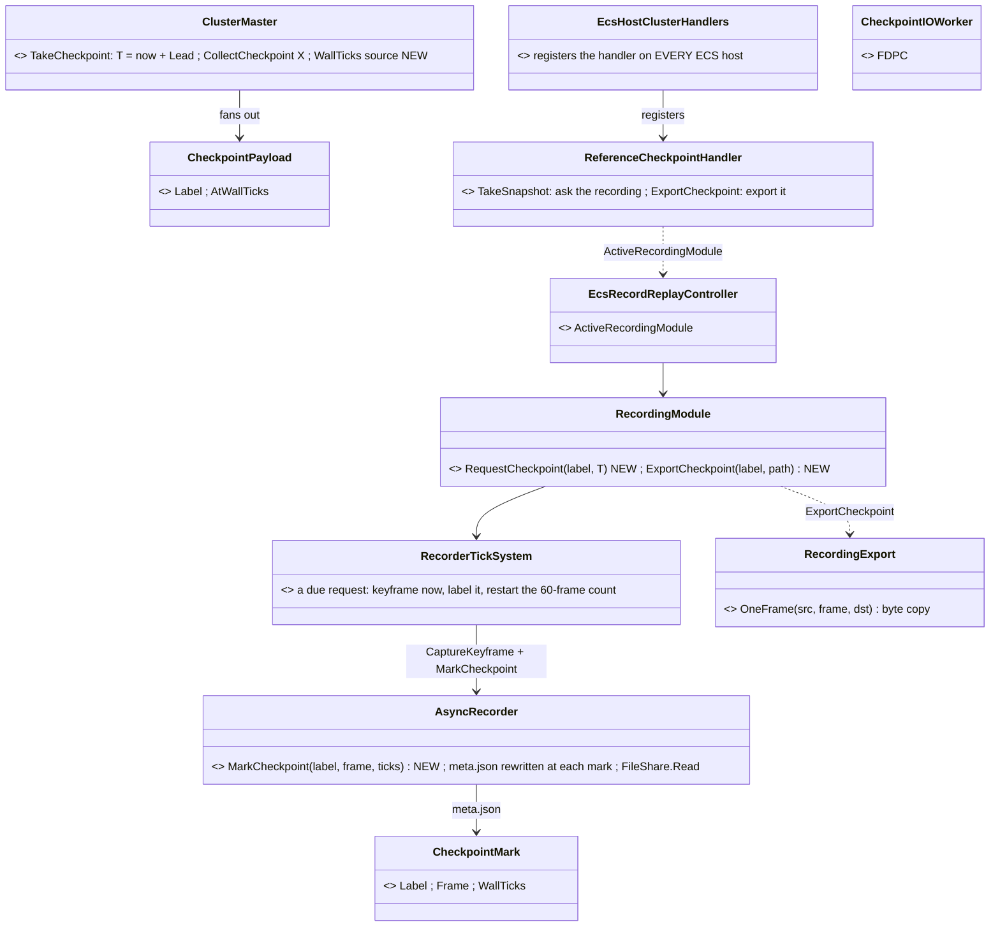
*What the picture shows that prose hid:* every arrow ends in a class that already runs; the only state B3 adds is a pending request in the
recorder and a list of marks in the metadata it already writes — and the handler reaches every host through the one composition, so the
four hosts that took no checkpoint get one with no host code.

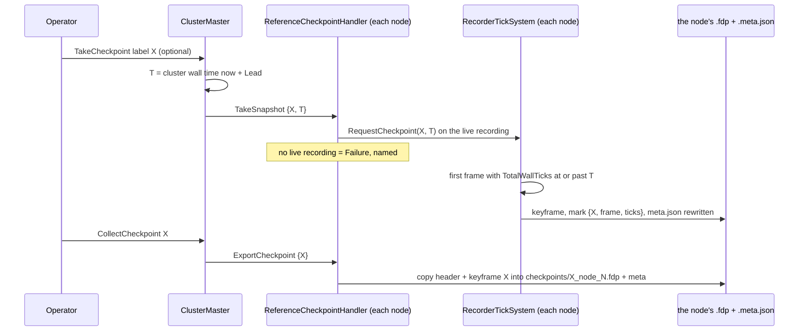
*What the picture shows that prose hid:* the save never waits on the node — the handler answers when the request is queued, and the keyframe
lands at T on every node; only COLLECT reads the file, so it is the one step that must find the mark already written.

| decision | why | rejected — one line |
|---|---|---|
| **T = the master's wall time + `Lead` (0.5 s)**, read through `ITimeController.GetCurrentState().TotalWallTicks` (the clock slaves follow by PLL) | D3: every node lands within one frame of T; 0.5 s covers the fan-out | write on receipt — skew = message latency |
| the master's time source is PASSED by both hosts that build one (`OrchestratorCore`, the editor) and pinned by a rail; without one, T = 0 ⇒ "the next frame", logged | the silent-default rule | an optional parameter nobody passes |
| the label: the request's, else `cpN-HHmmss` (a per-master sequence + T — 📐 two unnamed checkpoints in one second collided as `cp-HHmmss`, caught by `e2e_overlapping_checkpoints`); a label already in the recording is REFUSED | a restore names one keyframe | silent overwrite / auto-suffix |
| ack = "queued on a live recording" (Success) or "this node is not recording" (Failure, named) | the save must not wait (R-3042) | ack after the write — the master would wait the lead on every save |
| the mark goes into `RecordingMetadata.Checkpoints`, and `.meta.json` is REWRITTEN at each mark (off the main thread) | a crash keeps the marks (D10: a fresh process restores) | marks in memory until `Dispose` — lost with the process |
| the keyframe's events = that frame's bus, as every keyframe — **D2 verified equal to today's flush** (`FlushToReplica(bus, GlobalVersion − 1)` = the events after the previous frame) | nothing to add for a running cluster | ⏳ a PAUSED multi-frame step window — the restore (B4) decides what it needs |
| export = a byte copy of the global header + the marked keyframe (`FrameMetadata` positions) into `checkpoints/X_node_N.fdp` + its meta; the recorder opens its file `FileShare.Read` and flushes after a marked frame | R-3044 "collect": readable by the existing replay code, no decode | re-serialize the world — a second writer |
| ⛔ `CheckpointIOWorker` + the `'FDPC'` capture are DELETED | R-3044: no checkpoint mechanism outside the recorder; it is read by nothing (§1) | keep it beside — two implementations |

**As built (`2026-10-22`).** Graph inventory before the build (`search_graph` `.*(Checkpoint|Recorder|Recording).*`, 118 classes): no
frame-copy helper existed — `RecordingExportService` decodes a recording to JSON, a different job — so `RecordingSlice` is new (B4's D18
"copy the history up to T" is its second user).

| piece | where | ⚠ deviation / finding |
|---|---|---|
| `CheckpointMark` + `RecordingMetadata.Checkpoints` · `AsyncRecorder.MarkCheckpoint` (meta rewritten off the main thread, in order) · `HasCheckpoint` · `WaitForWrites` · the file opened `FileShare.Read` | Fdp.Core | ⭐ a mark's `Frame` counts frames WRITTEN — the non-blocking recorder may drop a delta, so it is the file's position, not the tick count (📐 found by the rail: 4, not 7) |
| `RecordingSlice.CopyFrames` (header + frames, byte copy, `FileMode.CreateNew`) | Fdp.Core | — |
| `RecorderTickSystem.RequestCheckpoint` · `RecordingModule.RequestCheckpoint` / `ExportCheckpoint` | Fdp.Toolkits | a checkpoint IS that interval's keyframe (the 60-frame count restarts). ⚠ A request whose T has not come when the recording ends is never written — its op already answered Success |
| `ReferenceCheckpointHandler` (rewritten: `TakeSnapshot` + new `ExportCheckpoint` = 31 on both enums) · `CheckpointPayload` / `ExportCheckpointPayload` · the slave decodes both | Toolkits / Network | registered by `EcsHostClusterHandlers.Compose` ⇒ SimHost, IG, CGF, Stride, traffic and the editor all take one (only SimHost did) |
| `ClusterMaster`: `WallTicks` (set by `OrchestratorCore` from its time reads), `CheckpointLeadTicks` 0.5 s, the label, `CollectCheckpoint`; `CollectCheckpointIntent` (9067) + both translators | Orchestrator / Network | ⭐ `TakeCheckpointIntent` gains `Label` — the CMC-S003 shape rail ("only RequestId") is re-pinned |
| ⛔ deleted: `CheckpointIOWorker` (+ its tests), the SimHost bootstrapper's worker, `ReferenceLiveLoadHandler`'s drain parameter | — | — |
| 🔴 **a live run without an exercise id does not RECORD** — so it has no checkpoint (the handler fails, named). 📐 The test `clusterop` action went live with none (the operator panel mints one); the `'FDPC'` path had hidden it by snapshotting anyway | `ReferenceLiveLoadHandler` (`_pendingExerciseId == Empty` ⇒ no `PrepareRecordingAsync`) | ⏳ `CE-3310` — lean: the master mints an exercise id for every live run (mgmt-1 §8.12 "Always Recording"); the script now passes one |
| ⚠ name clash, not changed | `DebugApiService.Checkpoint()` (`POST /checkpoint`) | it is the PREVIEW rewind (enter preview paused), not this checkpoint — a duplicate SURFACE name; left for the ui lane |

| rail | proves |
|---|---|
| `RecordingModuleTests.CE3299_B3_*` (3) | the keyframe lands on the first frame at or past T, is named, the mark is on disk before the recording ends, a label is unique · the export is a one-frame recording that replays the world AT the mark, while the source is still written, never overwriting · the handler queues on a live recording and FAILS on a node that is not recording |
| `ClusterMasterCheckpointTests.CE3299_B3_*` (3) | T = the master's clock + the lead, the label, both reported · no clock ⇒ the next frame, a minted name · collect fans `ExportCheckpoint`, a label-less one is rejected |
| ⭐ `CheckpointClusterTests` (cross-node, the in-process cluster: simhost, ig, excon, cgf, live `tt-take-cover`) | a checkpoint on a LIVE cluster: the cluster stays live, SimHost / IG / CGF each write the keyframe and export it; 📐 **the three landed within 94 ms** (median frame 9 ms) — the slaves' PLL clocks trail the master's here, R-3041's accepted residual, NOT D3's "within one frame" |

📐 **M5 (partial):** the frames over the 1.5 s around a checkpoint on the in-process cluster: median 9.1 ms, p95 19.3 ms, max 112.8 ms —
the window also holds the periodic keyframes, so 112 ms is an UPPER bound for the checkpoint frame (three hosts in one thread, debug).
⏳ the isolated cost of `MarkCheckpoint` (manifests + JSON on the main thread) is not separated.

📐 **Reds at B3's gate, both pre-existing** (red at `a0c2e318b`, a clean build before B2/B3, in a worktree):
`ClusterOpE2eScriptTests.RecordAndReplaySeek_Passes` (already `QA-031`) · `RecordReplayIntegrationTests.NodeBootstrapper_ImageGeneratorRole_NoControllerRegistered`
— it asserts the role gate R-4011 retired (`CE-3311`).

### 1h. B4 — restore a checkpoint, and a branch that keeps its history (D18) (`2026-10-22`; build-state: BUILT — as-built table at the end)

📐 **What B4 starts from** (graph `search_graph .*(Restore|Branch|Seek|GoLive|LiveFrom).*` = 29 classes, + grep, `2026-10-22`):
- **The branch from a replay already exists:** `OperatingReplay → LoadingLive` (`HrotStateGraph.cs:50`); `ReferenceReplayLoadHandler` claims `PrepareLive` while a replay is open, tears it down and records the exercise id the REQUEST carries (`:255–257`). `LiveBranchProcessManager` freezes time first and `SnapTo`s the branch time after (`:62`, `:74`).
- **A live cluster cannot reach a replay without unloading:** Live → Replay goes `UnloadingLive → Idle → LoadingReplay` (`HrotStateGraph.cs:45–48`), and passing Idle tears the session down. ⇒ a restore from LIVE is its own op, not a DSM path (R-3043: what is loaded stays loaded).
- **The cluster op was always meant:** mgmt-1 §9.3 names `ClusterOpRequest(RestoreCheckpoint)` and no enum carries it. `NodeOpType.RestoreSnapshot = 5` is a dead slot ("restores ECS from recording snapshot", `Hrot-Simulation-Pipeline.md:678`) — it is REUSED, not a new value.
- **A two-phase round already exists:** the zone load (`StartZoneLoadRound`, `ClusterMaster.cs:1019`): phase 1 stages under the round's id on every node, phase 2 runs only when all staged, and a failed phase 1 sends `AbortTransaction` so the nodes drop what they staged. ⚠ `ClusterSlave` commits each node right after ITS OWN prepare (`ClusterSlave.cs:306`), so a one-phase restore could leave half the cluster restored.

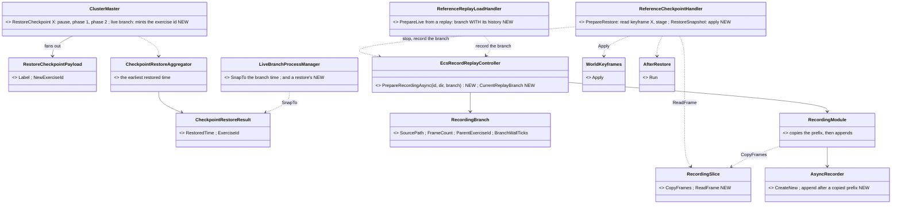
*What the picture shows that prose hid:* a restore and a replay branch END the same way — "record a new exercise whose first frames are a
copy of the old one up to the branch point" — so ONE `RecordingBranch` feeds both, and the restore's only new world code is the existing
keyframe apply and `AfterRestore`.

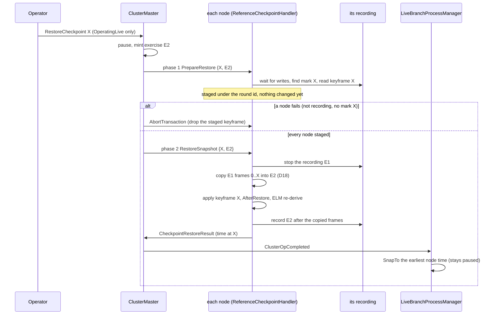
*What the picture shows that prose hid:* the first phase changes nothing, so the only failure that can leave nodes apart is an I/O error in
phase 2 — and the recording E1 is never written again after X, so every later restore of E1 still finds its frames (D8).

| decision | why | rejected — one line |
|---|---|---|
| ⭐ RESTORE = a two-phase round: phase 1 reads and stages keyframe X, phase 2 applies | phase 1 fails on any node ⇒ no node is touched | one phase — `ClusterSlave` commits each node at once, so a node with no mark leaves the rest restored |
| restore only from `OperatingLive` (else Rejected, named) | a replay already has seek + go-live; B4 does not add a second path to it | Live → Idle → Replay → seek → branch — Idle unloads the session (R-3043) |
| the master mints the branch's exercise id on BOTH branches (restore, and replay → live); the requester's id is ignored and logged | D18 ① — one HTTP client with the wrong id truncated an exercise | trust the request |
| ⭐ a branch COPIES its parent's frames up to the branch point, then appends (D18 ②): `RecordingBranch` + `RecordingSlice.CopyFrames`; the copied marks and the parent's id + branch time go into the new `.meta.json` | every exercise replays straight through its branch point, alone | an empty branch from T (today) — its replay starts at T |
| the recorder opens `FileMode.CreateNew` (D18 ③) | a branch never overwrites | `Create` (today) — the truncation D18 found |
| the clock: each node returns ITS mark's recorded time; the master `SnapTo`s the EARLIEST, and stays paused | D5; the marks differ by ≤ one PLL residual (94 ms measured, §1g) | the master's T — no node holds a keyframe at exactly T |
| events: the keyframe's events are NOT re-injected (`RestoreOptions` default) | D2's step-window refill is ⏳ (no step window in a running live cluster) | re-inject — acts twice |
| ids: no allocator reset | ids only grow; an id used after X is a gap, never a collision | reset to the recording's high-water mark |

⏳ Not in B4: a restore from `OperatingReplay` by label · a FRESH process (D10: load chain first) · R1 (B5).

**As built (`2026-10-22`).**

| piece | where | ⚠ deviation / finding |
|---|---|---|
| `RecordingBranch` · `RecordingSlice.ReadFrame` · `RecordingMetadata.ParentExerciseId` / `BranchWallTicks` · `CheckpointMark.TotalTime` / `UnscaledTotalTime` / `FrameNumber` (the clock a restore goes back to) | Fdp.Core | — |
| `AsyncRecorder(path, meta, appendAfterFrames)`: 0 = `CreateNew`, N = append after a copied prefix, counting from N | Fdp.Core | ⚠ **`CreateNew` is the EXERCISE recorder's** (`RecordingModule` uses this constructor); the old `AsyncRecorder(path, meta)` keeps `Create` — the examples (Showcase, CarKinem) and ~100 tests record to fixed or pre-created files, and D18's hazard is the cluster's exercise recording |
| `RecordingConfiguration.Branch` → `RecordingModule.StartBranch` (copy, inherit the parent's marks / terrain / geo origin / max network id, name the parent) | Toolkits | — |
| `IRecordReplayController.PrepareRecordingAsync(id, dir, branch)` + `CurrentReplayBranch` (default interface members) · `EcsRecordReplayController` implements both · `ReplayModule.CurrentFrame` / `CurrentFrameWallTicks` / `FilePath` / `RecordedExerciseId` | Fdp.Core / Network | — |
| the replay branch: `ReferenceReplayLoadHandler` (`PrepareLive` from a replay) records the branch WITH its history, and refuses an empty id · `ClusterMaster.ExecuteTransitionTrajectory` mints the id for `OperatingReplay → LoadingLive` | Toolkits / Orchestrator | — |
| `ClusterOpType.RestoreCheckpoint = 21` (both enums) · `NodeOpType.PrepareRestore = 32` · `RestoreSnapshot = 5` reused · `RestoreCheckpointPayload` / `CheckpointRestoreResult` · `RestoreCheckpointIntent` (9068) · the three translators | Toolkits / Network | — |
| `ClusterMaster.StartRestore` / `CommitRestore` (the zone round's two phases) · `CheckpointRestoreAggregator` (registered by `OrchestratorCore`) · `LiveBranchProcessManager` snaps on a `CheckpointRestoreResult` | Orchestrator | — |
| `ReferenceCheckpointHandler`: `PrepareRestore` stages (off the main thread), `RestoreSnapshot` stops the recording, `Commit` applies + `AfterRestore` + the ELM re-derive + starts the branch recording; an abort of the staged round drops it. `EcsHostClusterHandlers.Compose` passes it the controller, world, accumulator, ELM hook and staging root | Toolkits / Network | ⚠ the branch recording's install completes on a later tick, AFTER the node answered: a failure to start it is logged, not reported in the round |
| a branch writes its `.meta.json` with its FIRST frame (`RecorderTickSystem` → `AsyncRecorder.WriteMetadata`) | Toolkits / Fdp.Core | D10: the parent and the inherited marks are on disk at once, not only at the next mark or the end |
| 🔴 `NodeOpMasterTranslator` decoded a node's result for FOUR ops and dropped every other to `null` — so a restore's `CheckpointRestoreResult` (and B3's export path) never reached the master on a DDS cluster; typed cases added for `RestoreSnapshot` and `ExportCheckpoint` | Network | 📐 found by the cluster rail: the world came back, the clock did not. ⚠ The same gap drops a replay branch's `LiveBranchResult`, and nothing aggregates `PrepareLive` — so `LiveBranchProcessManager`'s branch snap never fires on a cluster → `CE-3312` |
| 🔴 `LoadPhaseChain` kept its load's exercise id after starting the recording, so the `OperatingLive` step of a REPLAY BRANCH (which the chain did not load) started a second recording under the ORIGINAL id — truncating the recording being replayed. Now the id is consumed by its one recording | Hrot.Core | 📐 found because `CreateNew` turned the silent truncation into a loud failure (`e2e_live_from_replay_branch`, red since `QA-031`, now GREEN) |
| the clock: a snap moves sim time (`TotalTime`, `FrameNumber`) on every node and the MASTER's wall clock; ⚠ each node's wall ticks keep physical time (the replay seek's behaviour too) | Time | ⇒ a branch's own frames resume after a wall-time GAP — never before its copied history, so wall ticks stay monotonic in every recording |

| rail | proves |
|---|---|
| `RecordingModuleTests.CE3299_B4_*` (3) | a branch opens with its parent's bytes up to the branch point, inherits its marks, names its parent, counts its own marks in the whole file; the parent is untouched · the exercise recorder never opens over a file · the handler's two phases: phase 1 changes nothing, a missing mark fails it, an abort drops the stage, phase 2 puts the world back and records the branch |
| `ClusterMasterCheckpointTests.CE3299_B4_*` (4) | pause → stage → restore in ONE round as a minted exercise, the earliest time reported · a failed stage aborts the round and restores nothing · rejected without a label or outside live · the aggregator picks the earliest |
| `ClusterMasterBranchTests.D18_*` · `LiveBranchProcessManagerTests.CE3299_B4_*` · `FullBranchPipelineTests` (its `Broken` mark removed) | the master mints a replay branch's id · a restore result snaps the clock, paused, with no replay freeze · a replay branch keeps its history byte-for-byte and leaves the parent byte-identical |
| ⭐ `CheckpointClusterTests.CE3299_B4_*` (the in-process cluster: simhost, ig, excon, cgf, live `tt-take-cover`) | 📐 the units moved up to 1.86 m after the checkpoint; after the restore every SimHost unit is within **0.00 m** of it · sim time back at the checkpoint and paused · each node records a new exercise opening with its old one up to X, the old one keeps its frames after X |

### 1i. D17 — the recorder's CHECKPOINTING MODE (R-3045) (`2026-10-22`; build-state: BUILT — as-built table at the end)

📐 **What D17 starts from** (graph + grep, `2026-10-22`): the recorder has ONE behaviour — a keyframe every `KeyframeInterval = 60` frames
and a delta every other frame (`RecorderTickSystem.cs:21,83`); no recording mode exists anywhere (`grep RecordingMode|Checkpointing` = 0
hits). A live session's settings reach a node on ONE path — the live-load request, the same eight hops as its exercise id: the request DTO →
`TransitionStateIntent` → `ClusterMaster` fan-out → `EditLoadHandlerPayload` → wire DTO → the node's `EditLoadHandlerPayload` →
`LoadPhaseContext` → `LoadPhaseChain` → `PrepareRecordingAsync`. ⇒ the mode rides that path; nothing new decides it.

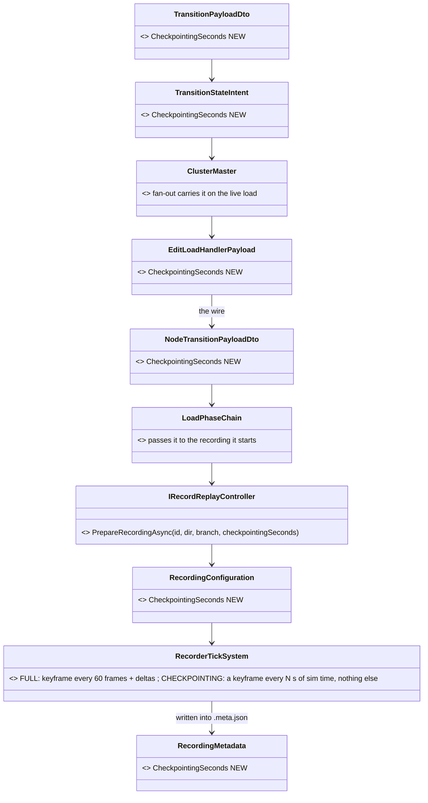
*What the picture shows that prose hid:* the mode is ONE number carried on the path every live session already takes, and the only
behaviour that changes is one branch in the recorder; a branch (restore, replay → live) reads it back from its parent's `.meta.json`.

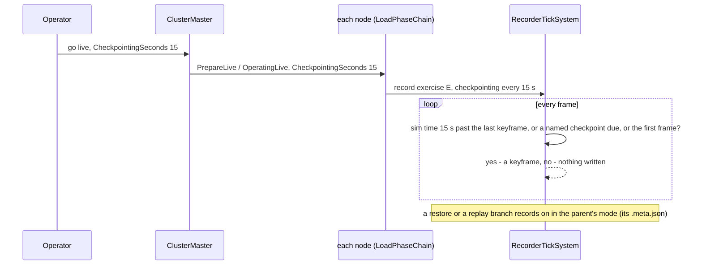
*What the picture shows that prose hid:* a paused cluster writes nothing (sim time does not advance), and a named checkpoint (R-3044) is still
exact — it forces its keyframe in either mode.

| decision | why | rejected — one line |
|---|---|---|
| ONE optional number on the live-load request, `CheckpointingSeconds`: 0 = FULL (the default, today's behaviour), N &gt; 0 = keyframes only, every N s of sim time | R-3045 "chosen per session"; additive on the wire (an older peer omits it ⇒ 0 ⇒ FULL) | an enum + an interval — two fields for one choice · a cluster-config setting — not per session |
| sim time (`GlobalTime.TotalTime`), not frames | R-3045 "every N seconds of simulation time"; a paused cluster writes nothing | a frame count — a paused cluster would write keyframes of an unchanged world |
| a branch inherits its parent's mode (from the parent's `.meta.json`) | one session, one mode | the request's — a restore carries no live-load request |
| the mode is written into `.meta.json` | a replay can say "restore points only" | — |

⏳ Not in D17: choosing the mode in the operator panel (the ui lane's) — the request field and the debug API take it.

**✅ As-built `2026-10-22`** — the diagrams above hold; no deviation.

| what | where |
|---|---|
| the request field `CheckpointingSeconds` (0 = FULL) on `TransitionPayloadDto` → `TransitionStateIntent` → the node payload and wire DTO → `LoadPhaseContext` | `ClusterOpRequestAdapter`, `ClusterOpMasterTranslator`, `ClusterOpEgressTranslator`, `NodeOpMasterTranslator`, `NodeOpSlaveTranslator` |
| the master keeps the live load's mode (`_currentCheckpointingSeconds`) and sends it in the fan-out AND the catch-up payload (a node that joins late records in the session's mode) | `ClusterMaster.InSync.cs` |
| `PrepareRecordingAsync(id, dir, branch, checkpointingSeconds)`; a branch ignores the argument and inherits its parent's mode from the parent's `.meta.json` | `IRecordReplayController`, `EcsRecordReplayController`, `RecordingModule` |
| the recorder's one branch: CHECKPOINTING writes a keyframe on the first frame, when sim time is N s past the last keyframe (or went back), or at a named checkpoint — and returns otherwise | `RecorderTickSystem.Execute` |
| the mode in `.meta.json` (`RecordingMetadata.CheckpointingSeconds`) | `RecordingModule` |
| the debug API: `POST /cluster/transition` takes `checkpointingSeconds` | `DebugApiService.Cluster.cs` |

Rails: `RecordingModuleTests.CE3299_D17_*` (keyframes every 1 s over 3 s, none while paused, a named mark exact; FULL unchanged; a branch
keeps its parent's mode) · `ClusterMasterBranchTests.D17_*` (the mode rides the PrepareLive fan-out) · `CheckpointClusterTests.CE3299_D17_*`
(the in-process cluster, 1 s: simhost / IG / CGF wrote 4–5 keyframes over 4.5 s of sim time, only keyframes). ⚠ Found on the way, filed as
CE-3313: a live recording's `.meta.json` was written only at a checkpoint mark or at finalize — a node killed mid-session left a recording
with no manifest. ✅ Fixed the same day: every recording writes its manifest with its first keyframe (as a branch already did); finalize
rewrites it.

### 1j. ✅ D7 — every registrable type declares its `DataPolicy` (`2026-10-22`; build-state: BUILT)

📐 **Measured before the rail** (`DataPolicyProbe`, the same assembly walk as `TickModeProbe`): **108** of the `[ComponentId]` types (the
complete set the ECS can register — `ComponentType.cs:139` throws without the id) declared no policy and took the registration default.

| class (count) | declared | why |
|---|---|---|
| unmanaged structs and records (87) | `DataPolicy.Default` | world state — recorded, scenario-saved, snapshotted (what the default already did; now said) |
| managed mutable classes (11) | `DataPolicy.NoPreview` | world state, but a preview must clone, not share, it — the convention `RegisterComponent` already applied to an undeclared mutable class |
| services and singletons that are not the world (10): `ISerializationRegistry`, `INetworkTopology`, `IEqsTemplateRegistry`, `IOrderForm`, `BlockIdManager`, `ConstructionResults`, `SoundEmissionRing`, `ActivePerspective`, `OrderDesignations`, `OrdersOffered` | `NoScenario \| NoReplay` | content, caches, session or UI state — a keyframe restore must leave them in place (R-3043) |

⭐ Rail `EveryComponentTypeDeclaresItsDataPolicyTests` (`Hrot.ClusterRunner.Tests`; walks > 250 types, 0 undeclared). ⚠ The Stride
assemblies are not in that binary's folder and are not walked (CE-3307). ⭐ Side effect: CE-3305's state rail no longer needs its four
"managed singleton — never recorded" exemptions — they are `NoReplay` now, so it skips them by policy.

### 1k. B5 — R1, the restore-equivalence oracle (`2026-10-22`; build-state: BUILT — as-built and first results at the end)

📐 **What B5 starts from** (graph `search_graph` `.*(WorldKeyframe|ScenarioGolden|ScenarioVerification|DirectorRunner|VerifyCommand|FreshVerifyJobs|IVerifyWorld).*` = 9 classes, `has_more:false`; grep; [Scenario Regression](DESIGN_Scenario_Regression.md) §2–§8):
**only the editor's stepped dry run is MEASURED to repeat** across fresh processes (Scenario Regression §7: goldens SAME in fresh runs;
R-3035 "live play is not required to be" deterministic) ⇒ R1's equality can only be asked there. The editor's verifier already loads a
scenario in a fresh process, steps it once per frame and snapshots every unit's full component state (`ScenarioGolden`, `golden.full`) —
R1 adds a checkpoint WRITTEN at T1 in one process and RESTORED in another. ⚠ The editor dry run has no recording, so the checkpoint is
written by the recorder's writer as a one-frame recording — the format `CollectCheckpoint` already exports (§1g).

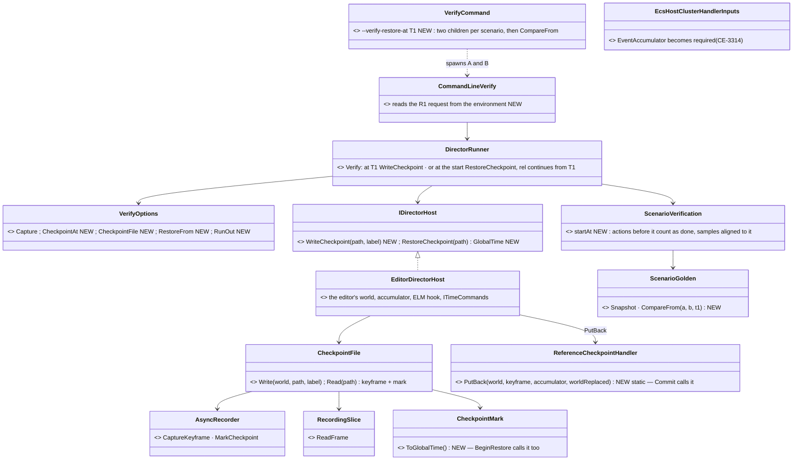
*What the picture shows that prose hid:* process B puts the world back through **the same three lines the cluster restore runs**
(`PutBack` = `WorldKeyframes.Apply` → `AfterRestore.Run` → the ELM hook, extracted from `Commit`), and moves the clock with the same
`ITimeCommands.SnapTo` from the same mark — so R1 proves the product's restore, not a copy written for the test. The only new type is the
file writer/reader, and it is the recorder.

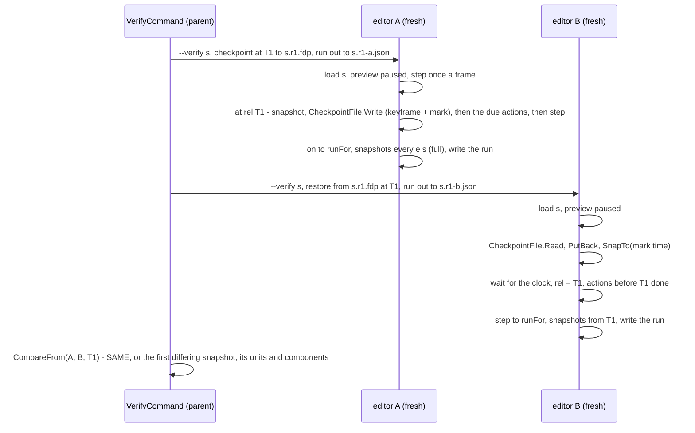
*What the sequence shows:* A snapshots at T1 BEFORE writing the checkpoint and before the actions due at T1, and B's first snapshot is
the restored world at T1 — so the first comparison is the restore itself, and every later one is what the restored world DID.

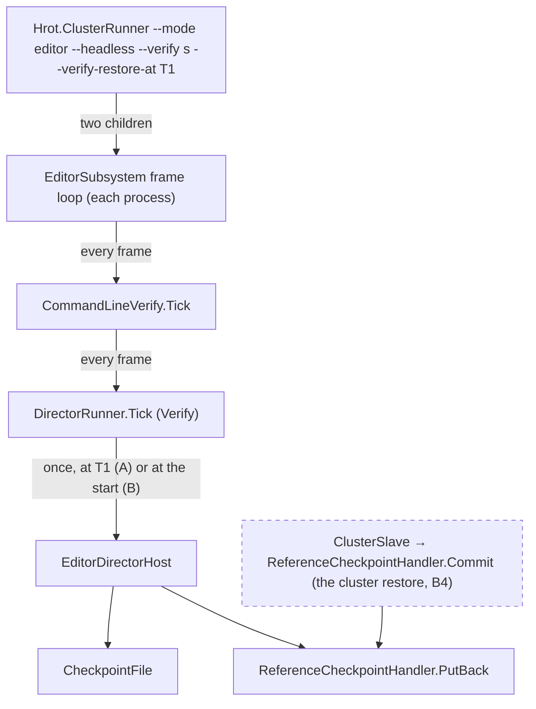
*What the module view shows:* nothing here runs on a cluster node or in a live session — the cluster's own restore (dashed) reaches the
SAME `PutBack` through its slave, but R1 does not exercise the node-op ordering (B4's cluster rails do).

| decision | why | rejected — one line |
|---|---|---|
| R1 runs in the editor's stepped dry run, two fresh processes | the only run measured to repeat (Scenario Regression §7; R-3035); R-4066 *"checking in editor is sufficient for now"* | a live cluster — its runs do not repeat, so no equality can be asked |
| the checkpoint is a one-frame recording written by `AsyncRecorder` (`CheckpointFile`) | the recorder's own format, with its schema manifest and mark — what `CollectCheckpoint` exports (R-3044) | raw `WorldKeyframe` bytes to a file — a second format, no manifest |
| B restores through `ReferenceCheckpointHandler.PutBack` + `SnapTo(mark)` | the product's restore, line for line | a restore written in the director — R1 would prove the test |
| full component snapshots (`golden.full`) from T1, compared by `CompareFrom` | a red names the UNIT and the COMPONENT that diverged (design §7: "each red names the next violator") | hashes — say *that*, not *what* |
| A's snapshot at T1 comes before the checkpoint and the actions due at T1 | B's restored world is exactly that moment | after the actions — B would re-apply them |
| CE-3314 first: `EventAccumulator` becomes a required composition input | the editor and CGF held it and did not pass it, so a restore there never restarted the step window (D4) — R1's process B is such a restore | leave it optional — the silent-default pattern |

⚠ **Expected result:** R1 is red until R-3039's remaining violators are moved — §7. A red is a work-list row, not a B5 failure.

**✅ As-built `2026-10-22`** — the diagrams hold, with three deviations, each forced by a measurement:

| deviation | why |
|---|---|
| the R1 request is one record, `RestoreCheck(At, File, Restore, RunOut, Every)`, on `VerifyOptions.R1` (not four loose fields); a child gets it as JSON in `HROT_VERIFY_R1` | one value to pass from the parent to a child |
| ⭐ **the verdict compares only what the checkpoint CARRIES** — the components its own schema manifest lists (+ position, health); a not-carried (`NoReplay`) component's difference is listed apart, "not carried by a checkpoint, by design" (`CompareFrom` / `CompareNotCarried`) | 📐 the first run differed on every unit by `PendingNetworkAck` alone — a protocol marker M4 classified *"absent ⇒ fast mode, harmless"*, which the editor (no network gateway) never strips. What a not-carried component changes still shows in the carried state |
| ⭐ **CE-3317 — a fresh process now registers a component a frame carries and the world has not used** (`ComponentTypeRegistry.FindType` by `[ComponentId]`; `PlaybackSystem` registers the table, `RestoreSingleton` finds the type) | 📐 `ua-tank-ammo`'s restore threw *"Component type ID 360 not found"* — `DesignatedTarget` registers on first use (25 components do). A replay reaching such a keyframe threw the same way. This is D10's "a fresh process loads first" for types |

The command: `Hrot.ClusterRunner --mode editor --headless --verify <a,b|all> --verify-restore-at <T1> [--verify-out dir]` — per scenario two
fresh children (`<s>.r1-a.*`, `<s>.r1-b.*`, the checkpoint `<s>.r1.fdp`), then `summary.json` and `junit.xml`; exit 0 when every one matches.
Rails: `DirectorRunnerTests.CE3299_B5_*` (both halves on the runner's fake: the checkpoint on its moment, an action before T1 not applied
again, SAME; a lossy checkpoint DIFFERENT naming the unit and component; the carried split), `PlaybackRegistersRecordedTypesTests` 2/2.

📐 **First results** (checkpoint at 3 s, the cloud VM): **2 of 4 restore to the same run** — `bt-grenade-posture` (12 s) and `ua-tank-ammo`
(60 s) SAME in every carried component of every unit. 🔴 `ua-civ-routine-alarm` — the near civilians do not hear the 3.1 s shot after a
restore: the sound ring is not carried while each ear's read position is (**CE-3315**, and in the same process the reverse — the abandoned
timeline's sounds heard again). 🔴 `ua-civ-melee` — the Policeman's threat freshness drifts a few float ULPs a step (**CE-3316**, not run down).

📐 **After CE-3315/CE-3316's ring work (`2026-10-22`):** `bt-grenade-posture`, `ua-tank-ammo` SAME; `ua-civ-routine-alarm` SAME through the 3.1 s
shot — its first difference is now at 7 s, NAVIGATION HANDLES only (labels from a process-static counter, **CE-3318**); `ua-civ-melee` run down
step by step: a background hearing solve IN FLIGHT across the checkpoint is lost and the restored run dispatches that slot a step late
(**CE-3316**, re-diagnosed — a decision for the stepped scheduler, Time Architecture §17). ⭐ `--verify-restore-every <s>` snapshots at any grid
(1/60 = every step) to run a difference down.

### 1l. ✅ CE-3316 — a checkpoint on a quiet step; a restore resumes the slots (`2026-10-22`; build-state: BUILT; 🔒 user: *"yes, CE-3316 on your lean"*)

📐 **Measured** (R1 a snapshot every step, `ua-civ-melee`; `ModuleHostKernel` stepped rules, [Time Architecture §17](blueprints/DESIGN_Time_Architecture.md)): a slow
background module dispatches when a step enters a new sim-time slot, on a snapshot taken at the START of that frame, and is applied at the next
step. A checkpoint written at the end of a dispatching frame has that run IN FLIGHT — its input is the previous frame's world, which no
keyframe holds — and a restore's clock snap reset every module to "never ran" (`LastRunSlot = MinValue`), so the restored run dispatched the
slot one step late on a newer snapshot: a hearing solve late, a threat boost off by 5.

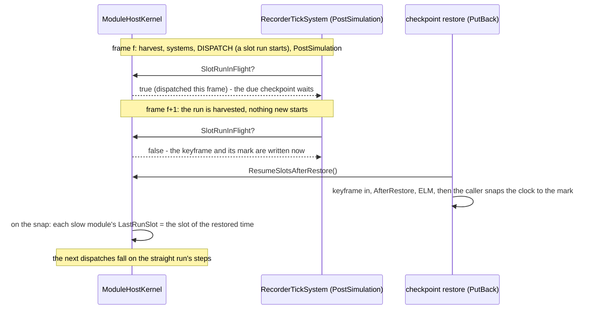
*What the picture shows that prose hid:* the two halves are one invariant — a checkpoint is written only when every slow module has run the
slot it stands in AND nothing is in flight, so "has run the current slot" is exactly what a restore may assume.

| decision | why | rejected — one line |
|---|---|---|
| the recorder waits for a step with no slot run in flight (`SlotRunInFlight`, stepped mode only), at most 8 steps; a periodic keyframe meanwhile is not the checkpoint | in stepped mode a run is in flight for one step; a module run EVERY step (a legacy `Tier` fallback) is never idle, hence the cap | carry the in-flight run's result in the checkpoint — engine command buffers, not ECS state |
| a CHECKPOINT restore (and only it — `PutBack` calls `ResumeSlotsAfterRestore`) counts each slow module as having run the restored slot | true by the first half; a load and a dry-run exit return to a time nothing had run at, so they keep `MinValue` | derive it on every snap — a dry-run exit would then skip the first step's runs (the Play → Stop → Play rail) |
| R1's writing half asks the same question (`IDirectorHost.SlotRunInFlight`) and records where it really wrote; the restoring half and the compare start there | R1 must test the product's rule | a fixed T1 — the checkpoint would sit on a dispatching step |

| ⭐ **D2's checkpoint half, as built:** the restore applies the keyframe's pending events into a HOLDING bus (`WorldKeyframes.ApplyKeepingUnconsumedEvents`), and the kernel publishes them into the live bus's pending buffer at the clock snap, after `Restart` and before that frame's swap (`ModuleHostKernel.ResumeAfterRestore` → `FdpEventBus.PublishCurrentOf`) — read once, on the first restored step | 📐 R1 `ua-civ-melee`: a heard contact published in the checkpoint's frame was lost — the straight run's Policeman got its +5 boost on the next step, the restored one never did | ⛔ DEVIATES from D2's "into the accumulator": the accumulator is the recorder's input, not the systems' — events put there are recorded but never read · into the live bus at restore time — `Restart` on the snap erases them, or they are read twice |
| R1's grid: `FirstAtOrAfter` rounds with a 1e-4-step tolerance | a sidecar's `at` (3.0000000000000013) put the first compared snapshot one step late | — |

Rails: `ModuleHostKernelTimeTests.CE3316_*` ×3 (in flight from dispatch to harvest, stepped only; a restored kernel runs its slow module on the
straight run's steps — red without the resume; a checkpoint's unconsumed event arrives once at the restore's snap — red without the publish),
`RecordingModuleTests.CE3316_*` (written on the first quiet step, capped — red without the wait).

### 1m. ✅ CE-3318 — a restore numbers its next path where the straight run did (`2026-10-22`; build-state: BUILT; 🔒 user: *"then CE-3318"*)

📐 **Measured:** R1 on `ua-civ-routine-alarm` — at 7 s the Rifleman's new path took handle 1073741830 restored, 1073741833 straight (every position
equal). `NavigationHandleAllocator` is a process static, allocated from the pathfinding solver's BACKGROUND run; after a restore R-3039 S2's
`EnsureAbove` lifted it only past the highest handle a live mover still holds — the handles taken and released before the checkpoint were lost.

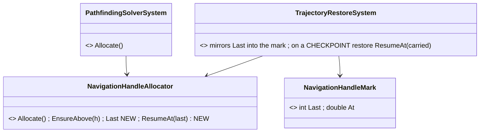
*What the picture shows that prose hid:* the counter stays where the background solver can reach it; the WORLD only holds its value — exact at a
checkpoint because §1l writes one only when no solver run is in flight.

| decision | why | rejected — one line |
|---|---|---|
| mirror the static counter into a recorded singleton every frame it moves; on a CHECKPOINT restore resume the counter exactly at the carried value (it may go DOWN in the same process — the trajectory pool's keyed entry of the abandoned timeline is replaced) | the smallest change that makes the next handle the straight run's; §1l makes the copy exact | move the counter into the world — the background solver allocates from a snapshot, so it would need the singleton in `SyncFrom` and a write through its command buffer |
| a copy newer than the restored clock (a dry-run exit puts no singleton back) is not used: `EnsureAbove` as before | the same guard as `SoundTimeline` (Sensing §8.3a) | trust the copy always — after a dry run it is the abandoned future's |
| ⭐ the decision waits for the FIRST STEP after the restore (`deltaTime > 0`), never the paused restore frame | 📐 measured: an every-frame system runs on the paused frame before the clock snap lands — sim time still reads ~0 there, so every carried mark looked newer and was rejected | decide in `Replaced` — that frame's clock is the pre-snap one |

📐 **R1 after §1l + §1m (`2026-10-22`, checkpoint at 3 s): 4 of 4 pilot scenarios restore to the same run** (`bt-grenade-posture`, `ua-civ-melee`, `ua-civ-routine-alarm`, `ua-tank-ammo`); the only differences left are the not-carried `PendingNetworkAck` (by design, listed apart).

⚠ **Not solved here:** the counter is still SHARED by every node of one process (the in-process cluster harness). Rail: `PathTraceSystemTests.CE3318_*`.

## 2. Modules — who calls what (only the recorder runs every frame, and it already does)

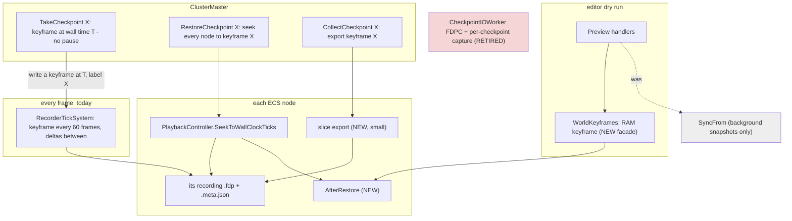
*What the picture shows that prose hid:* a checkpoint SAVE's only arrow goes to the recorder that already runs every frame — it asks for one
extra keyframe, labelled; nothing else in the running world is touched. Every arrow that touches the world is a RESTORE (a seek, or the dry run's
Stop), and both land on the same after-restore step.

## 3. Classes

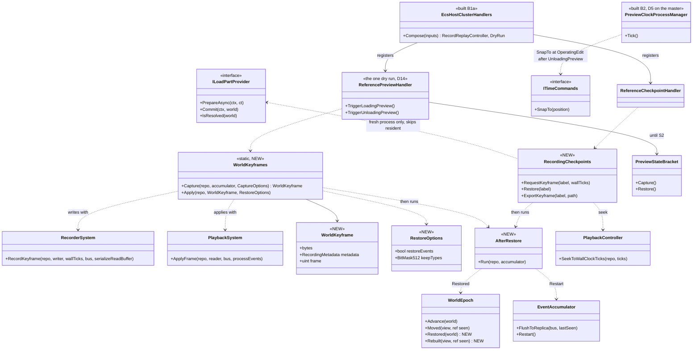
*What the picture shows that prose hid:* the NEW classes are a dry-run facade, a checkpoint-as-mark helper, an options record and one step — every arrow out of
them lands on a class that exists; `WorldEpoch` gains a SECOND count (`Restored`) so a restore never reads as "the world ended" (which makes
`CycloneNetworkCleanupSystem` delete every owned entity on the wire, `:52`).

## 4. Sequences

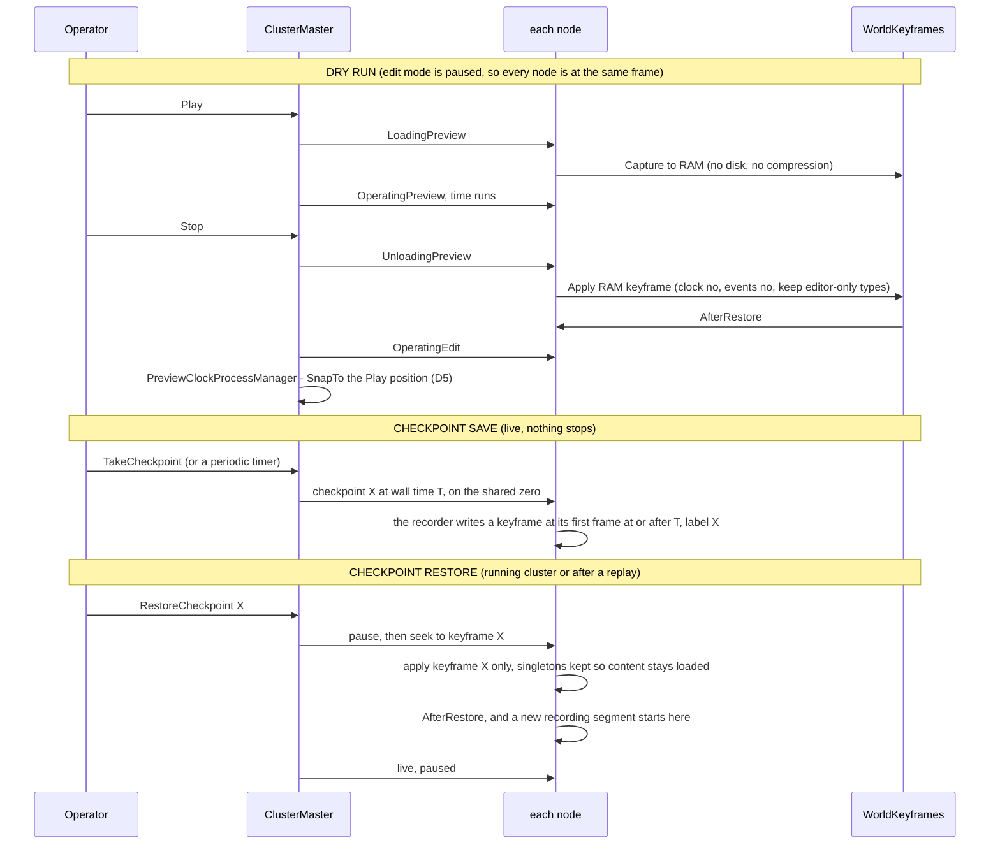
*What the picture shows that prose hid:* the save touches no node — the nodes were already recording; only the RESTORE pauses (it replaces the
world, so it cannot run under a moving simulation), and it reaches every node through the replay seek that already aligns them by one
shared wall-clock zero. A restore then FORKS the recording: the frames after the mark stay intact for another restore.

## 5. Decisions — one per review finding (Paused and Stepped §7g.0c); ✅ D1–D4, D6–D12, D14–D16 APPROVED by the user `2026-10-22` (*"The other leans accepted."*, R-3046); D5 corrected; D13 withdrawn; D17 added

| # | finding | ⏳ lean | rejected — one line |
|---|---|---|---|
| **D1** | F1: `NoReplay`/`Transient` components with sim meaning are not in a keyframe (`SubordinateOrders`, `AirPath`, `PausedTask`, `TrafficCar`, `MissionAdapterState`, `OutgoingGrantsPending`, …) | M4 classifies all 86 types: **sim state ⇒ recordable** (drop `NoReplay`); protocol ⇒ re-derived (`GhostStateTracker`, `PendingNetworkAck`, R-3039 class B); network shadows ⇒ republished (`NetworkTransform`, `NetworkVelocity`); events stay out | record everything — protocol progress restored as-is deadlocks (replay §2.1d) |
| **D2** | F2: a keyframe re-injects recorded events | dry-run exit: `restoreEvents: false`. ⏳ Checkpoint: keyframe X records the UNCONSUMED step window (the `EventAccumulator` content since the last step — as `ReferenceCheckpointHandler` flushes it today); the restore puts it INTO THE ACCUMULATOR after `Restart`, never into the bus. ✅ **BUILT `2026-10-22` with CE-3316 — DEVIATED:** into the live bus's PENDING buffer at the clock snap, after `Restart` (§1l) — the accumulator is the recorder's input, not the systems' | inject into the bus buffers (re-processing) · drop all events (a step's pending orders lost) |
| **D3** | F3: nodes captured at different frames | ⭐ **R-3042 + R-3044**: no pause; the master names a wall time T a moment ahead on the shared zero (R-4012) and each node's recorder writes keyframe X at its first frame with `TotalWallTicks ≥ T` — within one frame on every node; the residual skew is R-3041's accepted loss | ⛔ pause the cluster — ruled out (R-3042) · write on receipt — skew = message latency, avoidable at no cost |
| **D4** | F4: no reset fires after a keyframe apply | `AfterRestore`: ELM re-arm (exists) → `NetworkEntityMap.RebuildFromWorld` (exists) → `WorldEpoch.Restored` (NEW count; R-3039 class A/B fields reset through `Rebuilt`) → `EventAccumulator.Restart` (+ D2) → a forced keyframe in the running recording (D8) | reuse `Moved` — makes the network cleanup delete every owned entity on the wire |
| **D5** ✅ *(corrected `2026-10-22`)* | F5: the clock | ⭐ **one rule for both, and it is not the keyframe:** the kernel rewrites `GlobalTime` every frame from the time controller (`ModuleHostKernel.cs:496–500`, [Time Architecture §12a](blueprints/DESIGN_Time_Architecture.md)), so a keyframe's clock is overwritten on the next frame and decides nothing. The clock is MOVED by the time system's one discontinuity, `ITimeCommands.SnapTo(position)`: the dry-run Stop snaps to the position captured at Play (✅ built for the editor, `CE-3156`; ⚠ the cluster twin `ReferencePreviewHandler` has the gap — closed by D14's one handler), the checkpoint restore snaps to the keyframe's recorded time (the seek path already does, `ReplaySeekProcessManager`) | ⛔ *the first lean — "Stop skips the clock, a restore applies it"* — wrong on both halves: neither applies the keyframe's clock, both snap |
| **D6** | F6: `NoPreview` vs `NoReplay` | M4 diffs the sets; ONE recorded set if they agree; editor-only state moves to D12's keep list | two filters in the recorder |
| **D7** | F7: recordability is decided at registration — 📐 **confirmed for singletons (§6a)**: `ITkbDatabase`, `INavmeshProvider`, `NetworkEntityMap`, `WorldEpoch` (marked `Transient`) … are all recorded | ⭐ singletons honour `DataPolicy` like components (the recorder reads the policy, not only the registry default); content / service singletons are `NoReplay`; a rail: every registered component AND singleton has an explicit policy | trust the default — it records the TKB and the navmesh provider into every keyframe |
| **D8** | F8: `GlobalVersion` goes back to the recorded tick | apply under `max(live, recorded) + 1` (versions only grow); ⭐ **a restore starts a new recording segment** (a fork) — the frames after the mark stay intact for another restore, the new segment begins with a keyframe | let it go back — the always-on recorder skips changes until its next keyframe · overwrite the recording past the mark — loses the other branch |
| **D9** | F9: a fixed 32 MB recorder buffer | M2 measures the largest world; the buffer grows when a keyframe does not fit | a bigger constant |
| **D10** | F10: a fresh process — content and node ids | ⭐ **a restore keeps what is loaded (R-3043)**: in a running process the seek keeps every singleton (`Clear` spares them) — 📐 terrain, TKB, navmesh stay; only a fresh process runs the load chain first, which skips resident content (`TerrainLoadStep:55`, `KnowledgeBaseLoadStep:99`). ⏳ Node ids: the recordings are per node, so each node restores its OWN recording — ids match by construction; in a fresh cluster the master grants each node the id its recording carries | a restore as a full load from Idle — reloads content and stops everything |
| **D11** | F11: the oracle masks the ids that hide the trajectory pool | R1 compares unmasked once S2 puts the pool in the ECS; until then it compares what a trajectory id POINTS AT | keep masking — the oracle passes over the bug it exists for |
| **D12** | F12: editor-only `Transient` state wiped at Stop | `keepTypes` at dry-run exit: editor/debug types are neither cleared nor overwritten (M4 lists them) | restore them from the keyframe — the Stop would undo the operator's view settings |
| **D13** ⛔ *(withdrawn `2026-10-22`)* | (R-3044) a labelled keyframe must outlive recording clean-up | 📐 **no trim inside a recording exists.** The only clean-up is `ExerciseRetention.Prune`, at `ClusterRunner` start-up, deleting WHOLE old exercise directories (keep the newest 20) — and only for a scratch staging root (the platform temp directory); anywhere else only when asked (`--keep-exercises N` / `FDP_KEEP_EXERCISES`), because recordings are user data, deleted by the operator only (file-sync-1). A checkpoint lives INSIDE its exercise's recording, so it goes when that exercise goes — by design; no rule needed | a rule protecting keyframes from a trim that does not exist |
| **D14–D16** ✅ | (§1b) unification | one dry-run handler · the editor's recorder through `ForNode` · one shared host composition + rail | (see §1b) |
| **D17** ✅ (R-3045) | the recorder's **CHECKPOINTING MODE** (user: *"It's basically a checkpointing mode"*) | a recording mode beside FULL (today): **keyframes only, every N seconds of simulation time** (e.g. 15 s), no per-frame deltas — `RecorderTickSystem`'s fixed 60-frame interval becomes the mode's setting. Restore points every N s; named checkpoints stay exact (R-3044 forces a keyframe); the restore path is unchanged. ⚠ No smooth replay — the after-action review, the replay browser and the film director's later replay need FULL. FULL stays the default for exercises; checkpointing mode is chosen per session | a separate checkpoint stream (R-3044: none outside the recorder) |
| **D18** ✅ (R-3047) | 🔴 **a branch can OVERWRITE history** (user: *"There might be some trimming when we are switching from replay to live. In such a case, we are overwriting the old history. So the old history is lost."*) — 📐 measured: going live from a replay (and so a checkpoint restore, which is a seek + go-live) records to the exercise id the REQUEST carries — the master forwards `intent.ExerciseId` unchanged (`ClusterMaster.cs:1311`), the node records to it (`ReferenceReplayLoadHandler.cs:255–257`), and the recorder opens with `FileMode.Create` (`AsyncRecorder.cs:117`) ⇒ a request carrying the REPLAYED exercise's id truncates its recording; an empty id sends every branch to one folder. ✅ The operator panel happens to send `Guid.NewGuid()` — safe by luck, not by rule | ⭐ **APPROVED `2026-10-22`:** ① the MASTER mints the branch's exercise id (mgmt-1 step 10: *"New ExerciseId = Drill_999_Branch1"*); the requester's id is ignored on a branch ② ⭐ **each node COPIES its history up to the branch point into the new exercise, then appends the live frames** — a byte copy, no decoding (`FrameMetadata.FilePosition` / sizes index every frame): the header + every frame up to the last one at or before T + the `.meta.json`, done while the branch is frozen (`LiveBranchProcessManager`); the new recording also records its parent (exercise id + branch time) as provenance ⇒ every exercise is SELF-CONTAINED and replays straight through the branch; deleting the parent breaks nothing ③ the recorder never overwrites: `FileMode.CreateNew`, a loud failure on an existing file ④ rails: two branches from one replay leave its recording byte-identical; the branch replays seamlessly across T. 📐 As-is: the branch starts EMPTY at T (its first frame is a keyframe, `RecorderTickSystem.cs:38–39`); the cost of the copy (≈ disk speed, the shared prefix stored twice) is unmeasured | trust every caller to send a fresh id — one HTTP client with the wrong id deletes an exercise |

## 6. Measure first (M1–M4) — nothing in §8 starts before these

| # | what | how | decides |
|---|---|---|---|
| M1 | what a keyframe holds on each host — components and singletons, recordable or not | a test-only walk of `ComponentTypeRegistry` after each host's composition | D7, D1 |
| M2 | keyframe size and capture time on the largest scenario (300 civilians; `uc-urban-battle`) — the recorder already pays it every 60 frames | `WorldKeyframes.Capture` timed in the editor harness | D9 |
| M3 | apply time on the same world | the same | the dry-run Stop (accepted by the user; recorded) |
| M5 | a forced keyframe mid-run: its extra cost on the recorder frame, and the step-window events it carries | force one on a recorded `uc-urban-battle` | D2, R-3042's "does not interfere" |
| M4 | the 86 `NoReplay`/`Transient` types, each classed: sim state / protocol / network shadow / event / editor-only; and `NoPreview` vs `NoReplay` | read + `search_graph` per type | D1, D6, D12 |

### 6a. 📐 MEASURED `2026-10-22` — M1, M2, M3 (throwaway probe in the in-process cluster harness, `uc-urban-battle` live, 600 frames after spawn; Debug build, four hosts in one process — absolute times are high)

| host | live entities | keyframe (raw, uncompressed) | capture (median of 5) | components NOT recorded but in use | singletons NOT recorded |
|---|---|---|---|---|---|
| SimHost | 731 | 6.2 MiB | 20 ms | `NetworkTransform`/`NetworkVelocity` (555), `ReportLifecycleOnActive` (555), **`SensorCapability` (68)**, **`AirPath` (1)**, `WorldSurveyRequest` (1) | `TerrainDefinition`, `TerrainWorld`, `TrafficFrame`, `TrafficNetCache` |
| CGF | 759 | 7.8 MiB | 31 ms | `NetworkTransform` (555), `NetworkVelocity` (40), `EgressPublicationState` (97), **`MissionAdapterState` (45)**, **`SensorCapability` (68)**, **`PausedTask` (3)**, **`SubordinateOrders` (3)**, `BehaviorStartRecord` (34), `SopStartRecord` (36), `SquadDrillTrace` (3), `SensorConfigPayload` (1), `WorldSurvey*` (1+1) | the same four + `ScenarioDescriptionResident` |
| IG | 589 | 3.8 MiB | 19 ms | `NetworkTransform`/`NetworkVelocity` (555), `ReportLifecycleOnActive` (555) | the same four |

| finding | ⇒ |
|---|---|
| ⭐ **M3: applying the SimHost keyframe in place took 36 ms**; 731 entities before and after; 30 more frames ran without an exception | the restore cost is small — the dry-run Stop and a checkpoint restore are tens of ms per host |
| ⭐ **M2: 4–8 MiB raw and 19–31 ms per keyframe per host** — well inside the 32 MiB buffer (F9) at this size; the recorder already pays this every 60 frames | a forced checkpoint keyframe (R-3044) costs ONE such capture on the frame it lands — the same hitch the recorder already takes once a second; ⚠ M2 in a Release build is still owed before calling R-3042's "does not interfere" measured |
| 🔴 **M1: singletons ignore `DataPolicy`.** ⚠ **Corrected `2026-10-22` (B1):** "recorded" below is the REGISTRY's recordable flag, not keyframe bytes — 📐 a MANAGED singleton set by `SetSingletonManaged` stamps no table version, and the recorder writes a singleton only when its version is past the keyframe's base, so it is in NO keyframe (rail `WorldKeyframesTests.ManagedSingleton_SetBySetSingletonManaged_IsNotInAKeyframe`); only versioned (unmanaged) singletons are. The flag was still wrong (root cause in §1c) and is fixed. Flagged recordable on every host: `ITkbDatabase`, `INavmeshProvider`, `ICoverProvider`, `IGeographicTransform`, `IPathRegistry`, `RoadNetworkHolder`, `StaticObstacleBakery`, `NetworkEntityMap`, `WorldEpoch` (marked `Transient`!), `CanvasContextMenuState` (editor UI); recordability is the REGISTRATION default (F7, confirmed) | a keyframe restore would REPLACE loaded content and services with deserialized copies — against R-3043. **D7 becomes:** singletons honour `DataPolicy` like components; content and service singletons are `NoReplay`; a rail fails on any singleton without an explicit policy. ⚠ Replays restore these today too — what that does to a live navmesh provider is unmeasured |
| 🔴 **M1: sim state in use, not recorded** — `SubordinateOrders`, `PausedTask`, `MissionAdapterState`, `AirPath`, and `SensorCapability` (68 sensors) | D1's list, now measured in use; M4 classifies |

### 6b. 📐 M4 — the `NoReplay` / `Transient` types, classified (`2026-10-22`; full table: [appendix](DESIGN_Checkpoint_And_Dry_Run_Restore_M4_Classification.md))

103 types carry `NoReplay`: **57 events** (out of scope — events are not state) and **46 components / singletons** (31 per-entity, 15 singletons). Of the 46:

| class | count | ⇒ restore treatment | the types |
|---|---|---|---|
| 🔴 **SIM-STATE** | 9 | ✅ **RECORDED `2026-10-22` (D1)** — `NoReplay` dropped (`Transient` → `NoPreview | NoScenario`; `SensorCapability` / `WorldSurveyRequest` → `NoScenario`); ⚠ `SubordinateOrders` also needed a parameterless constructor and settable members (the recorder builds, then writes public settable members — the CE-3305 rule); rails `SimStateKeyframeTests` (8, a keyframe round trip field for field) + `MissionAdapterSystemTests.CE3299_D1_*` | `PausedTask` · `SubordinateOrders` · `BehaviorStartRecord` (the running task's restart text — `SopActions.cs:82`) · `SopStartRecord` · `AirPath` · `MissionAdapterState` · `SensorCapability` (per-sensor range / FOV and the default to undo an override) · `SensorConfigPayload` · `WorldSurveyRequest` |
| PROTOCOL | 18 | re-derived by `AfterRestore` (D4) | incl. `GhostStateTracker` — ⚠ a restored ghost is never timed out until re-derived |
| NET-SHADOW | 5 | refilled by the owners' republish (egress reads an absent `EgressPublicationState` as "publish everything") | `NetworkTransform`, `NetworkVelocity`, `EgressPublicationState`, … ⚠ **`ReplicatedBrainIntent` is NOT refilled** — the owner republishes only on change, so a hand-over before the next change starts no brain ⇒ `AfterRestore` forces a republish of it |
| EDITOR-DEBUG | 4 | kept across a dry-run Stop (D12 `keepTypes`) | |
| ONE-SHOT | 9 | nothing — absent is the normal state | |
| UNCLEAR | 1 | settle by a run: restore with live SUMO traffic, shoot a pre-restore replica | `TrafficCar` (added only when the replica is created) |

⭐ **Singletons are never cleared by a restore** (`Clear` empties component tables and the bus only) — so the 15 `NoReplay` singletons survive in place; the singleton problem is the OPPOSITE one (§6a: content singletons ARE recorded and would be overwritten — D7). ⭐ **`NoPreview` vs `NoReplay`** (D6): 4 types are `NoPreview`-only and stay recorded (`LightweightRound`, `Lifespan`, `EffectAnchor`, `EffectFlight`); 19 are `NoReplay` without `NoPreview` — the sets differ, so D6's lean (one rule) needs these 23 decided one by one.

## 7. Rails

| rail | proves |
|---|---|
| **R1 — the oracle** ✅ *built `2026-10-22` as two fresh editor verify runs (§1k); first results there* (in-process, then live): a stepped run to T1 → checkpoint → on to T2 = capture A; restore into a FRESH process → step to T2 = capture B; A ≡ B in full component state (`scripts/determinism-probe.py --compare`) | the whole contract; ⚠ red until R-3039 S1/S2 land — each red names the next violator |
| dry run: Play → Stop → Play again equals the first Play, step by step | D1, D2, D4, D12 |
| a restore never moves `WorldEpoch.Moved` (no delete on the wire) and always moves `Restored` | D4 |
| a checkpoint save changes nothing in the running world and costs no frame time beyond the recorder's | D3 (R-3042) |
| a restore in a running process loads no content (terrain / TKB / navmesh untouched) | D10 (R-3043) |
| the clock is untouched by Stop and restored by a checkpoint | D5 |
| every registered type carries an explicit `DataPolicy` | D7 |

## 8. Build order

**B0** M1–M5 → **B1a** D16 one shared host composition + D15 the editor's recorder through `ForNode` + its rail → **B1** `AfterRestore` (+ `WorldEpoch.Restored`) and `WorldKeyframes` for the dry run → **B2** the dry run moves into ONE handler (D14 — both entry points; `SyncFrom` leaves them; `PreviewStateBracket` keeps only the allocator until S2) → ✅ **B3** *(built `2026-10-22`, §1g)* checkpoints as labelled keyframes (`RecorderTickSystem` takes a *keyframe at T, label X* request; the label → frame index goes into
the recording's metadata; `CheckpointIOWorker`'s `'FDPC'` capture retires; `CollectCheckpoint` exports keyframe X) → ✅ **B4** *(built `2026-10-22`, §1h)*
`RestoreCheckpoint X` = pause → every node seeks to keyframe X → `AfterRestore` → a new recording segment → live paused; a fresh process loads first → **B5** R1
live. ⚠ R1 stays red until R-3039's S1/S2 (Paused and Stepped §7g.1) land — that red is the work list, not a failure of this design. ✅ **B5 built `2026-10-22` (§1k)** — R1 in the editor's stepped dry run; its first reds are CE-3315 and CE-3316.

## ⛔ HISTORY

- `2026-10-22`: a checkpoint was a MARK (a time) and a restore applied keyframe + deltas up to it. ⛔ SUPERSEDED by R-3044 — a forced, labelled keyframe; the restore applies it alone.

- `2026-10-22` (first version, same day): the save PAUSED the cluster so every node captured one frame, and a restore was a LOAD from Idle
  through a `CheckpointLoadPart`. ⛔ SUPERSEDED by the user (R-3042: a save never stops the cluster; R-3043: a restore keeps what is loaded).
