<!--STATUS
state: LIVE
updated: 2026-10-18 (backend: §7.17 B-17 thrown cold weapons DESIGNED, CE-3247/CE-3248) · 2026-10-17 (backend: §7.13a B-11a stations + pick-up weapons BUILT, CE-3233) · 2026-10-17 (backend: §7.12 B-9 pistol BUILT, CE-3231) · 2026-10-17 (backend: §7.11 B-10 LaidDown BUILT, CE-3232) · 2026-10-17 (backend: §7.10 B-13 pick-up BUILT, CE-3235) · 2026-10-17 (backend: §7.3c CE-3239 a cloud round bursts on the ground) · 2026-10-17 (behaviors: §5i.1 CIV-4 part 1 AS-BUILT — riot, the blow, the side flip, CE-2238; demo ua-civ-melee live 4/4) · 2026-10-17 (behaviors: §5i CIV-4 part 1 designed READY-TO-BUILD; §5h.2 CV-13a hands up holds fire built) · 2026-10-17 (backend: §7.8 B-7 Armament designed and BUILT, CE-3229) · 2026-10-17 (behaviors: §5h.1 AW-20 as built — a neutral person in the line or the spread holds the shot; §5f CE-2246 — contagion stopped at a crowd split by wandering, fixed in the demo) · 2026-10-17 (behaviors: §5h AW-24 the simple path stays simple, R-2029) · 2026-10-17 (behaviors: §5c the 13 armed-people demos, one per §5h branch) · 2026-10-17 (behaviors: §5h AW-22 civilian → combatant, AW-23 player fratricide, R-2028) · 2026-10-17 (behaviors: §5h AW-21 status vs conduct, R-2027) · 2026-10-17 (behaviors: §5h amended — AW-15…AW-20, R-2026; AW-1/AW-3 superseded) · 2026-10-17 (behaviors: §5h armed people AW-1…AW-14, R-2025) · 2026-10-17 (behaviors: §5f crowds — onlookers gather, fear spreads, CE-2237; §5g the protest and its gestures, CE-2240) · 2026-10-17 (behaviors: §5e CivilianHsm slice 2 panic/shelter/cower, CE-2236 + CE-2245 the stopped-move fix; §5d CivilianHsm slice 1, CE-2235; CV-13 gestures + props, CV-13a hands up holds fire, CV-14 security forces provoke — R-2024; §5b CIV-0 as-built; §5c demos) · 2026-10-16 (behaviors: CV-1 class-table rows, CV-4 dirty-mark, §5a measurements, §5 owners/ids + handoffs; backend: §7 detailed designs B-1…B-5; ui: §8 detailed designs U-1…U-4, CE-1162…CE-1165)
build-state: BUILDING (backend B-3/B-2 first) — the HOW is RULED too: CV-1…CV-12 approved as written 2026-10-16 (R-3013).
  SUPERSEDED: the programme's scope and order are RULED by the user 2026-10-16 (§0, R-4032…R-4036); the HOW is
  leans per decision (§4, CV-1…CV-12), awaiting the user. §5 is the slice plan; its backend and ui halves are handed off
  as FRAMES (§5, the receiving lane designs its details first, builds after the user rules the CV it builds), and the
  behaviors half is recorded as CE-2233…CE-2239. Written by the coordinator lane (cross-lane: most slices are
  behaviors-lane work, CV-6 is engine/backend work); the 2026-10-16 additions are the behaviors lane's.
current-answer: §0 the rulings · §2 the diagrams · §4 the decisions with leans · §5 the slice plan · §5a measure before CIV-2 · §5b CIV-0 as-built · §5c demos · §5d CIV-1 CivilianHsm as-built · §5e CIV-2 panic, shelter, cower as-built · §5f CIV-3 crowds (CE-2237) · §5g the protest (CE-2240) · §5h armed people (R-2025) · §7 backend detailed designs (B-1…B-5) · §8 ui detailed designs (U-1…U-4).
stale-below: nothing.
known-rot: §4 CV-4's "draw a weapon" as a hostile act — amended in place (R-2026, §5h AW-16).
known-conflict: ⭐ RESOLVED 2026-10-17 (CE-2235) — docs/TUTORIAL_Behaviour_Composition.md §2 put "crowds" at Tier 0; it now says
  Tier 0 is for entities that only move (traffic) and civilians run one CivilianHsm (R-263). ⚠ AQ93 §8 P5 named a single "PanickedCivilian" type — SUPERSEDED here by CV-1
  (one civilian family whose panic is a MODE, not a type).
related-designs:
  - docs/DESIGN_People_Display.md — (ui) OWNS how a person is DRAWN — what he holds, his gestures, marks above the head; its §8 gaps G1–G8 are answered by §5o here
  - OVERVIEW_Rules_And_Demos.md — the INDEX of the rules and demos built across the behaviour designs (rule → what implements it → demo); this design OWNS the rows that cite it
  - docs/blueprints/batches/HANDOFF_Behaviors_To_Backend_Civilians_Gestures.md — the B-6 frame §7.7 answers.
  - docs/DESIGN_Node_Roles_And_Policies.md — §3.5 (R-3015): every node receives the same event data (detonations included); it owns who receives, §7.3a here owns the cloud.
  - docs/DESIGN_Operations_Behaviour_Catalogue.md — OWNS the civilian catalogue (CIV-1…CIV-7, ASY-5, SQD-13) and the rulings
    D3 (civilians = crowd agents + light HSM + crowd-level system), D4 (hidden truth + observable cues), D5 (melee = contact
    damage + knockdown, thrown objects reuse ThrowAt); this design is the BUILD of its P3 + P7 rows.
  - docs/blueprints/Architect_Question_93_Sumo_Traffic_Node.md — §8: SUMO pedestrians that panic are handed to THIS
    programme's civilians (CGF creates them, P4). That hookup is slice CIV-7 here, after everything else.
  - docs/DESIGN_Building_Interiors.md — owns doors (DoorState, DoorRules, DoorPassageSystem opening doors on its own) and
    building footprints/storeys that CV-7's shelter query and inside test read.
  - docs/designs/eqs-2/EQS_Design_v1.3_final.md — owns EQS templates and §19 terrain sight/cover; CV-7 adds an enterable-
    building generator and an inside test.
  - docs/DESIGN_Injury_States.md — owns ok/wounded/incapacitated/dead derived from Health (rule I1); CV-6 adds a STORED effect
    state for stun/irritant at full health, the case that design names as breaking I1.
  - docs/designs/hit-location/DESIGN_Body_Parts_And_Hit_Location.md — owns body parts and the civilian poses (HL-9).
  - docs/designs/weapons/DESIGN_Weapon_Systems.md — owns separable weapons (PickUp/PutDown, FireWhileCarried) that CV-4's
    armed hostile civilian uses; §5h adds the pick-up rifle/pistol and charge types, the laid-down flag and more stations per person.
  - docs/DESIGN_Weapon_Layers.md — owns the weapon brain, WeaponChoice and W-13 weapon posture; §5h's ladder reads that posture and adds the hands mount.
  - docs/DESIGN_Entity_Interactions.md — §7.4/§7.5 own the carry stations (R-2009, R-2017) that §5h extends to Hands / Back / Hidden.
  - docs/blueprints/batches/HANDOFF_Behaviors_To_Backend_Armed_People.md — the backend frame for §5h.
  - docs/DESIGN_Weapon_Layers.md — owns the weapon brain, weapon categories and the grenade throw (W-12e/f) that CV-6's
    non-lethal munitions and CV-5's ThrowAt reuse.
  - docs/DESIGN_Decision_Layer.md — §4.4 owns Roe (R-200); its "later" row (WeaponsTight needs identification) is what CV-8
    builds as an escalation-of-force ladder.
  - docs/DESIGN_Sensors_And_Doctrine.md — §9.4 perception budget (~500 units) that bounds CV-10; §11.2 G11 identification; §7.8a "armed = 1", which §5h AW-1 refines (one Armament rule).
  - docs/designs/group-maneuvers/DESIGN_Squad_Tactics.md — owns squads (UnitRoster ≤ 16) and SquadMarch formations; CV-5
    keeps crowds OUT of the squad layer (catalogue T3) and CV-8's police line uses its Line formation.
  - docs/DESIGN_Map_3D_Mode.md — §6q owns civilian outfits/children (CE-1099) the new types keep.
  - docs/DESIGN_Orders_Params_Entity_Classes.md — §2 owns EntityClassTable (R-279/R-280), the one class table CV-1's new
    civilian and security-force classes are added to.
  - docs/blueprints/batches/HANDOFF_Behaviors_To_Backend_Civilians.md — the backend half of §5 (B-1…B-5).
  - docs/blueprints/batches/HANDOFF_Behaviors_To_Ui_Civilians.md — the ui half of §5 (U-1…U-5).
  - docs/UX/UX_Feature_Entity_Symbology.md — OWNS the map symbol's colour (§3.1 the AffiliationColors fix = CE-125, §3.2 the one palette); U-2 builds §3.1.
  - docs/DESIGN_Visual_Effects.md — owns EffectLayer (lifespan visuals, the chaff cloud) that U-4 extends.
  - docs/blueprints/batches/HANDOFF_Ui_To_Backend_Civilians_Findings.md — ui's four findings on §7 (F-1…F-4).
  - docs/blueprints/batches/HANDOFF_Behaviors_To_Backend_Civilians_Gestures.md — B-6, the replicated Gesture component (CV-13).
  - docs/blueprints/batches/HANDOFF_Behaviors_To_Ui_Civilians_Gestures.md — U-6, the gesture poses and the placard on a pole (CV-13).
  - docs/blueprints/batches/NOTE_Behaviors_To_Backend_CivilianHsm_Landed.md — CE-2235 landed; B-4 (the perf harness) may go.
-->

# DESIGN — **civilians and crowd control** *(the CIV programme)*

> **The one rule:** a civilian is ONE entity family whose behaviour is a **mode of one HSM** — routine, alarm, panic,
> shelter, casualty, protest, riot, armed hostility — and whose **side is what others can SEE**: neutral until it commits a
> hostile act. Security forces answer with an **escalation-of-force ladder** that starts below lethal.

## 0. What the user ruled *(2026-10-16)*

🔒 **User, verbatim:**
- *"P1 to P8, your leans accepted."* *(AQ93 §8)*
- *"Our civilian tkb typed are obsolete and old and need to be replaced by a completely new ones supporting the panic mode you just described, And not just that, probably many more behaviors we will need."*
- *"Note that the civilian can also be a threat to the soldiers, especially the hostile civilian, because their mood can change at runtime from neutral to hostile."*
- *"Best if all this civilian story could be solved independently on the sumo and before it, . as a separate programme."*
- *"I would carefully consider if we really need promotion zones. Likely the Sumo implementation already tries not to go over the pedestrians on a Crosswalk."*
- *"Panicking pedestrians should try hiding in a building if the doors can be opened, instead of flying away indefinitely. Inside a building, they can disappear after a certain time."*
- *"Let's please try writing a separate pedestrian design to be implemented in parallel with Sumo integration."*
- *"The civilians need to support rioting and attacking security forces. . Security forces need to support non-lethal weapons."*

| ruling | what |
|---|---|
| **R-4032** | AQ93 §8 P1–P8 accepted (the SUMO pedestrian handover). P1's promotion zones are re-examined in AQ93 §8 (lean: drop them) |
| **R-4033** | civilians are a **separate programme, independent of SUMO and built before its pedestrian hookup**; the old civilian TKB types are **replaced** by a new family |
| **R-4034** | a civilian's **attitude changes at runtime** (neutral → hostile); a hostile civilian is a threat soldiers may answer |
| **R-4035** | a panicking civilian **hides in a building whose door can be opened**, and **disappears** after a while inside — never flees indefinitely |
| **R-4036** | civilians **riot and attack security forces**; security forces have **non-lethal weapons** |
| **R-3013** | ✅ **CV-1…CV-12 leans approved as written** (§4) — 🔒 user, `2026-10-16`, after a plain-words walkthrough of all twelve: *"approved"* |
| **R-2024** | ✅ **CV-13, CV-13a, CV-14 approved as written** (§4) — gestures and drawn props, hands up holds fire, the security forces provoke a crowd |
| **R-2029** | ✅ **AW-24** (§5h) — the simple path stays simple: one status lookup for combatants, the conduct path never entered without civilians (a counter rail), the pistol and the hands mount bounded, appearance defaulted from the weapon category |
| **R-2028** | ✅ **AW-22, AW-23** (§5h) — a lethal hostile act makes a civilian a combatant, known per unit (the witnesses and their squad); a player who kills his friends is flipped Hostile and engaged as an enemy combatant, the instructor told |
| **R-2027** | ✅ **AW-21** (§5h) — status for combatants (an enemy combatant is engaged as today, unless out of the fight), conduct (AW-15…AW-20) for civilians of any side and the neutral or unknown |
| **R-2026** | ✅ **the armed-people review, AW-15…AW-20** (§5h) — armed judged per observer by appearance and identification range; drawing is not a hostile act, aiming and firing at the forces are; direction of fire; self-defence over the force level; lethality by reach (knives, Molotovs, vehicles); a neutral in the line holds the shot. AW-1 and AW-3 superseded |
| **R-2025** | ✅ **armed people AW-1…AW-14** (§5h) — armed = a visible usable lethal weapon; issued weapons built-in (a pistol too), handed-over ones entities; hands, carry stations with a hidden one, held items; stones and canisters picked up and thrown; posture grades the ladder; insurgents and charges |

🔒 **User, verbatim (`2026-10-17`):**
- *"Do we have special stances for demonstrating pedestrians? Like they might be raising hands or holding a poster On a pole. They might also need some behavior. I don't know exactly what, but they might sometims  respond to the security forces by switching to rioting."*
- *"approved, add CV-13 and CV-14 to the design"*

## 1. INVENTORY *(2026-10-16 — four read-only sweeps: codebase-memory CLI `search_graph` + grep + the design corpus; `check_index_coverage` NOT run)*

| area | measured | where |
|---|---|---|
| types | `CivilianPedestrian` 1001, `CivilianChild` 1003, `CivilianCar` 1002 — `BrainTier 0`, no `CombatPlatformDefDto` (no Health), no `CharacterAnimationDefDto` (no stances), 30 m vision + 100 m hearing; map keys 501–505 have NO template. `search_graph .*Civilian.*` = 74 nodes | `Hrot.Core/Tkb/UrbanCombatTkbCatalog.cs:141-176`, `MapDefinitions/TkbEntityTypes.cs:130-131` |
| replacement blast radius | 54 symbol lines in 12 files; 4 scenarios use `"TkbType": 1001` (`ua-threat-ranking`, `ua-attack-approach`, `tt-heard-shot`, `tt-posture`); ~9 test files use literal 1001 | grep |
| how a type is defined | code catalogues registered by `HrotEnvironment.RegisterBuiltInTkb` (`HrotEnvironment.cs:42-54`); one TKB per deployment (R-4018); a type's default behaviour = `BehaviorProfileDto.DefaultBehaviorHash`/`DefaultSop` (`BehaviorTkbTranslator.cs:82-118`); brain group granted only when `BrainTier != 0` (`HrotOwnershipGroups.cs:138`) | — |
| civilian AI | ⛔ none in production: `WanderCivil`/`PanicFlee` ids only (`BehaviorIds.cs:28-31`); `TrafficBrainSystem` example only; `FleeExecutor` legacy (R-259) | — |
| HSM cost | FastHSM kernel 15 ns/instance idle; ⚠ HROT calls `HsmKernel.Update` per entity inside `BrainTickSystem` (`HsmRunner.cs:189`), not batched; ⛔ no HROT per-entity brain cost measured | `FastHSM/benchmarks/BENCHMARK-RESULTS.md` |
| perception cost | vision 100 / 250 / 500 / 1000 units = 9.6 / 36 / 76 / 230 ms; every sensor every tick only up to ~500 units | `DESIGN_Sensors_And_Doctrine.md` §9.4 |
| side | `ForceId { Neutral, Friend, Hostile }` on `EntityInfo`, replicated (`dtEntityInfo`), owned by the CREATOR (R-160); set at birth only — no runtime writer except the generic attribute patch | `Fdp.Core/Components/ForceId.cs:10-20`, `EntityInfoEgressTranslator.cs:115-147` |
| who reads side | vision drops only the observer's own force (`VisionBroadphase.cs:79`) ⇒ soldiers SEE neutrals; ⛔ `ThreatDanger` (unarmed 0.3), `ThreatRankingDecision`, `TopThreat`, `AimAndFireExecutor.RoePermitsFire` never check the target's side; `TargetMemory` stores no side (reads live); `LineOfFire` fires through neutrals | `ThreatDanger.cs:18-33`, `AimAndFireExecutor.cs:35-47` |
| perceived vs true side | ⛔ none — every reader uses ground truth; G11 (identification) open; D4 approved (hidden truth + cues) | `DESIGN_Sensors_And_Doctrine.md` §11.2 |
| ROE | `Roe { HoldFire, ReturnFire, FireAtWill }` (R-200); no escalation ladder, no weapon-category tier | `Behavior/Components/Roe.cs:9-58` |
| doors | `DoorState {Open, Closed, Locked, Destroyed}` replicated (`dtDoorState`); `DoorAwareQueryFilter` (Locked = wall, Closed +10 m); ⭐ `DoorPassageSystem` opens a closed door for ANY path-following person (`DoorPassageSystem.cs:31-139`) | `Terrain/TerrainObjects.cs:16-31`, `NavDoorways.cs:99-168` |
| buildings | `TerrainWorld.Buildings` (footprint, storeys, `Solid`), `Doors[]`; ⛔ no inside test, no enterable-building EQS generator (`IndoorTest` is design only); only **bt-range** ships enterable houses | `TerrainWorld.cs:113-115`; catalogue §6 |
| self-delete | ⛔ no behaviour deletes itself; `DestroyEntityCommand` disposes on the wire only from the primary owner (`CycloneNetworkCleanupSystem.cs:74-120`) | — |
| weapons | `WarheadKind {Kinetic, HighExplosive, Fragmentation, ShapedCharge}`; damage is ONE scalar (`DamageAssessedEvent`, `DetonationEvents.cs:26-42`); `AreaEffectSystem` is a one-moment blast; smoke/fire are cosmetic; ⛔ no gas, stun, melee, non-lethal, persistent area effect | `WarheadDto.cs:9-19`, `AreaEffectSystem.cs:33-320` |
| groups | `UnitRoster` ≤ 16, `TargetMemory` 16 slots; SquadMarch formations File/Wedge/Line; ⛔ no cordon; ⛔ no crowd-level system (catalogue T3: a crowd is an uncommanded group, not a squad) | `UnitRoster.cs:42`, `PerceptionConstants.cs:11` |
| crowd navigation | dtCrowd `MaxAgents = 128`, Stride nodes only; SimHost persons move through `CarKinematicsSystem` `HumanGait` | `DotRecastDtCrowdProvider.cs:44` |
| side on the wire *(behaviors, 2026-10-16)* | ⚠ `EntityInfo` egress re-sends ONLY when `dtEntityInfo` is marked dirty (`SmartEgressUtil.ShouldPublish`) — a `ForceId` write that does not `MarkDirty` changes the creator's copy only (the `AX-015` rename failure); a receiver DOES apply an update to a live entity | `EntityInfoEgressTranslator.cs:51-53, 121`, `EntityInfoIngressTranslator.cs:177-193` |
| entity classes *(behaviors, 2026-10-16)* | `EntityClassTable` has `Person` (`3`) and `LandPerson` (`3.1`) but no civilian or security-force class — the picker folder, the 3-D model (`VisualFamilies`) and the behaviour lookup (`<Class><Order>`, R-278) all read this table (R-280) | `Hrot.Core/Tkb/EntityClassTable.cs:109, 174` |

## 2. Diagrams

### 2.1 Classes

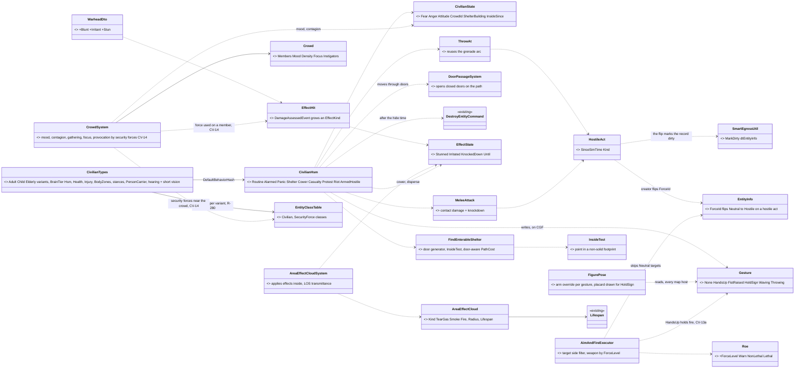

*What the picture shows that prose hid:* the side flip has ONE producer (a hostile act, made by the civilian's own brain on
CGF, which is also the creator that owns `EntityInfo`) and every existing side reader picks it up live, because
`TargetMemory` stores no side — on OTHER nodes only because the flip marks `dtEntityInfo` dirty (§1, the egress re-sends
nothing otherwise); and every non-lethal effect lands in ONE stored component (`EffectState`) that both the
civilian HSM and the body read — the I1 rule stays intact because health is never used to mean "stunned". ⭐ *(CV-13/CV-14, 2026-10-17)* — what a protester DOES
with his body is a third, separate carrier (`Gesture`), written by the same brain and read by the map and by the fire gate; and the
crowd's anger has TWO producers, instigators and the security forces themselves, so a police action can tip a crowd into a riot.

### 2.2 The civilian HSM

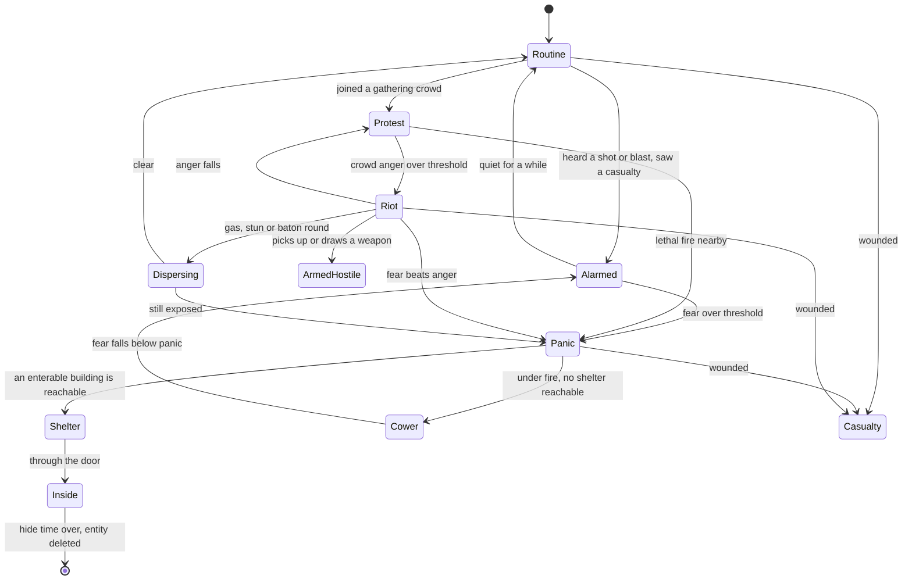

*What the picture shows that prose hid:* panic never ends in open-ended running — every panic path drains into Shelter
(and deletion) or Cower (R-4035); and the only edges INTO violence go through the crowd (Protest → Riot) or a weapon, so a
lone frightened civilian never attacks. ⚠ **As built (`CE-2236`, §5e):** Cower's exit is **Alarmed** once fear falls below
`PanicAt` — ⛔ SUPERSEDED: *"Cower → Panic : fire stops"*, which re-asks the shelter query that just answered none and loops
Panic ⇄ Cower while he is still frightened.

### 2.3 Sequence — a shot, a panicking civilian, a building, gone

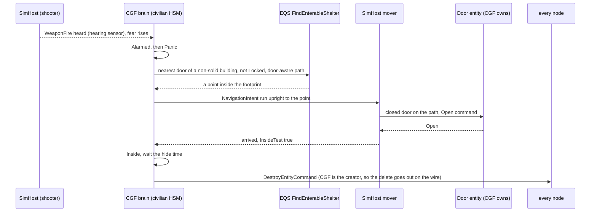

*What the picture shows that prose hid:* no new door logic — the mover already opens a closed door for any person on its
path, and a Locked door is a wall to the route planner, so "if the doors can be opened" is answered by the EXISTING planner;
and the delete works because CGF both runs the brain and created the entity.

### 2.4 Sequence — a riot meets a police line

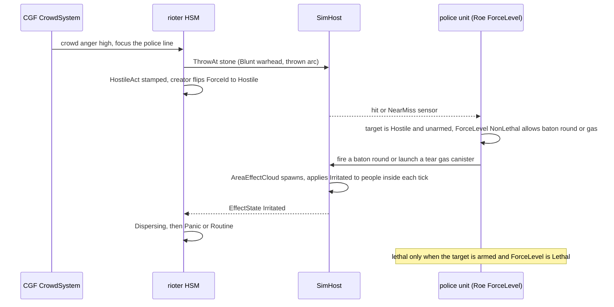

*What the picture shows that prose hid:* the police never decide on ground truth — they act on what the rioter DID
(the hostile act made it Hostile) and on what it CARRIES (armed or not), and the ladder is a property of the police unit's
Roe, not of the weapon.

### 2.5 Modules — who registers it, who calls it each frame

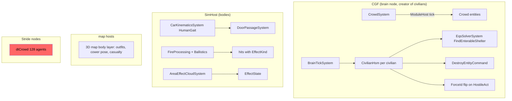

*What the picture shows that prose hid:* the red box — dtCrowd exists only on Stride nodes and caps at 128 agents, so
civilians on SimHost move through `CarKinematicsSystem` like soldiers; the catalogue's "crowd agents (dtCrowd)" in D3 is
NOT the movement host here (CV-10). And everything that decides runs on CGF; SimHost only moves, hits and applies clouds.

## 3. Why — what the diagrams cannot carry

- **One family, modes not types.** AQ93 P5 proposed a `PanickedCivilian` type. A runtime mood change (R-4034) and a
  handover from SUMO both want the SAME entity to move between routine, panic and violence; a type per state would mean
  re-creating entities on every mood change. ⇒ superseded by CV-1.
- **Side = what others can see.** D4 (approved) forbids omniscient detection. Flipping `ForceId` only on an OBSERVABLE act
  gives disguise for free (a hostile-at-heart civilian reads Neutral until it acts) without building G11's identification
  layer first, and every existing side reader (`VisionBroadphase`, `FactionFilterTest`, drones, map tint) already reads it
  live.
- **The Neutral filter is a safety gate, not a feature.** Today nothing stops a soldier engaging a neutral — an unarmed
  civilian simply ranks at 0.3. Civilians with brains, in crowds, next to soldiers make that a live hazard the moment slice
  CIV-1 ships, so it ships first (AQ93 P6).

## 4. Decisions — ✅ RULED `2026-10-16` (R-3013): every lean below approved as written

| id | question | ⭐ lean | rejected — one line each | blast radius |
|---|---|---|---|---|
| **CV-1** | the new types | ONE civilian family in a new catalogue (`CivilianTkbCatalog`): Adult (m/f), Child, Elderly variants, NEW type ids (1001/1003 retired, not reused); `BrainTier = Hsm`, `DefaultBehaviorHash = CivilianHsm`, `CombatPlatformDefDto` (Health), `InjuryDefDto`, `BodyZonesDto` (HL-12), `CharacterAnimationDefDto` (stand/crouch/prone), `PersonCarrier` (can pick up a weapon or a stone), footsteps; outfits kept (CE-1099); `CivilianCar` stays until SUMO; ⭐ *(behaviors, 2026-10-16)* **a `Civilian` and a `SecurityForce` class in `EntityClassTable`** (R-280: the picker folder, the 3-D model and the behaviour lookup must agree on what the new types are) | a type per state (`PanickedCivilian`, `Rioter`…): re-create on every mood change · patching 1001: keeps ids whose meaning changes under live scenarios | 4 scenarios + ~12 code files + ~9 tests migrate; map keys 501–505 re-pointed |
| **CV-2** | sensors | hearing 100 m (shots, blasts, footsteps) + **short vision 30 m, Low priority band, 1 Hz refresh**; crowd awareness comes from the CrowdSystem, not per-person vision — a Neutral observer drops Neutral targets anyway (`VisionBroadphase.cs:79`) | 360° full vision: ~76 ms at 500 units · hearing only (AQ93 P5): a rioter could not see the police line it attacks | perception budget — measured in CIV-1's perf gate |
| **CV-3** | the behaviour host | **one `CivilianHsm`** per civilian (R-263), the states of §2.2; reads `CivilianState` (fear, anger, attitude), `EffectState` and crowd hints | BTree per civilian: R-263 rules HSM · Tier-0 C# system (tutorial §2): cannot express the modes | behaviors lane |
| **CV-4** | attitude and side | hidden attitude in `CivilianState` (brain only); a **hostile act** (throw, melee, fire, ~~draw a weapon~~ — ⭐ *amended 2026-10-17, R-2026 §5h AW-16: drawing makes him armed, intent unknown; the act is aiming at or firing at the forces, attacking, a vehicle driven at them*) stamps replicated `HostileAct` and the creator (CGF, owner of `EntityInfo`) flips `ForceId` Neutral → Hostile — sticky for the exercise in slice 1; ⭐ *(behaviors, 2026-10-16)* **the flip goes through ONE engine write path that also marks `dtEntityInfo` dirty** (§1: otherwise only CGF sees it), pinned by a two-node rail; an armed hostile civilian uses separable weapons (`PickUp`, `FireWhileCarried`) | flipping on attitude alone: omniscient detection (D4) · building G11 perceived-side first: large and not needed for this | `EntityInfo` writer on CGF; map symbol letter may stay stale (known limit) |
| **CV-5** | crowds | a **bodiless `Crowd` entity** (no `UnitRoster` — 16-member cap) and a CGF `CrowdSystem`: membership by proximity, mood (mean fear/anger), **contagion** of fear/anger by distance, gathering point, focus (a building, a police line), instigators (ASY-5) who raise anger; members read it through `CivilianState` | a squad per crowd: 16 members, and catalogue T3 says a crowd is uncommanded · per-person perception for contagion: civilians do not see each other | behaviors lane + one new system |
| **CV-6** | non-lethal effects | ⓐ `DamageAssessedEvent`/`EntityHitDamage` grow an **`EffectKind`** (Kinetic, Blunt, Irritant, Stun, Push) + magnitude; ⓑ a **stored `EffectState`** (Stunned, Irritated, KnockedDown, Until) on the victim — the case I1 names; ⓒ a persistent **`AreaEffectCloud`** entity (tear gas, smoke, later fire) on `Lifespan`, its system applying effects each tick and reducing LOS transmittance; ⓓ new `WarheadKind`s Blunt, Irritant, Stun | deriving stun from Health: breaks I1 · a cosmetic smoke effect: does not affect sight or people | engine (backend lane): damage path, AreaEffectSystem sibling, LOS strategy |
| **CV-7** | shelter and vanish | EQS **`FindEnterableShelter`**: generator over doors of non-solid buildings (not Locked in `DoorStates`), a point inside the footprint (**new `InsideTest`** = `PolygonMath.Contains` + storey), door-aware `PathCost`; the mover opens closed doors itself; inside ⇒ wait a **hide time** (scenario parameter, e.g. 60–180 s, randomised), then the brain issues `DestroyEntityCommand`; no reachable building ⇒ `FallBack` away, Cower under fire | open-ended fleeing (rejected by the user) · `PhysicalPresence.IsHidden` inside: keeps entities alive for nothing | EQS + one HSM state; test terrain bt-range |
| **CV-8** | escalation of force | `Roe` grows a **`ForceLevel`** {Warn, NonLethal, Lethal}; **ground-AI targeting skips Neutral targets** (threat ranking, `TopThreat`, `AimAndFire`) — the safety gate, first; a Hostile target is engaged with the weapons its `ForceLevel` allows; Lethal also needs the target armed or a lethal act; security-force SOP: Warn (an audible cue) → NonLethal → Lethal | weapon-per-target hard-coding: no doctrine knob · a full G11 identification model first: too big for the gate | `AimAndFireExecutor`, `ThreatRankingDecision`, `Roe` |
| **CV-9** | the weapons | slice 1 of non-lethal: **baton/melee** (D5 `MeleeAttack`), **baton round** (ballistic, Blunt), **tear gas grenade/launcher** (Indirect, Irritant cloud), **stun grenade** (thrown, Stun area); civilians' **stone** and **Molotov** (`ThrowAt`, Blunt / fire cloud); later: water cannon (a spray weapon), LRAD | all at once: the spray and acoustic weapons need new physics | TKB weapons + munitions |
| **CV-10** | scale | target **~300 active civilians per CGF** (perf gate in CIV-1, measured: brain tick per entity, perception, movement); movement through `CarKinematicsSystem` `HumanGait` on SimHost (dtCrowd is Stride-only, 128 cap); above the budget, the scenario spawns fewer — no brain LOD in slice 1 | thousands of brained civilians: unmeasured, perception alone tops out near 500 · dtCrowd: not on SimHost | measurement first |
| **CV-11** | security forces | a police/security unit family (shield, baton, baton-round launcher, gas launcher, stun grenades) and a **hold-the-line** behaviour on SquadMarch's `Line` formation; a proper cordon waits for CE-2124 (formations) | building a cordon formation now: CE-2124 is the owner | behaviors lane |
| **CV-13** *(2026-10-17, R-2024)* | gestures and props | ONE replicated **`Gesture`** byte per person {None, HandsUp, FistRaised, HoldSign, Waving, Throwing}: the civilian HSM writes it on CGF (as it writes `Cowering`); the map's `FigurePose` reads it as an ARM override (the way it draws carry arms today); **HoldSign draws a pole + placard in the hands — drawn only, no entity**; Throwing is the wind-up `ThrowAt` (CE-2238) sets | fold into `EffectState`: those are timed effects of a hit, a gesture is the person's own act · a real carried-item entity for the pole: heavy for a picture — later, if a pole must be dropped or used as a club · new stances: a stance is locomotion (stand / crouch / prone), a gesture is the arms over any stance | backend: the component + wire (B-6); ui: the poses + placard (U-6); behaviors: who writes it (CE-2240) |
| **CV-13a** *(2026-10-17, R-2024)* | hands up | a person showing **HandsUp is held like a neutral** — `AimAndFireExecutor.HoldOf` ⇒ a new `HoldSurrender`, the same gate CIV-0 built (§5b) — even when Hostile; it does NOT flip the side back | decoration only: a soldier shooting a surrendering man is exactly what a trainee is assessed on · flip Hostile → Neutral on hands up: the act stays recorded, and a feint must not erase it | `AimAndFireExecutor`, `ThreatDanger` (behaviors) |
| **CV-14** *(2026-10-17, R-2024)* | the security forces provoke | the `CrowdSystem` (CV-5) gets anger inputs beside the instigators: ① security forces (the `SecurityForce` class, CV-1) within ~30 m and FACING the crowd raise it slowly; ② force used on a member (baton, baton round, gas, an arrest — an `EffectHit` on him) SPIKES it in his neighbours; ③ the police withdrawing lets it decay. Each member has a **hidden threshold from his attitude** (CV-4), so only a FRACTION riots — the same non-lethal hit makes a calm crowd disperse and an angry one riot (the Riot / Dispersing edges of §2.2 both stay) | a fixed scripted switch: predictable, not a test of the trainee's choice · per-person vision of the police: the perception cost CV-2 already ruled out | `CrowdSystem` (behaviors, with CE-2237/CE-2241) |
| **CV-12** | the SUMO hookup | last slice (R-4033): AQ93 §8's handover creates a civilian of this family in **Panic** mode with the incident point — no special type | a SUMO-specific type: two civilian models | AQ93 §8 |

## 5. Slice plan *(backend + ui halves handed off as frames 2026-10-16; behaviors half recorded, not started)*

⭐ Handoffs: [backend B-1…B-5](blueprints/batches/HANDOFF_Behaviors_To_Backend_Civilians.md) ·
[ui U-1…U-5](blueprints/batches/HANDOFF_Behaviors_To_Ui_Civilians.md). Behaviors rows: `CE-2233`…`CE-2239` in the
[tracker](blueprints/Blueprint_Issues_Tracker.md).

| slice | content | owner | acceptance |
|---|---|---|---|
| **CIV-0** | **safety gate**: ground-AI targeting skips Neutral targets (CV-8 first half) | behaviors `CE-2233` | a soldier at FireAtWill next to a neutral civilian does not engage it; `ua-threat-ranking` migrates |
| **CIV-1** | the new civilian family (CV-1/CV-2) + its class rows, old types retired, 4 scenarios migrated; `CivilianHsm` Routine + Alarmed + Casualty; **perf gate** (CV-10) | backend B-2, B-4 · behaviors `CE-2235` · ui U-1 | 300 civilians on CGF within the frame budget, measured |
| **CIV-2** | Panic → Shelter → Inside → deleted, Cower (CV-7) on bt-range | behaviors `CE-2234` (§5a first), `CE-2236` | a shot near a civilian sends it through an openable door into a house and it is gone after the hide time; a locked house is skipped |
| **CIV-3** | crowds (CV-5): gathering, protest, contagion; ⭐ the protest's **gestures + placards** (CV-13) | behaviors `CE-2237`, `CE-2240` · backend B-6 · ui U-5 (optional), U-6 | onlookers gather at an incident; fear spreads through a crowd; a protest shows its gestures on every map |
| **CIV-4** | attitude + hostile acts (CV-4), `ThrowAt` + `MeleeAttack` (D5), riot (CV-3) | backend B-3 · behaviors `CE-2238` · ui U-2 | a rioter that throws a stone turns Hostile on every node; soldiers may now answer it |
| **CIV-5** | non-lethal (CV-6, CV-9), escalation ladder (CV-8), security forces (CV-11); ⭐ the security forces **provoke** (CV-14) and **hands up holds fire** (CV-13a) | backend B-1, B-5 · behaviors `CE-2239`, `CE-2241` · ui U-3, U-4 | a police line disperses a riot with gas and baton rounds without a single lethal shot; an armed rioter draws lethal fire; a pressing police line tips a FRACTION of a protest into a riot |
| **CIV-6** | water cannon, LRAD, Molotov fire cloud | backend | — |
| **CIV-7** | SUMO hookup (CV-12, AQ93 §8) | coordinator | a panicked SUMO pedestrian becomes a civilian in Panic and shelters |

## 5a. Measure before CIV-2 *(behaviors, 2026-10-16 — `CE-2234`; both unmeasured, both load-bearing)*

| # | question | why it decides | where to look |
|---|---|---|---|
| **M-1** | does CGF hold the authority the wire delete needs over a civilian it CREATED, while SimHost moves the body? | §2.3's last step: `CycloneNetworkCleanupSystem` disposes on the wire only when the deleting node `HasAuthority`; if SimHost is primary, "the brain deletes itself" leaves a ghost everywhere else | `CycloneNetworkCleanupSystem.cs:70-120`, R-160, the CGF creation path |
| **M-2** | does the route planner reach a point INSIDE a bt-range house footprint (through its door), and does `DoorPassageSystem` fire on that route? | CV-7's "a point inside the footprint" is only reachable if the navmesh / road graph enters the building; if not, the shelter target must be the door's inner side | `NavDoorways.cs`, `DoorPassageSystem.cs:78-122`, the bt-range terrain |

⭐ **Answered** *(behaviors, `CE-2234`, 2026-10-17)* — both YES, so CV-7 keeps its shape:

| # | answer | evidence |
|---|---|---|
| **M-1** | ✅ **a `DestroyEntityCommand` published on CGF removes a person CGF created on SimHost and on CGF** — no ownership move, no SimHost-side logic. The brain's self-delete is enough | `SplitAuthoritySpawnTests.CE2234_APersonCgfCreated_DeletedOnCgf_IsGoneOnSimHost` (two nodes, real DDS) — passes. ⚠ a measurement rail, not red-proved |
| **M-2** | ✅ **a path from outside reaches inside the house through its door; every doorway of the SHIPPED bt-range House A connects for infantry; a closed door on the route holds the walker and opens once, a locked one is a wall (replans or fails the move)** ⇒ the shelter target may be a point inside the footprint | `RecastNavmeshFactoryTests.Stage2_InsideTheHouse_…`, `Stage5c_ALockedDoorIsAWall_…`, `Stage5d_BtRangeHouseA_EveryDoorwayConnectsForInfantry`, `DoorPassageSystemTests.Stage5d_*` (4) — 7 / 0 |

## 5b. AS-BUILT — CIV-0, the safety gate *(behaviors, `CE-2233`, 2026-10-17)*

Built as CV-8's first half, at every layer a target passes (five — the last two found after the first three shipped) — measured, not assumed: danger 0 alone left the neutral as
`TopThreat`'s pick (it takes the ranking's top at score 0, the CE-2202 corpse case).

| layer | as built | why here |
|---|---|---|
| danger | `ThreatDanger.Of` = 0 for a neutral (`ThreatDanger.IsNeutral`: `EntityInfo.ForceId == Neutral`, read live) | "the ONE function every threat reader calls" (Sensors §7.8a) — counts, the ranking, danger areas, the vehicle budget at once, as the dead (CE-3080) |
| pick | `EqsTacticsNodes.TopThreat`: the designated target, the kept/top threat and the live fallback must be `Engageable` (in the fight AND not neutral) | the one threat pick every fire / sensor / close step goes through (Entity Control §10) |
| fire | `AimAndFireExecutor.HoldOf` ⇒ `ActionReason.HoldNeutral` (label "hold: neutral", amber, weapon posture Ready) — on both the turret and the per-shot path | the last gate before an AI round, whoever picked the target (a squad assignment, an order); ⭐ an operator's (human's) fire does not pass here |
| edges | `ThreatEvaluationSystem`'s FirstThreat / AllClear count THREATS (`ThreatCount`: heard contacts + seen non-neutral ones), against the unit's count last frame — so a neutral turning Hostile is a FirstThreat | 📐 **found by the demo `ua-civ-neutral-gate`**: counted as CONTACTS, the first civilian seen took the one FirstThreat — `BasicInfantrySop` reacted, found nothing to engage, went idle — and the Hostile seen after it raised none: he never fought; and with civilians in view the memory never empties, so AllClear never came. ⛔ SUPERSEDED: `countBefore == 0 && mem.Count > 0`. Rail `SensorChangedEventTests.CE2233_…`, red-proved |
| posture | `StandardInputs.HaveLiveTarget` and `ThreatInSight` skip a neutral as they skip a corpse (CE-2120) | 📐 found by a sweep of every `IsOutOfTheFight` reader: these two gate the FIRING postures — without it a soldier who sees only a civilian picks Suppress with nothing to shoot. (`SquadInputs:270` reads the unit's own members and the EQS `AliveFilterTest` is not a threat gate — left alone) |

📐 **Live** *(2026-10-17, `utility-demo-check.py --launch ua-threat-ranking`, "Civilian Near" now Neutral)*: the ranking settles Armed Near
› Armed Far › Civilian 0, and stays so until both armed contacts are down. ⚠ Once every candidate scores 0 the ranking's debug WINNER
shows the civilian (the scorer returns its top at 0) — harmless, `TopThreat` filters it, but a reader of `/utility` should not take it as
a pick.

⚠ **Known limits of the gate:** ① an entity with NO `EntityInfo` is not neutral (Neutral is the enum's zero; unknown = engageable, as
`ThreatDanger` treats a target this node does not hold). ② An ORDER to attack a neutral is held by the weapon (no override yet — the
escalation ladder, `CE-2239`, decides whether an order may). ③ A grenade or an indirect round at a POINT is not gated by a neutral near
it (collateral is `CE-2239`'s). ④ Scenario sweep (2026-10-17): of 315 typed scenario entities only 4 are Neutral / unset — two vans and two
weather regions, none a combatant.

## 5c. Demo scenarios — one per feature, each a TEST *(behaviors, 2026-10-17; user: "a demo scenario for each civilian feature, with a clear success condition so it is usable as a test")*

⭐ **The rule:** a civilian slice is not done until its demo PASSES. Each demo is ① a `scenarios/<name>/scenario.json`, ② a live check
`python3 scripts/utility-demo-check.py --launch <name>` (a fresh cluster, asserting — the acceptance), and ③ an in-process twin in
`Hrot.ClusterRunner.Integration.Tests` (the CI gate; shipped-scenario twins live in `PostureScenarioTests`). A PASS line names what it
proves; ⭐ every demo also asserts the **precondition that makes the pass meaningful** (e.g. "he SEES the neutral" — otherwise "not
shot" could mean "not seen").

| slice | demo | terrain · cast | ⭐ PASS = all of | state |
|---|---|---|---|---|
| **CIV-0** `CE-2233` | **`ua-civ-neutral-gate`** | test-town · a rifleman (Friend) on a MISSION — CombatPosture → Sentry (MinDanger 0.5) → CombatPosture; an unarmed Neutral civilian; an ARMED Neutral nearest of all; a Hostile farther | ⓪ the cast stands where the scenario put it (else `CE-2242`, not CIV-0) · ① he remembers both neutrals · ② the Hostile is put out of the fight · ③ neither neutral loses health, sampled all run · ④ the neutrals rank at score 0 · ⑤ his fire stops, then no round for 8 s, and his weapon's target is never a neutral (sampled) · ⑥ the armed neutral's side flips to Hostile (`/attribute`, the owner's write path) ⇒ he is engaged, the civilian still unhurt | ✅ **live 3/3 `2026-10-17`** · twin `PostureScenarioTests.CE2233_CivNeutralGate_…` · 📐 it found the 5th CIV-0 layer (the threat edges, §5b) |
| CIV-0 | `ua-threat-ranking` *(migrated)* | test-town · its civilian is Neutral | the neutral civilian scores 0 and is never the ranking's winner | ✅ |
| **CIV-1** `CE-2235` | **`ua-civ-routine-alarm`** | test-town (⚠ 0–400 m; keep off the Pond) · 6 civilians of the new types (1101–1104) at their homes; a rifleman fighting a Hostile, two civilians 35–40 m from him, four 150+ m from both shooters | ① all 6 start in `Routine` (from the type's default), and the far ones walk · ② within 2.5 s of the first shot both near ones are `Alarmed`, no far one ever is (sampled) · ③ after the quiet time each `Alarmed` returns to `Routine` · ④ one wounded (Health set to 40 on CGF, the owner) ⇒ `Casualty`, stops moving, and stays there | ✅ **live 11/11 `2026-10-17`** (alarmed 1.7 s after the first shot; 4/4 far ones walked) · run 1 found its own cast off the navmesh — test-town is 0–400 m, two stood in the Pond (fixed) · twin `PostureScenarioTests.CE2235_CivRoutineAlarm_…` |
| CIV-1 | **`ua-civ-crowd-300`** *(perf gate, CV-10)* | test-town · 300 civilians, mixed variants, routine points spread over the town | ① all 300 run a behaviour · ② over 60 s, CGF frame time p95 ≤ the budget backend's `scripts/perf-civilians.sh` measures against (B-4) · ③ brain tick per civilian reported | ⏳ CE-2235 + B-4 |
| **CIV-2** `CE-2236` | **`ua-civ-shelter`** | bt-range · 4 civilians near House A (doors closed, not locked) and House B (locked); a burst fired 30 m away; hide time set short (20 s) for the test | ① each enters `Panic` · ② each reaches a point INSIDE House A's footprint (InsideTest), its door Open on every node · ③ none enters House B · ④ ~20 s after entering, each is gone on CGF, SimHost and IG | ✅ **live 15/15 `2026-10-17`** (re-run after the check's fix: all 4 in through A's front door, hid 19.3–21.0 s, gone on CGF, SimHost and IG) · ⛔ SUPERSEDED: 14/15, the check's 0.25 s poll missing a few-frame `Panic` · twin `PostureScenarioTests.CE2236_CivShelter_…` ✅ (samples every frame, so it asserts `Panic` itself; door Open on all three nodes) |
| CIV-2 | **`ua-civ-cower`** | open ground (no building in reach) · 3 civilians; sustained fire nearby | ① each enters `Cower`, `EffectState.Cowering` true on every node, speed ≈ 0 · ② the fire stops ⇒ `Cowering` false and each leaves `Cower` | ✅ live 11/11 `2026-10-17` · twin `PostureScenarioTests.CE2236_CivCower_…` ✅ (also asserts each passed through `Panic` and left Cower for Alarmed, never back to Panic) |
| **CIV-3** `CE-2237` | **`ua-civ-gathering`** | test-town · a hurt civilian (health 40) at the crossroads (200, 200); 12 calm civilians 30–60 m up the four streets | ⓪ the hurt one is a `Casualty` · ① every onlooker enters `Gather` · ② their mean distance to him falls below 15 m within 60 s · ③ one crowd holds ≥ 8 of them · ④ every one arrives and stands on a ring 2.5–11 m round him | ⏳ live run 1: 5/6 — ② at 25 s; ④ was measured while the 60 m ones still walked (check fixed: waits for all to arrive) · twin `PostureScenarioTests.CE2237_CivGathering_…` ✅ (12/12 Gather, 4.0–11.0 m, one crowd, mean < 15 m at 24.5 s) |
| CIV-3 | **`ua-civ-contagion`** | test-town · 15 civilians 8 m apart along the street, 30–142 m from a firefight (a rifleman and a hostile) at its west end · ⚠ *deviation:* small-arms fire, not a blast — no scenario-scriptable blast exists; the hearing edge (100 m) splits the crowd the same way | ⓪ ONE crowd · ① ≥ 5 hear it (`HeardAt`) · ⓪ ≥ 4 never hear anything · ② ≥ 3 of those who never heard panic, from the crowd | ✅ live 3 of 3 in a row after `CE-2246` (§5f: the crowd split by wandering; the demo's civilians wander 3 m) · twin `PostureScenarioTests.CE2237_CivContagion_…` ✅ (samples `HeardAt` and `Panic` every frame) |
| **CIV-4** `CE-2238` | **`ua-civ-riot-stone`** | test-town · ⭐ *as built:* an instigator and two protesters inside a stone source (TKB 8812, a polyline area), a policeman 12 m off | ⓪ the instigator riots · ① he fills his hands at the source · ② he throws · ③ the side follows the ACT: nobody Hostile without his act; every thrower Hostile on CGF, SimHost and IG within 3 s | ✅ live 6/6 `2026-10-17` (sim 7.9 s) · twin green (§5i.2a) · ⏳ the soldier line and "no soldier hits a Neutral rioter" wait on A6 (`Roe.ForceLevel`) |
| CIV-4 · `CE-2238` | **`ua-civ-melee`** | test-town · an instigating protester (Neutral) 6 m from a policeman (Friend) | ⓪ he riots · ① his blow knocks the policeman down (`EffectState.KnockedDownUntil` > now) on CGF, SimHost and IG · ② the rioter is Hostile on all three | ✅ live 4/4 `2026-10-17` (simTime 8.6 s) · twin `PostureScenarioTests.CE2238_CivMelee_…` green (§5i.1) |
| **CIV-5** `CE-2239` | **`ua-civ-police-line`** | test-town · a police squad (shields, batons, baton-round launcher, stun grenades; `ForceLevel = NonLethal`) against a riot | ① police fire ONLY baton rounds / stun grenades / batons — zero lethal rounds counted · ② ≥ 1 rioter knocked down or stunned · ③ the riot breaks up (`Dispersing`/`Panic`, the crowd's members leave) · ④ no death | ✅ §5j.1 — live 6/6 (force at 4.1 s, four stun grenades, all five stunned, the riot broken: a Casualty and four Cower), twin green |
| CIV-5 | **`ua-civ-escalation`** | test-town · the police line; one rioter armed with a rifle who fires | ① lethal fire goes ONLY at the armed rioter · ② the unarmed hostile rioters still receive non-lethal only · ③ with `ForceLevel = Warn`, no round at all — the warning cue only | ✅ §5k.1 — ⭐ *as built:* the armed rioter is a Hostile GUNMAN who draws a hidden rifle, holds it at ease 6 s (warned, no round), then fires into the air (ready ⇒ lethal after the ignored warning); ③ is its own scenario `ua-civ-escalation-warn` · live 6/6 + 6/6, twins green |
| **CIV-3** `CE-2240` | **`ua-civ-protest`** | test-town · 12 civilians told to protest at (224, 265), the street in front of the building at 230–290 × 230–300; NO security forces | ① every one reaches `Protest`, standing as one crowd (≥ 10) · ② on every node (CGF, SimHost, IG) members show `FistRaised` and `HoldSign` gestures (≥ 3 of each over the run) · ③ nobody turns Hostile and nobody enters `Riot` in 120 s — sampled all run | ⏳ · twin `PostureScenarioTests.CE2240_CivProtest_…` |
| **CIV-5** `CE-2241` | **`ua-civ-provocation`** | test-town · the same protest, each protester an authored `Attitude` (four at −1); three policemen (SecurityForce, NonLethal) walk from 60 m to 15 m, hold the line there facing the crowd 60 s (the presence, PV-1), `BatonCharge` the front rank 12 s, then `HoldTheLine` (§5m) | ① before the police are within 30 m, no riot · ② after the batons, ≥ 1 and < all members enter `Riot` (a fraction, not the whole crowd) · ③ every Hostile civilian rioted first, the same on every node · ④ ⚠ *as built:* no member of attitude −1 riots (the deterministic half of "the same members" — the seed is the authored attitude, §5m PV-3) | ⚠ §5m.1 |
| **CIV-5** `CE-2241` | **`ua-civ-surrender`** | test-town · ⭐ *unarmed half, as built:* an instigator strikes a policeman (Hostile, §5i); a rifleman 40 m off, ordered to attack him | ① he is Hostile · ② covered, his hands go up on CGF, SimHost and IG · ③ the rifleman holds ('hold: hands up') · ④ from the first raised-hands sample, 10 s: no round, no hurt · ⑤ still Hostile | ✅ unarmed half live 8/8 `2026-10-17` · twin green (§5h.4) · ⏳ the ARMED half (drop the weapon, re-arm, engaged again) waits on B-10 |
| **ARMED** §5h AW-21 · needs B-7 | **`ua-armed-status`** | test-town · a rifleman (Friend) vs an enemy rifleman AT EASE, 300 m, at night | ⓪ he is remembered · ① he is engaged · ② his danger and the ranking are identical to today's `ua-threat-ranking` — ⭐ the GUARD RAIL: green from the first armed-people commit on (the military fight is untouched) | ⏳ |
| ARMED AW-15 · B-7 | **`ua-armed-identify`** | test-town · 3 civilians holding a phone, a pistol, a toy gun, each at 20 m and at 150 m; two observers, one with binoculars | ① at 20 m the pistol and the toy gun are identified lethal · ② at 150 m both are unidentified without binoculars and identified with them · ③ the phone is never lethal, at any range | ⏳ |
| ARMED AW-16 · CE-2238 | **`ua-armed-draw-aim`** | test-town · a covert insurgent (Civilian, a pistol Hidden) 25 m from a rifleman; his routine 8 s, he draws, waits 10 s, then aims (a mission: `CivilianHsm` → `StationWeapon` → `PersonAttack`) | ① after the draw: side still Neutral, no round (sampled) — ⛔ SUPERSEDED: "the soldier's WARNING is B2" — B2 (§5k EL-1, AW-24) is the security forces' ladder; a soldier gives no warning · ② after the aim: side Hostile on every node and he is engaged | ✅ §5h.7a — live 7/7, twin green |
| ARMED AW-17 · CE-2239 | **`ua-armed-celebration`** | test-town · a wedding crowd; one man fires into the air, later at the patrol | ① fire into the air: a warning, no lethal round (sampled) · ② fire at the patrol: lethal | ✅ §5k.1 — ⭐ *as built:* a police patrol (the ladder is the security forces', AW-24); his rifle in his hands from the start, so he is warned at once · live 5/5, twin green |
| ARMED AW-18 · CE-2239 | **`ua-armed-self-defence`** | test-town · a NonLethal police line; one rioter aims a rifle at it | ① lethal fire at THAT rioter only · ② every other rioter still gets non-lethal force only | ✅ §5k.1 — ⭐ *as built:* the gunman is NEUTRAL until he aims (the act flips him; a Hostile-from-the-start man was beaten down by non-lethal force first) · live 4/4, twin green |
| ARMED AW-19 · CE-2239 | **`ua-armed-knife`** | test-town · a man with a knife closing on a checkpoint from 15 m; a second throws a Molotov | ① a warning while he is beyond reach · ② lethal once he is within reach or closing fast · ③ the Molotov thrower reads lethal | ⏳ |
| ARMED AW-20 · CE-2239 | **`ua-armed-shield`** | test-town · a rifleman 60 m from an insurgent who walks east along the line, then 20 m out of it; six civilians standing in one row 0.45 m BESIDE the line (outside a 0.3 m body, inside the rifle's spread) — ⚠ *as built:* not "from inside a crowd": a civilian ON the line hides the target (no aimed shot is ever ready), and two rows are pushed ~1 m apart by pedestrian spacing | ① the rifleman holds ('hold: neutral on line') while a civilian is in the spread · ② he fires once clear and the insurgent goes down (out of the fight) · ③ zero neutral casualties (sampled) | ✅ live 5/5 · twin `PostureScenarioTests.AW20_ArmedShield_…` ✅ (every frame: held 2870 frames, no round left with a body on the line) |
| ARMED AW-5, CV-13a · B-10, CE-2241 | **`ua-armed-surrender`** | test-town · an enemy soldier lays his weapon down and raises his hands; later re-arms and aims | ① no round while laid down (sampled) · ② engaged again once armed and aiming | ✅ §5h.5 — live 7/7, twin green |
| ARMED AW-2, AW-21 · B-7, B-8 | **`ua-armed-stones`** | test-town · stone-throwers (Hostile civilians) against a police line | ① non-lethal force only — zero lethal rounds counted · ② the throwers read unarmed on every node | ⏳ |
| ARMED AW-22 · CE-2238, B-16 | **`ua-armed-blend-back`** | test-town · ⭐ *as built:* a civilian draws a pick-up rifle and AIMS at patrol A from behind a row of civilians (the act — no round: both sides are held by the row), conceals it, walks along the line and then off it; patrol B (another unit, 170 m off at the act) comes up | ① patrol A knows him, holds while a civilian is in the line, fires once it is clear — the rifle still hidden · ② patrol B holds (`HoldConduct`), 0 rounds | ✅ §5h.7b — live 5/5 (A fired with the rifle hidden, 150 → 149; B 150 → 150), twin green |
| ARMED AW-8, AW-9 · B-13, B-14 | **`ua-armed-gas-throwback`** | test-town · police gas a riot; a rioter picks the canister up and throws it back | ① the cloud stays where it was picked up and drifts · ② a new cloud rises where it lands · ③ the rioter is irritated while he holds it | ✅ §5i.3a — live 6/6 (the cloud 12.9 m from the police, the new one 0.1 m), twin green |
| ARMED AW-23 · B-15, CE-2238 | **`ua-player-fratricide`** | test-town · a first-person player in a squad shoots two friends; a second run, one accidental wound | ① flipped Hostile on every node · ② the friendly AI engage him · ③ the instructor event names both victims · ④ the one-wound run flags nothing | ⏳ |
| ARMED AW-12 · B-11, CE-2238 | **`ua-armed-bomber`** | test-town · a civilian with a Hidden charge walks into a crowd and sets it off | ① never armed to any observer before the blast (sampled) · ② the casualties match the warhead's numbers | ✅ §5l.1 — ⭐ *as built:* a rifleman 30 m off, ten civilians in a ring, the bomber walks in (`MoveToLocation` → `DetonateCharge {Seconds 1}`) · live 5/5, twin green · ⛔ `CE-2247`: the spent vest's replicas stay live on CGF and IG |
| CIV-6 *(backend)* · CIV-7 *(coordinator)* | named by their owners | — | — | — |

⚠ **Timing is never a frame count in a live check** — the cluster boots paused and each node ticks on its own clock; every wait is
`wait_for(condition, timeout)` with the condition printed on failure, and every "never" is SAMPLED over the whole run (a minimum, not
an end state).

## 5d. CIV-1 behaviour — `CivilianHsm` slice 1: Routine, Alarmed, Casualty *(behaviors, `CE-2235`, 2026-10-17)*

INVENTORY *(codebase-memory CLI `search_graph` + grep, one Explore sweep; `check_index_coverage` not available through the CLI)*: hand-built
HSMs are `[HsmDefinition(Curated)]` graphs (`CuratedMachines.cs`, `ClassOrderBehaviors.cs`) bound through `HsmFluentBindingExtensions`;
hearing reaches a brain as `SoundContactEvent` → `TargetMemory.HearContact` (`ThreatEvaluationSystem.cs:69`, `PerceptionComponents.cs:282`)
— ⚠ a sound near an IDENTIFIED contact only refreshes that slot, so memory cannot say "heard now"; moves are `LocomotionMoveTo.Issue/Stop`,
stances `StanceRequest.Set`, wounds `Injury.StateOf` (fraction below the type's `WoundedBelow`, 0.6); no civilian AI, no fear component
existed (§1).

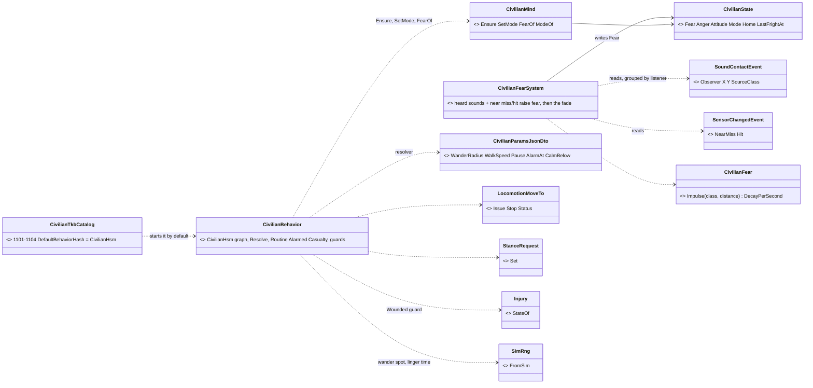
*What the picture shows that prose hid:* fear has ONE writer (the system) and the HSM only READS it — so the crowd's contagion
(`CE-2237`) is a second writer of the same field, not a second fear model; and the mode is written by the HSM's own state, so a reader
that is not the HSM never needs its metadata.

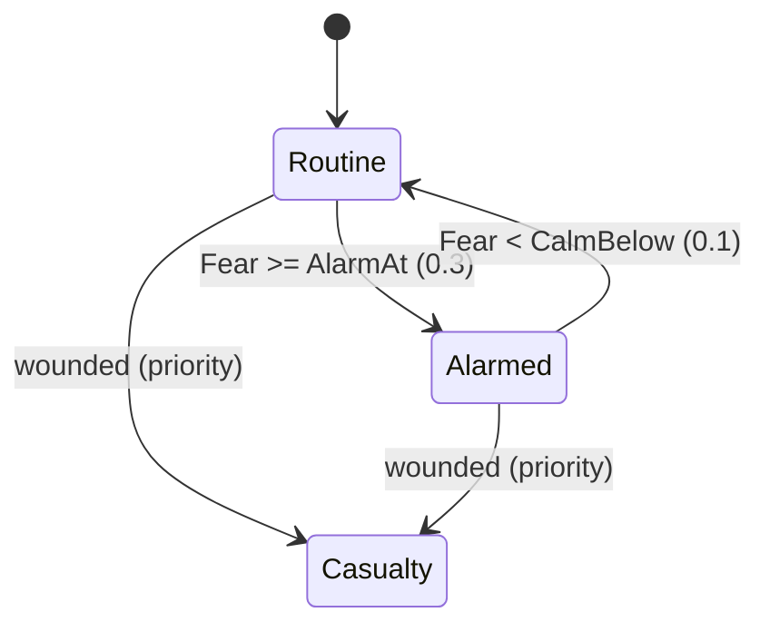
*What the picture shows that prose hid:* the slice-1 subset of §2.2 — Casualty has no exit, and the wounded edge outranks the fear edge
from both states, so a frightened wounded man lies down instead of crouching.

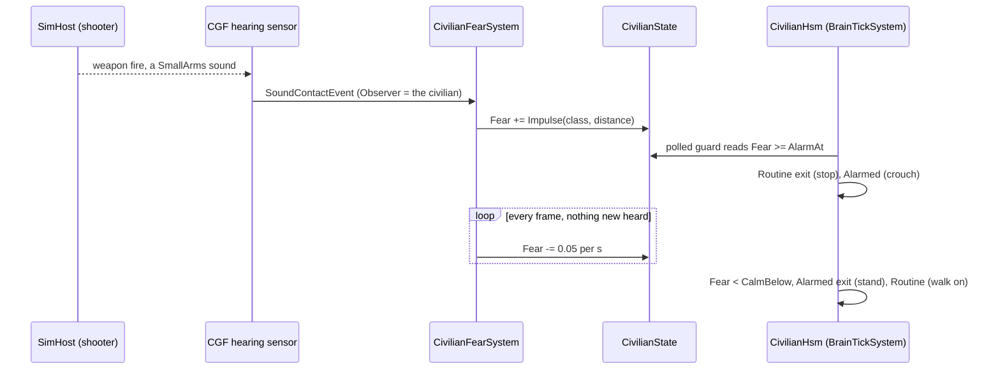
*What the picture shows that prose hid:* the alarm's length is the FADE, not a timer in the machine — a burst that frightened him more
keeps him down longer, and a second shot while he is alarmed extends it without any transition.

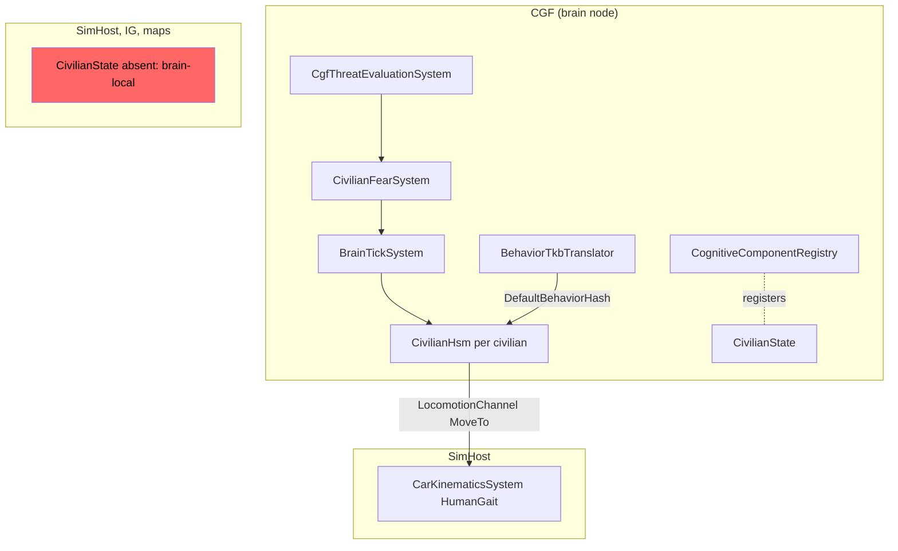
*What the picture shows that prose hid:* `CgfLogicPack` puts `CivilianFearSystem` in its Simulation list right after threat evaluation
and before the cognitive runtime (the brain tick), so a fright is read the same frame; the red box — no other node has `CivilianState`,
so anything another node needs (the cower pose, the side) travels in its own replicated component, never here.

| decision | ⭐ as built | rejected — one line each |
|---|---|---|
| who integrates fear | ⭐ one CGF system, one pass over the frame's `SoundContactEvent`s | a node in the HSM: civilians × events per frame (300 × a burst's samples) · reading `TargetMemory`: it cannot tell "heard now" for an identified contact (§5d inventory) |
| where fear lives | ⭐ `CivilianState` (id 399), brain-local, registered with the cognitive components, never saved | in the HSM block: the crowd (CE-2237) and a live check could not read it |
| who adds it | ⭐ the HSM, on its first tick (`CivilianMind.Ensure`, home = where he stands) | the TKB translator: any person may be given `CivilianHsm`, and only a running one needs a mind |
| the mode | ⭐ each state's activity writes `CivilianState.Mode` | the HSM trace's leaf names: the trace must be armed per entity and the leaves are ids |
| wounded | ⭐ `Injury.StateOf != Ok` (the type's thresholds: below 60 %) | "health below max": a scratch would make a casualty |
| the routine | ⭐ wander about home (radius 12 m, 1.4 m/s, linger 3–10 s, `SimRng` per man and leg) | authored routine points: no demo needs them yet — a later round-out |

⚠ **Known limits (slice 1):** ① *seeing* a casualty does not frighten (§2.2's "saw a casualty") — a Neutral observer drops Neutral
targets in vision (`VisionBroadphase.cs:79`), so the crowd hint (`CE-2237`) carries it. ② Fear's impulses and fade are constants of
`CivilianFear`, the same for every man — attitude-scaled nerve comes with `CE-2238`. ③ A casualty stays one; a casualty's rescue is not
civilian behaviour.

## 5e. CIV-2 behaviour — Panic, Shelter, Inside, Cower *(behaviors, `CE-2236`, 2026-10-17)*

INVENTORY *(codebase-memory CLI `search_graph` + grep; `check_index_coverage` not available through the CLI)*: EQS templates are
`[EqsTemplate]` static classes (`VehicleTemplates.cs` — ⚠ the existing **`FindShelter`** finds OVERHEAD cover on a grid for the drone
shelter, V8b: it does not know doors or footprints, so it cannot answer "a house I can walk into"); point generators derive from
`PointPatternGenerator` (`PointPatternGenerators.cs`); a behaviour owns a sensor through `PostureNodes.Keep/Drop`; doors are
`TerrainWorld.Doors`/`Panels` with live state in `DoorStates.Of` and the mover opens a closed door itself (`DoorPassageSystem`, §5a M-2);
a person is deleted on every node by `DestroyEntityCommand` (§5a M-1); cowering is `Effects.SetCowering` (backend F-3, §7).

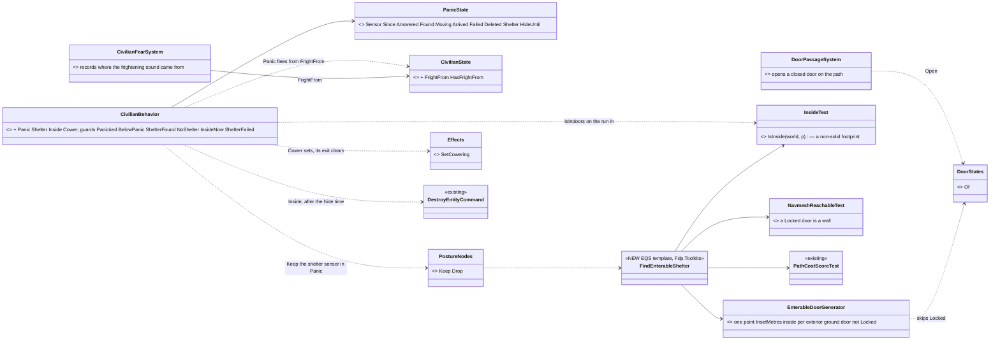
*What the picture shows that prose hid:* ONE new template of three new pieces, the rest reused — the door rule ("if the doors can be
opened") lives in TWO existing places and nowhere new: the generator skips a Locked door, and the reachability test treats it as a wall;
nothing in the HSM knows doors, and `InsideTest.IsInside` is the same question for the query and for the run in.

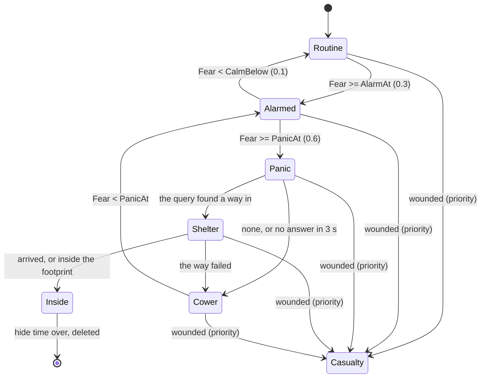
*What the picture shows that prose hid:* every panic drains — into Inside (and deletion) or Cower, never open-ended running (R-4035);
Cower's exit is Alarmed, not Panic (§2.2 SUPERSEDED there): re-panicking would re-ask a query that just answered none; Inside alone has
no wounded edge, because a man inside is about to vanish and nothing outside can hurt him.

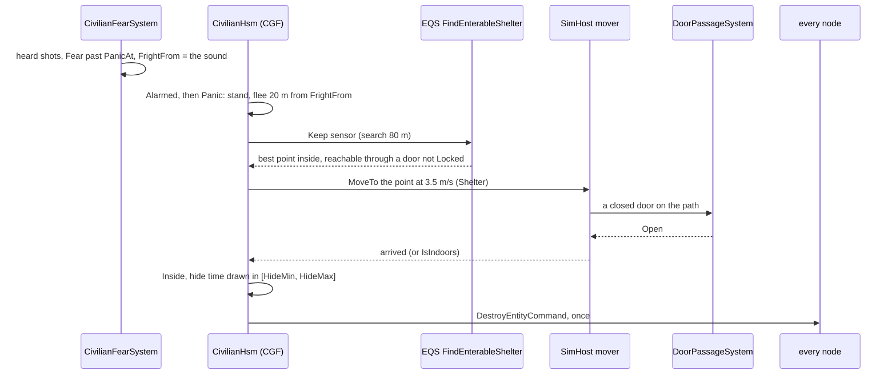
*What the picture shows that prose hid:* the flee and the query run TOGETHER — he is already running away while EQS answers, and the
answer replaces the flee's move; a query that never answers (no terrain, a node without EQS) costs ShelterWaitSeconds and ends in
Cower, not a stuck Panic.

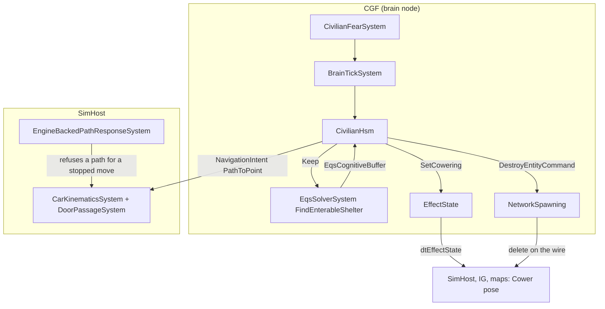
*What the picture shows that prose hid:* the one cross-lane fix of this slice sits on SimHost — `EngineBackedPathResponseSystem` drove
EVERY reachable path answer, so a path planned for a move that was then STOPPED revived it (measured: a casualty crawling 2 m along
the walk he was shot out of, CIV-1's ④); it now refuses one whose intent is the explicit stop (`CE-2245`).

| decision | ⭐ as built | rejected — one line each |
|---|---|---|
| where he hides | ⭐ a NEW template `FindEnterableShelter`: a point 2 m inside each exterior ground-storey door not Locked, indoors, reachable, nearest | the existing `FindShelter`: overhead cover on a grid, blind to doors and footprints · the door CENTRE: on the threshold, half outside |
| the lock rule | ⭐ the generator skips Locked (`DoorStates`) and reachability treats it as a wall — both existing | a door check in the HSM: a third place for one rule |
| the run | ⭐ flee 20 m from `FrightFrom` while the query runs, then MoveTo the answer at 3.5 m/s, upright | wait still for the answer: a man frozen under fire · `FallBack`: a soldier's node, needs a threat contact he does not have |
| no answer | ⭐ Cower after `ShelterWaitSeconds` (3 s) | wait forever: no terrain ⇒ a stuck Panic |
| inside | ⭐ hide `[HideMin, HideMax]` (60–180 s, `SimRng`), then ONE `DestroyEntityCommand` | `PhysicalPresence.IsHidden`: keeps him alive for nothing (CV-7) |
| Cower's exit | ⭐ Alarmed once Fear < PanicAt | §2.2's Cower → Panic: re-asks a query that answered none, loops Panic ⇄ Cower |
| the stopped-move fix | ⭐ `EngineBackedPathResponseSystem` skips a path whose entity's intent is `None` (cross-lane, backend file; the handle stays registered) | correlate request ids: PlanRoute already asks with intent `None` and documents that it "does not start corridor-following" — the same rule fixes it |

⚠ **Known limits (slice 2):** ① only bt-range's houses are enterable (§6); on test-town every panic ends in Cower. ② The shelter is the
first answer — a door locked AFTER the answer makes the run fail and he cowers, he does not re-query. ③ `Inside` deletes him from
`SimulationTime`; a paused sim holds him inside. ④ Upper storeys are not candidates (ground floor only).

## 5f. CIV-3 behaviour — crowds: onlookers gather, fear spreads *(behaviors, `CE-2237`, 2026-10-17; build-state: READY-TO-BUILD)*

INVENTORY *(codebase-memory CLI, re-indexed 2026-10-17 after the backend/ui merges; `check_index_coverage` not available through the CLI)*:
`search_graph .*Crowd.* Class` = **18**, every one a dtCrowd MOVEMENT agent (`CrowdAgent`, `CrowdMotorIntent`, `IDtCrowdProvider`,
`CrowdAgentUpdateSystem`…, Stride-only and capped at 128, §2.5's red box) — none is a group of civilians; `.*(Gather|Onlook|Incident|Contagion|Mood).* Class`
= **0**. A brain-local entity that is never saved already exists as a pattern: `EqsChildSensor.Ensure` (`repo.CreateEntity` +
`DerivedParts.MarkNotSaved`, CE-3045). `CivilianState` already carries `Anger` and `Attitude` (unused), §2.1 already names a `CrowdId` on it.
Component id **400** is free on `behaviors`, `backend` and `ui` (grep of `GlobalComponentIds.cs` on all three, 2026-10-17).

⭐ **Scope** *(this slice)*: the crowd itself (membership, mood, focus), onlookers gathering at an incident, and fear spreading through a
crowd. ⛔ Moved out, each to the slice that first has a consumer: **Protest** and its gestures → `CE-2240`; **anger and instigators** (ASY-5)
→ `CE-2238` (anger has no reader before Riot); the security forces' provocation → `CE-2241`. `Crowd.MeanAnger` is computed now so those
slices only add producers.

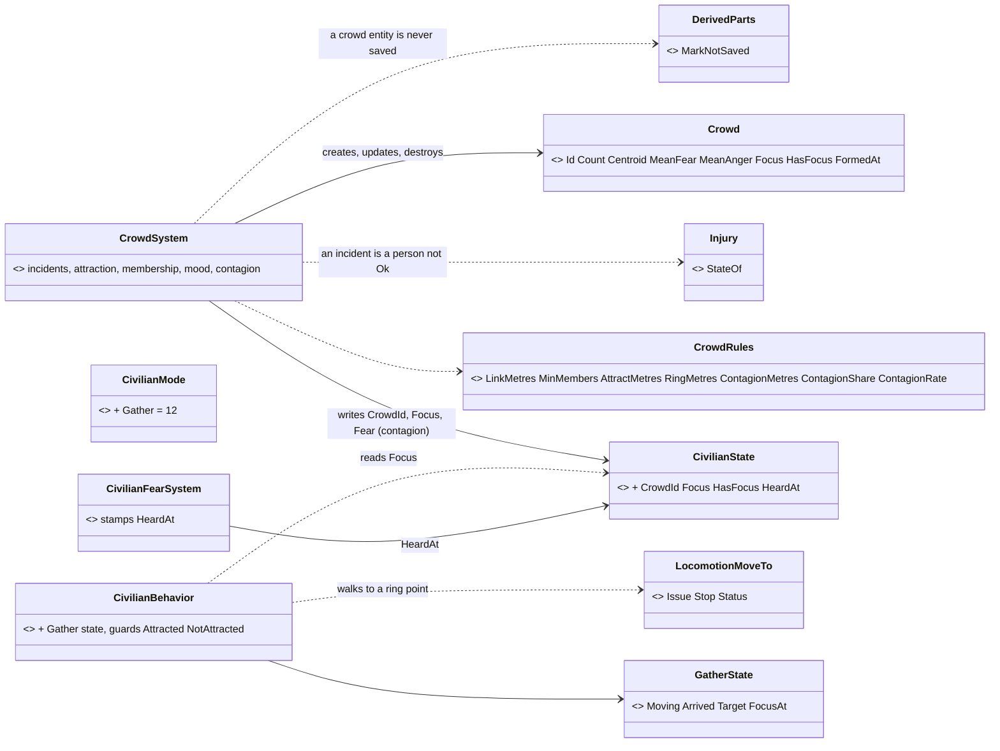
*What the picture shows that prose hid:* fear still has ONE model — contagion is a second WRITER of the same `Fear` field (§5d's caption
predicted it), so the HSM's thresholds, the fade and the panic path are untouched; and the crowd is DERIVED every frame from where the
civilians stand, so a crowd entity is a read-out with an id, never a second place membership is decided.

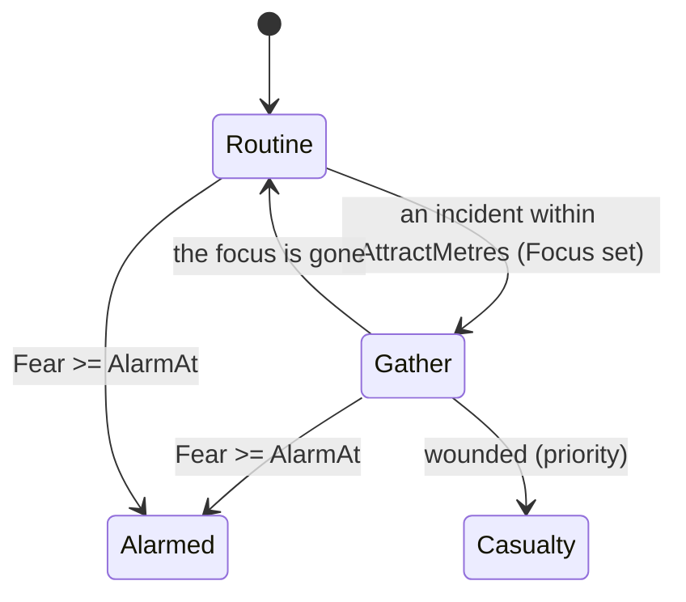
*What the picture shows that prose hid:* gathering is entered only from Routine — a frightened man never walks TOWARDS an incident — and
fear outranks curiosity from both states; the rest of §5e's machine is unchanged.

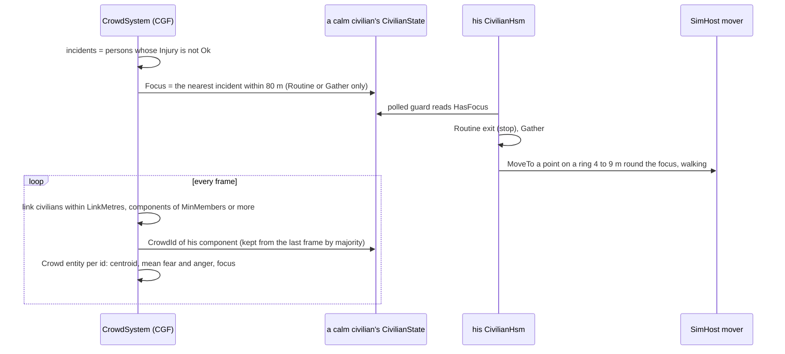
*What the picture shows that prose hid:* nobody tells a civilian to join a crowd — each walks to the SAME focus, and walking there is what
makes them one crowd; the id survives because a component inherits the id most of its members already had.

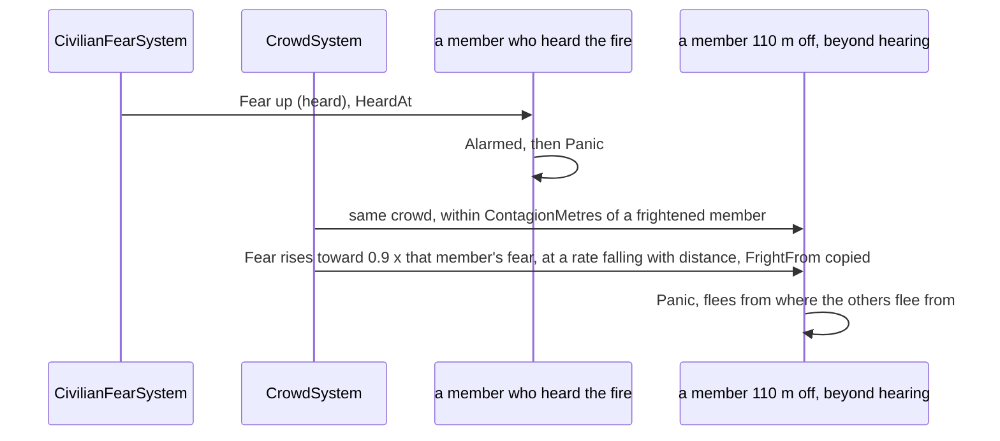
*What the picture shows that prose hid:* contagion can never RAISE a crowd's peak fear — each hop carries at most 0.9 of its source — so a
wave dies out after a few hops and two frightened neighbours cannot hold each other frightened forever (each fades below the other).

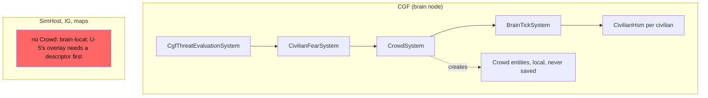
*What the picture shows that prose hid:* `CgfLogicPack` runs the crowd after the fear system and before the brain tick, so a contagion step
and the guard that reads it land in the same frame; the red box — no other node holds a crowd, so ui's optional overlay (U-5) needs a
replicated descriptor first, a backend item that does not exist yet.

| decision | ⭐ lean (this lane's detail under CV-5) | rejected — one line each |
|---|---|---|
| membership | ⭐ connected components of civilians within `LinkMetres` (15 m), ≥ `MinMembers` (3), recomputed every frame (300 civilians ≈ 45 000 pair checks) | a crowd assigned by the scenario: onlookers form crowds nobody authored · `UnitRoster`: 16 members, and a crowd is uncommanded (T3) |
| identity | ⭐ a component keeps the id most of its members had last frame; a new id otherwise; an empty id's entity is destroyed | a fresh id every frame: a reader could not follow a crowd |
| the crowd entity | ⭐ CGF-local `repo.CreateEntity` + `Crowd` + `DerivedParts.MarkNotSaved`, no `NetworkIdentity` — the `EqsChildSensor` pattern | a replicated entity: no reader on another node yet (U-5 is optional, LATER) · a singleton table: CV-5 rules an entity |
| what draws onlookers | ⭐ a PERSON whose `Injury.StateOf` is not Ok within `AttractMetres` (80 m), read from ground truth on CGF — CV-2's "crowd awareness comes from the CrowdSystem" | per-person vision: a Neutral observer drops Neutral targets (`VisionBroadphase.cs:79`) and costs CV-2's budget |
| how they gather | ⭐ walk to a point on a ring 4–9 m round the focus, on their own bearing (`SimRng` per man) and stand | everyone to the focus point: they stack on the casualty |
| contagion | ⭐ from a same-crowd member within `ContagionMetres` (20 m) showing fear (Alarmed, Panic, Shelter, Cower): `Fear += ContagionRate·(1 − ½·d/R)·dt·(0.9·Fear_src − Fear)` when positive; `FrightFrom` copied from the strongest source | an impulse per sighting: two cowering neighbours re-frighten each other forever · the crowd's mean: one panicking man in 300 changes nothing, a wave never starts |
| how a check tells hearing from contagion | ⭐ `CivilianState.HeardAt` — the fear system stamps the last time he HEARD violence | a contagion counter: says nothing about whether he also heard it |

⭐ **Demos** (§5c): `ua-civ-gathering` and `ua-civ-contagion`, each with a live check and a twin. ⚠ **Known limits:** ① incidents are ground
truth within 80 m — no line of sight; ② a crowd is one CGF's civilians (two CGF nodes ⇒ two crowds where one stands); ③ an onlooker does
not turn to face the focus (no facing request exists for a standing person); ④ an onlooker stays as long as the incident does — a casualty
is never rescued (§5d ③), so the crowd stays; ⑤ *(`CE-2246`, measured)* **a crowd held together only by its 15 m link breaks as its members
wander, and contagion stops at the break** — see below.

⭐ **`CE-2246` — why contagion reached the crowd in-process but not live** *(behaviors, 2026-10-17, measured)*. A per-second live trace
(fear, mode, crowd, x of all 15) showed it: at t ≈ 12 s civilian 11 had wandered 17 m from civilian 10, past `LinkMetres`, so 11–15 were
a SECOND crowd while 10 cowered at fear 0.84; they re-linked at t ≈ 20 s, by which time the wave had faded (10 → 0.84, 11 → 0.67, 12 → 0.59,
just under `PanicAt`). At 8 m spacing, two neighbours on the default 12 m wander drift up to 32 m apart, so the line held only by luck —
the twin was lucky, the live run not. The candidates the row named first (a shorter fight, the check's poll) were measured too: the
hearers peaked at 0.97–1.00 live as in-process, and the poll was ~4 s a sweep (3 HTTP calls per civilian), fixed but not the cause.
⭐ **Fix — in the DEMO, not the rule:** the scenario gives its 15 civilians `WanderRadius` 3 (`CivilianHsm` override), so neighbours stay
within 8 + 2 × 3 = 14 m < 15 m — a crowd standing in the street, which is what the demo means. ⛔ The rule is unchanged: contagion within
one crowd is CV-5's, and a crowd that walks apart SHOULD stop passing fear. The check now sweeps all 15 under one perspective switch
(~1.7 s) and prints the same per-second trace as the twin. Live after the fix: PASS 3 of 3 in a row (4 of 6 who heard nothing caught it in the first).

#### 5f.1 AS-BUILT — the spatial grid *(behaviors, 2026-10-17; backend's [scaling note](blueprints/batches/NOTE_Backend_To_Behaviors_CrowdSystem_Scaling.md))*

⭐ **Measured cause:** `Link` compared every pair of civilians, and `Spread` / `Rouse` every pair INSIDE a crowd with a component read per
pair — at 500 the town links into one crowd, so both became ~250 k reads a frame (×33 for ×1.7). ⭐ **Fix:** a 20 m cell grid
(≥ `LinkMetres` 15 and `ContagionMetres` 20, so every partner is in the 3 × 3 block round a man); `Mode` and `Instigator` read once per
frame. ⛔ **No behaviour change by construction:** union-find roots are the component's lowest index whatever the pair order, and the
neighbour list is sorted ascending so a tie resolves as the all-pairs loop did. 📐 500 civilians: **103.6 → 2.79 ms** (§7.4a). Proof:
`CrowdSystemTests` + civilian unit suites green; twins `CE2237_CivGathering`, `CE2237_CivContagion`, `CE2238_CivMelee`,
`CE2238_RiotStone`, `CE2238_GasThrowback`, `CE2239_PoliceLine`, `CE2240_CivProtest` 7/7.

## 5g. CIV-3 behaviour — the protest and its gestures *(behaviors, `CE-2240`, 2026-10-17; build-state: READY-TO-BUILD)*

INVENTORY *(codebase-memory CLI + grep, 2026-10-17)*: backend's B-6 is built (§7.7: `Gesture` 398, `Gestures.Set/Of`, `dtGesture` 143,
Brain group, so the behaviour on CGF owns it); ui's U-6 is built (`CE-1166`: `EntityBodyLayer3D.Gestured` draws `Gestures.Of` on every map
host, the placard for `HoldSign`). A params DTO carries a point as a `Vector3` (`CombatPostureParamsJsonDto.Objective`). ⛔ No facing
request exists for a standing person (grep `Facing|LookAt|TurnTo` over the behaviour layer: none).

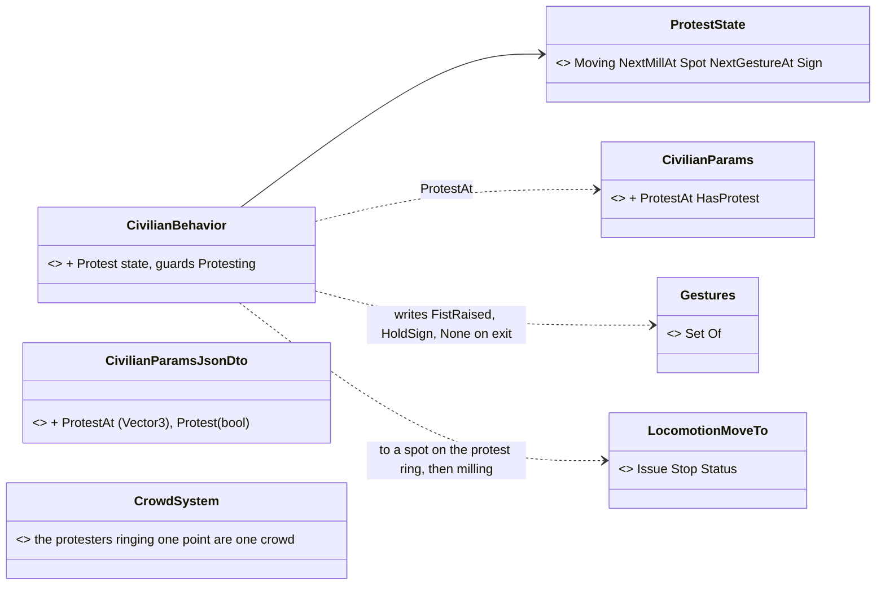
*What the picture shows that prose hid:* a protest is a PARAMETER of the one civilian machine (where to protest), not a new type or a
crowd order — and the crowd it forms is the same derived crowd as onlookers', so anger and provocation (`CE-2238`, `CE-2241`) attach to
a crowd that already exists.

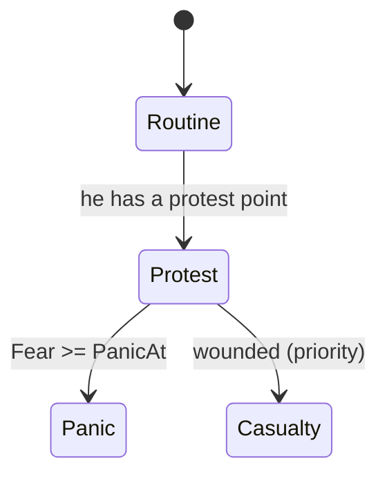
*What the picture shows that prose hid:* a protester skips Alarmed — a shot alone does not send a committed protester home, only fear past
PANIC does (§2.2's "Protest → Panic : lethal fire nearby"); Riot (`CE-2238`) is the next edge out of Protest.

```mermaid
sequenceDiagram
  participant HSM as CivilianHsm (CGF)
  participant MV as SimHost mover
  participant G as Gesture (dtGesture)
  participant N as every map host
  HSM->>MV: MoveTo his spot on the protest ring (8 to 15 m out), walking
  loop every 8 to 15 s
    HSM->>MV: a step to a new spot within 3 m, slowly
  end
  alt a sign carrier (40 per cent, per man)
    HSM->>G: HoldSign, the whole protest
  else
    loop
      HSM->>G: FistRaised for 3 to 6 s, then None for 2 to 5 s
    end
  end
  G-->>N: dtGesture, drawn as arms and a placard
  HSM->>G: None, on leaving Protest
```
*What the picture shows that prose hid:* the brain is the gesture's only writer and every map just draws the replicated byte, so "a
protest shows its gestures on every map" needs no new wire; and leaving the state clears it, so a panicking protester never runs with
his fist up.

| decision | ⭐ lean | rejected — one line each |
|---|---|---|
| who protests | ⭐ a civilian whose params name a point (`Protest: true`, `ProtestAt`) — scenario-authored, the same CivilianHsm | a protester TYPE: re-create on every mood change (CV-1) · a crowd order: a crowd is uncommanded (T3) |
| where he stands | ⭐ on a ring 8–15 m round the point, his own bearing (the onlookers' `RingPoint`, wider), stepping within 3 m every 8–15 s at 0.8 m/s | standing still: a frozen crowd reads as a picture, not a protest |
| his gesture | ⭐ 40 % carry a sign the whole time (`HoldSign`), the rest raise a fist 3–6 s then rest 2–5 s — per man, `SimRng` | everyone the same: a drilled unit, not a crowd |
| leaving | ⭐ `None` on exit; Panic only past `PanicAt` | Alarmed from Protest: one shot would end every protest |

⚠ **Known limits:** ① protesters do not FACE the point (no facing request for a standing man — §5f ③); ② anger stays 0 until `CE-2238`/`CE-2241`
add producers; ③ a protest point inside a solid building leaves its ring spots unreachable on that side — author it in the street.

## 5h. Armed people — what a man holds, what others can see *(behaviors, 2026-10-17; build-state: READY-TO-BUILD; ✅ RULED R-2025, amended R-2026, R-2027, R-2028, R-2029)*

🔒 **User, verbatim (`2026-10-17`, one exchange, each step approved in turn):**
- *"Both concepts sound reasonable. Just the condition for armed or unarmed need to be a little bit more complex."*
- *"picking the stones is likely very common way of getting a stone. Also picking a landed gas grenade and throwing it back should be possible."*
- *"Is there any threat level evaluated based on whether the weapon is drawn or just at ease?"* → *"Yes sounds good."*
- *"Is the bomb attached also considered a carried weapon? Bomb can be hidden."* → *"Approved."*
- *"The hand mount should be usable also for normal civilian stuff, not just weapons, like a mobile phone or maybe a binocular."* · *"we should not make it a separate entity, because there could be many soldiers who just carry it but never use it. The same like with their ordinary main weapon."* → *"approved, write it into the design"*
- After a critical review against real incidents (misidentification, legally armed civilians, celebratory fire, self-defence, knives and
  Molotovs, crowds as shields): *"approved, fold 1-6 into the design with your leans"* ⇒ **R-2026**, AW-15…AW-20 below; AW-1 and AW-3 are
  SUPERSEDED (their old text kept in their rows, struck through).
- On whether the complex rules are for civilians only (*"for soldiers and military is much simpler, because every enemy soldier who is
  armed, no matter where his weapon is drawn, unless he surrenders, needs to be considered hostile"*): *"approved, add AW-21 to the
  design"* ⇒ **R-2027**, AW-21.
- On how a civilian turns into a combatant (the lean: a lethal act, known per unit): *"Yes please."* And: *"in first-person shooter mode, if
  the player starts to kill his friends, he should be marked as enemy combatant and treated as such."* ⇒ **R-2028**, AW-22 and AW-23.
- *"I would like to prevent overcomplicated decisions where they are not necessary."* → *"yes, add AW-24 to the design"* ⇒ **R-2029**, AW-24.

INVENTORY *(codebase-memory MCP `search_graph` + grep, 2026-10-17; `check_index_coverage` not run)*:

| area | measured | where |
|---|---|---|
| "armed" today | ONE test: a `WeaponState` on the target or a controlled weapon system, a dispenser-only mount excepted; armed = danger 1, unarmed 0.3 | `ThreatDanger.cs:30-33`, `WeaponSystems.WeaponOf:182-186`, `Countermeasures.DispenserOnly` (5 readers) |
| who reads `WeaponState` as armed-ness | **27** production reads in 17 files (figure, utility inputs, squad inputs, threat danger…) | grep `HasComponent<WeaponState>` |
| issued weapons | BUILT-IN mounts, type data (rifle, RPG); several per type, the weapon brain ranks them per target | `UrbanCombatTkbCatalog.cs:203, 256-279` (Insurgent 2003: RPG + rifle), `WeaponChoice.Choose`; W-A, W-F |
| separable weapons | weapon-system ENTITIES 600–609 (HMGs, minigun, Javelin, NLAW, LAW, Kornet, TOW, sentry, mortar); one-man launchers fire while carried; stowed / deploying / deployed / packing | `TkbEntityTypes.cs:27-38`, `BdcTkbCatalog.cs:264`, `WeaponSystemComponents.cs:45`; R-2016 |
| picking up | the carry station takes a downed man or a portable weapon system — nothing else | `Embarkation.cs:121-160`, `CarrierDefDto.cs:43-47` (ONE station per person) |
| a thrown grenade on the ground | a time-fuzed round LANDS and lies there (`WarheadRound.Landed`) until its fuze runs out; grenades cross the wire as lightweight entities, simulated only on SimHost | `CombatComponents.cs:146-149`; R-271 (ui) |
| several rounds on one mount | `AmmoLoadout`: up to 4 munition types with counts, one loaded, a switch time | `AmmoLoadout.cs` (M8) |
| the gas cloud | BUILT (backend `CE-3219` part 3): a CGF-owned area entity 7202 that drifts on the wind, Irritant hits once a second | §7.3a part 3; R-3014 |
| weapon posture | at ease / ready / aimed + the aimed-at target + the active mount, weapon brain's, replicated `dtWeaponPosture` — read ONLY by the 3-D figure | `WeaponPosture.cs`; W-13, R-272 (backend) |
| the stone round | 6038 Blunt — ⚠ its own warhead without `Indirect`, so it would fly straight; 6037 (stun) the same | `MunitionTkbCatalog.cs:269-273` |
| civilians | no mount, no `CanShoot`; a hidden `Attitude` (unused) | `CivilianTkbCatalog.cs:62-65`, `CivilianState.Attitude` |
| ⛔ none exist | held items (phone, binoculars), a pistol, a hands mount, round pick-up, stone sources, explosive charges, surrender / laid-down weapons, a suspicion sensor | graph + grep: 0 production hits; catalogue lines 191, 237 ("the carrier and trigger 🟥") |

```mermaid
classDiagram
  direction LR
  class Armament { <<NEW static, Fdp.Toolkits/Combat>> Judge(view, observer, man) IdentifiedLethal or Unidentified or Nothing · LethalInHand(view, man) truth }
  class Appearance { <<NEW TKB data per item>> LooksLike Rifle Pistol LongObject SmallObject None · Size m · Lethality Reach }
  class Identification { <<NEW>> range from Size x light x optics (binoculars, night sight) }
  class NeutralInLine { <<NEW, beside LineOfFire.BlockedByFriendly>> a neutral on the line or in the spread holds the shot }
  class ThreatDanger { <<existing>> armed = 1 now via Armament }
  class WeaponOf { <<existing>> the primary weapon }
  class DispenserOnly { <<existing>> }
  class BuiltInMounts { <<existing type data, grows>> rifle, RPG · + pistol · + the HANDS mount }
  class LaidDown { <<NEW flag on a built-in mount, replicated>> surrendered: cannot fire, reads unarmed }
  class HandsLoadout { <<existing AmmoLoadout on the hands mount>> stones, a picked-up canister or grenade }
  class CarryStations { <<existing seats, grows>> Hands · Back · Hidden (Concealed) }
  class WeaponSystemEntity { <<existing>> + pick-up Rifle, Pistol · + ExplosiveCharge }
  class HeldItem { <<as built §7.14 HI-1 - a byte on WeaponPosture beside ActiveMount>> None Weapon Throwable Phone Binoculars }
  class PocketItems { <<NEW type data>> phone, binoculars — never entities }
  class WeaponPosture { <<existing, replicated>> AtEase Ready Aimed · Target · ActiveMount }
  class LandedRound { <<existing>> a round lying where it landed }
  class RoundPickUp { <<NEW, SimHost>> request from the brain · validate · remove · give }
  class StoneSource { <<NEW area kind>> unlimited stones }
  class AreaEffectCloud { <<existing, CE-3219>> + Source: sits on its canister while it vents }
  class EscalationLadder { <<CE-2239>> reads posture: at ease Warn · ready NonLethal · aimed Lethal }
  class SuspicionSensor { <<D4, later>> observable cues, never ground truth }
  Armament ..> WeaponOf
  Armament ..> Appearance : what it looks like, not what it is
  Armament ..> Identification : per observer
  Armament ..> DispenserOnly
  Armament ..> LaidDown
  Armament ..> CarryStations : a Hidden station is invisible
  Armament ..> HandsLoadout : lethal round in hand
  ThreatDanger ..> Armament
  BuiltInMounts --> LaidDown
  BuiltInMounts --> HandsLoadout : the hands mount
  CarryStations --> WeaponSystemEntity
  HeldItem ..> WeaponPosture : Weapon means ActiveMount
  HeldItem ..> PocketItems
  RoundPickUp ..> LandedRound
  RoundPickUp ..> StoneSource
  RoundPickUp ..> HandsLoadout
  AreaEffectCloud ..> LandedRound : Source
  EscalationLadder ..> WeaponPosture
  EscalationLadder ..> Armament
  EscalationLadder ..> NeutralInLine : before any shot
  SuspicionSensor ..> HeldItem : phoning is a cue
```
*What the picture shows that prose hid:* every source of danger — a built-in rifle, a carried launcher, a stone in the hand, a hidden vest —
ends in ONE function, so the 27 readers change their call, not their meaning; ⭐ *(R-2026)* that function judges what the OBSERVER can
identify (an item's `Appearance` at his range, light and optics), never what the man really holds — a phone at 150 m is "something", a
toy gun is a rifle; and the picture has TWO kinds of object only: TYPE DATA for
what a man is issued (rifle, pistol, hands, phone, binoculars — free until used) and ENTITIES for what changes hands (a picked-up rifle, a
launcher, a charge) or flies (rounds).

```mermaid
stateDiagram-v2
  [*] --> Ground : lying there (a weapon entity, a landed round, a stone source)
  Ground --> Hands : pick up
  Hands --> Back : stow (visible)
  Hands --> Hidden : conceal
  Back --> Hands : draw
  Hidden --> Hands : draw (armed, intent unknown)
  Hands --> Ground : put down, or lay down (surrender)
  Hands --> Flight : throw (a round off the hands mount)
  Flight --> Ground : lands
  Hidden --> Burst : a worn charge goes off
  Hands --> Burst : a held grenade goes off
```
*What the picture shows that prose hid:* concealment is a PLACE, not a property of the thing — the same pistol is visible in the hands or on
the belt and invisible under the coat; and "drawing" is the one edge that turns a hidden lethal weapon into a visible one — ⭐ *(R-2026)* which makes him
ARMED, INTENT UNKNOWN, not Hostile: the hostile act is pointing it at the forces, firing at them, or attacking (AW-16). ⛔ SUPERSEDED: "which
is why it is the hostile act (CV-4)".

```mermaid
graph TD
  S{AW-21: an enemy COMBATANT - Hostile and not of the Civilian class?} --> ST[engaged on STATUS - armed, a full threat, wherever his weapon is]
  ST --> OUT{out of the fight? laid down and hands up, or wounded out}
  OUT --> NOT[not a target]
  OUT --> NL
  S --> Q
  Q{what can THIS observer identify on him, at his range, light and optics?} --> A[an item that LOOKS lethal - a rifle, a pistol, a toy gun, a knife within reach]
  Q --> U[something he cannot identify - a long object, a small object in the hand]
  Q --> D[only items that look non-lethal - stones, a canister]
  Q --> E[nothing visible - a Hidden station, a vest]
  A --> ID[IDENTIFIED LETHAL - armed]
  U --> UNK[UNIDENTIFIED - warn and confirm, never fire on this alone]
  D --> UN[UNARMED - non-lethal force only]
  E --> UN2[UNARMED and neutral until he acts - only D4's suspicion sensor may flag him]
  ID --> I{his intent}
  I --> AE[weapon at ease, or just drawn: intent unknown - Warn, demand]
  I --> RD[weapon ready and an ignored warning: NonLethal, then Lethal]
  I --> HA[a HOSTILE ACT: aimed at us, fired at us or near us, attacking, a vehicle driven at us: Lethal]
  I --> AIR[fired into the air: intent unknown - Warn]
  HA --> SD[self-defence: Lethal even above the unit's ForceLevel]
  RD --> NL{a neutral in the line or the spread?}
  SD --> NL
  NL --> HOLD[hold the shot]
  NL --> FIRE[fire]
```
*What the picture shows that prose hid:* ⭐ *(R-2027)* the first question is STATUS — an enemy combatant is engaged as today, by
status, and everything below it is for civilians of any side and the neutral or unknown; the second question is what the OBSERVER can identify, so the same man is "armed" to a soldier 20 m
away and "carrying something" to one 200 m away in the dark — and a toy gun is engaged like a rifle, which is the training outcome
(R-2026); armed is never enough to fire — intent decides, and only a hostile act (or self-defence, which overrides the force level) gives
Lethal; every shot first asks whether a neutral is in the line or the spread. Hands up is NOT a branch — a man with his hands up is still
armed if he holds a weapon, and fire is held by CV-13a (a feint must not erase the threat); and posture and intent grade only the security
forces' LADDER, never the general danger, so a military fight (an at-ease enemy rifleman is a full threat) is unchanged.

```mermaid
sequenceDiagram
  participant P as police (CGF brain)
  participant SH as SimHost (rounds)
  participant CG as CGF (cloud owner)
  participant R as rioter (CGF brain)
  P->>SH: fire the gas launcher (WeaponFireIntent)
  SH->>SH: the canister lands, lies there venting (a landed round)
  SH->>CG: cloud creation request, Source = the canister
  CG->>CG: the cloud sits on its canister, Irritant hits once a second
  R->>SH: pick up the round (RoundPickUp request, in reach)
  SH->>SH: still lying there and not spent? remove it from the ground
  SH-->>R: the canister is in his hands loadout, its burn left
  CG->>CG: the source is gone: the cloud drifts free on the wind and fades
  R->>SH: throw it (FireAtPoint on the hands mount, the throw arc)
  SH->>CG: it lands again: a new cloud for the burn left
```
*What the picture shows that prose hid:* nothing new happens to the cloud — its source simply moves, and the existing creation request and
wind drift do the rest; the pick-up is SimHost's to grant, because SimHost alone simulates rounds (R-271), so two men grabbing one canister
cannot both get it.

```mermaid
sequenceDiagram
  participant I as covert insurgent (CivilianHsm, CGF)
  participant N as every node
  participant S as soldier (weapon brain)
  Note over I: Routine, Hostile at heart, a pistol in his Hidden station
  N-->>S: a neutral unarmed civilian (side Neutral, nothing visible)
  I->>I: his trigger (an order, a time, a target in reach): ArmedHostile
  I->>N: draw: the pistol to Hands, HeldItem Weapon, posture Ready
  N-->>S: identified lethal (in range), intent unknown: Warn, demand
  I->>N: aims at the soldier: the hostile act, side flips to Hostile (EntityWriteRouter)
  N-->>S: armed, Hostile, posture Aimed at him
  S->>S: the ladder allows Lethal (self-defence), no neutral in the line: fire
```
*What the picture shows that prose hid:* there is no "insurgent" detector anywhere — the soldier reacts only to what crossed the wire (side,
posture, what is in the man's hands), exactly as for anyone else; ⭐ *(R-2026)* the draw alone buys the insurgent a warning, not a bullet —
the soldier fires when the man AIMS, which is the moment real ROE allows it. ⛔ SUPERSEDED: the side flipped on the draw.

```mermaid
graph TD
  subgraph CGF["CGF (brains, cloud owner)"]
    HSM[CivilianHsm / soldier behaviours: draw, stow, conceal, pick up, throw, lay down, detonate]
    WB[weapon brain: Armament, ladder, WeaponChoice]
    CL[AreaEffectCloudSystem: the cloud sits on its source]
  end
  subgraph SimHost
    FP[FireProcessingSystem + the throw arc]
    RP[RoundPickUp: grant or refuse]
  end
  subgraph Every["every node"]
    REP[HeldItem, LaidDown, carry stations, WeaponPosture: replicated]
    MAP[3-D figure: item in hand, laid-down weapon, bending]
  end
  HSM -->|WeaponFireIntent| FP
  HSM -->|pick-up request| RP
  RP -->|granted| HSM
  WB --> REP
  REP --> MAP
  style RP fill:#f66,color:#000
```
*What the picture shows that prose hid:* the red box is the only NEW cross-node exchange — everything else rides wires that exist (fire
intents, posture, entity creation); and every node can answer `IsArmed` itself, because everything it reads is replicated.

| id | ✅ ruled (R-2025) | rejected — one line each |
|---|---|---|
| ~~**AW-1**~~ | ⛔ **SUPERSEDED by AW-15 (R-2026)** — *was:* **armed = an observer can see a usable LETHAL weapon on him**: a built-in lethal mount not laid down · a lethal carried weapon in Hands or Back · a lethal round in the hands loadout. ONE function (`Armament`), called by the 27 readers through `WeaponOf` | "any `WeaponState` = armed": a stone-thrower justifies lethal force, a concealed rifle is seen by all |
| **AW-2** | **non-lethal only arms nobody** (stones, canister, baton-round launcher, stun grenades, dispensers) | — |
| **AW-3** | **a Hidden station is invisible** · ⛔ **the rest SUPERSEDED by AW-16 (R-2026)** — *was:* "drawing a lethal weapon from it is the hostile act (CV-4)" | concealment through the side flip alone: `WeaponOf` reads ground truth |
| **AW-4** | **issued weapons stay built-in type data — the rifle AND a new PISTOL mount**; the weapon brain switches by itself (`WeaponChoice`) | an entity per issued weapon: W-A — "an entity per rifle would multiply entities and wire for nothing" |
| **AW-5** | **surrender = a LAID-DOWN flag** on every built-in mount (cannot fire, reads unarmed); **handover** later: laying a weapon down spawns a pick-up weapon entity and empties the mount — only for the weapon actually picked up | hands up = unarmed: a feint erases the threat (CV-13a holds fire without changing what he is) |
| **AW-6** | **pick-up rifle and pistol weapon-system types** (one man, fire while carried) for anything that changes hands — a covert insurgent's, a dropped soldier's | — |
| **AW-7** | **every person gets a built-in HANDS mount** (non-lethal by default, an `AmmoLoadout` of up to 4 kinds, empty at start); a throw is `FireAtPoint` on it, on the throw arc (6038 and 6037 get `Indirect`) | a stone pouch entity: an entity per rioter for nothing visible · a mountless throw: a second firing path on SimHost |
| **AW-8** | **stones are PICKED UP**: from a stone-source AREA (unlimited, 1.5 s bend, up to 5) or a landed throwable (a stone stays 60 s after landing, a canister, a grenade) via a RoundPickUp request SimHost grants | every stone an entity: hundreds per riot on the wire · stones from terrain material: no terrain stores loose stones |
| **AW-9** | **a gas canister can be thrown back**: the cloud sits on its canister while it vents; picked up, the cloud drifts free; thrown, a new cloud for the burn left. A picked-up LIVE grenade is a lethal round in hand ⇒ armed | — |
| **AW-10** | **posture grades the security forces' LADDER (CV-8), not general danger**: armed at ease ⇒ Warn · ready ⇒ NonLethal, Lethal after an ignored warning · aimed at us or fired ⇒ Lethal; "aimed at me" in threat RANKING later, with its own demo | posture in the general danger score: changes every military scenario's ranking and the Sentry threshold |
| **AW-11** | **insurgents**: OPEN = the existing combatant type (unchanged); COVERT = a civilian, Hostile at heart, a pick-up weapon Hidden, `ArmedHostile` reusing the soldiers' fighting behaviours | a covert insurgent TYPE: a type per role (CV-1) |
| **AW-12** | **an explosive CHARGE is one weapon-system type in three placements**: worn Hidden (suicide vest — never "drawn", only D4's suspicion sensor may flag him, a search reveals it), placed (IED, its trigger holder controls it), a vehicle station (VBIED); it bursts at its controller's position | a bomber type with a built-in charge: cannot be planted or put in a car |
| **AW-13** | **worn = carried in a HIDDEN station** — a person gets a few stations (Hands, Back, Hidden) instead of one; concealment belongs to the STATION | a separate "worn" concept: a second mechanism for one idea |
| **AW-15** *(R-2026)* | **armed is judged PER OBSERVER, by what he can IDENTIFY**: every item carries an `Appearance` (looks like Rifle / Pistol / LongObject / SmallObject / None, a size, its lethality and reach) and an identification range from its size × light × optics (binoculars, night sights lengthen it). Three answers: **identified lethal** · **unidentified** (warn and confirm, never fire on it alone) · **nothing**. A toy or replica gun LOOKS like a rifle and may be engaged — the training outcome | ground truth of what he holds: no misidentification can ever happen, and those are the cases a trainee is assessed on (the 2007 Baghdad cameras, toy-gun shootings, the 2005 London man taken for a bomber) |
| **AW-16** *(R-2026)* | **drawing is NOT a hostile act**: drawn ⇒ armed, intent unknown (Warn, demand). The **hostile act** — and the side flip (CV-4, amended) — is pointing at the forces, firing at them, attacking, or driving a vehicle at them | the draw as the act: in many theatres households, farmers, guards and plain-clothes police carry openly — it punishes the normal |
| **AW-17** *(R-2026)* | **direction matters**: fired AT us, or rounds landing near us (`NearMiss`) ⇒ Lethal; fired into the air ⇒ intent unknown (Warn) | "he fired ⇒ Lethal": celebratory fire at weddings and funerals has caused tragic engagements |
| **AW-18** *(R-2026)* | **self-defence overrides the unit's `ForceLevel`**: a weapon aimed at us, or fire at us, allows Lethal even to a NonLethal police line | the cap always binding: no ROE card denies self-defence |
| **AW-19** *(R-2026)* | **lethality is an item's REACH, not "firearms and explosives"**: a knife or machete is lethal within its reach (~2 m, and an attacker closes 7 m in under 2 s), a Molotov is lethal, a stone non-lethal; a **vehicle driven at people** is a hostile act | firearms only: knife attacks at checkpoints and Molotovs (deadly force under most ROE) read as unarmed |
| **AW-20** *(R-2026)* | **a neutral in the line of fire or within the weapon's spread HOLDS the shot** — beside `LineOfFire.BlockedByFriendly`, which today holds only for the shooter's own force (`LineOfFire.cs:71-81`, measured) | collateral left for later: an armed man in a crowd is lethal-permitted the moment he is identified (human shields, fire from inside protests) |
| **AW-21** *(R-2027)* | **STATUS for combatants, CONDUCT for civilians**: an enemy COMBATANT (Hostile and not of the `Civilian` class — soldiers, the open `Insurgent`, enemy crews) is engaged on STATUS: armed by status, a full threat wherever his weapon is, unless out of the fight (laid down and hands up, AW-5; wounded out, `ThreatDanger.IsOutOfTheFight`). AW-15…AW-20 apply ONLY to the `Civilian` class (of any side, a Hostile-flipped rioter included) and to neutral or unknown targets — so the military fight, its ranking and the Sentry threshold are unchanged. ⚠ Simplification: the law targets a civilian who takes part only "for such time" as he does; the flip is sticky for the exercise (CV-4) | per-observer judgement for combatants too: an unseen enemy rifleman becomes "unidentified, warn first", which no military ROE does · Hostile = status target: a rioter who threw one stone becomes as targetable as an enemy rifleman |
| **AW-22** *(R-2028)* | **a LETHAL hostile act makes a civilian a COMBATANT; a non-lethal one only makes him Hostile.** Lethal = fires at the forces, a lethal attack (a knife, a Molotov), plants or sets off a charge — the `HostileAct` stamp carries its kind (CV-4). ⭐ **Combatant status is KNOWLEDGE PER UNIT**: the units that saw or heard the act, and their squad through the shared contacts (`SquadPerceptionMergeSystem`), mark that contact a known combatant (one byte per `TargetMemory` slot) and engage him on status (AW-21) until he is out of the fight; everyone else sees a civilian and applies the conduct rules — so a man who fires, hides his rifle and blends back is still a target to the patrol that watched him, and a civilian to a fresh one. The side flip stays global (CV-4); "for such time" stays simplified (sticky for the exercise) | any hostile act ⇒ combatant: one stone makes a rifleman's target · a global combatant fact: every soldier knows who fired, and hiding cannot be represented · never a combatant: a man who just shot at you gets a warning each time he re-aims |
| **AW-23** *(R-2028)* | **a PLAYER who kills his friends is marked an enemy combatant and treated as one.** A unit held by a station (`Possession`, first person) whose rounds or bursts put a FRIEND out of the fight — ⭐ *lean:* one friend killed or incapacitated, or two wounded within 60 s (a single wound may be an accident; deliberate fratricide repeats) — has his side flipped Friend → Hostile (`EntityWriteRouter`); being of a combatant class, AW-21 then makes him a status target on every node, and every friendly AI engages him. The instructor gets an event (who, whom, when) for the after-action review and may reset it. ⚠ Needs the shooter on the damage: SimHost knows it at the hit (`BallisticProjectile.Shooter` via `HitEvent.BulletEntity`), but `DamageAssessedEvent` does not carry it today | no rule: a trainee shooting his squad is ignored by it · the first friendly hit: real fratricide by accident happens and must not end the exercise · AI units: they never fire through a friend (`LineOfFire.BlockedByFriendly`), so only an operator can do this |
| **AW-24** *(R-2029)* | **THE SIMPLE PATH STAYS SIMPLE.** A soldier against an enemy combatant pays ONE class-and-side lookup (AW-21) and an empty neutral-in-line check (AW-20); identification, intent and the ladder are never reached, and the ladder runs only for a unit with a graded force level (security forces). Gated, not hoped: ① `ua-armed-status` (§5c) stays green from the first armed-people commit on, with every soldier rail's expectations unchanged (backend note 2); ② a COUNTER rail — in a scenario with no `Civilian`-class entity the conduct path is entered ZERO times. Three military touches, each bounded: the **pistol** only on the types that should carry it, accepted by re-running the soldier rails (`ua-threat-ranking`, `ua-posture`, `ua-universal-soldier`, `bt-window-duel`); the **hands mount** never chosen as a weapon while empty or non-lethal (a rail); the **neutral-in-line hold** is the one new rule a soldier obeys, and only near neutrals. An item's **appearance defaults from its weapon category** — only odd items (a toy gun, a phone, a disguised weapon) set it by hand | one rule for everyone: a pure military fight pays for civilian judgement it never needs, and a future change could route soldiers through it unnoticed |
| **AW-14** | **the hands hold everyday things too**: a replicated HELD-ITEM byte (None, Weapon, Throwable, Phone, Binoculars; "Weapon" means `WeaponPosture.ActiveMount`, never a copy); phone and binoculars are POCKET ITEMS, type data, never entities; binoculars lengthen vision and narrow it while held; a phone is a D4 cue and an IED's remote trigger | phones and binoculars as entities: the pistol's cost times every civilian |

⭐ **Owners and order.** Backend (frame [HANDOFF_Behaviors_To_Backend_Armed_People.md](blueprints/batches/HANDOFF_Behaviors_To_Backend_Armed_People.md)):
`Armament` + the 27 readers routed (AW-1/2), `LaidDown` (AW-5), stations per person (AW-13), `HeldItem` + its wire (AW-14), the hands and
pistol mounts and pocket items on person types (AW-4/7/14), pick-up rifle/pistol and the charge types (AW-6/12), `Indirect` on 6037/6038,
RoundPickUp on SimHost + stone sources + landed stones lingering (AW-8), the cloud's source (AW-9). Behaviors: `CE-2238` (draw / stow /
conceal / pick up / throw / detonate, the covert trigger, riot), `CE-2239` (the ladder's posture rows), `CE-2241` (hands up). Ui: the held
item, the laid-down weapon and the bending pose on the figure.

⭐ **R-2026 / R-2027 owners:** backend — `Appearance` on every item's TKB data, `Armament.Judge` per observer with the identification range,
and the status rule for combatants in front of it (B-7 is amended, [NOTE](blueprints/batches/NOTE_Behaviors_To_Backend_Armed_People_Amended.md),
[NOTE 2](blueprints/batches/NOTE_Behaviors_To_Backend_Armed_People_Status.md)); behaviors — the intent rows, self-defence and the
neutral-in-line hold in the ladder and the weapon brain's hold (`CE-2239`), the hostile act moved from the draw to the aim/fire/attack
(`CE-2238`).

### 5h.1 AS-BUILT — AW-20, a neutral in the line or the spread holds the shot *(behaviors, 2026-10-17)*

⭐ **Built as the class diagram's `NeutralInLine` box says — beside `LineOfFire.BlockedByFriendly`, at its four callers.**
`LineOfFire.BlockedByNeutral(world, shooter, target | point, σ)`: a living PERSON (`PhysicsColliderReaders.IsPerson`) whom
`ThreatDanger.IsNeutral` calls neutral (the CE-2233 test, reused), other than the target, whose collider — widened by σ (`HitModel.Sigma`,
the shooter's spread) × his distance along the line — the line crosses; a held round is `ActionReason.HoldNeutralOnLine` (posture stays Aimed).

| caller | as built |
|---|---|
| `AimAndFireExecutor` aimed path | after the friendly hold, same shape (Running, nothing spent) |
| `AimAndFireExecutor.FireBlind` | the point form, after the friendly hold |
| `FireAtPointExecutor.ShootAtPoint` | only when `obeyRoe` (the AI's) — an operator decides himself, as for the neutral target (CE-2233); an indirect warhead is exempt |
| `WeaponTaskDispatcherSystem.Engage` (turrets) | entity or point form; an indirect warhead is exempt |

| ⚠ deviation / detail | why |
|---|---|
| a neutral is a PERSON, never just `ForceId.Neutral` | `Neutral` is the enum's ZERO: walls, wrecks, dropped weapons would hold every shot |
| a NEUTRAL shooter is never held by it | the neutrals are his friends — `BlockedByFriendly` already holds him |
| ⭐ it holds EVERY AI shooter, the insurgent too | the design names no shooter class; one rule is the simple path (AW-24). An insurgent who fires through a crowd on purpose is a later per-unit knob, recorded under the known limits below |

Rails `AimAndFireExecutorTests.AW20_…` (2) — each red under its mutant (the executor's hold removed; the spread term removed). Demo
`ua-armed-shield` (§5c), live check + twin `PostureScenarioTests.AW20_ArmedShield_…`.

📐 **Measured building the demo:** a civilian standing ON the line never reaches this hold — he hides the target (vision's planar
sight test uses the same 0.3 m collider), so no aimed shot is ever ready (the twin: 4098 on-line frames, reasons only None / Aiming). ⇒ the
hold's own case is the NEAR MISS: a neutral beside the line, inside the spread. Pedestrians also keep ~1 m from each other, so a crowd
packed closer than that spreads out.

### 5h.2 AS-BUILT — CV-13a, hands up holds fire *(behaviors, `CE-2241` ①, 2026-10-17)*

⭐ **Built exactly where CV-13a's owner column puts it, beside the CE-2233 neutral gate:** `ThreatDanger.ShowsHandsUp(view, target)`
(`Gestures.Of` == HandsUp, read live) ⇒ `ThreatDanger.Of` = 0 and `AimAndFireExecutor.HoldOf` ⇒ `ActionReason.HoldSurrender`
("hold: hands up", posture Aimed — covered, never fired). Any side, a Hostile included; ⛔ the side never flips and nothing is disarmed
(AW-5); the hands coming down is read the next frame (a feint). An operator's fire is not held (`HoldOf` is the AI's).
Rail `AimAndFireExecutorTests.CV13a_…`, red under each mutant (the `HoldOf` arm removed; the danger-0 arm removed).
⏳ **Demo deferred to after `CE-2238` part 1 (§5i):** a live hands-up needs someone who RAISES them — the scenario format cannot set a
`Gesture` (`DataPolicy.NoScenario`) and the debug API edits only a component that exists. ⭐ Lean: a hostile rioter (§5i) raises his hands
when a forces person aims at him past `PanicAt` — the `ua-armed-surrender` hands-up half then runs on it.

⚠ **Known limits (ruled later, not now):** ⓪ *(AW-20 as built)* an insurgent holds for neutrals like a soldier — human shields used
on purpose need a per-unit "ruthless" setting; ① one item in Hands at a time; ② a dead bomber's charge stays live only once a dead-man setting
exists; ③ a search that reveals a Hidden station is the checkpoint slice (SQD-13); ④ the D4 suspicion sensor is its own item; ⑤ *(from the
review, each its own later item)* Friend → Hostile and disguise (insider attacks, stolen uniforms); a killed soldier's weapon left to pick
up; the bomber's hit-initiated vest, handler trigger and secondary devices; a vehicle ladder (signs, flares, warning and disabling shots);
the warning-shot step and time to comply; snatching a soldier's weapon.

### 5h.3 CV-13a demo — a covered hostile raises his hands *(behaviors, `CE-2241` ①, 2026-10-17; build-state: BUILT — as-built §5h.4)*

⭐ **Scope.** The §5h.2 deferral: SOMEONE who raises his hands, so `HoldSurrender` runs live. The unarmed half of `ua-civ-surrender`
(§5c): a rioter who has struck a policeman (Hostile, §5i) and is then covered by a rifleman raises his hands; the rifleman holds. The
armed half (drop the weapon, re-arm, aim — AW-5) waits on backend B-10 (the laid-down flag).

**INVENTORY** *(2026-10-17)*: `search_graph name_pattern=".*(AimedAt|BeingAimed|AimingAt|Surrender|HandsUp|UnderAim|Covered).*"
label=Method` ⇒ 35 hits — test names and `ThreatDanger.ShowsHandsUp` (the reader); ⛔ **no "who aims at me" reader exists.** ⭐ The
fact it needs already exists and is replicated: **`WeaponPosture {Kind, Target}`** (WL-6, `Combat/Components/WeaponPosture.cs` —
written only by `WeaponPostureOf.Report` at the executors' status points, `dtWeaponPosture` to every node). `HoldSurrender` maps to
`Ready` with the target kept (`WeaponPostureOf.For`), so a soldier who holds at a raised pair of hands still COVERS him. ⇒ reuse it; the
brain-local `ActionStatus` row (never on the wire) is rejected. ⚠ `check_index_coverage` not run (CLI only).

```mermaid
classDiagram
  direction LR
  class Covering { <<NEW static, Fdp.Toolkits/Combat>> By(world, target, reach) the nearest forces person covering him }
  class WeaponPosture { <<existing, replicated>> Kind · Target }
  class WeaponPostureOf { <<existing>> the one writer · HoldSurrender = Ready, target kept }
  class CivilianHsm { <<existing, grows>> + Surrender state }
  class HostileActs { <<existing>> Committed }
  class Gestures { <<existing>> HandsUp }
  class ThreatDanger { <<existing>> ShowsHandsUp = 0 danger }
  class AimAndFireExecutor { <<existing>> HoldOf = HoldSurrender }
  Covering ..> WeaponPosture : Kind not AtEase, Target = him
  WeaponPostureOf --> WeaponPosture
  CivilianHsm ..> Covering : Covered guard
  CivilianHsm ..> HostileActs : only one who committed an act
  CivilianHsm ..> Gestures : HandsUp while covered
  AimAndFireExecutor ..> ThreatDanger : reads HandsUp
  AimAndFireExecutor ..> WeaponPostureOf : reports the hold
```
*What the picture shows that prose hid:* the loop closes through two components that already exist — the soldier's posture (who he
covers) and the civilian's gesture (hands up) — so the slice adds ONE static and ONE state; nothing new crosses the wire.

```mermaid
stateDiagram-v2
  Riot --> Surrender : covered and he committed an act
  Protest --> Surrender : covered and he committed an act
  Panic --> Surrender : covered and he committed an act
  Cower --> Surrender : covered and he committed an act
  Surrender --> Alarmed : uncovered for 5 s
  Surrender --> Casualty : wounded
```
*What the picture shows that prose hid:* Surrender is entered from the states where a hostile can still be engaged, and left only for a
wound or after five seconds with nobody covering him — a soldier still holding at him keeps him there.

```mermaid
sequenceDiagram
  participant R as rioter CivilianHsm (CGF)
  participant S as rifleman AimAndFire (brain node)
  participant P as WeaponPosture (replicated)
  participant N as SimHost, IG
  R->>R: the blow: Hostile (§5i)
  S->>P: Aiming at the rioter: Kind Aimed, Target rioter
  R->>P: Covering.By: covered
  R->>R: Riot to Surrender, HandsUp, stops
  S->>S: HoldOf sees HandsUp: HoldSurrender, no round
  S->>P: Kind Ready, Target kept
  P-->>N: dtWeaponPosture · Gesture HandsUp on every node
```
*What the picture shows that prose hid:* the race is aim time against one brain tick — the round waits for `Aiming` to finish, the
hands go up the tick after the posture reads Aimed.

```mermaid
graph TD
  CGF[CGF node] --> BT[BrainTickSystem]
  BT --> HSM[rioter CivilianHsm: Surrender]
  BT --> SOL[rifleman CombatPosture / Sentry]
  SOL --> AAF[AimAndFireExecutor]
  AAF --> WPO[WeaponPostureOf.Report]
  HSM --> COV[Covering.By reads WeaponPosture]
  HSM --> GES[Gestures.Set HandsUp]
```
*What the picture shows that prose hid:* no system is registered; both brains already tick on CGF for a scenario cast, and the posture
the guard reads is written by the executor every frame it reports.

| decision | ⭐ lean | rejected — one line each |
|---|---|---|
| what "covered" is | ⭐ a FORCES person (`Friend`, `Armament.IsCombatant`, standing) within 100 m whose `WeaponPosture.Kind` is not `AtEase` and whose `Target` is him | the `ActionStatus` row: brain-local, never on the wire · a cone from the muzzle: the posture already names the target |
| who raises his hands | ⭐ a man who has COMMITTED a hostile act (`HostileActs.Committed`) — he knows he is a target | every covered civilian: a Neutral is never fired at (CIV-0), and a crowd raising its hands at every soldier is a different behaviour |
| fear | ⭐ not used — being covered is enough for him (deviates from §5h.2's "past `PanicAt`" lean: an aimed rifle is not a fear source yet, and making it one spreads panic through his crowd — CV-14's world) | a fear impulse while covered: changes every crowd near a soldier |
| leaving | ⭐ 5 s with nobody covering him ⇒ Alarmed, and from there the usual way back (calm ⇒ Routine ⇒ his protest ⇒ his anger may riot him again, and he is engaged again) | stay for ever: a soldier who walks away leaves a statue |
| side | ⭐ unchanged — stays Hostile (CV-13a, AW-5) | flip back to Neutral: the act stays recorded |
| priority | ⭐ Surrender's transitions at priority 1, Casualty raised to 2 — a wound still wins | rely on declaration order: invisible in the table |

⚠ **Known limits:** ① the armed half (B-10) · ② an operator's aim is a `WeaponPosture` too — a trainee covering a rioter makes him raise
his hands, which is right · ③ he does not keep his hands up after the soldier leaves (5 s) — no "detained" state yet (SQD-13).

### 5h.4 AS-BUILT — CV-13a demo *(behaviors, `CE-2241` ①, 2026-10-17)*

⭐ **Built as §5h.3 draws it**, with two deviations, both folded into the diagrams above: ① Surrender leaves for **Alarmed**, not
Protest — the existing Alarmed → Routine → Protest → Riot edges carry him back, so no new edge was needed; ② Casualty's priority is
**2** and Surrender's entries **1**, as the decision table says.

| | as built |
|---|---|
| where | `Covering.By` (`Fdp.Toolkits/Combat/Covering.cs`, reach 100 m) · `CivilianBehavior`: `Surrender` activity + `Deactivate_Surrender`, guards `Covered` / `Uncovered`, `SurrenderState { CoveredAt }`, `SurrenderHoldSeconds` 5 · `CivilianMode.Surrender` = 13 |
| ⚠ the demo's rifleman is ORDERED | 📌 measured in the twin: under plain `CombatPosture` the rifleman never engaged the unarmed Hostile (danger 0.3): weapon reason `None`, 150 rounds for 80 s. ⇒ the scenario gives him `PersonAttack {Target: 9902}`. ⚠ This corrects §5i's "the AI may engage him": an UNORDERED soldier's posture decision does not pick an unarmed Hostile — that is the force ladder's (A6, `Roe.ForceLevel`) to decide, not this slice's |
| hold vs cover | the rifleman's `WeaponPosture` reads `Ready` + target kept while he holds (`HoldSurrender`), so `Covering.By` keeps the hands up — measured: 760 frames of `HoldSurrender` in the twin |
| ⭐ a COVERING weapon is LETHAL *(CE-2239, 2026-10-17)* | `Covering.By` also needs `Armament.LethalInHand` — 📌 measured on `ua-civ-police-line`'s first twin: the security types are combatants (class 3.1.*.3), so a policeman aiming his BATON LAUNCHER covered the rioters and every one surrendered; a police line could only ever end in hands up. A rifle aimed at him still does it. Rail `CivilianHsmTests.CE2239_ABatonLauncherAimedAtHim_DoesNotCoverHim_ARifleDoes` |

**Proof.** Rails `CivilianHsmTests.CE2241_ACoveredHostile_…` (raise, hold while Ready, stays Hostile, not down before 5 s, down after,
re-raise, a wound wins) and `CE2241_OnlyAManWhoCommittedAnAct_…` (no act ⇒ no hands; a Hostile gunman covers nobody; beyond 100 m
nobody). Red under 5 mutants (any covered man surrenders · an at-ease rifle covers · any side covers · no 5 s hold · Surrender outranks the wound — 📌 that one survived the first rail, which only checked the final state; the rail now checks every tick). Demo `ua-civ-surrender` (§5c): twin `PostureScenarioTests.CE2241_CivSurrender_…` green (23 s: hands up on CGF, SimHost, IG; 760
frames held; 150 → 150 rounds; 100 → 100 HP; Hostile); live 8/8 `2026-10-17` (sim 19.5 s).

### 5h.5 AW-5 / AW-21 — a soldier lays his weapon down and raises his hands; a feint takes it up again *(behaviors, `CE-2241` ①, 2026-10-17; build-state: BUILT)*

⭐ **Scope.** The ARMED half of `ua-armed-surrender` (§5c), now that backend landed B-10 (`WeaponLaying`, §7.11a): ① a library
behaviour **`Surrender`** — he stops, lays every weapon down (`WeaponLaying.LayDownAll`) and raises his hands; after `Seconds` (0 = for
good) he takes them up again and the behaviour FINISHES, so the next mission task (his fight) resumes — the feint; ② AW-21's "out of the
fight" grows the case backend left to us: **laid down AND hands up** (`ThreatDanger.IsOutOfTheFight`).

**INVENTORY** *(2026-10-17)*: `WeaponLaying.LayDownAll / IsLaidDown / AllLaidDown` (`Combat/WeaponLaying.cs`, replicated through
`WeaponAmmo`; a laid-down mount holds with `NotDeployed`); `Gestures.Set` / `ThreatDanger.ShowsHandsUp` (§5h.2); `IsOutOfTheFight`'s 7
callers measured — `ThreatDanger.Of`, `Covering.By`, `StandardInputs` ×2, `SquadInputs`, `AliveFilterTest`, `CivilianBehavior.Standing` —
each reads it as "not a target / not a member who counts", which is exactly AW-21's meaning. A Final HSM state ends a behaviour
(`HsmKernelCore.cs:368` — the `CombatPostureHsm` precedent, `PostureNodes.Arrived`). ⛔ No surrender behaviour exists (grep
`Surrender` over `Brains/` ⇒ the civilian state only).

```mermaid
classDiagram
  direction LR
  class SurrenderBehavior { <<NEW, Hrot.AI.Behaviors/Brains>> Surrender HSM: Surrendered then Done (Final) · Seconds }
  class WeaponLaying { <<backend B-10>> LayDownAll(down) · AllLaidDown }
  class Gestures { <<existing>> HandsUp }
  class ThreatDanger { <<existing, grows>> IsOutOfTheFight: + laid down AND hands up }
  class AimAndFireExecutor { <<existing>> HoldSurrender on hands up · NotDeployed on a laid-down mount }
  SurrenderBehavior ..> WeaponLaying : down, then up
  SurrenderBehavior ..> Gestures : HandsUp, then None
  ThreatDanger ..> WeaponLaying : AllLaidDown
  ThreatDanger ..> Gestures : ShowsHandsUp
  AimAndFireExecutor ..> ThreatDanger
```
*What the picture shows that prose hid:* the surrender is two writes the engine already carries to every node (the laid-down mask, the
gesture); the only reader that changes is the one AW-21 names.

```mermaid
stateDiagram-v2
  [*] --> Surrendered
  Surrendered --> Done : Seconds elapsed (Seconds above 0)
  Done --> [*]
```
*What the picture shows that prose hid:* leaving `Surrendered` — by time or because an order replaced the behaviour — always runs the one
deactivator that takes the weapons up and lowers the hands, so a surrender never outlives its behaviour.

```mermaid
sequenceDiagram
  participant M as mission plan (CGF)
  participant S as Surrender (enemy soldier, CGF)
  participant R as rifleman AimAndFire (CGF)
  M->>S: task 1 Surrender, Seconds 20
  S->>S: stop, LayDownAll, HandsUp
  R->>R: HoldOf: HandsUp, HoldSurrender, no round
  S->>S: 20 s: LayDownAll(down false), hands down, Done
  M->>S: task 2 his fight (BehaviorFinished)
  S->>R: aims and fires
  R->>R: hands down and armed: engages again
```
*What the picture shows that prose hid:* the feint is not a special case anywhere — the rifleman's ordinary rules see hands up, then
hands down and a weapon up, frame by frame (CV-13a: "the hands coming down is read the next frame").

```mermaid
graph TD
  CGF[CGF node] --> BT[BrainTickSystem]
  BT --> SUR[enemy soldier: Surrender HSM]
  BT --> RIF[rifleman: his tree]
  SUR --> WL[WeaponLaying: LaidDownWeapons mask, replicated]
  SUR --> GE[Gestures: Gesture, replicated]
  RIF --> AAF[AimAndFireExecutor reads HandsUp]
```
*What the picture shows that prose hid:* nothing is registered; the behaviour runs in the brain tick on the node that owns the soldier.

| decision | ⭐ lean | rejected — one line each |
|---|---|---|
| who decides to surrender | ⭐ an ORDER — the scenario's mission task (or an operator) gives `Surrender`; a morale-driven decision is later | a morale model now: no design for it, and the demo needs a deterministic feint |
| the feint | ⭐ `Seconds` > 0: weapons up and hands down when it elapses, then the behaviour finishes and the next task runs | a separate "re-arm" behaviour: two behaviours for one act |
| out of the fight (AW-21) | ⭐ `IsOutOfTheFight` = incapacitated OR (all weapons laid down AND hands up) — the seven callers stop counting him | hands up alone: a feint with a weapon still up is not out of the fight (CV-13a holds fire, AW-21 does not discount him) |
| a man with no weapon | ⭐ `AllLaidDown` needs at least one weapon mount — an unarmed rioter's hands up is CV-13a only, never AW-21 | count the unarmed as laid down: every civilian with hands up would read out of the fight |

⚠ **Known limits:** ① no handover yet (AW-5's later half — the weapon stays on him, laid down); ② `Seconds` is per order, not a decision.

⭐ **As built `2026-10-17`** *(matches the four diagrams; one fact the design did not state)*:
`SurrenderBehavior` (`Brains/SurrenderBehavior.cs`, HSM `Surrender_HSM`, params `SurrenderParamsJsonDto {Seconds}`, `AllMilitary`); the
activity re-asserts laid-down + hands-up EVERY tick (so a weapon taken up by anything else goes down again); `IsOutOfTheFight` widened in
`ThreatDanger.cs`. ⭐ **The fact the design did not state:** `PersonAttack` (`ClassAttackOrders`) *succeeds* when its target is out of the
fight — so a surrender ENDS an attack order on him. ⇒ the demo's rifleman has a second task, `CombatPosture`, and it is that posture which
engages the feint (not a held-open attack order). Demo `ua-armed-surrender`: enemy soldier task 1 `Surrender {Seconds: 20}`, task 2
`PersonAttack` on the rifleman; rifleman task 1 `PersonAttack` on him, task 2 `CombatPosture`.
Rails: `SurrenderBehaviorTests` ×2 (SimHost, production registry) · `WeaponLayingTests.CE2241_OutOfTheFight_…` (toolkit) — red under 5
mutants (no lay-down · no take-up · never held · no `AllLaidDown` term · no hands-up term). Twin
`PostureScenarioTests.CE2241_ArmedSurrender_…`: surrendered on CGF/SimHost/IG at 1.6 s, 0 rounds, unhurt, rose at 21.6 s, fired on at
22.4 s.

### 5h.6 AW-22 — a known combatant, per unit *(behaviors, `CE-2238` part 3 / handoff A5, 2026-10-17; build-state: BUILT)*

⭐ **Scope.** AW-22's KNOWLEDGE half: a civilian who commits a LETHAL hostile act becomes a known combatant to the units that witnessed it
and to their squad, sticky for the exercise; everyone else still sees a civilian (the conduct rules). The act's REPLICATED kind is
backend's B-16 (§7.16, `CE-3238`); the knowledge is brain-local and needs nothing from it. ⏳ No brain commits a lethal act yet (the
covert insurgent's trigger is B3) ⇒ rails now, `ua-armed-blend-back` with B3.

**INVENTORY** *(2026-10-17; codebase-memory CLI `search_graph` — `.*Combatant.*` ⇒ `Armament.IsCombatant` only (+ two notes);
`.*HostileAct.*` ⇒ `HostileActs` only; grep for every call site; `check_index_coverage` NOT run — CLI only)*:

| question | measured | where |
|---|---|---|
| who asks "armed?" with an OBSERVER | `Armament.Judge` — ONE production caller, `ThreatDanger.Of` | `Perception/ThreatDanger.cs:36` |
| the status / conduct split | `IsCombatant` (not Civilian class, not Neutral) ⇒ status; else `Conduct` (counted, AW-24) | `Combat/Armament.cs:188, 252, 268` |
| what a hidden weapon reads as | `ArmedByStatus` excludes a CONCEALED controlled weapon (ST-6); `LethalInHand` (the truth form) still counts it | `Armament.cs:201-218, 224` |
| where a unit's contacts live | `TargetMemory` (per unit, brain-local, never replicated; scenario-saved by a keyed translator) | `Perception/Components/PerceptionComponents.cs:45` |
| ⚠ a slot's lifetime | `AddOrUpdateTarget` evicts the weakest when full; `Forget` drops a slot; ⇒ a per-SLOT byte dies with the slot | same file, `:195-215`, `:386` |
| a unit's squad | `UnitSubordinate.Commander` → the commander's `UnitRoster.SubordinateEntities` | `Fdp.Core/CommandHierarchy/UnitSubordinate.cs:21` |
| the act today | `HostileActs.Commit(repo, actor)` — once, brain-local stamp + side flip; callers: the stone and the blow (`CivilianBehavior.cs:580, 590`) | `Civilians/HostileActs.cs` |

```mermaid
classDiagram
  direction LR
  class TargetMemory { <<existing, grows>> + KnownCombatantIds[8] · KnownCombatantCount }
  class KnownCombatants { <<NEW, Fdp.Toolkits/Combat>> Mark(world, observer, man) · Knows(view, observer, man) · MarkWitnesses(world, actor) }
  class HostileActKind { <<NEW enum, the one §7.16 draws>> None · NonLethal · Lethal }
  class HostileActs { <<existing, grows>> Commit(repo, actor, kind) }
  class Armament { <<existing>> Judge: + a known combatant reads on what he carries }
  class UnitSubordinate { <<existing>> Commander }
  class UnitRoster { <<existing>> SubordinateEntities }
  HostileActs --> HostileActKind
  HostileActs ..> KnownCombatants : Lethal ⇒ MarkWitnesses
  KnownCombatants ..> TargetMemory : the list, per unit
  KnownCombatants ..> UnitSubordinate : his squad
  KnownCombatants ..> UnitRoster : the mates' lists
  Armament ..> KnownCombatants : Knows(observer, man)
```
*What the picture shows that prose hid:* the knowledge sits beside the contacts it is about (`TargetMemory`), but as a LIST, not a slot
field — so forgetting a contact does not forget that he fired; and the squad's knowledge is read from the mates, never copied.

```mermaid
sequenceDiagram
  participant A as the civilian (CGF brain)
  participant H as HostileActs.Commit
  participant K as KnownCombatants
  participant P as patrol A rifleman (CGF)
  participant Q as patrol B rifleman (CGF, other squad)
  A->>H: Commit(actor, Lethal)
  H->>K: MarkWitnesses(actor)
  K->>P: his memory holds the actor, seen within 1 s ⇒ add to his list
  A->>A: hides the rifle (B-11 HIDDEN), walks into the crowd
  P->>K: ThreatDanger.Of ⇒ Judge ⇒ Knows(P, actor) yes ⇒ LethalInHand ⇒ IdentifiedLethal
  Q->>K: Knows(Q, actor) no ⇒ Conduct ⇒ nothing seen ⇒ a civilian
```
*What the picture shows that prose hid:* the same man is judged twice in one frame with two answers — the rule is per OBSERVER, which is
why it is a property of the witness's memory and not of the man.

```mermaid
graph TD
  BT[BrainTickSystem — CGF] --> CIV[civilian brain: the lethal act]
  CIV --> HA[HostileActs.Commit]
  HA --> MW[KnownCombatants.MarkWitnesses: every TargetMemory on this node]
  BT --> SOL[soldier brain] --> TD[ThreatDanger.Of] --> J[Armament.Judge] --> KN[KnownCombatants.Knows]
```
*Caption:* nothing new is registered or scheduled; both edges run inside the brain tick on the node that owns the brains (CGF), where
every witness's `TargetMemory` lives.

| id | decision *(lean)* | rejected — one line each |
|---|---|---|
| **KC-1** | ⭐ the knowledge is a sticky per-unit LIST (8 ids; full ⇒ the oldest goes). ⭐ *Revised `2026-10-17` (§5h.7b):* its OWN component `KnownCombatantList` (id 405, brain-local, NoScenario) beside the memory. ⛔ SUPERSEDED: "in `TargetMemory`" — `ThreatEvaluationSystem` copies the memory and writes the copy back through the command buffer, which erased a mark made later in the same frame (measured on `ua-armed-blend-back`) | a byte per memory SLOT (the ruling's sketch): eviction and `Forget` drop it — not "sticky for the exercise" · a new component: needs an id from the shared block for what is perception knowledge |
| **KC-2** | ⭐ the WITNESSES are every unit on the actor's brain node whose memory holds him IDENTIFIED and perceived within 1 s of the act | a line-of-sight test at the act: duplicates the sensors that already decided what each unit perceives |
| **KC-3** | ⭐ the SQUAD knows it by reading the mates' lists (`UnitSubordinate.Commander` → `UnitRoster`), never by copying | a flag through `SquadPerceptionMergeSystem`'s pool: bounded to 16 pooled contacts, lost when he leaves the pool, on the merge cadence |
| **KC-4** | ⭐ to an observer who KNOWS, a civilian reads on what he CARRIES — `LethalInHand` (a hidden rifle counts: they saw it) ⇒ IdentifiedLethal, else Nothing; the conduct path is skipped | `ArmedByStatus`: a hidden weapon arms nobody by sight ⇒ he escapes the very patrol that watched him hide it |
| **KC-5** | ⭐ the kind decides: a Lethal act marks the witnesses EVERY time, even after an earlier non-lethal one (HA-2's upgrade). ⚠ *As built:* backend's B-16 (`CE-3238`) landed the same day with `HostileActKind`, the replicated `HostileAct` and the upgrade-aware `Commit` (its `kind` defaults to NonLethal, every behaviors caller passes it) — behaviors' part is the ONE line in `Commit` that calls `MarkWitnesses`. ⛔ SUPERSEDED: "`HostileActKind` defined by behaviors, `Commit` with no default" | wait for B-16: the knowledge is brain-local · mark only on the first act: a stone-thrower who later fires would never be marked |

⚠ **Known limits:** ① heard-only witnesses (an anonymous acoustic contact) learn nothing — there is no identity to mark; ② the knowledge is
not on the wire (another node's brain has its own); ③ "for such time" stays simplified — sticky for the exercise (AW-22).

⭐ **As built `2026-10-17`** *(matches the four diagrams; two facts the design did not state)*: `KnownCombatants` (`Combat/KnownCombatants.cs`),
`TargetMemory.KnownCombatantIds[8]`, the `MarkWitnesses` line in backend's B-16 `HostileActs.Commit` (KC-5), `Armament.Judge` +
`AsKnown`. ⭐ **① a COMMANDER reads his own roster** — he has no `UnitSubordinate`, so the first build missed him (a rail caught it);
`Knows` takes the observer himself as the commander when he answers to nobody. ⭐ **② the neutral gate comes first** — `ThreatDanger.Of`
returns 0 for a Neutral before `Judge` is asked (CE-2233), so the knowledge matters once the act has flipped him Hostile (CV-4), which it
always does. Witness window = 60 ticks of `SimulationTick` (what `ThreatEvaluationSystem` stamps). Rails: `ArmamentTests.CE2238_…` ×3 —
red under 6 mutants (no `Knows` in `Judge` · no squad-mate read · knowledge dying with the memory · lethal marks only a first act · no
witness window · a known man always lethal).

### 5h.7 B3 — draw, sling, conceal; the covert insurgent; aiming at the forces is the act *(behaviors, `CE-2238` part 4 / handoff B3, 2026-10-17; build-state: BUILT — as-built §5h.7a)*

⭐ **Scope.** AW-11's COVERT insurgent (a civilian, a pick-up pistol Hidden) and AW-16: drawing makes him armed but is NOT a hostile act;
aiming at the forces IS — the act and the side flip. Demo `ua-armed-draw-aim` (§5c). ⏳ Not here: the soldier's WARNING after the draw
(the ladder's intent rows, B2) · `ua-armed-blend-back` (fire, conceal, walk into a crowd — next, on the same pieces).

**INVENTORY** *(2026-10-17; grep `HostileActKind.Lethal` ⇒ readers only (`ForceLevels.SelfDefence`, `HostileActs.MarkWitnesses`) — ⛔ NO
producer of a lethal act; grep `CarryStations\.(Move|Ask)` ⇒ no behaviour caller; codebase-memory CLI `search_graph`
`.*(Draw|Stow|Conceal|Holster|Restation).*` ⇒ editor drawers only; `check_index_coverage` NOT run — CLI only)*:

| question | measured | where |
|---|---|---|
| the stations | a person carries in seat 1 HANDS, 2 BACK (stowed: seen, cannot fire), 3 HIDDEN (stowed + concealed: arms nobody, not sensed); `CarryStations.Move` on the list's owner, `Ask` from anywhere (I-1 kind 11) | `Behavior/CarryStations.cs`, §7.13a |
| the weapon | pick-up pistol **617** / rifle **616** — one man, fire while carried; a weapon system the man controls (`WeaponChoice` candidates include it) | §7.13a, `WeaponChoice.cs:29-37` |
| a scenario that carries one | `PassengerBuffer { Passengers: [guid], Seats: [3] }` on the man (the air-assault scenarios author passengers this way) | `scenarios/ua-air-assault` |
| the ONE writer of an aimed posture | `WeaponPostureOf.Report` — every executor reports "aiming / firing" there | `Combat/WeaponPostureOf.cs:45` |
| who is a combatant | `Armament.IsCombatant`: not the Civilian class, not Neutral | `Armament.cs:188` |
| ⛔ the lethal act | ⛔ no producer — `HostileActs.Commit(…, Lethal)` is called by nobody; ⇒ a civilian who shoots at the forces stays Neutral today | INVENTORY grep |
| a mission's timer | `TimerElapsed {seconds}` ends a task | `MissionTriggerHelper.cs:39` |
| a civilian running a soldier behaviour | categories are UI only — the ingress does not refuse `PersonAttack` on a civilian; civilians `CanShoot` (§5i.2a) | `BehaviorCategory` readers (none in the ingress) |

```mermaid
classDiagram
  direction LR
  class WeaponPostureOf { <<existing, grows>> Report: + a NON-combatant Aimed at a forces person ⇒ HostileActs.Commit(Lethal) }
  class HostileActs { <<existing B-16>> Commit(repo, actor, kind) · Of }
  class StationWeapon { <<NEW library BTree, Hrot.AI.Behaviors>> Station Hands·Back·Hidden · Seconds }
  class CarryStations { <<backend B-11, existing>> Hands · Back · Hidden · SeatOf · Move · Ask }
  class PersonAttack { <<existing soldier behaviour>> AimAndFire at the named target }
  class MissionPlan { <<existing>> cover (CivilianHsm) · TimerElapsed · StationWeapon Hands · PersonAttack }
  WeaponPostureOf ..> HostileActs : the AW-16 act
  StationWeapon ..> CarryStations : Move / Ask
  MissionPlan ..> StationWeapon
  MissionPlan ..> PersonAttack
  PersonAttack ..> WeaponPostureOf : its executor reports Aimed
```
*What the picture shows that prose hid:* the insurgent is a MISSION — three existing pieces and one new behaviour; and the act is decided
in the ONE posture writer, so any behaviour that aims — PersonAttack, CombatPosture, a player — commits it the same way.

```mermaid
sequenceDiagram
  participant I as covert insurgent (CGF)
  participant N as every node
  participant S as soldier (CGF)
  Note over I: task 1 CivilianHsm routine — his pistol in seat 3, armed to nobody
  I->>I: TimerElapsed — task 2 StationWeapon Hands
  I->>N: the pistol to his hands (CarryStations.Move) — armed, side still Neutral
  S->>S: a Neutral: HoldNeutral, no round
  I->>I: 10 s later — task 3 PersonAttack the soldier
  I->>I: AimAndFire reports Aimed — WeaponPostureOf: a non-combatant aims at the forces
  I->>N: HostileActs.Commit(Lethal) — side Hostile everywhere
  S->>S: armed, Hostile, aimed at me: engages (self-defence lifts any cap)
```
*What the picture shows that prose hid:* nobody detects an "insurgent" — the soldier reacts to what crossed the wire, and the draw buys the
man a hold, not a bullet, until he aims.

```mermaid
graph TD
  MP[MissionPlan task chain — CGF] --> HSM[CivilianHsm routine]
  MP --> SW[StationWeapon — BrainTickSystem]
  MP --> PA[PersonAttack — BrainTickSystem]
  SW --> CS[CarryStations.Move — the list owner CGF / Ask elsewhere]
  PA --> AF[AimAndFireExecutor — WeaponDispatcherSystem]
  AF --> WP[WeaponPostureOf.Report — the act rule]
  WP --> HA[HostileActs.Commit — the side flip, B-16 replicated]
```
*Caption:* nothing new is scheduled — the act rule runs inside the existing posture write; the behaviour runs in the brain tick.

| id | decision *(lean)* | rejected — one line each |
|---|---|---|
| **CO-1** | ⭐ **AW-16 in the ONE posture writer**: `WeaponPostureOf.Report` — a unit that is NOT a combatant (`Armament.IsCombatant` false: a civilian, a neutral) whose weapon goes **Aimed** at a FORCES person (Friend, combatant) commits a **Lethal** hostile act, once (`HostileActs.Of` already Lethal ⇒ nothing) | in the attack behaviour: the next behaviour (CombatPosture, a player's order) forgets it · on the round fired: AW-16 makes the AIM the act — he may never fire |
| **CO-2** | ⭐ ONE library behaviour **`StationWeapon {Station, Seconds}`** — Hands (draw) · Back (sling) · Hidden (conceal): moves his carried weapon there (`Move` where his list is owned, else `Ask`), holds still `Seconds` (0 ⇒ finishes at once) | three behaviours Draw/Sling/Conceal: one parameter · an `ArmedHostile` HSM state: it would re-implement the soldier's fight (AW-11 says reuse it) |
| **CO-3** | ⭐ the covert insurgent is a **mission**: task 1 `CivilianHsm` (his cover) until `TimerElapsed`, task 2 `StationWeapon` Hands, task 3 a soldier's attack (`PersonAttack`) — no type, no detector | a covert type: a type per role (CV-1, AW-11) · a trigger vocabulary in the civilian's params: the mission already has timers |
| **CO-4** | ⭐ the scenario carries the pistol in seat 3 (`PassengerBuffer`) | spawning it at run time: the scenario is the author's place |

**Slices:** ① CO-1 + its rail (a civilian aiming at a soldier ⇒ Lethal, Hostile; a soldier aiming ⇒ nothing; a civilian aiming at a
civilian ⇒ nothing) · ② `StationWeapon` + rails (draw, sling, conceal; finish after `Seconds`) · ③ demo `ua-armed-draw-aim` + live
check + twin.

#### 5h.7a AS-BUILT *(behaviors, 2026-10-17)*

⭐ **Built as the diagrams above draw it — one refinement.** CO-1's target test is a forces PERSON: `ForceId.Friend` **and**
`Armament.IsCombatant` — a Friend-side civilian (an interpreter, a contractor) is not the forces, and aiming at him commits nothing. ⭐ Police
are combatants by this test (DIS category 3, Security Force, not the Civilian category 2), so a pistol aimed at a policeman IS the act.
`StationWeapon` (`Hrot.AI.Behaviors/Brains/StationWeaponBehavior.cs`, DTO `StationWeaponParamsJsonDto` with the enum `WeaponStation`
Hands·Back·Hidden) moves the first weapon system in his list the station takes; on a node that does not own the list it asks once and waits
for the replicated slot; Failure when he carries nothing to put there.

| proof | result |
|---|---|
| rail `ArmamentTests.CE2238_AimingAtTheForces_IsALethalAct_…` | ✅ — Ready at the soldier: none · aimed at a Neutral civilian: none · aimed at a Friend-side civilian: none · aimed at the soldier: Lethal · an enemy rifleman aiming: none. ✅ 3 mutants red: the call removed · the actor's combatant guard · the target's combatant test |
| rails `StationWeaponBehaviorTests` ×3 (the shipped tree, real ingress + brain tick) | ✅ — draw Hidden → Hands, held `Seconds`, Success · sling to Back, conceal to Hidden · nothing to draw ⇒ Failure. ✅ 4 mutants red: no move · no `Seconds` hold · stations collapsed to Hands · `Place` lies |
| demo `ua-armed-draw-aim` — twin `PostureScenarioTests.CE2238_DrawAim_…` | ✅ — hidden at 1.5 s; drawn at 9.5 s, still Neutral; no round at him while Neutral; Hostile at 19.7 s (10.2 s after the draw — when `PersonAttack` aimed) on CGF, SimHost and IG; the act Lethal; the rifleman fired at 20.5 s |
| live `run_armed_draw_aim` | ✅ 7/7 — hidden (seat 3), drawn (seat 1) still Neutral, no round (150 → 150), Hostile 10.5 s after the draw on CGF, SimHost and IG, engaged (150 → 149) |
| the neighbours re-run (`CrowdSystem` grid, same commit range) | twins `CE2237_CivGathering` · `CE2237_CivContagion` · `CE2238_CivMelee` · `CE2238_RiotStone` · `CE2238_GasThrowback` · `CE2239_PoliceLine` · `CE2240_CivProtest` ✅ 7/7 |

### 5h.7b The conduct hold, and the known-combatant list's own home *(behaviors, `CE-2238` part 4, 2026-10-17; build-state: BUILT; ✅ CH-1 approved by the user)*

⭐ **Found by `ua-armed-blend-back`** (two defects, one demo): ① the patrol that SAW the act did not know him — its mark was erased the same
frame; ② a patrol that never saw it fired at him with his rifle hidden — the R-2027/R-2028 rule ("unarmed: non-lethal force only";
"everyone else sees a civilian and applies the conduct rules") was never enforced for a unit with a Lethal force level.

```mermaid
classDiagram
  direction LR
  class ForceLevels { <<existing, grows>> Permits · AllowsMount · + ConductPermits(unit, target, lethal) }
  class Armament { <<existing>> IsCombatant · Judge(observer, man) }
  class KnownCombatants { <<existing, revised>> Mark · MarkWitnesses · Knows }
  class KnownCombatantList { <<NEW component 405>> Ids[8] · Count }
  class TargetMemory { <<existing, shrinks>> − KnownCombatantIds · − KnownCombatantCount }
  class AimAndFireExecutor { <<existing>> HoldOf: + HoldConduct before HoldForceLevel }
  ForceLevels ..> Armament : status first, then Judge
  Armament ..> KnownCombatants : Knows
  KnownCombatants --> KnownCombatantList : the one writer
  AimAndFireExecutor ..> ForceLevels
```
*What the picture shows that prose hid:* the hold reuses the ONE judgement every threat reader already asks (`Judge`), so "I know him"
and "I see a rifle" lift it the same way; and the list moves out of the component another system copies wholesale.

```mermaid
sequenceDiagram
  participant TE as ThreatEvaluationSystem
  participant WD as WeaponDispatcher (the aim)
  participant ECB as command buffer
  TE->>ECB: SetComponent(witness, copy of his memory) — queued
  WD->>WD: CO-1 — a Lethal act, MarkWitnesses marks the witness
  ECB->>ECB: playback — the queued copy overwrites the memory
  Note over ECB: before the fix the mark lived in that copy and was erased, now it lives in KnownCombatantList, which no one copies
```
*What the picture shows that prose hid:* the erase is ORDER, not logic — every rail that marked without a memory system running between
mark and read passed.

| id | decision | rejected — one line each |
|---|---|---|
| **CH-1** | ⭐ *(user, `2026-10-17`: "add the conduct hold")* a LETHAL round at a target who is not a combatant on status (`Armament.IsCombatant` false) is held — `HoldConduct`, "hold: unarmed civilian" — unless this unit's `Judge` reads him IdentifiedLethal (something that looks lethal, or a known combatant: KC-4) or he aims a lethal weapon at this unit. Non-lethal rounds are never held; a point has no target. In `ForceLevels.Permits` / `AllowsMount` (both round and weapon choice) | in the ladder (B2): AW-24 runs the ladder only for graded units, so a soldier would never obey it · on danger alone: danger 0.3 still lets a utility engage |
| **KC-1′** | ⭐ the known-combatant list is its own component `KnownCombatantList` (405), added beside `TargetMemory` by the perception translator, registered with it; `Mark` adds it when missing (after the witness walk) | a merge in `ThreatEvaluationSystem`'s write-back: the copy is taken before the mark, nothing at record time can see it · writing marks through the same buffer: the later playback then erases the memory's own update |

⭐ **AW-24 holds:** a combatant target costs one class-and-side lookup before the hold returns; the conduct path (`Judge` → conduct) is
reached only for civilian-class targets.

| proof | result |
|---|---|
| rail `ArmamentTests.CE2238_TheConductHold_…` | ✅ — an unarmed Hostile civilian held for a stranger, fired on by the witness when known and carrying; never held: a non-lethal round, an armed soldier, an UNARMED combatant (status); lifted by an aim. ✅ 3 mutants red (status shortcut · Judge line · aim line) |
| rail `ArmamentTests.CE2238_AMark_SurvivesTheMemorysWriteBack_…` | ✅ — `ThreatEvaluationSystem` queued, mark, playback ⇒ still known. 📌 Its red is the measured live defect: before the fix the twin's probe showed the witness marked (`=> 1`) and known 0 one frame later |
| demo `ua-armed-blend-back` — twin + live | ✅ twin green; live 5/5 — A (Sentry → CombatPosture) fired at him with the rifle hidden; B held (`HoldConduct`), 0 rounds |
| the neighbours on the hold | twins `CE2238_DrawAim`, `CE2241_*`, `CE2238_CivMelee`, `CE2238_RiotStone`, `CE2238_GasThrowback`, `CE2239_PoliceLine`, `AW20_*`, `CE2233_*` ✅; live `ua-armed-draw-aim` 7/7 · `ua-civ-police-line` 6/6 · `ua-civ-surrender` 8/8 · `ua-civ-riot-stone` 6/6 · `ua-armed-shield` 5/5 |

## 5i. CIV-4 behaviour, part 1 — the riot, the blow, the side flip *(behaviors, `CE-2238` part 1, 2026-10-17; build-state: BUILT — as-built §5i.1)*

⭐ **Scope.** The protest's next edge (§2.2 Protest → Riot), the riot's one act that needs no backend item — the **melee blow** (D5) — and
the **hostile act** it is, which flips the rioter's side (CV-4 as amended by AW-16). Throwing (`ThrowAt`) waits on backend B-8 / B-13
(the hands mount, stones); the act's replicated KIND waits on B-16 — this slice stamps the act brain-locally and B-16 swaps the stamp for
the replicated component later. Demo `ua-civ-melee` (§5c).

**INVENTORY** *(2026-10-17)*: `search_graph name_pattern=".*(Melee|HostileAct|Instigat|Riot|Anger).*" label=Method` ⇒ 89 hits, **none** a
melee, a hostile act or an anger producer (danger-area and test names); grep `Melee|HostileAct|Instigat|\.Anger\b` ⇒ animation montage ids
only, and `CrowdSystem.cs:195` READS `Anger` (the crowd's mean). ⇒ nothing to reuse but the pieces below. ⚠ `check_index_coverage` not run.
Reused, measured: `EntityWriteRouter.For(world).Write(… Affiliation …)` (§7.1a — the flip, Direct on CGF for a scenario cast) ·
`DamageAssessedEvent{Effect = Blunt, EffectSeconds}` on the publishing node's bus, applied only where Health is claimed
(`HealthApplicationSystem.cs:77`) — CGF for a scenario cast; `AreaEffectCloudSystem.Pulse` is the CGF-side precedent · `Effects.IsKnockedDown`
· `Gestures.Set` · `LocomotionMoveTo` · the protest ring (`CivilianBehavior.Protest`).

```mermaid
classDiagram
  direction LR
  class CivilianHsm { <<existing, grows>> + Riot state · Protest ⇄ Riot on his anger }
  class CivilianState { <<existing>> Anger · + HostileActAt (brain-local stamp until B-16) }
  class CivilianParams { <<existing, grows>> + Instigator · RiotAt }
  class CrowdSystem { <<existing, grows>> ⑤ anger: an instigator raises his crowd's anger near him; anger fades }
  class Melee { <<NEW static, Fdp.Toolkits/Combat>> Strike(world, attacker, victim) a Blunt DamageAssessedEvent }
  class HostileActs { <<NEW static, Fdp.Toolkits/Civilians>> Commit(world, actor) stamp + flip once }
  class EntityWriteRouter { <<existing>> Affiliation write, Direct or Requested }
  class HealthApplicationSystem { <<existing>> damage + EffectState.KnockedDownUntil on the Health owner }
  class Gestures { <<existing>> FistRaised while rioting }
  CivilianHsm ..> Melee : within reach, on cooldown
  CivilianHsm ..> HostileActs : the blow is the act
  CivilianHsm ..> Gestures
  CrowdSystem ..> CivilianState : Anger
  CivilianHsm ..> CivilianState : reads Anger
  HostileActs ..> EntityWriteRouter
  HostileActs ..> CivilianState : HostileActAt
  Melee ..> HealthApplicationSystem : DamageAssessedEvent
```
*What the picture shows that prose hid:* the slice adds TWO statics and grows three existing types; the blow and the flip ride paths
that already reach every node (the damage chain, the attribute write) — nothing new crosses the wire.

```mermaid
stateDiagram-v2
  Protest --> Riot : his anger reaches RiotAt
  Riot --> Protest : his anger falls below half of RiotAt
  Riot --> Panic : fear past PanicAt
  Riot --> Casualty : wounded
  state Riot {
    [*] --> Mill
    Mill --> Close : a forces person within RiotReach
    Close --> Strike : within MeleeReach
    Strike --> Close : cooldown
    Close --> Mill : none in reach
  }
```
*What the picture shows that prose hid:* the riot is the protest's crowd turned on the nearest forces person; the blow is an inner
loop, not a state of its own, so leaving Riot (fear, a wound, anger gone) always stops the walking and the gesture in one deactivator.

```mermaid
sequenceDiagram
  participant CS as CGF CrowdSystem
  participant R as rioter's CivilianHsm (CGF)
  participant M as Melee
  participant H as HealthApplicationSystem (CGF, Health owner)
  participant W as EntityWriteRouter
  participant N as SimHost, IG
  CS->>R: anger raised by the instigator beside him
  R->>R: Protest to Riot, FistRaised, walks at the nearest forces person
  R->>M: within 1.5 m, cooldown over: Strike(victim)
  M->>H: DamageAssessedEvent Blunt, 5 hp, 3 s
  H->>H: Health down, EffectState KnockedDownUntil
  H-->>N: dtEffectState, Health replicated
  R->>W: HostileActs.Commit: Affiliation Opposing (once)
  W-->>N: dtEntityInfo, the rioter reads Hostile everywhere
```
*What the picture shows that prose hid:* both writes happen on CGF and leave through EXISTING egress — the knock-down through
`dtEffectState`, the flip through the dirty-marked `EntityInfo` (§7.1a's rail) — so "on every node" needs no new code.

```mermaid
graph TD
  CGF[CGF node] --> CLP[CgfLogicPack]
  CLP --> CFS[CivilianFearSystem]
  CLP --> CRS[CrowdSystem: + anger]
  CGF --> BT[BrainTickSystem]
  BT --> HSM[CivilianHsm: Riot]
  HSM --> MEL[Melee.Strike]
  HSM --> HA[HostileActs.Commit]
  MEL --> BUS[CGF bus: DamageAssessedEvent]
  BUS --> HAS[HealthApplicationSystem, Health owner]
  HA --> EWR[EntityWriteRouter]
```
*What the picture shows that prose hid:* no new system is registered — `CgfLogicPackTests`' count is unchanged; the riot runs inside
the brain tick and the crowd system that already run every frame on CGF.

| decision | ⭐ lean | rejected — one line each |
|---|---|---|
| where anger comes from (slice 1) | ⭐ an **instigator** (`Instigator` param; his own anger 1) raises the anger of his crowd's members within `ContagionMetres` toward 1 at `InstigateRate` 0.15/s, faster the nearer; anger fades 0.02/s; the security forces' provocation is CV-14 / `CE-2241` | anger contagion between every member: a wave nobody started · the crowd's mean as the trigger: one instigator in 12 never tips it |
| when he riots | ⭐ HIS anger ≥ `RiotAt` (default 0.6); back to Protest below half of it (hysteresis); only a protester riots | the crowd's mean: the front rank and the back rank riot together |
| who he goes for | ⭐ the nearest living, standing PERSON of the forces — `Friend`, not Neutral, not of the `Civilian` class — within `RiotReach` 30 m | anyone: a rioter beating a bystander is a different act (later) · the crowd's focus point: not every protest point is the police line |
| the blow | ⭐ `Melee.Strike`: within `MeleeReach` 1.5 m, every `MeleeCooldown` 2 s, a `DamageAssessedEvent{5 hp, Blunt, 3 s}` on the CGF bus — applied by the Health owner (D5); a knocked-down victim is not struck again until he is up | a melee "round" through the ballistic path: a fist has no muzzle · damage on SimHost: CGF is where the brain decides and, for a scenario cast, where Health is claimed |
| the hostile act | ⭐ the FIRST blow commits it: `HostileActs.Commit` flips his side to Hostile (Opposing) through `EntityWriteRouter` and stamps `CivilianState.HostileActAt` — once, sticky (CV-4); its KIND (B-16) is added when backend lands it | flip on entering Riot: AW-16 — anger is not an act · a new replicated component now: B-16 owns it |
| a hostile rioter and the soldiers | ⭐ he is Hostile and unarmed (danger 0.3). ⭐ *As of `2026-10-17` (§5h.7b CH-1, user-approved):* no unit fires a LETHAL round at him unless it sees something lethal on him, knows him (it or its squad saw a lethal act) or he aims at it — non-lethal force only (the R-2027 flow's UNARMED arm); a police unit's force level (A6) caps it further. ⛔ SUPERSEDED: "the AI may engage him" | special-casing rioters in the threat rules: the ladder's job |

⚠ **Known limits:** ① a blow at a victim whose Health another node claims is dropped there (`HealthApplicationSystem`'s gate) — fine for
scenario casts (CGF claims them), a limit for a SimHost-created soldier; ② no stone, no Molotov, no knife yet (B-8, B-13, AW-19); ③ the
hostile act carries no kind yet (B-16) — AW-22's lethal/non-lethal split waits on it; ④ a rioter does not avoid being shot — the force
level (A6) is what makes the police answer non-lethally.

### 5i.1 AS-BUILT *(behaviors, 2026-10-17)*

⭐ **Built as drawn above — the class, state, sequence and module diagrams hold; no deviation in structure.** What the build settled
that the design left open:

| | as built |
|---|---|
| where | `Melee` (`Fdp.Toolkits/Combat/Melee.cs`), `HostileActs` (`Fdp.Toolkits/Civilians/HostileActs.cs`), the `Riot` activity + `Rioting`/`Calmed` guards + `NearestForces` in `CivilianBehavior`, `CrowdSystem.Rouse` after the contagion step |
| "the forces" | `NearestForces`: `Friend`, standing (alive, not knocked down), a person (`PhysicsColliderReaders.IsPerson`), `Armament.IsCombatant` (backend B-7 — not of the `Civilian` class, not Neutral), within 30 m; re-chosen every 1 s or when the target falls |
| the anger rise | an instigator's anger is held at 1; a member of his crowd (≥ 3) within `ContagionMetres` rises by `InstigateRate × (1 − 0.5·d/20) × dt` — so 0.15/s beside him, 0.075/s at 20 m; with no instigator near, anger fades 0.02/s. A lone instigator (no crowd) still riots — his own anger is 1 |
| the flip's route | ⚠ **`EntityWriteRouter` is Direct only where this node holds AUTHORITY over the rioter's `EntityInfo`** (the gate is `AuthorityMask`, `EcsPatchContext.Gate`); elsewhere it is Requested from the owner. On CGF a scenario cast's `EntityInfo` is CGF's, so the flip is Direct — 📌 a bare test world grants no authority, so the HSM rail grants it, as CGF holds it |
| the act's stamp | `CivilianState.HostileActAt` (brain-local, `GlobalTime` where present) — `Commit` is a no-op once stamped or once he is already Hostile; B-16 swaps it for the replicated kind |

**Proof.** Rails `CivilianHsmTests.CE2238_AnAngryProtester_…` (riot at `RiotAt`, not just under; runs at the policeman; blow ⇒ Hostile;
the cooldown; calm ⇒ Protest, still Hostile) and `CE2238_ARioter_StrikesOnlyTheForces_…` (no neutral bystander, no man down);
`CrowdSystemTests.CE2238_AnInstigator_…` (near past 0.6 in 6 s, farther slower, beyond 20 m and another crowd untouched, fade 0.02/s).
Each rail red under its mutant (5: the flip written to `Name`, a knocked-down man struck, the riot guard `>`, any side struck, the anger rate 0.05). Demo `ua-civ-melee` (§5c): twin `PostureScenarioTests.CE2238_CivMelee_…` green (15 s: Riot, knocked down on CGF/SimHost/IG, Hostile on
all three, one strike, no flip before the blow); live check `run_civ_melee` — see §5c.

### 5i.2 CIV-4 behaviour, part 2 — the stone *(behaviors, `CE-2238` part 2, 2026-10-17; build-state: BUILT — as-built at the end of this section)*

⭐ **Scope.** The riot's ranged act, now that backend landed the HANDS (B-8, §7.9a) and the STONE SOURCE (B-13, §7.10a): a rioter
fills his hands at a stone source and throws at the forces from range; the first stone is his hostile act (the same `HostileActs.Commit`
as the blow). Demo `ua-civ-riot-stone` (§5c). ⛔ Not here: picking a LYING stone up (`RoundPickUp`, a later step), a live grenade or a
canister in hand (AW-9, B-14), the crowd's many throwers and the perf gate (CE-3222).

**INVENTORY** *(2026-10-17, grep + reads — the throw path is one call deep, so the call sites ARE the set)*:

| question | measured | where |
|---|---|---|
| how a behaviour throws | write `FireAtPointParams { Point, Rounds, Mount, CooldownSeconds }` onto the unit's `WeaponChannel` with `ActionIdFireAtPoint` — the `SuppressBehavior` precedent; the executor throws the LOADED round of that mount on its arc (H-5) | `SuppressBehavior.cs:85-89`, `FireAtPointExecutor` |
| which mount is the hands | `PersonHands.MountIndex(world, man)` | `PersonHands.cs:57` |
| what he holds | `PersonHands.Rounds(world, man, ammo)` · `Holding(world, man, each)` · `HoldsLethal` | `PersonHands.cs:155-210` |
| filling his hands | `ItemSources.Refill(world, man)` — tops up to the source's `UpTo` (5) when he stands inside one; nothing to ask | `ItemSources.cs:44` |
| does a civilian have a weapon channel | ✅ every brain-tier unit gets `WeaponChannel` + `WeaponPosture` | `BehaviorTkbTranslator.cs:140-145` |
| the stone | TKB 6038, `Indirect` (H-6), lies 60 s | `MunitionTkbCatalog.cs:123, 384` |

```mermaid
classDiagram
  direction LR
  class CivilianHsm { <<existing, grows>> Riot: + the throw arm, + the bend at a source }
  class RiotState { <<existing, grows>> + NextThrowAt · BendUntil }
  class Stones { <<NEW static, Fdp.Toolkits/Civilians>> InHand(world, man) · Throw(world, man, at) }
  class PersonHands { <<backend B-8>> MountIndex · Rounds · Holding · HoldsLethal }
  class ItemSources { <<backend B-13>> Refill(world, man) }
  class WeaponChannel { <<existing>> ActionIdFireAtPoint }
  class FireAtPointExecutor { <<existing>> throws the loaded round on its arc }
  class HostileActs { <<existing, §5i>> Commit }
  CivilianHsm ..> Stones
  CivilianHsm ..> ItemSources : at a source, hands empty
  CivilianHsm ..> HostileActs : the first stone
  Stones ..> PersonHands
  Stones ..> WeaponChannel : FireAtPoint, Rounds 1, the hands
  WeaponChannel ..> FireAtPointExecutor
```
*What the picture shows that prose hid:* the throw is ONE channel write on the path backend already made carry the loaded round — the
slice adds a thin helper and an arm in the Riot activity; no new firing path, no new component.

```mermaid
stateDiagram-v2
  state Riot {
    [*] --> Choose
    Choose --> Bend : hands empty and in a source
    Bend --> Choose : 1.5 s, hands filled
    Choose --> Throw : stones in hand, target 4 to 20 m
    Throw --> Choose : cooldown 3 s
    Choose --> Close : target beyond 20 m, or no stones
    Close --> Strike : within 1.5 m, no stones
    Strike --> Choose : cooldown
  }
```
*What the picture shows that prose hid:* the stone is preferred whenever he has one and the target is in range; the fist is what he does
with empty hands — and a rioter in a source never walks off empty-handed, he bends first.

```mermaid
sequenceDiagram
  participant R as rioter CivilianHsm (CGF)
  participant I as ItemSources
  participant H as PersonHands
  participant F as FireAtPointExecutor (CGF)
  participant S as SimHost FireProcessing
  R->>I: Refill after the 1.5 s bend (in a source)
  I->>H: Give(stone, up to 5)
  R->>F: WeaponChannel FireAtPoint at the policeman, Rounds 1, the hands mount
  F->>S: WeaponFireIntent, the stone, on the arc
  R->>R: HostileActs.Commit (the first throw)
  S-->>R: the stone lands, lies 60 s (every node sees it)
```
*What the picture shows that prose hid:* the act is committed when he THROWS, not when the stone lands or hits — the trainee sees the
side flip the moment the arm comes over, which is what an observer would judge.

```mermaid
graph TD
  CGF[CGF node] --> BT[BrainTickSystem]
  BT --> HSM[rioter CivilianHsm: Riot]
  HSM --> ST[Stones.Throw: WeaponChannel write]
  CGF --> EX[weapon executors: FireAtPointExecutor]
  EX --> SH[SimHost: FireProcessing, the stone flies]
  HSM --> IS[ItemSources.Refill]
```
*What the picture shows that prose hid:* nothing is registered — the executor that runs a soldier's grenade throw runs the rioter's stone.

| decision | ⭐ lean | rejected — one line each |
|---|---|---|
| stone or fist | ⭐ a stone whenever he holds one and the target is 4–20 m away; the fist only with empty hands (or inside 4 m) | fist first: a rioter with a stone walks into a baton |
| where he aims | ⭐ the target's feet (`SimTransform.Position`); the executor's arc does the rest | lead the target: a policeman in a line barely moves |
| how often | ⭐ one stone every 3 s (`ThrowCooldownSeconds`), `Rounds = 1` per write | a burst: a hand throws one |
| filling | ⭐ in a source with empty hands: crouch 1.5 s (`StanceRequest`), then `Refill` | walk to the nearest source: a riot that leaves its line to fetch stones is a later behaviour |
| the act | ⭐ the first THROW commits it (`HostileActs.Commit`, once) | on the hit: a stone that misses is still an attack (AW-16) |
| the throwers' arms | ⭐ the gesture stays `FistRaised`; the throw shows through the executor's `Throwing` status | a Throwing gesture byte per throw: the figure already reads the weapon status |

⚠ **Known limits:** ① ~~no lying-stone pick-up yet~~ — built, §5i.3 (`CE-2238` part 3); ② one target at a time, the nearest; ③ a thrown
stone never hits a neutral on purpose — the executor's neutral exemption for an arcing round (H-5) means he may hit one by accident.

#### 5i.2a AS-BUILT *(behaviors, 2026-10-17)*

⭐ **Built as the diagrams above draw it**; one deviation, folded into the class box: `Stones` lives in **`Fdp.Toolkits/Civilians`**, not
`Hrot.AI.Behaviors` — beside `HostileActs`, so it sits with the `PersonHands` it reads.

| | as built |
|---|---|
| where | `Stones.InHand` / `Stones.Throw` (`Fdp.Toolkits/Civilians/Stones.cs`) · the bend and the throw arm at the top of `CivilianBehavior.Riot`, `CanFill`, `RiotState { NextThrowAt, BendUntil }`, constants `ThrowMinMetres` 4 · `ThrowMaxMetres` 20 · `ThrowCooldownSeconds` 3 · `BendSeconds` 1.5; `Deactivate_Riot` stands him up when he leaves mid-bend |
| the throw | ONE `FireAtPoint` round (`Rounds = 1`, the executor's own cooldown 0.5 s) on the hands mount at the target's position; the behaviour paces the stones |
| ⛔→✅ civilians could not throw | 📌 **measured live, `2026-10-17`:** the rioter filled his hands and issued the throw, but no stone left his hand in 102 s (weapon status `None`). `WeaponDispatcherSystem` fails every weapon-channel action without `CanShoot` (`WeaponDispatcherSystem.cs:92`), and the civilian types carried only `CanMove | CanInteract`. ⇒ **`CivilianTkbCatalog.Civilian` now sets `CanShoot`** (cross-lane, backend's file — [note](blueprints/batches/NOTE_Behaviors_To_Backend_Hands_CanShoot.md)); it gives no weapon (H-3 reads the hands). Rail `NonLethalMunitionTests.CE2238_EveryBuiltInPersonWithABrain_…`, red without the flag. 📌 The twin had passed before the fix because it counted throw REQUESTS — it now asserts a stone is SPENT |
| a test world needs HANDS | 📌 `PersonHands.MountIndex` reads the TKB type — a bare HSM world has none, so the rail builds the production path in miniature: a pedestrian type through `EnsureOnPersons`, injected by `CombatTkbTranslator` |

**Proof.** Rails `CivilianHsmTests.CE2238_ARioterWithStones_…` (throws at 12 m from the hands mount, `Rounds` 1, at the policeman; the
stone is the act ⇒ Hostile; he stands; not again before 3 s; no fist while he has stones; out of stones he closes and strikes) and
`CE2238_NoStoneBeyond20m_NorInside4m_AndALiveGrenadeIsNotAStone`, red under 5 mutants (a live grenade counts as a stone · thrown from 100 m · the stone is no act · no cooldown · thrown point-blank). Demo `ua-civ-riot-stone` (§5c): twin
`PostureScenarioTests.CE2238_RiotStone_…` green (25 s, after the `CanShoot` fix: he filled at the source; 6 throws, 6 stones spent — weapon status `Turning` then `Firing`;
the instigator acted at 2.2 s and was Hostile on CGF, SimHost and IG by 2.3 s; both protesters caught his anger, threw and turned Hostile
at 8.5 s — none Hostile before his act); live 6/6 (the instigator's hands dropped to 4, Hostile everywhere at his act, 3.5 s).

### 5i.3 CIV-4 behaviour, part 3 — picking a lying throwable up, the canister thrown back *(behaviors, `CE-2238` part 3 / handoff B1, 2026-10-17; build-state: BUILT — as-built in §5i.3a)*

⭐ **Scope.** AW-8's second source and AW-9: a rioter with empty hands and someone to throw at goes for the nearest LYING throwable —
a stone that missed, a gas canister still venting — asks for it (backend's `RoundPickUp`, B-13 §7.10) and throws it with the riot's one
throw. A canister thrown back carries its burn left (B-14 §7.15 VC-5…VC-7). Demo `ua-armed-gas-throwback` (§5c). ⛔ Not here: a live
grenade (`HoldsLethal` ⇒ the armed path, B3), a crowd fetching stones from far off, a stone source further than his reach.

**INVENTORY** *(2026-10-17; codebase-memory CLI `search_graph` `.*(Lying|Throwable|Scaveng|NearestRound).*` ⇒ no production finder,
only `RoundPickUpTests` and the CE-3235 integration rail; grep `RoundPickUp\.(IsLying|Ask|CanAsk)` ⇒ no production caller;
`check_index_coverage` NOT run — CLI only)*:

| question | measured | where |
|---|---|---|
| the pick-up | `RoundPickUp.CanAsk` (lying · hand item · in reach 1.5 m · room) and `Ask` publish the request; the round's owner grants ONE asker and destroys the round; the grant lands in his hands (`PersonHands.Give`, a canister with `HeldFuze.BurnSeconds`) | `Combat/RoundPickUp.cs:131-145`, `RoundPickUpSystem` |
| a lying round on the brain's node | a lightweight replica: `LightweightRound` + `TkbIdentity` (the ammo) + `SimTransform`; lying = speed < 0.2 m/s. On its owner: `BallisticProjectile` `Landed` and not `Spent` | `RoundPickUp.IsLying:103` |
| who finds one today | ⛔ nobody — no production caller of `IsLying` / `Ask` | INVENTORY query |
| the throw | `Stones.InHand` (holding anything NOT lethal — a stone or a canister) + `Stones.Throw` (one FireAtPoint from the hands mount); `FireAtPointExecutor` already sends a held round's fuze / burn left | `Civilians/Stones.cs`, §7.15a |
| the riot's order of things | bend at a source → (no target ⇒ stand) → throw (4–20 m, stones in hand) → strike (in reach) → walk to the target | `CivilianBehavior.Riot:542-598` |
| ⚠ gas frightens him first | FL-6 (§5j.1): a new irritation frightens as a hit (impulse 1) ⇒ `Panicked` (fear ≥ `PanicAt`, default 0.6) ⇒ Riot → Panic before he reaches the canister | `CivilianFearSystem`, `CivilianBehavior.cs:244, 724` |
| ⭐ a hardened rioter | `PanicAt` is an authored per-civilian param; fear is capped at 1 ⇒ `PanicAt` > 1 never panics (the gas still irritates him) | `CivilianBehavior.Resolve:189`, `CivilianFear` |

```mermaid
classDiagram
  direction LR
  class Throwables { <<NEW static, Fdp.Toolkits/Civilians>> SearchMetres 15 · Nearest(world, man, radius, out round) }
  class RoundPickUp { <<backend B-13, existing>> IsLying · IsHandItem · InReach · CanAsk · Ask }
  class Stones { <<existing>> InHand · Throw }
  class PersonHands { <<backend B-8, existing>> HasRoom · Holding · HoldsLethal }
  class ItemAppearances { <<existing>> IsLethal(world, ammo) }
  class CivilianBehavior_Riot { <<existing, grows>> + scavenge arm: walk to it, bend, Ask }
  class RiotState { <<existing, grows>> + Pickup (Entity) }
  Throwables ..> RoundPickUp : IsLying · IsHandItem · AmmoOf
  Throwables ..> PersonHands : HasRoom
  Throwables ..> ItemAppearances : skips a lethal round
  CivilianBehavior_Riot ..> Throwables : Nearest
  CivilianBehavior_Riot ..> RoundPickUp : CanAsk · Ask
  CivilianBehavior_Riot ..> Stones : InHand · Throw (unchanged)
  CivilianBehavior_Riot *-- RiotState
```
*What the picture shows that prose hid:* the throw-back needs NO new throw and NO new pick-up path — the riot gains one FINDER and one
arm; what is thrown, how the burn travels and who wins a contested round are all backend's, already built.

```mermaid
sequenceDiagram
  participant P as policeman (CGF)
  participant S as SimHost (flies the round)
  participant R as hardened rioter, Riot (CGF)
  participant C as the cloud (CGF)
  P->>S: FireAtPoint the gas canister at the crowd
  S->>S: it lands, bursts, LIES and VENTS
  S->>C: a cloud, sitting on its canister
  R->>R: empty hands, a target 4–20 m: Throwables.Nearest — the canister
  R->>R: walks to it — in reach: crouch, RoundPickUp.Ask
  S->>R: the grant: the canister in his hands, its burn left
  C->>C: its source is gone — the cloud drifts free
  R->>R: irritated each second while he holds it (HandsFuze)
  R->>S: Stones.Throw at the policeman (FireAtPoint, the burn left)
  S->>C: it lands: a NEW cloud by the police
```
*What the picture shows that prose hid:* acceptance ①②③ are each one backend hop already railed in one world; the behaviour's part is
the middle three lines — find, walk, ask.

```mermaid
graph TD
  BT[BrainTickSystem — CGF] --> RIOT[CivilianHsm Riot]
  RIOT --> TH[Throwables.Nearest — a library call]
  RIOT --> ASK[RoundPickUp.Ask — the request on the bus]
  ASK -.I-1 kind 9.-> RPS[RoundPickUpSystem — Interactions capability, the round's owner]
  RPS -.I-1 kind 10.-> HANDS[PersonHands.Give — the brain's node]
```
*Caption:* nothing new is registered or scheduled — the finder is a library call inside the existing Riot activity; the request and the
grant ride backend's existing `RoundPickUpSystem`, which every node builds.

| id | decision *(lean)* | rejected — one line each |
|---|---|---|
| **PK-1** | ⭐ the riot SCAVENGES when his hands are empty, he has a target and nobody in arm's reach: the nearest lying, non-lethal hand item within `Throwables.SearchMetres` (15 m) with room in his hands | always, target or not: a man with no one to throw at has no reason to · any distance: a riot that leaves its line to fetch is a later behaviour (§5i.2) |
| **PK-2** | ⭐ walk to it (`MoveTo`, arrival 0.5 m); in reach: crouch and `Ask` ONCE, then the existing bend (`BendSeconds`) — the grant lands while he is down; if another man won it, the next look finds the next | a separate "pick up" state in the HSM: it is one arm of the riot, like the stone source's bend · ask every frame: one request per bend is the backend's contract (one winner) |
| **PK-3** | ⭐ a LETHAL round (a live M67) is skipped (`ItemAppearances.IsLethal`) — picking up a live grenade is the armed path (AW-9 second half, B3) | pick it up and throw it: the riot would hold a lethal round with no rule for it |
| **PK-4** | ⭐ the THROWER of a canister is a **hardened** rioter: authored `PanicAt` > 1 (fear never reaches it), so FL-6's gas fright does not turn him; the crowd around him still breaks | exempt instigators from FL-6: a riot with an instigator would never break under gas · a smaller gas impulse: gas would break no riot (FL-6's reason) |
| **PK-5** | ⭐ the throw is the riot's existing `Stones.Throw` (a canister is "in hand, not lethal"); its first throw is his hostile act, as a stone's | a separate canister throw: two firing paths (§5i.2 rejected it) |

**Slices:** ① `Throwables` + the scavenge arm + rails (a missed stone picked up and thrown · a canister picked up, the burn in hand ·
a live grenade skipped · no target ⇒ no scavenging) · ② demo `ua-armed-gas-throwback` + live check + twin.

#### 5i.3a AS-BUILT *(behaviors, 2026-10-17)*

⭐ **Built as the diagrams above draw it — no deviation.** `Throwables.Nearest` (`Fdp.Toolkits/Civilians/Throwables.cs`) walks the
lightweight replicas AND, on the node that flies them, the rounds themselves; `CivilianBehavior.Riot` gains `Scavenge` (after the throw
and strike arms, before the walk to the target) and `RiotState.Pickup`. A round someone else won is "not lying" any more, so the next
tick looks again.

| proof | result |
|---|---|
| rail `CivilianHsmTests.CE2238_ARioterWithEmptyHands_PicksTheLyingStoneUp_NotALiveGrenade_AndThrowsIt` (through backend's real `RoundPickUpSystem`) | ✅ — no target ⇒ the stone lies · he walks to the stone, not the nearer live grenade · granted (gone, one in his hands) · thrown at the policeman · his act. ✅ 3 mutants red: no scavenge arm · no lethal skip · no Ask |
| demo `ua-armed-gas-throwback` — twin `PostureScenarioTests.CE2238_GasThrowback_…` | ✅ — the cloud sat on the canister 12.9 m from the policeman; picked up at 3.6 s, it let go and drifted; he was irritated while he held it; thrown, a new cloud rose 0.1 m from the policeman; he stayed in Riot (PanicAt 1.5) and his throw flipped him Hostile |
| live `run_armed_gas_throwback` | ✅ 6/6 (the same numbers: 12.9 m → 0.1 m) |
| the neighbours re-run (the riot changed under them) | twins `CE2238_RiotStone` · `CE2238_CivMelee` · `CE2239_PoliceLine` ✅; live `ua-civ-riot-stone` 6/6 |

## 5j. CV-8 / CV-11 — the force level and the police line *(behaviors, `CE-2239` part 1 / handoff A6, 2026-10-17; build-state: BUILT — slices ①–④, the demo's twin green)*

⭐ **Scope.** CV-8's second half: a unit's ROE carries a FORCE LEVEL {Warn, NonLethal, Lethal} that caps what its weapons may fire, with
AW-18's self-defence over it; and CV-11's police, who today have no brain at all, get one: they hold a line and use their non-lethal
weapons on Hostile people. Demo `ua-civ-police-line` (§5c). ⏳ Not here: the ladder's intent rows (AW-10, B2), `Lethal also needs the
target armed or a lethal act` (B2 with the identification rows), a squad Line formation (CE-2124).

**INVENTORY** *(2026-10-17; codebase-memory CLI `search_graph` `.*Roe.*`, `.*WeaponChoice.*`, `.*ForceLevel.*|.*NonLethal.*` ⇒ no force
level exists; an Explore sweep for the police half; grep for every call site; `check_index_coverage` NOT run — CLI only)*:

| question | measured | where |
|---|---|---|
| the ROE | `Roe {Fire, Reactions, SetBy, ReturnFireWindowSeconds}` — JSON-carried in the brain intent and the scenario save (no wire change, CE-2095's recipe: 11 files) | `Behavior/Components/Roe.cs`; commit `2d85ef59f` |
| where the ROE is enforced | ONCE per path: `AimAndFireExecutor.RoePermitsFire` (`:35`) inside its gate, and `FireAtPointExecutor`'s hold (`:246`) | `Combat/Executors/*` |
| the last gate before a round | `AimAndFireExecutor.HoldOf` — the neutral (CE-2233), hands up (CV-13a), domain, min range… | `AimAndFireExecutor.cs:585` |
| what chooses the weapon | `WeaponChoice.Choose` → `WeaponSelectionDecision`; the candidates are filtered in `UtilityScorer` (hands H-4, laid down B-10) | `Utility/Core/UtilityScorer.cs:294-330` |
| lethal or not | `ItemAppearances.FiresLethal(world, mount)` (a mount whose rounds are all Blunt/Irritant/Stun/Smoke is not) | `Combat/Armament.cs:136` |
| self-defence signals | aimed at = the target's replicated `WeaponPosture {Aimed, Target = me}`; a lethal act = B-16's replicated `HostileAct.Kind` (`HostileActs.Of`); ⚠ fired upon (`RecentSensesOf` Hit/NearMiss) names no shooter | `Combat/Components/WeaponPosture.cs`; `Civilians/HostileActs.cs` |
| the police | types 1201 shield, 1202 baton, 1203 launcher — class `SecurityForce` 3.1.*.3, ONLY non-lethal mounts (stun 6037, gas 6039, the 40 mm baton round 6036 on 1203); no default behaviour; in every scenario a brainless Friend | `Hrot.Core/Tkb/CivilianTkbCatalog.cs:51-104` |
| a police behaviour | ⛔ none (searched PoliceLine, HoldTheLine, RiotControl, Cordon, SecurityForce, Police) | Explore sweep, 2026-10-17 |
| the baton | `Melee.Strike` — Blunt, knocks down 3 s; called only by the rioter; nothing checks who strikes | `Combat/Melee.cs:42` |
| what a non-lethal hit does to a civilian | a baton round hurts ⇒ `Hit` ⇒ fear +1.0 ⇒ Panic (`CivilianFearSystem.cs:84`); ⚠ a stun grenade or gas does NO damage and is not heard ⇒ no fear, so a riot under gas does not break | `CivilianFearSystem.cs:83-84`, `AreaEffectSystem.cs:221`, `AreaEffectCloudSystem.cs:116` |
| ⚠ "an unordered soldier does not engage an unarmed Hostile" (§5h.4) | no danger threshold exists on that path (`HaveLiveTarget`, `TopThreat`, `HoldOf` all pass him) — the measurement stands, its cause is not found (a candidate: the unauthored `Objective` (0,0,0) ending AdvanceAndAttack, `PostureNodes.cs:263-269`) | not load-bearing here — the police get their own behaviour |

```mermaid
classDiagram
  direction LR
  class Roe { <<existing, grows>> + ForceLevel (last) }
  class RoeForceLevel { <<NEW enum>> ForceUnset · Warn · NonLethal · Lethal }
  class ForceLevels { <<NEW, Fdp.Toolkits/Combat>> Of(view, unit) · Permits(world, unit, target, ammo) · SelfDefence(world, unit, target) }
  class AimAndFireExecutor { <<existing>> HoldOf: + HoldForceLevel }
  class FireAtPointExecutor { <<existing>> its hold: + HoldForceLevel }
  class UtilityScorer { <<existing>> WeaponSelection: a mount above the cap is no candidate }
  class BehaviorProfileDto { <<existing, grows>> + DefaultRoeForceLevel }
  class HoldTheLine { <<BUILT library BTree, Hrot.AI.Behaviors>> hold the post · fire at the nearest Hostile in reach · the baton in reach }
  class CivilianFearSystem { <<existing, grows>> + a stun or a gas cloud frightens }
  Roe --> RoeForceLevel
  ForceLevels ..> Roe
  AimAndFireExecutor ..> ForceLevels
  FireAtPointExecutor ..> ForceLevels
  UtilityScorer ..> ForceLevels
  HoldTheLine ..> AimAndFireExecutor : AimAndFire MountAuto
  HoldTheLine ..> Melee : Strike in reach
```
*What the picture shows that prose hid:* the cap is ONE reader (`ForceLevels.Permits`) asked at the two places a round can leave and at
the one place a weapon is chosen — so no behaviour, a police line's or a soldier's, can forget it; and the police behaviour itself
contains no force rule at all.

```mermaid
sequenceDiagram
  participant R as rioter (CGF)
  participant P as policeman HoldTheLine (CGF)
  participant W as WeaponChoice
  participant X as AimAndFireExecutor
  R->>R: throws a stone, Hostile (§5i)
  P->>P: the nearest Hostile in reach
  P->>W: AimAndFire MountAuto
  W->>W: candidates above NonLethal dropped (a rifle, if he had one)
  W-->>X: the baton launcher
  X->>X: HoldOf: ForceLevels.Permits(baton round) yes
  X-->>R: a baton round: Hit, fear +1, Panic
  R->>P: closes to 1.5 m
  P->>R: Melee.Strike (the baton)
  Note over P,X: a rifle aimed at him, or a lethal act, lifts the cap against THAT man (AW-18)
```
*What the picture shows that prose hid:* the choice and the gate ask the same question, so a unit whose only weapon is lethal holds
(`HoldForceLevel`) instead of firing — and self-defence is asked at the gate, per shot, not decided once by the behaviour.

```mermaid
graph TD
  BT[BrainTickSystem — CGF] --> HTL[policeman: HoldTheLine]
  HTL --> AF[WeaponChannel: AimAndFire]
  HTL --> ML[Melee.Strike]
  WD[WeaponDispatcherSystem — CGF] --> X[AimAndFireExecutor.HoldOf + ForceLevels]
  WD --> FP[FireAtPointExecutor hold + ForceLevels]
  CF[CivilianFearSystem — CGF] --> FE[reads Effects: stunned or irritated]
```
*Caption:* nothing new is registered or scheduled: the cap runs inside the two existing executors, the fear inside the existing fear
system, the police brain in the brain tick.

| id | decision *(lean)* | rejected — one line each |
|---|---|---|
| **FL-1** | ⭐ `Roe.ForceLevel` {ForceUnset 0, Warn 1, NonLethal 2, Lethal 3} — ordered most restrictive first, like `RoeFire`; **unset ⇒ Lethal** (today's behaviour); the field LAST; CE-2095's recipe end to end (SetRoeEvent, RoeSystem, TKB `DefaultRoeForceLevel`, the JSON intent/save, hand-over, materialisation); the security types default **NonLethal** | a separate component: the ROE already owns "what may I fire" and its plumbing · a per-weapon flag: CV-8 rejects weapon-per-target hard-coding |
| **FL-2** | ⭐ enforced ONCE per path, at the gate: `HoldOf` and `FireAtPoint`'s hold ask `ForceLevels.Permits(world, unit, target, ammo)` ⇒ `HoldForceLevel` — Warn ⇒ no round at all; NonLethal ⇒ no lethal round; Lethal ⇒ anything | in each behaviour: the next behaviour forgets it (why the ROE is enforced in the executor, CE-2075) |
| **FL-3** | ⭐ AW-18 SELF-DEFENCE lifts the cap to Lethal **against THAT target only**: he AIMS a lethal weapon at me (`WeaponPosture` Aimed, Target = me, `LethalInHand`) or he committed a LETHAL hostile act (B-16 `HostileActs.Of` = Lethal); a point (FireAtPoint) has no target ⇒ the cap holds | "I was hit or near-missed" (the ReturnFire signal): one stone would lift the cap against the whole riot — and `ua-civ-escalation` ① needs lethal fire at the armed man ONLY · the cap always binding: no ROE card denies self-defence (AW-18) · any armed target: that is the ladder's intent row (B2) |
| **FL-4** | ⭐ the weapon CHOICE drops a mount above the cap (the `UtilityScorer` candidate filter, beside H-4 and B-10), so a unit with a non-lethal weapon uses it rather than holding | only the gate: a soldier with a rifle and a baton launcher would pick the rifle and hold forever |
| **FL-5** | ⭐ the police brain is a NEW library behaviour **`HoldTheLine {Facing, Reach, Hold}`**: stay at the post (or within `Hold` m of it), face `Facing`, engage the nearest Hostile within `Reach` with `AimAndFire MountAuto`, strike with the baton (`Melee`) within 1.5 m; the security types run it by default | `CombatPosture`: it advances, takes cover and flees — a police line does none · a squad formation now: CE-2124 owns the Line formation |
| **FL-6** | ⭐ a civilian who is STUNNED or IRRITATED is frightened as if hit (`CivilianFearSystem` reads `Effects`, a one-off impulse per new effect) — so gas and a stun grenade break a riot as the design intends | leave it: the demo's "the riot breaks up" would rest on the baton round alone, and tear gas would do nothing to a crowd |

**Slices:** ① FL-1 (the field, defaults, rails) · ② FL-2/3/4 (the cap, self-defence, the choice; rails red under mutants) · ③ FL-5/6
(HoldTheLine, the fear) · ④ `ua-civ-police-line` + its twin.

### 5j.1 As built *(2026-10-17 — slices ①②③)*

| slice | built | rails *(red-proof)* |
|---|---|---|
| ① FL-1 | `Roe.ForceLevel` + `RoeForceLevel` (`Behavior/Components/Roe.cs`), CE-2095's recipe end to end; the three security types `DefaultRoeForceLevel = NonLethal` | `RoeAndRecentSensesTests.CE2239_AnOrderSetsTheForceLevel…` · `NonLethalMunitionTests.CE2239_TheSecurityForces_…` |
| ② FL-2/3/4 | ⭐ ONE reader `Combat/ForceLevels.cs` — `Permits(world, unit, target, ammo, mount)`, `AllowsMount`, `SelfDefence`; asked in `AimAndFireExecutor.HoldOf` (after HoldSurrender) and `FireAtPointExecutor.ShootAtPoint` (obeyRoe) ⇒ `ActionReason.HoldForceLevel` ("hold: force level", posture Ready); the `UtilityScorer` WeaponSelection candidates drop a mount above the cap (mount 0, child mounts, controlled weapon systems) | `AimAndFireExecutorTests.CE2239_TheForceLevel_HoldsALethalRound_…` · `StarterPackIntegrationTests.CE2239_WeaponSelection_UnderANonLethalCap_…` — ✅ 5 mutants red: no gate · no self-defence · aimed-at-anyone · no choice filter · Warn as NonLethal |
| ③ FL-5 | `HoldTheLineBehavior` — a curated BTree (the security brain tier), one stateful action: post = where it started, walk back past `Hold` (default 3 m), the nearest REMEMBERED Hostile within `Reach` (default 40 m) gets `PostureNodes.Fire` (AimAndFire MountAuto — the force level picks the weapon), one in `Melee.ReachMetres` gets `Melee.Strike` instead; skipped: Neutral, out of the fight, hands up, knocked down. The security types' `DefaultBehaviorHash = HoldTheLine` | `HoldTheLineBehaviorTests` ×3 (target choice · baton · walk back) · `NonLethalMunitionTests.CE2239_TheSecurityForces_…` (the default) — ✅ 7 mutants red: no Neutral skip · no hands-up skip · no knocked-down skip · no reach bound · no baton arm · no walk back · no default |
| ③ FL-6 | `CivilianFearSystem` — a NEW or LONGER stun / irritation (`EffectState`) frightens as a hit (`CivilianFear.EffectImpulse` = 1), remembered in `CivilianState.EffectFrightUntil` so a running effect frightens once | `CivilianFearSystemTests.CE2239_AStunOrGas_FrightensHimOnce_ANewOneAgain` — ✅ 2 mutants red: no effect fright · not once per effect |

| ④ demo | `ua-civ-police-line` (§5c): three policemen placed with NO task (their default `HoldTheLine`, NonLethal), an instigator and four protesters around a stone source; live check `run_civ_police_line` + twin `PostureScenarioTests.CE2239_PoliceLine_…` | live ✅ 6/6 + twin ✅ — force at 4.0 s (four stun grenades, the launcher holding its baton rounds for the weapon choice), all five rioters stunned, the riot broken (the instigator a Casualty at health 30, four Alarmed), nobody dead |

⚠ **Deviations from the table above, measured:**
- ⛔ **FL-5's `Facing` is NOT built** — no seam turns a STANDING person's body to a heading (`HumanGait` turns him only to the aim
  or the travel, `CarKinematicsSystem.cs:404-412`); he keeps the facing the scenario placed him with and turns to aim at his
  target. A facing request is its own capability (the person motor's), not a police rule.
- ⭐ **hands up is skipped by the BEHAVIOUR** — the gate holds a round at raised hands (CV-13a) but nothing holds a baton blow
  (`Melee.Strike` checks no one), so `HoldTheLine` asks it.
- ⭐ **a STUNNED man is skipped too** — 📌 twin run 2: a stunned instigator in arm's reach was beaten to death by three batons
  (5 per blow); the stun grenade does no damage (`BlastLethalDamage` 0). Out of the fight for its seconds, as a knocked-down man.
- ⭐ **covering needs a lethal weapon** (§5h.3's row) — 📌 twin run 1: a rifleman in the line under the NonLethal cap, and the
  policemen's own launchers, made every rioter raise his hands, so no force was used and the riot never "broke". The demo's
  rifleman is dropped (his cap is railed); a soldier in a police line would still make them surrender — his rifle is lethal.
- ⚠ **the three older riot demos pin their policeman to `Idle`** (`ua-civ-melee`, `ua-civ-riot-stone`, `ua-civ-surrender`) — they test
  the RIOTER against a passive target; with the new default he would fight back and change what they measure.

## 5k. B2 — the escalation ladder: warn, then non-lethal, then lethal *(behaviors, `CE-2239` part 3 / handoff B2, 2026-10-17; build-state: BUILT — §5k.1)*

⭐ **Scope.** AW-10's ladder for the SECURITY FORCES (AW-24: soldiers never run it): against a civilian who is not a combatant on status,
the force a police unit may use rises with what the man does — **armed at ease ⇒ Warn · ready ⇒ NonLethal, Lethal after an ignored
warning · aimed at us or a lethal act ⇒ Lethal (FL-3, built)** — under the unit's `Roe.ForceLevel` cap; and the WARNING itself, an
audible cue the police give and every node can see. Demos `ua-civ-escalation`, `ua-armed-self-defence`, `ua-armed-celebration` (§5c).
⏳ Not here: `ua-armed-knife` (no knife item in any catalogue, and "closing fast" reads speed — slice ④ later) · `ua-armed-identify`
(catalogue toy gun + binoculars — its own slice) · a civilian's COMPLIANCE with a warning (the demos author what he does).

**INVENTORY** *(2026-10-17; codebase-memory CLI `search_graph` `.*(Warn|Ladder|Escalat|Demand|Shout).*` Class+Method ⇒ only
`MissileWarning*`, migration and editor warnings — ⛔ **no warning act, no ladder in code**; an `Explore` sweep of `docs/`, `.dev/` and
the toolkit; `check_index_coverage` NOT run — CLI only)*:

| question | measured | where |
|---|---|---|
| the cap | `Roe.ForceLevel` {Unset, Warn, NonLethal, Lethal}; police types default NonLethal; `ForceLevels.Permits` / `AllowsMount` / `SelfDefence` (aimed at me, or a Lethal act) / `ConductPermits` (CH-1) | `Combat/ForceLevels.cs`, `CivilianTkbCatalog.cs:104-109` |
| what he carries, to THIS observer | `Armament.Judge` ⇒ IdentifiedLethal · Unidentified · Nothing (range × light × optics; a reach weapon beyond its reach ⇒ Unidentified) | `Combat/Armament.cs:252-316` |
| what he does with it | `WeaponPosture` {AtEase, Ready, Aimed} + Target/Point, ONE writer `WeaponPostureOf` (replicated). ⚠ A drawn weapon stays **AtEase** until a weapon action runs | `Combat/WeaponPostureOf.cs`, `StationWeaponBehavior.cs` |
| a security-force unit | DIS `3.1.*.3` (`DisCategorySecurityForce`), class `SecurityForce`; ⛔ no toolkit helper — the class table and the uniform only | `CivilianTkbCatalog.cs:36`, `EntityClassTable.cs:181` |
| the police brain | `HoldTheLine` — fires (`PostureNodes.Fire`, AimAndFire MountAuto) at the nearest Hostile in memory within reach; skips Neutral / out of the fight / hands up / down / stunned | `Brains/HoldTheLineBehavior.cs` |
| a visible act | `Gesture` {None, HandsUp, FistRaised, HoldSign, Waving, Throwing}, replicated (`dtGesture`) | `Combat/Gestures.cs` |
| fire into the air | `FireAtPoint` with a raised `z` ⇒ posture Aimed at a POINT ⇒ no act (CO-1 needs a target) | `FireAtPointExecutor.cs:233-303` |

```mermaid
classDiagram
  direction LR
  class ForceLevels { <<existing, grows>> Permits · AllowsMount · + LevelFor(unit, target) · SelfDefence · ConductPermits }
  class EscalationLadder { <<NEW static, Fdp.Toolkits/Combat>> Applies(unit, target) · Level(unit, target) · Warn(unit, target) · WarnedAt }
  class WarningLog { <<NEW component 406, brain-local>> TargetIds[8] · At[8] · Count }
  class Armament { <<existing, grows>> Judge · IsCombatant · + IsSecurityForce }
  class WeaponPosture { <<existing>> Kind · Target }
  class Gestures { <<existing, grows>> + GestureKind.Warning }
  class AimAndFireExecutor { <<existing>> HoldOf: + HoldWarn }
  class HoldTheLine { <<existing, grows>> + warns an armed man in reach }
  ForceLevels ..> EscalationLadder : a graded unit at a civilian
  EscalationLadder ..> Armament : Judge
  EscalationLadder ..> WeaponPosture : at ease · ready
  EscalationLadder --> WarningLog : the one writer
  EscalationLadder ..> Gestures : the visible cue
  AimAndFireExecutor ..> ForceLevels
  HoldTheLine ..> EscalationLadder : Warn
```
*What the picture shows that prose hid:* the ladder is ONE function the existing cap asks, so a round and a weapon choice obey it the
same way; the warning lives with the WARNER (he knows whom he warned), and only its visible cue crosses the wire.

```mermaid
sequenceDiagram
  participant M as the armed man (CGF)
  participant P as policeman (CGF)
  participant N as every node
  M->>M: draws — posture at ease
  P->>P: ladder — identified lethal, at ease: Warn, no round
  P->>N: Gesture Warning, WarningLog stamps him
  M->>M: weapon READY (aims elsewhere, or waits)
  P->>P: ladder — ready: NonLethal (a baton round)
  P->>P: 5 s after the warning and still ready: Lethal
  M->>P: or he AIMS at the policeman — self-defence: Lethal at once (FL-3)
```
*What the picture shows that prose hid:* the warning is a TIME, not an event the man must answer — the ladder re-reads his posture
every tick, so lowering the weapon drops it back down without any "complied" flag.

```mermaid
graph TD
  BT[BrainTickSystem — CGF] --> HTL[HoldTheLine — the police brain]
  HTL --> WARN[EscalationLadder.Warn — the cue]
  HTL --> AF[AimAndFireExecutor — WeaponDispatcherSystem, CGF]
  AF --> HO[HoldOf]
  HO --> FL[ForceLevels.LevelFor]
  FL --> EL[EscalationLadder.Level]
  WARN --> G[Gesture — replicated to every node]
```
*Caption:* nothing new is scheduled — the ladder is asked inside the existing gate on the brain node, the warning is given by the police
brain that already runs there; only the gesture crosses the wire.

| id | decision *(lean — built; ⭐ for the user's review)* | rejected — one line each |
|---|---|---|
| **EL-1** | ⭐ the ladder applies to a unit of the **SecurityForce class** (`3.1.*.3`) facing a target who is **not a combatant on status** (`Armament.IsCombatant` false); soldiers never (AW-24) | every unit with a NonLethal cap: a soldier ordered non-lethal is not a police ladder · every unit: AW-24 |
| **EL-2** | ⭐ the rung: Judge ≠ IdentifiedLethal ⇒ **NonLethal** (unarmed: non-lethal force only — CH-1 holds lethal anyway); IdentifiedLethal and **AtEase** ⇒ **Warn** (no round); **Ready** ⇒ **NonLethal**, and **Lethal once warned ≥ `IgnoredWarningSeconds` (5 s) ago and still ready**; aimed at me / a lethal act ⇒ Lethal (FL-3, before the ladder). Capped by `Roe.ForceLevel` except self-defence | a "complied" flag: a man who lowers his weapon drops back by posture alone · Lethal straight from Ready: AW-10 says "after an ignored warning" |
| **EL-3** | ⭐ the WARNING: `EscalationLadder.Warn(unit, man)` — the warner's `Gesture.Warning` for `WarningShowSeconds` (2 s) and a stamp in his own `WarningLog` (8 men, oldest goes); given by the gate when the rung is Warn, and by `HoldTheLine` to an identified-armed man within its reach | a bus event only: nothing visible on IG, nothing for the man's brain to see · a stamp on the TARGET: two policemen would share one clock |
| **EL-4** | ⭐ "warned" is PER WARNER — `WarnedAt(unit, man)`; ⚠ no squad sharing yet (a later rung) | the squad's: a neighbour's shout 40 m away would let this policeman fire lethal |
| **EL-5** | ⭐ firing INTO THE AIR (posture Aimed at a point, no target) reads as **Ready** to the ladder (intent unknown ⇒ Warn first, AW-17) | as Aimed: a celebratory volley would be a lethal rung |
| **EL-6** | ⭐ a new `ActionReason.HoldWarn` ("hold: warning") for a round held at the Warn rung | `HoldForceLevel`: hides that a warning was given |

**Slices:** ① `EscalationLadder` + `WarningLog` + `GestureKind.Warning` + `HoldWarn`, through `ForceLevels.LevelFor` + rails · ②
`HoldTheLine` warns + demo `ua-civ-escalation` (live + twin) · ③ `ua-armed-celebration` + `ua-armed-self-defence` · ④ (later) knife
and "closing fast"; `ua-armed-identify`.

### 5k.1 As built *(2026-10-17)*

⭐ The class and sequence diagrams above hold as drawn. Slices ①–③ are BUILT; ④ (knife, closing fast, `ua-armed-identify`) is not.
The build found five things the design had not drawn; each is now a decision row (EL-7…EL-9) or a fix:

| id | as built *(⭐ lean, for the user's review)* | found by |
|---|---|---|
| **EL-5′** | ⛔ SUPERSEDED: "firing into the air reads as Ready" as a posture conversion in the ladder. 📐 It was dead code — the rung only tells AT EASE apart, and `ForceLevels.SelfDefence` already asks aimed AT THIS unit (`AimsAt`'s `Target == unit`), so a volley into the air is the ready rung and never self-defence with nothing in `EscalationLadder` | mutant M7: the conversion removed, every rail green |
| **EL-7** | ⭐ the BATON is non-lethal force: `HoldTheLine` strikes only when `LevelFor(unit, man) ≥ NonLethal` — under a Warn ceiling, or at the Warn rung, no blow (`Roe.ForceLevel`'s own doc: "NonLethal — … and the baton") | `ua-civ-escalation-warn`: `Melee.Strike` asked no force rule |
| **EL-8** | ⭐ `HoldTheLine` engages the man it may use the MOST force on (`LevelFor`: a gunman past his ignored warning before a stone thrower; a man it may only warn last), the nearest among those | `ua-civ-escalation`: a gunman behind the stone throwers was never engaged (nearest only) |
| **EL-9** | ⭐ `AimAndFireExecutor`'s kept mount choice is valid only under the force level it was made at (`AimState.HasChoice` = 1 + that level): a raised weapon after an ignored warning gets the rifle, not the next stun grenade; a lowered one gets the baton round, not a held rifle | review: a kept rifle would hold `HoldForceLevel` for ever once the level fell |
| fix | `HoldTheLine` never targets a weapon a PERSON carries (its carrier is the target) | twin run 2: 17 police rifle rounds at the gunman's rifle ITEM (side Hostile) |
| fix | `FireAtPoint` mount 0 with EMPTY hands fires the weapon the person carries (`WeaponSystems.PrimaryMount`, the weapon choice's own hands rule, CE-3230) | twin: a civilian's FireAtPoint failed at once — no volley, no fire into the air |

⚠ **Known limit (filed with this section):** other shooters than `HoldTheLine` read a carried item with a SIDE as a target of its own
(threat ranking, the soldier's posture). The demos carry their items Neutral (as `ua-armed-blend-back` does); `ua-civ-escalation`
keeps a Hostile item on purpose, to prove the line's guard.

| proof | result |
|---|---|
| rails `ArmamentTests.CE2239_TheLadder_…` + `CE2239_TheWarning_…` | ✅ green; **mutants 8/8 killed** — the at-ease rung · the ignored-warning clock · the SecurityForce test · the cap · the reach · the cue lowered · `AimsAt`'s target test · a repeated shout re-raising the cue |
| toolkit suites (Armament, AimAndFire, Civilians, StarterPack, Perception, PersonHands, WeaponLaying) | ✅ 303/303 and 186/186 |
| twins `PostureScenarioTests.CE2239_Escalation_…` · `_EscalationWarn_…` · `_SelfDefence_…` · `_Celebration_…` · `_PoliceLine_…` | ✅ all five green; neighbours `CE2238_GasThrowback`, `RiotStone`, `CE2238_*` green |
| live checks `utility-demo-check.py --launch` | ✅ `ua-civ-escalation` 6/6 (warned at ease, rifle silent; 1 rifle round, at him; hit at 12.8 s; rioters stunned, none dead) · `ua-civ-escalation-warn` 6/6 (no round, no blow, the cue, 22 'hold: warning' samples) · `ua-armed-self-defence` 4/4 (2 rounds at him, hit at 12.7 s) · `ua-armed-celebration` 5/5 (warned, 0 rounds during the volley, fired on once he aimed at 19.7 s, guests unhurt) |

## 5l. B5 — the bomber sets off his worn charge *(behaviors, `CE-2238` part 5 / handoff B5, 2026-10-17; build-state: BUILT — §5l.1)*

⭐ **Scope.** AW-12's worn charge, the BEHAVIOUR half: a person who carries a charge (B-11b, built — `Charges`, TKB 618) walks where his plan
sends him and sets it off. Demo `ua-armed-bomber` (§5c). ⏳ Not here: D4's suspicion sensor (what gives a bomber away), a search, the
remote phone trigger as a demo (HI-6 is built and railed), a dead-man switch.

**INVENTORY** *(2026-10-17; codebase-memory MCP `search_graph` `.*(Detonat|Charge|Bomber|Suicide).*` Class ⇒ 26: `Charges`, `ChargeSystem`,
`DetonateChargeEvent`, the I-1 `DetonateChargeInteractionPayload`, and the detonation pipeline (`DetonationNotification`, `DetonationLog`,
`RecentDetonations`, the NED translators) — ⛔ **no behaviour sets a charge off**: grep `Charges\.(Ask|Detonate)` outside `Combat/` and
its rails ⇒ only `BdcTkbCatalog` (the type) · `check_index_coverage` not run)*:

| question | measured | where |
|---|---|---|
| how a charge goes off | `Charges.Ask(world, charge, by)` publishes `DetonateChargeEvent`; `ChargeSystem` (Interactions capability) calls `Detonate` on the charge's POSITION owner — its round's `DetonationNotification` where it stands (worn: at the man), shooter = `by`; then the one teardown | `Combat/Charges.cs:45-111` |
| who may ask | his OWN charge, or a timer (`by` null): always; another man's: only with a phone in hand (HI-6) | `Charges.cs:47` |
| where he carries it | a carry station: Hidden ⇒ concealed, it arms nobody (`Armament.Judge` ⇒ Nothing) | §7.13, `CarryStations` |
| the pattern to mirror | `StationWeapon` — a StatefulAction over the man's `PassengerBuffer` | `Brains/StationWeaponBehavior.cs` |

```mermaid
classDiagram
  direction LR
  class DetonateChargeBehavior { <<NEW, Hrot.AI.Behaviors/Brains>> DetonateCharge(Seconds) · Set(p, ws, self, world) }
  class DetonateChargeParamsJsonDto { <<NEW, Hrot.Core MapDefinitions>> Seconds }
  class Charges { <<existing>> IsCharge · Ask(charge, by) · Detonate }
  class ChargeSystem { <<existing, Interactions capability>> }
  class PassengerBuffer { <<existing>> what he carries }
  class StationWeaponBehavior { <<existing — the pattern>> }
  DetonateChargeBehavior ..> PassengerBuffer : the first charge he carries
  DetonateChargeBehavior ..> Charges : Ask(charge, self)
  Charges ..> ChargeSystem : DetonateChargeEvent
  DetonateChargeBehavior ..|> StationWeaponBehavior : same shape
```
*What the picture shows that prose hid:* the behaviour owns no burst — it only ASKS; the existing charge pipeline (position owner, teardown,
detonation event on every node) does the rest, so the brain node need not own the charge.

```mermaid
sequenceDiagram
  participant B as bomber (CGF brain)
  participant C as ChargeSystem (position owner)
  participant N as every node
  B->>B: MoveToLocation into the crowd (his plan)
  B->>B: DetonateCharge — still for Seconds
  B->>C: Charges.Ask(vest, by self)
  C->>N: DetonationNotification at the vest (= at him), the charge torn down
  N->>N: blast damage — him and everyone in its radius
```

```mermaid
graph TD
  BT[BrainTickSystem — CGF] --> DC[DetonateCharge — the bomber's plan step]
  DC --> ASK[Charges.Ask — DetonateChargeEvent]
  ASK --> CS[ChargeSystem — Interactions capability, the charge's position owner]
  CS --> DN[DetonationNotification — replicated to every node]
```
*Caption:* nothing new is scheduled — the brain asks, the existing Interactions capability bursts it where it stands.

| id | decision *(⭐ lean, for the user's review)* | rejected — one line each |
|---|---|---|
| **BM-1** | ⭐ a library behaviour `DetonateCharge {Seconds}`: he stands still `Seconds` (0 = at once), then asks the FIRST charge he carries (any station) with `by` = himself; Success once asked; Failure when he carries none | a bomber HSM: a mission plan already composes "walk there, then set it off" · `Detonate` directly: only the position owner may burst it |
| **BM-2** | ⭐ the charge stays HIDDEN until it goes off — never drawn, so `Armament.Judge` reads him Nothing to every observer (AW-12) | a "drawn" vest: AW-12 says never drawn |
| **BM-3** | ⭐ no reaction of his own to being shot first (a dead-man switch is §5h's later knob) | — |

### 5l.1 As built *(2026-10-17)*

⭐ The diagrams above hold as drawn: `DetonateChargeBehavior` (`Brains/DetonateChargeBehavior.cs`) + `DetonateChargeParamsJsonDto`
(`BehaviorNames.DetonateCharge`) — still for `Seconds`, then `Charges.Ask(first charge he carries, by himself)`; Success once asked,
Failure with no charge. No deviation.

| proof | result |
|---|---|
| rails `DetonateChargeBehaviorTests` ×2 (in `StationWeaponBehaviorTests.cs`, its `World` shared) | ✅; **mutants 3/3 killed** — the `Seconds` hold · `by` himself · Failure with no charge |
| twin `PostureScenarioTests.CE2238_Bomber_…` | ✅ green (47 s): never judged armed by the rifleman or a civilian, 0 rounds, every civilian within 5 m dead, one at 10.4 m wounded, nobody beyond the radii hurt |
| live `ua-armed-bomber` | ✅ 5/5 — Neutral and 0 rounds until the blast; the vest bursts at 37.7 s, he is dead; everyone within 3 m hurt; the rifleman at 31 m unhurt |
| ⛔ finding `CE-2247` (backend) | 2 s after the burst the position owner (SimHost) has the spent vest GONE, but CGF and IG still hold it as a LIVE charge — `Charges.End` promises every replica goes. Rail `CE2247_Bomber_TheSpentVest_LeavesEveryNode`, skipped until fixed; [note](blueprints/batches/NOTE_Behaviors_To_Backend_SpentChargeReplicas.md) |

## 5m. B7 — CV-14, the security forces provoke a crowd *(behaviors, `CE-2241` ② / handoff B7, 2026-10-18; build-state: READY-TO-BUILD)*

⭐ **Scope.** CV-14 (§4, R-2024) on the crowd built in §5f/§5i: police near the crowd, facing it, raise its anger slowly; force used on a
member spikes his neighbours' anger; each member's hidden **attitude** sets HIS riot threshold, so only a fraction riots. Demo
`ua-civ-provocation` (§5c). ⏳ Not here: an arrest (a person led away), anger from a death, attitude for a civilian with no authored value
(it stays 0 — every existing demo keeps its thresholds).

**INVENTORY** *(2026-10-18; codebase-memory MCP `search_graph` `.*(Provok|Provoc|BatonCharge|Disperse|Arrest|Attitude|Anger).*` ⇒
`CivilianState.Anger` (5 readers), `CivilianState.Attitude` (**0 readers**), `CrowdRules.AngerFade` — ⛔ **no provocation input, no order
that strikes a protester**; grep `Melee.Strike` ⇒ `HoldTheLine` (Hostiles only) and the rioter · `check_index_coverage` not run)*:

| question | measured | where |
|---|---|---|
| where anger rises today | `CrowdSystem.Rouse`: an instigator's 1; a crowd member near one rises `InstigateRate × near`; otherwise fades `AngerFade` | `Civilians/CrowdSystem.cs` ⑤ |
| who riots | `CivilianBehavior.Rioting`: a protester with `Anger ≥ RiotAt` (0.6); `Calmed` below half | `Brains/CivilianBehavior.cs:770` |
| how force shows on a man | `EffectState` Until fields grow (Blunt ⇒ KnockedDown, Irritant, Stun); `CivilianFearSystem` already turns a NEW stun/irritation into fear once per effect (`EffectFrightUntil`) | `Combat/Effects.cs`, `CivilianFearSystem.cs:92` |
| who is police | `Armament.IsSecurityForce` (DIS 3.1.*.3) | `Combat/Armament.cs:185` |
| a man's facing | `SimTransform.Rotation`, X-forward | `EmbarkedStateSystem.Forward` |
| who strikes a NEUTRAL protester | ⛔ nobody — `HoldTheLine.Nearest` skips Neutral | `Brains/HoldTheLineBehavior.cs:131` |

```mermaid
classDiagram
  direction LR
  class CrowdSystem { <<existing, + CV-14>> Rouse: + presence · Provoke: force spike }
  class CrowdRules { <<existing, + CV-14>> ProvokeMetres 30 · ProvokeRate · FacingCos · ForceSpike · SpikeMetres · AttitudeWeight }
  class CivilianState { <<existing>> Anger · Attitude (now written) · + ForceSeenUntil }
  class CivilianBehavior { <<existing>> Rioting / Calmed read RiotAtFor(RiotAt, Attitude) }
  class CivilianParamsJsonDto { <<existing>> + Attitude }
  class BatonChargeBehavior { <<NEW, Brains>> BatonCharge(X,Y,Z, Reach, Seconds) }
  class Melee { <<existing>> Strike }
  class ForceLevels { <<existing>> LevelFor }
  class Armament { <<existing>> IsSecurityForce }
  class EffectState { <<existing>> }
  CrowdSystem ..> Armament : police near and facing
  CrowdSystem ..> EffectState : a new effect on a member
  CrowdSystem --> CivilianState : anger
  CivilianBehavior ..> CivilianState : anger vs his threshold
  BatonChargeBehavior ..> Melee : strike a protester in reach
  BatonChargeBehavior ..> ForceLevels : no blow below NonLethal (EL-7)
  Melee ..> EffectState : Blunt ⇒ knocked down
```
*What the picture shows that prose hid:* the provocation has NO new system — both inputs land in the `CrowdSystem` pass that already owns
anger, and the only new class is the order that puts force on a Neutral crowd (nothing could before).

```mermaid
sequenceDiagram
  participant P as police (CGF brains)
  participant C as CrowdSystem (CGF)
  participant M as protester's HSM
  P->>P: PersonMove to 15 m, facing the crowd
  loop every frame within 30 m and facing
    C->>M: Anger += ProvokeRate × near (no fade)
  end
  P->>M: BatonCharge — Melee.Strike ⇒ KnockedDown
  C->>C: a NEW effect on a member (ForceSeenUntil)
  C->>M: every member within SpikeMetres: Anger += ForceSpike × near
  M->>M: Anger ≥ RiotAt − 0.5 × Attitude ⇒ Riot (a fraction)
  M->>P: the rioter's blow ⇒ HostileActs.Commit ⇒ Hostile
```

```mermaid
graph TD
  CGF[CGF] --> CRS[CrowdSystem — already registered: + presence, + force spike]
  CGF --> BT[BrainTickSystem]
  BT --> HSM[CivilianHsm — Rioting reads his threshold]
  BT --> BC[BatonCharge — a police plan step]
  BC --> MEL[Melee.Strike — DamageAssessedEvent]
```
*Caption:* nothing new is scheduled; `CgfLogicPackTests`' system count is unchanged.

| id | decision *(⭐ lean, for the user's review)* | rejected — one line each |
|---|---|---|
| **PV-1** | ⭐ **presence**: each `SecurityForce` person alive and standing within `ProvokeMetres` 30 of a crowd member, facing him (forward · direction ≥ `FacingCos` 0.5, ±60°), raises his anger `ProvokeRate` 0.01/s × (1 − 0.5·d/30) — the strongest one counts, added to an instigator's pull; while provoked his anger does not fade | the crowd's centroid: a long crowd's far end is not provoked · per-person sight: CV-2's cost |
| **PV-2** | ⭐ **force**: a NEW or longer effect on a crowd member (`EffectState` KnockedDown/Stunned/Irritated past `ForceSeenUntil`) adds `ForceSpike` 0.3 × (1 − 0.5·d/10) to every OTHER member of his crowd within `SpikeMetres` 10 — once per effect | the struck man too: CV-14 says neighbours; his own answer is fear (FL-6) · every member: a blow at the front does not reach the back rank |
| **PV-3** | ⭐ **attitude**: authored `Attitude` (−1 friendly … +1 hostile at heart; default 0) sets HIS threshold `RiotAt − 0.5 × Attitude` (−1 ⇒ 1.1: never riots; +1 ⇒ 0.1); `Calmed` is below half of it; the HSM writes it into `CivilianState.Attitude` | a seeded random per entity: entity ids differ per run — ④ "the same members riot" fails · a hash of the network id for unauthored civilians: moves every existing demo's thresholds |
| **PV-4** | ⭐ **the order**: a library behaviour `BatonCharge {X,Y,Z, Reach 8, Seconds 10}` for the police — walk at the point, strike the nearest standing `Civilian`-class person within `Reach` of it (close on him, `Melee.Strike` in reach, every `Melee.CooldownSeconds`; a man down or stunned is left), only when `ForceLevels.LevelFor ≥ NonLethal` (EL-7); Success after `Seconds` | baton rounds by `FireAtPoint`: a fixed point misses a milling protester · `HoldTheLine` striking Neutrals: its rule is "Hostiles only" (FL-5) |
| **PV-6** *(found building the demo, 2026-10-18)* | ⭐ **Riot → Panic is §2.2's "fear beats anger"**: a rioter panics only when his fear is past `PanicAt` AND at least his anger (`FearBeatsAnger`). Contagion gives at most 0.9 of its source, so the crowd's fright does not turn a man angrier than that; force on HIM (fear 1) still does. Protest → Panic and Alarmed → Panic keep `Panicked` | the old guard (fear ≥ `PanicAt` alone) — measured: every rioter panicked by contagion from his struck neighbour within a second, so the live run saw no riot · contagion skipping rioters: hides a rioter's fear from readers that are not the HSM |
| **PV-5** | ⭐ the fraction is the TWO knobs together — presence makes a crowd angry, force tips the ones whose threshold the spike reaches; a calm crowd (no presence) under the same blows stays below 0.6 and its struck men panic instead (§2.2's Dispersing edge) | — |

### 5m.1 As built *(2026-10-18)*

⭐ The diagrams above hold as drawn — PV-1…PV-4 in `CrowdSystem` (`Police`, `Provocation`, `Provoke`; `CrowdRules.Provoke*`,
`ForceSpike`, `SpikeMetres`, `AttitudeWeight`, `RiotAtFor`), `CivilianState.ForceSeenUntil`, the `Attitude` param read by
`CivilianBehavior.Rioting`/`Calmed` (and written to `CivilianState.Attitude`), `BatonChargeBehavior` + `BatonChargeParamsJsonDto`
(`BehaviorNames.BatonCharge`). No new system.

| deviation | why |
|---|---|
| ④ "the same members riot on every run" is checked as "no member of attitude −1 riots" | the WHO among the willing depends on which members the blows land near (timing); the deterministic part is the threshold, and that is what the seed (the authored attitude) fixes |
| the struck man's own anger is not spiked (PV-2) | as designed — his answer is fear; measured live: the struck front rank mostly panics, the spike tips their neighbours |

| proof | result |
|---|---|
| rails `CrowdSystemTests.CE2241_…` ×3 (presence 0.0075/s at 15 m · facing away / beyond 30 m nothing · the spike 0.24 at 4 m, once per effect, not himself, not beyond 10 m · the threshold literals) | ✅ |
| rails `CivilianHsmTests.CE2241_HisAttitude_…` · `CE2241_ARioter_PanicsOnlyWhenFearBeatsAnger` · `HoldTheLineBehaviorTests.CE2241_BatonCharge_…` ×2 | ✅ (the two classes share one xunit collection: both read the process-wide `Melee.Strikes`) |
| twin `PostureScenarioTests.CE2241_Provocation_…`, first cut (no presence phase, the old Riot → Panic guard) | ✅ twice — rioted {4, 6, 8} of 12 at the first blow; ⛔ but every rioter PANICKED within a second (trace: the struck man's fear spread to his whole crowd at 0.6) |
| live, first cut | ⛔ 0 of 12 rioted — the riots were too short to be sampled, nobody struck the police ⇒ PV-6 and the 60 s presence phase |
| twin, as built (60 s presence, `FearBeatsAnger`) | ✅ police within 30 m at 22.3 s; the first riot at 51.5 s (presence alone, a hostile-at-heart member); the first baton blow at 58.6 s; rioted {1, 4, 6}, all three Hostile (each struck the police); no attitude −1 member riots |

## 5n. G7 — the civilian brain sets what a man holds *(behaviors, `CE-2248`, ui finding G7, 2026-10-18; build-state: READY-TO-BUILD)*

⭐ **Scope.** ui's finding G7 ([handoff](blueprints/batches/HANDOFF_Ui_To_Backend_And_Behaviors_People_Display_Gaps.md)): `HeldItems.Set`
(backend HI-2, `Combat/HeldItems.cs:30`) has no production caller, so the display never shows a phone or a stone in hand. ⏳ Not here:
binoculars (no lookout behaviour exists to raise them — a later role), speech (G1) and the replicated mood (G2) — both need backend's
component first.

**INVENTORY** *(2026-10-18; grep `HeldItems\.(Set|Of|Shows|BinocularsUp)` outside tests ⇒ readers only: `Charges.Ask` (a phone in hand
triggers a remote charge, HI-6), `VisualPerception` (binoculars), `HeldItems.Shows` (an observer judges a small non-lethal object);
⛔ no writer · the owner's `WeaponPosture` is added beside the weapon channel by `BehaviorTkbTranslator.cs:145` — a civilian type has
`CanShoot` (§5i.2a), so he has one · codebase-memory CLI not used for this one-symbol question)*.

```mermaid
classDiagram
  direction LR
  class CivilianBehavior { <<existing, + G7>> Routine: phone out for a share of his pauses · Riot: Throwable while a stone is in hand · deactivators put it away }
  class HeldItems { <<existing, backend HI-2>> Set(man, kind) · Of(man) }
  class WeaponPosture { <<existing, replicated>> HeldItem }
  class Stones { <<existing>> InHand }
  CivilianBehavior ..> HeldItems : Set
  HeldItems --> WeaponPosture : HeldItem (dtWeaponPosture)
  CivilianBehavior ..> Stones : InHand
```
*What the picture shows that prose hid:* the brain only WRITES the existing replicated byte — the display, the observer's judgement and
the remote trigger already read it, so nothing new crosses the wire.

| id | decision *(⭐ lean, for the user's review)* | rejected — one line each |
|---|---|---|
| **HD-1** | ⭐ **the phone**: when a Routine walk ends and he pauses, he takes his phone out on `PhoneShare` 0.3 of his pauses (his own seeded draw, the same per man per pause); he puts it away when he walks on or leaves Routine | a phone for everyone at once: a street of statues · a phone in Panic: he runs |
| **HD-2** | ⭐ **the stone**: while he riots with a stone in his hands (`Stones.InHand`) he holds `Throwable`; empty-handed, or out of Riot, `None` | the hands mount's ammo read by ui: it is not replicated as a held item; the byte is |
| **HD-3** | ⭐ only the owning HSM writes it, only through `HeldItems.Set`, and only clears what it set (a Phone or a Throwable — never a drawn weapon) | clearing on every state entry: it would put away a weapon `StationWeapon` drew |
| **HD-4** | ⚠ a phone in hand is a small NON-lethal object to an observer (`HeldItems.Shows`): no rule fires a round at it, and a Neutral is held first anyway (CIV-0) | — |

## 5o. The people display's gaps — the BEHAVIOUR halves *(behaviors, 2026-10-18; build-state: DESIGN — frames with leans, for review)*

⭐ **Scope.** ui's [DESIGN_People_Display.md](DESIGN_People_Display.md) §8 (findings [G1–G8](blueprints/batches/HANDOFF_Ui_To_Backend_And_Behaviors_People_Display_Gaps.md))
needs data that nothing writes. Backend owns the components and the wire; **this section owns WHO writes them, WHEN**. G7 is built in §5n.
⏳ Each row designs fully (UML) when backend's component lands; until then it is a frame with a lean.

**INVENTORY** *(2026-10-18; grep `Gestures.Set(` outside tests ⇒ writers of FistRaised, HandsUp, None (`CivilianBehavior`), HandsUp
(`SurrenderBehavior`), Warning (`EscalationLadder`) — ⛔ **nobody writes `Waving`**, and `HoldSign` only through the protest's sign share;
`Melee.Strike` callers ⇒ the rioter's fist (`CivilianBehavior`), the police baton (`HoldTheLineBehavior`, `BatonChargeBehavior`), neither
says WHICH weapon; no speech, no mood on the wire — ui's §1.1 sweep agrees)*.

| row | gap | ⭐ lean — who writes it, when | waits on | rejected — one line each |
|---|---|---|---|---|
| **`CE-2249`** · G1 speech | ⭐ **one writer per kind, through one helper `Speech.Say(man, kind, target, seconds)`**: **warning** — `EscalationLadder` (beside today's `Gesture.Warning`, 2 s); **order** — `BatonCharge` and `HoldTheLine` when the line moves ("disperse", 3 s); **insult** — a protester at anger ≥ half his threshold, on his own seeded clock (one every 6–12 s), aimed at the nearest forces person; **chant** — the protest ring (the sign-holders, a shared phase); **talk** — two civilians standing in Routine / Gather within 2 m, now and then | backend's `Utterance` component (G1) | the HSM writing the component directly: four writers would invent four rules · speech as a gesture kind: one byte, but a man can shout AND raise his fist |
| **`CE-2250`** · G2 mood | ⭐ **one writer, `CrowdSystem`'s pass (it already touches every civilian each frame)**: quantise `Fear`/`Anger` to quarters and write `Demeanour {Mode, Fear, Anger}` ONLY when a quarter or the mode changes | backend's `Demeanour` (G2) | the HSM writing it: a crowd's contagion moves fear between HSM ticks · every tick: G2 says never |
| **`CE-2251`** · G3/G4 melee | ⭐ **`Melee.Strike` takes the weapon** (`Fist` · `Baton` · `Knife`) and backend's notification carries it; the callers say which: the rioter's fist, the police line and the charge a `Baton` (from the 1202's item once G4 gives it); ⭐ **AW-19 the knife** (§5h): a man with a knife ITEM closes and strikes — lethal within its reach; demo `ua-armed-knife` (§5c) | backend's `StrikeNotification` (G3), the knife / baton items (G4) | the swing read from the victim's knock-down: ui's U10 rejects it (a miss shows nothing) |
| **`CE-2252`** · G5 taser, spray | ⭐ **they are ladder RUNGS between Warn and NonLethal**: a policeman who may use non-lethal force on a man within 7 m (taser) / 3 m (spray) chooses them before the baton round — the weapon choice (`ForceLevels.AllowsMount`, EL-9) reads the mount's effect and range; `HoldTheLine` closes to them only when the target is already within reach | backend's munitions and effects (G5) | a new force level: the ladder already has NonLethal; these are mounts under it |
| **`CE-2253`** · G6 toy gun | ⭐ **the toy gun needs no behaviour** — `Armament.Judge` already reads its LOOK (AW-15); the work is the demo **`ua-armed-identify`** (§5c): a toy rifle at 80 m is warned / held, closer the soldier sees it is harmless | backend's toy type (G6) | — |
| **`CE-2254`** · G8 riot shield | ⭐ **the shield man faces the throwers**: `HoldTheLine` turns the shield man toward the nearest thrower within 20 m; a stone hitting the shield arc is stopped (backend's blocker) | backend's shield item + blocker (G8) | the shield as cover in EQS: a moving 1 m board is not a cover point |
| **`CE-2255`** · gestures and items nobody writes | ⭐ **Waving**: a civilian in Routine waves at a passing patrol now and then (a cue, never an act); ⭐ **binoculars**: a lookout role (an `Observe {point}` order — raise them, report) — the ISR half belongs with the AW-14 phone spotter | nothing | a Waving written by the protest: it is a greeting, not a slogan |

## 6. Known limits

- Only **bt-range** has enterable buildings; other terrains' buildings are solid prisms — civilians there can only Cower or fall back.
- Doors do not physically block the kinematic mover; a dtCrowd agent ignores doors (Building_Interiors §3j known limits).
- After a side flip, the SIDC symbol keeps its TKB affiliation letter and an `IgSymbolOverride` may keep its old style (map tint follows live).
- `TargetMemory` holds 16 contacts per unit — a soldier facing a 100-person riot remembers the nearest 16.

## 7. Backend detailed designs *(backend, 2026-10-16 — B-3 and B-2 first, as the handoff orders; CVs ruled 2026-10-16, R-3013 — ids CE-3219…CE-3223)*

⭐ Cross-lane: this section is the backend lane's, written into the behaviors-lane design because it owns the programme.
INVENTORY for this section: codebase-memory CLI `search_graph` (`.*(MarkDirty|SetForce|ForceId).*`, 50 hits read) + grep
over `Hrot/` `FDP/` for `ForceId =`, `MarkDirty`, `EcsPatchContext`, the TKB id constants; `check_index_coverage` is not
available through the CLI, so the "no runtime ForceId writer" claim rests on grep and the graph together.

### 7.1 B-3 — the side flip *(CV-4)*

⭐⭐ **Finding: the write path already exists.** `EcsPatchContext.Create(repo, entity)` (`EcsPatchContext.cs:96`) resolves the
world's component→descriptor map itself (Q59-E), gates a write on the component's authority bit (`:187-189`), and its
`FlushDirtyMarks()` marks EVERY descriptor covering the written component (`:160-164`). That is the AX-015 fix, used today
by the attribute patch. ⇒ B-3 is a five-line wrapper over it, not a new dirty mechanism, and FDP code never names
`dtEntityInfo` (the 2026-08-26 ruling: attributes are network-agnostic).

```mermaid
classDiagram
  direction LR
  class EntityAffiliation { <<NEW static, Fdp.Toolkits.Replication>> +Set(repo, entity, ForceId) AffiliationResult }
  class AffiliationResult { <<NEW enum>> Applied, Unchanged, NotOwner, NoEntityInfo }
  class EcsPatchContext { <<existing>> +Create(repo, entity) +CanWrite~T~() +GetUnmanagedComponent~T~() +FlushDirtyMarks() }
  class DescriptorOwnershipMap { <<existing, per world>> GetDescriptorsForComponentId }
  class EntityInfo { <<existing component>> ForceId }
  class EntityInfoEgressTranslator { <<existing>> publishes only when ShouldPublish = dirty }
  class HostileActHandler { <<behaviors CE-2238>> }
  HostileActHandler ..> EntityAffiliation : on CGF
  EntityAffiliation ..> EcsPatchContext
  EcsPatchContext ..> DescriptorOwnershipMap : which descriptors cover EntityInfo
  EcsPatchContext ..> EntityInfo : write ForceId
  EntityInfoEgressTranslator ..> EntityInfo : re-send once
```
*What the picture shows that prose hid:* nothing new sits between the behaviour and the wire except one call; the only
new box is the result enum, so a caller can tell "I am not the owner" from "nothing to do".

```mermaid
sequenceDiagram
  participant B as CGF behaviour (HostileAct)
  participant A as EntityAffiliation.Set
  participant P as EcsPatchContext
  participant E as EntityInfoEgress (CGF)
  participant S as SimHost EntityInfoIngress
  B->>A: Set(civilian, Hostile)
  A->>P: Create, CanWrite EntityInfo
  alt CGF owns EntityInfo (creator, R-160)
    P->>P: ForceId = Hostile, FlushDirtyMarks
    A-->>B: Applied
    E->>S: EntityInfo sample, ForceIdentifier Hostile
    S->>S: apply to the live entity (EntityInfoIngressTranslator.cs:177-193)
  else another node created it
    A-->>B: NotOwner
  end
```
*What the picture shows that prose hid:* the `NotOwner` branch — the flip is local only when the brain node is also the
creator.

| the design rests on | code — how it IS | design — how it was MEANT |
|---|---|---|
| egress re-sends only on dirty | ✅ `EntityInfoEgressTranslator.cs:121` (`ShouldPublish`) | ✅ §1 row "side on the wire"; AX-015 |
| one call marks every covering descriptor | ✅ `EcsPatchContext.cs:96, 160-164` | ✅ Q59-E (`EcsPatchContext.cs:31-43` cites it) |
| `EntityInfo` stays with the creator | ✅ `HrotOwnershipGroups.cs:19` (no group ⇒ creator) | ✅ R-160 |
| the brain node IS the creator of every civilian | ⛔ **not measured** — true for CGF-created entities; for scenario-loaded civilians the creator is whichever node loads them | ⛔ searched §5a, none found — ⇒ **M-3 below** |

| decision | ⭐ lean | rejected — one line each |
|---|---|---|
| B3-a the call | `EntityAffiliation.Set` over `EcsPatchContext.Create` | a `SetForce` that calls `SmartEgressUtil.MarkDirty(dtEntityInfo)`: FDP code naming a NED ordinal (Q59-E undid exactly that) · a bare `SetComponent`: AX-015 |
| B3-b not the owner | return `NotOwner`; the caller (the behaviour) may retry through the existing `UpdateEntityAttributeRequest` (`{"Affiliation": "Hostile"}`), which the owner applies (`UpdateEntityAttributeRequestSystem`) | a new cross-node "flip" message: the attribute request already routes to the owner and acks |
| B3-c rail | two-node rail: CGF flips, SimHost's `EntityInfo.ForceId` reads Hostile within one publish; red-proof by skipping `FlushDirtyMarks` | — |

**M-3 (measure before CIV-4):** which node creates a scenario-loaded civilian, and therefore owns its `EntityInfo`? If it is
not CGF, B3-b's request path is the normal case, not the fallback.

#### 7.1a AS-BUILT `CE-3221` *(2026-10-16)* — ⛔ SUPERSEDES the class diagram, sequence and B3-a/B3-b above

⭐⭐ **Nothing new was built: the write path already existed one layer up.** `EntityWriteRouter.For(repo).Write(entity, changes)`
(`Fdp.Toolkits/Replication/Attributes/EntityWriteRouter.cs`, AX-005b) applies a change locally through `EcsPatchContext` when this
node owns the component (`EntityWriteRoute.Direct`) and publishes the attribute request to the owner when it does not
(`Requested`) — **both** branches of §7.1's sequence, in one call. The side is the `Affiliation` attribute
(`AttributeIds.Affiliation`, value a `ForceIdentifier`). `EqsDistributedTests` T-DIS4 already flipped forces across hosts this way.
⇒ the drafted `EntityAffiliation` wrapper would have been a second implementation, and was deleted before commit.

| | |
|---|---|
| the call the behaviors lane's `HostileAct` handler makes | `EntityWriteRouter.For(world).Write(civilian, new[] { new EntityAttributeChange { AttributeId = AttributeIds.Affiliation, Value = AttributeValue.FromInt((int)ForceIdentifier.Opposing) } })` |
| **M-3, measured** | a scenario's entities are created by CGF (`CgfEpisodeLoadHandler`: "CGF-authoritative episode load"), so CGF owns their `EntityInfo` (R-160) and the flip is `Direct`; elsewhere the router sends the request |
| rail | `SplitAuthoritySpawnTests.CE3221_ASideFlipMadeOnCgf_ReachesSimHost` (IT-SA-6, domain 36): a CGF-created man flipped on CGF reads Hostile on SimHost. 🔴 Red-proved: with `EcsPatchContext.FlushDirtyMarks` emptied it fails |

### 7.2 B-2 — the civilian catalogue *(CV-1)*

```mermaid
classDiagram
  direction LR
  class CivilianTkbCatalog { <<NEW, Hrot.Core.Tkb>> RegisterAll(tkb) }
  class SecurityForceTkbCatalog { <<NEW, same file or sibling>> shield, baton, launcher men }
  class HrotEnvironment { <<existing>> RegisterBuiltInTkb — one line each }
  class UrbanCombatTkbCatalog { <<existing>> 1001 CivilianPedestrian, 1003 CivilianChild REMOVED; 1002 CivilianCar KEPT }
  class EntityClassTable { <<existing>> +Civilian 3.1.*.2 (HROT) +SecurityForce 3.1.*.3 (HROT) }
  class TkbTemplate { <<existing>> }
  class BehaviorProfileDto { <<existing>> BrainTier Hsm, DefaultBehaviorHash CivilianHsm }
  class CombatPlatformDefDto { <<existing>> Health }
  class InjuryDefDto { <<existing>> }
  class BodyZonesDto { <<existing, HL-12>> }
  class CharacterAnimationDefDto { <<existing>> stand crouch prone }
  class CarrierDefDto { <<existing>> PersonCarrier }
  class SensorCapabilitiesDto { <<existing>> hearing 100, vision 30 Low band }
  HrotEnvironment --> CivilianTkbCatalog
  HrotEnvironment --> SecurityForceTkbCatalog
  CivilianTkbCatalog --> TkbTemplate : Adult m/f, Child, Elderly
  TkbTemplate --> BehaviorProfileDto
  TkbTemplate --> CombatPlatformDefDto
  TkbTemplate --> InjuryDefDto
  TkbTemplate --> BodyZonesDto
  TkbTemplate --> CharacterAnimationDefDto
  TkbTemplate --> CarrierDefDto
  TkbTemplate --> SensorCapabilitiesDto
  CivilianTkbCatalog ..> EntityClassTable : DIS category 2 ⇒ Civilian
  SecurityForceTkbCatalog ..> EntityClassTable : DIS category 3 ⇒ SecurityForce
```
*What the picture shows that prose hid:* the class a type falls into is decided by its DIS mask, not by a name — so the
new catalogue must give each type a DIS category the table's new rows match, or the picker, the 3-D model and the
behaviour lookup (R-280) silently disagree.

| decision | ⭐ lean | rejected — one line each |
|---|---|---|
| B2-a ids | NEW block **1101–1104** (Adult m, Adult f, Child, Elderly) and **1201–1203** (security: shield, baton, launcher); 1001/1003 retired, never reused — measured free: the TKB id constants in 1000–1299 are only 1001–1003 | reuse 1001: live scenarios change meaning under them |
| B2-b DIS | Kind 3, Domain 1, Category **2** = Civilian (HROT), **3** = SecurityForce (HROT); ⚠ SISO-REF-010's own life-form category numbers not checked — "(HROT)" marks them ours, as `Infantry (HROT)` 3.1.*.1 already is | category 0 (today's civilians): falls only under `LandPerson`, no class of its own |
| B2-c migration | the 4 scenarios, ~9 tests and map keys 501–505 re-pointed in the same commit; a rail that no scenario/test names 1001/1003 outside HISTORY | a compatibility alias 1001→1101: two ids for one thing |
| B2-d the HSM name | `DefaultBehaviorHash` = the hash of `CivilianHsm`, which the behaviors lane registers (`CE-2235`); until then the type loads with no behaviour (Tier HSM, nothing bound) | waiting on CE-2235: blocks the perf gate B-4 needs |

#### 7.2a AS-BUILT `CE-3220` part 1 *(2026-10-16)* — the types; the retirement waits for CIV-0

| as built | deviation, and why |
|---|---|
| `CivilianTkbCatalog` (`Hrot.Core/Tkb/CivilianTkbCatalog.cs`), registered by `HrotEnvironment.RegisterBuiltInTkb`: 1101 adult male, 1102 adult female, 1103 child (1.25 m ⇒ drawn as a child), 1104 elderly; 1201 shield, 1202 baton, 1203 launcher; `EntityClassTable` rows `Civilian` 3.1.*.2 and `SecurityForce` 3.1.*.3 | — |
| ⛔ **1001 / 1003 NOT retired yet, the 4 scenarios NOT migrated** (B2-c deferred) | ⚠ the new civilians have health; until the neutral-target safety gate (`CE-2233`, CIV-0) lands, a soldier at FireAtWill may shoot them and the 4 scenarios' baselines would move. §3 already orders CIV-0 first. ⇒ **part 2** (retire + migrate ~25 sites incl. Stride tests with literal `1001L`, map key 501) follows CE-2233 |
| the child type is named `CivilianMinor` | 📐 its rail threw: a TKB template name is unique and the old `CivilianChild` (1003) is still registered until part 2 — the same name would have thrown at every host's start-up |
| `DefaultBehaviorHash` left empty | `CivilianHsm` does not exist until `CE-2235`; a brain tier with no default runs nothing (`BehaviorTkbTranslator` publishes no start) — the behaviors lane sets the hash when it registers the HSM |
| CV-2's "Low priority band, 1 Hz" not in the type | `SensorCapabilitiesDto` has no band/refresh field — it is a perception-budget setting (Sensors §9.4), the behaviors lane's `CE-2235` |
| the security forces carry no weapon | baton, shield, launchers are B-5 (`CE-3223`) |

Rails: `EntityClassTableTests.CE3220_TheCivilianFamily_AndTheSecurityForces_HaveTheirOwnClasses`; the type catalogue golden
(`EntityTypeCatalogTests`) gains the seven rows under `Life Form/Land/Civilian (HROT)` and `…/Security Force (HROT)`.

### 7.3 B-1 — non-lethal effects *(CV-6)*

⭐⭐ **Finding: the cloud's sight effect is an obstacle prism.** `TerrainMaterial` already carries `SightTransmittance`,
`ResistanceMmRhaPerMetre`, `SoundAttenuationDb` and `BlocksMovement` (`TerrainMaterials.cs:14-19`), and a `StaticObstacle`
entity (Material + `ObstacleShape`) becomes a terrain prism through the debounced rebake (`StaticObstacles.cs:17-35`,
`StaticObstacleBake.cs:51`, P-7a). ⇒ a gas or smoke cloud = an obstacle of material `smoke` (sight 0.15, resistance 0,
sound 0, `BlocksMovement = false`) — every sight solver sees it with no new LOS code.

```mermaid
classDiagram
  direction LR
  class EffectKind { <<NEW enum>> Kinetic Blunt Irritant Stun Push }
  class DamageAssessedEvent { <<existing, grows>> +EffectKind +EffectMagnitude }
  class EntityHitDamage { <<existing wire, grows>> +EffectKind +EffectMagnitude, appended }
  class HealthApplicationSystem { <<existing, grows>> applies Health AND EffectState on the owner }
  class EffectState { <<NEW component, Brain group beside Health>> Stunned Irritated KnockedDown, UntilSimTime }
  class EffectStateTranslators { <<NEW, dtEffectState>> the dtWeaponAmmo shape }
  class AreaEffectCloud { <<NEW component>> Kind Radius Magnitude }
  class AreaEffectCloudSystem { <<NEW, SimHost, sibling of AreaEffectSystem>> each tick: people inside get an EffectKind hit }
  class StaticObstacle { <<existing, P-7a>> Material smoke, ObstacleShape cylinder-ish box }
  class Lifespan { <<existing>> }
  class WarheadKind { <<existing, grows>> +Blunt +Irritant +Stun }
  class AreaEffectSystem { <<existing, one moment>> Irritant or Stun burst spawns a cloud }
  WarheadKind ..> AreaEffectSystem
  AreaEffectSystem ..> AreaEffectCloud : spawn on Irritant
  AreaEffectCloud --> StaticObstacle : sight
  AreaEffectCloud --> Lifespan : gone after
  AreaEffectCloudSystem ..> DamageAssessedEvent : EffectKind hit, 0 damage
  DamageAssessedEvent ..> EntityHitDamage : existing egress
  EntityHitDamage ..> HealthApplicationSystem
  HealthApplicationSystem ..> EffectState
  EffectState ..> EffectStateTranslators
```
*What the picture shows that prose hid:* the effect rides the EXISTING damage pipeline to the owner (one event, one wire
message, one applier) — so an effect lands on the node owning `Health`, the same rule damage already obeys; nothing new
crosses the wire except two appended fields and the stored state.

| decision | ⭐ lean | rejected — one line each |
|---|---|---|
| B1-a the effect on the wire | append `EffectKind` + `EffectMagnitude` to `DamageAssessedEvent` and `EntityHitDamage` (`FireInteractionMessages.cs:221`) | a second hit message: two appliers racing on one victim |
| B1-b the state | `EffectState` beside Health in the Brain group, written only by `HealthApplicationSystem`; KnockedDown sets the stance prone; Health is never read to mean stunned (I1) | derive from Health: breaks I1 |
| B1-c the cloud's sight | a `StaticObstacle` of material `smoke` | a new LOS strategy term: every solver would need it |
| B1-d the cloud's people effect | `AreaEffectCloudSystem` on the node that resolves area effects (SimHost), ticking at 1 Hz | per-frame: a riot's 100 people × N clouds for nothing |

| the design rests on | code | design |
|---|---|---|
| a material can let movement and rounds through | ✅ `TerrainMaterials.cs:14-19` | ✅ Building_Interiors §3c |
| an obstacle entity becomes a prism after a debounced rebake | ✅ `StaticObstacleBake.cs:37-51` | ✅ P-7a (Peek and fire) |
| Health is Brain-group, its applier on the owner | ✅ `HrotOwnershipGroups.cs:53`, `HealthApplicationSystem.cs:47` | ✅ CE-523 |
| a rebake per cloud is cheap enough | ⛔ **not measured** — a navmesh rebake for a non-blocking prism may be wasted work | ⛔ none ⇒ **M-4**: time one cloud's rebake on bt-range; if heavy, skip the navmesh for `BlocksMovement = false` prisms |

#### 7.3a AS-BUILT `CE-3219` part 1 *(2026-10-16)* — the effect on the hit, stored and replicated (B1-a, B1-b, ⓓ)

| as built | deviation, and why |
|---|---|
| `HitEffect` {Kinetic, Blunt, Irritant, Stun, Push} (named so: `Tkb.Domain.EffectKind` is the visual-effects enum) + `Effects.Apply` / `IsStunned` / `IsIrritated` / `IsKnockedDown` (`Fdp.Toolkits/Combat/Effects.cs`) | the "magnitude" is a DURATION (`EffectSeconds`): every effect here is "until when", so a second hit extends it (never shortens it) and nothing has to decay |
| `DamageAssessedEvent.Effect` (`HitEffect`) and the wire's `EntityHitDamage.EffectKind` (byte), each + `EffectSeconds`, APPENDED; both translators copy them; unset = Kinetic, so every existing sender reads as before | — |
| `EffectState` {StunnedUntil, IrritatedUntil, KnockedDownUntil} (component 397, NoScenario, Brain group beside Health), written only by `HealthApplicationSystem` on the Health owner; `dtEffectState` = 142 (`EntityEffectStateTranslators.cs`, the dtWeaponAmmo shape + CE-4007's delete-on-wipe), both packs, the group binding, the shared registry | times are SIM seconds, which the cluster keeps in step, so every node reads the same "is he still stunned" |
| `WarheadKind` += Blunt (4), Irritant (5), Stun (6) | nothing produces them yet: the area-effect cloud and the munitions are part 2 / B-5 |
| ⛔ KnockedDown does not set the stance | the stance is the body's (behaviors / Muscle); `Effects.IsKnockedDown` is the reader they use — no second writer of the stance |

Rails: `HealthApplicationSystemTests.CE3219_ABluntHit_StoresKnockedDown_…`, `EntityHitDamageIngressTranslatorTests.CE3219_TheEffectArrives_…`,
the descriptor-map lists (`TheDescriptorMapIsWiredTests`, `RoleGroupOwnershipStrategyTests`).
**Part 2a (built the same night):** `WarheadDto.EffectSeconds`; a `Blunt` round's direct hit carries `HitEffect.Blunt` for that long
(`DamageCalculationSystem`); a `Stun` burst gives every man its blast reaches a `HitEffect.Stun` hit with no damage, for `EffectSeconds`
× the blast fall-off × barrier × shadow (`AreaEffectSystem` — a wall between him and the flash spares him). Rails:
`DamageCalculationSystemTests.CE3219_ABluntRound_…`, `AreaEffectSystemTests.CE3219_AStunBurst_…`.

⏳ **Part 3 — the cloud (B1-c, B1-d, M-4). ✅ RULED `2026-10-17` (R-3014): the cloud is a REPLICATED entity.** ⚠ The obstacle-prism SIGHT mechanism below is SUPERSEDED by §7.3b (the cloud drifts on the wind) — the replicated entity stands. 🔒 User: *"Claud being a special area entity approved."* The node that
owns the detonation creates it through the normal creation path: a TKB "gas cloud" type carrying `StaticObstacle` (material `smoke`)
+ `ObstacleShape` + `Lifespan`. Every node then bakes it with the existing `StaticObstacleBakeSystem`. When the owner's
`LifespanSystem` (`Fdp.Toolkits/Time/LifespanSystem.cs`) removes it, the delete replicates. The owner alone pulses the irritation
(`AreaEffectCloudSystem`). It reuses creation, replication, the obstacle bake and its lifecycle ack. A late joiner and a recording
see the cloud as they see any entity. ⚠ Still to measure: M-4, the rebake cost per cloud.

| the lean rests on | code | design |
|---|---|---|
| one registration covers every host | ✅ the bake is made inside the shared pack (`EntityCreationPack.cs:115`) | ✅ P-7a §9 *(rule and ack both in the pack)* |
| a local derivation needs every node to see every detonation | ⚠ corrected `2026-10-17`: CGF DOES get them (it builds `SimHostAuxiliaryTranslatorPack` too, `CgfSubsystem.cs:1103`; the Brain-only branch, CE-2176). But they arrive through host-shaped lists with role exclusions, which the user ruled must be unified: CE-1148, [Node Roles §4.5](DESIGN_Node_Roles_And_Policies.md) | ✅ R-3015 |
| a removed cloud leaves every node | ⛔ assumed: the owner's destroy replicates like any delete | ✅ creation unification §3 |

⛔ **SUPERSEDED (`2026-10-16`):** *"`DetonationNotification` reaches EVERY node … each node derives the same cloud … a registration on
every host, not a single pack line."* The second premise was wrong: the bake is one line in the shared pack. A derived cloud would also be missed by a late joiner.

#### 7.3b Part 3 DESIGN — the cloud *(`CE-3219`, backend, `2026-10-17`; build-state: BUILT — as-built in §7.3c)*

🔒 User, `2026-10-17`: *"do the cloud next. Btw the ground wind could move the cloud i guess."* ⇒ the cloud DRIFTS. ⛔ That retires
§7.3's B1-c (a `smoke` obstacle prism baked into the terrain): measured, `StaticObstacleBakeSystem` waits for its obstacle set to be
quiet for 0.5 s before baking (`StaticObstacleBake.cs`, `DebounceSeconds`), so a cloud that moves every tick is never re-baked; and a
prism is a wall to the navmesh and to `SurfaceZ` (nothing but the renderer skips a see-through prism — `TerrainWorldMesh.IsVolumeEffect`
is its only reader), so people would walk round gas, or stand on it. ⭐ Instead the cloud is a LIVE OVERLAY at the world-query seam,
the way door states already are (R-219): every sight query is asked through `IWorldQuery` (`WorldQuery.Of`, `TerrainWorldLosStrategy`,
`TerrainLosService`), and the query multiplies in the clouds the line crosses.

```mermaid
classDiagram
  direction LR
  class AreaEffectCloud { <<NEW component, PerInstanceValue>> Kind TearGas Smoke · Radius · Height · SightTransmittance · IrritantSeconds · BornAtSimSeconds · Seconds }
  class AreaEffectClouds { <<NEW static>> Of(view) the live cloud table · Request(repo, at, cloud) · TkbType 7202 }
  class CloudTable { <<NEW, the DoorStates shape>> per thread, per view; Transmittance(from, to) }
  class TerrainWorldQuery { <<existing, grows>> + Clouds: SightBlocked, QuerySight, Trace(Sight) multiply them in }
  class WorldQuery { <<existing>> Of(view) passes the view's clouds }
  class AreaEffectSystem { <<existing>> an Irritant or Smoke burst requests a cloud }
  class EntityCreationRequest { <<existing, MOVED to Fdp.Toolkits, CE-3228>> on the FDP bus, owner 0 = the system picks }
  class CreateEntityRequestSystem { <<existing>> the default processor creates it, or the request is forwarded there }
  class AreaEffectCloudSystem { <<NEW, Interactions capability, owner only>> once a second per cloud: drift by WindAt x elapsed, Irritant hits to people · destroy at the end }
  class EntityAreaEffectCloud { <<NEW wire dtAreaEffectCloud 144>> creator to every node, no group (like dtObstacleShape) }
  class EffectLayer { <<existing, ui U4-a>> draws Radius, fades on BornAtSimSeconds + Seconds }
  AreaEffectSystem ..> AreaEffectClouds : Request
  AreaEffectClouds ..> EntityCreationRequest : publishes on the FDP bus
  EntityCreationRequest ..> CreateEntityRequestSystem
  CreateEntityRequestSystem ..> AreaEffectCloud : InitialComponents
  AreaEffectCloud ..> EntityAreaEffectCloud
  AreaEffectCloudSystem ..> AreaEffectCloud
  AreaEffectClouds ..> CloudTable
  WorldQuery ..> TerrainWorldQuery
  TerrainWorldQuery --> CloudTable
  EffectLayer ..> AreaEffectCloud
```
*What the picture shows that prose hid:* nothing the cloud does touches the terrain world, so a moving cloud costs no bake on any node; the
only new wire data is the cloud's own description, once (its position rides the entity's ordinary transform).

```mermaid
sequenceDiagram
  participant SH as SimHost (resolves the burst)
  participant CG as CGF (the default processor)
  participant C as cluster (every node)
  participant Q as any sight query
  SH->>SH: AreaEffectSystem: a TearGas / Smoke burst publishes EntityCreationRequest(type 7202, owner 0) on the bus
  SH->>CG: not the default processor: the forwarder sends the request (CreateEntityRequest on DDS)
  CG->>CG: CreateEntityRequestSystem creates it, owner = CGF, a bare type is granted to nobody (R-175)
  CG->>C: EntityMaster + dtAreaEffectCloud (Kind, Radius, born, seconds)
  loop once a second per cloud, owner only
    CG->>CG: move the cloud by WindAt(position) x the time since its last step
    CG->>CG: Irritant hit to every PERSON inside (DamageAssessedEvent, 0 damage, to the owner of his Health)
    CG->>C: the transform (ordinary position replication)
  end
  Q->>Q: WorldQuery.Of(view): SightBlocked multiplies terrain x clouds crossed
  CG->>C: at BornAt + Seconds the owner destroys it (the delete replicates)
```

```mermaid
graph TD
  PACK[shared pack: every node] --> CLOUD[AreaEffectCloudSystem: acts only on clouds it has authority over]
  PACK --> PAIR[dtAreaEffectCloud egress + ingress]
  AES[AreaEffectSystem: the node that resolves the burst] --> REQ[EntityCreationRequest on the FDP bus, owner 0]
  REQ --> CERS[CreateEntityRequestSystem: the default processor creates it; elsewhere the forwarder sends it there]
  WQ[WorldQuery.Of / TerrainWorldLosStrategy / TerrainLosService] --> TABLE[AreaEffectClouds.Of view]
  LS[LifespanSystem]:::dead
  classDef dead fill:#f88
```
*Caption:* the red box is deliberately NOT used — `LifespanSystem` destroys on every node that runs it, so a replicated cloud carrying
`Lifespan` would be deleted locally on each replica as well as by its owner; the cloud keeps its own born/seconds and only the owner ends it.

| decision | ⭐ lean | rejected — one line each |
|---|---|---|
| sight | a live overlay at the world-query seam (the `DoorStates` shape), multiplied into `SightBlocked`, `QuerySight` and `Trace(Sight)` | a baked `smoke` prism: never re-baked while drifting, and a wall to the navmesh and `SurfaceZ` |
| drift | the owner steps the cloud ONCE A SECOND by `WeatherField.WindAt(position) × the time since its last step` (🔒 user: *"not every tick"*); no weather ⇒ it stays | every tick: a position sample per tick per cloud on the wire · a fixed breeze (VE W3's): ignores the scenario's weather |
| lifetime | `BornAtSimSeconds` + `Seconds` on `AreaEffectCloud`; the owner destroys it | `Lifespan`: destroyed on every node (above) |
| creation | ⭐ THE entity-creation request on the FDP bus (`AreaEffectClouds.Request` → `EntityCreationRequest`, owner 0 = the system picks: the default processor creates it, then the role-group grants) — `CE-3228`, Entity Creation §3.4d (🔒 user: *"whoever wants to create an entity simply puts a request in the form of FDP bus event, and some system will create the entity"* · *"Isn't the creation request coming from the network exactly the same one … Do we need some new FDP request? I do not think so."*) | a toolkit event + a Hrot spawn system: two steps · publishing `SpawnEntityCommand` directly (with a `ThisNode` owner): the ORDER level, which skips the routing and the load-balanced grants (Authoring Surface G1) — built first, reverted the same day · a new FDP request type: two types for one intent (user) |
| who irritates | the owner, once a second, an Irritant hit (0 damage) to each PERSON inside (`PhysicsColliderReaders.IsPerson`, the one person check) through the existing `DamageAssessedEvent` → owner of `Health` path | every node: N copies of each hit · every `Health` holder: gasses vehicles |

| the design rests on | code | design |
|---|---|---|
| every sight query goes through one seam | ✅ `WorldQuery.cs:19` and `LosStrategies.cs:160` build it through `TerrainWorldQuery.ForView`; the EQS `TerrainLosService` takes that `IWorldQuery` (`ILosService.cs:31`; its `:39` bare-terrain form is for tests and tools) | ✅ World Query Seam WQ-A |
| a moving prism is never re-baked | ✅ `StaticObstacleBake.cs` (signature must be quiet `DebounceSeconds`) | — |
| the wind is readable at a point | ✅ `WeatherField.WindAt(world, point)` (`WeatherField.cs:249`) | ✅ Weather §4 (CE-3216) |
| a creator-owned per-instance descriptor needs no group | ✅ `NedOwnershipGroupBinding.cs:102` (dtObstacleShape) | ✅ P-7a §9 |
| `LifespanSystem` destroys on every node | ✅ `LifespanSystem.cs` (no authority check) | — |

#### 7.3c AS-BUILT `CE-3219` part 3 *(2026-10-17)* — the cloud, built as §7.3b draws it

| built | where |
|---|---|
| `AreaEffectCloud` (component 401, `NoScenario`; ⚠ 399 went to behaviors' `CivilianState`) · `CloudKind` · `CloudTable` / `AreaEffectClouds.Of` (the `DoorStates` shape: per thread, the last table handed back while unchanged; null when there are none) · `AreaEffectClouds.Request` / `TkbType` 7202 | `Fdp.Toolkits/Combat/AreaEffectClouds.cs` |
| sight: dense for two thirds of its life, then thinning linearly to clear (`TransmittanceAt`); clouds crossed MULTIPLY (two 0.6 clouds block, one does not); `Trace(Sight)` lists each as a `"cloud"` crossing | `TerrainWorldQuery.SightBlocked` / `Trace`, `ForView` |
| the owner's system, once a second per cloud (`StepSeconds`; the first step at once): drift by `WeatherField.WindAt(position) × elapsed`, an Irritant hit (0 damage, `IrritantSeconds`) to every living, not-hidden PERSON inside (`PhysicsColliderReaders.IsPerson`); end at `BornAt + Seconds` (checked each tick) — ⭐ a replicated cloud through the ONE teardown path, a `DestroyEntityCommand` published once (Entity Creation §3.4c), so every replica goes too; 📐 the first build destroyed the owner's copy directly and the replicas stayed (measured by the cross-node rail once CGF owned it); an offline cloud (no network identity) is destroyed directly | `Combat/Systems/AreaEffectCloudSystem.cs` |
| the burst asks: `WarheadDto` grows `CloudRadiusM` / `CloudHeightM` / `CloudSeconds`, `WarheadKind.Smoke`, `HasCloud`; tear gas 0.4 transmittance, smoke 0.1; a remote detonation never asks | `AreaEffectSystem.RequestCloud` |
| creation: ⭐ `CE-3228` — the entity-creation request on the FDP bus, owner 0: the default processor (CGF) creates it — on any other node the forwarder sends the request there (Entity Creation §3.4d). TKB 7202 "Area effect cloud" registered by Hrot (`AreaEffectCloudTkb`, bare, hidden from the palette) ⇒ no role group applies and nothing is granted away (R-175, `RoleGroupOwnershipStrategyTests.ATacticalSymbol_GrantsNothing`): the creator owns its position too, so the owner's drift replicates. The owner's system is in the `Interactions` capability (every node) | `AreaEffectClouds.cs`, `AreaEffectSystem.RequestCloud`, `AreaEffectCloudTkb.cs`, `CoreInfrastructureCapabilities.cs` |
| wire: `dtAreaEffectCloud` 144, topic `EntityAreaEffectCloud` (reliable, transient-local), no ownership group, in the shared translator pack | `EntityAreaEffectCloudTranslators.cs`, `SharedTranslatorPack.cs` |
| munitions (B-5's gas grenade): tear-gas grenade `6039` (6 m, 60 s, time fuze 1.5 s) · 40 mm tear-gas canister `6040` (8 m, 90 s) · smoke grenade `6041` (8 m, 4 m high, 75 s); the security launcher man carries 2 tear-gas grenades (mount 2) | `MunitionTkbCatalog.cs`, `CivilianTkbCatalog.cs` |

Rails: `AreaEffectCloudTests` (10: sight through / beside / over / thinning, two clouds multiply, drift once a second, no weather, irritation
once a second inside only, people not vehicles, smoke irritates nobody, ends at its time, a cloud this node does not own is left alone, the
burst publishes the creation request) · `NonLethalMunitionTests.CE3219_…` (each cloud round over the built-in TKB requests its cloud) ·
`BodyPartReplicationTests.CE3219_…` (every field across the wire) · `EntityOrdersAcrossNodesTests.CE3219_…` (asked for on SimHost ⇒ forwarded,
created and owned by the default processor CGF ⇒ on SimHost and the IG as replicas ⇒ gone everywhere at its time).

⛔ **SUPERSEDED `2026-10-17` (same day, before any push), twice:** ① the first build had an `AreaEffectCloudRequest` toolkit event (5011)
and a Hrot `AreaEffectCloudSpawnSystem` feeding the creation-request queue, and drifted every tick — rejected by the user (two steps,
every-tick drift); event id 5011 was never pushed. ② the second published the `SpawnEntityCommand` ORDER with a new `ThisNode` (−1) owner —
rejected: the order skips the routing and the load-balanced grants, and *"no valid node ID should be 0"* makes owner 0 free to mean "the
system picks". Reverted; the cloud asks with THE creation request (`CE-3228`).

⚠ **Limits, stated:** a scenario with no `TerrainWorld` has no world query, so its clouds do not block sight (every sight caller already
needs a terrain). The canister is data only: no launcher loads it yet (which round a launcher fires is the weapon brain's choice —
behaviors). The drift is written by the cloud's primary owner. ⭐ A cloud's TKB type is bare, so no role group applies (R-175) and its
position is never granted away — the default processor that creates it drifts it. ⚠ Not railed across nodes: the cross-node rail checks
creation, ownership and the end, not the drift (`AreaEffectCloudTests` rails the drift on one node). ⭐ A cloud asked for on a node that
is not the default processor crosses the wire inside the forwarded request (`dtAreaEffectCloud` in the request's descriptor union —
Entity Creation §3.4d ③); it is created `AllPeers` there (the request's `InitType` does not travel).

⛔⛔ **Defect found and fixed `2026-10-17` — `CE-3239`: a cloud round never burst on the GROUND.** 📐 Measured in the B-13 round-lifecycle
sweep: `FireProcessingSystem` set a round's `Area` bit only for `WarheadDto.HasAreaEffect` (blast or fragments), and only an `Area` round
bursts when the flight stops it — so a canister was destroyed where it landed (`BallisticsSystem`'s stopped-round grace) and a gas grenade that
landed before its 1.5 s fuze lay 8 ticks and vanished. ⚠ The rails above published the burst by hand, so none saw it. ⭐ Now
`WarheadRound.BitsOf` (`Combat/Components/CombatComponents.cs`) is the one derivation of a fired round's bits and sets `Area` for `HasCloud`
too; the burst asks for the cloud through `AreaEffectSystem.RequestCloud` as drawn, and is still not assessed as a blast. Rails
`WarheadFlightTests.CE3239_…` (the fuzed grenade bursts on its fuze where it lies; the canister where it lands) and
`NonLethalMunitionTests.CE3239_…` (every built-in cloud round flies as an area round). ⚠ A gas burst publishes a `DetonationNotification`
like any area round — the effects layer draws what it draws for one (ui's to decide).

#### 7.3d Gas as a DANGER AREA — and what people do about it *(`CE-3219` part 4; approved `2026-10-17`; build-state: BUILT (backend half) — §7.3d-B/C)*

🔒 User, `2026-10-17`: *"avoidance via brain yes if sensor can find a cover point and the person can still see (usually not if hit by tear
gas) so the gas is something like a dangerous area to be avoided by not stepping into and rather taking cover farther from its current or
future expected location"* · *"Danger area kind for gas seems okay."* · *"Behaviors accepted."*

📐 INVENTORY (`search_graph name_pattern=".*(DangerAlongRoute|DangerZone|DangerArea|AvoidArea|Hazard)[A-Za-z]*$"`, Class: 29, Interface: 1,
`has_more:false`): the danger-area machinery EXISTS — `IDangerAreaProvider`, `DangerAreaSensorSystem`, `DangerAlongRouteClassifier`,
`DangerAreaKind` (*"Extensible: new kinds may be added"*), `DangerAreaKindsOf.Wants` (stops at `CrestLine`), `DangerAreaCrossingManeuver`,
behaviors' `DangerAreaNodes`. ⇒ gas is a new KIND in it, never a second danger mechanism. ⚠ That machinery is built for areas to CROSS
(a bound from `NearSideHandle` to `FarSideHandle`); gas is an area NOT to enter — the kind is what lets a behaviour choose differently.

```mermaid
classDiagram
  direction LR
  class DangerAreaKind { <<existing enum, grows>> + GasCloud }
  class DangerAreaKindsOf { <<existing>> Wants: + GasCloud bit }
  class DangerAlongRouteClassifier { <<existing, grows>> + a cloud crossing the route corridor, now OR where the wind takes it within T s }
  class AreaEffectClouds { <<existing>> Of(view) · + Predicted(cloud, position, wind, T) }
  class DangerAreaDescriptor { <<existing>> Center · ExtentsXY · NearSideHandle FarSideHandle = detour points }
  class EffectState { <<existing>> Irritated: the person cannot see }
  class GasReactions { <<behaviors lane>> avoid · escape blind · mask drill · crowd scatter }
  DangerAlongRouteClassifier ..> AreaEffectClouds
  DangerAlongRouteClassifier ..> DangerAreaDescriptor : Kind GasCloud
  GasReactions ..> DangerAreaDescriptor
  GasReactions ..> EffectState
```
*What the picture shows that prose hid:* the backend adds ONE kind and one predicted footprint; every reaction reads data that already
replicates (the danger-area result, `EffectState`). No navmesh change.

| situation | the expected behaviour *(behaviors lane)* | reads |
|---|---|---|
| outside, gas on or near the route | do not step in; detour or wait; take cover upwind / crosswind, beyond where the cloud will be in 10–20 s | the `GasCloud` danger area (its footprint already includes the drift) |
| caught inside, no mask | eyes shut: NO cover search — move blind out of the cloud, upwind and away from its centre; seek cover only once sight is back | `EffectState` Irritated · the wind |
| masked (riot police, prepared troops) | a masking drill (~8 s), then continue; not irritated, narrower vision | a gas-mask TKB entry *(backend, later)* |
| a crowd | break and flee away from the cloud and the launcher; panic spreads | the danger area · the CivilianHsm |
| smoke (not gas) | cover, not danger: cross open ground behind it; the enemy fires blind into it | sight only (already built) |

| decision | ⭐ lean | rejected — one line each |
|---|---|---|
| where avoidance lives | a `DangerAreaKind.GasCloud` reported by the existing danger-area sensor | a new EQS "outside the cloud" test: a second danger mechanism · a navmesh cost: a rebake each time a cloud moves |
| the footprint | the cloud now ∪ its centre moved by `WindAt × T` (T ≈ 15 s), radius + a margin | the current cylinder only: the cloud drifts onto the chosen cover |
| a gassed man | no cover search; escape blind | a normal cover search: he cannot see (user) |

⏳ Backend half (`CE-3227`): the kind, the predicted footprint, the classifier. Behaviors half: the reactions — 📨 [frame](blueprints/batches/HANDOFF_Backend_To_Behaviors_Gas_Reactions.md).

##### 7.3d-B The backend build (`CE-3227`; backend, `2026-10-17`; build-state: BUILT — as-built §7.3d-C)

📐 Measured at `backend@1ba6e036d`: `DangerAlongRouteClassifier.Classify` is a pure function of (route, road graph, terrain, cover) and
returns 0 at once when the node has NO road graph (`:50`) — and `DangerAlongRouteSolve.Solve` too (`:43`); the Brain's
`DangerAreaSensorSystem` keeps only the kinds a sensor asked for (`:74`) and re-rates every area every tick from the unit's memory,
overwriting `ThreatRating` (`:116`); `DangerAreaKindsOf.Wants` stops at `CrestLine`; `DangerAreaKinds` is a byte with bits 1–3 used.

```mermaid
sequenceDiagram
  participant B as Brain (CGF) — DangerAreaSensorSystem
  participant S as SimHost — EqsSolverSystem
  participant V as DangerAlongRouteSolve
  participant C as DangerAlongRouteClassifier
  S->>V: Solve(sensor) — the route, as before
  V->>V: GasFootprints.Of(repo, T) — every TearGas cloud now, and its centre moved by WindAt·T (not while it sits on its canister)
  V->>C: Classify(route, roads, terrain, cover, corridor, gas, areas)
  C->>C: a run of route samples inside a footprint = one GasCloud area (handles before / after it) · areas sorted by DistanceAlongRoute
  S-->>B: DangerAreaResultEvent (unchanged wire)
  B->>B: Wants(Kinds, GasCloud) · rate it 1 — the gas IS the threat
```

```mermaid
graph TD
  ES[EqsSolverSystem — SimHost, every solve] --> V[DangerAlongRouteSolve.Solve]
  V --> GF[GasFootprints.Of — NEW, reads AreaEffectCloud + WeatherField.WindAt]
  V --> C[DangerAlongRouteClassifier.Classify — grows a gas pass]
  DS[DangerAreaSensorSystem — Brain, every tick] --> W[DangerAreaKindsOf.Wants — + GasCloud]
  DS --> R[Rate — GasCloud ⇒ 1]
```
*What the pictures show that prose hid:* nothing new is scheduled and nothing new crosses the wire — the gas pass rides the solve that
already runs, and a node with no road graph must still answer for gas (today it answers nothing).

| id | decision *(backend lean)* | rejected — one line each |
|---|---|---|
| **G-1** | `DangerAreaKind.GasCloud = 6`, `DangerAreaKinds.GasCloud = 1 << 6`; `Wants` accepts kinds up to `GasCloud`; never in the v1 default (`Crossings`) | in the default: a squad that never asked would stop at gas it has no reaction for |
| **G-2** | **the footprint** = a capsule from the cloud's centre now to its centre moved by `WindAt × 15 s` (no drift while it sits on its canister), radius + 2 m; only `TearGas` (smoke is cover, §7.3d) | the cylinder now: the cloud drifts onto the chosen cover |
| **G-3** | **the area** = the run of route samples inside any footprint: Center at its middle, ExtentsXY from the run, handles `StandOff` before / after — the detour points; `FeatureId` from the cloud's network id, stable while it drifts | one area per cloud regardless of the route: the reaction needs where the ROUTE enters it |
| **G-4** | **no road graph ⇒ gas still answers** (the road passes skip; the gas pass runs) | keep the early return: gas on a roadless map would be invisible |
| **G-5** | **the Brain rates a GasCloud 1** (the gas is the threat, whoever sees it) so `AreaThreatened` fires | 0 like every unseen area: no edge, a behaviour would have to poll the kind |
| **G-6** | the result is in route order — the gas pass may overlap a crossing, so the written areas are sorted by `DistanceAlongRoute` | emit order: a long gas run ending after a crossing would sit behind it |

##### 7.3d-C AS-BUILT `CE-3227` *(2026-10-17)* — built as G-1…G-6 draw it

| built | where |
|---|---|
| `DangerAreaKind.GasCloud = 6` · `DangerAreaKinds.GasCloud = 1 << 6` · `Wants` accepts up to `GasCloud`; never in the v1 default | `DangerAreaDescriptor.cs`, `DangerAreaSettings.cs` |
| `GasFootprint` (capsule `From → To`, `Radius`, a height band) and `GasFootprints.Of(repo, span)`: every live `TearGas` cloud, `To` = its centre + `WindAt × min(15 s, its time left)`, no drift while `SourceNetworkId ≠ 0`, radius + 2 m, band 2 m below / above | `Squad/DangerArea/GasFootprints.cs` |
| `DangerAlongRouteClassifier.Classify(…, gas)`: a run of samples inside any footprint = one `GasCloud` area (handles `StandOff` before / after, `FeatureId = GasFeatureId(cloud id)`); the road and open-ground passes skip on a node with no road graph; the result sorted by `DistanceAlongRoute` | `DangerAlongRouteClassifier.cs` |
| `DangerAlongRouteSolve`: up to 16 footprints per solve; no road graph and no gas ⇒ 0 as before | `DangerAlongRouteSolve.cs` |
| the Brain rates a `GasCloud` area **1** (`AreaThreatened` fires) | `DangerAreaSensorSystem.Rate` |

Rails: `DangerAlongRouteClassifierTests.CE3227_…` ×2 (one area, handles, stable id, route order; no roads still answers, a miss is
nothing, `Wants`) · `AreaEffectCloudTests.CE3227_…` (the drift, the canister, smoke skipped). ⚠ Not railed: the Brain's rating of 1 and
the solve's wiring end to end (a SimHost solve over a live cloud) — the behaviors reactions' rails will exercise it.

### 7.4 B-4 — the perf-gate harness *(CV-10)*

One command (`scripts/perf-civilians.sh <count>`) runs the ClusterRunner `--mode all` headless on test-town with N civilians
spawned by a generated scenario, reads the scheduler's per-system `SystemProfileData` (`SystemScheduler.cs:21`) through `/diagnostics/architecture` (⚠ its system rows carrying the timing is not yet checked; the profiler panel reads the same data) over 60 s
of sim time on CGF and SimHost, and prints ms/frame for `BrainTickSystem`, the perception systems and `CarKinematicsSystem`
at 100 / 300 / 500. ⭐ It reads the existing diagnostics route — no new timing code. ⛔ Not built until B-2 gives it a type
with a brain.

#### 7.4a AS-BUILT `CE-3222` *(2026-10-17)* — the harness, and what it measured

| built | where |
|---|---|
| ⚠ **deviation:** the route did NOT carry timing (it serialised each system's name only) — it now adds `executions`, `avgMs`, `recentAvgMs`, `maxMs`, `errors` from the scheduler's own `SystemProfileData`. Still no new timing code | `DebugApiService.Diagnostics.cs`, route doc |
| ⚠ **deviation:** a Python harness, not a shell script — it reuses `utility-demo-check.py`'s launch / load / call helpers. `python3 scripts/perf-civilians.py 100 300 500 [--seconds 60] [--budget-ms N]`: generates `scenarios/perf-civ-N/` (gitignored, removed after), CIV-1 types on a jittered grid over test-town, a fresh `--mode all` per count; prints the crowd-scaling systems, each subsystem's top 8 and sum, and the frames run | `scripts/perf-civilians.py` |

📐 **Measured** (`--mode all`, one process runs CGF, SimHost and IG in turn; ms/frame, recent average):

| | 100 | 300 | ×3 civilians ⇒ |
|---|---|---|---|
| CGF all systems | 54.9 | 138.8 | ×2.5 |
| SimHost all systems | 54.2 | 157.4 | ×2.9 |
| `BrainTickSystem` | 1.70 | 4.79 | ×2.8 — linear |
| `WeaponAmmoMirrorSystem` (CGF) | 3.41 | 21.97 | ×6.4 ⇒ **`CE-3240` — fixed** (one pass per frame): 📐 **2.41 at 300 after**; CGF's sum 138.8 → 100.2, frames 382 → 512 |
| `EqsResultUpdateSystem` (SimHost) | 5.60 | 39.18 | ×7 ⇒ **`CE-3241` — fixed** (per-frame key maps instead of a sensor scan per result): 📐 **below SimHost's top 8 (< 1.5) at 300 after** |
| `CrowdSystem` (CGF, behaviors) | 0.45 | 3.06 | ×6.8 ⇒ behaviors note |
| `RecorderTickSystem` CGF / SimHost / IG | 25.0 / 22.1 / 15.5 | 29.4 / 24.6 / 16.8 | flat but the biggest ⇒ `CE-3243` |
| frames in 60 s of sim | 690 | 382 | |

~~⛔ **500 did not load:** not settled in the load route's 30 s (1059 entities) ⇒ `CE-3242`.~~ ⭐ **`CE-3242` — fixed.** Measured
with the route's new per-translator ms and a stopwatch inside promotion: SimHost promoted 2–5 civilians/s because the perception
translator's `SensorChildFactory.Find` scanned every sensor child per call (1.1 ms a call at 1 500 entities) — the load trickled in
for 93 s and CGF gave up waiting on 267 acks. Now an index per world: 📐 **the 500 load lands in 13 s** and the load route settles.

📐 **After `CE-3240`/`CE-3241`/`CE-3242`** (same harness; ms/frame recent average):

| | 300 | 500 |
|---|---|---|
| CGF all systems | 95.2 | 338.0 |
| SimHost all systems | 71.4 *(was 157.4)* | 104.1 |
| IG all systems | 30.0 | 38.1 |
| `CrowdSystem` (CGF, behaviors) | 3.16 | ⛔ **103.6** (max 159) — now CGF's biggest ⇒ behaviors note |
| `RecorderTickSystem` CGF / SimHost / IG | 29.4 / 24.0 / 15.3 | 33.4 / 27.3 / 15.9 ⇒ `CE-3243` |
| ⭐ `RecorderTickSystem` after **`CE-3243`** (one chunk-version read; `LastChangeTick` structural only) | **8.5 / 2.8 / 1.2** | — |
| `OwnershipRecomputeSystem` CGF / SimHost | 9.6 / 11.4 | 16.3 / 19.1 — linear |
| ⭐ `OwnershipRecomputeSystem` after **`CE-3244`** (descriptor masks; CGF / SimHost / IG) | **4.7 / 6.9 / 3.8** | — |
| ⭐ `EqsSensorConfig` egress translator (CGF) after **`CE-3245`** (TKB-default skip first) | **1.64** *(was 4.8)* | — |
| frames in 60 s of sim | 448 *(was 382)* | 322 |

📐 **After the behaviors `CrowdSystem` grid** (`2026-10-17`, same command, 500): `CrowdSystem` **2.79 ms** (max 5.2) — was 103.6;
CGF all systems **88.8** (was 338.0), 494 frames in 60 s (was 322). The cause was every-pair work inside one town-sized crowd (§5f.1).

📐 **After `CE-3243`/`CE-3244`/`CE-3245` + the `CrowdSystem` grid** (300, 30 s): CGF all systems **70.2**, SimHost **52.8**, IG **15.0**.
CGF's next: `TogglableSimulationGroup` 17.4 (a group — its children's time), `CycloneEgressSystem` 11.3 (all egress translators;
the costliest `EntityWeaponAmmo` 2.3, `EqsSensorConfig` 1.6, `EntityWeaponPosture` 1.3), `RecorderTickSystem` 8.8.

⚠ **No budget is set yet** — the harness gates on `--budget-ms` once one is ruled; `ua-civ-crowd-300`'s ② needs that number.

### 7.5 B-5 — the weapons *(CV-9)*

Data on existing types, no new code beyond B-1: `WarheadKind` Blunt (baton round, stone), Irritant (gas grenade/launcher
round: spawns a cloud), Stun (stun grenade: one Stun hit in radius); munitions in `MunitionTkbCatalog`, launchers as
weapon mounts; the stone and Molotov as `ThrowAt` munitions on the grenade arc (W-12e). ⚠ Baton/melee is a behaviors
node (D5) whose hit goes through B-1-a's event — backend adds only the warhead.

#### 7.5a AS-BUILT `CE-3223` part 1 *(2026-10-16)* — the rounds whose effect exists, and the security loadouts

| built | where |
|---|---|
| three munitions with their own `WarheadDto`: **40 mm baton round** `6036` (Blunt, 4 s, damage 5) · **stun grenade** `6037` (Stun, injury radius 8 m, 8 s, time fuze 1.5 s) · **thrown stone** `6038` (Blunt, 2 s, damage 3); costs 2 / 5 / 0.1 | `MunitionTkbCatalog.cs` |
| loadouts: shield and baton men carry 2 stun grenades; the launcher man a baton-round launcher (20 rounds, 80 m/s, 50 m) and 2 stun grenades | `CivilianTkbCatalog.Security(…, mounts)` |
| rail `NonLethalMunitionTests` (3): each round resolves to its effect with no fragments (`ParameterResolver.Warhead`); the real `DamageCalculationSystem` / `AreaEffectSystem` over the built-in TKB knock down / stun; the security types load the rounds. Red-proved: the baton round set to Kinetic ⇒ 2 red | `Hrot.Core.Tests` |

✅ **The gas grenade, the gas canister and a smoke grenade are BUILT** with the cloud (§7.3c, `2026-10-17`). ⏳ The Molotov still waits:
its fire is the same kind of lasting area, with a burn effect no cloud has yet. The stone has no thrower yet: a civilian picks one up through `PersonCarrier`, which is
behaviors' CE-2236. The baton blow is behaviors' melee node (D5).

### 7.7 B-6 — the gesture *(CV-13, R-2024; `CE-3224`; [frame](blueprints/batches/HANDOFF_Behaviors_To_Backend_Civilians_Gestures.md))* — ✅ BUILT `2026-10-17`

```mermaid
classDiagram
  class Gesture { <<NEW component 398>> GestureKind Kind }
  class Gestures { <<NEW>> Set(repo, unit, kind) · Of(view, unit) }
  class EntityGesture { <<NEW wire, dtGesture 143>> EntityId · byte Kind }
  class EntityGestureEgressTranslator { <<NEW, shared pack>> on change, from the dtGesture owner }
  class EntityGestureIngressTranslator { <<NEW, shared pack>> skips the recorded owner }
  class CivilianHsm { <<behaviors, CE-2240>> }
  class AimAndFireExecutor { <<behaviors, CE-2241>> hands up holds fire }
  class FigurePose { <<ui>> }
  CivilianHsm ..> Gestures : Set
  AimAndFireExecutor ..> Gestures : Of
  FigurePose ..> Gestures : Of
  Gestures ..> Gesture
  EntityGestureEgressTranslator ..> EntityGesture
  EntityGestureIngressTranslator ..> Gesture
```
*The frame's fences hold:* not in `EffectState` (that is what was done TO a man), not a stance (locomotion), no prop entity. Brain group
(the behaviour that chooses it owns it); recorded like `EffectState` (`NoScenario` only — it reaches the replay, never a scenario
file). Absent ⇒ None, so a unit that never gestures costs nothing. `None` after a gesture is a change and is published.

### 7.9 B-8 — the HANDS mount, and stones and stun grenades on the arc *(AW-7, AW-24 — R-2025, R-2029; `CE-3230`; backend, `2026-10-17`; build-state: BUILT — as-built in §7.9a)*

INVENTORY *(grep + reads at `backend@58d6e7a5c`; codebase-memory CLI as in §7.8)*:

| question | measured | where |
|---|---|---|
| person types | every TKB type whose `VehicleParametersDto.VehicleClass` is `Pedestrian`: the urban catalog (civilian pedestrian/child 1001/1003, infantry, grenadier, mortar team, insurgent, the AT men), the civilian catalog (the family + security forces), the BDC builder's infantry, and any TKB FILE the knowledge-base step loads | `UrbanCombatTkbCatalog`, `CivilianTkbCatalog.Person`, `BdcTkbBuilder:541`, `KnowledgeBaseLoadStep` |
| one place every TKB passes through | `HrotEnvironment.RegisterBuiltInTkb` (with a post-pass precedent: `RouteTkbExtensions.ApplyRoutePlanToBlueprint`) and `KnowledgeBaseLoadStep` (file TKB) | `HrotEnvironment.cs:41`, `KnowledgeBaseLoadStep.cs:70+` |
| how a mount becomes state | `CombatTkbTranslator`: mount 0 ⇒ `WeaponState` on the OWNER, mount 1+ ⇒ a child; an `AmmoLoadout` only when the TKB mount lists one | `CombatTkbTranslator.cs:86-140` |
| a civilian today | NO suite ⇒ no `WeaponState` ⇒ the hands mount would be his mount 0, on him | `CivilianTkbCatalog.cs:62` |
| readers that take "a `WeaponState` on the unit" as "he has a weapon" | `PersonBody.PoseOf` (figure armed), `WeaponSystems.WeaponOf`, `Armament.ArmedByStatus`, `Armament.LethalInHand` (`FiresLethal` of a mount naming no round = lethal), the weapon-selection candidates (`UtilityScorer`) | §7.8 table |
| throwing at a point from a LOADOUT | ⛔ `FireAtPointExecutor` sends the mount's own round (`AmmoGuid = 0`), never spends the loaded type, and checks `Indirect` on the mount's own round — a loadout is ignored on this path today | `FireAtPointExecutor.cs:235-260` |
| the hand grenade today | the M67 is thrown as an `Indirect` round on a `Grenade` mount — the arc already works | `UrbanCombatTkbCatalog.cs:223`, `BallisticAim.IsIndirect` |
| replicated per-mount ammo | `WeaponAmmo` (`dtWeaponAmmo`), the breech round of mounts 0…3 | `WeaponAmmo.cs` (`MaxMounts` 4) |

```mermaid
classDiagram
  direction LR
  class WeaponMountDto { <<existing, + Hands bool>> Category Grenade · no AmmoGuid · empty Loadout }
  class PersonHands { <<NEW static, Fdp.Toolkits/Combat>> Mount() the DTO · EnsureOnPersons(db) · IsHands(mount) · HandsOnly(view, unit) · Give(world, owner, ammo, n) · Rounds(world, owner, ammo) · HoldsLethal(world, owner) · MountIndex(world, owner) }
  class CombatTkbTranslator { <<existing>> a Hands mount gets WeaponState 0/0 + an EMPTY AmmoLoadout }
  class AmmoLoadout { <<existing>> up to 4 kinds; Give fills a free slot }
  class FireAtPointExecutor { <<existing, fixed>> sends + spends the LOADED round; Indirect from it; an empty hands slot reloads the next kind at once }
  class Armament { <<CE-3229>> hands judged by what it holds }
  class UtilityScorer { <<existing>> never a hands candidate unless it holds a lethal round }
  class PersonBody { <<existing>> armed pose: not for the hands }
  class WeaponOf { <<existing>> a hands-only unit is unarmed }
  class HrotEnvironment { <<existing>> RegisterBuiltInTkb → EnsureOnPersons }
  class KnowledgeBaseLoadStep { <<existing>> a file TKB → EnsureOnPersons }
  HrotEnvironment ..> PersonHands
  KnowledgeBaseLoadStep ..> PersonHands
  PersonHands ..> WeaponMountDto
  CombatTkbTranslator ..> PersonHands : IsHands
  PersonHands ..> AmmoLoadout
  FireAtPointExecutor ..> AmmoLoadout
  Armament ..> PersonHands
  UtilityScorer ..> PersonHands
  PersonBody ..> PersonHands
  WeaponOf ..> PersonHands
```
*What the picture shows that prose hid:* the hands is an ordinary mount with one flag, so it rides every existing path (the translator, the
loadout, `FireAtPoint`, the ammo mirror, the wire) — and the ONLY new behaviour is in the five readers that would otherwise read an empty
hand as a weapon. The fix to `FireAtPoint` is not hands-specific: a loadout thrown at a point was simply never wired.

```mermaid
sequenceDiagram
  participant B as rioter brain (CGF)
  participant H as PersonHands
  participant F as FireAtPointExecutor
  participant S as SimHost FireProcessing
  B->>H: Give(stone, 3) — B-13's grant, a test today
  H->>H: free slot ← stone ×3, Loaded = it, WeaponState.Ammo += 3
  B->>F: FireAtPoint(point, mount = hands)
  F->>F: loaded = stone (Indirect) ⇒ the arc, no friendly or neutral line hold for an arcing round
  F->>S: WeaponFireIntent { AmmoGuid = stone, AtPoint }
  F->>F: Magazine.Spend + SpendLoaded ⇒ 2 left
  Note over F: a slot emptied ⇒ the next kind with rounds is loaded at once (a hand has no breech)
```
*What the picture shows that prose hid:* the round that flies, the round that is spent and the round whose warhead decides "arc or
straight" are now the SAME round — before, a loadout thrown at a point flew its mount's default and spent nothing of the loadout.

| id | decision *(backend lean, inside AW-7 / AW-24)* | rejected — one line each |
|---|---|---|
| **H-1** | **the hands is a TKB mount with `Hands = true`, appended LAST by one pass** `PersonHands.EnsureOnPersons(db)` over every `Pedestrian` type, idempotent — run by `RegisterBuiltInTkb` and after a FILE TKB loads; a type already ending in a hands mount is left alone | a call in every person template: misses the BDC builder's and every file TKB · a synthesized mount the TKB never names: `MountOf(index)` would return null and every suite reader would disagree with the runtime |
| **H-2** | **it starts empty**: `Category = Grenade`, no `AmmoGuid`, no `Loadout` entries; the translator gives a hands mount `WeaponState` 0/0 and an EMPTY `AmmoLoadout` (`Count = 0`) that `Give` fills (up to 4 kinds, AW-7) | a fixed 4-kind loadout (stone, stun, gas, grenade): a picked-up type outside the list could not be held |
| **H-3** | **a hands-only unit has NO weapon** (`HandsOnly`: his mount 0 is the hands — exactly the dispenser rule CE-2188): `WeaponOf` ⇒ null, `ArmedByStatus` false, the figure's armed pose false. `LethalInHand` and `Judge` read the hands by WHAT IT HOLDS: empty ⇒ nothing; stones ⇒ a small object, not lethal; a grenade ⇒ lethal (AW-9) | a hands-only civilian read as armed by every "has a WeaponState" reader — the figure would carry a rifle |
| **H-4** | **never CHOSEN as a weapon unless it holds a lethal round** (AW-24): the weapon-selection candidates skip it; an explicit `FireAtPoint` / `AimAndFire` on its index (behaviors' throw) is not affected | rely on "0 ammo scores 0": stones in a soldier's hand have ammo |
| **H-5** | **`FireAtPoint` throws the LOADED round**: it sends it on the intent, spends its count, and takes `Indirect` / the line-of-fire exemption from its warhead; a hands slot that empties loads the next kind with rounds at once (no switch time) | a hands-only fire path: the frame's fence, "no second firing path" |
| **H-6** | **6037 (stun) and 6038 (stone) get `Indirect`** — thrown on the arc like the M67; the security forces' stun grenades arc too | leave them straight: a stone would fly like a bullet (AW-7) |
| ⚠ **H-7** | the hands index is the type's mount COUNT; every built-in person has ≤ 3 weapon mounts, so it is ≤ 3 and `dtWeaponAmmo` (4 mounts) carries what it holds to every node. A rail fails if a person type ever has more | widen `WeaponAmmo` now: no type needs it |

#### 7.9a AS-BUILT `CE-3230` *(2026-10-17)* — built as §7.9 draws it

| what | where |
|---|---|
| `PersonHands` (`Mount`, `EnsureOnPersons`, `IsHands`, `MountIndex`, `HandsOnly`, `MountEntity`, `Give`, `Rounds`, `ReadyNext`, `Holding`, `HoldsLethal`) | `FDP/Toolkits/Fdp.Toolkits/Combat/PersonHands.cs` |
| `WeaponMountDto.Hands` (appended) | `Tkb/Domain/WeaponSuiteDto.cs` |
| the pass, run twice: the built-in catalogue and a file TKB | `HrotEnvironment.RegisterBuiltInTkb`, `KnowledgeBaseLoadStep.PrepareAsync` |
| an empty `AmmoLoadout` for a hands mount | `CombatTkbTranslator.AddLoadout` |
| H-3 readers: `WeaponOf`, `PrimaryMount`, `Armament.ArmedByStatus` / `LethalInHand` / the conduct path (`OfHands`), `PersonBody.PoseOf` | as named |
| H-4: the weapon-selection candidates (self and children) | `UtilityScorer` |
| H-5: `FireAtPoint` sends, spends and judges the LOADED round (`ShootAtPoint`'s friendly / neutral exemptions read that round's warhead) | `FireAtPointExecutor` |
| H-6: `Indirect` on 6037, 6038 | `MunitionTkbCatalog` |
| rails: `PersonHandsTests` (5) · `StarterPackIntegrationTests.CE3230_ARiflemanWithStonesInHisHands_StillFiresHisRifle` · `NonLethalMunitionTests.CE3230_EveryBuiltInPerson_…` (every person ends with one hands mount at index ≤ 3; 6037 / 6038 arc) | toolkit tests · `Hrot.Core.Tests` |

⚠ **Known limits.** ① Replicas see the hands' content only through `dtWeaponAmmo`'s breech round (the loaded kind) — enough for
`Armament.Judge`; the full loadout stays on the brain's node. ② A civilian's hands ARE his mount 0, so `FireAtPoint` on mount 0 throws from
his hands even when he also carries a weapon system (B-11): the throw names the hands' index, a carried weapon its controlled index — B-11
decides whether a carried weapon should take mount 0 first. ③ `Give` is the only writer: the pick-up grant (B-13) calls it.

### 7.6 ui's findings F-1…F-4 — backend's answers *(2026-10-16; [findings](blueprints/batches/HANDOFF_Ui_To_Backend_Civilians_Findings.md))*

| # | finding | answer |
|---|---|---|
| F-1 | a cloud prism would draw as a solid block | ✅ agreed: ui owns the render skip (U4-b). The cloud itself is still not built (B-1 part 3) |
| F-2 | a second `EffectKind` | ✅ already done: the hit's enum is `HitEffect` (`Fdp.Toolkit.Combat/Effects.cs`) |
| F-3 | nothing carries "cowering" | ✅ built as asked: `EffectState.Cowering` (a byte, 0/1), on the wire in `EntityEffectState`. The CivilianHsm (behaviors) sets it through `Effects.SetCowering(repo, e, on)` on the brain owner, the same node that owns `dtEffectState`. ⚠ It is a mode, not a timed effect: it holds until the HSM clears it |
| F-4 | no elderly carrier | ✅ built as asked: the TKB descriptor `PersonDto` (`Body.Person`), holding `Age` (Adult / Child / Elderly) and `Sex` (Unspecified / Male / Female). It is on the four civilian types (male, female, minor, elderly), and the security types say Adult. No descriptor means an adult of unspecified sex, so soldiers need none. Read it with `template.GetDescriptor<PersonDto>()` |

⭐ Ruled `2026-10-16` (R-3013). Tracker: B-1 `CE-3219` · B-2 `CE-3220` · B-3 `CE-3221` · B-4 `CE-3222` · B-5 `CE-3223`.

### 7.8 B-7 — `Armament`, the one armed rule *(AW-15, AW-19, AW-21, AW-24 — R-2026, R-2027, R-2029; `CE-3229`; backend, `2026-10-17`; build-state: BUILT — as-built in §7.8a)*

INVENTORY *(codebase-memory CLI re-indexed at `backend@d84808237`, + grep `HasComponent<WeaponState>` and `WeaponOf(`; `check_index_coverage` is
not reachable through the CLI)*. ⭐ **Behaviors' "27 readers" are 27 READS, and only TWO of them mean "armed".** The rest ask whether a mount
can fire, or how much ammunition it holds, and keep their test:

| the read means | sites | routed? |
|---|---|---|
| ⭐ **is the TARGET armed** (to this observer) | `ThreatDanger.Of:32` — and through it every threat reader (`TopThreat`, ranking, the Sentry, utility inputs, EQS) | ✅ → `Armament.Judge` |
| ⭐ **am I armed** (my own strength) | `ThreatDanger.OwnStrength:243` | ✅ → `Armament.LethalInHand` |
| does he HOLD a weapon (the figure's pose) | `PersonBody.PoseOf:69` | ⛔ unchanged — a police launcher is held too; the figure draws what he holds, not what an observer concludes |
| can this mount fire / what is its ammo | `FireAtPointExecutor` ×3, `AimAndFireExecutor` ×5, `FireProcessingSystem`, `WeaponChoice` ×2, `HiddenTargetThrow`, `WeaponMountQuery`, `WeaponAmmoMirrorSystem`, `UtilityScorer` ×2 (weapon selection), `IndirectFireBehaviors`, `SquadGates` ×2, `SquadInputs.SquadAmmoRollup`, `SquadEventIngressSystem` (shot fired), `StandardInputs` ×4 and `PeekAndFireNodes` / `VehicleFightFromCoverNodes` (via `WeaponOf`: own ammo), `DebugApiService.Orders` (ammo row) | ⛔ unchanged |
| the dispenser and the translator themselves | `Countermeasures.DispenserOnly`, `CombatTkbTranslator` (stamps `WeaponState`) | ⛔ unchanged |

```mermaid
classDiagram
  direction LR
  class Armament { <<NEW static, Fdp.Toolkits/Combat>> Judge(view, observer, man) ArmedJudgement · Judge(world, observer, man, seeing) · IsCombatant(view, man) · ArmedByStatus(view, man) · LethalInHand(view, man) · IsCivilianClass(dis) · ConductJudgements counter }
  class ArmedJudgement { <<NEW enum>> Nothing · Unidentified · IdentifiedLethal }
  class SeeingConditions { <<NEW struct>> RelativeLight · VisibilityM · Optics · Of(world, observer, man) }
  class Identification { <<NEW static>> RangeM(sizeM, seeing) = 300 x size x light x optics, capped by visibility }
  class ItemAppearanceDto { <<NEW TKB, appended to WeaponMountDto>> Look · SizeM · Lethal? · ReachM }
  class ItemAppearances { <<NEW static>> Of(world, mount) resolved, defaulted from Category }
  class ItemLook { <<NEW enum>> None Rifle Pistol LongObject SmallObject }
  class ThreatDanger { <<existing>> Of: status or Judge · OwnStrength: LethalInHand }
  class WeaponOf { <<existing, unchanged>> }
  class DispenserOnly { <<existing, unchanged>> }
  class WeatherField { <<existing, CE-3216>> At(world, p).RelativeLight · VisibilityM }
  class EntityClassTable { <<existing, Hrot.Core>> Civilian = 3.1.*.2 }
  ThreatDanger ..> Armament
  Armament ..> WeaponOf : ArmedByStatus = today's test
  Armament ..> DispenserOnly
  Armament ..> ItemAppearances : conduct path only
  Armament ..> Identification
  Identification ..> SeeingConditions
  SeeingConditions ..> WeatherField
  ItemAppearances ..> ItemAppearanceDto
  ItemAppearanceDto ..> ItemLook
  Armament ..> EntityClassTable : the same mask, a rail keeps them equal
```
*What the picture shows that prose hid:* the status branch and the conduct branch share NOTHING below `Armament` — `ArmedByStatus` is
today's three-line test moved, untouched, and only the conduct path reaches the TKB appearance, the weather and the identification range;
so a soldier against an enemy combatant pays one DIS-type read and one side read (AW-24), and the counter proves it.

```mermaid
sequenceDiagram
  participant R as a threat reader (TopThreat, Sentry, ranking)
  participant TD as ThreatDanger.Of(view, self, target)
  participant A as Armament.Judge
  participant W as WeatherField / ItemAppearances
  R->>TD: danger of target to self
  TD->>TD: out of the fight? 0 · Neutral? 0 (CIV-0, unchanged)
  TD->>A: Judge(view, self, target)
  A->>A: IsCombatant (not 3.1.*.2, side not Neutral)?
  alt combatant (AW-21) — the simple path
    A-->>TD: ArmedByStatus ? IdentifiedLethal : Nothing
  else Civilian class, or a neutral or unknown non-civilian (conduct)
    A->>A: ConductJudgements++
    A->>W: seeing at the man (light, visibility) · his items' appearances
    A->>A: per visible item: in its identification range? looks lethal? within its reach?
    A-->>TD: the strongest of IdentifiedLethal · Unidentified · Nothing
  end
  TD-->>R: IdentifiedLethal ⇒ 1 (or ToMe for a vehicle) · else Unarmed 0.3
```
*What the picture shows that prose hid:* a Neutral still returns 0 BEFORE the rule (CIV-0) — so today the conduct path is reached only by
a Hostile-flipped civilian (or a non-civilian with no side); and `Unidentified` gives the same danger as unarmed, because danger drives
engagement and "never fire on it alone" (AW-15). The ladder (`CE-2239`, behaviors) reads `Judge` directly to warn.

```mermaid
graph TD
  subgraph AnyNode["every node that runs a brain (CGF, SimHost twins, tests)"]
    BR[weapon brain, utility inputs, EQS TopThreat, Sentry] --> TD[ThreatDanger.Of / OwnStrength]
    TD --> AR[Armament - a pure function, no system]
    LAD[CE-2239 ladder - behaviors, later] -.-> AR
  end
  AR --> REP[reads replicated data only: EntityInfo, the DIS header, WeaponState, controlled weapons, TkbIdentity]
  style LAD stroke-dasharray: 5 5
```
*What the picture shows that prose hid:* there is no system to register and no host on which it "never ticks" — `Armament` is called
inside the readers' own frames, on whatever node runs them, and everything it reads is replicated (so every node gives the same answer
for the same observer). The dashed reader is not built yet.

| id | decision *(backend lean, inside the ruled AW rows)* | rejected — one line each |
|---|---|---|
| **A-1** | `Armament` is a static in `Fdp.Toolkits/Combat` beside `WeaponOf` / `DispenserOnly`; the class test is the DIS mask `3.1.*.2` held as a toolkit constant, and a rail asserts it equals `EntityClassTable.Default`'s "Civilian" | reference `Hrot.Core`'s table from the toolkit: the toolkit cannot depend on Hrot |
| **A-2** | **combatant = not Civilian class and side not Neutral** (an entity with no `EntityInfo` is a combatant, as `ThreatDanger` reads it today); ⇒ `ArmedByStatus` = today's test exactly (a weapon not only a dispenser, or a working controlled weapon) | AW-2's non-lethal rule for combatants too: a baton-launcher police unit is SecurityForce class, and AW-24 says the status branch is today's |
| **A-3** | **the items** a man shows are his template's built-in mounts and his controlled weapon systems' mount 0; each has an `ItemAppearanceDto` (named so beside `Fdp.Core.EntityAppearance`, the body colour) on its `WeaponMountDto` — **null ⇒ defaulted from `Category`** (AW-24): SmallArms / MachineGun / Atgm / Sam ⇒ Rifle 1.0 m; Grenade (a thrown item: a grenade, a stone) ⇒ SmallObject 0.15 m; Countermeasure and the vehicle-borne categories ⇒ none; its `Lethal` defaults to "any round it fires is not Blunt / Irritant / Stun / Smoke" | a separate appearance table per type: a second place to keep in step with the mounts |
| **A-4** | **identification range = 300 × size(m) × light × optics, capped by the visibility at the man** — light = 1 at `RelativeLight` ≥ 0.3 (day), falling to 0.1 at night; optics = 1 until B-12's binoculars (`Judge` takes an explicit `SeeingConditions` for them); ⭐ a world with no World Environment (every scenario that predates the clock) reads a CLEAR DAY — the default clock's 06:00 UTC would put a test world without a geo origin at sunrise. ⇒ by day a pistol (0.2 m) is identified at 60 m, a rifle at 300 m; at night a pistol at 6 m; binoculars ×4 identify the pistol at 240 m | Johnson criteria per sensor: the sensors have no optics model yet (CE-3216 S2), and one constant is checkable against the acceptance rows |
| **A-5** | **per item**: hidden ⇒ skipped (B-11's Hidden station); beyond its range ⇒ Unidentified; identified and lethal-looking ⇒ IdentifiedLethal, **but a REACH item (`ReachM` > 0, a knife) only within its reach**, else Unidentified (warn); identified non-lethal ⇒ Nothing. The man's answer is the strongest item's | a knife lethal at any range: AW-19 says within its reach |
| **A-6** | **`Unidentified` reads `ThreatDanger.Unarmed`** (0.3); only `IdentifiedLethal` is danger 1 | Unidentified = armed: AW-15 "never fire on this alone", and danger feeds the Sentry's fire threshold |
| **A-7** | **`OwnStrength` reads `LethalInHand`** (truth: a lethal round on a built-in mount or a working controlled weapon) — a soldier reads exactly as before; a unit with only non-lethal rounds is unarmed to its own strength (AW-2) | own strength by status: a stone-thrower's strength would equal a rifleman's |
| **A-8** | **the counter** `Armament.ConductJudgements` (a process-wide `Interlocked` count of conduct-path entries) is the AW-24 rail's probe; it costs one atomic add, only on the conduct path | a debug flag: the rail must run on production code |

#### 7.8a AS-BUILT `CE-3229` *(2026-10-17)* — built as §7.8 draws it

| what | where |
|---|---|
| `Armament` (`Judge` ×2, `IsCombatant`, `ArmedByStatus`, `LethalInHand`, `IsCivilianClass`, `OfItem`, `ConductJudgements`), `ArmedJudgement`, `SeeingConditions`, `Identification`, `ItemAppearance` + `ItemAppearances` | `FDP/Toolkits/Fdp.Toolkits/Combat/Armament.cs` |
| `ItemAppearanceDto` + `ItemLook`, appended to `WeaponMountDto.Appearance` (null = by category) | `Tkb/Domain/WeaponSuiteDto.cs` |
| `ThreatDanger.Of` → `Judge` (A-6); `OwnStrength` → `LethalInHand` (A-7) | `Perception/ThreatDanger.cs` |
| rails: `ArmamentTests` (9, a non-parallel collection because the counter is process-wide) · `EntityClassTableTests.CE3229_…` (the mask equals the table's "Civilian") | toolkit tests · `Hrot.Core.Tests` |

⚠ Not yet reachable, by design: a pistol, the hands mount, Hidden stations, binoculars and laid-down weapons are B-8…B-12 — `Judge` sees
today's items (built-in mounts and controlled weapon systems) and takes optics through `SeeingConditions`. The live `ua-armed-status`
scenario (§5c) does not exist yet; its in-process twin is `ArmamentTests.CE3229_AnEnemyRiflemanAtNight_…` (status at 300 m at night,
danger 1, the counter unmoved).

### 7.10 B-13 — picking a round up, stone sources, a stone that lies *(AW-8, AW-9 — R-2025; `CE-3235`; backend, `2026-10-17`; build-state: BUILT — as-built in §7.10a)*

INVENTORY *(grep + reads at `backend@397502d14`; codebase-memory CLI `search_graph` `.*PickUp.*` / `.*Pickup.*` (30: team-carry `PickUp*`, the
pickup truck — no round pick-up), `.*InteractionKind.*` (1: `EInteractionKind`), `.*StoneSource.*` (0), `.*Zone.*` / `.*Region.*` (Class))*:

| question | measured | where |
|---|---|---|
| what ends a round that stops | a NON-area round: frozen at the stop, destroyed after `StoppedRoundGraceTicks` (8); an area round on an impact fuze bursts after `ContactHitWaitTicks`; on a time fuze it is marked `Landed` and waits for its fuze | `BallisticsSystem.cs:93-122` |
| `Landed` today | only an area round on a time fuze; the `Landed` branch always DETONATES when `FuzeRemaining` runs out | `BallisticsSystem.cs:93-101, 226-229` |
| a round that hits a unit | goes to `TearDown` and is destroyed — it does not fall | `HitResolutionSystem.cs:181-188` |
| who sees a round | only a munition with a `MunitionVisualDto` becomes a LIGHTWEIGHT replicated entity (`TkbIdentity` + `WorldPos`, no lifecycle; the master's dispose removes the replicas). ⛔ Stone, stun grenade, tear-gas grenade, canister and smoke have NO look ⇒ the brain's node never sees them | `FireProcessingSystem.MarkIfVisible:396`, `EntityMasterIngressTranslator.cs:214-227`, `MunitionTkbCatalog.BuiltInLooks` |
| lying, on a viewer | a replica is lying when its speed < 0.2 m/s | `ProjectileLayer.cs:150` |
| asking the owner of another entity | ⭐ I-1's ONE interaction transport: a codec per kind (event ↔ payload case + who owns the target); egress sends what this node does not own, ingress publishes it remote; "a new interaction kind adds its owner-side system" to the `Interactions` capability (every node) | `InteractionTransport.cs` (`InteractionCodecs.All`, 8 kinds), `CoreInfrastructureCapabilities.Interactions` |
| who owns a brain / a round | `PossessionSystem.OwnsBrain` (authority over `BehaviorState`); a round is created by `FireProcessingSystem` on the node that runs `CombatModule` (SimHost) | `Possession.cs:268`, `CombatModule.cs:37-45` |
| what the hands hold, and where | `PersonHands` (B-8): the `AmmoLoadout` on the hands mount, written by `Give` on the node that runs the brain; ⛔ not on the wire (only the breech round, `WeaponAmmo`) | §7.9a |
| a fire intent's fuze | ⛔ none: `FireProcessingSystem` takes `FuzeDelayS` from the warhead; the intent wire (`WeaponFireRequest`) carries `Charge`, `HighArc`, `RaisedAt` | `FireInteractionMessages.cs:32-59` |
| an authored AREA of its own kind | ⭐ prior art: `TerrainZone` 8804 and `WeatherRegion` 8811 — an area entity (`EditablePolyline` + `SimTransform`) born as its OWN type, replicated, found by `WeatherField.TryOutline` | `TkbEntityTypes.cs:104`, `WeatherField.cs:200-243`, `PlacementToolRegistry.cs:49` |

```mermaid
classDiagram
  direction LR
  class HandItemDto { <<NEW TKB descriptor on a munition>> LiesSeconds · present = a hand may pick one up }
  class WarheadRound { <<existing bits, + Lingers 32>> BitsOf sets Lingers + the lying time }
  class BallisticsSystem { <<existing>> a stopped LINGERING round lies Landed for LiesSeconds, then goes without a burst }
  class MunitionVisualDto { <<existing>> a look on every throwable ⇒ it replicates }
  class RoundPickUp { <<NEW static, Fdp.Toolkits/Combat>> ReachM 1.5 · IsLying(world, round) · CanAsk(world, man, round) · Ask(world, man, round) · OwnsRound(world, round) }
  class PickUpRoundEvent { <<NEW event>> Round · Man · IsRemote }
  class PickUpGrantEvent { <<NEW event>> Man · Ammo · Rounds · FuzeSeconds · IsRemote }
  class RoundPickUpSystem { <<NEW, Interactions capability>> owner of the round: check, grant, destroy · owner of the brain: Give }
  class PersonHands { <<CE-3230, + live round>> Give · HeldFuze(world, man) }
  class HeldFuze { <<NEW component on the hands mount>> Ammo · Remaining }
  class HandsFuzeSystem { <<NEW, Interactions capability>> burns a held live round; at 0 it is thrown at his feet }
  class WeaponFireIntent { <<existing, + FuzeSeconds>> 0 = the warhead's own }
  class ItemSourceDto { <<NEW TKB descriptor>> Ammo · UpTo }
  class ItemSources { <<NEW static>> At(world, point) · Refill(world, man) }
  class StoneSource { <<NEW TKB type 8812, an area>> carries ItemSourceDto stone x5 }
  class InteractionCodecs { <<existing>> + PickUpRound (9) · PickUpGrant (10) }
  HandItemDto ..> WarheadRound : BitsOf
  WarheadRound ..> BallisticsSystem
  RoundPickUp ..> PickUpRoundEvent : publishes
  InteractionCodecs ..> PickUpRoundEvent
  InteractionCodecs ..> PickUpGrantEvent
  RoundPickUpSystem ..> PickUpRoundEvent : reads where it owns the round
  RoundPickUpSystem ..> PickUpGrantEvent : publishes · reads where it owns the brain
  RoundPickUpSystem ..> PersonHands : Give
  PersonHands *-- HeldFuze
  HandsFuzeSystem ..> HeldFuze
  HandsFuzeSystem ..> WeaponFireIntent : cook-off
  StoneSource *-- ItemSourceDto
  ItemSources ..> ItemSourceDto
  ItemSources ..> PersonHands : Give
```

*What the picture shows that prose hid:* **no new transport, no new component on the wire for the pick-up** — the request and the grant are two
cases of I-1's one interaction message, both handled by ONE system that every node runs (each half gates itself on what it owns). The only
new replicated state is the munition looks (so the brain can SEE a lying stone) and one field on the fire request (the fuze left).

```mermaid
sequenceDiagram
  participant B as brain node (CGF) — man's brain + hands
  participant T as I-1 transport
  participant S as round owner (SimHost)
  participant V as every viewer
  Note over S: a stone stops: frozen 8 ticks, then Landed for LiesSeconds (60 s)
  S->>V: the stone replicates (it has a look) — lying = speed 0
  B->>B: behaviour: CanAsk (lying, in reach, room in the hands) ⇒ Ask
  B->>T: PickUpRoundEvent (round not owned here ⇒ sent)
  T->>S: kind 9, round + man as network ids
  S->>S: RoundPickUpSystem: alive · Landed · not Spent · Throwable · man alive · within 1.5 m
  S->>S: grant: PickUpGrantEvent (ammo, 1, fuze left) · destroy the round (a second ask finds it gone — one winner)
  S->>V: the master's dispose removes the replicas
  S->>T: PickUpGrantEvent (man not owned here ⇒ sent)
  T->>B: kind 10
  B->>B: RoundPickUpSystem: PersonHands.Give, a live round keeps its fuze (HeldFuze)
  Note over B: thrown: FireAtPoint sends the intent with FuzeSeconds = what is left · or the fuze runs out in hand ⇒ thrown at his own feet
```

```mermaid
graph TD
  subgraph every node
    I[Interactions capability] --> R[RoundPickUpSystem]
    I --> H[HandsFuzeSystem]
  end
  subgraph SimHost
    C[CombatModule] --> F[FireProcessingSystem]
    C --> BS[BallisticsSystem]
  end
  R -. "owner of the round: grant + destroy (SimHost)" .-> BS
  R -. "owner of the brain: Give (CGF)" .-> P[PersonHands]
  H -. "cook-off intent" .-> F
  X[ItemSources.Refill]:::lib -. "called by the behaviour on the brain node" .-> P
  classDef lib fill:#eee,stroke:#999
```

*Caption:* the two halves of `RoundPickUpSystem` tick on DIFFERENT nodes — the check on the round's owner, the `Give` on the brain's. Both are
in the `Interactions` capability, which every node builds, so in a one-node world (the in-process rails) both run in one frame-chain.
`ItemSources.Refill` is a library call, no system: a stone source is unlimited, so there is nothing to arbitrate.

| id | decision *(lean, backend's own — no CV is reopened)* | rejected — one line each |
|---|---|---|
| **PU-1** | **a lying round is the round itself, kept**: `HandItemDto.LiesSeconds` (stone 60) ⇒ `BitsOf` sets `WarheadRound.Lingers` and the lying time; a stopped lingering round lies `Landed` after the 8-tick grace and goes WITHOUT a burst when its time is up (the `Landed` branch detonates only an area round) | a new "loose item" entity: a second representation of the same thing, and a hand-off at the moment it stops |
| **PU-2** | **what a hand may pick up is data**: a `HandItemDto` (`Munition.HandItem`) on the MUNITION type — stone, stun grenade, M67, tear-gas grenade, canister, smoke | a flag on `WarheadDto`: the M67's warhead comes from the reference library, not the TKB (`ParameterResolver.Warhead:283`) · every `Indirect` round: a mortar bomb is indirect · by category: a round has no weapon category |
| **PU-3** | **a throwable has a LOOK** (`MunitionVisualDto`, the existing grenade shape: a stone a grey lump 8 cm, a canister a can) ⇒ it replicates as a lightweight round, so the brain's node sees it lying; no ui change (the grenade shape is drawn already) | a pick-up list replicated by SimHost: a second channel for what the round entity already is |
| **PU-4** | **request and grant are two I-1 kinds** (9 `PickUpRound`: target = the round, its owner applies · 10 `PickUpGrant`: target = the man, his brain's owner applies); **one winner by construction** — the owner destroys the round on the first valid ask, a later ask finds it gone; no "denied" message (the asker sees the round gone and his hands unchanged) | a reply topic: I-1 has none and the target's replicated state is the reply · a lock on the round: two writers |
| **PU-5** | **the owner checks what it can see**: round alive, `Landed`, not `Spent`, `Throwable`; man alive; within **1.5 m** (embark's reach). ⚠ It cannot see his hands (not on the wire) ⇒ the ASKER checks room first (`CanAsk`); a grant that finds the hands full is dropped (stated limit) | the owner checks the hands: it holds a stale copy |
| **PU-6** | **a live round keeps its fuze**: the grant carries the fuze left; the hands hold it (`HeldFuze`, one live round at a time); thrown, the intent's new `FuzeSeconds` flies it with what is left; run out in hand, it is thrown at his own feet (the ONE firing path) | a fresh fuze on the throw: a cooked grenade is the throwback's whole risk · an in-hand burst published by the brain node: a second detonation path |
| **PU-7** | **a stone source is an AREA of its own type** (8812, "Stone Source", like Weather Region) whose TKB template carries `ItemSourceDto { Ammo = stone, UpTo = 5 }`; `ItemSources.Refill(world, man)` tops his hands up to `UpTo` when he stands inside one, locally on the brain's node (unlimited ⇒ nothing to arbitrate); the 1.5 s bend is the behaviour's | a flag on the tactical area: every area reader would have to skip it (Terrain Zones §2.1) · stones from the terrain material: no terrain stores loose stones (AW-8) |

⚠ **Known limits, stated before the build:** a round that HITS a man ends (it does not fall at his feet) · a stone thrown onto a roof lies on
the roof · the canister bursts where it lands (CE-3239) until B-14 makes it vent, so it is not yet pickable · a grant that finds the hands full
is lost · one live round in the hands at a time.


#### 7.10a AS-BUILT `CE-3235` *(2026-10-17)* — built as §7.10 draws it

| built | where |
|---|---|
| `HandItemDto` (`Munition.HandItem`, `LiesSeconds`) · `ItemSourceDto` (`Area.ItemSource`, `Ammo`, `UpTo` 5) | `Fdp.Toolkits/Tkb/Domain/HandItemDto.cs` |
| `WarheadRound.Lingers` (32) and `BitsOf(warhead, hand, out fuze)` — an inert hand item's lying time rides as its fuze; `CombatTkb.HandItemOf` | `CombatComponents.cs`, `ArmorModel.cs` (CombatTkb) |
| a stopped LINGERING round lies `Landed` after the 8-tick grace; the `Landed` branch bursts only a non-lingering round | `BallisticsSystem.cs` |
| `PickUpRoundEvent` (5011) · `PickUpGrantEvent` (5012) · `HeldFuze` (component 402, `NoScenario`) · `RoundPickUp` (`OwnsRound` = this node holds its `BallisticProjectile` · `IsLying` · `IsHandItem` · `InReach` 1.5 m / ±2 m · `CanAsk` · `Ask` · `TryGrant` · `Receive` · `FuzeLeft` · `Thrown`) | `Combat/RoundPickUp.cs` |
| `RoundPickUpSystem` (the flier grants and DESTROYS the round — the master's dispose removes the replicas; the brain owner receives) · `HandsFuzeSystem` (a held live round burns; at 0 it is thrown at his feet, 0.5 m ahead, with a 0.05 s fuze, through `WeaponFireIntent`) — both in the `Interactions` capability | `Combat/Systems/RoundPickUpSystem.cs`, `CoreInfrastructureCapabilities.Interactions` |
| `PersonHands.HasRoom` · `PersonHands.Take` | `PersonHands.cs` |
| `WeaponFireIntent.FuzeSeconds` + the request wire (`WeaponFireRequest.FuzeSeconds`, appended); `FireProcessingSystem` flies a time-fuzed round with it; `FireAtPointExecutor` sends a held live round's fuze left and drops the `HeldFuze` once thrown | `WeaponFireEvents.cs`, `FireInteractionMessages.cs`, the two SimHost fire translators, `FireAtPointExecutor.cs` |
| interaction kinds 9 `PickUpRound` / 10 `PickUpGrant` + payload cases; codecs (`OwnsRound`, `PossessionSystem.OwnsBrain`); events registered on every host | `InteractionMessages.cs`, `InteractionTransport.cs`, `HrotSharedComponentRegistry.cs` |
| built-in data: hand items stone (lies 60 s), M67, stun, tear-gas grenade, canister, smoke — each with a look (grenade shape) | `MunitionTkbCatalog.HandItems`, `BuiltInLooks` |
| `ItemSources.At` / `Refill` (the area found by `WeatherField.TryOutline`, even-odd inside test) · the **Stone Source** type 8812 (`ItemSourceDto` stone ×5) · its placement tool (ui's `PlacementToolRegistry`, one row — a cross-lane edit, named in the commit) | `Combat/ItemSources.cs`, `TkbEntityTypes.cs`, `BdcTkbCatalog.cs`, `PlacementToolRegistry.cs` |

Rails: `RoundPickUpTests` (7: lingers vs bursts · a stone lies its minute then goes without a burst · ask → grant → hands · two asks, one winner ·
out of reach / still flying / not a hand item refused · a live grenade cooks off at his feet · a held round thrown with its fuze left) ·
`NonLethalMunitionTests.CE3235_…` (2: the built-in hand items are seen, a stone lies a minute · a man in a Stone Source is topped up to 5) ·
`InteractionTransportTests.CE3235_…` (the ask and the grant cross as their union cases) · ⭐ integration
`EntityOrdersAcrossNodesTests.CE3235_AStoneLyingOnSimHost_IsPickedUpByABrainOnCgf_Once` (SimHost's lying stone seen on CGF, asked twice,
granted once, gone everywhere, one stone in his hands).

### 7.11 B-10 — a weapon LAID DOWN *(AW-5, AW-21, AW-24 — R-2025, R-2027, R-2029; `CE-3232`; backend, `2026-10-17`; build-state: BUILT — as-built in §7.11a)*

INVENTORY *(grep + reads at `backend@61f235fd7`; codebase-memory CLI `search_graph` `.*(LaidDown|LayDown|Surrender|Disarm).*` → 9, none a weapon state)*:

| question | measured | where |
|---|---|---|
| a "this weapon fires for nobody" precedent | a weapon SYSTEM: `WeaponSystems.IsBroken` / `CanFire` (`WeaponHold.Destroyed`, `NotDeployed`); ⛔ nothing for a BUILT-IN mount | `WeaponSystems.cs:64-96, 197` |
| the built-in mount's state | `WeaponState` on the man (mount 0) or a mount child; brain-local; ⚠ **no `DataPolicy`** — saved and recorded as raw bytes, so a new field changes its size | `CombatComponents.cs:11-48` |
| what crosses per mount | `WeaponAmmo` (`dtWeaponAmmo`, mounts 0…3), written only by `WeaponAmmoMirrorSystem` on the brain; already a bit-per-mount byte (`Busy`) | `WeaponAmmo.cs`, `WeaponAmmoMirrorSystem.cs`, `EntityWeaponAmmoTranslators.cs` |
| the "armed" readers B-8 gated (the same set) | `Armament.ArmedByStatus` / `LethalInHand` / `Judge` · `WeaponSystems.WeaponOf` / `PrimaryMount` · the weapon-choice candidates (`UtilityScorer`) · the figure (`PersonBody.PoseOf`) | §7.9a |
| the one place a round is made | `FireProcessingSystem` (SimHost), from any intent — the AI's, an operator's | `FireProcessingSystem.cs` |
| an executor's "why held" | `ActionReason.NotDeployed` ("hold: not deployed") exists | `ActionStatus.cs:60, 162` |

```mermaid
classDiagram
  direction LR
  class LaidDownWeapons { <<NEW component 403, on the man, brain node>> Mounts byte — bit i = mount i laid down }
  class WeaponLaying { <<NEW static>> LayDown(world, man, mount, down) · LayDownAll(world, man, down) · IsLaidDown(world, man, mount) · AllLaidDown(world, man) }
  class WeaponAmmo { <<existing, + LaidDown byte>> mirrored from LaidDownWeapons; on the wire (dtWeaponAmmo, appended) }
  class WeaponAmmoMirrorSystem { <<existing>> copies the mask }
  class Armament { <<CE-3229>> a laid-down mount arms nobody }
  class WeaponSystems { <<existing>> WeaponOf / PrimaryMount skip a laid-down mount 0 }
  class UtilityScorer { <<existing>> never a laid-down candidate }
  class PersonBody { <<existing>> unarmed figure when all are down }
  class FireProcessingSystem { <<existing>> refuses an intent from a laid-down mount }
  class FireAtPointExecutor { <<existing>> held: NotDeployed }
  class AimAndFireExecutor { <<existing>> held: NotDeployed }
  WeaponLaying ..> LaidDownWeapons : brain node
  WeaponLaying ..> WeaponAmmo : every other node
  WeaponAmmoMirrorSystem ..> LaidDownWeapons
  WeaponAmmoMirrorSystem ..> WeaponAmmo
  Armament ..> WeaponLaying
  WeaponSystems ..> WeaponLaying
  UtilityScorer ..> WeaponLaying
  PersonBody ..> WeaponLaying
  FireProcessingSystem ..> WeaponLaying
  FireAtPointExecutor ..> WeaponLaying
  AimAndFireExecutor ..> WeaponLaying
```

*What the picture shows that prose hid:* **ONE reader (`WeaponLaying.IsLaidDown`) answers on every node** — from the brain's own mask where
the brain runs, from the replicated `WeaponAmmo` bit everywhere else — so the seven readers never ask "which node am I on".

| id | decision *(lean, backend's own)* | rejected — one line each |
|---|---|---|
| **LD-1** | **a per-mount BIT on the man** (`LaidDownWeapons`, brain-local) — the frame's "a flag on the mount's state", kept OFF `WeaponState` | a field in `WeaponState`: it has no data policy, so its size is in every save and recording · a component per weapon: the frame rules it out |
| **LD-2** | **replicated through `WeaponAmmo`** (a `LaidDown` byte appended, mounts 0…3, mirrored by the existing system) | a new topic: `WeaponAmmo` already carries per-mount state from the brain to every node |
| **LD-3** | **cannot fire, enforced where the round is made**: `FireProcessingSystem` refuses the intent (the operator's too); the executors hold with `NotDeployed` so the brain reads why | the executors only: an operator or another path would still fire |
| **LD-4** | **reads unarmed**: a laid-down mount arms nobody (status and conduct); all down ⇒ `ArmedByStatus` false and the figure unarmed. ⭐ AW-21's "out of the fight" stays the ladder's: laid down AND hands up (CV-13a) — both now readable | folding "laid down" into `ThreatDanger.IsOutOfTheFight`: a man laying his rifle down with his hands free is not yet surrendered (AW-5: a feint) |
| **LD-5** | **the hands mount is never "laid down"** (it is not a weapon, B-8) | — |

⚠ **Known limits, stated before the build:** a mount at index ≥ 4 is laid down on the brain's node but reads armed elsewhere (`WeaponAmmo`
carries 4 mounts, as it does for ammo); the handover (a laid-down weapon becomes a pick-up weapon entity) is B-11's.


#### 7.11a AS-BUILT `CE-3232` *(2026-10-17)* — built as §7.11 draws it

| built | where |
|---|---|
| `LaidDownWeapons` (component 403, on the man, brain node) · `WeaponLaying.LayDown / LayDownAll / IsLaidDown / AllLaidDown` (LayDownAll skips the hands) | `Combat/WeaponLaying.cs` |
| `WeaponAmmo.LaidDown` + `IsLaidDown(mount)`; mirrored by `WeaponAmmoMirrorSystem`; on the wire as `EntityWeaponAmmo.LaidDown` (appended) | `WeaponAmmo.cs`, `WeaponAmmoMirrorSystem.cs`, `SimDescriptors.cs`, `EntityWeaponAmmoTranslators.cs` |
| gates: `FireProcessingSystem` makes no round from a laid-down mount · `AimAndFireExecutor` (both paths) and `FireAtPointExecutor` hold with `NotDeployed` · `Armament.ArmedByStatus` (all down), `LethalInHand` / conduct skip a laid-down mount · `WeaponSystems.WeaponOf` / `PrimaryMount` skip mount 0 · `UtilityScorer` candidates · `PersonBody.PoseOf` (all down ⇒ unarmed figure) | as listed |

Rails: `WeaponLayingTests` (3: all down arms nobody and taken up arms again · FireAtPoint held, no intent · the bit mirrored into
`WeaponAmmo` and read on a replica) · `FireProcessingSystemTests.CE3232_…` (no round here or as a replica; taken up it fires) ·
`PossessionReplicationTests.CE3174_…` now carries the bit across the wire; red-proved ×4. ⚠ No new ActionReason: a laid-down weapon reads
"hold: not deployed" (the weapon-systems reason).

### 7.12 B-9 — the PISTOL, a second built-in mount on the soldier types *(AW-4, AW-24 — R-2025, R-2029; `CE-3231`; backend, `2026-10-17`; build-state: BUILT — as-built in §7.12a)*

INVENTORY *(grep + reads at `backend@1e935427a`; codebase-memory CLI `search_graph` `.*(WeaponChoice|ChooseMount|SelectWeapon|PickMount|BestMount).*` → 10:
`WeaponChoice` the one chooser; grep `Pistol` → only `ItemLook.Pistol` + its 0.2 m size; grep `9 mm|9x19` → nothing in code or the reference library)*:

| question | measured | where |
|---|---|---|
| who the "soldier types" are | `UrbanCombatTkbCatalog`: InfantrySoldier 2002 (rifle), Grenadier 2004 (rifle + M67), MortarTeam 2005, JavelinTeam 2006 / NlawGunner 2007 (launcher + rifle), Insurgent 2003 (RPG + rifle). ⛔ **no Pilot type exists** (the frame's "planned Pilot"). BDC `InfantrySoldier` 504 takes its mounts from BDC data rows, not code | `UrbanCombatTkbCatalog.cs:193-306`, `BdcTkbBuilder.cs:280-300` |
| which types the soldier rails spawn | `ua-posture`, `ua-threat-ranking`, `bt-window-duel` → 2002 (and 8806, a parked car) | `scenarios/*/scenario.json` |
| who picks the weapon | `WeaponChoice.Choose` ← `AimAndFireExecutor.EngagementMount` (only for `MountAuto`; chosen ONCE per engagement, re-chosen when the chosen mount runs dry, W-12a) ← `PostureNodes` / `CgfNodes` aimed fire | `WeaponChoice.cs`, `AimAndFireExecutor.cs:99, 756-772`, `PostureNodes.cs:470` |
| how it ranks a mount | `WeaponSelectionDecision`: ammo (step) × in range (logistic at distance / range = 1) × effectiveness (expected damage of one round through `ArmorModel` × hit chance from `HitModel`) × `RoundsLeft` (log scale, 300 = 1) | `WeaponSelectionDecision.cs`, `StandardInputs.cs:378-470` |
| readers that loop over a man's mounts | `ThreatDanger.ToMe` / `ReachAgainst` take the **MAX** (never a sum) · `Armament` lethal-any / `Judge` max · `WeaponLaying` · `ParameterResolver` (per-mount provenance) | `ThreatDanger.cs:110, 133`, `Armament.cs:215, 261` |
| where the hands go | `PersonHands.EnsureOnPersons` appends them LAST; `WeaponAmmo` carries mounts 0…3 (rail `CE3230_…` asserts hands ≤ 3) | `PersonHands.cs:40-60` |
| a vest | `bodies.json` "Soldier": torso 5 mm front and rear, head 0 front | `Tkb/Reference/Data/bodies.json` |

```mermaid
classDiagram
  direction LR
  class UrbanCombatTkbCatalog { <<existing>> Rifle() · + Pistol() — InfantrySoldier, Grenadier }
  class MunitionTkbCatalog { <<existing>> + TkbPistol9mm 6042 "9x19 ball" · Costs[9 mm] = 1 }
  class WeaponMountDto { <<existing>> Category SmallArms · Appearance Look = Pistol }
  class PersonHands { <<existing>> EnsureOnPersons appends the hands AFTER the pistol }
  class CombatTkbTranslator { <<existing>> mount i ≥ 1 ⇒ a mount child with WeaponState }
  class WeaponChoice { <<existing, unchanged>> Choose(repo, owner, target) }
  class WeaponSelectionDecision { <<existing, unchanged>> ammo × in range × effectiveness × rounds left }
  class AimAndFireExecutor { <<existing, unchanged>> MountAuto ⇒ EngagementMount }
  class ItemAppearances { <<existing>> Look Pistol ⇒ a 0.2 m item to identify }
  UrbanCombatTkbCatalog --> WeaponMountDto : Pistol()
  WeaponMountDto ..> MunitionTkbCatalog : AmmoGuid 6042
  PersonHands ..> UrbanCombatTkbCatalog : after its mounts
  CombatTkbTranslator ..> WeaponMountDto : the pistol child
  AimAndFireExecutor ..> WeaponChoice
  WeaponChoice ..> WeaponSelectionDecision
  ItemAppearances ..> WeaponMountDto
```

*What the picture shows that prose hid:* **nothing on the brain side is new** — the pistol is DATA (a mount + a munition); the existing
chooser ranks it, the existing translator makes its child, the existing appearance reads its look.

```mermaid
sequenceDiagram
  participant BT as soldier behaviour (CGF)
  participant AF as AimAndFireExecutor
  participant WC as WeaponChoice
  participant SC as WeaponSelectionDecision
  participant FP as FireProcessingSystem (SimHost)
  BT->>AF: aimed fire, Mount = Auto, target 20 m
  AF->>WC: EngagementMount (rifle ran dry, re-choose)
  WC->>SC: rank mounts vs target
  SC-->>WC: rifle 0 (no ammo), pistol > 0 (in 50 m)
  WC-->>AF: mount 1, the pistol child
  AF->>FP: WeaponFireIntent WeaponIndex 1
  FP-->>FP: a 9 mm round from the pistol's WeaponState
```

```mermaid
graph TD
  ENV[HrotEnvironment.RegisterBuiltInTkb — every node, at load] --> UC[UrbanCombatTkbCatalog: + Pistol on 2002, 2004]
  ENV --> MU[MunitionTkbCatalog: + 6042]
  ENV --> PH[PersonHands.EnsureOnPersons: hands last]
  SPAWN[CombatTkbTranslator — at spawn, every node] --> CH[the pistol mount child]
  DISP[BTree dispatcher — CGF brain node, every frame] --> AF[AimAndFireExecutor MountAuto]
  AF --> WC[WeaponChoice]
  FPS[SimHost combat group, every frame] --> FP[FireProcessingSystem]
```

*Caption:* the catalogue runs at load on every node; the choice runs where the brain is; the round is made on SimHost — **no new system, no new
frame edge.**

| id | decision *(lean, backend's own)* | rejected — one line each |
|---|---|---|
| **PI-1** | **the pistol on InfantrySoldier (2002) and Grenadier (2004)** — the soldier rails' types, as the frame names them | every person type: AW-24 bounds it to "the types that should carry it" · the Insurgent: his second weapon is a rifle · the AT and mortar crews: not in the frame, and a third mount for nothing measured · BDC 504: its weapons are BDC data rows · the Pilot: does not exist (it takes `Pistol()` when it is added) |
| **PI-2** | **appended AFTER the existing mounts** — rifle stays 0, the grenade stays 1; the hands move to 2 / 3 (≤ 3, `WeaponAmmo` carries them) | the pistol at 1: every authored grenade index (`Mount = 1`) would fire the pistol |
| **PI-3** | **a 9 mm ball round, 6042** (DIS 8.USA.2 — calibre fields 0, not invented, R-3011), cost 1; the mount: 15-round magazine × 3 = 45, 2 s reload, 360 m/s, **range 50 m**, 18 per hit, **penetration 2 mm** (a 5 mm vest stops it), dispersion 12 mils, `Look = Pistol` | reusing the 5.56 round: the cost table, the shot log and `/combat/shots` would name a rifle round |
| **PI-4** | **no brain change** — `WeaponChoice` ranks it: while the rifle has ammo it wins (lower damage × lower hit chance × fewer rounds); the rifle empty ⇒ the pistol. ⚠ **Measured on the rail: beyond 50 m too** — the in-range term never reaches 0 (≈ 4·10⁻¹¹ at 150 m) and `Choose` falls back only on a score of exactly 0 (limit ③ below) | a "sidearm" rule in the executor: a second chooser (AW-4: the weapon brain switches by itself) |
| **PI-5** | **accepted by re-running the soldier rails UNCHANGED** — U1 `ua-posture`, U2 `ua-threat-ranking`, `ua-universal-soldier`, `bt-window-duel` (a deviation is a finding, never a re-baseline) | — |

⚠ **Known limits, stated before the build:** ① against a VESTED soldier seen from the front the pistol's expected damage is 0 (2 < 5 mm), so
an empty rifleman facing one holds — the chooser falls back to the empty primary (realistic; an unvested target, a civilian or an insurgent,
gets the pistol); ② the 3-D figure keeps drawing a rifle while he fires the pistol (`ActiveMount` = 1 is on the wire — the drawing is ui's);
③ **an EMPTY rifleman fires his pistol at whatever he engages, at any range** *(measured — the design first said "held beyond 50 m";
the rail disproved it)*: aimed fire has no range gate for ANY weapon (a rifle beyond 300 m fires today) and the chooser takes any score
above 0. ⛔ Not fixed here: a cut-off in the shared chooser changes vehicles' choices too. A behaviour that should not waste the magazine
gates on range itself; ④ a rifle with only a few rounds left (≈ 8 at 20 m, by the numbers above) may lose to a full pistol at close range —
a deliberate property of `RoundsLeft`, not a new rule.

#### 7.12a AS-BUILT `CE-3231` *(2026-10-17)* — built as §7.12 draws it, PI-4 corrected to the measured

| built | where |
|---|---|
| `Pistol()` beside `Rifle()` — 3 × 15 rounds, 2 s change, 360 m/s, 50 m, 18 per hit, 2 mm, 12 mils, `Look = Pistol`; on InfantrySoldier (mount 1, hands 2) and Grenadier (mount 2, after the grenades; hands 3) | `UrbanCombatTkbCatalog.cs` |
| `TkbPistol9mm` 6042 `"9x19 ball"` (DIS 8.USA.2, its own 2 mm / 18), cost 1 | `MunitionTkbCatalog.cs` |
| ⛔ no code in the brain, the chooser, the translator or the fire path | — |

Rails *(the armed-people catalogue suite)*: `NonLethalMunitionTests.CE3231_TheSoldiersCarryAPistol_AfterTheirWeapons_AndNobodyElse` ·
`CE3231_ASoldierWhoseRifleIsEmpty_FiresHisPistol_InsideItsRange` (built-in types + `CombatTkbTranslator` + `WeaponChoice`: rifle at 20 m and
150 m while loaded, the pistol child at 20 m once it is empty); red-proved ×2 (no pistol on the InfantrySoldier; pistol range 0). ⭐ The soldier
rails re-ran UNCHANGED (PI-5): `CE3085_U1` posture, `CE3085_U2` threat ranking, `CE3136_P8_WindowDuel`, `CE3094_UniversalSoldier`, plus
`CE2073` and `AW20_ArmedShield` — 6/6. ⚠ The rail measured limit ③ (an empty rifleman fires his pistol at any range); PI-4 above carries
the correction.

### 7.13 B-11 — carry stations Hands / Back / Hidden, the pick-up rifle and pistol, the explosive charge *(AW-6, AW-12, AW-13 — R-2025; `CE-3233`; backend, `2026-10-17`; build-state: BUILT — as-built §7.13a (B-11a) and §7.13b (B-11b))*

INVENTORY *(grep + reads at `backend@5b7c356f6`, an `Explore` sweep; codebase-memory CLI only — `check_index_coverage` not run)*:

| question | measured | where |
|---|---|---|
| the person's seats today | ⚠ **TWO, not one** — seat 0 the casualty seat, seat 1 ONE `Station` accepting `Carried`; the Javelin preset fills "seat 1 = the carry station" BY INDEX | `CarrierDefDto.cs:45-51`, `BdcTkbCatalog.cs:179` |
| how seats reach the runtime | `CarrierTkbTranslator` projects `CarrierSeats` (roles, `ExposedMask`) and `CarrierStations` (`StationMask`, per-seat `Accepts`) — **type facts, never on the wire**, on every node | `CarrierTkbTranslator.cs:32-120` |
| how a carried thing knows its seat | its slot in the man's `PassengerBuffer` — **on the wire** (`EntityPassengers`); every node re-derives `IsEmbarkedTag.Seat` / `Exposed` from it (`EmbarkedStateSystem` re-boards when the slot changes) | `EntityPassengersTranslators.cs`, `EmbarkedStateSystem.cs:52-73` |
| "hidden" today | `PhysicalPresence.IsHidden` — an enclosed passenger (`IsEmbarkedTag.Exposed == 0`) is not sensed, targeted or hit; ⛔ **no `Concealed` anywhere** | `PhysicalPresence.cs:25-35`, `Embarkation.cs:447` |
| where a carried thing stands | `EmbarkedStateSystem` moves it with its carrier, at the station's offset — so a carried thing's OWN position is its carrier's | `EmbarkedStateSystem.cs:122-135` |
| carry, controller, fire gate | `Embarkation.Check` / `FreeStation` (the first free accepting station) · `WeaponSystems.ControllerOf` (carried + `FireWhileCarried` ⇒ the carrier) · `CanFire` (:85) · `AimAndFireExecutor.SystemHold` | `Embarkation.cs:137-286`, `WeaponSystems.cs:41-93`, `AimAndFireExecutor.cs:722` |
| a cross-node carry command | `EmbarkEntityCommand` applied where the CARRIER is owned (`Embarkation.OwnsVehicle`) | `EmbarkationSystem.cs:35` |
| one-man fire-while-carried types | the `shoulder` preset (OneMan, Ground \| Carried, `FireWhileCarried`): Javelin, NLAW, LAW; ids 600–615, **616 free** | `BdcTkbCatalog.cs:264-334`, `TkbEntityTypes.cs:26-47` |
| `Armament` and carried weapons | status (`WeaponOf`), lethal-in-hand and conduct (`Controlled`) ALREADY count a carried weapon — ⛔ none asks where it is carried | `Armament.cs:199-276` |
| a burst with no round in flight | the FPV drone: the position owner publishes `DetonationNotification` from mount 0's round, then spends itself (`DamageAssessedEvent`) | `DroneImpactSystem.cs:105-119` |
| the builder's mount | `WeaponMount` has `Category`, ⛔ no look — a pistol weapon system would read as a rifle | `SimCombatDef.cs:5-58`, `BdcTkbBuilder.cs:299-325` |

```mermaid
classDiagram
  direction LR
  class SeatDto { <<existing, + 2 fields>> + Stowed : cannot fire from it · + Concealed : nobody sees it }
  class CarrierDefDto { <<existing>> PersonCarrier(): seat 0 casualty · 1 HANDS (unchanged) · + 2 BACK (Stowed) · + 3 HIDDEN (Stowed, Concealed, not exposed) }
  class CarrierStations { <<existing type fact, + 2 masks>> + StowedMask · + ConcealedMask }
  class CarryStations { <<NEW static>> Hands/Back/Hidden(view, man) · SeatOf(view, thing) · IsStowed · IsConcealed · Move(world, man, thing, seat) }
  class Embarkation { <<existing>> FreeStation never picks a Concealed seat }
  class WeaponSystems { <<existing>> CanFire: not from a Stowed seat }
  class Armament { <<CE-3229>> a weapon in a Concealed seat arms nobody }
  class UtilityScorer { <<existing>> no Stowed candidate }
  class InteractionTransport { <<I-1>> + kind 11 Restation · + kind 12 DetonateCharge }
  class Charges { <<NEW static, B-11b>> Detonate(world, charge) — on its position owner }
  class BdcTkbCatalog { <<existing>> + 616 pick-up rifle · + 617 pick-up pistol · + 618 explosive charge (B-11b) }
  CarrierDefDto --> SeatDto
  CarrierStations ..> SeatDto : projected
  CarryStations ..> CarrierStations
  Embarkation ..> CarrierStations
  WeaponSystems ..> CarryStations
  Armament ..> CarryStations
  UtilityScorer ..> CarryStations
  InteractionTransport ..> CarryStations : Restation, on the man's list owner
  InteractionTransport ..> Charges : DetonateCharge, on the charge's position owner
```

*What the picture shows that prose hid:* **concealment is a SEAT fact, and the seat already crosses the wire** — no new replicated
component: two masks on a type fact, read through the slot every node already has.

```mermaid
sequenceDiagram
  participant B as brain (CGF)
  participant T as I-1 transport
  participant O as the man's list owner
  participant N as every node
  B->>T: Restation(man, pistol, Hands)
  T->>O: kind 11
  O->>O: CarryStations.Move — the slot moves 3 → 1
  O-->>N: EntityPassengers (the slot)
  N->>N: EmbarkedStateSystem re-tags: Seat 1, Exposed 1
  N-->>N: Armament: now armed · CanFire: yes
  B->>T: DetonateCharge(vest)  (B-11b)
  T->>O: kind 12, on the vest's position owner
  O->>O: DetonationNotification at the vest = at the man
```

```mermaid
graph TD
  TKB[CarrierTkbTranslator — at spawn, every node] --> CS[CarrierStations + Stowed / Concealed masks]
  EMB[EmbarkedStateSystem — every node, every frame] --> TAG[IsEmbarkedTag Seat / Exposed from the slot]
  IA[Interactions capability — every node] --> RS[Restation applied on the list owner]
  IA --> DC[DetonateCharge applied on the position owner]
  AE[AreaEffectSystem — SimHost] --> BURST[the vest's warhead]
```

*Caption:* every edge exists today except the two I-1 kinds — which run in the `Interactions` capability every node already builds (B-13's
pick-up runs there).

| id | decision *(lean, backend's own)* | rejected — one line each |
|---|---|---|
| **ST-1** | **seat 1 stays HANDS; BACK and HIDDEN are APPENDED** (seats 2, 3) | renumbering Hands to a new index: the Javelin preset and every saved slot name seat 1 |
| **ST-2** | **two seat flags: `Stowed` (cannot fire from it) and `Concealed` (nobody sees it)** — Back = Stowed; Hidden = Stowed + Concealed + `Exposed = false` (so `IsHidden` keeps it from being sensed or hit — the existing rule) | one "Hidden" flag: a slung rifle is visible but cannot fire, so the two properties differ |
| **ST-3** | **`FreeStation` never picks a Concealed seat** — a weapon goes Hidden only when asked (`Move`) | auto-filling Hidden third: a man picking up a third weapon would conceal it without deciding to |
| **ST-4** | **draw / stow / conceal = `CarryStations.Move`**, applied on the man's list owner; from another node an I-1 **`Restation` (kind 11)**; every node follows the slot | a new replicated "station" component: the slot already IS the station |
| **ST-5** | **cannot fire from a Stowed seat** (`CanFire` and the weapon-choice candidates) — **but it still ARMS by sight**: a slung rifle is armed to an observer | stowed = unarmed: a soldier with a slung rifle is armed (AW-21's status) |
| **ST-6** | **a Concealed seat arms NOBODY** — status, lethal-in-hand, conduct (R-2025) | hiding by `Exposed` alone: `Armament` reads the controlled list, not presence |
| **ST-7** | **pick-up rifle 616 and pistol 617** — the `shoulder` preset's one-man carry, their mount = the built-in `Rifle()` / `Pistol()` numbers; `WeaponMount.Look` appended so the pistol LOOKS like one | a new "item" entity kind: a weapon system already carries, fires while carried and changes hands |
| **ST-8** *(B-11b)* | **the charge 618 is a weapon system with one mount (the charge round, 6043)**; `Charges.Detonate` on the charge's POSITION owner publishes its `DetonationNotification` where it stands and spends it — **worn, it stands at the man; in a car, at the car** (the carried-thing rule above); from another node an I-1 **`DetonateCharge` (kind 12)** | the round fired from a muzzle: a vest has none; "bursts at its controller" as a special case: its own position already is |
| **ST-9** *(B-11b)* | **the VBIED: `MountKinds.Cargo` (16, appended) and ONE cargo station appended to the civilian car** | the charge in a passenger seat: seats hold people (`Seated` role) |

⚠ **Stated before the build:** ① the 3-D figure draws a carried weapon in its hands today — Back (slung) and Hidden (not drawn) are ui's;
② `Carriage` / `LoadOf` still return the FIRST load (the casualty seat first) — unchanged; ③ which car takes the cargo station is settled
at B-11b against CE-3220 part 2 (the urban-combat car 1002 is being retired; the BDC `CivilianCar` 502 stays).

#### 7.13a AS-BUILT `CE-3233` B-11a *(2026-10-17)* — the stations and the pick-up weapons; the charge (B-11b) follows

| built | where |
|---|---|
| `SeatDto.Stowed` / `Concealed` (appended); `PersonCarrier()` seats 2 BACK (stowed) and 3 HIDDEN (stowed, concealed, `Exposed = false`) appended — seat 1 stays the hands | `CarrierDefDto.cs` |
| `CarrierStations.StowedMask` / `ConcealedMask` + `IsStowed` / `IsConcealed` (type fact), projected by `CarrierTkbTranslator` | `InteractionComponents.cs`, `CarrierTkbTranslator.cs` |
| `Embarkation.FreeStation` skips a concealed station (ST-3) | `Embarkation.cs` |
| `CarryStations` — `SeatOf`, `IsStowed`, `IsConcealed`, `Hands` / `Back` / `Hidden`, `Move` (on the list owner), `Ask`; `RestationEvent` (5013); `CarryStationSystem` in the `Interactions` capability | `Behavior/CarryStations.cs`, `CoreInfrastructureCapabilities.cs` |
| I-1 kind 11 **`Restation`** (target the man, actor the thing, payload the seat; owner = `OwnsVehicle`) | `InteractionMessages.cs`, `InteractionTransport.cs` |
| fire gates: `WeaponSystems.CanFire` (stowed ⇒ `NotDeployed`) · `PrimaryMount` / `WeaponOf` skip a stowed weapon · weapon-choice candidates skip it | `WeaponSystems.cs`, `UtilityScorer.cs` |
| observer gates: `Armament.ArmedByStatus` reads `SeenControlled` (no concealed weapon) · `Judge`'s conduct skips a concealed one | `Armament.cs` |
| pick-up rifle **616** and pistol **617** (one man, `FireWhileCarried`, the soldier's rifle / pistol numbers); `WeaponMount.MuzzleVelocity` + `Look` (appended, copied by the builder) | `TkbEntityTypes.cs`, `BdcTkbCatalog.cs`, `SimCombatDef.cs`, `BdcTkbBuilder.cs` |

⚠ **Deviation from ST-6, and why:** `Armament.LethalInHand` — the TRUTH form ("am I armed", `ThreatDanger.OwnStrength`) — still counts a
hidden weapon: the man knows he has it. ST-6's "arms nobody" holds for every OBSERVER reader (status, conduct, `Judge`). ⚠ `WeaponOf` now answers
"what can he FIRE" (a slung rifle is not it), so `ArmedByStatus` no longer reads it — it reads `SeenControlled` (a slung rifle IS seen).

Rails: `PersonCarrierTests.CE3233_APersonHasHandsBackAndHidden_…` (hands, then back, never hidden unasked) · `CE3233_DrawStowConceal_…`
(the slot moves; hidden: no fire, armed to nobody, not exposed, still lethal in truth; back: armed, no fire; a replica re-tags) ·
`InteractionTransportTests.CE3233_ARestation_…` · `NedTkbBuilderCombatTests.CE3233_ThePickUpRifleAndPistol_…` and the WS-4 catalogue table
(+ 616, 617). Pins moved for the deliberate change: the soldier has 4 seats (`TheProfile_IsStampedFromTheType`), the MANPADS gunner's launcher
is checked at seat 1 (`CE2187_…`).

#### 7.13b AS-BUILT `CE-3233` B-11b *(2026-10-17)* — the explosive charge and the car's boot

| built | where |
|---|---|
| `WeaponSystemDto.Charge` + `MountKinds.Cargo = 16` (appended); `WeaponSystemParams.Charge` (type fact, not on the wire) | `WeaponSystemDto.cs`, `WeaponSystemComponents.cs` |
| `WeaponSystems.CanFire`: a charge ⇒ `NotDeployed` — it is never fired | `WeaponSystems.cs` |
| `Charges` — `IsCharge`, `Ask`, `Detonate` (on the POSITION owner: mount 0's round as one `DetonationNotification` where it stands, shooter = who set it off, else its carrier, else itself; out of the carrier's list where this node owns it; ⭐ a REPLICATED charge is spent at once and ends through ONE `DestroyEntityCommand` — the teardown — so every replica goes; an offline one is destroyed); `DetonateChargeEvent` (5014); `ChargeSystem` in the `Interactions` capability | `Combat/Charges.cs`, `CoreInfrastructureCapabilities.cs` |
| I-1 kind 12 **`DetonateCharge`** (target the charge, actor who set it off; owner = `OwnsPosition`) | `InteractionMessages.cs`, `InteractionTransport.cs` |
| charge **618** (one man, Ground \| Carried \| Cargo, breakable) and its round **6043** "8 kg demolition charge" — its warhead from the reference library's entry of that name (`explosiveKg 8`) | `TkbEntityTypes.cs`, `BdcTkbCatalog.cs`, `MunitionTkbCatalog.cs`, `ammo.json` |
| the civilian car **1002**: a fifth seat, a cargo station — stowed, concealed, not exposed (the boot) | `UrbanCombatTkbCatalog.cs` |

⚠ **Deviation from ST-3, and why:** `FreeStation` skips a concealed station only while an OPEN station on the type takes the thing (a man's hands,
his back). Where only a concealed one does — the boot is the car's only cargo station — boarding fills it; else a car bomb could never be loaded.
The man is unchanged: hands, then back, and `Full` after (never hidden unasked).
⚠ **The round's name differs from the type's:** TKB names are case-insensitive and one table, so the round is "8 kg demolition charge", not
"explosive charge". ③ above is settled: `CE-3220` part 2 retires 1001/1003 only, so the boot goes on **1002**.

Rails: `ChargesTests` — a vest worn hidden arms nobody, fires nothing, set off bursts AT the man and is gone · only the position owner sets
one off, only a charge (a real rifle refused) · a charge on a truck's OPEN station is still no weapon its crew fires · a car bomb rides in the boot, the car unarmed · `InteractionTransportTests.CE3233_ADetonateCharge_…` ·
`NedTkbBuilderCombatTests.CE3233_TheCharge_IsDetonatedOnly_…` (its blast wider than the M67's; the boot is the car's last seat). Pin moved:
the type-catalogue golden gains 618; `LR1_EveryBuiltInMount…` lists 6043 among the rounds with a warhead (a new type on a new mount).
⚠ **Found after the first B-11b push:** `Detonate` destroyed the charge LOCALLY — the handoff's trap (a local destroy leaves every replica
behind, measured on the cloud). Fixed to the teardown command, rail `ChargesTests.CE3233_AReplicatedCharge_EndsThroughTheTeardown_Once`
(red-proofs: a local destroy ⇒ red; not spent ⇒ two bursts ⇒ red).
8 red-proofs, each red: no charge check · no `CanFire` gate · no ownership check · the boot not concealed (fixture and catalogue) · no hidden-station
fallback · the library entry renamed · the codec out of `All`.

### 7.14 B-12 — what is in his hand: `HeldItem` + pocket items *(AW-14 — R-2025; `CE-3234`; backend, `2026-10-17`; build-state: BUILT — as-built §7.14a)*

INVENTORY *(codebase-memory CLI `search_graph` `.*HeldItem.*` / `.*Binocular.*` / `.*Pocket.*` → 0 each, grep agrees; reads at `backend@aa2e2eb62`;
`check_index_coverage` not available through the CLI)*:

| question | measured | where |
|---|---|---|
| the frame's model: a `Gesture`-shaped byte | `Gesture` = own component 398 + `dtGesture` 143 + 2 translators + Brain-group bit | `Gestures.cs`, `EntityGestureTranslators.cs` (B-6) |
| where `ActiveMount` lives ("Weapon" means it) | ⭐ **`WeaponPosture.ActiveMount`** — Brain group, `dtWeaponPosture` 127, on EVERY behaving unit (civilians too: `BehaviorTkbTranslator` adds it beside the weapon channel); ingress rebuilds the struct field by field | `WeaponPosture.cs:36`, `BehaviorTkbTranslator.cs:144`, `EntityWeaponPosture*Translator.cs` |
| where vision's range and field of view are read | ONE place: `VisualPerception.Optics` (the receptor, or the sensor's capability record), on the EQS solver node | `VisualPerception.cs:60-80` |
| identification optics | `SeeingConditions.Optics` — `Of` hard-codes 1 "until B-12" | `Armament.cs:49-54` |
| what a man shows | `Armament.Judge` reads built-in mounts, the hands, controlled weapon systems — never a non-weapon thing | `Armament.cs:266-330` |
| ids | component 404, descriptor 145 free on every lane — ⛔ **not needed** (below) | `GlobalComponentIds.cs`, `AllDescriptors.cs` on 4 lanes |

```mermaid
classDiagram
  direction LR
  class WeaponPosture { <<existing, Brain group, dtWeaponPosture>> Kind · Target · Point · ActiveMount · + HeldItem (APPENDED) }
  class EntityWeaponPosture { <<existing topic>> … ActiveMount · + HeldItem (APPENDED, R-169) }
  class HeldItemKind { <<NEW enum>> None · Weapon · Throwable · Phone · Binoculars }
  class HeldItems { <<NEW static>> Set(world, man, kind) · Of(view, man) · Optics(view, man) · BinocularsRangeFactor 2 · BinocularsFovDegrees 10 · BinocularsOptics 4 }
  class PocketItemsDto { <<NEW type data>> Phone · Binoculars }
  class VisualPerception { <<existing>> Optics: × range, narrowed FOV while binoculars are up }
  class SeeingConditions { <<CE-3229>> Of: optics from HeldItems }
  class Armament { <<CE-3229>> Judge: a held phone / binoculars is a small non-lethal item }
  class Charges { <<B-11b>> Ask by a man who does not carry it ⇒ he holds a phone }
  HeldItems ..> WeaponPosture : writes / reads HeldItem
  HeldItems ..> PocketItemsDto : refuses what he has not got
  EntityWeaponPosture ..> WeaponPosture : replicated
  VisualPerception ..> HeldItems
  SeeingConditions ..> HeldItems
  Armament ..> HeldItems
  Charges ..> HeldItems
```

*What the picture shows that prose hid:* **the held item sits BESIDE `ActiveMount` on a component that already reaches every node** —
"Weapon means the active mount" is then true by construction, and no new id, topic or translator is spent.

```mermaid
sequenceDiagram
  participant B as brain (CGF)
  participant W as WeaponPosture (brain owner)
  participant N as every node
  participant S as EQS solver (vision)
  B->>W: HeldItems.Set(man, Binoculars)  (type has them)
  W-->>N: dtWeaponPosture … HeldItem = 4
  S->>S: VisualPerception.Optics — range × 2, FOV 10°
  N->>N: SeeingConditions.Of — optics 4
  B->>W: HeldItems.Set(man, Phone)
  B->>B: Charges.Ask(charge, man) — allowed (a phone in hand)
```

```mermaid
graph TD
  BT[BehaviorTkbTranslator — every node at spawn] --> WP[WeaponPosture]
  EG[EntityWeaponPosture egress — brain owner, every frame] --> WIRE[dtWeaponPosture]
  WIRE --> IN[ingress — every other node]
  SOLVER[EqsSolverSystem — the perception node] --> OPT[VisualPerception.Optics reads HeldItem]
```

*Caption:* every edge exists today; B-12 adds a field to one and a reader to another.

| id | decision *(backend lean)* | rejected — one line each |
|---|---|---|
| **HI-1** | **`HeldItem` is a byte APPENDED to `WeaponPosture` and its topic** — beside `ActiveMount`, same group, same owner, same units | a Gesture-shaped own component (the frame's sketch): a second id, topic and two translators for one byte that lives where `ActiveMount` already crosses |
| **HI-2** | **one writer, `HeldItems.Set`**, on the brain owner; it refuses Phone / Binoculars unless his type has them (`PocketItemsDto`), and Weapon / Throwable unless he has a mount; lowering the weapon (`WeaponPostureOf.Idle`) does NOT clear it | the dispatcher setting it from the weapon action: a phone or binoculars is no weapon action |
| **HI-3** | **pocket items are TYPE DATA** (`PocketItemsDto { Phone, Binoculars }`), never entities (AW-14): a phone on every civilian 1101–1104 and the insurgent 2003 (his charge's trigger), binoculars on the urban mortar team 2005 (⚠ the officer 201 has no template to carry them) | an item entity per pocket: AW-14's rejected row |
| **HI-4** | **binoculars up: vision range × 2 and its field of view 10°** (the visual sensor only), **identification optics × 4** — constants on `HeldItems` | a per-type magnification field: one model is enough until a type needs another |
| **HI-5** | **a held phone or binoculars is an item `Judge` sees**: `SmallObject`, 0.15 m, non-lethal — far off it is Unidentified (danger as unarmed, A-6), near it is Nothing | invisible: AW-14 calls the phone a D4 cue, so an observer must be able to see it |
| **HI-6** | **`Charges.Ask` by a man who does not carry the charge needs a phone in his hand** (the remote trigger); his own vest, a timer (`by` null) need none | no gate: then a remote bomber needs nothing in hand and nobody can read him as about to set it off |

#### 7.14a AS-BUILT `CE-3234` B-12 *(2026-10-17)* — built as §7.14 draws it

| built | where |
|---|---|
| `HeldItemKind` + `WeaponPosture.HeldItem` (appended); `EntityWeaponPosture.HeldItem` (appended) carried by both posture translators | `WeaponPosture.cs`, `SimDescriptors.cs`, `EntityWeaponPosture{Egress,Ingress}Translator.cs` |
| `HeldItems` — `Set` (refuses what he has not got), `Has`, `Of`, `BinocularsUp`, `IdentificationOptics`, `Shows`; constants ×2 range, 10° FOV, ×4 optics | `Combat/HeldItems.cs` |
| `PocketItemsDto` (`Body.PocketItems`): a phone on civilians 1101–1104 and the insurgent 2003, binoculars on the mortar team 2005 | `Tkb/Domain/PocketItemsDto.cs`, `CivilianTkbCatalog.cs`, `UrbanCombatTkbCatalog.cs` |
| readers: `VisualPerception.Optics` (binoculars up), `SeeingConditions.Of` (optics), `Armament.Judge` conduct path (a held phone / binoculars), `Charges.Ask` (a remote bomber needs a phone) | `VisualPerception.cs`, `Armament.cs`, `Charges.cs` |

No deviation from §7.14 except HI-3's officer: type 201 has no template, so no binoculars on it (found while building; the ExCon note at
`ExConSubsystem.cs:488` already records the missing template). ⚠ Also measured: `SeeingConditions.Of` without a World Environment now
returns a clear day WITH the observer's optics (it returned `ClearDay`, optics 1, before).

Rails: `HeldItemsTests` (he holds only what his type carries; binoculars ×2 range, 10° cone, identify a pistol at 200 m; a held phone is
Unidentified at 100 m, Nothing at 10 m) · `ChargesTests.CE3234_ARemoteBomber_NeedsAPhoneInHisHand_…` ·
`EntityTurretPoseTranslatorTests` (the held item crosses with the posture) · `NonLethalMunitionTests.CE3234_…` (who carries what).
7 red-proofs, each red: `Set` without `Has` · `Optics` without binoculars · optics 1 · `Judge` without the held item · `Ask` without the
phone gate · egress without the field · the civilians' pockets dropped.

### 7.15 B-14 — the cloud's SOURCE: a canister that vents, is picked up and thrown back *(AW-9 — R-2025; `CE-3236`; backend, `2026-10-17`; build-state: BUILT — as-built §7.15a)*

INVENTORY *(grep + reads at `backend@e6eec6145`; codebase-memory CLI `search_graph` `.*Vent.*` → 0; `check_index_coverage` not available through the CLI)*:

| question | measured | where |
|---|---|---|
| what happens to a cloud round on the ground today | it BURSTS (`Area` bit, CE-3239) and is DESTROYED in the same tick — the cloud is born free and drifts | `BallisticsSystem.cs:96-118` (time-fuze `Landed` branch, the stopped impact round) |
| who asks for the cloud | `AreaEffectSystem.RequestCloud`, on the node that flies the round (SimHost, `DamageAssessmentModule`), from the local `DetonationNotification` — which names no round | `AreaEffectSystem.cs:64,85-98`, `DetonationNotification.cs` |
| how a round can lie | `Landed` + `Lingers` (B-13): the `Landed` branch counts `FuzeRemaining` down and ends it WITHOUT a burst; `IsLying` on the owner = `Landed` and not `Spent` | `CombatComponents.cs:139-185`, `RoundPickUp.cs:99-109` |
| is a canister a hand item | ✅ 6039 gas grenade, 6040 canister, 6041 smoke grenade have `HandItemDto` | `MunitionTkbCatalog.cs:397-401` |
| what a pick-up carries | `PickUpGrantEvent.FuzeSeconds` (I-1 kind 10) → `HeldFuze.Remaining` on the man; `HandsFuzeSystem` cooks a live round off at his feet when it runs out | `RoundPickUp.cs:40-75,160-175`, `RoundPickUpSystem.cs:52-100` |
| what a throw carries | `WeaponFireIntent.FuzeSeconds` (appended, on the wire) — FireProcessing applies it ONLY to a time-fused round | `FireAtPointExecutor.cs:168,270`, `FireProcessingSystem.cs:181-183` |
| the cloud's owner | CGF (the default processor); steps once a second: drift, irritate, end through the teardown | `AreaEffectCloudSystem.cs` |
| net id → entity, with "known dead" | `NetworkIdResolver.ResolveNetworkId` / `IsKnownDeadAnchor` | `Replication/Services/NetworkIdResolver.cs:105-150` |

```mermaid
classDiagram
  direction LR
  class BallisticProjectile { <<existing, owner only>> Warhead bits · FuzeRemaining · + BurnSeconds }
  class WarheadRound { <<existing>> Area · Arc · TimeFuze · Landed · Spent · Lingers · + Vents (64) }
  class DetonationNotification { <<existing>> … · + Round (local; Null when remote) }
  class AreaEffectCloud { <<CE-3219, dtAreaEffectCloud>> … · + SourceNetworkId (APPENDED) }
  class AreaEffectCloudSystem { <<CE-3219, the cloud's owner>> step: sits on its source while it lives, else drifts }
  class AreaEffectSystem { <<existing>> RequestCloud: seconds = the round's burn · source = the round }
  class PickUpGrantEvent { <<B-13, I-1 kind 10>> … · + BurnSeconds (APPENDED) }
  class HeldFuze { <<B-13>> Ammo · Remaining · + BurnSeconds }
  class HandsFuzeSystem { <<B-13>> a burning canister irritates its holder; burnt out = gone, no cook-off }
  class WeaponFireIntent { <<existing, on the wire>> … FuzeSeconds · + BurnSeconds (APPENDED) }
  BallisticProjectile ..> WarheadRound
  AreaEffectSystem ..> DetonationNotification : reads Round
  AreaEffectSystem ..> AreaEffectCloud : requests
  AreaEffectCloudSystem ..> AreaEffectCloud
  PickUpGrantEvent ..> HeldFuze : Receive
  HeldFuze ..> WeaponFireIntent : FireAtPoint throws it
  WeaponFireIntent ..> BallisticProjectile : FireProcessing
```

*What the picture shows that prose hid:* **one number — the burn left — travels round → hand → throw → round → cloud**, each hop a field
APPENDED to a struct that already crosses that hop; and the cloud needs only its source's EXISTENCE, because a lying canister never moves.

```mermaid
sequenceDiagram
  participant S as SimHost (flies the round)
  participant C as CGF (owns the cloud)
  participant B as rioter's brain node
  S->>S: canister stops: burst — DetonationNotification(Round)
  S->>C: cloud request (Seconds = burn, Source = the round)
  S->>S: the round LIES and VENTS (Landed, Lingers, Vents · FuzeRemaining = burn)
  C->>C: each second: the source lives — the cloud sits on it
  B->>S: PickUpRound (kind 9)
  S->>S: grant BurnSeconds = burn left · the round is destroyed
  S->>B: PickUpGrant (kind 10, + BurnSeconds)
  C->>C: the source is gone (known dead) — the cloud drifts free, fades on its time
  B->>B: HeldFuze.BurnSeconds burns down · an Irritant hit on him each second
  B->>S: FireAtPoint — WeaponFireIntent(+ BurnSeconds)
  S->>S: it lands: a new cloud for the burn left, sitting on it
```

```mermaid
graph TD
  BAL[BallisticsSystem — SimHost] --> VENT[a cloud round lies and vents]
  AE[AreaEffectSystem — SimHost, DamageAssessmentModule] --> REQ[cloud request with source + burn]
  CLD[AreaEffectCloudSystem — Interactions capability, the cloud's owner CGF] --> SIT[sits on its source / drifts]
  HF[HandsFuzeSystem — Interactions capability, the brain node] --> IRR[irritates the holder; burnt out = gone]
```

*Caption:* every system here already runs where it is drawn; B-14 adds fields and branches, no system and no registration.

| id | decision *(backend lean)* | rejected — one line each |
|---|---|---|
| **VC-1** | **a CLOUD round (a cloud, no blast, no fragments) that bursts on the GROUND keeps lying and VENTS**: `Vents` bit set at fire time (`BitsOf`); at the ground burst it becomes `Landed` + `Lingers` (no `TimeFuze`), `FuzeRemaining` = its burn; the existing `Landed` branch ends it without a burst | a separate canister entity: the round already lies, replicates and is picked up (B-13) |
| **VC-2** | **the burn is the round's `BurnSeconds`** (owner only): at fire, the intent's burn left, else the warhead's `CloudSeconds`; the cloud is asked for that long | the warhead's full seconds on every throw: a re-thrown canister would double the gas |
| **VC-3** | **`DetonationNotification.Round`** — local only (Null off the wire): the burst names its round so the one cloud producer (`RequestCloud`) can read its burn and network id | a second cloud producer in `BallisticsSystem`: two paths to one request |
| **VC-4** | **`AreaEffectCloud.SourceNetworkId`** (appended, on the wire): while the source resolves the cloud SITS on it (no drift); once it is KNOWN dead (or unresolvable on a mapless node) the cloud lets go — `SourceNetworkId` = 0 — and drifts | stepping the cloud to the source's position each second: a lying canister never moves, so existence is all that is needed |
| **VC-5** | **picked up, the burn goes with it**: `TryGrant` sends `BurnSeconds` (appended to the grant and its I-1 payload), never as a fuze — a vented grenade's fuze is spent | reuse `FuzeSeconds`: a picked-up live gas grenade (still fused) and a venting one would be indistinguishable |
| **VC-6** | **in his hand it burns on**: `HeldFuze.BurnSeconds`; each second an Irritant hit on the holder (the cloud's own effect); burnt out ⇒ out of his hands, no cook-off (it is empty) | no effect in hand: AW-9's acceptance ③ (irritated while he holds it) |
| **VC-7** | **thrown, a new cloud for the burn left**: `FireAtPoint` passes `BurnSeconds` (`WeaponFireIntent`, appended + its wire), `FireProcessing` puts it on the round | throwing it as a fresh canister: VC-2's rejection |

⚠ **Stated before the build:** an AIRBURST (a gas grenade whose fuze runs out in flight) is still destroyed at the burst — its cloud is free
from birth; only a GROUND burst vents. The lying canister is a lightweight round, so a stone-sized replica on every node (B-13's cost).

#### 7.15a AS-BUILT `CE-3236` B-14 *(2026-10-17)* — built as §7.15 draws it

| built | where |
|---|---|
| `WarheadRound.Vents` (64) set by `BitsOf` for a cloud warhead with no blast / fragments; `BallisticProjectile.BurnSeconds` (owner only) | `CombatComponents.cs` |
| `BallisticsSystem.BeginVenting` at both ground bursts (a stopped impact round, a landed time-fuzed one): `Landed` + `Lingers`, no `TimeFuze`, `FuzeRemaining` = the burn; `Detonate` names the round | `BallisticsSystem.cs` |
| `DetonationNotification.Round` (local only) → `AreaEffectSystem.RequestCloud` asks for the cloud for the round's burn, with `SourceNetworkId` = the venting round's network id | `DetonationNotification.cs`, `AreaEffectSystem.cs` |
| `AreaEffectCloud.SourceNetworkId` (+ `EntityAreaEffectCloud`); the owner's step `SitsOnItsSource` (resolves ⇒ no drift; known dead / mapless-unresolvable ⇒ 0 and drift) | `AreaEffectClouds.cs`, `AreaEffectCloudSystem.cs`, `SimDescriptors.cs`, `EntityAreaEffectCloudTranslators.cs` |
| burn through the hand: `PickUpGrantEvent.BurnSeconds` (+ I-1 kind 10 payload) · `HeldFuze.BurnSeconds` · `RoundPickUp.BurnLeft` · `HandsFuzeSystem` irritates the holder each whole second and drops it burnt out (no cook-off) · `AreaEffectCloudSystem.Irritate` (one Irritant hit, shared with the cloud's pulse) | `RoundPickUp.cs`, `RoundPickUpSystem.cs`, `InteractionMessages.cs`, `InteractionTransport.cs` |
| the throw: `FireAtPoint` → `WeaponFireIntent.BurnSeconds` (+ `WeaponFireRequest` wire) → `FireProcessingSystem` puts it on the round (else the warhead's `CloudSeconds`) | `FireAtPointExecutor.cs`, `WeaponFireEvents.cs`, `FireInteractionMessages.cs`, `WeaponFire*Translator.cs`, `FireProcessingSystem.cs` |

No deviation from §7.15. ⚠ Not railed across nodes (as the cloud's drift before it): a source resolved on CGF needs the lying round's
replica there — the rails check one world (resolve by scan) and the mapless rule; the wire rails check every appended field.

Rails: `WarheadFlightTests.CE3236_ACloudRound_LiesAndVents_…` (grenade and canister) · `AreaEffectCloudTests.CE3236_ACloud_SitsOnItsCanister_…`
and `…_AVentingCanistersBurst_AsksForACloud_…` · `RoundPickUpTests.CE3236_AVentingCanister_PickedUp_…` and `…_AHeldCanister_IsThrown…` ·
`FireProcessingSystemTests.CE3236_ACanister_FliesWithItsBurn_…` · the wire: `WeaponFireIntentEgressTranslatorTests.M8_…`,
`InteractionTransportTests.CE3235_APickUpAskAndItsGrant_…`, `BodyPartReplicationTests.CE3219_ACloud_…` (each gained the new field).
11 red-proofs, each red.

### 7.16 B-15 + B-16 — who caused the damage, and what kind of hostile act *(AW-22, AW-23 — R-2028; `CE-3237`, `CE-3238`; backend, `2026-10-17`; build-state: BUILT — as-built §7.16a (B-15) and §7.16b (B-16))*

INVENTORY *(grep at `backend@e6eec6145`; codebase-memory CLI `search_graph` `.*HostileAct.*` → `HostileActs` only)*:

| question | measured | where |
|---|---|---|
| every `DamageAssessedEvent` producer | the hit (`DamageCalculationSystem`, from a `DetonationNotification` that already names `Shooter`) · the burst (`AreaEffectSystem.Assess` ×4, same notification) · `Melee.Strike` (the striker) · the cloud / a canister in hand (`AreaEffectCloudSystem.Irritate`) · `DroneImpactSystem` (the drone spends itself) · `EjectionSystem` (the aircraft) · the wire ingress | 7 producers |
| the wire | `EntityHitDamage` (HitEntityId, TotalDamage, BodyPart, EffectKind, EffectSeconds — the last three APPENDED), `DamageAssessedEgressTranslator` / `EntityHitDamageIngressTranslator` | `FireInteractionMessages.cs:237`, `SimHost/*` |
| the hostile act today | `HostileActs.Commit` stamps `CivilianState.HostileActAt` — brain-LOCAL — and flips the side through the one write path | `Civilians/HostileActs.cs` |
| the planned component | §2 class diagram: `HostileAct { SinceSimTime, Kind }`, NEW, replicated | this design `:126` |
| the model to follow | `Gesture` (B-6): own component, Brain group, `dtGesture` 143 + two translators | `Gestures.cs`, `EntityGestureTranslators.cs` |
| ids | component 404 and descriptor 145 free on every lane (measured for B-12; re-checked at the build) | `GlobalComponentIds.cs`, `AllDescriptors.cs` |

```mermaid
classDiagram
  direction LR
  class DamageAssessedEvent { <<existing>> HitEntity · TotalDamage · … · + Source (APPENDED, Null = unknown) }
  class EntityHitDamage { <<existing topic>> … EffectSeconds · + SourceEntityId (APPENDED, 0 = unknown) }
  class HostileAct { <<NEW component 404, Brain group, dtHostileAct 145>> SinceSimTime · Kind }
  class HostileActKind { <<NEW enum>> None · NonLethal · Lethal }
  class HostileActs { <<CE-2238, extended>> Commit(repo, actor, kind) · Of(view, actor) }
  class CivilianState { <<behaviors>> HostileActAt (kept, stamped too) }
  DamageAssessedEvent ..> EntityHitDamage : egress / ingress map Source
  HostileActs ..> HostileAct : the one writer
  HostileActs ..> CivilianState
  HostileAct --> HostileActKind
```

*What the picture shows that prose hid:* both items are a field on something that already reaches every node — B-15 two appended
fields on an existing event and topic, B-16 the component §2 already drew.

```mermaid
sequenceDiagram
  participant S as SimHost (assesses the hit)
  participant C as CGF (owns the victim's Health and brain)
  S->>S: DamageAssessedEvent(Source = the round's shooter)
  S->>C: EntityHitDamage(+ SourceEntityId)
  C->>C: DamageAssessedEvent(Source = his entity here) — behaviors read it (AW-23)
  C->>C: HostileActs.Commit(actor, Lethal) — HostileAct written, side flipped
  C-->>S: dtHostileAct — every node reads Kind
```

```mermaid
graph TD
  DC[DamageCalculationSystem / AreaEffectSystem — SimHost] --> SRC[fill Source from the notification's Shooter]
  EG[DamageAssessedEgressTranslator — SimHost] --> WIRE[EntityHitDamage + SourceEntityId]
  HA[HostileActs.Commit — the actor's brain node] --> COMP[HostileAct, Brain group]
  TR[EntityHostileAct translators — shared pack, every node] --> COMP
```

*Caption:* nothing new is scheduled; the translators join the shared pack beside `dtGesture`'s.

| id | decision *(backend lean)* | rejected — one line each |
|---|---|---|
| **DS-1** | **`DamageAssessedEvent.Source`** (Entity, appended; Null = unknown) filled where the producer KNOWS it: the hit and the burst (the notification's `Shooter`), a melee blow (the striker); a cloud, a canister in hand, a crash, an ejection say unknown | a separate "attribution" event: every reader would join two events |
| **DS-2** | **`EntityHitDamage.SourceEntityId`** (appended; 0 = unknown), mapped through the entity map both ways | sending the source only for lethal damage: AW-23 counts friendly hits of every kind |
| **HA-1** | **`HostileAct { SinceSimTime, Kind }`** — its own component (404), Brain group, `dtHostileAct` (145), the `Gesture` wiring | a field on `CivilianState`: behaviors' brain-local struct, not on the wire |
| **HA-2** | **`HostileActs.Commit(repo, actor, kind)`** — stamps once, UPGRADES Non-lethal → Lethal (never down), keeps `CivilianState.HostileActAt` in step, flips the side once (as before) | a second writer per kind: the one write path stays one |

#### 7.16a AS-BUILT `CE-3237` (B-15) *(2026-10-17)* — built as DS-1/DS-2 draw it

| producer | `Source` | where |
|---|---|---|
| the hit | the detonation's `Shooter` — the entity that FIRED: a person, a vehicle, or a weapon system (`WeaponSystems.ControllerOf` names who works it; the reader resolves, the event does not) | `DamageCalculationSystem` |
| the burst — whole body, per part, blast, stun | the detonation's `Shooter` | `AreaEffectSystem.Assess` (4 sites) |
| a melee blow | the striker | `Melee.Strike` |
| a cloud, a canister in hand, a drone's crash, an ejection | `Null` — unknown | unchanged |
| the wire | `EntityHitDamage.SourceEntityId` (APPENDED, 0 = unknown): egress maps `Source` through the entity map (unmapped ⇒ 0); ingress maps it back (0, or an id this node does not know ⇒ `Null`; the damage still applies) | `DamageAssessedEgressTranslator`, `EntityHitDamageIngressTranslator` |

⭐ A thrown-back grenade names the man who threw it back (the round's shooter is whoever fired it last). `DamageAssessedEvent` grew 24 → 32
bytes. Rails: `DamageCalculationSystemTests.CE3237_…`, `AreaEffectSystemTests.CE3237_…`, `DamageAssessedEgressTranslatorTests.CE3237_…`,
`EntityHitDamageIngressTranslatorTests.CE3237_…` — red-proved: the hit, the blow, a burst's per-part damage, the egress, the ingress. ⚠ The burst's WHOLE-BODY publish (a target with no body plan — a vehicle) is not railed: a soldier always takes the per-part split, so removing its `Source` stays green.

#### 7.16b AS-BUILT `CE-3238` (B-16) *(2026-10-17)* — built as HA-1/HA-2 draw it

| built | where |
|---|---|
| `HostileAct { double SinceSimTime; HostileActKind Kind }` (`None · NonLethal · Lethal`), component **404**, `NoScenario` (recorded, never authored), Brain group | `Civilians/HostileActs.cs`, `HrotOwnershipGroups` |
| `HostileActs.Commit(repo, actor, kind)` — the first act stamps the time and flips the side once (the one write path, as before); a graver one UPGRADES the kind and keeps the time; a lesser one changes nothing (returns false); a `Lethal` one marks the witnesses every time (behaviors' `KnownCombatants`, §5h.6). `HostileActKind` is behaviors' enum (CE-2238 part 3) — one enum, reused. `CivilianState.HostileActAt` kept in step | same |
| `HostileActs.Of(view, actor)` the kind on any node · `Committed` true from the replicated component OR the brain's own stamp | same |
| `dtHostileAct` **145**, topic `EntityHostileAct { EntityId, SinceSimTime, Kind }` (Reliable, TransientLocal, KeepLast 1), egress on change from the `dtHostileAct` owner, ingress skips the recorded owner — the `dtGesture` shape, in the shared pack | `EntityHostileActTranslators.cs`, `SharedTranslatorPack` |

Rails: `CivilianHsmTests.CE3238_…` (upgrade, never down, flip once, a replica reads committed) · `BodyPartReplicationTests.CE3238_…` (kind
and time cross; an upgrade is a change) · the two Brain-group descriptor pins.

### 7.17 B-17 — THROWN COLD WEAPONS: knife, axe, spear, throwing star *(AW-19 extension; `CE-3247`, `CE-3248`; backend, `2026-10-18`; build-state: DESIGN — backend leans TC-1…TC-7 for approval; TC-7 is behaviors' to rule)*

⭐ **The question** *(user, `2026-10-18`)*: *"Thrown knife or axe or spear or shuriken is worth investigating, if this is melee at all or more a
cold weapon fire."* ⇒ **cold-weapon FIRE.** A blow (`Melee.Strike`, §5i) has no flight; a thrown blade flies, can miss, stops on a wall,
strikes the first body on its line and lands where it can be picked up again — every one of which the THROWN STONE already does.

INVENTORY *(grep + reads at `backend@5856585c0`; codebase-memory CLI)*:

| question | measured | where |
|---|---|---|
| is a thrown stone a round? | ✅ a munition (6038) with `WarheadDto { Kind = Blunt, Indirect = true }`, damage 3 — it flies the arc like the M67 | `MunitionTkbCatalog.cs:294` (H-6, §7.9) |
| does a flying round strike a body on its line? | ✅ every round is a ballistic entity raycast each tick; a unit in its path is struck (a contact burst for an arc round), a wall stops it | `BallisticsSystem.cs:110`, `:173`, `:217` |
| how does the hit reach the victim's owner? | ✅ resolved on the Muscle (SimHost): `DamageAssessedEgressTranslator` → `EntityHitDamage` → the Brain's ingress → the `Health` owner applies it. ⭐ NOT the melee gap (`CE-3246`) | `SimHostAuxiliaryTranslatorPack.cs:86`, `:100` |
| what kinds a warhead has | `Kinetic` (direct hit only — a bullet), HE, Frag, Shaped, `Blunt`, `Irritant`, `Stun`, `Smoke` | `WarheadDto.cs:9` |
| who throws, from what | the HANDS mount on every person (`PersonHands`, 15 m/s, its `Range`), up to 4 kinds in its `AmmoLoadout` (`Give`); `FireAtPoint` on the hands index throws the LOADED round | `PersonHands.cs:20-28`, §7.9 H-1…H-5 |
| does a thrown thing lie and get picked up? | ✅ `HandItemDto.LiesSeconds` ⇒ it lies `Landed`; `RoundPickUp` (kinds 9/10) grants it back into a hand | §7.10 PU-1…PU-6 |
| how a round is drawn | `MunitionVisualDto.Shape`: Grenade · Bomb · Shell · Rocket · Missile · Bullet — no blade | `MunitionVisualDto.cs:7` |
| how a held throwable is judged armed | `Armament.OfHands`: every held kind is a `SmallObject`, lethal by `ItemAppearances.IsLethal(ammo)`, **`ReachM` 0** ⇒ `IdentifiedLethal` at ANY identified distance | `Armament.cs:333` |
| is a hand throw a gunshot? | ⚠ `SoundEmissionSystem` gives a shot report for EVERY `WeaponFireNotification` but a flare / chaff (`IsExpendable`); thermal, muzzle-flash, tracer, `RecentShots` read the same event — **not measured for a throw** | `SoundEmissionSystem.cs:55-60`, §5 consumers list in `CE-3248` |

```mermaid
classDiagram
  direction LR
  class MunitionTkbCatalog { <<existing>> + ThrowingKnife · Hatchet · Javelin · ThrowingStar }
  class WarheadDto { <<existing>> Kind = Kinetic · Indirect = true }
  class HandItemDto { <<existing>> LiesSeconds — it lies and can be picked up }
  class MunitionVisualDto { <<existing, + 4 shapes>> Knife · Axe · Spear · Star }
  class PersonHands { <<existing>> Give(world, man, ammo, n) · the throw's one speed }
  class FireAtPointExecutor { <<existing>> throws the LOADED round from the hands }
  class BallisticsSystem { <<existing>> the flight, the strike on the line, the wall }
  class DamageAssessedEgressTranslator { <<existing, SimHost>> the hit to the Health owner }
  class Armament { <<existing>> OfHands — TC-7 is behaviors' }
  class HandThrow { <<NEW static, CE-3248>> IsHandThrow(world, notification) — a hand throw is no gunshot }
  class SoundEmissionSystem { <<existing>> skips a hand throw }
  MunitionTkbCatalog ..> WarheadDto
  MunitionTkbCatalog ..> HandItemDto
  MunitionTkbCatalog ..> MunitionVisualDto
  PersonHands ..> MunitionTkbCatalog : holds
  FireAtPointExecutor ..> PersonHands
  FireAtPointExecutor ..> BallisticsSystem : the round flies
  BallisticsSystem ..> DamageAssessedEgressTranslator : a struck body
  SoundEmissionSystem ..> HandThrow
  Armament ..> PersonHands
```
*What the picture shows that prose hid:* every box but one EXISTS — the four blades are rows of data on the stone's path, and the only new
code is the "a hand throw is no gunshot" test that the stone needed already (`CE-3248`).

```mermaid
sequenceDiagram
  participant B as thrower's brain (CGF)
  participant S as SimHost (the round's owner)
  participant O as the victim's Health owner (CGF)
  participant V as every node (IG)
  B->>B: PersonHands.Give(knife, 3) — a scenario loadout or a pick-up (PU-6)
  B->>S: FireAtPoint on the hands — WeaponFireIntent(knife, at point)
  S->>S: FireProcessing: the knife flies the throw arc (Indirect)
  S->>V: the round replicates (its look: Knife)
  S->>S: Ballistics: the first body on its line is struck — direct hit, Kinetic
  S->>O: EntityHitDamage (damage, Source = the thrower)
  O->>O: HealthApplication applies it
  S->>S: no body: it stops on the ground or a wall and LIES (LiesSeconds)
  B->>S: PickUpRound (kind 9) — the knife can be thrown again
```
*What the picture shows that prose hid:* the whole life of a thrown blade crosses nodes on paths that are already live for the stone —
none of it waits for `CE-3246` (that row is the BLOW raised on a brain).

```mermaid
graph TD
  CGF[CGF - brain] -->|FireAtPoint, WeaponFireIntent| SH[SimHost - FireProcessing, Ballistics]
  SH -->|the round: EntityMaster + WorldPos + look| IG[IG - draws the blade in flight and lying]
  SH -->|EntityHitDamage - Muscle egress| CGF
  CGF -->|PickUpRound kind 9| SH
  SH -->|PickUpGrant kind 10| CGF
```
*What the picture shows that prose hid:* who runs what each frame — the throw is decided on the brain, the flight and the strike on
SimHost, and the hit comes back to the `Health` owner; no new module, no new registration.

| id | decision *(backend lean)* | rejected — one line each |
|---|---|---|
| **TC-1** | **a thrown blade is a MUNITION (a round), never melee**: it flies, can miss, is stopped by a wall, strikes the first body on its line through the direct-hit chain | `Melee.Strike` at range: no flight, no miss, no cover, no lying · a `StrikeNotification` for a throw: a throw is a round, already on the wire |
| **TC-2** | **four starter munitions**: throwing knife, hatchet, javelin (spear), throwing star — `WarheadDto { Kind = Kinetic, Indirect = true }`, a small `penetrationMm` (body armour stops them), damage per type (starter values: star 8, knife 25, hatchet 35, javelin 45), a `HandItemDto` (they lie and are picked up) | a new `WarheadKind.Edged`: no reader tells it from `Kinetic` today — add it with the first reader (bleeding, `DESIGN_Injury_States`) |
| **TC-3** | **four appended `MunitionShape` members** — `Knife`, `Axe`, `Spear`, `Star` — so ui draws a blade, not a lump; ⭐ ui is told when they land (a replicated enum ui draws grows) | reuse `Grenade`: a knife drawn as a stone |
| **TC-4** | **carried in the HANDS** (`PersonHands.Give`, up to 4 kinds) and thrown from them — the stone's path, unchanged. A FIGHTING knife (AW-19, the melee item of ui's G4) is a different item; throwing your one fighting knife is later — it needs a held weapon to become a round, the canister's shape (§7.15) on a weapon mount | one item that is both: the conversion is not built and no demo needs it yet |
| **TC-5** | **one throw speed** — the hands' (15 m/s, its `Range`) — for v1 | a speed per munition: a javelin outranges a knife in life; the per-charge machinery exists (`charges`, IF-1) — add it when a demo needs the difference |
| **TC-6** | **a hand throw is not a gunshot** (`CE-3248`): no shot report, no barrel heat, no muzzle flash, no tracer — one test, *"fired from a hands mount"*, read by each `WeaponFireNotification` consumer; ⭐ it fixes the stone and the hand grenade too | a flag per munition: every throwable would need it, and a hand never makes a report · a separate throw notification: the round, `RecentShots` and replay already ride this one |
| **TC-7** | ⏳ **behaviors' to rule** (AW-19 / AW-15): a held throwable is judged lethal at ANY identified distance today (`OfHands`, `ReachM` 0). Lean: its lethal reach is the hand's throw `Range` (25 m) — "lethality is an item's reach" | leave it: a man with throwing stars reads armed-lethal at 150 m · a per-munition reach: one hand, one throw |

⚠ **Not here:** the melee half of AW-19 (the fighting knife, baton, machete as items — ui's G4); the blow's own wire (`CE-3246`, `StrikeNotification` G3);
a sound for the throw's whoosh (none is wanted).

## 8. UI detailed designs *(ui, 2026-10-16 — U-1…U-4 of the [ui handoff](blueprints/batches/HANDOFF_Behaviors_To_Ui_Civilians.md); ✅ the CVs are RULED (R-3013, 2026-10-16) ⇒ each builds once its backend item exists)*

**INVENTORY** *(2026-10-16; codebase-memory CLI `search_graph` for `.*EntityClassTable.*`, `.*VisualFamil.*`, `.*EffectState.*`,
`.*AreaEffect.*`, `.*IgSymbolOverride.*`, `.*Affiliation.*` + grep on every call site + the design corpus; `check_index_coverage` NOT run — CLI only)*:

| surface | exists | where |
|---|---|---|
| class rows | `Person` 3, `LandPerson` 3.1, `Infantry` 3.1.*.1 — **no Civilian / SecurityForce row** (B-2) | `EntityClassTable.cs:98-191` |
| class readers a new row reaches | picker folders (`DisNameTable` → `EntityTypeCatalog.CategoryOf`), picker icon (`VisualFamilies.IconName`), 3-D family (`VisualFamilies.FamilyOfClass`), 2-D outline (`EntityClassShapeLibrary.ProfileOfClass`), `WeaponKits`, behaviour lookup (`OrderResolver`, `TacticalIntentResolutionSystem`) | `DisNameTable.cs:24-38`, `EntityTypeCatalog.cs:56,87-91,131`, `VisualFamily.cs:51-89`, `EntityClassShapeLibrary.cs:21-42` |
| soldier vs civilian look | ⚠ **a hard-coded `DIS Category == 1`**, not the table | `VisualFamily.cs:104` `IsSoldier` |
| outfits, child | `Outfits.For(seed, type, soldier, child, own, side)`; child = shorter than 1.5 m; no elderly look | `Outfits.cs:91`, `EntityBodyLayer3D.cs:47,223,1204` |
| the 2-D side colour | 🔴 **no map host draws an SIDC**; the shared entity outline is **fixed cyan** on every host (CE-125, Symbology defect A) | `EntityPresentationGizmoShared.cs:272` |
| side palettes | **four** that disagree: `ResolvedStyleConstants` (authoritative, Symbology §3.2), `EntityPlacementGizmo.GetAffiliationColor`, `MilStd2525Renderer`, and the entity card's `SidePalette` | `EntityCardGizmos.cs:13-25` (the fourth, not in Symbology §1) |
| IG override | `StyleResolutionSystem`: live `ForceId` at Layer 1.5, then `IgSymbolOverride.StyleSetId` re-sets the affiliation at Layer 2 — **a flip is outranked**; its output `ResolvedStyle` feeds no renderer | `StyleResolutionSystem.cs:110-131` |
| poses | `FigurePose` from `LogicalStance` + `StanceStatus`; a lying wounded pose exists (`Downed`, C-2); **no cower pose; no `EffectState`** (B-1) | `EntityBodyLayer3D.cs:399-432`, `ShapeKit.cs:1163-1177`, `Carriage.cs:29,88` |
| 2-D state text | `StanceGizmo` — a text line under the entity, on every host | `StanceGizmo.cs:11-35` |
| clouds | **no `AreaEffectCloud`, no smoke obscurant**; `EffectLayer` (2-D + 3-D, every host) already draws a growing fading disc, wreck-smoke puffs and a chaff cloud thinning over its `Lifespan` | `EffectLayer.cs:15-25,141-216`, `MapInteractionPack.cs:485` |
| ⚠ B1-c's prism | every terrain prism is meshed whatever its material ⇒ a `smoke` obstacle draws as a **solid block** (3-D mesh and the 2-D terrain gizmo) | `TerrainWorldMesh.cs:48,128-133`, `StaticObstacles.cs:100-112`, `TerrainWorldGizmo.cs:68` |
| ⚠ a name | `EffectKind` already names the VISUAL-effect enum; B-1 draws a second `EffectKind` | `EffectDtos.cs:7` |

### 8.1 Classes

```mermaid
classDiagram
  direction LR
  class EntityClassTable { <<existing, B-2 adds rows>> Civilian 3.1.*.2 · SecurityForce 3.1.*.3 }
  class VisualFamilies { <<existing, grows>> +PersonKit(t) Civilian / Soldier / Security · IconName per class }
  class Outfits { <<existing, grows>> For(seed, type, kit, age, own, side) · + police look · + elderly look }
  class EntityBodyLayer3D { <<existing>> FigurePose reads EffectState first }
  class FigurePose { <<existing, grows>> KnockedDown ⇒ Downed · Cowering ⇒ Cower }
  class BlockFigure { <<existing, grows>> + Cower parts: crouched, forearms over the head }
  class EffectState { <<B-1 NEW>> Stunned Irritated KnockedDown + Cowering (asked of B-1) }
  class EffectStateGizmo { <<NEW, StanceGizmo's shape>> 2-D text: DOWN · STUNNED · GASSED · COWERING }
  class AffiliationColors { <<NEW, Symbology §3.1>> For(view, entity): ResolvedStyle tint, else live ForceId, else cyan }
  class ResolvedStyleConstants { <<existing, the one palette>> }
  class EntityPresentationGizmoShared { <<existing>> prim.Color = AffiliationColors.For }
  class SidePalette { <<existing, 4th palette>> redirects to ResolvedStyleConstants }
  class StyleResolutionSystem { <<existing, IG>> StyleSetId no longer outranks live ForceId }
  class EffectLayer { <<existing, grows>> + cloud: disc 2-D, puffs 3-D, fades on Lifespan }
  class AreaEffectCloud { <<B-1 NEW>> Kind Radius Magnitude }
  class TerrainWorldMesh { <<existing, grows>> skips see-through walk-through prisms }
  EntityClassTable <.. VisualFamilies : class of the type
  VisualFamilies <.. Outfits : kit
  EntityBodyLayer3D --> FigurePose
  FigurePose ..> EffectState
  FigurePose --> BlockFigure
  EffectStateGizmo ..> EffectState
  EntityPresentationGizmoShared ..> AffiliationColors
  AffiliationColors ..> ResolvedStyleConstants
  SidePalette ..> ResolvedStyleConstants
  EffectLayer ..> AreaEffectCloud
  TerrainWorldMesh ..> AreaEffectCloud : not drawn as terrain
```
*What the picture shows that prose hid:* every new box hangs off an EXISTING reader — the class table, the pose function,
`EffectLayer`, the shared outline — so the four items add one new class (`EffectStateGizmo`) and one helper (`AffiliationColors`,
already designed by Symbology §3.1); everything else grows.

### 8.2 Sequence — a civilian flips Hostile (U-2)

```mermaid
sequenceDiagram
  participant B as CGF behaviour (HostileAct)
  participant A as EntityAffiliation.Set (B-3)
  participant N as EntityInfo egress / ingress
  participant G as EntityPresentationGizmo (every host, each frame)
  participant C as AffiliationColors.For
  participant I as IG StyleResolutionSystem
  B->>A: Set(civilian, Hostile)
  A->>N: ForceId dirty, one sample
  N-->>G: the entity's EntityInfo.ForceId = Hostile
  G->>C: colour of this entity
  C-->>G: no ResolvedStyle here ⇒ the live ForceId's colour (red)
  N-->>I: same sample on the IG
  I->>I: Layer 1.5 live ForceId, then Layer 2 keeps texture and label, NOT the StyleSet colour
  I-->>G: ResolvedStyle tint red ⇒ the IG draws it red too
```
*What the picture shows that prose hid:* "within one update, no reload" costs nothing new on the wire — the gizmo reads the side
every frame; the only reasons it does not redraw today are the cyan constant and the IG override's precedence.

### 8.3 Modules — who registers it, who calls it each frame

```mermaid
graph TD
  MIP[MapInteractionPack.AttachMapLayers, every map host] --> BODY[EntityBodyLayer3D: pose, outfit]
  MIP --> EFX[EffectLayer: the cloud]
  MIP --> TER[TerrainLayer3D: TerrainWorldMesh on rebake]
  SGS[StatelessGizmoSystem, every host, each frame] --> EPG[EntityPresentationGizmo: the outline colour]
  SGS --> ESG[EffectStateGizmo NEW, auto-discovered like StanceGizmo]
  IGM[IG StyleResolutionModule, IG only] --> SRS[StyleResolutionSystem]
  PK[Add-Entity picker] --> DNT[DisNameTable folders, from the class table]
  B1[B-1 AreaEffectCloud + StaticObstacle smoke] -.->|today: meshed solid| TER
  classDef dead fill:#fdd,stroke:#c00
  CYAN[the outline colour is a constant: never reads the side]:::dead
  CYAN -.-> EPG
```
*Caption:* every surface is already called each frame on every map host; ⚠ the red box is why a flip shows nowhere in 2-D today,
and the dashed B-1 edge is the one path where a backend change would draw wrongly unless U-4 lands with it.

### 8.4 Decisions — leans *(the CVs above them are ruled, R-3013; these ui details follow the CV leans)*

| # | item | ⭐ lean | rejected — one line each |
|---|---|---|---|
| **U1-a** | U-1 the soldier look | `VisualFamilies.PersonKit(t)` reads the CLASS (Infantry ⇒ soldier kit, SecurityForce ⇒ police kit, Civilian / other ⇒ clothes), replacing `IsSoldier`'s `Category == 1` | keep `Category == 1`: a police officer (category 3) draws in civilian clothes with no weapon |
| **U1-b** | U-1 elderly | ask B-2 for an explicit age/sex on the type (one small descriptor read by `Outfits`); child stays "under 1.5 m" | derive from the type NAME: two tables (R-280) · from height: an old man is not shorter |
| **U1-c** | U-1 picker | nothing to build: the folders come from the new rows (`DisNameTable`); a rail that a Civilian and a SecurityForce type each land in their folder with their icon | a hand-made civilian folder: a second table |
| **U2-a** | U-2 the 2-D colour | build Symbology §3.1 (CE-125): `AffiliationColors.For` — `ResolvedStyle` tint, else the live `ForceId` from `ResolvedStyleConstants`, else today's cyan; `SidePalette` redirects to the same constants | colour only flipped civilians: a second rule for one colour · keep the cyan: friend and hostile stay identical (defect A) |
| **U2-b** | U-2 the IG override | `IgSymbolOverride.StyleSetId` stops outranking a live `EntityInfo.ForceId` (it applies when no `EntityInfo` is present); its texture and label overrides keep winning | the override always wins: a flipped civilian stays neutral on the IG |
| **U2-c** | U-2 in 3-D | ⭐ **no clothes change** — a hostile civilian still LOOKS civilian (the user's "side is what others can see" is the 2-D symbol and the card); the card frame already follows live side | repaint the figure: makes a disguise visible to everyone |
| **U3-a** | U-3 pose source | `FigurePose` reads `EffectState` FIRST: KnockedDown ⇒ the existing `Downed` pose (C-2), Cowering ⇒ a new `Cower` block pose; else stance as today | per-state models: a second pose system · KnockedDown as plain prone (B1-b sets the stance prone): reads as a soldier taking cover |
| **U3-b** | U-3 cower's carrier | ask B-1 to add a `Cowering` bit to `EffectState`, written by the CivilianHsm (§2.1 already draws `CivilianHsm ..> EffectState : cower`) | a new replicated component for one bit · infer from stance + speed: a crouched soldier would cower |
| **U3-c** | U-3 in 2-D | `EffectStateGizmo`, `StanceGizmo`'s shape: one text line (DOWN / STUNNED / GASSED / COWERING) | an icon set: not designed anywhere yet |
| **U4-a** | U-4 the drawing | `EffectLayer` draws an `AreaEffectCloud`: a disc growing to `Radius` and fading over `Lifespan` in 2-D, the chaff cloud's puffs in 3-D (tear gas off-white, smoke grey) | a gizmo: `EffectLayer` is "no gizmos (U2)" and already owns lifespan visuals |
| **U4-b** | U-4 the prism | `TerrainWorldMesh` and `TerrainWorldGizmo` skip a prism whose material lets sight through (`SightTransmittance > 0`) and does not block movement — a volume effect, drawn by its own layer | let the terrain draw it: a gas cloud renders as a solid grey block |
| **U4-c** | the enum name | ask B-1 to name its enum `HitEffectKind` (or similar) | a second `EffectKind`: two meanings for one name across Fdp.Toolkits |

| the leans rest on | code — how it IS | design — how it was MEANT |
|---|---|---|
| a police officer draws as a civilian today | ✅ `VisualFamily.cs:104` | ✅ R-280 (one class table) says the class decides |
| the 2-D outline never reads the side | ✅ `EntityPresentationGizmoShared.cs:272` | ✅ Symbology §2 defect A, §3.1 the fix (CE-125) |
| the IG override outranks a live flip | ✅ `StyleResolutionSystem.cs:110-131` | ⛔ searched Symbology §3.8.9 / §0, nothing rules precedence against a live flip |
| who publishes `IgSymbolOverride.StyleSetId` (U2-b's blast radius) | ✅ **measured `2026-10-16`: two DELIBERATE producers** — the IG's mini-ExCon panel (`MiniExConPanelState.cs:118-120`, an operator picks the affiliation) and the external `MapEntitySymbol` topic (`MapEntitySymbolIngressTranslator.cs:78,105`) | ⛔ not searched — ⇒ 🔴 **U2-b's lean is WITHDRAWN**: an operator's override is an intent, so it keeps winning; a live flip shows wherever no override was set (§8.6) |
| a `smoke` prism would draw solid | ✅ `TerrainWorldMesh.cs:48,128-133` | ✅ B1-c (§7.3) — the clash is between two correct designs |
| nothing marks cowering on the wire | ✅ B-1's `EffectState` fields (§7.3) | ✅ §2.1 draws the edge — the field is missing, not the intent |

### 8.5 Items *(ids from the ui block)*

| id | item | needs | build when |
|---|---|---|---|
| `CE-1162` | U-1 class-driven person kit, police and elderly looks, picker rail | B-2 rows (`CE-3220`); U1-b's age field | B-2's rows exist |
| `CE-1163` | U-2 side colour on the 2-D outline (= CE-125's §3.1) + the IG override precedence | B-3 (`CE-3221`, built); U2-b measured | now (U2-a); U2-b after its measurement |
| `CE-1164` | U-3 `EffectState` poses (Downed, Cower) + `EffectStateGizmo` | B-1 `EffectState` with Cowering (`CE-3219`) | B-1 exists |
| `CE-1165` | U-4 the cloud in `EffectLayer` + terrain skips see-through prisms | B-1 `AreaEffectCloud` (`CE-3219`) | with B-1 |

U-5 (crowd overlay) stays LATER as the handoff leans, with no id until behaviors' `CE-2237` exists.
⚠ **Findings for the backend lane** (U1-b, U3-b, U4-b, U4-c) are sent in
[`HANDOFF_Ui_To_Backend_Civilians_Findings.md`](blueprints/batches/HANDOFF_Ui_To_Backend_Civilians_Findings.md).

### 8.6 AS-BUILT — U-1 and U-2 (`CE-1162`, `CE-1163`, `2026-10-16`, ui; elderly + cower + B-5 arming `2026-10-17`)

| decision | as built | deviation, and why |
|---|---|---|
| U1-a | `VisualFamilies.PersonKitOf(t)` walks the class chain: `SecurityForce` ⇒ `PersonKit.Security`, `Infantry` ⇒ `Soldier`, else `Civilian`; `TypeLook.Kit`; `IsSoldier` (the rifle) = a soldier, or an officer whose type has a **held** weapon — a mount whose `Category` is not `Grenade` | ⚠ **corrected `2026-10-17`** after backend's B-5 loadouts: the shield and baton men carry only stun grenades (thrown, not held) ⇒ unarmed; the launcher man's baton launcher (`SmallArms`) ⇒ armed. ⛔ SUPERSEDED: *"an officer whose type has a weapon suite"* — it armed every officer once B-5 landed |
| U1-a (outfit) | `Outfits.For(…, kit)` — Security wears `Outfits.PoliceUniform` (navy), trousers darker, no camouflage whatever his side, the helmet of the uniformed | — |
| U1-b | ✅ `2026-10-17`: `TypeLook.Elderly` = a person whose type's `PersonDto.Age` is `Elderly` (backend F-4); `Outfits.For(…, kit, elderly)` dresses an elderly civilian adult in grey/white hair (a man often balding), a muted top, trousers or a long skirt — never shorts | — (⛔ SUPERSEDED: *"not built until a TKB age carrier exists"*) |
| U1-c | nothing to build: the picker folders come from backend's rows; backend's own `EntityTypeCatalogTests` rows cover it | — |
| U2-a | `AffiliationColors` (Hrot.Common): `For(view, entity)` = the `ResolvedStyle` tint, else the live `EntityInfo.ForceId` from `ResolvedStyleConstants`, else `NoSide` (the old cyan); `EntityPresentationGizmo` passes it to `DrawSemanticShape(…, colour)` on every host; `SidePalette` (the card) and `EntityPlacementGizmo`'s private palette now read the same table | ⚠ the card frame's colours change to the authoritative table (pure blue / red / green): Symbology §3.2 names that table, and two palettes would disagree |
| U2-b | 🔴 **withdrawn** — `IgSymbolOverride.StyleSetId` keeps winning on the IG (it is an operator's or the exercise's deliberate choice, §8.4's measured row) | the lean assumed nobody set it on purpose; measured, two producers do |
| U2-c | no 3-D change (as leaned) | — |

Rails: `EntityPresentationGizmoTests.CE1163_…` ×3 (the live side and its flip, a resolved tint wins, one palette) · `Map3DTests.CE1162_…`
(the kit from the class; police uniform on every side; civilians in clothes; every infantryman still a soldier; a grenade-only officer
unarmed, the launcher man armed) and `CE1162_AnElderlyType_…` (grey hair, no shorts, on 40 seeds).

**U-3 (`CE-1164`, `2026-10-16`) as built:** `Carriage.Of` returns `Downed` when `Effects.IsKnockedDown` (backend's `EffectState`, CE-3219) —
so a knocked-down man lies like a man down at full health and stands when it runs out (U3-a, through the carriage that already picks
`Downed` for the incapacitated, not a second pose path in `FigurePose`). `EffectStateGizmo` (Hrot.Common, auto-discovered, Labels layer)
writes `DOWN · STUNNED · GASSED · COWERING` under him in 2-D (U3-c). ✅ **Cower built `2026-10-17`** on backend's F-3
(`EffectState.Cowering`): `EntityBodyLayer3D.Cowers(world, e, soldier)` (an unarmed man with `Effects.IsCowering`) makes `FigurePose`
return `BlockFigure.Cower` — the crouched body with both forearms over the head — after the death fall and before the stance; a soldier
never cowers in the drawing; the knock-down (a carriage) still wins. Rails `Map3DTests.CE1164_AKnockedDownMan_…` and
`CE1164_ACoweringCivilian_…`, red-proved.

**U-4 (`CE-1165`) part built `2026-10-16` — U4-b, ahead of B-1's cloud:** `TerrainWorldMesh.IsVolumeEffect(prism)` (a material with
`SightTransmittance > 0` and `BlocksMovement = false`) keeps such a prism out of the mesh — so it neither renders as a block nor enters the
navmesh (it blocks nothing; this also answers backend's M-4 for walk-through prisms) — and `TerrainWorldGizmo` skips it in 2-D. Sight still
reads the prism (B1-c unchanged). ⚠ Cross-lane: `Fdp.Toolkits/Terrain/TerrainWorldMesh.cs` (backend's area), render/navmesh input only.
Today's see-through materials (glass, hedge, chain-link) all block movement ⇒ nothing existing changes. Rail
`TerrainWorldTests.CE1165_…`, red-proved. ⏳ U4-a (the cloud drawn in `EffectLayer`) waits on `AreaEffectCloud`.


### 8.7 U-6 — gestures and the placard *(ui, `2026-10-17`; frame [HANDOFF_Behaviors_To_Ui_Civilians_Gestures.md](blueprints/batches/HANDOFF_Behaviors_To_Ui_Civilians_Gestures.md), CV-13 R-2024; item `CE-1166`)*

**INVENTORY** *(2026-10-17; codebase-memory CLI `search_graph` `.*Gesture.*` (40 results) and `.*Placard.*|.*Sign.*Pole.*` (0) + grep
`Arms(` in `ShapeKit.cs`; `check_index_coverage` NOT run — CLI only)*:

| surface | exists | where |
|---|---|---|
| a body-gesture anything | ⛔ **none** — all 40 `Gesture` hits are EDITOR input gestures (variable edit, watch pinning) | — |
| backend's `Gesture` component (B-6) | ⏳ **not built** at `ui@21a0e3498` (frame dispatched to backend the same day) | — |
| arm overrides on a figure | `BlockFigure.CarrierArms` (C-1), `HandleArms` (T-b3), `AtWeapon` (N-2), `Shouldered` (N-4), `Cower` (U-3) — each replaces the four arm parts at `TorsoIndex+2…+5` and slings a soldier's rifle at `WeaponIndex` | `ShapeKit.cs:1055,1081,1104`, `ShapeKit.cs:873` |
| where an override is applied | `EntityBodyLayer3D.Burdened` (standing only; carriage arms) after `FigurePose` | `EntityBodyLayer3D.cs:660-680` |
| 2-D state text | `StanceGizmo`; `EffectStateGizmo` (U-3c, DOWN · STUNNED · GASSED · COWERING) | `EffectStateGizmo.cs` |

```mermaid
classDiagram
  direction LR
  class Gesture { <<backend B-6, NOT YET BUILT>> None HandsUp FistRaised HoldSign Waving Throwing }
  class ArmGesture { <<NEW, ui>> the same six names, byte for byte }
  class BlockFigure { <<existing, grows>> +GestureArms(parts, ArmGesture, crouched, soldier) KitPart[] ; +Placard KitPart[] }
  class EntityBodyLayer3D { <<existing, grows>> Gestured(world, e, parts) after Burdened }
  class EffectStateGizmo { <<existing, grows>> + HANDS UP / PROTEST text }
  class CarrierArms { <<existing>> the precedent: replace the four arm parts }
  EntityBodyLayer3D --> BlockFigure : GestureArms
  EntityBodyLayer3D ..> Gesture : reads (when B-6 lands)
  Gesture ..> ArmGesture : cast, a rail pins the names
  BlockFigure ..> CarrierArms : same shape
  EffectStateGizmo ..> Gesture : reads (when B-6 lands)
```
*Caption:* what the picture shows that prose hid — the drawing vocabulary (`ArmGesture`) is ui's own and is built now; the ONLY edge that
waits on backend is the read of `Gesture`, and a rail pins the two enums' names so the cast cannot drift.

```mermaid
sequenceDiagram
  participant L as EntityBodyLayer3D (every map host, each frame)
  participant F as FigurePose
  participant B as Burdened
  participant G as Gestured
  participant K as BlockFigure
  L->>F: parts for the stance (dead fall, cower win first)
  L->>B: carriage arms (a carrier does not gesture)
  L->>G: free, standing or crouched, alive, not cowering
  G->>G: ArmGesture from Gesture (None draws nothing new)
  G->>K: GestureArms(parts, g, crouched, soldier)
  K-->>L: the four arm parts replaced, rifle slung, HoldSign adds the pole and the board
```

```mermaid
graph TD
  MIP[MapInteractionPack, every map host] --> BODY[EntityBodyLayer3D.Draw each frame]
  BODY --> FP[FigurePose]
  BODY --> BUR[Burdened]
  BODY --> GES[Gestured NEW]
  SGS[StatelessGizmoSystem, every host] --> ESG[EffectStateGizmo]
  B6[backend B-6 Gesture component]:::wait -.->|not built: Gestured reads None| GES
  B6 -.-> ESG
  classDef wait fill:#ffd,stroke:#aa0
```
*Caption:* both readers are already called each frame on every map host; the yellow box is the one input that does not exist yet — until it
does, `Gestured` sees `None` and the figure is unchanged.

| # | decision | lean | rejected |
|---|---|---|---|
| **U6-a** | where the override applies | `Gestured` right after `Burdened`: standing AND crouched (the shoulders follow `CrouchDrop`); NOT prone, dead, cowering, knocked down or carrying (those already own the arms — the frame's "EffectState wins") | inside `FigurePose`: it returns before carriage, so a carrier would wave · prone too: a prone man's arms are under him |
| **U6-b** | the vocabulary | ui's `ArmGesture` enum with backend's six names; the wiring is a byte cast and a rail asserts `Enum.GetNames` equal | switch on backend's type directly: blocks the whole build on B-6 · a pose per stance: six × three tables |
| **U6-c** | the shapes | HandsUp — both arms straight up, open · FistRaised — right arm up, the left hanging · HoldSign — both hands up on a pole in front of the face, a board above the head · Waving — right arm up and out, the forearm tilted · Throwing — the wind-up: right hand back above the shoulder, left arm forward; all static (the brain cycles them, the frame says so) | animated waving: the brain toggles it, and an animation per gesture is a second clock |
| **U6-d** | the placard | two appended parts (a `Metal`-role pole and a `Canvas`-role board), appended AFTER every indexed part so no index moves | a prop entity: fenced off by the frame |
| **U6-e** | 2-D | `EffectStateGizmo` adds `HANDS UP` (HandsUp) and `PROTEST` (FistRaised, HoldSign, Waving, Throwing) to its one line | a second gizmo: two lines under one man |
| **U6-f** | a soldier | the gesture still draws (a surrendering soldier raises his hands); his rifle is slung like a carrier's | skip soldiers: CV-13a's surrender is about armed men |

| the lean rests on | code — how it IS | design — how it was MEANT to be |
|---|---|---|
| an arm override replaces four parts at `TorsoIndex+2` | ✅ `ShapeKit.cs:1081-1094` (`CarrierArms`) | ✅ §8.4 U3-a names the arm-override precedent |
| a carrier never reaches `Gestured` with free arms | ✅ `Burdened` sets carrier arms first (`EntityBodyLayer3D.cs:666`) | ✅ frame: "EffectState wins over a gesture" (cowering / down) |
| appending parts moves no index | ✅ `HeadIndex 5`, `TorsoIndex 4`, `WeaponIndex 10` are all below the arm block's end | ⛔ searched, none found |
| backend's enum names are the frame's six | ⛔ **assumed until B-6 lands** — the names rail fails the build the day they differ | ✅ CV-13 §4 lists the six |

#### 8.7a AS-BUILT — the poses, then the wiring on B-6 (`CE-1166`, `2026-10-17`, ui)

| decision | as built | still to do |
|---|---|---|
| U6-b | `BlockFigure.ArmGesture` — the six names of CV-13; ✅ `2026-10-17` the byte cast from backend's `GestureKind` (B-6, `CE-3224`) and the names rail `CE1166_TheDrawingsGestures_AreBackendsGestures_ByteForByte` | — |
| U6-c | `BlockFigure.GestureArms(parts, gesture, crouched, soldier)` — the five shapes as leaned, static; only the four arm parts at `TorsoIndex+2…+5` change; a soldier's rifle slung (the carrier's sling, shifted by the crouch) | — |
| U6-d | `BlockFigure.Placard(drop)` — the pole (`Metal`) and the board (`Canvas`), appended after every indexed part (`PlacardParts` = 2) | — |
| U6-a | ✅ `2026-10-17` — `EntityBodyLayer3D.Gestured(world, e, soldier, carriage, parts)` after `Burdened` and the shouldered launcher: `Gestures.Of` → `GestureArms` for a FREE (carriage `Free`, wounded included), living, not-cowering man, standing or crouched | the `ua-civ-protest` look on a live cluster (behaviors' CE-2240 writes it) |
| U6-e | ✅ `2026-10-17` — `EffectStateGizmo.Text` adds `HANDS UP` / `PROTEST` (`GestureWord`) after the effects; ⚠ **deviation:** a `[GizmoProjector]` runs only for entities that HAVE its component, so a protester with no `EffectState` never reached the effect gizmo ⇒ a small `GestureGizmo` (`[GizmoProjector(typeof(Gesture))]`) draws the SAME line when there is no `EffectState` (never two lines; one text rule) | — |

No deviation from §8.7's leans. Rails `Map3DTests.CE1166_EachGesture_ChangesOnlyTheArms` (×5, standing and crouched, the placard above the
head, the soldier's rifle slung) and `CE1166_TheShapes_ReadAsTheGesture` (hands up = two hands above the head, a fist = one, the wind-up's
hand behind the shoulder), red-proved with three switches (no override · hands up drawn as a fist · no placard). ⭐ `2026-10-17`, on
B-6: `CE1166_TheDrawingsGestures_AreBackendsGestures_ByteForByte` (red-proved by an extra enum member) and
`CE1166_TheReplicatedGesture_DrivesTheArms_AndThe2DLine` (red-proved: no `Gestured`, no word).

### 8.8 U4-a — the cloud drawn *(ui, `2026-10-17`; on backend's [NOTE](blueprints/batches/NOTE_Backend_To_Ui_AreaEffectCloud.md), `CE-3219` part 3 as built in §7.3c; item `CE-1165`)*

⛔ **SUPERSEDES §8.4 U4-a's "fading over `Lifespan`"** — the cloud carries no `Lifespan` (§7.3b: `LifespanSystem` would delete it on every
node); it fades on `AreaEffectCloud.Fraction(now)` and its density is `TransmittanceAt(now)`.

**INVENTORY** *(2026-10-17; grep over every `[GizmoProjector]` keyed on `SimTransform` / `NetworkIdentity` / `TkbIdentity`, the body layer's
no-body rule and `EffectLayer`'s query — the codebase-memory server did not connect this session, so no `search_graph` sweep:
⚠ the list below is a grep result, not a graph enumeration)*:

| surface | today, for a cloud entity (TKB 7202, `SimTransform`, `NetworkIdentity`, `AreaEffectCloud`, no `EntityInfo`) | where |
|---|---|---|
| `EffectLayer` | ⛔ draws nothing — its query is `Lifespan` + `TkbIdentity` + `SimTransform`; the cloud has no `Lifespan` | `EffectLayer.cs:69-73` |
| 3-D body | 🔴 **an unknown BOX** — the no-body rule lists effects, the map camera, munitions and doors, not 7202 | `EntityBodyLayer3D.cs:1185` |
| 2-D symbol, anchor, pick box | 🔴 **drawn as a unit** — the skips are the map camera, a `LightweightRound`, an enclosed passenger | `EntityPresentationGizmo.cs:98-106` |
| 2-D label | 🔴 drawn | `EntityEditorLabelGizmo.cs:40-42` |
| heading arrow | 🔴 drawn (projects every `SimTransform`) | `EntityRotationGizmo.cs:11` |
| entity card | — not drawn (needs `EntityInfo`, which only a presentation descriptor adds — `PresentationTkbTranslator.cs:76`) | — |
| the precedent for puffs | the chaff cloud (`EffectKind.Chaff`): hashed puffs per seed, stateless | `EffectLayer.cs:185-193` |

```mermaid
classDiagram
  direction LR
  class AreaEffectCloud { <<backend, replicated 401>> Kind Radius Height Fraction(now) TransmittanceAt(now) }
  class EffectLayer { <<existing, grows>> +ResolveClouds() List~CloudLook~ · 2-D disc + rim · 3-D puffs filling the cylinder }
  class CloudLook { <<NEW record>> Centre Radius Height Kind Density Seed }
  class NotAUnit { <<NEW, Hrot.Common>> +Is(view, entity) map camera, round, cloud }
  class EntityPresentationGizmo { <<existing>> skips NotAUnit }
  class EntityEditorLabelGizmo { <<existing>> skips NotAUnit }
  class EntityRotationGizmo { <<existing>> skips NotAUnit }
  class EntityBodyLayer3D { <<existing>> no body for TKB 7202 }
  EffectLayer ..> AreaEffectCloud : reads each frame
  EffectLayer --> CloudLook
  EntityPresentationGizmo ..> NotAUnit
  EntityEditorLabelGizmo ..> NotAUnit
  EntityRotationGizmo ..> NotAUnit
  NotAUnit ..> AreaEffectCloud
```
*Caption:* what the picture shows that prose hid — drawing the cloud is one box; the other four are the places that would ALSO draw it as a
unit, and one predicate replaces the copies of "is this a unit?" those gizmos carry today.

```mermaid
sequenceDiagram
  participant M as map host frame
  participant E as EffectLayer
  participant W as world view
  M->>E: Draw (2-D) or Draw3D
  E->>W: query AreaEffectCloud + SimTransform
  W-->>E: each cloud and its position (drifted by its owner, replicated)
  E->>E: CloudLook: density = (1 - TransmittanceAt(now)) x fade, colour by Kind
  E-->>M: 2-D disc of Radius and a rim, 3-D puffs filling Radius x Height
```

```mermaid
graph TD
  MIP[MapInteractionPack.AttachMapLayers, every map host] --> EFX[EffectLayer each frame: the cloud]
  MIP --> BODY[EntityBodyLayer3D: no body for 7202]
  SGS[StatelessGizmoSystem, every host] --> EPG[EntityPresentationGizmo]
  SGS --> LBL[EntityEditorLabelGizmo]
  SGS --> ROT[EntityRotationGizmo]
  EPG --> NAU[NotAUnit]
  LBL --> NAU
  ROT --> NAU
  CGF[CGF owner: AreaEffectCloudSystem drifts it once a second] -.->|replicated transform| EFX
```
*Caption:* every reader is already called each frame on every map host; the cloud's motion arrives as its ordinary replicated transform.

| # | decision | lean | rejected |
|---|---|---|---|
| **U4-a′** | where | `EffectLayer` gets a second, small query (`AreaEffectCloud` + `SimTransform`) and `ResolveClouds()` (railable without GL), drawn under the other effects | a gizmo: `EffectLayer` is "no gizmos (U2)" · folding it into the `Lifespan` path: the cloud has no `Lifespan` |
| **U4-e** | the look | 2-D: a filled disc of `Radius` and a thin rim, alpha = density; 3-D: puffs filling the cylinder (hashed per entity, slow bob), the chaff precedent; tear gas off-white with a yellow cast, smoke grey; density = `1 − TransmittanceAt(now)`, faded over the last tenth of its life | a cylinder mesh: a hard-edged can, not a cloud |
| **U4-f** | not a unit | one predicate `NotAUnit.Is(view, entity)` — the map camera, a replicated round, a cloud — used by the outline/pick, label and heading gizmos; the body layer's no-body rule adds TKB 7202 | a check per gizmo: three more copies of a rule already copied twice |

| the lean rests on | code — how it IS | design — how it was MEANT to be |
|---|---|---|
| the cloud reaches every map host | ✅ shared translator pack, `EntityOrdersAcrossNodesTests.CE3219_…` (SimHost and IG replicas) | ✅ §7.3b: "every node reads it … and draws it" |
| `EffectLayer` misses it today | ✅ `EffectLayer.cs:69-73` (`Lifespan` in the query) | ✅ backend's note: "fade on `Fraction(now)` instead" |
| the cloud has no `EntityInfo` (so no card) | ✅ only the presentation descriptor adds one (`PresentationTkbTranslator.cs:76`); 7202 carries `TkbMasterDto` only (`AreaEffectCloudTkb.cs`) | ⛔ searched, none found |
| a round's and the camera's skips are the same rule | ✅ `EntityPresentationGizmo.cs:98-102` | ✅ R-260 (camera), R-271 (round): "not a thing on the map" |

#### 8.8a AS-BUILT — the cloud drawn (`CE-1165` U4-a, `2026-10-17`, ui) — as §8.8 draws it

| decision | as built |
|---|---|
| U4-a′ | `EffectLayer.ResolveClouds()` (its own `AreaEffectCloud` + `SimTransform` query) → `CloudLook` (centre, radius, height, kind, density = `1 − TransmittanceAt(now)`, seed, age); a cloud past its time or fully thinned is skipped; `CloudsDrawn` counts them |
| U4-e | 2-D: drawn FIRST (under every other effect) as a filled disc of `Radius` at 0.55 × density and a 1.5-pixel rim; 3-D: `CloudPuffs` — 8…36 puffs by size, hashed per entity, spread evenly over the disc and bobbing slowly between a fifth and four fifths of the height, every puff inside the cylinder, each at 0.32 × density; tear gas `(236,232,196)`, smoke `(168,168,166)` |
| U4-f | `NotAUnit.Is(view, entity)` (Hrot.Common) — the map camera, a replicated round, a cloud — replaces `EntityPresentationGizmo`'s two copies and is used by `EntityEditorLabelGizmo` and `EntityRotationGizmo`; `EntityBodyLayer3D.LookOf` gives TKB 7202 no body |

Rails: `EffectTests.CE1165_ACloud_IsDrawnWhereItIs_AsDenseAsItLooks_UntilItsTimeIsUp` (where it is after a drift, the density now and in
its last third, gone at its time, puffs inside the cylinder and repeatable) · `Map3DTests.CE1165_ACloudIsNotAUnit_NoBody_NoSymbol` (no
body; no 2-D symbol — and the same entity without the cloud draws one) · frame rail `Map3DFrameRail.CE1165_V_GasAndSmokeClouds`
(screenshots [`cloud-1-3d.png`](assets/map-3d/cloud-1-3d.png), [`cloud-2-map2d.png`](assets/map-3d/cloud-2-map2d.png) — looked at: the puffs stand on the ground and leave the civilians visible; in 2-D the civilians have symbols, the clouds none). Red-proved: no cloud resolved · no thinning · the cloud counted as a unit.
⚠ Not checked live on a cluster: the cross-node replication is backend's rail (`EntityOrdersAcrossNodesTests.CE3219_…`); this item reads
whatever the view holds.
