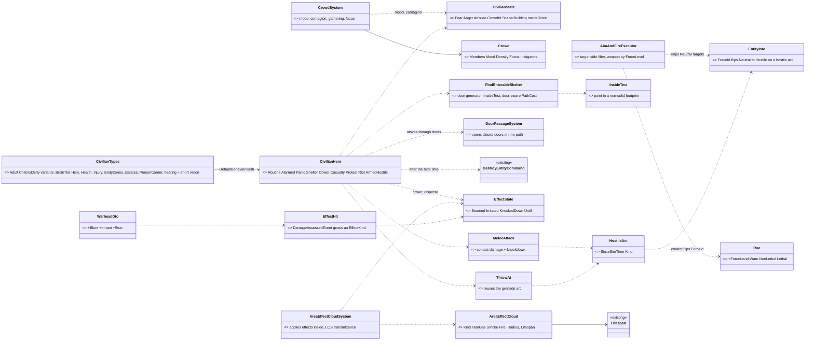
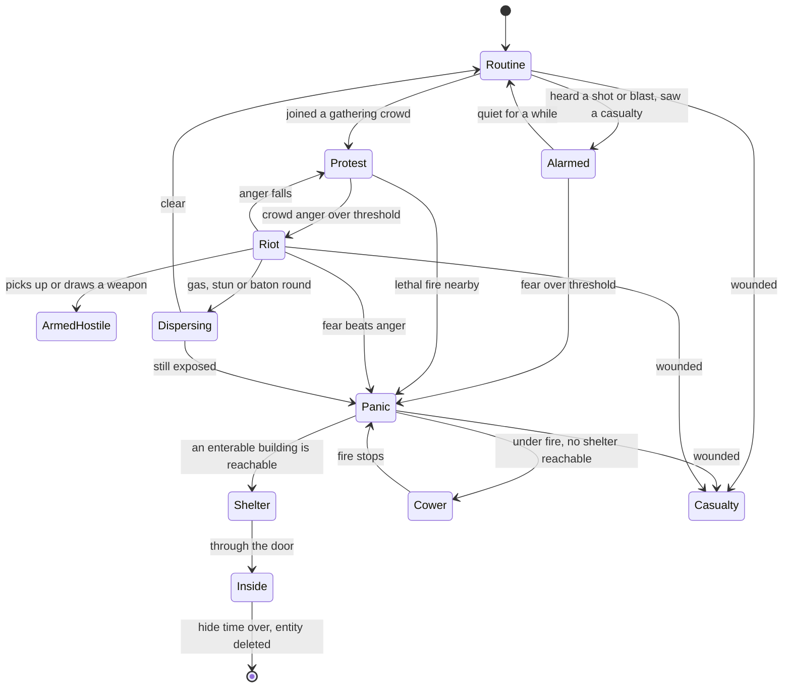
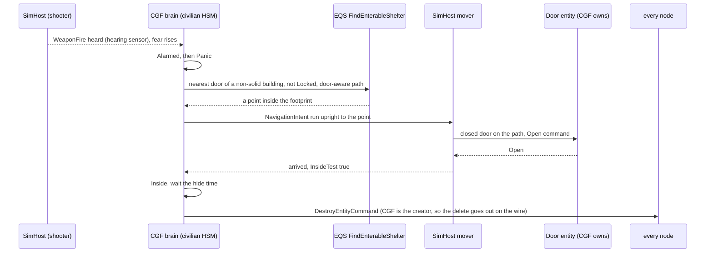
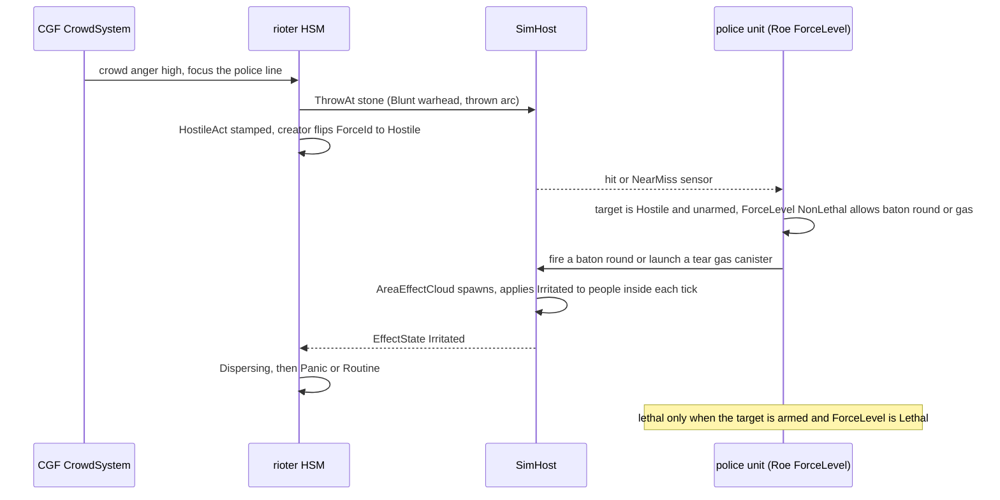
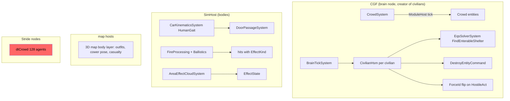

<!--STATUS
state: LIVE
updated: 2026-10-16
build-state: DESIGN — the programme's scope and order are RULED by the user 2026-10-16 (§0, R-4032…R-4036); the HOW is
  leans per decision (§4, CV-1…CV-12), awaiting the user. Nothing is dispatched; §5 is the slice plan. Written by the
  coordinator lane (cross-lane: most slices are behaviors-lane work, CV-6 is engine/backend work).
current-answer: §0 the rulings · §2 the diagrams · §4 the decisions with leans · §5 the slice plan.
stale-below: nothing.
known-rot: none.
known-conflict: docs/TUTORIAL_Behaviour_Composition.md §2 (line 58) puts "thousands of trivial entities (traffic, crowds)"
  at Tier 0 (a plain C# system); the user's ruling D3 / R-263 makes civilians HSMs. This design follows R-263; the
  tutorial row is not reconciled yet. ⚠ AQ93 §8 P5 named a single "PanickedCivilian" type — SUPERSEDED here by CV-1
  (one civilian family whose panic is a MODE, not a type).
related-designs:
  - docs/DESIGN_Operations_Behaviour_Catalogue.md — OWNS the civilian catalogue (CIV-1…CIV-7, ASY-5, SQD-13) and the rulings
    D3 (civilians = crowd agents + light HSM + crowd-level system), D4 (hidden truth + observable cues), D5 (melee = contact
    damage + knockdown, thrown objects reuse ThrowAt); this design is the BUILD of its P3 + P7 rows.
  - docs/blueprints/Architect_Question_93_Sumo_Traffic_Node.md — §8: SUMO pedestrians that panic are handed to THIS
    programme's civilians (CGF creates them, P4). That hookup is slice CIV-7 here, after everything else.
  - docs/DESIGN_Building_Interiors.md — owns doors (DoorState, DoorRules, DoorPassageSystem opening doors on its own) and
    building footprints/storeys that CV-7's shelter query and inside test read.
  - docs/designs/eqs-2/EQS_Design_v1.3_final.md — owns EQS templates and §19 terrain sight/cover; CV-7 adds an enterable-
    building generator and an inside test.
  - docs/DESIGN_Injury_States.md — owns ok/wounded/incapacitated/dead derived from Health (rule I1); CV-6 adds a STORED effect
    state for stun/irritant at full health, the case that design names as breaking I1.
  - docs/designs/hit-location/DESIGN_Body_Parts_And_Hit_Location.md — owns body parts and the civilian poses (HL-9).
  - docs/designs/weapons/DESIGN_Weapon_Systems.md — owns separable weapons (PickUp/PutDown, FireWhileCarried) that CV-4's
    armed hostile civilian uses.
  - docs/DESIGN_Weapon_Layers.md — owns the weapon brain, weapon categories and the grenade throw (W-12e/f) that CV-6's
    non-lethal munitions and CV-5's ThrowAt reuse.
  - docs/DESIGN_Decision_Layer.md — §4.4 owns Roe (R-200); its "later" row (WeaponsTight needs identification) is what CV-8
    builds as an escalation-of-force ladder.
  - docs/DESIGN_Sensors_And_Doctrine.md — §9.4 perception budget (~500 units) that bounds CV-10; §11.2 G11 identification.
  - docs/designs/group-maneuvers/DESIGN_Squad_Tactics.md — owns squads (UnitRoster ≤ 16) and SquadMarch formations; CV-5
    keeps crowds OUT of the squad layer (catalogue T3) and CV-8's police line uses its Line formation.
  - docs/DESIGN_Map_3D_Mode.md — §6q owns civilian outfits/children (CE-1099) the new types keep.
-->

# DESIGN — **civilians and crowd control** *(the CIV programme)*

> **The one rule:** a civilian is ONE entity family whose behaviour is a **mode of one HSM** — routine, alarm, panic,
> shelter, casualty, protest, riot, armed hostility — and whose **side is what others can SEE**: neutral until it commits a
> hostile act. Security forces answer with an **escalation-of-force ladder** that starts below lethal.

## 0. What the user ruled *(2026-10-16)*

🔒 **User, verbatim:**
- *"P1 to P8, your leans accepted."* *(AQ93 §8)*
- *"Our civilian tkb typed are obsolete and old and need to be replaced by a completely new ones supporting the panic mode you just described, And not just that, probably many more behaviors we will need."*
- *"Note that the civilian can also be a threat to the soldiers, especially the hostile civilian, because their mood can change at runtime from neutral to hostile."*
- *"Best if all this civilian story could be solved independently on the sumo and before it, . as a separate programme."*
- *"I would carefully consider if we really need promotion zones. Likely the Sumo implementation already tries not to go over the pedestrians on a Crosswalk."*
- *"Panicking pedestrians should try hiding in a building if the doors can be opened, instead of flying away indefinitely. Inside a building, they can disappear after a certain time."*
- *"Let's please try writing a separate pedestrian design to be implemented in parallel with Sumo integration."*
- *"The civilians need to support rioting and attacking security forces. . Security forces need to support non-lethal weapons."*

| ruling | what |
|---|---|
| **R-4032** | AQ93 §8 P1–P8 accepted (the SUMO pedestrian handover). P1's promotion zones are re-examined in AQ93 §8 (lean: drop them) |
| **R-4033** | civilians are a **separate programme, independent of SUMO and built before its pedestrian hookup**; the old civilian TKB types are **replaced** by a new family |
| **R-4034** | a civilian's **attitude changes at runtime** (neutral → hostile); a hostile civilian is a threat soldiers may answer |
| **R-4035** | a panicking civilian **hides in a building whose door can be opened**, and **disappears** after a while inside — never flees indefinitely |
| **R-4036** | civilians **riot and attack security forces**; security forces have **non-lethal weapons** |

## 1. INVENTORY *(2026-10-16 — four read-only sweeps: codebase-memory CLI `search_graph` + grep + the design corpus; `check_index_coverage` NOT run)*

| area | measured | where |
|---|---|---|
| types | `CivilianPedestrian` 1001, `CivilianChild` 1003, `CivilianCar` 1002 — `BrainTier 0`, no `CombatPlatformDefDto` (no Health), no `CharacterAnimationDefDto` (no stances), 30 m vision + 100 m hearing; map keys 501–505 have NO template. `search_graph .*Civilian.*` = 74 nodes | `Hrot.Core/Tkb/UrbanCombatTkbCatalog.cs:141-176`, `MapDefinitions/TkbEntityTypes.cs:130-131` |
| replacement blast radius | 54 symbol lines in 12 files; 4 scenarios use `"TkbType": 1001` (`ua-threat-ranking`, `ua-attack-approach`, `tt-heard-shot`, `tt-posture`); ~9 test files use literal 1001 | grep |
| how a type is defined | code catalogues registered by `HrotEnvironment.RegisterBuiltInTkb` (`HrotEnvironment.cs:42-54`); one TKB per deployment (R-4018); a type's default behaviour = `BehaviorProfileDto.DefaultBehaviorHash`/`DefaultSop` (`BehaviorTkbTranslator.cs:82-118`); brain group granted only when `BrainTier != 0` (`HrotOwnershipGroups.cs:138`) | — |
| civilian AI | ⛔ none in production: `WanderCivil`/`PanicFlee` ids only (`BehaviorIds.cs:28-31`); `TrafficBrainSystem` example only; `FleeExecutor` legacy (R-259) | — |
| HSM cost | FastHSM kernel 15 ns/instance idle; ⚠ HROT calls `HsmKernel.Update` per entity inside `BrainTickSystem` (`HsmRunner.cs:189`), not batched; ⛔ no HROT per-entity brain cost measured | `FastHSM/benchmarks/BENCHMARK-RESULTS.md` |
| perception cost | vision 100 / 250 / 500 / 1000 units = 9.6 / 36 / 76 / 230 ms; every sensor every tick only up to ~500 units | `DESIGN_Sensors_And_Doctrine.md` §9.4 |
| side | `ForceId { Neutral, Friend, Hostile }` on `EntityInfo`, replicated (`dtEntityInfo`), owned by the CREATOR (R-160); set at birth only — no runtime writer except the generic attribute patch | `Fdp.Core/Components/ForceId.cs:10-20`, `EntityInfoEgressTranslator.cs:115-147` |
| who reads side | vision drops only the observer's own force (`VisionBroadphase.cs:79`) ⇒ soldiers SEE neutrals; ⛔ `ThreatDanger` (unarmed 0.3), `ThreatRankingDecision`, `TopThreat`, `AimAndFireExecutor.RoePermitsFire` never check the target's side; `TargetMemory` stores no side (reads live); `LineOfFire` fires through neutrals | `ThreatDanger.cs:18-33`, `AimAndFireExecutor.cs:35-47` |
| perceived vs true side | ⛔ none — every reader uses ground truth; G11 (identification) open; D4 approved (hidden truth + cues) | `DESIGN_Sensors_And_Doctrine.md` §11.2 |
| ROE | `Roe { HoldFire, ReturnFire, FireAtWill }` (R-200); no escalation ladder, no weapon-category tier | `Behavior/Components/Roe.cs:9-58` |
| doors | `DoorState {Open, Closed, Locked, Destroyed}` replicated (`dtDoorState`); `DoorAwareQueryFilter` (Locked = wall, Closed +10 m); ⭐ `DoorPassageSystem` opens a closed door for ANY path-following person (`DoorPassageSystem.cs:31-139`) | `Terrain/TerrainObjects.cs:16-31`, `NavDoorways.cs:99-168` |
| buildings | `TerrainWorld.Buildings` (footprint, storeys, `Solid`), `Doors[]`; ⛔ no inside test, no enterable-building EQS generator (`IndoorTest` is design only); only **bt-range** ships enterable houses | `TerrainWorld.cs:113-115`; catalogue §6 |
| self-delete | ⛔ no behaviour deletes itself; `DestroyEntityCommand` disposes on the wire only from the primary owner (`CycloneNetworkCleanupSystem.cs:74-120`) | — |
| weapons | `WarheadKind {Kinetic, HighExplosive, Fragmentation, ShapedCharge}`; damage is ONE scalar (`DamageAssessedEvent`, `DetonationEvents.cs:26-42`); `AreaEffectSystem` is a one-moment blast; smoke/fire are cosmetic; ⛔ no gas, stun, melee, non-lethal, persistent area effect | `WarheadDto.cs:9-19`, `AreaEffectSystem.cs:33-320` |
| groups | `UnitRoster` ≤ 16, `TargetMemory` 16 slots; SquadMarch formations File/Wedge/Line; ⛔ no cordon; ⛔ no crowd-level system (catalogue T3: a crowd is an uncommanded group, not a squad) | `UnitRoster.cs:42`, `PerceptionConstants.cs:11` |
| crowd navigation | dtCrowd `MaxAgents = 128`, Stride nodes only; SimHost persons move through `CarKinematicsSystem` `HumanGait` | `DotRecastDtCrowdProvider.cs:44` |

## 2. Diagrams

### 2.1 Classes

*What the picture shows that prose hid:* the side flip has ONE producer (a hostile act, made by the civilian's own brain on
CGF, which is also the creator that owns `EntityInfo`) and every existing side reader picks it up live, because
`TargetMemory` stores no side; and every non-lethal effect lands in ONE stored component (`EffectState`) that both the
civilian HSM and the body read — the I1 rule stays intact because health is never used to mean "stunned".

### 2.2 The civilian HSM

*What the picture shows that prose hid:* panic never ends in open-ended running — every panic path drains into Shelter
(and deletion) or Cower (R-4035); and the only edges INTO violence go through the crowd (Protest → Riot) or a weapon, so a
lone frightened civilian never attacks.

### 2.3 Sequence — a shot, a panicking civilian, a building, gone

*What the picture shows that prose hid:* no new door logic — the mover already opens a closed door for any person on its
path, and a Locked door is a wall to the route planner, so "if the doors can be opened" is answered by the EXISTING planner;
and the delete works because CGF both runs the brain and created the entity.

### 2.4 Sequence — a riot meets a police line

*What the picture shows that prose hid:* the police never decide on ground truth — they act on what the rioter DID
(the hostile act made it Hostile) and on what it CARRIES (armed or not), and the ladder is a property of the police unit's
Roe, not of the weapon.

### 2.5 Modules — who registers it, who calls it each frame

*What the picture shows that prose hid:* the red box — dtCrowd exists only on Stride nodes and caps at 128 agents, so
civilians on SimHost move through `CarKinematicsSystem` like soldiers; the catalogue's "crowd agents (dtCrowd)" in D3 is
NOT the movement host here (CV-10). And everything that decides runs on CGF; SimHost only moves, hits and applies clouds.

## 3. Why — what the diagrams cannot carry

- **One family, modes not types.** AQ93 P5 proposed a `PanickedCivilian` type. A runtime mood change (R-4034) and a
  handover from SUMO both want the SAME entity to move between routine, panic and violence; a type per state would mean
  re-creating entities on every mood change. ⇒ superseded by CV-1.
- **Side = what others can see.** D4 (approved) forbids omniscient detection. Flipping `ForceId` only on an OBSERVABLE act
  gives disguise for free (a hostile-at-heart civilian reads Neutral until it acts) without building G11's identification
  layer first, and every existing side reader (`VisionBroadphase`, `FactionFilterTest`, drones, map tint) already reads it
  live.
- **The Neutral filter is a safety gate, not a feature.** Today nothing stops a soldier engaging a neutral — an unarmed
  civilian simply ranks at 0.3. Civilians with brains, in crowds, next to soldiers make that a live hazard the moment slice
  CIV-1 ships, so it ships first (AQ93 P6).

## 4. Decisions — leans *(not yet ruled)*

| id | question | ⭐ lean | rejected — one line each | blast radius |
|---|---|---|---|---|
| **CV-1** | the new types | ONE civilian family in a new catalogue (`CivilianTkbCatalog`): Adult (m/f), Child, Elderly variants, NEW type ids (1001/1003 retired, not reused); `BrainTier = Hsm`, `DefaultBehaviorHash = CivilianHsm`, `CombatPlatformDefDto` (Health), `InjuryDefDto`, `BodyZonesDto` (HL-12), `CharacterAnimationDefDto` (stand/crouch/prone), `PersonCarrier` (can pick up a weapon or a stone), footsteps; outfits kept (CE-1099); `CivilianCar` stays until SUMO | a type per state (`PanickedCivilian`, `Rioter`…): re-create on every mood change · patching 1001: keeps ids whose meaning changes under live scenarios | 4 scenarios + ~12 code files + ~9 tests migrate; map keys 501–505 re-pointed |
| **CV-2** | sensors | hearing 100 m (shots, blasts, footsteps) + **short vision 30 m, Low priority band, 1 Hz refresh**; crowd awareness comes from the CrowdSystem, not per-person vision — a Neutral observer drops Neutral targets anyway (`VisionBroadphase.cs:79`) | 360° full vision: ~76 ms at 500 units · hearing only (AQ93 P5): a rioter could not see the police line it attacks | perception budget — measured in CIV-1's perf gate |
| **CV-3** | the behaviour host | **one `CivilianHsm`** per civilian (R-263), the states of §2.2; reads `CivilianState` (fear, anger, attitude), `EffectState` and crowd hints | BTree per civilian: R-263 rules HSM · Tier-0 C# system (tutorial §2): cannot express the modes | behaviors lane |
| **CV-4** | attitude and side | hidden attitude in `CivilianState` (brain only); a **hostile act** (throw, melee, fire, draw a weapon) stamps replicated `HostileAct` and the creator (CGF, owner of `EntityInfo`) flips `ForceId` Neutral → Hostile — sticky for the exercise in slice 1; an armed hostile civilian uses separable weapons (`PickUp`, `FireWhileCarried`) | flipping on attitude alone: omniscient detection (D4) · building G11 perceived-side first: large and not needed for this | `EntityInfo` writer on CGF; map symbol letter may stay stale (known limit) |
| **CV-5** | crowds | a **bodiless `Crowd` entity** (no `UnitRoster` — 16-member cap) and a CGF `CrowdSystem`: membership by proximity, mood (mean fear/anger), **contagion** of fear/anger by distance, gathering point, focus (a building, a police line), instigators (ASY-5) who raise anger; members read it through `CivilianState` | a squad per crowd: 16 members, and catalogue T3 says a crowd is uncommanded · per-person perception for contagion: civilians do not see each other | behaviors lane + one new system |
| **CV-6** | non-lethal effects | ⓐ `DamageAssessedEvent`/`EntityHitDamage` grow an **`EffectKind`** (Kinetic, Blunt, Irritant, Stun, Push) + magnitude; ⓑ a **stored `EffectState`** (Stunned, Irritated, KnockedDown, Until) on the victim — the case I1 names; ⓒ a persistent **`AreaEffectCloud`** entity (tear gas, smoke, later fire) on `Lifespan`, its system applying effects each tick and reducing LOS transmittance; ⓓ new `WarheadKind`s Blunt, Irritant, Stun | deriving stun from Health: breaks I1 · a cosmetic smoke effect: does not affect sight or people | engine (backend lane): damage path, AreaEffectSystem sibling, LOS strategy |
| **CV-7** | shelter and vanish | EQS **`FindEnterableShelter`**: generator over doors of non-solid buildings (not Locked in `DoorStates`), a point inside the footprint (**new `InsideTest`** = `PolygonMath.Contains` + storey), door-aware `PathCost`; the mover opens closed doors itself; inside ⇒ wait a **hide time** (scenario parameter, e.g. 60–180 s, randomised), then the brain issues `DestroyEntityCommand`; no reachable building ⇒ `FallBack` away, Cower under fire | open-ended fleeing (rejected by the user) · `PhysicalPresence.IsHidden` inside: keeps entities alive for nothing | EQS + one HSM state; test terrain bt-range |
| **CV-8** | escalation of force | `Roe` grows a **`ForceLevel`** {Warn, NonLethal, Lethal}; **ground-AI targeting skips Neutral targets** (threat ranking, `TopThreat`, `AimAndFire`) — the safety gate, first; a Hostile target is engaged with the weapons its `ForceLevel` allows; Lethal also needs the target armed or a lethal act; security-force SOP: Warn (an audible cue) → NonLethal → Lethal | weapon-per-target hard-coding: no doctrine knob · a full G11 identification model first: too big for the gate | `AimAndFireExecutor`, `ThreatRankingDecision`, `Roe` |
| **CV-9** | the weapons | slice 1 of non-lethal: **baton/melee** (D5 `MeleeAttack`), **baton round** (ballistic, Blunt), **tear gas grenade/launcher** (Indirect, Irritant cloud), **stun grenade** (thrown, Stun area); civilians' **stone** and **Molotov** (`ThrowAt`, Blunt / fire cloud); later: water cannon (a spray weapon), LRAD | all at once: the spray and acoustic weapons need new physics | TKB weapons + munitions |
| **CV-10** | scale | target **~300 active civilians per CGF** (perf gate in CIV-1, measured: brain tick per entity, perception, movement); movement through `CarKinematicsSystem` `HumanGait` on SimHost (dtCrowd is Stride-only, 128 cap); above the budget, the scenario spawns fewer — no brain LOD in slice 1 | thousands of brained civilians: unmeasured, perception alone tops out near 500 · dtCrowd: not on SimHost | measurement first |
| **CV-11** | security forces | a police/security unit family (shield, baton, baton-round launcher, gas launcher, stun grenades) and a **hold-the-line** behaviour on SquadMarch's `Line` formation; a proper cordon waits for CE-2124 (formations) | building a cordon formation now: CE-2124 is the owner | behaviors lane |
| **CV-12** | the SUMO hookup | last slice (R-4033): AQ93 §8's handover creates a civilian of this family in **Panic** mode with the incident point — no special type | a SUMO-specific type: two civilian models | AQ93 §8 |

## 5. Slice plan *(not dispatched)*

| slice | content | owner | acceptance |
|---|---|---|---|
| **CIV-0** | **safety gate**: ground-AI targeting skips Neutral targets (CV-8 first half) | behaviors | a soldier at FireAtWill next to a neutral civilian does not engage it; `ua-threat-ranking` migrates |
| **CIV-1** | the new civilian family (CV-1/CV-2), old types retired, 4 scenarios migrated; `CivilianHsm` Routine + Alarmed + Casualty; **perf gate** (CV-10) | behaviors + backend | 300 civilians on CGF within the frame budget, measured |
| **CIV-2** | Panic → Shelter → Inside → deleted, Cower (CV-7) on bt-range | behaviors | a shot near a civilian sends it through an openable door into a house and it is gone after the hide time; a locked house is skipped |
| **CIV-3** | crowds (CV-5): gathering, protest, contagion | behaviors | onlookers gather at an incident; fear spreads through a crowd |
| **CIV-4** | attitude + hostile acts (CV-4), `ThrowAt` + `MeleeAttack` (D5), riot (CV-3) | behaviors + backend | a rioter that throws a stone turns Hostile on every node; soldiers may now answer it |
| **CIV-5** | non-lethal (CV-6, CV-9), escalation ladder (CV-8), security forces (CV-11) | backend + behaviors | a police line disperses a riot with gas and baton rounds without a single lethal shot; an armed rioter draws lethal fire |
| **CIV-6** | water cannon, LRAD, Molotov fire cloud | backend | — |
| **CIV-7** | SUMO hookup (CV-12, AQ93 §8) | coordinator | a panicked SUMO pedestrian becomes a civilian in Panic and shelters |

## 6. Known limits

- Only **bt-range** has enterable buildings; other terrains' buildings are solid prisms — civilians there can only Cower or fall back.
- Doors do not physically block the kinematic mover; a dtCrowd agent ignores doors (Building_Interiors §3j known limits).
- After a side flip, the SIDC symbol keeps its TKB affiliation letter and an `IgSymbolOverride` may keep its old style (map tint follows live).
- `TargetMemory` holds 16 contacts per unit — a soldier facing a 100-person riot remembers the nearest 16.
