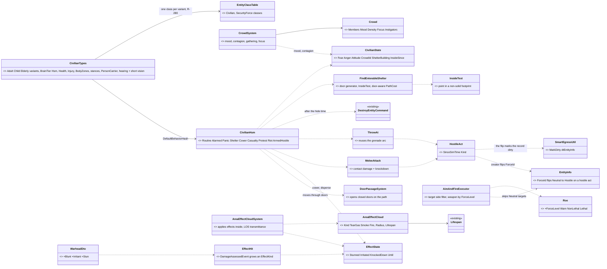
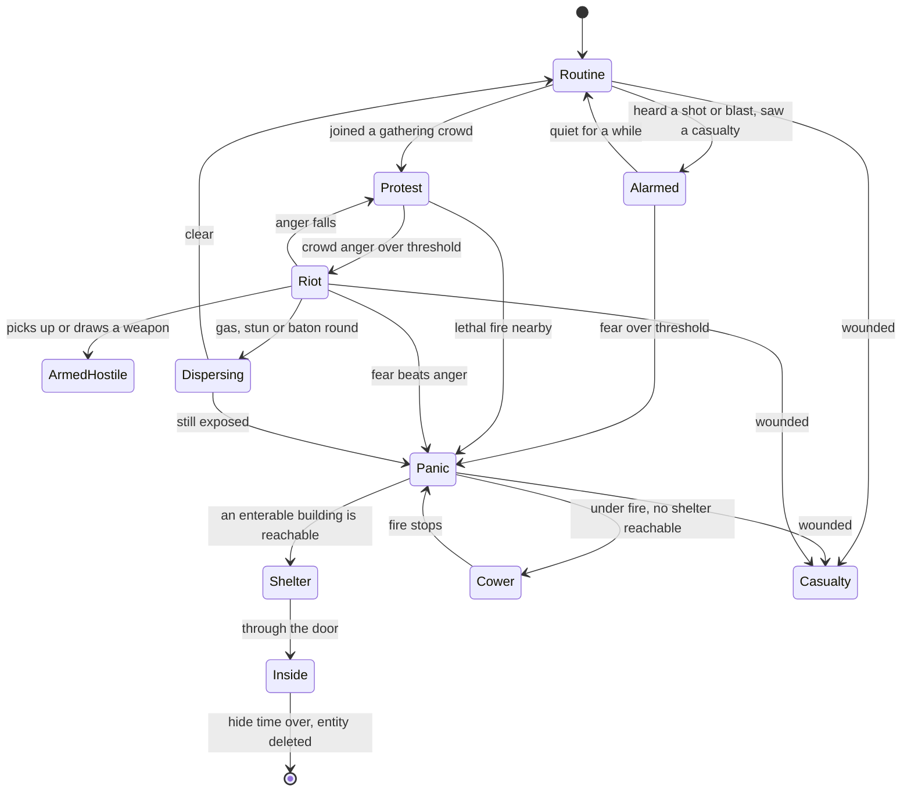
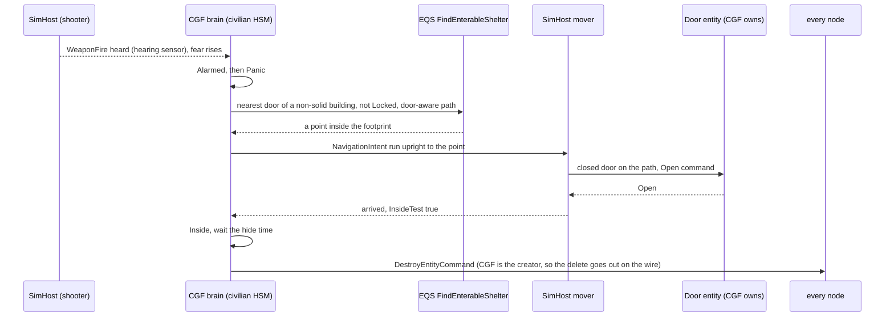
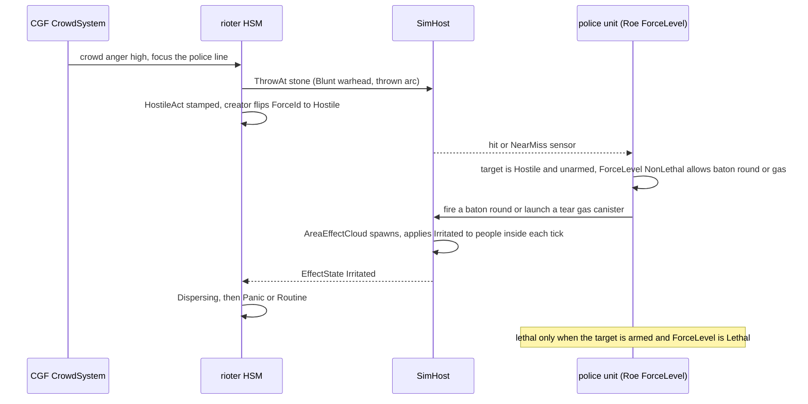
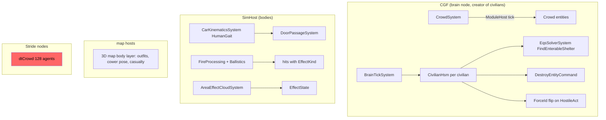
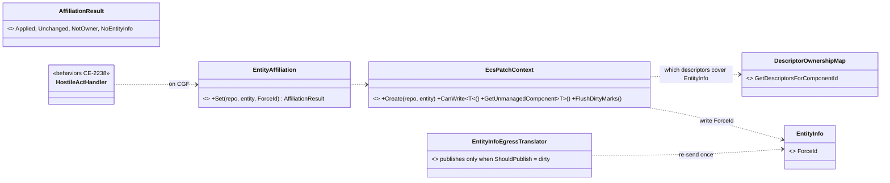
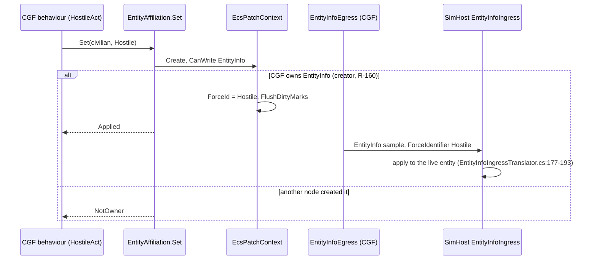
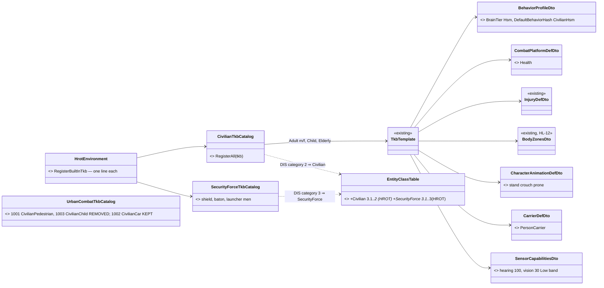
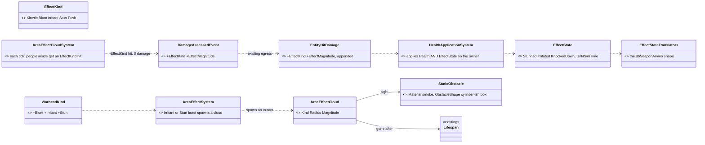

<!--STATUS
state: LIVE
updated: 2026-10-16 (behaviors: CV-1 class-table rows, CV-4 dirty-mark, §5a measurements, §5 owners/ids + handoffs; backend: §7 detailed designs B-1…B-5)
build-state: BUILDING (backend B-3/B-2 first) — the HOW is RULED too: CV-1…CV-12 approved as written 2026-10-16 (R-3013).
  SUPERSEDED: the programme's scope and order are RULED by the user 2026-10-16 (§0, R-4032…R-4036); the HOW is
  leans per decision (§4, CV-1…CV-12), awaiting the user. §5 is the slice plan; its backend and ui halves are handed off
  as FRAMES (§5, the receiving lane designs its details first, builds after the user rules the CV it builds), and the
  behaviors half is recorded as CE-2233…CE-2239. Written by the coordinator lane (cross-lane: most slices are
  behaviors-lane work, CV-6 is engine/backend work); the 2026-10-16 additions are the behaviors lane's.
current-answer: §0 the rulings · §2 the diagrams · §4 the decisions with leans · §5 the slice plan · §5a measure before CIV-2 · §7 backend detailed designs (B-1…B-5).
stale-below: nothing.
known-rot: none.
known-conflict: docs/TUTORIAL_Behaviour_Composition.md §2 (line 58) puts "thousands of trivial entities (traffic, crowds)"
  at Tier 0 (a plain C# system); the user's ruling D3 / R-263 makes civilians HSMs. This design follows R-263; the
  tutorial row is not reconciled yet. ⚠ AQ93 §8 P5 named a single "PanickedCivilian" type — SUPERSEDED here by CV-1
  (one civilian family whose panic is a MODE, not a type).
related-designs:
  - docs/DESIGN_Operations_Behaviour_Catalogue.md — OWNS the civilian catalogue (CIV-1…CIV-7, ASY-5, SQD-13) and the rulings
    D3 (civilians = crowd agents + light HSM + crowd-level system), D4 (hidden truth + observable cues), D5 (melee = contact
    damage + knockdown, thrown objects reuse ThrowAt); this design is the BUILD of its P3 + P7 rows.
  - docs/blueprints/Architect_Question_93_Sumo_Traffic_Node.md — §8: SUMO pedestrians that panic are handed to THIS
    programme's civilians (CGF creates them, P4). That hookup is slice CIV-7 here, after everything else.
  - docs/DESIGN_Building_Interiors.md — owns doors (DoorState, DoorRules, DoorPassageSystem opening doors on its own) and
    building footprints/storeys that CV-7's shelter query and inside test read.
  - docs/designs/eqs-2/EQS_Design_v1.3_final.md — owns EQS templates and §19 terrain sight/cover; CV-7 adds an enterable-
    building generator and an inside test.
  - docs/DESIGN_Injury_States.md — owns ok/wounded/incapacitated/dead derived from Health (rule I1); CV-6 adds a STORED effect
    state for stun/irritant at full health, the case that design names as breaking I1.
  - docs/designs/hit-location/DESIGN_Body_Parts_And_Hit_Location.md — owns body parts and the civilian poses (HL-9).
  - docs/designs/weapons/DESIGN_Weapon_Systems.md — owns separable weapons (PickUp/PutDown, FireWhileCarried) that CV-4's
    armed hostile civilian uses.
  - docs/DESIGN_Weapon_Layers.md — owns the weapon brain, weapon categories and the grenade throw (W-12e/f) that CV-6's
    non-lethal munitions and CV-5's ThrowAt reuse.
  - docs/DESIGN_Decision_Layer.md — §4.4 owns Roe (R-200); its "later" row (WeaponsTight needs identification) is what CV-8
    builds as an escalation-of-force ladder.
  - docs/DESIGN_Sensors_And_Doctrine.md — §9.4 perception budget (~500 units) that bounds CV-10; §11.2 G11 identification.
  - docs/designs/group-maneuvers/DESIGN_Squad_Tactics.md — owns squads (UnitRoster ≤ 16) and SquadMarch formations; CV-5
    keeps crowds OUT of the squad layer (catalogue T3) and CV-8's police line uses its Line formation.
  - docs/DESIGN_Map_3D_Mode.md — §6q owns civilian outfits/children (CE-1099) the new types keep.
  - docs/DESIGN_Orders_Params_Entity_Classes.md — §2 owns EntityClassTable (R-279/R-280), the one class table CV-1's new
    civilian and security-force classes are added to.
  - docs/blueprints/batches/HANDOFF_Behaviors_To_Backend_Civilians.md — the backend half of §5 (B-1…B-5).
  - docs/blueprints/batches/HANDOFF_Behaviors_To_Ui_Civilians.md — the ui half of §5 (U-1…U-5).
-->

# DESIGN — **civilians and crowd control** *(the CIV programme)*

> **The one rule:** a civilian is ONE entity family whose behaviour is a **mode of one HSM** — routine, alarm, panic,
> shelter, casualty, protest, riot, armed hostility — and whose **side is what others can SEE**: neutral until it commits a
> hostile act. Security forces answer with an **escalation-of-force ladder** that starts below lethal.

## 0. What the user ruled *(2026-10-16)*

🔒 **User, verbatim:**
- *"P1 to P8, your leans accepted."* *(AQ93 §8)*
- *"Our civilian tkb typed are obsolete and old and need to be replaced by a completely new ones supporting the panic mode you just described, And not just that, probably many more behaviors we will need."*
- *"Note that the civilian can also be a threat to the soldiers, especially the hostile civilian, because their mood can change at runtime from neutral to hostile."*
- *"Best if all this civilian story could be solved independently on the sumo and before it, . as a separate programme."*
- *"I would carefully consider if we really need promotion zones. Likely the Sumo implementation already tries not to go over the pedestrians on a Crosswalk."*
- *"Panicking pedestrians should try hiding in a building if the doors can be opened, instead of flying away indefinitely. Inside a building, they can disappear after a certain time."*
- *"Let's please try writing a separate pedestrian design to be implemented in parallel with Sumo integration."*
- *"The civilians need to support rioting and attacking security forces. . Security forces need to support non-lethal weapons."*

| ruling | what |
|---|---|
| **R-4032** | AQ93 §8 P1–P8 accepted (the SUMO pedestrian handover). P1's promotion zones are re-examined in AQ93 §8 (lean: drop them) |
| **R-4033** | civilians are a **separate programme, independent of SUMO and built before its pedestrian hookup**; the old civilian TKB types are **replaced** by a new family |
| **R-4034** | a civilian's **attitude changes at runtime** (neutral → hostile); a hostile civilian is a threat soldiers may answer |
| **R-4035** | a panicking civilian **hides in a building whose door can be opened**, and **disappears** after a while inside — never flees indefinitely |
| **R-4036** | civilians **riot and attack security forces**; security forces have **non-lethal weapons** |
| **R-3013** | ✅ **CV-1…CV-12 leans approved as written** (§4) — 🔒 user, `2026-10-16`, after a plain-words walkthrough of all twelve: *"approved"* |

## 1. INVENTORY *(2026-10-16 — four read-only sweeps: codebase-memory CLI `search_graph` + grep + the design corpus; `check_index_coverage` NOT run)*

| area | measured | where |
|---|---|---|
| types | `CivilianPedestrian` 1001, `CivilianChild` 1003, `CivilianCar` 1002 — `BrainTier 0`, no `CombatPlatformDefDto` (no Health), no `CharacterAnimationDefDto` (no stances), 30 m vision + 100 m hearing; map keys 501–505 have NO template. `search_graph .*Civilian.*` = 74 nodes | `Hrot.Core/Tkb/UrbanCombatTkbCatalog.cs:141-176`, `MapDefinitions/TkbEntityTypes.cs:130-131` |
| replacement blast radius | 54 symbol lines in 12 files; 4 scenarios use `"TkbType": 1001` (`ua-threat-ranking`, `ua-attack-approach`, `tt-heard-shot`, `tt-posture`); ~9 test files use literal 1001 | grep |
| how a type is defined | code catalogues registered by `HrotEnvironment.RegisterBuiltInTkb` (`HrotEnvironment.cs:42-54`); one TKB per deployment (R-4018); a type's default behaviour = `BehaviorProfileDto.DefaultBehaviorHash`/`DefaultSop` (`BehaviorTkbTranslator.cs:82-118`); brain group granted only when `BrainTier != 0` (`HrotOwnershipGroups.cs:138`) | — |
| civilian AI | ⛔ none in production: `WanderCivil`/`PanicFlee` ids only (`BehaviorIds.cs:28-31`); `TrafficBrainSystem` example only; `FleeExecutor` legacy (R-259) | — |
| HSM cost | FastHSM kernel 15 ns/instance idle; ⚠ HROT calls `HsmKernel.Update` per entity inside `BrainTickSystem` (`HsmRunner.cs:189`), not batched; ⛔ no HROT per-entity brain cost measured | `FastHSM/benchmarks/BENCHMARK-RESULTS.md` |
| perception cost | vision 100 / 250 / 500 / 1000 units = 9.6 / 36 / 76 / 230 ms; every sensor every tick only up to ~500 units | `DESIGN_Sensors_And_Doctrine.md` §9.4 |
| side | `ForceId { Neutral, Friend, Hostile }` on `EntityInfo`, replicated (`dtEntityInfo`), owned by the CREATOR (R-160); set at birth only — no runtime writer except the generic attribute patch | `Fdp.Core/Components/ForceId.cs:10-20`, `EntityInfoEgressTranslator.cs:115-147` |
| who reads side | vision drops only the observer's own force (`VisionBroadphase.cs:79`) ⇒ soldiers SEE neutrals; ⛔ `ThreatDanger` (unarmed 0.3), `ThreatRankingDecision`, `TopThreat`, `AimAndFireExecutor.RoePermitsFire` never check the target's side; `TargetMemory` stores no side (reads live); `LineOfFire` fires through neutrals | `ThreatDanger.cs:18-33`, `AimAndFireExecutor.cs:35-47` |
| perceived vs true side | ⛔ none — every reader uses ground truth; G11 (identification) open; D4 approved (hidden truth + cues) | `DESIGN_Sensors_And_Doctrine.md` §11.2 |
| ROE | `Roe { HoldFire, ReturnFire, FireAtWill }` (R-200); no escalation ladder, no weapon-category tier | `Behavior/Components/Roe.cs:9-58` |
| doors | `DoorState {Open, Closed, Locked, Destroyed}` replicated (`dtDoorState`); `DoorAwareQueryFilter` (Locked = wall, Closed +10 m); ⭐ `DoorPassageSystem` opens a closed door for ANY path-following person (`DoorPassageSystem.cs:31-139`) | `Terrain/TerrainObjects.cs:16-31`, `NavDoorways.cs:99-168` |
| buildings | `TerrainWorld.Buildings` (footprint, storeys, `Solid`), `Doors[]`; ⛔ no inside test, no enterable-building EQS generator (`IndoorTest` is design only); only **bt-range** ships enterable houses | `TerrainWorld.cs:113-115`; catalogue §6 |
| self-delete | ⛔ no behaviour deletes itself; `DestroyEntityCommand` disposes on the wire only from the primary owner (`CycloneNetworkCleanupSystem.cs:74-120`) | — |
| weapons | `WarheadKind {Kinetic, HighExplosive, Fragmentation, ShapedCharge}`; damage is ONE scalar (`DamageAssessedEvent`, `DetonationEvents.cs:26-42`); `AreaEffectSystem` is a one-moment blast; smoke/fire are cosmetic; ⛔ no gas, stun, melee, non-lethal, persistent area effect | `WarheadDto.cs:9-19`, `AreaEffectSystem.cs:33-320` |
| groups | `UnitRoster` ≤ 16, `TargetMemory` 16 slots; SquadMarch formations File/Wedge/Line; ⛔ no cordon; ⛔ no crowd-level system (catalogue T3: a crowd is an uncommanded group, not a squad) | `UnitRoster.cs:42`, `PerceptionConstants.cs:11` |
| crowd navigation | dtCrowd `MaxAgents = 128`, Stride nodes only; SimHost persons move through `CarKinematicsSystem` `HumanGait` | `DotRecastDtCrowdProvider.cs:44` |
| side on the wire *(behaviors, 2026-10-16)* | ⚠ `EntityInfo` egress re-sends ONLY when `dtEntityInfo` is marked dirty (`SmartEgressUtil.ShouldPublish`) — a `ForceId` write that does not `MarkDirty` changes the creator's copy only (the `AX-015` rename failure); a receiver DOES apply an update to a live entity | `EntityInfoEgressTranslator.cs:51-53, 121`, `EntityInfoIngressTranslator.cs:177-193` |
| entity classes *(behaviors, 2026-10-16)* | `EntityClassTable` has `Person` (`3`) and `LandPerson` (`3.1`) but no civilian or security-force class — the picker folder, the 3-D model (`VisualFamilies`) and the behaviour lookup (`<Class><Order>`, R-278) all read this table (R-280) | `Hrot.Core/Tkb/EntityClassTable.cs:109, 174` |

## 2. Diagrams

### 2.1 Classes

*What the picture shows that prose hid:* the side flip has ONE producer (a hostile act, made by the civilian's own brain on
CGF, which is also the creator that owns `EntityInfo`) and every existing side reader picks it up live, because
`TargetMemory` stores no side — on OTHER nodes only because the flip marks `dtEntityInfo` dirty (§1, the egress re-sends
nothing otherwise); and every non-lethal effect lands in ONE stored component (`EffectState`) that both the
civilian HSM and the body read — the I1 rule stays intact because health is never used to mean "stunned".

### 2.2 The civilian HSM

*What the picture shows that prose hid:* panic never ends in open-ended running — every panic path drains into Shelter
(and deletion) or Cower (R-4035); and the only edges INTO violence go through the crowd (Protest → Riot) or a weapon, so a
lone frightened civilian never attacks.

### 2.3 Sequence — a shot, a panicking civilian, a building, gone

*What the picture shows that prose hid:* no new door logic — the mover already opens a closed door for any person on its
path, and a Locked door is a wall to the route planner, so "if the doors can be opened" is answered by the EXISTING planner;
and the delete works because CGF both runs the brain and created the entity.

### 2.4 Sequence — a riot meets a police line

*What the picture shows that prose hid:* the police never decide on ground truth — they act on what the rioter DID
(the hostile act made it Hostile) and on what it CARRIES (armed or not), and the ladder is a property of the police unit's
Roe, not of the weapon.

### 2.5 Modules — who registers it, who calls it each frame

*What the picture shows that prose hid:* the red box — dtCrowd exists only on Stride nodes and caps at 128 agents, so
civilians on SimHost move through `CarKinematicsSystem` like soldiers; the catalogue's "crowd agents (dtCrowd)" in D3 is
NOT the movement host here (CV-10). And everything that decides runs on CGF; SimHost only moves, hits and applies clouds.

## 3. Why — what the diagrams cannot carry

- **One family, modes not types.** AQ93 P5 proposed a `PanickedCivilian` type. A runtime mood change (R-4034) and a
  handover from SUMO both want the SAME entity to move between routine, panic and violence; a type per state would mean
  re-creating entities on every mood change. ⇒ superseded by CV-1.
- **Side = what others can see.** D4 (approved) forbids omniscient detection. Flipping `ForceId` only on an OBSERVABLE act
  gives disguise for free (a hostile-at-heart civilian reads Neutral until it acts) without building G11's identification
  layer first, and every existing side reader (`VisionBroadphase`, `FactionFilterTest`, drones, map tint) already reads it
  live.
- **The Neutral filter is a safety gate, not a feature.** Today nothing stops a soldier engaging a neutral — an unarmed
  civilian simply ranks at 0.3. Civilians with brains, in crowds, next to soldiers make that a live hazard the moment slice
  CIV-1 ships, so it ships first (AQ93 P6).

## 4. Decisions — ✅ RULED `2026-10-16` (R-3013): every lean below approved as written

| id | question | ⭐ lean | rejected — one line each | blast radius |
|---|---|---|---|---|
| **CV-1** | the new types | ONE civilian family in a new catalogue (`CivilianTkbCatalog`): Adult (m/f), Child, Elderly variants, NEW type ids (1001/1003 retired, not reused); `BrainTier = Hsm`, `DefaultBehaviorHash = CivilianHsm`, `CombatPlatformDefDto` (Health), `InjuryDefDto`, `BodyZonesDto` (HL-12), `CharacterAnimationDefDto` (stand/crouch/prone), `PersonCarrier` (can pick up a weapon or a stone), footsteps; outfits kept (CE-1099); `CivilianCar` stays until SUMO; ⭐ *(behaviors, 2026-10-16)* **a `Civilian` and a `SecurityForce` class in `EntityClassTable`** (R-280: the picker folder, the 3-D model and the behaviour lookup must agree on what the new types are) | a type per state (`PanickedCivilian`, `Rioter`…): re-create on every mood change · patching 1001: keeps ids whose meaning changes under live scenarios | 4 scenarios + ~12 code files + ~9 tests migrate; map keys 501–505 re-pointed |
| **CV-2** | sensors | hearing 100 m (shots, blasts, footsteps) + **short vision 30 m, Low priority band, 1 Hz refresh**; crowd awareness comes from the CrowdSystem, not per-person vision — a Neutral observer drops Neutral targets anyway (`VisionBroadphase.cs:79`) | 360° full vision: ~76 ms at 500 units · hearing only (AQ93 P5): a rioter could not see the police line it attacks | perception budget — measured in CIV-1's perf gate |
| **CV-3** | the behaviour host | **one `CivilianHsm`** per civilian (R-263), the states of §2.2; reads `CivilianState` (fear, anger, attitude), `EffectState` and crowd hints | BTree per civilian: R-263 rules HSM · Tier-0 C# system (tutorial §2): cannot express the modes | behaviors lane |
| **CV-4** | attitude and side | hidden attitude in `CivilianState` (brain only); a **hostile act** (throw, melee, fire, draw a weapon) stamps replicated `HostileAct` and the creator (CGF, owner of `EntityInfo`) flips `ForceId` Neutral → Hostile — sticky for the exercise in slice 1; ⭐ *(behaviors, 2026-10-16)* **the flip goes through ONE engine write path that also marks `dtEntityInfo` dirty** (§1: otherwise only CGF sees it), pinned by a two-node rail; an armed hostile civilian uses separable weapons (`PickUp`, `FireWhileCarried`) | flipping on attitude alone: omniscient detection (D4) · building G11 perceived-side first: large and not needed for this | `EntityInfo` writer on CGF; map symbol letter may stay stale (known limit) |
| **CV-5** | crowds | a **bodiless `Crowd` entity** (no `UnitRoster` — 16-member cap) and a CGF `CrowdSystem`: membership by proximity, mood (mean fear/anger), **contagion** of fear/anger by distance, gathering point, focus (a building, a police line), instigators (ASY-5) who raise anger; members read it through `CivilianState` | a squad per crowd: 16 members, and catalogue T3 says a crowd is uncommanded · per-person perception for contagion: civilians do not see each other | behaviors lane + one new system |
| **CV-6** | non-lethal effects | ⓐ `DamageAssessedEvent`/`EntityHitDamage` grow an **`EffectKind`** (Kinetic, Blunt, Irritant, Stun, Push) + magnitude; ⓑ a **stored `EffectState`** (Stunned, Irritated, KnockedDown, Until) on the victim — the case I1 names; ⓒ a persistent **`AreaEffectCloud`** entity (tear gas, smoke, later fire) on `Lifespan`, its system applying effects each tick and reducing LOS transmittance; ⓓ new `WarheadKind`s Blunt, Irritant, Stun | deriving stun from Health: breaks I1 · a cosmetic smoke effect: does not affect sight or people | engine (backend lane): damage path, AreaEffectSystem sibling, LOS strategy |
| **CV-7** | shelter and vanish | EQS **`FindEnterableShelter`**: generator over doors of non-solid buildings (not Locked in `DoorStates`), a point inside the footprint (**new `InsideTest`** = `PolygonMath.Contains` + storey), door-aware `PathCost`; the mover opens closed doors itself; inside ⇒ wait a **hide time** (scenario parameter, e.g. 60–180 s, randomised), then the brain issues `DestroyEntityCommand`; no reachable building ⇒ `FallBack` away, Cower under fire | open-ended fleeing (rejected by the user) · `PhysicalPresence.IsHidden` inside: keeps entities alive for nothing | EQS + one HSM state; test terrain bt-range |
| **CV-8** | escalation of force | `Roe` grows a **`ForceLevel`** {Warn, NonLethal, Lethal}; **ground-AI targeting skips Neutral targets** (threat ranking, `TopThreat`, `AimAndFire`) — the safety gate, first; a Hostile target is engaged with the weapons its `ForceLevel` allows; Lethal also needs the target armed or a lethal act; security-force SOP: Warn (an audible cue) → NonLethal → Lethal | weapon-per-target hard-coding: no doctrine knob · a full G11 identification model first: too big for the gate | `AimAndFireExecutor`, `ThreatRankingDecision`, `Roe` |
| **CV-9** | the weapons | slice 1 of non-lethal: **baton/melee** (D5 `MeleeAttack`), **baton round** (ballistic, Blunt), **tear gas grenade/launcher** (Indirect, Irritant cloud), **stun grenade** (thrown, Stun area); civilians' **stone** and **Molotov** (`ThrowAt`, Blunt / fire cloud); later: water cannon (a spray weapon), LRAD | all at once: the spray and acoustic weapons need new physics | TKB weapons + munitions |
| **CV-10** | scale | target **~300 active civilians per CGF** (perf gate in CIV-1, measured: brain tick per entity, perception, movement); movement through `CarKinematicsSystem` `HumanGait` on SimHost (dtCrowd is Stride-only, 128 cap); above the budget, the scenario spawns fewer — no brain LOD in slice 1 | thousands of brained civilians: unmeasured, perception alone tops out near 500 · dtCrowd: not on SimHost | measurement first |
| **CV-11** | security forces | a police/security unit family (shield, baton, baton-round launcher, gas launcher, stun grenades) and a **hold-the-line** behaviour on SquadMarch's `Line` formation; a proper cordon waits for CE-2124 (formations) | building a cordon formation now: CE-2124 is the owner | behaviors lane |
| **CV-12** | the SUMO hookup | last slice (R-4033): AQ93 §8's handover creates a civilian of this family in **Panic** mode with the incident point — no special type | a SUMO-specific type: two civilian models | AQ93 §8 |

## 5. Slice plan *(backend + ui halves handed off as frames 2026-10-16; behaviors half recorded, not started)*

⭐ Handoffs: [backend B-1…B-5](blueprints/batches/HANDOFF_Behaviors_To_Backend_Civilians.md) ·
[ui U-1…U-5](blueprints/batches/HANDOFF_Behaviors_To_Ui_Civilians.md). Behaviors rows: `CE-2233`…`CE-2239` in the
[tracker](blueprints/Blueprint_Issues_Tracker.md).

| slice | content | owner | acceptance |
|---|---|---|---|
| **CIV-0** | **safety gate**: ground-AI targeting skips Neutral targets (CV-8 first half) | behaviors `CE-2233` | a soldier at FireAtWill next to a neutral civilian does not engage it; `ua-threat-ranking` migrates |
| **CIV-1** | the new civilian family (CV-1/CV-2) + its class rows, old types retired, 4 scenarios migrated; `CivilianHsm` Routine + Alarmed + Casualty; **perf gate** (CV-10) | backend B-2, B-4 · behaviors `CE-2235` · ui U-1 | 300 civilians on CGF within the frame budget, measured |
| **CIV-2** | Panic → Shelter → Inside → deleted, Cower (CV-7) on bt-range | behaviors `CE-2234` (§5a first), `CE-2236` | a shot near a civilian sends it through an openable door into a house and it is gone after the hide time; a locked house is skipped |
| **CIV-3** | crowds (CV-5): gathering, protest, contagion | behaviors `CE-2237` · ui U-5 (optional) | onlookers gather at an incident; fear spreads through a crowd |
| **CIV-4** | attitude + hostile acts (CV-4), `ThrowAt` + `MeleeAttack` (D5), riot (CV-3) | backend B-3 · behaviors `CE-2238` · ui U-2 | a rioter that throws a stone turns Hostile on every node; soldiers may now answer it |
| **CIV-5** | non-lethal (CV-6, CV-9), escalation ladder (CV-8), security forces (CV-11) | backend B-1, B-5 · behaviors `CE-2239` · ui U-3, U-4 | a police line disperses a riot with gas and baton rounds without a single lethal shot; an armed rioter draws lethal fire |
| **CIV-6** | water cannon, LRAD, Molotov fire cloud | backend | — |
| **CIV-7** | SUMO hookup (CV-12, AQ93 §8) | coordinator | a panicked SUMO pedestrian becomes a civilian in Panic and shelters |

## 5a. Measure before CIV-2 *(behaviors, 2026-10-16 — `CE-2234`; both unmeasured, both load-bearing)*

| # | question | why it decides | where to look |
|---|---|---|---|
| **M-1** | does CGF hold the authority the wire delete needs over a civilian it CREATED, while SimHost moves the body? | §2.3's last step: `CycloneNetworkCleanupSystem` disposes on the wire only when the deleting node `HasAuthority`; if SimHost is primary, "the brain deletes itself" leaves a ghost everywhere else | `CycloneNetworkCleanupSystem.cs:70-120`, R-160, the CGF creation path |
| **M-2** | does the route planner reach a point INSIDE a bt-range house footprint (through its door), and does `DoorPassageSystem` fire on that route? | CV-7's "a point inside the footprint" is only reachable if the navmesh / road graph enters the building; if not, the shelter target must be the door's inner side | `NavDoorways.cs`, `DoorPassageSystem.cs:78-122`, the bt-range terrain |

## 6. Known limits

- Only **bt-range** has enterable buildings; other terrains' buildings are solid prisms — civilians there can only Cower or fall back.
- Doors do not physically block the kinematic mover; a dtCrowd agent ignores doors (Building_Interiors §3j known limits).
- After a side flip, the SIDC symbol keeps its TKB affiliation letter and an `IgSymbolOverride` may keep its old style (map tint follows live).
- `TargetMemory` holds 16 contacts per unit — a soldier facing a 100-person riot remembers the nearest 16.

## 7. Backend detailed designs *(backend, 2026-10-16 — B-3 and B-2 first, as the handoff orders; CVs ruled 2026-10-16, R-3013 — ids CE-3219…CE-3223)*

⭐ Cross-lane: this section is the backend lane's, written into the behaviors-lane design because it owns the programme.
INVENTORY for this section: codebase-memory CLI `search_graph` (`.*(MarkDirty|SetForce|ForceId).*`, 50 hits read) + grep
over `Hrot/` `FDP/` for `ForceId =`, `MarkDirty`, `EcsPatchContext`, the TKB id constants; `check_index_coverage` is not
available through the CLI, so the "no runtime ForceId writer" claim rests on grep and the graph together.

### 7.1 B-3 — the side flip *(CV-4)*

⭐⭐ **Finding: the write path already exists.** `EcsPatchContext.Create(repo, entity)` (`EcsPatchContext.cs:96`) resolves the
world's component→descriptor map itself (Q59-E), gates a write on the component's authority bit (`:187-189`), and its
`FlushDirtyMarks()` marks EVERY descriptor covering the written component (`:160-164`). That is the AX-015 fix, used today
by the attribute patch. ⇒ B-3 is a five-line wrapper over it, not a new dirty mechanism, and FDP code never names
`dtEntityInfo` (the 2026-08-26 ruling: attributes are network-agnostic).

*What the picture shows that prose hid:* nothing new sits between the behaviour and the wire except one call; the only
new box is the result enum, so a caller can tell "I am not the owner" from "nothing to do".

*What the picture shows that prose hid:* the `NotOwner` branch — the flip is local only when the brain node is also the
creator.

| the design rests on | code — how it IS | design — how it was MEANT |
|---|---|---|
| egress re-sends only on dirty | ✅ `EntityInfoEgressTranslator.cs:121` (`ShouldPublish`) | ✅ §1 row "side on the wire"; AX-015 |
| one call marks every covering descriptor | ✅ `EcsPatchContext.cs:96, 160-164` | ✅ Q59-E (`EcsPatchContext.cs:31-43` cites it) |
| `EntityInfo` stays with the creator | ✅ `HrotOwnershipGroups.cs:19` (no group ⇒ creator) | ✅ R-160 |
| the brain node IS the creator of every civilian | ⛔ **not measured** — true for CGF-created entities; for scenario-loaded civilians the creator is whichever node loads them | ⛔ searched §5a, none found — ⇒ **M-3 below** |

| decision | ⭐ lean | rejected — one line each |
|---|---|---|
| B3-a the call | `EntityAffiliation.Set` over `EcsPatchContext.Create` | a `SetForce` that calls `SmartEgressUtil.MarkDirty(dtEntityInfo)`: FDP code naming a NED ordinal (Q59-E undid exactly that) · a bare `SetComponent`: AX-015 |
| B3-b not the owner | return `NotOwner`; the caller (the behaviour) may retry through the existing `UpdateEntityAttributeRequest` (`{"Affiliation": "Hostile"}`), which the owner applies (`UpdateEntityAttributeRequestSystem`) | a new cross-node "flip" message: the attribute request already routes to the owner and acks |
| B3-c rail | two-node rail: CGF flips, SimHost's `EntityInfo.ForceId` reads Hostile within one publish; red-proof by skipping `FlushDirtyMarks` | — |

**M-3 (measure before CIV-4):** which node creates a scenario-loaded civilian, and therefore owns its `EntityInfo`? If it is
not CGF, B3-b's request path is the normal case, not the fallback.

#### 7.1a AS-BUILT `CE-3221` *(2026-10-16)* — ⛔ SUPERSEDES the class diagram, sequence and B3-a/B3-b above

⭐⭐ **Nothing new was built: the write path already existed one layer up.** `EntityWriteRouter.For(repo).Write(entity, changes)`
(`Fdp.Toolkits/Replication/Attributes/EntityWriteRouter.cs`, AX-005b) applies a change locally through `EcsPatchContext` when this
node owns the component (`EntityWriteRoute.Direct`) and publishes the attribute request to the owner when it does not
(`Requested`) — **both** branches of §7.1's sequence, in one call. The side is the `Affiliation` attribute
(`AttributeIds.Affiliation`, value a `ForceIdentifier`). `EqsDistributedTests` T-DIS4 already flipped forces across hosts this way.
⇒ the drafted `EntityAffiliation` wrapper would have been a second implementation, and was deleted before commit.

| | |
|---|---|
| the call the behaviors lane's `HostileAct` handler makes | `EntityWriteRouter.For(world).Write(civilian, new[] { new EntityAttributeChange { AttributeId = AttributeIds.Affiliation, Value = AttributeValue.FromInt((int)ForceIdentifier.Opposing) } })` |
| **M-3, measured** | a scenario's entities are created by CGF (`CgfEpisodeLoadHandler`: "CGF-authoritative episode load"), so CGF owns their `EntityInfo` (R-160) and the flip is `Direct`; elsewhere the router sends the request |
| rail | `SplitAuthoritySpawnTests.CE3221_ASideFlipMadeOnCgf_ReachesSimHost` (IT-SA-6, domain 36): a CGF-created man flipped on CGF reads Hostile on SimHost. 🔴 Red-proved: with `EcsPatchContext.FlushDirtyMarks` emptied it fails |

### 7.2 B-2 — the civilian catalogue *(CV-1)*

*What the picture shows that prose hid:* the class a type falls into is decided by its DIS mask, not by a name — so the
new catalogue must give each type a DIS category the table's new rows match, or the picker, the 3-D model and the
behaviour lookup (R-280) silently disagree.

| decision | ⭐ lean | rejected — one line each |
|---|---|---|
| B2-a ids | NEW block **1101–1104** (Adult m, Adult f, Child, Elderly) and **1201–1203** (security: shield, baton, launcher); 1001/1003 retired, never reused — measured free: the TKB id constants in 1000–1299 are only 1001–1003 | reuse 1001: live scenarios change meaning under them |
| B2-b DIS | Kind 3, Domain 1, Category **2** = Civilian (HROT), **3** = SecurityForce (HROT); ⚠ SISO-REF-010's own life-form category numbers not checked — "(HROT)" marks them ours, as `Infantry (HROT)` 3.1.*.1 already is | category 0 (today's civilians): falls only under `LandPerson`, no class of its own |
| B2-c migration | the 4 scenarios, ~9 tests and map keys 501–505 re-pointed in the same commit; a rail that no scenario/test names 1001/1003 outside HISTORY | a compatibility alias 1001→1101: two ids for one thing |
| B2-d the HSM name | `DefaultBehaviorHash` = the hash of `CivilianHsm`, which the behaviors lane registers (`CE-2235`); until then the type loads with no behaviour (Tier HSM, nothing bound) | waiting on CE-2235: blocks the perf gate B-4 needs |

#### 7.2a AS-BUILT `CE-3220` part 1 *(2026-10-16)* — the types; the retirement waits for CIV-0

| as built | deviation, and why |
|---|---|
| `CivilianTkbCatalog` (`Hrot.Core/Tkb/CivilianTkbCatalog.cs`), registered by `HrotEnvironment.RegisterBuiltInTkb`: 1101 adult male, 1102 adult female, 1103 child (1.25 m ⇒ drawn as a child), 1104 elderly; 1201 shield, 1202 baton, 1203 launcher; `EntityClassTable` rows `Civilian` 3.1.*.2 and `SecurityForce` 3.1.*.3 | — |
| ⛔ **1001 / 1003 NOT retired yet, the 4 scenarios NOT migrated** (B2-c deferred) | ⚠ the new civilians have health; until the neutral-target safety gate (`CE-2233`, CIV-0) lands, a soldier at FireAtWill may shoot them and the 4 scenarios' baselines would move. §3 already orders CIV-0 first. ⇒ **part 2** (retire + migrate ~25 sites incl. Stride tests with literal `1001L`, map key 501) follows CE-2233 |
| the child type is named `CivilianMinor` | 📐 its rail threw: a TKB template name is unique and the old `CivilianChild` (1003) is still registered until part 2 — the same name would have thrown at every host's start-up |
| `DefaultBehaviorHash` left empty | `CivilianHsm` does not exist until `CE-2235`; a brain tier with no default runs nothing (`BehaviorTkbTranslator` publishes no start) — the behaviors lane sets the hash when it registers the HSM |
| CV-2's "Low priority band, 1 Hz" not in the type | `SensorCapabilitiesDto` has no band/refresh field — it is a perception-budget setting (Sensors §9.4), the behaviors lane's `CE-2235` |
| the security forces carry no weapon | baton, shield, launchers are B-5 (`CE-3223`) |

Rails: `EntityClassTableTests.CE3220_TheCivilianFamily_AndTheSecurityForces_HaveTheirOwnClasses`; the type catalogue golden
(`EntityTypeCatalogTests`) gains the seven rows under `Life Form/Land/Civilian (HROT)` and `…/Security Force (HROT)`.

### 7.3 B-1 — non-lethal effects *(CV-6)*

⭐⭐ **Finding: the cloud's sight effect is an obstacle prism.** `TerrainMaterial` already carries `SightTransmittance`,
`ResistanceMmRhaPerMetre`, `SoundAttenuationDb` and `BlocksMovement` (`TerrainMaterials.cs:14-19`), and a `StaticObstacle`
entity (Material + `ObstacleShape`) becomes a terrain prism through the debounced rebake (`StaticObstacles.cs:17-35`,
`StaticObstacleBake.cs:51`, P-7a). ⇒ a gas or smoke cloud = an obstacle of material `smoke` (sight 0.15, resistance 0,
sound 0, `BlocksMovement = false`) — every sight solver sees it with no new LOS code.

*What the picture shows that prose hid:* the effect rides the EXISTING damage pipeline to the owner (one event, one wire
message, one applier) — so an effect lands on the node owning `Health`, the same rule damage already obeys; nothing new
crosses the wire except two appended fields and the stored state.

| decision | ⭐ lean | rejected — one line each |
|---|---|---|
| B1-a the effect on the wire | append `EffectKind` + `EffectMagnitude` to `DamageAssessedEvent` and `EntityHitDamage` (`FireInteractionMessages.cs:221`) | a second hit message: two appliers racing on one victim |
| B1-b the state | `EffectState` beside Health in the Brain group, written only by `HealthApplicationSystem`; KnockedDown sets the stance prone; Health is never read to mean stunned (I1) | derive from Health: breaks I1 |
| B1-c the cloud's sight | a `StaticObstacle` of material `smoke` | a new LOS strategy term: every solver would need it |
| B1-d the cloud's people effect | `AreaEffectCloudSystem` on the node that resolves area effects (SimHost), ticking at 1 Hz | per-frame: a riot's 100 people × N clouds for nothing |

| the design rests on | code | design |
|---|---|---|
| a material can let movement and rounds through | ✅ `TerrainMaterials.cs:14-19` | ✅ Building_Interiors §3c |
| an obstacle entity becomes a prism after a debounced rebake | ✅ `StaticObstacleBake.cs:37-51` | ✅ P-7a (Peek and fire) |
| Health is Brain-group, its applier on the owner | ✅ `HrotOwnershipGroups.cs:53`, `HealthApplicationSystem.cs:47` | ✅ CE-523 |
| a rebake per cloud is cheap enough | ⛔ **not measured** — a navmesh rebake for a non-blocking prism may be wasted work | ⛔ none ⇒ **M-4**: time one cloud's rebake on bt-range; if heavy, skip the navmesh for `BlocksMovement = false` prisms |

#### 7.3a AS-BUILT `CE-3219` part 1 *(2026-10-16)* — the effect on the hit, stored and replicated (B1-a, B1-b, ⓓ)

| as built | deviation, and why |
|---|---|
| `HitEffect` {Kinetic, Blunt, Irritant, Stun, Push} (named so: `Tkb.Domain.EffectKind` is the visual-effects enum) + `Effects.Apply` / `IsStunned` / `IsIrritated` / `IsKnockedDown` (`Fdp.Toolkits/Combat/Effects.cs`) | the "magnitude" is a DURATION (`EffectSeconds`): every effect here is "until when", so a second hit extends it (never shortens it) and nothing has to decay |
| `DamageAssessedEvent.Effect` (`HitEffect`) and the wire's `EntityHitDamage.EffectKind` (byte), each + `EffectSeconds`, APPENDED; both translators copy them; unset = Kinetic, so every existing sender reads as before | — |
| `EffectState` {StunnedUntil, IrritatedUntil, KnockedDownUntil} (component 397, NoScenario, Brain group beside Health), written only by `HealthApplicationSystem` on the Health owner; `dtEffectState` = 142 (`EntityEffectStateTranslators.cs`, the dtWeaponAmmo shape + CE-4007's delete-on-wipe), both packs, the group binding, the shared registry | times are SIM seconds, which the cluster keeps in step, so every node reads the same "is he still stunned" |
| `WarheadKind` += Blunt (4), Irritant (5), Stun (6) | nothing produces them yet: the area-effect cloud and the munitions are part 2 / B-5 |
| ⛔ KnockedDown does not set the stance | the stance is the body's (behaviors / Muscle); `Effects.IsKnockedDown` is the reader they use — no second writer of the stance |

Rails: `HealthApplicationSystemTests.CE3219_ABluntHit_StoresKnockedDown_…`, `EntityHitDamageIngressTranslatorTests.CE3219_TheEffectArrives_…`,
the descriptor-map lists (`TheDescriptorMapIsWiredTests`, `RoleGroupOwnershipStrategyTests`).
**Part 2a (built the same night):** `WarheadDto.EffectSeconds`; a `Blunt` round's direct hit carries `HitEffect.Blunt` for that long
(`DamageCalculationSystem`); a `Stun` burst gives every man its blast reaches a `HitEffect.Stun` hit with no damage, for `EffectSeconds`
× the blast fall-off × barrier × shadow (`AreaEffectSystem` — a wall between him and the flash spares him). Rails:
`DamageCalculationSystemTests.CE3219_ABluntRound_…`, `AreaEffectSystemTests.CE3219_AStunBurst_…`.

⏳ **Part 3 — the cloud (B1-c, B1-d, M-4), with one design point measured:** `DetonationNotification` reaches EVERY node (remote copies
flagged `IsRemote`), and a LOCAL entity carrying `StaticObstacle` + `ObstacleShape` + `SimTransform` is baked like any other obstacle
(`StaticObstacleBake.cs:167`). ⇒ ⭐ lean: each node DERIVES the same cloud from the same detonation (like the visual effects, W1) — no
replicated cloud entity, no new descriptor; only the node that owned the detonation pulses the irritation. ⚠ Open: the spawning system
must run on every host that bakes terrain, i.e. beside `StaticObstacleBakeSystem`, whose hosts each register it and are checked by
`EntityCreation`'s missing-system list — a registration on every host, not a single pack line.

### 7.4 B-4 — the perf-gate harness *(CV-10)*

One command (`scripts/perf-civilians.sh <count>`) runs the ClusterRunner `--mode all` headless on test-town with N civilians
spawned by a generated scenario, reads the scheduler's per-system `SystemProfileData` (`SystemScheduler.cs:21`) through `/diagnostics/architecture` (⚠ its system rows carrying the timing is not yet checked; the profiler panel reads the same data) over 60 s
of sim time on CGF and SimHost, and prints ms/frame for `BrainTickSystem`, the perception systems and `CarKinematicsSystem`
at 100 / 300 / 500. ⭐ It reads the existing diagnostics route — no new timing code. ⛔ Not built until B-2 gives it a type
with a brain.

### 7.5 B-5 — the weapons *(CV-9)*

Data on existing types, no new code beyond B-1: `WarheadKind` Blunt (baton round, stone), Irritant (gas grenade/launcher
round: spawns a cloud), Stun (stun grenade: one Stun hit in radius); munitions in `MunitionTkbCatalog`, launchers as
weapon mounts; the stone and Molotov as `ThrowAt` munitions on the grenade arc (W-12e). ⚠ Baton/melee is a behaviors
node (D5) whose hit goes through B-1-a's event — backend adds only the warhead.

#### 7.5a AS-BUILT `CE-3223` part 1 *(2026-10-16)* — the rounds whose effect exists, and the security loadouts

| built | where |
|---|---|
| three munitions with their own `WarheadDto`: **40 mm baton round** `6036` (Blunt, 4 s, damage 5) · **stun grenade** `6037` (Stun, injury radius 8 m, 8 s, time fuze 1.5 s) · **thrown stone** `6038` (Blunt, 2 s, damage 3); costs 2 / 5 / 0.1 | `MunitionTkbCatalog.cs` |
| loadouts: shield and baton men carry 2 stun grenades; the launcher man a baton-round launcher (20 rounds, 80 m/s, 50 m) and 2 stun grenades | `CivilianTkbCatalog.Security(…, mounts)` |
| rail `NonLethalMunitionTests` (3): each round resolves to its effect with no fragments (`ParameterResolver.Warhead`); the real `DamageCalculationSystem` / `AreaEffectSystem` over the built-in TKB knock down / stun; the security types load the rounds. Red-proved: the baton round set to Kinetic ⇒ 2 red | `Hrot.Core.Tests` |

⏳ **Not built, and why:** the gas grenade and gas launcher round wait for the cloud (§7.3, B-1 part 3). The Molotov waits too, since
its fire is the same kind of lasting area. The stone has no thrower yet: a civilian picks one up through `PersonCarrier`, which is
behaviors' CE-2236. The baton blow is behaviors' melee node (D5).

⭐ Ruled `2026-10-16` (R-3013). Tracker: B-1 `CE-3219` · B-2 `CE-3220` · B-3 `CE-3221` · B-4 `CE-3222` · B-5 `CE-3223`.
