<!--STATUS
state: LIVE
updated: 2026-10-30 (§11.10 NEW — R-3075: load-and-run is the master's; the filming node's 3-D map in its load by a per-node cluster setting; DESIGN) · 2026-10-29 (§11.7 NEW — U1, ui: ONE run gate on the run choice, the loading screen, the error indicator) · 2026-10-29 (§11.5 NEW — the cluster error state, R-3073) · 2026-10-29 (§11.3 NEW — the readiness protocol, R-3072 / AQ110) · 2026-10-29 (§11 NEW — readiness: R-3069 cluster ready = names AND roles, R-3070 play ready + cancel, R-3071 TKB first; DESIGN) · 2026-10-28 (§9.2 CE-4087: a scenario load needs a Brain and a MuscleGround node — it waits, starts when their adverts land, else is refused) · 2026-10-19 (CE-2244: sight is not judged while this node's terrain is still coming) · 2026-10-15 (§8.2 CE-4000 F2: entering Idle wipes the world and deletes what the node owned) · 2026-10-15 (§8: the clear moved to the START of the prepare — P4 made the prepare span frames) · 2026-10-06 (§8.1 CE-3076: the WorldEpoch list completed — EQS config, damage, lifecycle status, entity info, mission control, brain tick, dispatchers; CE-3093 the clock is not reset at the boundary) · 2026-10-05 (§8 CE-2101: the world boundary clears every host; §9 CE-295: a load over a loaded cluster unloads first; §10 CE-3075: a scenario naming no terrain unloads the resident one)
build-state: L1-L8 BUILT 2026-09-18 (§6 the AS-BUILT of L1-L7, §7.7 the AS-BUILT of L8, §5.2 the measured acceptance).
  ⭐ L8 (the deterministic staging WAIT — parked transitions) closed the half of L6 that §6.4 had deferred:
  every wait-on-a-clock in the load path is DELETED.
current-answer: ⭐ §9.2 (CE-4087 — a scenario load needs a Brain and a MuscleGround node, BUILT) · §4 (the per-role contract), §5 (the plan + the MET acceptance), §6 (the AS-BUILT of L1-L7) and
  ⭐ §7 (L8 — the deterministic staging WAIT, BUILT; §7.7 is its AS-BUILT).
  ⭐ §8 (CE-2101 — the world boundary clears every host before the load, BUILT; §8.1 CE-3076 completed its WorldEpoch list).
  ⭐ §9 (CE-295 — a load over a loaded cluster asks for Idle first, through ONE caller-side sequence, BUILT).
  ⭐ §9.1 (CE-1025 — a load during a live run or a dry run warns (interactive), forgets the dry run's restore point, loads from Idle; R-1031).
  §2 is the measured as-is that the build removed.
  ⭐ §4.1 splits the two DERIVATIONS — the knowledge base is required by every ECS node (not role-derived),
  terrain and scenario entities are role-derived. §4.1a is RULED (load nothing where nothing reads it).
  §4.1b is role x provider composition. ⭐⭐ §4.1c is the ONE scenario-load step and the measured
  three-copy drift it retires.
stale-below: §2 describes the world BEFORE this batch. It is kept because the defect it measures is the
  whole argument for §3-§4; ⛔ do not read it as current.
known-rot: ⛔⛔ R-4018 (2026-10-15): the knowledge base is NOT a scenario load part — one TKB per deployment, synced
  and loaded when a node joins the cluster and re-checked before every scenario load (docs/designs/tkb-1/DESIGN.md §0);
  TkbName leaves the load payload and travels with the file sync. Build item CE-4003.
known-conflict: DESIGN_Terrain_Zones_And_Assets.md §2.1e ④ ("it must NOT ride the scenario-load
  handler") argued the opposite of §4 here. Its PREMISE is confirmed by measurement (§2.3) but its
  CONCLUSION is superseded — see §4.3. That section is marked SUPERSEDED in its own file.
related-designs:
  - blueprints/Architect_Question_110_Readiness_Protocol.md — owns the readiness PROTOCOL decisions (A–E) and the slice ids that §11 builds
  - docs/DESIGN_Cgf_Scenario_Session_Slice.md — OWNS the shared scenario session and the File menu's items (§3a) that §9.1 guards
  - docs/UX/UX_Feature_Modal_Surfaces.md — OWNS ruling 53 (the confirm sits at the origin; headless never pre-flights)
  - docs/DESIGN_Checkpoint_And_Dry_Run_Restore.md — a checkpoint restore is a load: CheckpointLoadPart applies the keyframe in place of the scenario step (CE-3299).
  - docs/DESIGN_Film_Director.md — a CONSUMER of ScenarioLoadSequence (§9) for its playlist
  - docs/blueprints/DESIGN_Time_Architecture.md — §18 (CE-4087) OWNS the clock half of the load gate's item: a resume is never swallowed, and the step set admits a node when it is in sync
  - docs/blueprints/Architect_Question_91_Player_Nodes.md — a Player that joins LATE runs this same per-role load chain,
    replayed to the one node by the orchestrator (§4-E there); it adds nothing to the chain.
  - DESIGN_Geo_Origin.md — CE-3126: the terrain step's commit also switches every node's geo origin.
  - docs/DESIGN_Terrain_World.md — owns the terrain's CONTENT; its §5 made the terrain world UNIVERSAL (every ECS node; the navmesh bake stays NavigationSolver-only) — folded into §4.1a's table 2026-10-03.
  - docs/DESIGN_Terrain_Zones_And_Assets.md — owns WHAT terrain and zones ARE (the definition file,
    the ECS singleton, the zone ops, the asset build). This document owns only WHEN it loads and WHO
    runs it during the cluster's Loading* phase.
  - docs/blueprints/Architect_Question_72_Asset_Lifecycle_And_Distribution.md — the general asset
    lifecycle (per-node needs, transport packaging, authoring sync). ⭐ Q72-L records that this
    document's RoleLoadRequirements is the natural SOURCE of its hrot.asset.needs.* token set — this
    one decides what a node LOADS, that one decides what bytes reach its disk first. They compose.
  - docs/DESIGN_Artifact_Staging.md — owns how the BYTES reach a node (NAS -> per-node staging, the
    skip predicate, the staged header sidecar). This document owns what the load MESSAGE carries.
  - docs/DESIGN_Asset_Management.md — ⭐⭐ DERIVES its per-node needs vocabulary (hrot.asset.needs.*)
    FROM this document's RoleLoadRequirements (Q72-L). ⛔ That table stays the single source: a second
    hand-authored needs table would be R-132 (two producers for one slot). This one decides what a node
    LOADS; that one decides what bytes reach its disk first.
  - docs/DESIGN_Deterministic_Network_Ids.md — owns the id authority reset at the world boundary,
    which happens in this same phase.
  - docs/DESIGN_Node_Roles_And_Policies.md — ⭐⭐⭐ owns the ROLES themselves and therefore §3.2's
    per-role REQUIREMENT table (which role needs the knowledge base / terrain / scenario entities, by
    measured consumer). This document owns HOW and WHEN those requirements are satisfied and never
    restates the table. Its §3.1 (a role never denies a capability) bounds §4.1b here.
-->

# DESIGN — **the cluster LOAD phase: what each ROLE does, and how TKB, terrain and scenario compose**

> 🔒 **User, `2026-09-18`:** *"the node-centric concept is superseded, replaced with unification and
> role-centric approach … each node must be able to do all what is required for its role, in unified
> way. The init phase is distributed and should be unified; potentially each node must be able to load
> those scenario parts it needs."*
>
> 🔒 **User, same day:** *"Role not reading scenario file directly still need to consume 'shared' parts
> of the scenario like the TKB and terrain. These 'shared' part must be communicated in the cluster
> orchestration message initiating the LoadingXXX state."*
>
> 🔒 **And on terrain specifically:** *"the scenario load should do the terrain load first; terrain load
> should happen as part of scenario load unless the terrain is already loaded; no separate
> terrain-preload step is needed at the moment … terrain loading should be callable from multiple
> places … should be idempotent; and we might need to support terrain unloading as well."*

---

## 1. INVENTORY — measured `2026-09-18` (graph + grep; `check_index_coverage` NOT run)

```
search_graph(name_pattern=".*ClusterStateHandler.*", label="Class")                    -> total 4  (2 production, 2 test)
search_graph(name_pattern=".*(ScenarioLoadHandler|EditLoadHandler|LiveLoadHandler|PrefetchHandler).*",
             label="Class")                                                            -> total 14 (8 production, 4 test, 2 payload records)
grep -rn "RegisterHandler" <the three host bootstrappers>                               -> 11 + 9 + 6 call sites
```

| production handler that can claim a `Loading*` step | file |
|---|---|
| `TkbLoadClusterStateHandler` | `Hrot/Subsystems/Hrot.SimHost/Orchestration/Handlers/TkbLoadClusterStateHandler.cs` |
| `TerrainLoadClusterStateHandler` | `Hrot/Engine/Hrot.Core/Services/TerrainLoadClusterStateHandler.cs` |
| `CgfScenarioLoadHandler` | `Hrot/Subsystems/Hrot.CGF/Orchestration/Handlers/CgfScenarioLoadHandler.cs` |
| `HrotScenarioLoadHandler` | `Hrot/Subsystems/Hrot.SimHost/Orchestration/Handlers/HrotScenarioLoadHandler.cs` |
| `HrotEditLoadHandler` | `Hrot/Engine/Hrot.Presentation/ScenarioEditor/Handlers/HrotEditLoadHandler.cs` |
| `ReferenceReplayLoadHandler` · `ReferenceLiveLoadHandler` · `ReferencePrefetchHandler` · `ExConScenarioLoadHandler` | `FDP/Toolkits/.../Handlers/`, `Hrot/Subsystems/Hrot.ExCon/Observer/` |

---

## 2. AS-IS — **the measured picture, and it is worse than "terrain is in the wrong place"**

### 2.1 The dispatch rule that decides everything

📐 `ClusterSlave.cs:404-448` — the node walks its handler list, gives the step to the **first** handler
whose `CanHandle` returns true, and **returns**. One step, one participant, one ACK.
⛔ Every other handler that wanted that step is silently skipped. Nothing logs it.

### 2.2 What that produces today, per host

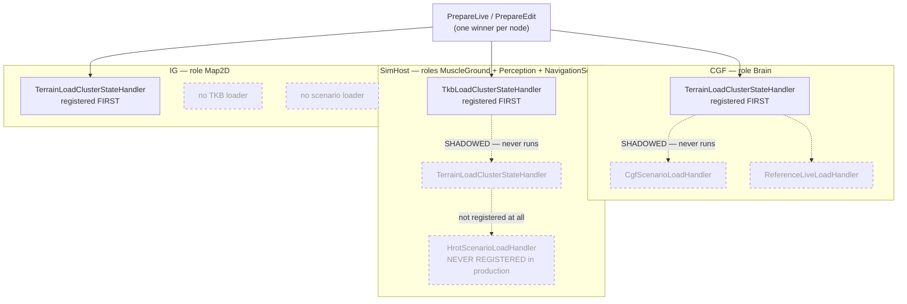

*What the picture shows that the prose hid: the dashed edges are the whole defect. On **CGF** the
terrain loader cancels the scenario loader, so the cluster loads **zero entities**. On **SimHost** the
TKB loader cancels the terrain loader, so terrain has **never** loaded there. And a **named TKB** is
loaded on SimHost only — CGF and IG build their knowledge base from the hard-coded catalogue and would
ignore a scenario's `TkbName` entirely.*

| 📐 measured evidence | |
|---|---|
| CGF loads nothing | a temporary probe showed `CgfScenarioLoadHandler.PrepareAsync` never invoked for `PrepareLive`; disabling the terrain registration on CGF changed the load from `entityCount:0, sawWorldChange:false` to `entityCount:8, sawWorldChange:true` and the full `hill-attack-close` run then passed both acceptance conditions |
| pinned, and red on the dispatch base `a5e9a5278` too | `ClusterConformanceRails.The_two_hosts_hold_the_same_loaded_world` · `..._number_the_same_entities_identically` — `[editor] entityCount:8` vs `[all] entityCount:0` |
| terrain never runs on SimHost | registration order `NodeBootstrapper.cs:331` (TKB) before `:344` (terrain), first-wins; the `--mode all` log carries exactly **two** `[TerrainLoad]` lines for **three** ECS hosts |

### 2.3 Why the scenario loader is absent on SimHost — **the premise `Terrain §2.1e ④` got right**

📐 `SimHostNodeBootstrapper.cs:391-438` passes the serializer but **not** the extractor / request source /
id allocator, with its own comment: *"Load handlers stay off (no authoring deps here)."* The registration
in `NodeBootstrapper.cs:365` is conditional on all three. ⇒ **in production SimHost has no scenario-load
handler at all**, and neither does IG. That is not an oversight — it is the role model: the **Brain** role
owns reading, parsing and saving the scenario; the muscle / perception / navigation / map roles consume a
world that is replicated to them.

### 2.4 How the shared names reach a node today — **a sidecar file, not the message**

| | |
|---|---|
| the load message (`EditLoadHandlerPayload`, `ReferenceEditLoadHandler.cs:8`) carries | `ScenarioId` (the scenario NAME) · `IsNewScenario` · `TargetState` · `ExerciseId` |
| it does **not** carry | ⛔ **`TkbName`** · ⛔ **`TerrainName`** · ⛔ anything else about content |
| so the names travel by | the orchestrator's gateway reading the master scenario header on the NAS and writing `{node staging}/TKB/ScenarioHeader.json` during the file-copy step (`StorageGatewayModule.BuildStagedHeaderJson`); each node then reads that file off its own disk (`TkbLoadClusterStateHandler`, `ScenarioTerrainName.Read`) |

🔴 **And that channel races the step that consumes it.** 📐 Measured in one `--mode all` load:
`PrefetchScenario started` at `T+0`, **`PrepareLive` dispatched at `T+6 ms`**, `PrefetchFiles` fanned out
at `T+55 ms`, staging ACKs at `T+118 ms`. The scenario loader survives only because it retries for two
seconds; **the TKB and terrain loaders do not retry** — they read once, find no header, and conclude
*"this scenario names no TKB / no terrain"*, which is a **legal and silent** answer indistinguishable from
the truth. ⇒ a node can come up on default content with nothing anywhere saying so.

---

## 3. THE MODEL — one unified load phase, composed per role

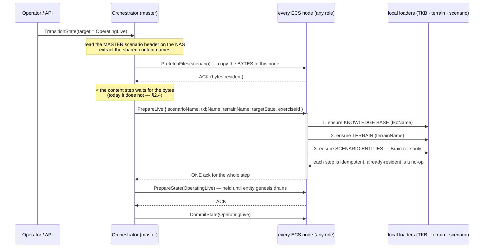

*What the picture shows that the prose hid: the node answers **once** for a step that has **three**
participants. That is the difference from today, where three handlers compete for one ACK and two lose
silently — and it is why this cannot be fixed by reordering the list.*

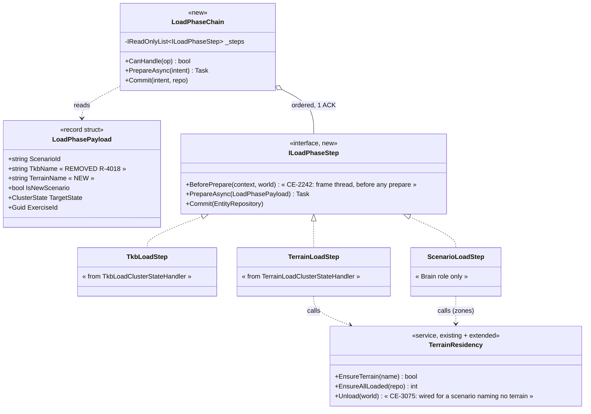

⭐ `CE-2242` (`2026-10-17`): a node's commit is not a cluster barrier — a faster node commits and replicates in while a slower one still prepares (the navmesh bake). `BeforePrepare` is the frame-thread hook for what must be in place before that happens; the terrain step sets the geo origin there on an empty world ([Geo Origin §4 ⑨](DESIGN_Geo_Origin.md)).
⭐⭐ `CE-2244` (`2026-10-19`, backend): ⛔ the same window let SIGHT see through every wall — SimHost (which bakes the navmesh, so it commits
last) held CGF's units for ~10 frames with no terrain world, and the sight test with no terrain judges open ground: a man behind a tower
was acquired and REMEMBERED (measured in-process, ua-threat-ranking: first sighting on frame 16 with the terrain absent; alone the terrain
was in by frame 7, before anyone was in range). 🛠 The terrain step marks the world PENDING in `BeforePrepare` when a terrain that is not
resident is coming (`TerrainWorldSource.MarkPending`, held beside the world — no component, never saved or replicated) and clears it at its
commit or abort; the production sight (`TerrainWorldLosStrategy.ForLiveWorld`) judges nothing visible while it is set. A scenario naming
no terrain never sets it (open ground, as before). Rails: `TerrainLoadStepTests.CE2244_…`, `LosStrategyTests.CE2244_…`.
| rejected — one line | |
|---|---|
| hold every replicated entity until this node commits (a load barrier) | the bigger change CE-2242 already declined: a node's commit is deliberately not a barrier |
| treat "no terrain world" as "blocked" | a scenario that names no terrain is legal (§10) and must keep seeing |


*What the picture shows that the prose hid: terrain residency is a **service with several callers**, not a
cluster step. The step is one caller; the future operator-driven preload is another; a standby unload is a
third. *(⚠ `2026-10-05`: `Unload` now also has a load-path caller — a scenario naming no terrain, §10.)* That is what makes "callable from multiple places" structural rather than a promise.*

---

## 4. THE PER-ROLE CONTRACT

### 4.1 What each role does in the `Loading*` phase

> ⛔⛔ **CORRECTED `2026-09-18`, before any of this was built.** The first version of this table gave
> **every** role a ✅ for terrain, with reasons like *"line of sight and broadphase are terrain-dependent"*
> and *"draws the map background and road graphics"*. 🔴 **Those were written from a principle, not from a
> measurement** — the precise failure mode `R-139` exists to prevent. 📐 Measured (`search_code` + grep
> agree): the only production consumers of the road graph are `CarKinematicsSystem` and the pathfinding
> solver. The rows below are by CONSUMER.

⭐⭐ **The per-role requirement table is owned by
[`DESIGN_Node_Roles_And_Policies.md`](DESIGN_Node_Roles_And_Policies.md) §3.2** — that document owns what a
role *is*, so it owns what a role *needs*. ⛔ It is not restated here.

⇒ ⭐ The asymmetry is exactly why the shared content names must ride the **message**: four of five roles
never open the scenario file, so they cannot read the names out of it.

#### ⭐⭐⭐ The two parts are derived DIFFERENTLY — and the knowledge base is NOT role-derived

> 🔒 **User, `2026-09-18`, on the `Map2D` row:** *"every ECS enable node should be able to create
> entities so every needs the TKB loaded."*

⛔⛔ **Do not read the requirement table as "three columns of the same kind."** It has two derivations, and
conflating them is how `Map2D` ended up with no knowledge base at all:

| part | derived from | the basis |
|---|---|---|
| ⭐⭐⭐ **knowledge base (TKB)** | 🔴 **NOT the role. Being an ECS node at all.** ⇒ **unconditional on every host that holds a world**, `Map2D` and every future role included | 🔒 `R-138` + `Q65-A′` — *"the shared code for entity creation support should not restrict any ECS enabled node from creating own networked entities"*, and `DESIGN_Node_Roles_And_Policies.md` §3.1: **every ECS node composes the FULL genesis pipeline**. ⇒ ⭐ **a node that can create an entity must be able to resolve its template**, so a node without the scenario's knowledge base holds a genesis pipeline it cannot actually use |
| ⭐ **terrain world + road graph** | ⭐⭐ **UNIVERSAL — every ECS node** *(since `2026-10-03`; the navmesh BAKE alone stays role-derived: `NavigationSolver`)* | ⭐ the consumer the 2026-09-18 ruling waited for appeared: the map on every host, LOS, movement Z (R-181/R-182, [`DESIGN_Terrain_World.md`](DESIGN_Terrain_World.md) §5). ⛔ *(was: the ROLE — `MuscleGround` and `NavigationSolver` only, "load nothing where nothing reads it", accepted `2026-09-18` — still true, the readers now exist)* |
| ⭐ **scenario entities** | ⭐ **the ROLE** — `Brain` only | only `Brain` also edits and saves the scenario |

🔴 **What that makes of §2.2's measured picture:** *"IG: no TKB loader"* and *"CGF: no TKB loader"* are not
neutral facts about hosts that happen not to need one — they are **violations of `Q65-A′`**. Both compose
the full genesis pipeline and both would **ignore a scenario's `TkbName` entirely**, falling back to the
hard-coded catalogue. ⇒ an entity created on IG or CGF from a scenario-supplied template would resolve
against the **wrong knowledge base**, silently. ⭐ `L4` must therefore give the knowledge-base step to
**every** ECS host, unconditionally — ⛔ not "to the roles that asked for it".

⚠ **And note the asymmetry is not a special case for terrain:** it is the general shape. *"Can this node
be asked to create an entity?"* is answered by **being an ECS node**; *"does this node read the road
graph?"* is answered by **its role**. A future part belongs to whichever question it answers.

### 4.1a ✅ RULED `2026-09-18` — **a role with no consumer does NOT load terrain**

> 🔒 **User, verbatim:** *"'load nothing where nothing reads it' … for sure, accepted."*

⇒ ⭐ `MuscleGround` and `NavigationSolver` make terrain resident; `Brain`, `Perception` and `Map2D` do not,
and [`DESIGN_Terrain_Zones_And_Assets.md`](DESIGN_Terrain_Zones_And_Assets.md) §8.3 N4's loud failure
narrows to the roles that declare the requirement. ⚠ **What would reopen it:** a measured consumer
appearing on `Map2D` or `Perception` — then the requirement table (roles §3.2) is the single place that
moves. ⛔ **This does not touch the knowledge base**, which is unconditional for a different reason (§4.1).

⛔ **HISTORY — the tie-break as it stood before the ruling:**

| ⭐ load it anyway | ⛔ do not load it |
|---|---|
| [`DESIGN_Terrain_Zones_And_Assets.md`](DESIGN_Terrain_Zones_And_Assets.md) §8.3 N4 — a zone operation is **cluster-wide**, and a node that does not hold the named terrain must **fail loudly** rather than silently pass | 🔒 the user's own framing: *"each node must be able to load those scenario parts **it needs**"*. Nothing on `Brain`, `Perception` or `Map2D` reads the road graph — ⭐ `Map2D` even holds a `RoadNetworkHolder` (`IgNodeBootstrapper.cs:80`) that **nothing on that host reads**. And memory held for no reader is the opposite of §5.1's future standby mode |

⭐ **Lean: do NOT load it where no consumer exists**, and narrow §8.3 N4's loud failure to roles that
declare the requirement. ⚠ **What would change the lean:** a measured consumer appearing on `Map2D` (a map
that actually draws the road graph) or on `Perception` (line of sight against terrain obstacles) — both are
plausible and neither exists today. ⇒ the requirement table is the single place that would change.

### 4.1b ⭐⭐⭐ THE ROLE DECLARES THE *WHAT*; THE HOST SUPPLIES THE *HOW* *(user, `2026-09-18`)*

> 🔒 **User, verbatim:** *"the goal is to unify the handling of the loading phase across host by binding
> it to the host role, not to the host bootstrap code, while keeping the possibility for each host to
> override the HOW the handling is done (like stride-simhost loads different data than SimHost because
> they implement their muscle/perception/navigation/etc… role differently)."*

⭐⭐ **This is what makes the chain in §3 uniform rather than three parallel chains.** The host bootstrap
stops deciding *whether* a part loads; it only registers *how*.

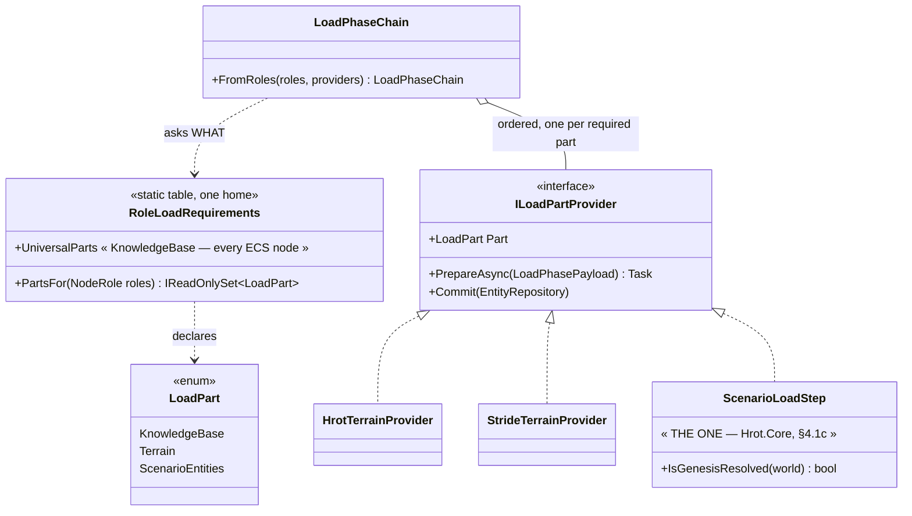

*What the picture shows that the prose hid: `HrotTerrainProvider` and `StrideTerrainProvider` satisfy the
**same** requirement with **different** data, and the chain cannot tell them apart — that is the override
point, and it is the only one. ⭐ Beside them, `ScenarioLoadStep` has **no** sibling: it is deliberately
the ONE implementation (§4.1c), because its readiness predicate is the thing no host may restate.*

| ⭐ the rules that fall out | |
|---|---|
| ⭐⭐⭐ **a host may not require LESS than its roles do** | ⛔ composing the chain from the role set makes "forgot to register the terrain step on this host" unrepresentable — which is precisely the defect class in §2.2 |
| ⭐⭐⭐ **the UNIVERSAL parts are not role-keyed at all** | ⭐ the knowledge base is required by **every ECS node** because every ECS node composes the genesis pipeline (§4.1). ⛔ `PartsFor` must never be able to return a set without it for a host that holds a world — the union with `UniversalParts` is unconditional |
| ⭐⭐ **a host MAY satisfy a part differently** | `HrotStrideApp` and `Hrot.SimHost` both carry `MuscleGround`; both must make terrain resident; they load different data |
| ⛔ **a missing provider for a required part is a STARTUP failure, loud** | ⚠ not a silent skip — that is the whole disease this replaces |
| ⛔ **this is NOT a permission gate** | 📄 `DESIGN_Node_Roles_And_Policies.md` §3.1 — a role never denies a capability. A host that composes a scenario reader may run that step whatever its role says; the table is the default, not a prohibition |

⇒ ⭐ **`L2`/`L4` in §5 are restated by this:** the chain is built from `roles × providers`, not from a
hand-written registration order in each bootstrapper.

### 4.1c ⭐⭐⭐ ONE SCENARIO-LOAD STEP — **what is already shared, what is triplicated, and what FORCES the rules**

⭐⭐ **The seam law first: the LOADING is already unified.** One `ScenarioEntityCreationRequestSource` →
`CreateEntityRequestSystem` → `NetworkSpawningSystem`, one `IScenarioEntityExtractor`, one
`ScenarioSerializer`, and **every ECS node composes the whole pipeline with no opt-out** — 📄
[`DESIGN_Entity_Creation_Unification.md`](DESIGN_Entity_Creation_Unification.md) invariants ⑥ and ⑨,
railed. ⛔ **So this is NOT "extract a shared loader".**

🔴 **What IS triplicated is the cluster-step ADAPTER** — parse, enqueue, then hold the state transition
until genesis has provably finished. 📐 **Measured `2026-09-18`, complete set (three implementations of
`ITickableClusterStateHandler` that load a scenario), and TWO have already DRIFTED:**

| readiness condition | `HrotScenarioLoadHandler` (SimHost) | `CgfScenarioLoadHandler` (CGF) | `HrotEditLoadHandler` (editor + CGF edit) |
|---|---|---|---|
| ① request queue drained | ✅ | ✅ | ✅ |
| ② nothing still `Constructing` | ✅ | ✅ | ✅ |
| ③ the **six** cross-reference Intent DTOs resolved | ✅ | ✅ | 🔴 **ABSENT** |
| ④ terrain made resident at the one valid moment *(§10.1's finding — the first frame the entities are real)* | ✅ | 🔴 **ABSENT** | 🔴 absent |

⇒ 🔴 **Two live defects fall straight out of the table:** an **edit** load can reach `OperatingEdit` while
passengers, vehicles, hierarchy, targets, routes and subordinates are still unresolved; and **CGF never
makes its zones' terrain resident**, though the design says that call belongs exactly there. ⛔ Neither is
a new decision — both are one copy having lost a line the others kept.

#### ⭐ The decision — **ONE step in `Hrot.Core`, the three handlers deleted**

⭐ `Hrot.Core` because it is reachable from CGF, SimHost **and** the editor presentation assembly — the
same reason `TerrainLoadClusterStateHandler` already lives there. ⛔ Not `Fdp.Toolkits`: the readiness
predicate names Hrot Intent DTO types, and pushing it down would need a registration seam invented for one
caller.

#### ⭐⭐⭐ What makes it FORCE the rules rather than merely state them

| # | mechanism | the defect class it makes unrepresentable |
|---|---|---|
| **①** | ⭐⭐⭐ **ONE readiness predicate**, owned by the step. There is no second place to write it | 🔴 exactly the ③/④ drift above — a host cannot express a subset of a predicate it does not own |
| **②** | ⭐⭐ **the chain is built from the ROLE SET** (§4.1b), never hand-registered; a required part with no provider **throws at startup** | 🔴 §2.2's whole family — "this host forgot to register a step", silently |
| **③** | ⭐⭐⭐ **required collaborators are NON-OPTIONAL constructor arguments** | 🔴 the id authority — `HN-037`: CGF constructed its own allocator seeded at 1 and produced ids **2–9** where the editor produced **1000–1007** (📄 `DESIGN_Deterministic_Network_Ids.md` §11d ②). 🔴 and the world — `ClusterSlave` commits with `repo: null` (§10.3), so a step publishing only through that parameter publishes **nothing**; each of the three copies had to rediscover this |
| **④** | ⭐⭐ **host differences are INJECTION POINTS, not classes** — edit vs live is an argument; terrain residency, behaviour remapping and recording are collaborators | ⛔ a host needing different behaviour supplies a different collaborator and **never writes a second handler**, so there is nothing left to drift |

⚠ **It stays a DEFAULT, not a permission gate** (📄 `DESIGN_Node_Roles_And_Policies.md` §3.1): the step
exists on every host; only `Brain`'s requirement pulls it into that host's chain.

#### ⛔ Rejected — one line each

| alternative | the one fact that ruled it out |
|---|---|
| a shared **abstract base** with virtual hooks | a host could override the readiness predicate — the single thing that must not be overridable |
| keep three handlers, add a **rail asserting they agree** | a rail over copies must be updated per copy, and it cannot see a fourth copy added later |
| push the step into **`Fdp.Toolkits`** | the predicate names Hrot Intent DTO types; it would need a generic registration seam invented for one caller |
| let `ClusterSlave` **run every matching handler** | breaks the exclusivity other handlers depend on (§5.1) |

### 4.2 Where the parts come from

| part | carried by | consumed by |
|---|---|---|
| **which** terrain / scenario | ⭐ the **load message** (§3's payload) — the orchestrator extracts the terrain name from the master scenario on the NAS | every node, per its role |
| **which** TKB | ⭐ **`R-4018`, as built `2026-10-15`:** ⛔ NOT the load message and NOT the scenario. One TKB per deployment, named by `ClusterConfiguration.TkbName` (default `HrotDefault`); the prefetch's TKB sync (`StorageGatewayModule.SyncTkb`) copies it and leaves a `StagedTkb` record naming it, which the knowledge-base step reads. No master copy ⇒ no record ⇒ the built-in catalogue | the knowledge-base step |
| **the bytes** (TKB archive, terrain definition, scenario file) | ⭐ the **staging copy** — NAS → per-node directory, before the content step | the loaders |
| **what this node needs** | ⭐ **the node's own role** — never on the wire | the chain, locally |

### 4.3 ⛔ SUPERSEDES `DESIGN_Terrain_Zones_And_Assets.md` §2.1e ④

That section ruled *"the terrain loader must NOT ride the scenario-load handler"*, on the measured ground
that a muscle node has no scenario-load handler (§2.3 — **the premise is correct and still holds**). Its
remedy was *"register it unconditionally on every ECS host, like the TKB loader"* — and that is exactly
what produced the shadowing in §2.2, because registering unconditionally means **competing**
unconditionally.

⇒ The premise survives; the conclusion is replaced. Terrain is neither a competitor nor a passenger on the
scenario load: it is an **ordered step in one composed chain** that every ECS host runs, and on the Brain
role the scenario step simply comes after it — which satisfies *"scenario load does the terrain load
first"* without hanging terrain off a handler four roles do not have.

---

## 5. THE PLAN

| # | item | owner surface |
|---|---|---|
| **L1** | ⛔ *`TkbName` half REMOVED by `R-4018` (`2026-10-15`) — see §4.2's TKB row.* Add `TkbName` and `TerrainName` to the load payload; the orchestrator fills them from the master scenario header it already reads. ⭐ The payload crosses the wire as **JSON**, so this is purely additive — no wire id, no compatibility break (`R-42` does not bite) | `ReferenceEditLoadHandler.cs` payload · `StorageGatewayModule` / the transition fan-out |
| **L2** | Introduce the ordered **load-phase chain**: one registered handler per ECS host claiming `PrepareLive`/`PrepareEdit`, running its steps in order and ACKing once. ⭐ Composed from **`roles × providers`** (§4.1b), never from a per-bootstrapper registration order; a required part with no provider fails **loudly at startup** | new, beside `SerializeLocalRegistrar` |
| **L3** | Re-home `TkbLoadClusterStateHandler` and `TerrainLoadClusterStateHandler` as **steps**, reading their name from the payload, falling back to the staged header only when the payload is silent (one release of tolerance) | both handlers |
| **L4** | Register the chain on **every ECS host** — CGF, SimHost, IG, editor. ⭐⭐⭐ The **knowledge-base step is unconditional** on all of them (§4.1 — `Q65-A′`; today only SimHost has one, so CGF and IG silently ignore a scenario's `TkbName`); the **terrain step** goes only to `MuscleGround`/`NavigationSolver` (§4.1a); the **scenario step** only where `Brain` is composed | the three bootstrappers + the editor |
| **L4a** | ⭐⭐⭐ **Collapse the THREE scenario-load adapters into ONE shared `ScenarioLoadStep` in `Hrot.Core`** (§4.1c) and delete `CgfScenarioLoadHandler`, `HrotScenarioLoadHandler` and `HrotEditLoadHandler`. ⭐ One readiness predicate · required collaborators non-optional (the id authority and the world) · edit-vs-live an argument · terrain residency, behaviour remapping and recording injected. ⚠ **Fixes two live defects the drift table measured**: the edit path is missing readiness condition ③, and CGF never makes its zones' terrain resident | `Hrot.Core` + the three deleted handlers and their suites |
| **L5** | Terrain residency becomes a service with a stable entry point: `EnsureTerrain(name)` idempotent (already-resident ⇒ no-op), plus an `UnloadAll()` seam left **unwired** for the future standby mode. ⚠ **SUPERSEDED `2026-10-05` (§10, `CE-3075`)**: `TerrainResidency.Unload` is now called when a scenario names NO terrain | `TerrainLoadService` |
| **L6** | Ensure the content step runs **after** the staging ACKs, closing the race in §2.4 — and remove the two-second retry that papers over it today | the orchestrator's transition sequencing |
| **L8** | ⭐⭐⭐ **The deterministic staging wait** — PARK a load transition until the file copy has completed AND every node has acknowledged it, then DELETE every wait-on-a-clock in the load path. 📄 Designed in **§7**; ⛔ not built | `ClusterMaster` (park + resume) · `AssetPrefetchProcessManager` (carry the request id) |
| **L7** | Rails: the chain runs **all** its steps and ACKs once · a shadowed step is impossible by construction · ⭐⭐ **every ECS host resolves the scenario's named knowledge base** — the `Q65-A′` rail, and the one that would have caught the IG/CGF gap · a host with no terrain consumer makes **no** terrain resident · a `Brain` host loads entities and a non-`Brain` host loads **none** · the payload names beat the sidecar · an absent name is legal and silent, an absent **artifact** is loud · ⭐⭐ **the readiness predicate has exactly ONE implementation** — the rail that replaces the three-copy drift, asserting an edit load also waits for the six cross-reference intents and that a Brain host makes terrain resident. ⚠ **`HN-037`'s test surface applies**: three handlers and their suites are deleted, so the claims each asserted must be **re-homed onto the one step**, not dropped | `Hrot.SimHost.Tests`, `Hrot.CGF` tests, `Hrot.Editor.Tests`, and the existing cluster conformance rails |

### 5.1 Deliberately NOT in this plan

| | |
|---|---|
| ⛔ a separate terrain **preload** cluster step | 🔒 user: *"no separate terrain-preload step is needed at the moment (although it could happen later — but that would likely require new cluster node operation)"*. `L5`'s service is the seam it would call |
| ⛔ ~~terrain **unload** wired to anything~~ — ⚠ **SUPERSEDED `2026-10-05` (§10)** | 🔒 user: *"we might need to support terrain unloading as well if we wanted (in the future) the hosts to go to some kind of clean low-memory standby mode"*. The STANDBY unload is still unwired; a scenario naming no terrain now unloads (`CE-3075`) |
| ⛔ changing `ClusterSlave` to run every matching handler | ⚠ several handlers depend on first-wins exclusivity — `ReferenceLiveLoadHandler` claims cold `PrepareLive` *only if* a scenario handler did not, and running both would double the recording preparation. The chain gets the ordering without touching the dispatcher |
| ⛔ giving non-Brain roles a scenario reader | §4.1 — the role model says the Brain owns the file; the others receive a replicated world |

### 5.2 Acceptance — ✅ **MET `2026-09-18`, stock build, no probe**

📐 `--mode all`, `hill-attack-close`, measured end to end:

```
[LoadPhase] SimHost composed for roles [MuscleGround, Perception, NavigationSolver]: KnowledgeBase -> Terrain.
[LoadPhase] IG      composed for roles [Map2D]:                                      KnowledgeBase.
[LoadPhase] CGF     composed for roles [Brain]:                                      KnowledgeBase -> ScenarioEntities.

POST /scenario/load/live → { entityCount: 8, sawWorldChange: true }
Scenario 8 · SimHost 8 · IG 9 (incl. the id-0 placeholder)
```

| at `simTime ≈ 106` | force | HP | `LocomotionChannel.Status` | ammo | distance to its OWN `FinalDestination` |
|---|---|---|---|---|---|
| 1006 · 1007 M1 Abrams | Hostile | **0/50** *(both by t≈46)* | Failure | 42 | — |
| 1001–1004 Tank Platoon | Friend | 50/50 | **Success** | 41 | **0.8 – 1.5 m** |

⭐⭐ **The composition lines are themselves a deliverable**: a node now says, at boot, which parts its roles
require. ⛔ The defect this replaces was invisible precisely because nothing said anything.

---

## 6. ⭐⭐⭐ AS-BUILT — **what the build changed, and why** *(batch load-phase, `2026-09-18`)*

⚠ Obligation ⑤: the deviations live here, not only in the batch report.

### 6.1 ⭐⭐ TWO ENABLING MOVES THE PLAN DID NOT FORESEE

| what | why it was forced |
|---|---|
| ⭐⭐⭐ **`GenesisIntentComponents` moved from `Hrot.Common` down to `Hrot.Core`** *(namespace unchanged, so no call site moved)* | 🔴 **This is WHY the editor's readiness predicate was missing condition ③.** `Hrot.Presentation` does not reference `Hrot.Common`, so the editor's handler **could not see the intent DTO types** — it was an ASSEMBLY WALL, not carelessness. §4.1c called that drift "one copy having lost a line"; the truer statement is that one copy was never able to have it |
| ⭐ **`IScenarioEntityExtractor` gained a remapper-aware overload** with a default implementation | before it, passing a behaviour remapper required depending on the CONCRETE CGF extractor — a large part of why CGF needed a handler of its own at all. The default keeps every existing implementor unchanged. ⛔⛔ **CORRECTED `2026-10-01` — and that sentence WAS the defect:** the default IGNORES the remapper, and the ONE implementor that remaps (`StagingEntityExtractor`) was among the "unchanged" — it implemented only the three-argument member. ⇒ from L4a on, every live load reached the default and **CGF's remapper was dropped**: entity references in mission parameters (`[RemapNetworkId]`) kept their staging ids. ⚠ Invisible because staging and live ids both start at 1000. 📐 Measured by `DistributedScenarioLoadTests` once its offline ids were moved off the live range; fixed by implementing the member explicitly in `StagingEntityExtractor`; railed by `StagingEntityExtractorTests.Extract_ThroughTheInterface_StillAppliesTheBehaviorRemapper` (red-proved). ⭐ Lesson for this seam: **a default interface member that drops an argument is a silent default** — an implementor that HAS the capability must implement it |

### 6.2 ⚠ THE KNOWLEDGE-BASE PROVIDER IS SUPPLIED BY THE HOST, NOT DEMANDED OF THE CALLER

📐 Measured: making it conditional on a caller-supplied database broke five call sites that legitimately
pass none (replay tests, a bootstrap with no TKB configured). ⇒ each host now **supplies the hard-coded
catalogue when no database was composed**. ⭐ That is the host supplying a *HOW*, not the requirement being
relaxed — a node with no named TKB starts from that catalogue anyway, and the chain still throws when a
part is genuinely unsatisfiable (asserted in `LoadPhaseChainTests`).

### 6.3 🔴 A BEHAVIOUR CHANGE THAT IS NOW LOUD

⛔ **An unreadable scenario on a `Brain` node THROWS.** The former CGF handler logged an error and enqueued
nothing — a node silently contributing an empty world, which is the exact failure this design removes. ⚠ It
is asserted rather than left implicit (`ScenarioLoadStepTests`).

### 6.4 ⛔ `L6` IS PARTIAL, DELIBERATELY

⭐ The **names** no longer race — `L1` moved them to the message, which removes the silent failure that was
actually measured. ⭐ The knowledge-base and terrain steps gained the bounded artifact wait the scenario step
always had, so the newly-loud *"artifact not found"* cannot fire while the copy is still in flight.
⛔ **The complete fix — ordering the content step after the staging acknowledgements — was NOT done.** It
restructures the two-phase trajectory that *every* transition shares (live, edit, preview, replay, idle),
and doing it in the same batch as a node-side refactor would have made a failure impossible to attribute.
⚠ Recorded as outstanding, not as finished. ✅ **CLOSED `2026-09-18` by `L8` — §7, `build-state: BUILT`; the three waits and `StagedArtifactWait` are DELETED and §7.7 carries the as-built.** ⭐ **DESIGNED `2026-09-18` in §7** — 🔒 user: *"it cannot
depend on timeouts where can easily wait deterministically."* 📐 And the design got SMALLER once measured:
the signal it needs is already computed and published by the prefetch saga, so the gate defers ONE intent
rather than restructuring the trajectory this section feared.

### 6.5 ⚠ RAILS THAT WERE WRONG, NOT JUST STALE

⛔ `TerrainLoaderIsComposedOnEveryEcsHostRails` asserted *"register the terrain loader BEFORE every
`PrepareLive` claimant"* — the remedy `C8` chose. 🔴 **It was GREEN throughout the defect**, because it
asserted the ordering it had been written to defend rather than what a node ends up running. ⇒ replaced by
`EveryEcsHostComposesTheLoadPhaseChainRails`, which asserts composition through the chain and that **no host
hand-registers a retired prerequisite loader**. ⭐ The lesson generalises: *a rail that encodes a remedy
cannot catch that remedy being wrong.*

---

## 7. ⭐⭐⭐ `L8` — **THE DETERMINISTIC STAGING WAIT** *(design `2026-09-18`; `build-state: BUILT`)*

> 🔒 **User, `2026-09-18`:** *"it cannot depend on timeouts where can easily wait deterministically."*

⚠ This section owns the half of `L6` that §6.4 records as deliberately deferred. It replaces every
wait-on-a-clock in the load path with a wait on a fact that is **already computed and already published**.

### 7.0 ⛔⛔ THE MEASUREMENT THAT CHOSE THE MECHANISM — **the bus is a BROADCAST**

📐 Measured `2026-09-18`: `FdpEventBus` managed streams are **double-buffered and broadcast**.
`ManagedEventStream.Write` appends to a back buffer, `Read()` returns the front, and `Swap()` runs at end
of frame. ⇒ **two consequences, and both decide the design:**

| ⭐ | |
|---|---|
| ⛔⛔ **reading does NOT consume** | every reader in a frame sees every event. ⇒ **an external gate CANNOT withhold an intent** from `ClusterMaster` — it would read the same one in the same frame and fan out anyway |
| ⚠ **an event is readable one frame AFTER it is published** | so any resumption is frame-quantised whatever we do. ⭐ One extra frame against a copy of hundreds of milliseconds is nothing, and there is no same-frame ordering subtlety to get wrong |

⇒ ⭐⭐⭐ **The wait lives INSIDE `ClusterMaster`, as a PARKED transition** — not in a gate in front of it.
📄 The rejected external-gate shape, and why, is §7.6.

### 7.1 The sequence — **parked, then resumed**

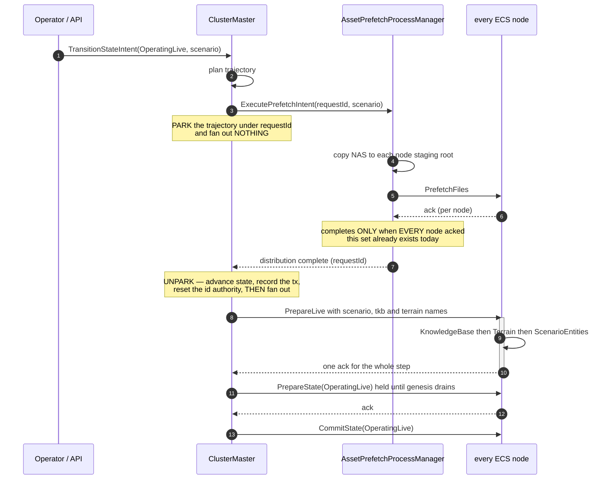

*⭐ What the picture shows that the prose hid: **the fan-out is not restructured — it is the same pass, run
later.** Everything from `PrepareLive` down is byte-for-byte today's flow, which is why two-phase commit,
ack accounting, replay and preview are untouched. ⛔ And the defect, stated as a picture: **today steps 3
and 9 happen in the SAME pass** — the copy is started and the trajectory fanned out together.*

### 7.2 What is parked, and where the method splits

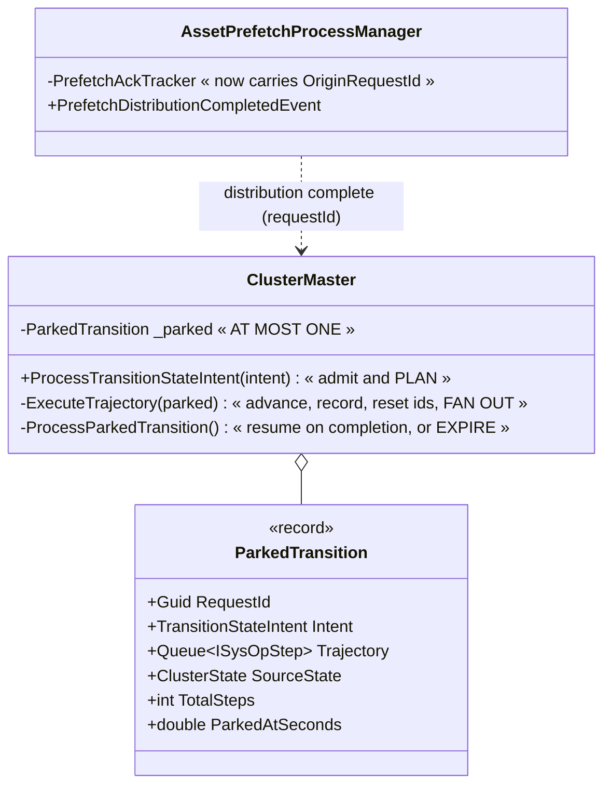

*⭐ What the picture shows that the prose hid: **nothing new is computed.** Every field of
`ParkedTransition` is a LOCAL the transition method already builds and throws away a few lines later. The
change is that those locals live for a few frames instead of a few statements.*

| ⭐ the seam | |
|---|---|
| **admit and PLAN** | plan the trajectory · resolve the target · exercise bookkeeping · publish "start copying" · **park and return** |
| **EXECUTE** | ⭐⭐⭐ the optimistic state advance · the transaction record · the id-authority reset · the fan-out · the ack accounting |
| ⭐ **no copy needed** | admit-and-plan calls EXECUTE straight away — same frame, identical to today |

### 7.2a 🔴 THE THREE THINGS THAT MUST MOVE WITH *EXECUTE* — **and why each bites**

| what | if it stayed in the planning half |
|---|---|
| ⭐⭐ the **optimistic state advance** | the cluster would report itself in the TARGET state while still waiting for files |
| ⭐ the **transaction record** beside it | history would show a transaction that had sent nothing |
| ⭐⭐⭐ the **id-authority reset** | it fires so authored ids start at 1000. Left behind, it resets while nothing has been sent — and a second request arriving in between sees a sequence already reset. 📄 This is the exact area `HN-037` came from |

### 7.2b ⛔⛔ TWO MASTERS — **and the editor parks through the SAME path, safely** *(CORRECTED at build time, `2026-09-18`)*

📐 Measured: `new ClusterMaster(...)` has **two** production call sites — `OrchestratorSubsystem.cs:134`
(the real cluster) and `EditorSubsystem.cs:2117`, an **offline master** with `Mandatory = []` so the editor
can list and load scenarios with no cluster at all.

⭐⭐⭐ **The rule is a DERIVATION, not a wait:** a transition parks **only if a copy was started for it** —
that is, only when the planner put a `PrefetchScenario` step in the trajectory, which happens only when the
intent names a scenario. ⚠ Replay, preview, idle and every unload carry no scenario, so they keep their
current latency exactly.

> ⛔⛔ **CORRECTION — the first version of this section said the editor *"starts no copy, so it never
> parks."* 🔴 THAT WAS FALSE, and it was the one claim that could have turned this design into a deadlock
> on every scenario open.** 📐 Measured while building: the editor **does** stage. It constructs an
> `AssetPrefetchProcessManager` over the real NAS root (`EditorSubsystem.cs:2150`) and ticks it every frame
> (`:2661`); it registers `ReferencePrefetchHandler` on its **own** one-node `ClusterSlave` (`:1422`); and it
> heartbeats as node `0` (`:1035`), so its roster is not empty.
>
> ⇒ ⭐⭐ **The editor parks and unparks on exactly the same path as the cluster, and that is why it is safe** —
> not because it is exempt. The saga that answers a parked transition is present, ticked and acked on both
> masters. ⭐ A one-node copy of a local scenario is the cheapest case there is, so the added latency is a
> frame or two.
>
> ⚠ **What the false claim cost, stated plainly:** nothing, because it was measured before the rail was
> written — but it is a textbook instance of a lean resting on a principle (*"the editor is offline, so it
> stages nothing"*) instead of a `file:line`. The rail in §7.5 pins the measurement so the claim cannot
> silently revert.

### 7.2c ⭐ AT MOST ONE PARKED TRANSITION — **decided, not inherited**

⛔ A table keyed by request id would make several simultaneous parked transitions *representable*, and the
master today tracks a single in-flight transition. ⇒ ⭐ **park at most one**, and reject a second transition
while one is parked with the rejection status the master already issues for other busy conditions.
⚠ Permitting several would be a new concurrency property nobody asked for, arriving because a dictionary
allowed it.

### 7.3 What actually changes

| # | change | why |
|---|---|---|
| **①** | ⭐⭐⭐ **`ClusterMaster` parks instead of fanning out** when a copy was started for the transition, and fans out on the completion event | the whole of `L8`. ⛔ The fan-out itself is unchanged |
| **②** | ⭐⭐ **The three items of §7.2a move to the execute half** | each is silently wrong if left behind |
| **③** | ⭐ **The prefetch saga carries the originating request id** through its ack tracker and publishes a distribution-complete event | today the tracker forgets it, so nothing can be correlated back |
| **④** | ⭐⭐⭐ **DELETE all three waits** — the two added for the knowledge base and terrain, and the scenario step's pre-existing retry, plus `StagedArtifactWait` itself | 🔒 *"it cannot depend on timeouts."* After ① nothing in the load path waits on a clock |
| **⑤** | ⭐⭐ **One liveness bound remains, on the PARKED entry** — *"staging never completed"* fails the request | ⚠ a deterministic wait still needs a bound. ⛔ The difference from a timeout is that it FAILS and never silently proceeds |

### 7.4 ⭐⭐ A SECOND DEFECT THE SAME CHANGE CLOSES

🔴 **Measured today:** when the copy FAILS, the saga reports a timeout to the requester — but the transition
has **already been fanned out**, so the cluster proceeds to build a world from files that never arrived.
⇒ ⭐ Parking removes that path by construction: a failed copy drops the parked entry and nothing is sent.

### 7.5 What must be PROVEN, not assumed

| | |
|---|---|
| ⛔ a transition with **no scenario** is not delayed at all | idle, replay, preview and every unload keep their current latency |
| 🔴 **the EDITOR's offline master never parks** | §7.2b — it stages nothing. ⚠ This is the path that would turn a wait into a deadlock, and it is not hypothetical: it is every scenario open in the editor |
| ⛔ a **second** transition arriving while one is parked is REJECTED | §7.2c — and rejected, not queued |
| ⛔ a **failed** copy fails the request and fans out nothing | §7.4 |
| ⛔ the state reported **while parked** is the loading state, not the target | §7.2a row 1 |
| ⛔ the **id authority** is reset on the execute side | §7.2a row 3 — assert the authored ids still start at 1000 |

### 7.6 ⛔ Rejected — one line each

| alternative | the one fact that ruled it out |
|---|---|
| ⭐ **an external `LoadPrerequisiteGate` in front of `ClusterMaster`** *(the shape this section carried until `2026-09-18`)* | 🔴 **the bus is a BROADCAST (§7.0)** — a gate cannot withhold what the master reads in the same frame |
| the same gate plus an **admission flag** on the intent | it works, and it buys a **composition landmine**: a host that forgets the gate ignores every scenario transition and loads stop silently — a fresh instance of the failure class this programme exists to remove |
| a **pre-master tick phase** to make the ordering structural | ⚠ its main new member was the gate. Without one, only the pre-existing three-comment convention remains — worth doing, ⛔ but not smuggled into this batch |
| make the trajectory itself suspend and resume mid-flight | restructures machinery EVERY transition shares, for no gain once the fan-out can simply run later |
| poll harder, or lengthen the wait | the same race, later — and it is the thing the user ruled out |
| keep the waits as a safety net beside the parking | ⚠ a fallback that hides a broken wait is how the original silence was built |

### 7.7 ⭐⭐⭐ AS-BUILT — **`L8`, built `2026-09-18`** *(obligation ⑤)*

⭐ **The design above is what was built**, with the corrections already folded into §7.2b. What follows is
the shape on disk plus the three things the build learned.

| design element (§7.2) | built as |
|---|---|
| `ClusterMaster._parked`, at most one | `private ParkedTransition? _parked;` + `public Guid? ParkedRequestId` (a read-only seam for the rails) |
| `ParkedTransition` record | same fields, `private sealed record` nested in `ClusterMaster` |
| the plan/execute seam | `ProcessTransitionStateIntent` (admit + plan + park) → `ExecuteTransitionTrajectory(parked)` (advance, record, reset ids, fan out) |
| the resume/expire pump | `ProcessParkedTransition()`, called from `Tick()` **before** the intent drain |
| the saga carries the origin | `PrefetchAckTracker.OriginRequestId` + `PrefetchDistributionCompletedEvent` |
| ④ delete all three waits | ✅ `StagedArtifactWait.cs` **deleted**; the knowledge-base and terrain waits and the scenario step's 100×20 ms retry are **gone**. `PrepareAsync` on all three steps is now genuinely synchronous (`Task.CompletedTask`) |

#### ⭐⭐ ① MEASURED ON THE REAL CLUSTER — the wait costs ~210 ms and is deterministic

📐 Stock `--mode all`, `hill-attack-close`, no probe:

```
19:07:37.4153  ClusterMaster  L8: transition 86ba65c9… PARKED until the staging of 'hill-attack-close' is on every node.
19:07:37.6259  AssetPrefetch  L8: distribution of 'hill-attack-close' for request 86ba65c9… completed (success).
19:07:37.6539  ClusterMaster  L8: the staging of 'hill-attack-close' is on every node — transition 86ba65c9… resumes.
```

⇒ **210 ms parked, then the ordinary fan-out** — against the 2 s of bounded retries the node steps used to
budget for the same race. ⭐ The three log lines are the whole feature, and they are the cheapest possible
proof that the ordering is real rather than lucky.

#### ⛔⛔ ② THE CORRECTION THAT MATTERED — §7.2b's editor claim was FALSE

🔴 The design said the editor *"starts no copy, so it never parks."* **Measured: it does both.** The full
correction, with its four `file:line`s, is in §7.2b; it is repeated here only as the pointer, because it is
the one claim that could have deadlocked every scenario open in the editor. ⚠ It was caught by opening
`EditorSubsystem.cs`, not by a rail — which is why `A_distribution_that_never_completes_expires…` now pins
the fact that **no production master is shaped like the deadlocking one**.

#### ⚠ ③ THE RAILS — six, in the two suites that already own these features *(`T-1` ④)*

| rail | suite | §7.5 row |
|---|---|---|
| `A_transition_with_no_scenario_fans_out_in_the_same_tick` | `ClusterMasterPrefetchTests` | 1 |
| `A_scenario_transition_parks_until_every_node_has_acknowledged_its_files` *(also asserts the reported state is the SOURCE while parked, and that a second transition is REJECTED)* | `ClusterMasterPrefetchTests` | 3 + 5 |
| `A_failed_distribution_fails_the_request_and_fans_out_nothing` | `ClusterMasterPrefetchTests` | 4 |
| `A_distribution_that_never_completes_expires_and_fans_out_nothing` | `ClusterMasterPrefetchTests` | ⑤'s bound |
| `A_parked_transition_can_be_cancelled_and_fans_out_nothing` | `ClusterMasterPrefetchTests` | ④'s cancel *(added after §7.5 was written)* |
| `A_parked_transition_does_not_reset_the_authority` | `TheWorldBoundaryResetsTheIdAuthorityTests` | 6 |

⛔ **No new test class was created** — both suites already own the feature under test (the prefetch barrier,
and the `HN-037` id-authority guard). ⭐ The positive half of row 6 needed no new case: every other rail in
that file carries no scenario, so it plans no copy, never parks, and proves the reset still fires on the
execute side.

⚠ **What a reader should NOT conclude from these rails:** they exercise `ClusterMaster` + the saga over a
real event bus, **not** a real node. The node-side proof is the measured cluster run in ① — and it is the
one that matters, because it is the only one where the files actually have to arrive.

#### ⚠ ④ TWO HONEST LIMITATIONS OF THE BUILT SHAPE

| | |
|---|---|
| ✅ **a `CancelOperation` now clears a parked entry** *(built `2026-09-18`, after the section below was first written)* | ⭐ **Parking created the first transition state that CAN be cancelled cleanly** — nothing has been sent, so there is nothing to undo, and the branch returns before the `AbortTransaction` fan-out for exactly that reason. 📐 Why it was absent rather than broken: `ProcessCancelOperationIntent` resolves its target through `_activeCancellations`, which **only** the ExportArchive and ImportArchive branches ever write *(`ClusterMaster.cs:1472`, `:1506`; specified that way in `.dev/_DONE/cgf-1/batches/CGF-1-BATCH-28-INSTRUCTIONS.md` §C.4)* — a transition was never a cancel target, and before parking there was no window in which it could have been one. ✅ **`2026-10-15` — and it STOPS the copy** (P8 H5 with P6, [`Q91`](blueprints/Architect_Question_91_Player_Nodes.md) §4-H): the master publishes `PrefetchCancelRequestedEvent`, the saga cancels the copy's token and the gateway's transfer removes its partial files; rail `P8_H5_Cancelling_a_parked_load_stops_its_staging_copy`. ⛔ HISTORY: *"it abandons the TRANSITION, not the copy — the bytes finish landing"*. Pinned by `A_parked_transition_can_be_cancelled_and_fans_out_nothing`, which also asserts the single parked slot is RELEASED, so the next transition is admitted rather than rejected as busy |
| ⚠ **the bound is wall-clock, and it is the only clock left** | `ParkedTransitionExpirySeconds`, default 300 s. ⛔ It is not a retry and it never proceeds — it fails the request. ⭐ It exists because a distribution that never reports at all *(a node ejected mid-copy, a saga that was never constructed)* must not hang the master forever |

## 8. ⭐⭐⭐ `CE-2101` — **THE WORLD BOUNDARY CLEARS EVERY HOST** *(AS-BUILT `2026-10-05`, backend)*

🔒 User, `2026-10-05`: *"the play is assumed to be a 'dry run', not a real production run, that one is started from scenario
file always, never from memory."* ⭐ Play from Edit is PREVIEW (snapshot + rewind, `EditorTimeTransportFacade.cs:105`) and is
untouched; this section is the PRODUCTION load.

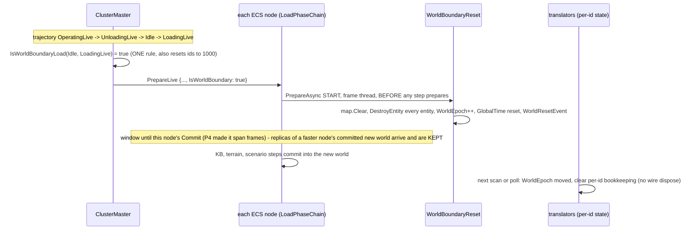

*What the picture shows that prose hid:* the clear is a NODE-local step every host runs at the same message, decided ONCE on
the master by the rule that already resets the ids — so a node never has to know the trajectory, and live-from-replay
(`OperatingReplay → LoadingLive`, never marked) keeps its world by construction.

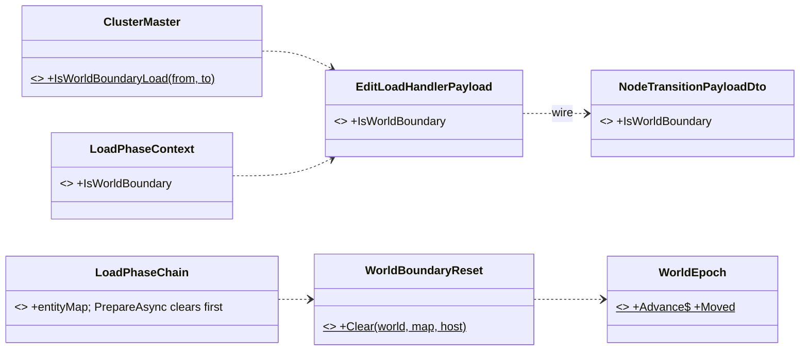

| ⭐ as built | why |
|---|---|
| **DESTROY every entity, not `SoftClear`** | `SoftClear` wipes the entity index, so generations restart at 1 (`EntityIndex.Clear`) and a handle cached before the wipe ALIASES the new entity at the same index; destroying bumps generations (`EntityIndex.cs:164`), so stale handles go DEAD. 📐 Measured safe: SimHost and CGF hold **0** entities at boot, so nothing but scenario content is destroyed |
| **`WorldEpoch` clears translator per-id bookkeeping** | 🔴 measured: `EntityMasterEgressTranslator._publishedNetIds` ("exactly once per net id") outlived the wipe ⇒ the reused id 1000 never re-published its master ⇒ SimHost's ghost had no `TkbIdentity`, was never promoted, built no TKB sensors ⇒ the unit perceived nothing. Guarded the same way: BDC master egress, brain-intent send-on-change + held, master-ingress owner retries, route-ingress deferrals, `CycloneNetworkCleanupSystem._trackedEntities`. ⛔ NOT `Dispose(id)`: that writes "entity deleted" on the wire, and a late dispose of a REUSED id could destroy the new run's ghost |
| the map is passed per host | IG, CGF, editor pass theirs; SimHost resolves the world singleton late (it is set after composition) |
| ⭐⭐ **the clear runs at the START of the prepare, not at Commit** *(`2026-10-15`, coordinator, P4 follow-up)* | 🔴 measured: after P4 ([`Q91`](blueprints/Architect_Question_91_Player_Nodes.md) §4-B2 — the terrain prepares on a worker, so the prepare spans frames) a faster node commits and its entities replicate in BEFORE this node has processed its own Commit, and a Commit-time clear destroyed them — lost entities, and SimHost's queued blueprint application threw `Entity is not alive` (`SpatialCoreTkbTranslator.Inject` ← `BlueprintApplicationSystem`; `TimeControlIntegrationTests.Stop_PausesTheClock…CE3068` red 3 of 12 runs, green 8/8 before P4). ⭐ At prepare start nothing of the new world exists anywhere yet (no node commits before every node prepared), so it is still *"before the load builds the new world"*. ⚠ An aborted load leaves the world EMPTY — accepted: it is a boundary, and the cancel's Idle round follows (P8). ⛔ HISTORY: built `2026-10-05` as *"Commit, BEFORE any step"* |
| the editor's own edit-path pre-wipe (`ScenarioFileService.NewScenario`) stays | it now also advances `WorldEpoch`; ⚠ it still uses `SoftClear` (generation reset) — a follow-up could route it through `WorldBoundaryReset` |

Rails: `TakeCoverScenarioTests.CE2101_ASecondLiveLoad_StartsFromTheFile_OnEveryHost` (cluster: once per host, at the authored
position, perceiving again — red before on position, then on perception), `LoadPhaseChainTests.TheWorldBoundary_ClearsTheWorldBeforeAnyStepPrepares_CE2101`
(boundary clears and kills stale handles; non-boundary keeps the world), `TheWorldBoundary_KeepsAnEntityThatArrivesDuringTheLoadWindow_CE2101_P4` (red against the Commit-time clear), `TheWorldBoundaryResetsTheIdAuthorityTests.The_world_boundary_is_a_load_entered_from_Idle_CE2101`.

### 8.1 ✅ AS-BUILT `2026-10-06` — `CE-3076`: the `WorldEpoch` list was not complete

📐 **Measured:** `hill-attack-close` loaded after `ua-posture` in one `--mode all` process never engaged — the commander's
area query (`IsAreaQueryResolved`) got no answer, the 5 s `NoAnswerTimeout` faulted the mission, hostiles stayed at 50 HP.
The reused id (the commander is 1000, as `ua-posture`'s rifleman was) met per-id state the 8 guards above did not cover.
⭐ **The rule is unchanged — the list grew.** Every holder of PER-WORLD state keyed by net id, (net id, part) or entity
INDEX now drops it on `WorldEpoch.Moved` (classified field by field; the rest are wire truth, type data, `Entity`-keyed or
scratch):

| holder | dropped | what a stale entry did |
|---|---|---|
| `EqsSensorConfigEgressTranslator` / `…IngressTranslator` | solver records, solver picks, suspended set / pending samples, awaiting-playback | ⭐ the "already recorded" memory skipped the result-owner record for the new parent ⇒ no owner for the answer |
| `EntityDamageEgressTranslator` | send-on-change values | a reused id whose health equals the last world's was never published |
| `PeerLifecycleStatusEgressSystem` | reported sets | a reused id never reported Constructing/Active |
| `EntityInfoIngressTranslator` | deferred subordinate assignments | a dead handle, or a unit under the wrong commander |
| `MissionControlExecutionSystem` | versions, task order, retry queue | a draft passed the version check against the last world's mission |
| `BrainTickSystem` | finished-run and blueprint-layout records (entity INDEX) | a new unit on a finished unit's index never ticked |
| the five dispatchers (`DispatcherSystemBase.ForgetLastWorld`) | `_previousAction` (entity INDEX) | the last world's action's `OnExit` ran on the new entity |

⛔ **Deliberately NOT cleared:** `_onWire` (what DDS holds is the wire, across worlds — the orphan sweep ends the last world's
instances), the EQS ingress source-time order (a late last-world sample is still stale), and
`EntityRequestFinalizationSystem._tracked` — its entries are written by `Track()` from OUTSIDE the system during the same load
commit, so a clear on its next `Execute` would drop the NEW world's creates; a stale entry only acks a requester that no
longer exists. Measured after: 2/2 second-load runs engage and kill both hostiles (EQS fix alone: 1/2). Rail:
`EqsDistributedTests.CE3076_AfterTheWorldBoundary_AReusedParentId_GetsItsResultOwnerRecorded`.

✅ **`2026-10-07` — FIXED by [`Q86`](blueprints/Architect_Question_86_Editor_Runs_The_Orchestrator_Core.md) (`CE-122`):** the load request now jumps every node's clock to the loaded time (`SnapTo` → `SnapTimeIntent`) BEFORE the world boundary runs; measured live, `RunSince` = 0 after a reload. ⛔ HISTORY below. ⚠ **Found on the way, NOT fixed here — `CE-3093`:** the diagram above says the boundary resets `GlobalTime`; measured, after
the load both CGF and SimHost still read the LAST world's time (14.9 s) until Play, which then restarts it near 0. Anything
stamped during the load carries the old clock — the commander's `BehaviorState.RunSince` = 14.9 s, so
`SopConditions.SensedFresh` ignores senses from the new world's first ~15 s.

### 8.2 ⭐⭐⭐ `CE-4000` (F2, `R-4019`) — **IDLE IS EMPTY EVERYWHERE: entering `Idle` wipes the world AND deletes what the node owned** *(design `2026-10-15`, coordinator; `build-state: BUILDING`)*

🔒 User, `2026-10-15`: *"F2 approved."* 📐 The defect it fixes (`CE-4000`, measured live): the §8 clear destroys locally and
deliberately writes no "deleted" (`CycloneNetworkCleanupSystem.cs:46`), so `EntityMaster` — `TransientLocal`, depth 1
(`GenericDescriptors.cs:96`) — keeps the dead run alive on the wire and every late joiner receives it.

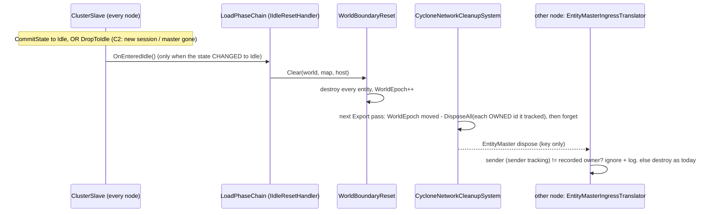

*What the picture shows that prose hid:* the deletes go out when the cluster ENTERS Idle — a whole load cycle before the
next run reuses any id — and the only new code is one hook, one changed line in the cleanup system, and one guard; the wipe,
the dispose fan-out and the sender identity all exist already.

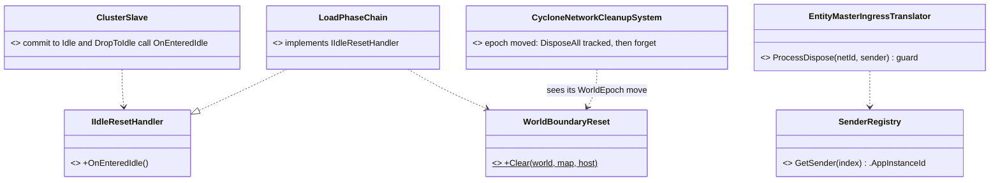

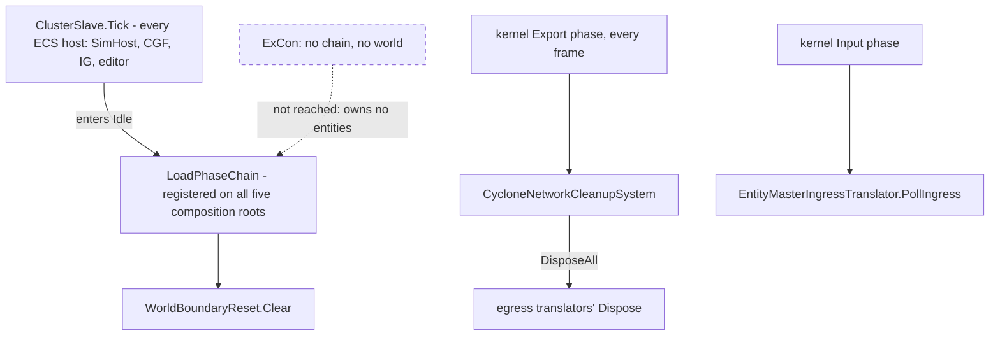

*What the module picture shows:* the hook is reached on exactly the hosts that own a world — every ECS host registers the
chain (`IgNodeBootstrapper.cs:413`, `CgfApplication.cs:206`, `CgfSubsystem.cs:1264`, `NodeBootstrapper.cs:410`,
`EditorSubsystem.cs:1550`); ExCon has none and owns nothing, so nothing is missed there.

| ⭐ decision | why · rejected |
|---|---|
| the trigger is a direct handler hook, the way `ITickableClusterStateHandler` already is | it fires in the same frame on BOTH routes into Idle (`ClusterSlave.cs:431` commit, `:639` drop). ⛔ Rejected: reading `TkClusterStateChangedEvent` in the chain — the chain reads no bus today and the event is double-buffered (a frame late) |
| the deletes reuse `DisposeAll`, the in-game destruction path | ⭐ a wiped world sends exactly what a destroyed entity sends. ⚠ Which is also its LIMIT: most egress translators' `Dispose` only drop a cache — `CE-4007` |
| the guard: a delete whose sender is KNOWN and differs from the entity's KNOWN owner is ignored and logged | 📐 measured: a key-only dispose sample still names its writer (`EntityMasterTranslatorTests.CE4000_ADisposeSample_NamesTheNodeThatDisposedIt`). ⭐ Either side unknown ⇒ accepted, as today — rejecting a real delete would leave exactly the stale entity this fixes |
| the §8 load-start clear stays | after an Idle wipe it finds an empty world; it still protects a load that did not pass through Idle |
| ⚠ accepted cost | after Stop the final world can no longer be inspected — only replay shows it (the user's F2 trade) |
| ⭐⭐ **and every WRITER deletes what it wrote** *(`CE-4007`, added after the live run)* | 📐 measured live: with only the owned-entity `DisposeAll`, seven TransientLocal topics still carried the dead run and a late Player built ghosts from them — their `Dispose` dropped a cache only, and several are written by a node that is not the entity's primary owner. ⇒ `EntityDamage`, `EntityWeaponAmmo`, `EntityWeaponPosture`, `NavigationIntent`, `NavigationStatus`, `EntityBrainIntent` egress, `PeerLifecycleStatusEgressSystem` — and, since the `backend` merge, the World Environment's `EntityScenarioClock` / `EntityWeather` egress (`CE-3216`, built in parallel) — each `DisposeInstance` every key they published when their `WorldEpoch` moves |

## 9. ⭐⭐⭐ `CE-295` — **A LOAD OVER A LOADED CLUSTER UNLOADS FIRST — the caller asks** *(AS-BUILT `2026-10-05`, backend)*

🔒 **User, `2026-10-05`:** *"the planner is correct, empty path if we already are in the target state is fine"* ·
*"Isn't the OpenForEdit style cleaner?"* · *"Ok shared helper. No refusal to load when not in idle. If load is possible
because there is valid way (unload first etc), no reason to refuse the order."* (R-210)

📐 **The defect.** A load is a state-change request — `TransitionStateIntent { TargetState, ScenarioId }`. From `Idle`
the path is `Idle → LoadingLive → OperatingLive`, and the `PrepareLive` step carries the scenario to every node. From
`OperatingLive` to `OperatingLive` the planner (rightly) plans an EMPTY path, so only the `PrefetchScenario` copy ran:
files staged on every node, no node unloaded or loaded — and the HTTP route answered `ok:true` on its grace timer.
Every later live load in one process was a silent no-op. Only `EditorScenarioSession.OpenForEdit` asked for `Idle`
first; `LoadForLive`, the panel's two buttons and the two HTTP routes sent one request.

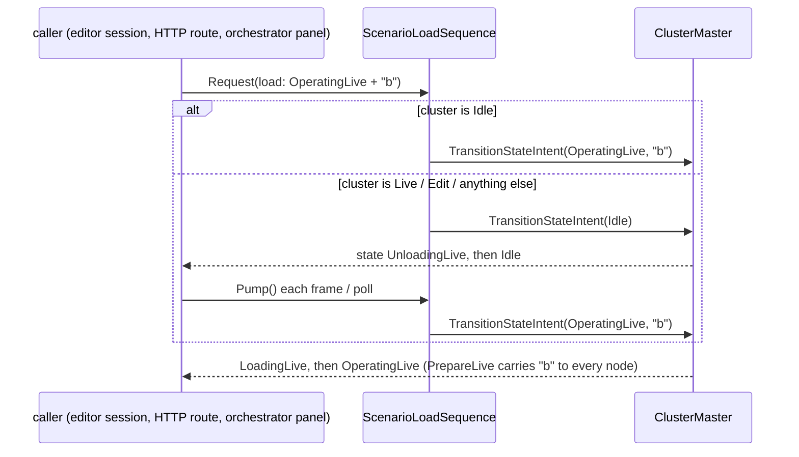

*What the picture shows that prose hid: the master and the planner are untouched — the unload is an ordinary request the
CALLER makes, exactly the two requests an operator would click; the sequence only holds the load until `Idle`.*

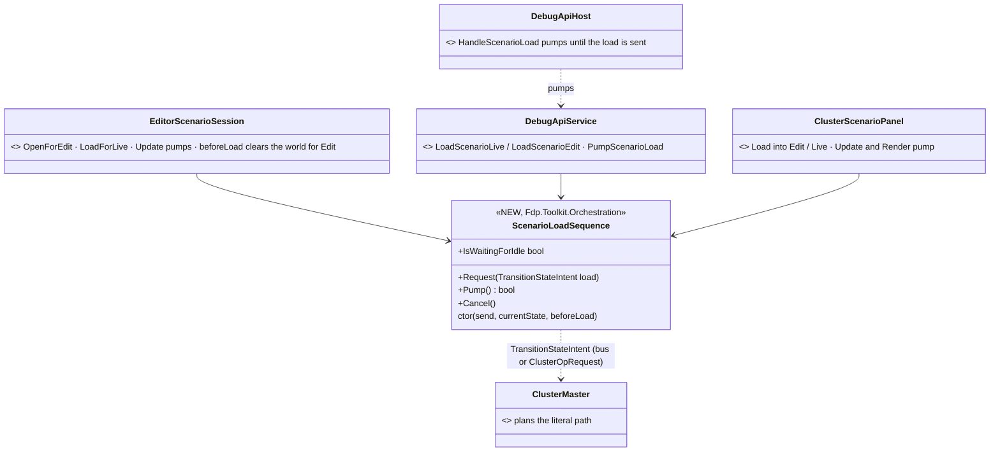

| decision | rejected |
|---|---|
| ⭐ the CALLER asks for `Idle` first, through ONE transport-free helper (`send` + `currentState`), pumped by each caller's own loop | a master-side rule "a named scenario from a non-Idle state goes via Idle" — 🔒 rejected by the user as a hidden shortcut · a planner change — the empty path is correct · a refusal to load when not Idle — 🔒 rejected: a valid way exists, so the order is honoured |

Rails: `ScenarioLoadSequenceTests` (6) · `EditorScenarioSessionLoadTests` (4, red-proved on the old session) — live:
`scripts/utility-demo-check.py` loads scenarios one after another in ONE `--mode all` process.

### 9.1 ⭐⭐⭐ `CE-1025` — **A LOAD DURING A LIVE RUN OR A DRY RUN: warn (interactive only), stop it, FORGET its restore point, load from Idle** *(design `2026-10-23`, ui; `build-state: BUILT 2026-10-23` — as-built at the end of this section; R-1031)*

> ⛔ **SUPERSEDED IN PART `2026-10-29` (CE-1438, [AQ108 §2.11](blueprints/Architect_Question_108_Run_Mode_Picker.md)).** The interactive warning no longer lives in the menu seam described below
> (`ScenarioMenuCommands` `runningRun` / `confirmLoad` / `Guarded`, `ScenarioLoadGuard.Prompt` — all RETIRED): it is `RunModeChoice.OpenScenario` / `OpenRecording` asking *Stop & Load* (a
> `RunModeConfirmation`), so CGF warns too. "A run is running" is `RunModeRunGuard.Of(TransportMode)`; `ScenarioLoadGuard.RunningRun` remains only for HTTP's `stoppedRun`. The diagrams and as-built
> text below describe the CE-1025 build and are history where they name the retired members.

🔒 **User, `2026-10-23`:** *"scenario load should warn about it breaks existing live or dryrun and once approved it stop it first
forgetting the dry run restoration point then performs the load from standby state. Of course the warn dialog only if not tasked
from ai debug http which is non interactive by design."* ("standby" = `Idle`; ruling 53: the confirm sits where the operator sits,
a headless or HTTP origin never pre-flights.)

📐 **The defect (CE-1025, measured `2026-10-06`, re-measured `2026-10-23`).** In the editor every Play is a DRY RUN — the editor's
`EditorPreviewController` captures a RAM keyframe on `ReferencePreviewHandler` and runs; the cluster stays where it was (a live load
plays inside it too). A load asks the cluster for `Idle` first (§9) — ⛔ but **nothing leaves the editor's dry run**: `_inPreview`
stays true, the keyframe stays held, the next Play keeps the OLD capture (*"already captured — kept"*) and the next **Stop rewinds the
newly loaded world to the one before the load**. No interactive load warns.

| claim | code — how it IS | design — how it was MEANT |
|---|---|---|
| every editor load is one of two calls | `EditorScenarioSession.OpenForEdit` / `LoadForLive` (menu `ScenarioMenuCommands.cs:130,141`; HTTP edit + film director via `EditorApplication.LoadScenarioByName`) · `DebugApiService.LoadScenarioLive:1222` (`ScenarioLoadSequence` directly) | §9 (one caller-side sequence) |
| a "forget" exists but has no local entry | `ReferencePreviewHandler.Abort:154` drops the keyframe and discards the id/map bracket WITHOUT rewinding; the local entries are only `TriggerLoadingPreview` / `TriggerUnloadingPreview` | restore design §1f: *"a dry run ended any other way (a load, an abort) forgets it"* (the clock half) |
| the confirm seam to copy | `confirmNewExercise` + `ConfirmPromptController` (`EditorSubsystem.cs:568, 4335`) | ruling 53 (`UX_Feature_Modal_Surfaces`) |
| the HTTP path must not prompt | `/scenario/load/live|edit` are non-interactive | ruling 53: headless never pre-flights, the origin logs what it did |
| a CLUSTER dry run (`OperatingPreview`, master-driven) leaves by its own rewind | `HrotStateGraph`: `OperatingPreview → UnloadingPreview → OperatingEdit → UnloadingEdit → Idle`, which the Idle request plans (`TransitionPlannerTests.CE1025_ClusterDryRunToIdle_GoesThroughTheRewind`) | 🔒 user, `2026-10-23`: *"we might follow this path (via rewind to pre-preview state) into the standby cluster state before loading, no problem with that if that makes things more regular"* ⇒ no forget edge is built |

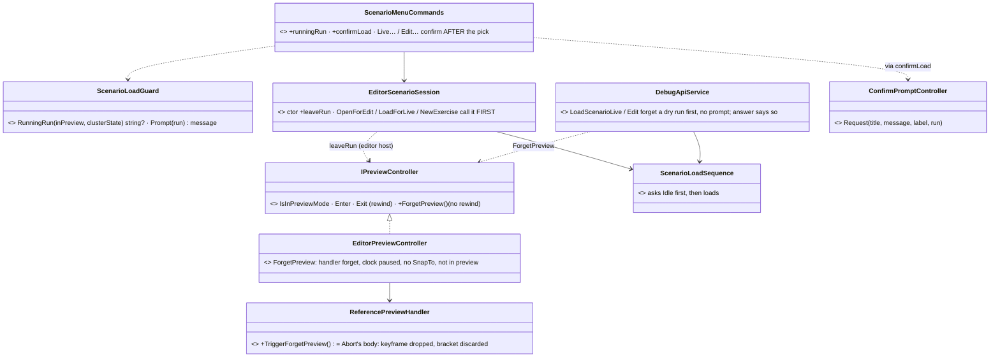
*What the picture shows that prose hid:* no new path to `Idle` is built — §9's sequence already stops a live run (`Live → Idle`); the
new parts are one local FORGET on the existing handler and one guard in front of the two interactive menu items.

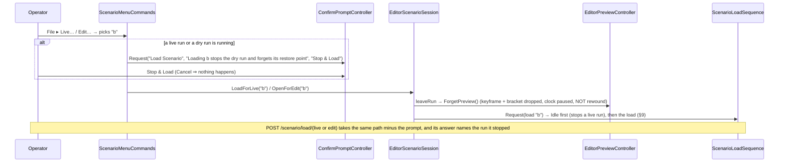

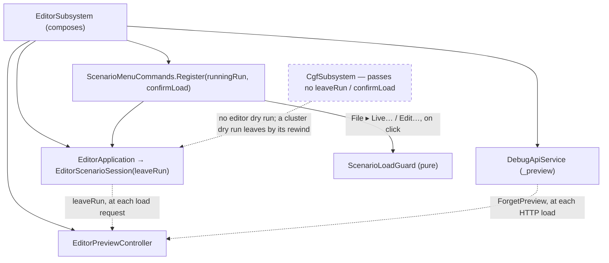
*Who calls it:* nobody per frame — only a load request (menu click, HTTP route, the film director's load). CGF composes the same
session and menu with neither seam: it has no editor dry run.

| decision | ⭐ lean | rejected — one line each |
|---|---|---|
| leave the dry run | **forget** (drop keyframe + bracket, keep the world as it is, pause) — the world is replaced by the load anyway | ExitPreviewMode (rewind) — wasted work, and on the film director's path it would flash the old world |
| where | **the session, at the request** (every load passes it: menu, HTTP edit, director) + `LoadScenarioLive` (its own sequence) | in `ScenarioLoadSequence.beforeLoad` — fires only once `Idle` is reached, after the unload already ran with the dry run held |
| when to warn | **after the pick**, only if a run is running | before opening the picker — warns about a load the operator may cancel anyway |
| what counts as "running" | the editor's dry run (`IsInPreviewMode`, which wins the name) or the cluster `OperatingLive` / `OperatingPreview` | the clock running — a paused dry run still holds a restore point |
| the clock | not snapped back: every load resets it to 0 (AQ86 §4-G) | SnapTo(entered) — the load resets it a frame later |

Acceptance: ① a load during a dry run, then Stop ⇒ the NEW scenario stays (no rewind); the next Play captures afresh. ② the menu warns
only while a run is running; Cancel does nothing. ③ `POST /scenario/load/live` during a dry run forgets it without a prompt and says
so. Rails beside `EditorScenarioSessionLoadTests` and `ScenarioMenuCommands`' tests; a live check over HTTP.

**As-built (`2026-10-23`)** — the diagrams above hold as drawn. Where the build differs from the plan, or adds to it:
- `ScenarioMenuCommands.Guarded` is the one confirm-then-load helper. `ScenarioLoadGuard.Prompt` names a restore point only for a dry
  run; a live run has none ("Loading 'b' stops the live run.").
- The editor draws both confirm prompts (new exercise, load) through one `DrawConfirmModal(controller, popupId, ref opened)`.
- ⚠ **Measured live, then fixed:** the editor's dry run plays INSIDE a live-loaded cluster — the state reads `OperatingLive` while
  `IsInPreviewMode` is true, and `/sim/play` itself enters the dry run. The first build checked the state first and named an editor
  dry run "a live run". ⇒ `RunningRun` asks `inPreview` FIRST.
- The HTTP answer carries `stoppedRun` in both shapes: the service's immediate one, and the awaited one that `DebugApiHost` builds
  (`waitForReady`).
- Rails: `ReferencePreviewHandlerTests.CE1025_*` · `EditorScenarioSessionLoadTests.CE1025_*` ·
  `ScenarioLoadGuardTests` (2). Each was red-proved by a compiling mutation: the session skips `leaveRun`, the guard skips the prompt,
  the forget rewinds.
- Live (headless editor, HTTP, `2026-10-23`):
  - acceptance ① and ③ hold: live-load `df-lone-soldier-reflex`, a dry run of 120 steps, then `POST /scenario/load/live bt-doors` ⇒
    out of preview, 26 entities (Locksmith, Visitor), and Stop keeps them;
  - a fresh dry run on bt-doors and Stop ⇒ simTime back to 0 on the next frame;
  - a load over a playing run ⇒ the new scenario, simTime 0.
  - from a CLUSTER dry run (`POST /cluster/transition OperatingPreview`, played 1 s), `POST /scenario/load/live bt-doors` ⇒
    `stoppedRun: "a dry run"`, `OperatingLive`, 26 entities (Locksmith, Visitor) — the master walked the rewind → Edit → Idle path.
  - ② (the menu prompt) is rail-only; a Windows look is owed.

### 9.2 ⭐⭐⭐ `CE-4087` — **THE BOOTSTRAP LATCH GAINS ROLES: a scenario load waits on the mandatory set (Brain + MuscleGround), starts when it is present, else is REFUSED** *(AS-BUILT `2026-10-28`, backend; `build-state: BUILT`)*

🔒 **User, `2026-10-28`:** *"i think scenario should not be able to load at all without muscle role node loaded, as it can not be edited nor
started, would it make sense to load it without muscle role being available??"* — agreed with the user: a cluster LOAD (live AND edit)
needs a `Brain` and a `MuscleGround` node; missing one it WAITS up to a configured time showing *"waiting for: <role> (<typical host>)"*,
then REFUSES with that reason.

⭐⭐ **Built ON the existing bootstrap latch, not beside it** (coordinator ruling, same day: *one implementation per concept*). `ClusterMaster`
already had the latch — `ClusterConfiguration.Mandatory` (subsystem NAMES), `CheckBootstrapLatch()`, every request rejected while it is
closed, a mandatory node's ejection re-engaging it ([`CGF-1-DESIGN.md`](designs/cgf-1/CGF-1-DESIGN.md) §3.5). The mandatory set now has two
halves — names and **roles** (`ClusterConfiguration.MandatoryRoles`, default `Brain|MuscleGround`) — and a scenario load against an unready
cluster WAITS instead of the bare `Rejected`. The names are tested by ONE helper (`MissingMandatoryNames`), which `CheckBootstrapLatch` itself
now calls; the wait reads it for its text.

📐 **The defect (measured `2026-10-28`, the `CE-4080` run).** A live load posted the moment the orchestrator and CGF were up, with SimHost
still registering, planned and ran a world nobody could drive: the load's pause expected acks from `[400]` only. A load without a
`MuscleGround` node can be neither edited nor started — and nothing said so.

| claim | code — how it IS | design — how it was MEANT |
|---|---|---|
| the latch exists and rejects while closed | ✅ `ClusterMaster._bootstrapLatch`, `CheckBootstrapLatch`, the three rejection sites (bus intent, injected request, episodes/storage) | ✅ `CGF-1-DESIGN.md` §3.5 *"Bootstrap Phase"* |
| ONE place every load passes | ✅ `ProcessTransitionStateIntent` — reached by the bus intent, the DDS request (→ bus) and the editor's injected request | §9: `ScenarioLoadSequence` is the CALLER's sequencing and refuses nothing (user, `2026-10-05`) — ⭐ the wait refuses on the MANDATORY SET, not on state, and lives master-side |
| a node's role mask reads `None` until its advert lands | ✅ `ClusterMaster.IngestHeartbeats`, `IngestCapabilities` | ✅ `Q91 §4-A′ ①`, `R-4005` |
| the editor plays every simulation role in-process and declares it to its own roster | ✅ `EditorCapabilities.DefaultRole`, `EditorSubsystem` `.WithRole("Editor", …)` | ✅ `DESIGN_Node_Roles_And_Policies.md` §3.4 |
| presence by role already has a query | ✅ `NodeRoster.NodesWithRole(role)` — reused | `Q91 §4-A` |

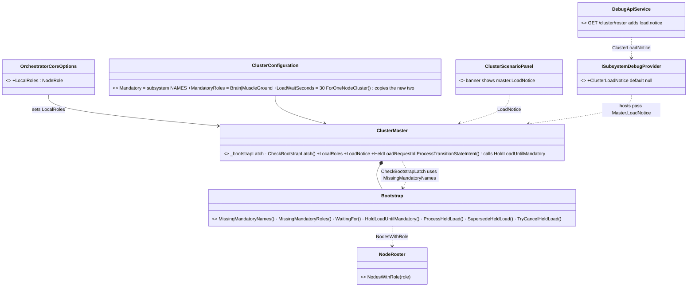
*What the picture shows that prose hid:* there is no new gate class — the wait is a partial of the one master, the latch's name test is
the SAME method for the latch and the wait, the roster query is the existing one, and the two hosts differ only in the ONE value they pass
(`LocalRoles`).

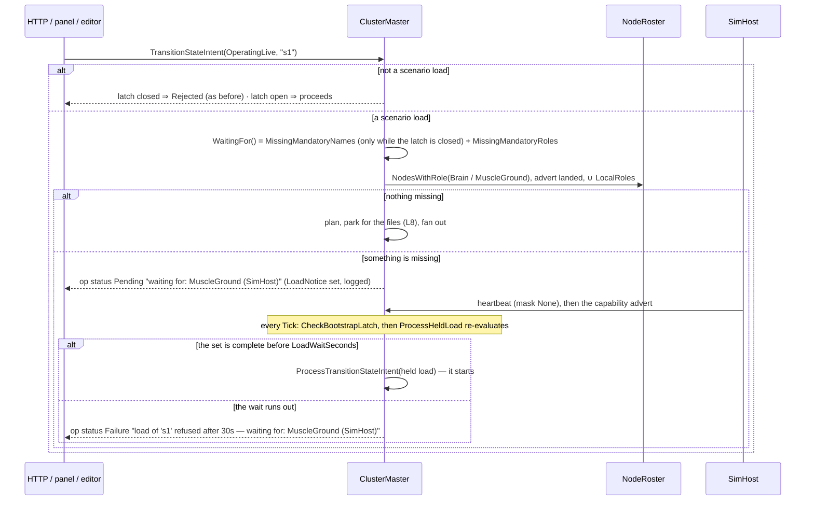

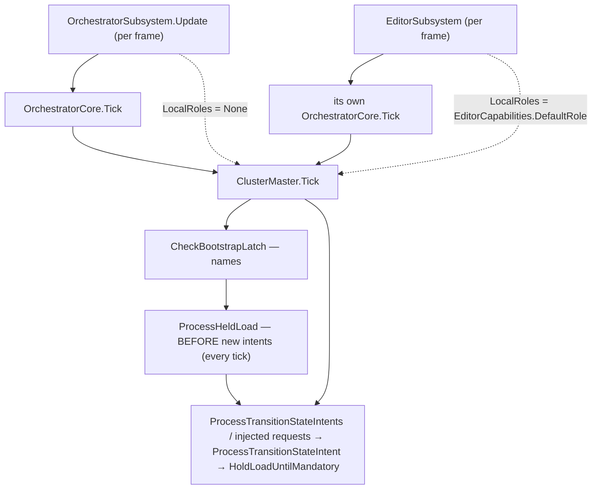
*Who calls it each frame:* the host ticks its core, the core ticks the master, the master re-checks the latch and then `ProcessHeldLoad` before
it admits new intents — so a node whose advert landed this frame starts the load this frame. Both hosts reach it; they differ only in `LocalRoles`.

| ⭐ decisions, each with its reason | |
|---|---|
| **scope = a request naming a scenario that targets `LoadingLive` / `LoadingEdit` / `OperatingLive` / `OperatingEdit`** | ⛔ A replay, a review, a branch and a dry run name no scenario and are not waited on |
| **only LOADS wait on a missing ROLE; with the name latch closed every other request is rejected as before** | 📐 a role as a latch condition for ALL requests would reject the clock commands, replays and storage ops of an orchestrator that has no nodes yet — and every `ClusterMaster` rail built on an empty roster. The coordinator's rule was *"only for loads"* |
| **a lost ROLE does NOT re-engage the latch / drop the cluster to Idle** (the names do, `EjectNode`) | ⚠ **a call for the coordinator**: right for a configured subsystem name, but as a default a 5 s CGF blip would tear down every running scenario, and C7 catches a rejoining node up in place (Q91 §4-M). Lean: keep it off; adding it is a few lines in `EjectNode` |
| **a role counts only after its node's advert landed** | the mask reads `None` until then (trap ①) |
| **the master's own host counts through `LocalRoles`** | trap ②: the editor plays all four simulation roles in-process; its heartbeat and advert loop back through the bus a frame later. ⛔ A composing host that plays roles and does not pass them would refuse its own loads (the silent-default rule) |
| **one waiting load at most; a newer request replaces it; the operator's cancel (`R-4004`) drops it; a refusal is cleared by the next request** | exactly `ScenarioLoadSequence.Request`'s rule, master-side; the replaced asker is told `Cancelled` |
| **`MandatoryRoles` / `LoadWaitSeconds` are configuration** | default `Brain\|MuscleGround`, 30 s; `NodeRole.None` leaves only the names; JSON `orchestrator-config.json` like `Mandatory` |
| **visibility: log · op status · `LoadNotice` (panel banner, `GET /cluster/roster` → `load.notice`)** | `Pending` + the text while waiting, `Failure` + the reason on refusal — a failed load the operator reads |
| ⚠ **NOT built: the REQUESTING node's `POST /scenario/load/*` does not yet echo the reason** | the master's `Pending`/`Failure` status crosses DDS to every node's bus (`ClusterOpStatus.ResultJson`), but no debug-API consumer reads it: the requester's `waitForReady` still ends in its own 504 at the same 30 s (whose text now points at `load.notice`). The reason is readable on the MASTER host's HTTP and panel |

⛔ **What it deliberately does NOT do:** `GlobalContextProcessManager` reads the same load intent from the bus before the master decides, so a
REFUSED load has already committed the orchestrator's own context and paused the clock at 0 — which is the `Idle` norm (*"Stop pauses the
clock"*); its pending resume is overwritten by the next load intent.

Rails — all in the latch's own suite, `Hrot.Orchestrator.Tests/ClusterMasterBootstrapTests` (T-1: the feature's suite, no parallel class), each red-proved
by a compiling mutation: `G1` waits and says which role (live + edit) · `G2` starts when the advert lands, not on the heartbeat · `G3` refused
after the wait naming every missing role · `G4` the host's own roles count (anti-vacuity: the same master without them waits) · `G5` a
transition naming no scenario is not waited on · `G6` a newer request replaces the waiting one · `G7` cancel drops it · `G8` the roles are
configuration · `G9` a refusal is cleared by the next request · `L1` a load against a closed NAME latch waits (was `Rejected`) and starts when
it clears, other requests still rejected · `L2` one text for names and roles. Forwarding rails: `OrchestratorSubsystemBusTests.CE4087_*`,
`DebugApiCompositionTests` (`clusterLoadNotice:`), `TheClusterMembershipRoutesTests.The_roster_carries_the_load_gate_notice_*`,
`TheEditorRunsTheOrchestratorCoreTests.CE4087_*` (the constructed editor's master carries its roles).

📐 **Live, `2026-10-28`, on the AS-BUILT latch build** (one process per node, domain 66, `scripts/cluster-node.sh`):

| run | observed |
|---|---|
| SimHost frozen at boot (`SIGSTOP`), load requested, SimHost thawed 5 s later | `GET :8920/cluster/roster` → `load.notice` = *"waiting for: MuscleGround (SimHost)"* from +0.4 s; the mandatory set was present 9.7 s after the request → *"… is present (9.7s) — it starts"*; the pause expected `[400, 1]` (it was `[400]` in the measured report); `POST /sim/play` ran the clock — CGF 7.97 s, SimHost 7.97 s eight seconds later; `SwitchTimeModeWireDto` `sentSamples: 0` on both |
| orchestrator + CGF only, SimHost never started | waiting from +2 s; at +32 s *"load of 'hill-attack' refused after 30s — waiting for: MuscleGround (SimHost)"* in `load.notice` and the master log (ERROR); the cluster stays `Idle` |

## 10. ⭐⭐ `CE-3075` — **A SCENARIO NAMING NO TERRAIN UNLOADS THE RESIDENT ONE** *(AS-BUILT `2026-10-05`, backend)*

🔒 **User, `2026-10-05`:** *"unload terrain when scenario names none. the terrain only stays untouched if scenario load
requests same terrain as already loaded."* (R-211)

📐 **The defect** (found once §9 made a second load in one process real): `TerrainResidency.Prepare(null)` answered
"nothing to do", so a terrain-less scenario INHERITED the previous one — `hill-attack-close` after `test-town` ran its
platoon on test-town's buildings and the mission halted.

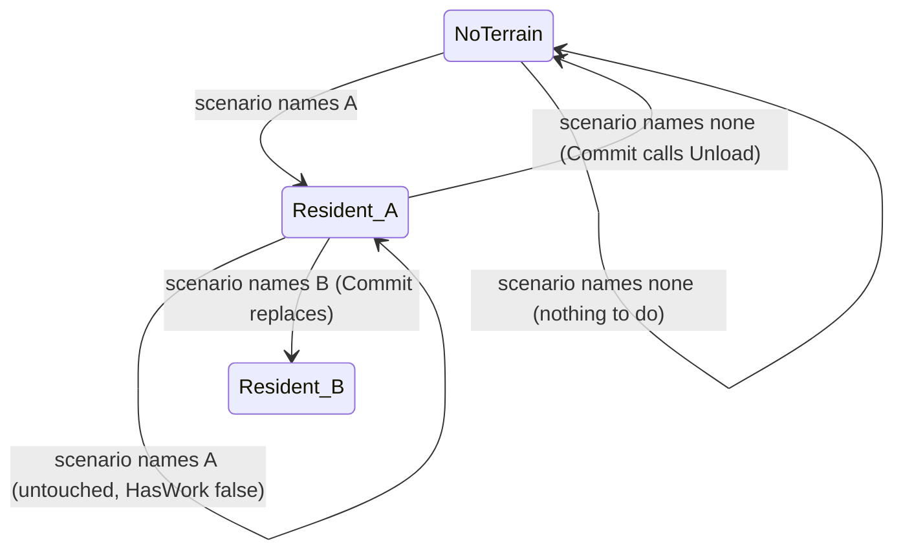

*What the picture shows that prose hid: "names none" is a TRANSITION when a terrain is resident, not a no-op; only the
self-loop on the SAME name leaves the world untouched.*

| decision | rejected |
|---|---|
| ⭐ `Prepare(null)` stages `UnloadResident`; `Commit` calls the existing `Unload` (ECS work stays on the main thread at commit). `Unload` also clears the `TerrainDefinition` singleton, so a save stamps no stale name; the world becomes an EMPTY `TerrainWorld` (flat ground), cover and navmesh empty | keep the old terrain — 🔒 rejected by the user · unload-then-load for a DIFFERENT terrain — `Commit` already replaces, and unloading first would drop a graph a background solver may hold |

⚠ Scope: the terrain step is universal (every ECS node, §4.1a), so every node unloads; `/world/info` reports `terrain: null` for the
unloaded (unnamed) world. Rails: `TerrainLoadStepTests.AScenarioNamingNoTerrain_UnloadsTheResidentOne_CE3075`,
`TheSameTerrainStaysUntouched_ADifferentOneReplacesIt_CE3075` (red-proved on the old residency).

📐 **Live (`2026-10-05`) found a second half:** SimHost and IG unloaded, CGF did not — its step fell back to a STALE staged
header (the gateway wrote none for a scenario naming nothing, so the previous one stayed). Fixed in the writer:
[`DESIGN_Artifact_Staging.md`](DESIGN_Artifact_Staging.md) §9.7.


## 11. ⭐⭐⭐ READINESS — **"cluster ready" (the boot latch) and "play ready" (the load), one fact each, read by every host** *(rulings `2026-10-29`, backend; `build-state: R1 BUILT (§11.4) · R2 BUILT (§11.6) — R3, R4, U1 DESIGN`)*

🔒 **User, `2026-10-29`** (R-3069…R-3071), in the CE-4103 thread (an open in the editor's first second):
- *"The HTTP server or UI simply can't be enabled before the node has joined the cluster as the cluster related feature would not work."*
- *"yes, role loss means Degraded too"* · *"i thought the latch was already checking the roles present as that was the intention - not allowing the cluster report readiness before all parts are up and running. it should."*
- *"scenario load might include terrain load and 3d map reload, these all are all happening after cluster-ready so not part of the boot latch, but they need to be part of "play readiness" check affecting the player/system controls while the scenario is loading"* · *"must be cancellable by the user which basically fails the load on that node and the node should report that on its side as failure to the master."*
- *"TKB load must finish before a scenario can be loaded or simulation started"* · *"for test harnesses this might be expected to finish before the system is considered usable for tests on the default initial empty world"*

| # | ruling | measured gap it closes |
|---|---|---|
| **R-3069** | ⭐⭐ **CLUSTER READY = every mandatory NAME and ROLE has a node that has REPORTED READY**; losing either ⇒ `Degraded` and the gate closes again. A node reports ready EXPLICITLY when its host's initialization is done (not "its frame loop started"). The master publishes the fact + what is still missing with the cluster state; `ClusterView` exposes it, with "this host's node is in sync" (R-4006). Controls grey out and HTTP cluster routes answer 409 with the missing list until it holds | `CheckBootstrapLatch` reads names only (`ClusterMaster.cs:681-687`); roles feed only the load wait (`ClusterMaster.Bootstrap.cs:100-119`); a lost role does not degrade (§9.2 open row); "ready" today = the default `LocalStateId` 0 = Idle on the first heartbeat (`ClusterSlave.cs:61,213`); no host gates its controls on it except the Orchestrator panel (`ClusterScenarioPanel.cs:315`) |
| **R-3070** | ⭐⭐ **PLAY READY = the cluster's scenario load (terrain, 3-D map reload, zones …) has finished on every node** — a second gate, AFTER cluster ready, on the same controls; a loading screen while it does not hold; **the user may cancel**: cancelling fails the load on that node, which reports the failure to the master (the round then fails — CE-4103's no-forever-wait rule) | to be measured (INVENTORY below) |
| **R-3071** | ⭐⭐ **THE TKB IS LOADED BEFORE ANY SCENARIO LOAD OR SIMULATION START**; a test harness may treat "TKB loaded" as part of usable on the initial empty world | to be measured: where each host loads it, and whether a load can start before the join sync's copy lands (R-4018) |

⛔ Not part of either gate: the data a surface SHOWS (the scenario / recording lists) — each surface waits for its own arrival fact (`ClusterView.HasInventory`, `ClusterView.cs:60`) and says "waiting for the cluster's list…" rather than showing a false empty.

### 11.1 INVENTORY — measured `2026-10-29` (read-only sweep: `search_code` + `search_graph` + grep over `Hrot/`, `FDP/`, `Stride/`; `docs/` then `.dev/`; ⚠ `check_index_coverage` unavailable through the CLI)

| question | measured | where |
|---|---|---|
| does any host still initialize after its first `Tick`? | ⛔ **no** — every host's slave ticks only after `Initialize` returns; no `Task.Run` for terrain / TKB / catalogs at boot (the editor's 2 s blueprint instrumentation is not cluster work) | `EditorSubsystem.cs:1303,2387,2898` · `SimHostApp.cs:533,624` · `IgApplication.cs:1018,1146` · `CgfSubsystem.cs:1662` · `HrotNodeContext.cs:57-66` |
| the ready report today | the capability advert on the slave's FIRST `Tick` (durable, kept for late joiners) + `LocalStateId` default 0 = Idle on every heartbeat | `ClusterSlave.cs:61,199-216` |
| the latch | names only; roles only in the load wait; a lost role never degrades | `ClusterMaster.cs:681-690`, `ClusterMaster.Bootstrap.cs:100-127`, `ClusterMaster.cs:755-765` |
| mandatory config | default names EMPTY, roles `Brain\|MuscleGround`; the editor alone: `ForOneNodeCluster` + `LocalRoles` ⇒ ready at once; no `orchestrator-config.json` in the repo | `ClusterConfiguration.cs:14,34,88-100`, `EditorSubsystem.cs:2426-2432` |
| the TKB on a load | ⭐ **already R-3071 by construction**: every prefetch syncs the TKB and the load waits on the prefetch; the knowledge-base step precedes the scenario step; a staged-but-missing file throws ⇒ the load fails. The JOIN sync is fire-and-forget and nothing waits on it — the per-load sync covers it | `StorageGatewayModule.cs:387-389`, `AssetPrefetchProcessManager.cs:333-350`, `KnowledgeBaseLoadStep.cs:100`, `HrotUniversalLoadParts.cs:26` |
| a load on a node | `LoadPhaseChain`: knowledge base → terrain (worker) → scenario; the `Operating*` prepare is HELD until every step `IsResolved`; one empty `InProgress` ack (P4) | `LoadPhaseChain.cs:172-350`, `ClusterSlave.cs:~493` |
| 3-D map reload | ⛔ OUTSIDE the chain (a frame-thread rebuild) — not covered by the held prepare | AQ91 §4-B3, CE-4078 |
| progress | none beyond the one empty `InProgress`; mgmt-1's "Step X of Y" was never built | `docs/designs/mgmt-1/DESIGN.md:633` |
| loading UI | ⛔ none on any host; only the Orchestrator panel greys on `!IsBootstrapped \|\| HasFlight` | `ClusterScenarioPanel.cs:315,565-598` |
| cancel | master-side only: held / parked / in-flight (`AbortTransaction` → round to Idle, R-4004), HTTP `POST /cluster/cancel`; ⛔ no node-initiated cancel, no UI cancel for a load; the node's `PrepareAsync` gets `default` as its token | `ClusterMaster.cs:2078-2112`, `ClusterSlave.cs:~423,523-592`, `LoadPhaseChain.cs:292` |
| a failed load round | fails at once (CE-4103) but ⛔ the master stays at the target state — no return to Idle (AQ91 §4-H: *"cluster goes to the initial default state"*) | `ClusterMaster.cs:~2371` |
| a node's failure reason | only in the node's log — the ack carries none | `ClusterSlave.cs:~289-305` |

### 11.2 The design

```mermaid
classDiagram
  class ClusterSlave {
    +Tick() advert on first Tick = READY
    +HoldReady() opt-in, async-init hosts
    +MarkReady()
    +CancelLoad(reason) NEW
  }
  class LoadPhaseChain {
    +PrepareAsync(ct) real token NEW
    +AbortLoad()
    +CurrentStep : string NEW
  }
  class ClusterMaster {
    -CheckBootstrapLatch() names AND roles
    -EjectNode() name OR role lost ⇒ Degraded
    -CompleteRound() failed load ⇒ round to Idle NEW
  }
  class ClusterStateTopic {
    +State
    +WaitingFor : string NEW
  }
  class ClusterView {
    +CanOperate : bool NEW
    +IsPlayReady : bool NEW
    +WaitingFor : string NEW
    +LoadProgress NEW
  }
  class DebugApiHost { cluster routes ⇒ 409 + WaitingFor }
  class LoadingScreen { ui lane: progress + Cancel }
  ClusterSlave --> LoadPhaseChain : prepares / aborts
  ClusterSlave ..> ClusterMaster : advert, heartbeat, acks (+reason)
  ClusterMaster ..> ClusterStateTopic : publishes
  ClusterStateTopic ..> ClusterView : ClusterFactsIngress
  ClusterView <-- DebugApiHost : reads
  ClusterView <-- LoadingScreen : reads
  LoadingScreen --> ClusterSlave : Cancel
```
*What the picture shows that prose hid: every gate reads ONE object (`ClusterView`); cancel goes to the host's OWN node, which fails its ack — the master learns it through the same round it already runs, no new op.*

```mermaid
sequenceDiagram
  participant U as user (loading screen)
  participant S as ClusterSlave (this node)
  participant L as LoadPhaseChain
  participant M as ClusterMaster
  participant V as ClusterView (every node)
  M->>S: PrepareLive / PrepareEdit (held)
  S->>M: InProgress (step name)
  M->>V: op status: loading, node N, step
  U->>S: Cancel
  S->>L: AbortLoad (token cancelled)
  S->>M: Failure ack, reason "cancelled by user on node N"
  M->>M: round fails now (CE-4103), drops owed acks
  M->>S: round to Idle (every node)
  M->>V: state Idle, op status Failure + reason
```
*The cancel needs no new master op: the node's failure IS the cancel, and the failed-round path ends in Idle.*

```mermaid
graph TD
  subgraph every_host["every ECS host: HrotNodeContext.Tick each frame"]
    T[ClusterSlave.Tick] --> V2[ClusterView.Update]
    T --> D[LoadPhaseChain.DrainDeferredAcks]
  end
  subgraph master_host["the master's host each frame"]
    MT[ClusterMaster.Tick] --> LT[CheckBootstrapLatch]
    MT --> AK[ProcessAcks → CompleteRound]
  end
  V2 --> G1[DebugApiHost route gate]
  V2 --> G2[run controls + loading screen, ui]
  RB[Replay Browser: no slave, no master]:::dead
  classDef dead fill:#fdd,stroke:#c00
```
*Red: the Replay Browser has no cluster at all — the gate does not apply there (it is offline by design).*

⭐ **The slices, with their ids, live in [`Architect_Question_110_Readiness_Protocol.md`](blueprints/Architect_Question_110_Readiness_Protocol.md) §4** (R1 cluster ready · R2 the readiness report + play ready + cancel · R3 the 3-D map step · R4 the admission policy · U1 ui) — ⛔ not restated here.

⛔ **Rejected:** a new `Starting` cluster state on the wire (the advert already is the explicit report, and it already gates roles) · a master-side cancel op for the user (the node's own failure already reaches the master through the round) · waiting on the TKB join sync (the per-load sync already makes R-3071 hold).

### 11.3 ⭐⭐ THE READINESS PROTOCOL — **each node reports, the master combines the participants, policies decide who waits** *(R-3072, AQ110 — approved `2026-10-29`)*

```mermaid
classDiagram
  class NodeHeartbeat {
    +NodeId
    +LocalStateId
    +Phase NEW
    +Step NEW
    +Reason NEW
  }
  class NodePhase {
    <<enumeration>>
    Booting
    Ready
    Loading
    CatchingUp
    PlayReady
    Failed
  }
  class ClusterMaster {
    -participants() in sync and not observer (K6)
    -CheckBootstrapLatch() names AND roles
    +AdmissionPolicy JoinTheLoad / Lobby / RefuseUntilLoaded
  }
  class ClusterStateTopic {
    +State
    +WaitingFor NEW
    +ClusterPlayReady NEW
  }
  class ClusterView {
    +CanOperate
    +LocalPhase
    +ClusterPlayReady
    +WaitingFor
    +LoadProgress
  }
  class HostGatePolicy {
    <<bootstrap parameter, per host kind>>
    Operator: local and cluster ready and cluster play-ready
    Player: local only
    +IsOpen(ClusterView) bool
  }
  NodeHeartbeat --> NodePhase
  NodeHeartbeat ..> ClusterMaster : every node, 1 Hz
  ClusterMaster ..> ClusterStateTopic : combines participants only
  ClusterStateTopic ..> ClusterView
  NodeHeartbeat ..> ClusterView : own node's phase
  HostGatePolicy --> ClusterView : reads
```
*What the picture shows that prose hid: the node's report carries NO rule — both levels and every policy are derived from it, so a new situation is a new policy value, never a new message.*

```mermaid
sequenceDiagram
  participant P as Player node (joining)
  participant M as ClusterMaster
  participant O as Operator host
  Note over M,O: cluster is loading a scenario
  P->>M: heartbeat Phase=Booting, then Ready
  alt AdmissionPolicy = Lobby
    M-->>P: not in sync (lobby) - P's own gate shows "waiting for the scenario"
    M->>O: participants finish - ClusterPlayReady
    M->>P: C7 catch-up
    P->>M: heartbeat Phase=CatchingUp, then PlayReady
  else JoinTheLoad (load still parked)
    M->>P: admitted, takes part in the load
  else RefuseUntilLoaded
    M-->>P: not admitted until ClusterPlayReady
  end
  Note over O: never waits on P (K6)
```
*The three admission values differ only in WHEN the master puts the joiner into the in-sync set; the joiner's own gate is the same in all three.*

### 11.4 ✅ AS-BUILT `CE-3344` (slice R1 — cluster ready), `2026-10-29`, backend *(obligation ⑤: where the build deviated from §11.2, the prior state is marked SUPERSEDED)*

| §11.2 said | as built | why it deviated |
|---|---|---|
| `ClusterMaster.CheckBootstrapLatch` "names AND roles" | ✅ as drawn: releases when `MissingMandatoryNames()` **and** `MissingMandatoryRoles()` are both empty (the two shared tests, not copies). ⭐ **Also built, not drawn:** the latch is **closed from construction** whenever roles are mandatory (the constructor used to open it when no NAME was mandatory — which is exactly why a cluster with no nodes reported ready); with nothing mandatory it still opens at once | the default config has no names, so a names-only check opened the latch on an empty cluster |
| `EjectNode` "name OR role lost ⇒ Degraded" | ✅ the same path (Degraded, abort + Idle to survivors, latch re-engaged); the role arm applies **only while the latch is open** (a booting cluster is missing roles for no ejection's sake). The latch flag is set **before** the Degraded broadcast so it carries `WaitingFor`. ⛔ **SUPERSEDED:** the `ClusterMaster.Bootstrap.cs` header's "deliberately NOT built: the re-engage for a lost ROLE (a 5 s CGF blip…)" — R-3069 ruled the other way | user, 2026-10-29: "role loss means Degraded too" |
| `ClusterStateTopic.WaitingFor` | ✅ `[DdsManaged] string WaitingFor` on the topic, `ClusterStateTransitionedEvent` and `ClusterStateUpdateEvent`; the master's `PublishClusterState` fills it from the **one** `WaitingFor()` (the load wait's text), encoded by `ClusterOpMasterTranslator.StateTopicOf`, decoded by `ClusterFactsIngress.StateOf` | — |
| *(not drawn)* the master published **no state at all** before the latch released | ⭐ now it **re-publishes the state it last announced (Idle before the first) whenever the missing text changes** (`PublishWaitingForIfChanged`, once per `Tick`). Nodes still do not treat the cluster as usable: `CanOperate` needs `WaitingFor` empty. Least change: no new state on the wire (the "Rejected: a `Starting` state" stands) | nodes could not learn what was missing from silence |
| `ClusterView.CanOperate` / `WaitingFor` | ✅ plus `NotOperableReason` (the ONE text the 409 and the grey-outs read; `CanOperate == (NotOperableReason == null)`), `IsInSync`, `HasInSyncSet`, `InSyncNodeIds`, and a `NodeId` (ctor arg; `ClusterSlave` passes its own; `null` = an observer, the in-sync clause is skipped). In-sync folds from `InSyncSetChangedEvent`: **in-process** (the editor) the master's own event is on the shared bus; **over DDS** the node's `ClusterFactsIngress` now also reads `OrchestratorContextTopic` (the durable context plane that already carries the set) and republishes the set as that event, de-duplicated so the echo of the master's own write ends after one round | the set was only on the master's bus and in `SimpleClusterStateCache`; `ClusterView` is the one read model (R-3066) |
| `DebugApiHost` "cluster routes ⇒ 409 + WaitingFor" | ✅ **one** gate, `DebugApiHost.ClusterGatedRoutes` (= `WorldChangingRoutes` ∪ the cluster-changing routes), checked before the handler and before the recording gate; the reason comes from `DebugApiService.ClusterNotOperableReason` ← `ISubsystemDebugProvider.ClusterView` (default member; every provider that has a view passes it: editor, ECS nodes, ExCon) ← `PerspectiveScopedDispatcher.ClusterViewAnyNode`. `GET /status` gains `canOperate` / `notOperable`. A host with **no** read model is not gated (the master's own refusal stays the authority) | one fact, one gate (R-3066 / ruling 9) |
| `ClusterSlave.HoldReady/MarkReady` | ✅ opt-in as drawn: the capability advert (the explicit ready report the latch counts roles by) goes out on the first `Tick` unless `HoldReady()` was called before it; `IsReadyHeld`. No host calls it today | — |
| `ClusterUiCache.IsBootstrapped` | ✅ **is** `ClusterView.CanOperate` now (it was a weaker second copy: "a broadcast was seen and not Degraded"). The Orchestrator panel reads `IsBootstrapped`; its `_master?.BootstrapComplete ?? …` arm is a test-only ctor (production passes no master) and is left as is | ruling 9 — one fact |

⚠ **Behaviour changes that are deliberate:** (1) a cluster whose Brain / MuscleGround have not reported now rejects every non-load request (the latch is closed) — suites that are not about readiness build their master from `TestClusterConfig.NothingMandatory()` / `MandatoryRoles = None`; (2) the HTTP cluster routes answer 409 until the node's view can operate; (3) `ClusterUiCache.IsBootstrapped` is false while the master is gone.
⛔ **Not built here** (their slices): the node-reported phase / participants' levels (R2), the loading screen and greyed editor controls (U1), the admission policy (R4). Related: [`Architect_Question_110_Readiness_Protocol.md`](blueprints/Architect_Question_110_Readiness_Protocol.md) §4 R1.

### 11.5 ⭐⭐ THE CLUSTER ERROR STATE — **a required node or role lost while a scenario is loaded or running** *(R-3073, user `2026-10-29`; ⛔ SUPERSEDES the "abort + Idle to survivors" teardown of `EjectNode` for that case)*

🔒 **User, `2026-10-29`:** *"Putting the cluster into error state seems sufficient to me (master broadcasts error state of the cluster with the reason, pauses clock, nodes show some red error indicator in status bar), until the master clears the error state the node operations are disallowed similarly to when node is not ready to play"* · *"If cluster is broken, user can likely just exit or leave the current armed mode … into some idle mode where nothing can be done but waiting for the cluster to recover."*

| | |
|---|---|
| **when** | a mandatory name OR role is lost while the cluster is loading or operating. ⭐ In Idle there is no world to lose — it is only *not ready* (R-3069) and recovers by itself |
| **what the master does** | publishes `Degraded` + an **error reason** (*"Brain (CGF) lost at 00:12:31"*) beside `WaitingFor`; **pauses the clock**; ⛔ no abort, no Idle — the world stays for inspection; the live recording is closed and KEPT up to the failure (⚠ the recorder's behaviour under the pause to be measured before building) |
| **sticky** | a returning node does NOT clear it — the lost node's state is gone (crash recovery out of scope, user) |
| **the only exits** | **Close** (`LeaveReason.Close` through the ONE door, AQ108 §2.11a/§2.15) and Exit, both exempt from the gate, plus HTTP `POST /replay/stop` and `/cluster/cancel`. ⛔ Save refused (the world may be inconsistent): Close asks only *"discard and close?"* |
| **cleared** | when the cluster reaches Idle; it is then *not ready, waiting for: Brain* until the node returns |
| **nodes** | a red status-bar indicator with the reason (ui); every operation refused like *not ready* |
| ⚠ **CE-3344 gap** | it gated `POST /replay/stop` — HTTP had no way back to Idle while not operable. CE-3345 exempts every way back to Idle and rails it |

⛔ Rejected: tear down at once (hides what happened, destroys the evidence) · pause and resume when the node returns (its state is lost) · an operator "reset cluster" item (the same as Close).

#### 11.5a ✅ AS-BUILT `CE-3345` part A (the master, the view, the exits), `2026-10-29`, backend *(obligation ⑤; the menu and the red indicator are the ui lane's)*

| §11.5 said | as built | deviation / why |
|---|---|---|
| master publishes `Degraded` + an error reason beside `WaitingFor` | ✅ `ErrorReason` string beside `WaitingFor` on `ClusterStateTopic`, `ClusterStateTransitionedEvent`, `ClusterStateUpdateEvent`, through the same route (`StateTopicOf` ⇄ `StateOf`); text *"Brain (CGF) lost (node 3, CGF) at sim 00:12:31"* (a lost name: *"SimHost lost (node 3) at …"*) from `ClusterMaster.EnterClusterError` (new file `ClusterMaster.ErrorState.cs`); the sim time comes from `SimSeconds`, set by `OrchestratorCore` beside `WallTicks` | the error is published by `PublishClusterState` for as long as it stands (`Degraded` replaces whatever state is passed), so every later broadcast keeps carrying it |
| ⛔ no abort, no Idle | ✅ `EjectNode`: a lost mandatory name OR role with a world loaded (`_currentDsmState != Idle`) ⇒ `EnterClusterError`, return. In Idle the CE-3344 arm is unchanged. **`_currentDsmState` is NOT touched** — Close is planned from the state the world really is in, and `ResolveReplayExercise` still names the run | a second loss while in error keeps the first reason (it broke the run) |
| pauses the clock | ✅ `PublishClusterPause()` — the ONE pause (Pause op, Stop, restore) | — |
| recording closed and KEPT | ✅ M1: the recorder keeps its file open and writes while the cluster runs; it is closed only by `FinalizeLive` (`ReferenceLiveLoadHandler` → `EcsRecordReplayController.FinalizeRecordingAsync`), which the UNLOAD sends. ⇒ in error the master fans out the same `NodeOpType.FinalizeLive` to the survivors **when the world is a live run** (`OperatingLive`/`LoadingLive`); the ledger (`AssetInventoryProcessManager`) lists the run when the broadcast leaves `OperatingLive` — which `Degraded` does | ⚠ a **review**'s recording (suspended, file open) is NOT finalised at the error — its own unload does it when the user closes. The Close that follows sends `FinalizeLive` again: the handler's *"no active recording module"* **warning** (benign, returns). The lost node's own file is whatever it had flushed (its manifest is written with its first frame, CE-3313) |
| sticky | ✅ `CheckBootstrapLatch` returns while `IsInError`; a returning node changes `WaitingFor` only. `MissingMandatoryNames` stops requiring `Idle` while in error (the survivors hold the world, they are not Idle) | — |
| refused like *not ready* | ✅ the latch stays CLOSED in error — the ONE gate. `LatchRefuses(intent)`: in error everything but a transition to Idle is refused, **with the error as the status text**; ⭐ a scenario LOAD is **refused**, not held (the CE-4087 wait is for a booting cluster) | the injected-request path rejected `CancelOperation` while the latch was closed — now a cancel always works there too |
| cleared when the cluster reaches Idle | ✅ `ClearClusterError()` when the Close round succeeds (`_currentDsmState == Idle`), and at once when there is no node to ask; the broadcast that follows is Idle without it; the latch then reports `WaitingFor` as CE-3344 built it | — |
| `ClusterView` | ✅ `ErrorReason`, `IsInError`; `NotOperableReason` = *"the cluster is in error — …"* **first**; `CanOperate` false | — |
| Save refused | ✅ the master refuses `SaveScenario` in error with the reason (`ProcessStorageOpIntent`); HTTP `POST /scenario/save` is a gated route, so it 409s with the error before the master | — |
| the exits stay open | ✅ `LeaveReason.Close` (`ScenarioDoor.cs`), its `DoorMove` text *"Closing"*; HTTP: `DebugApiHost.ClusterExitRoutes` = `POST /replay/stop`, `POST /sim/stop`, `POST /cluster/cancel` — **not** in `ClusterGatedRoutes` — plus `POST /cluster/transition` **when its target is `Idle`** (`IsWayBackToIdle`; the body is now read before the gate). Rule: *a way back to Idle is never gated* | ⚠ `BackToStart` is **still in the enum**: the Roslyn rename `BackToStart → Close` previewed correctly (ONE file, three sites, matching grep) but `roslyn_apply_rename` errored twice on this tree, so per CLAUDE.md §②a it was left; folding it is a one-line follow-up |
| ⛔ ~~**LOAD FOLLOWS THE ARMED MODE** at the master (`FollowArmedMode`)~~ | **WITHDRAWN and REMOVED `2026-10-29`** — user: *"all the requests to the cluster state machine are always explicit. No one is just please load."* · *"It's a nonsense."* The master never interprets the armed mode; the HOST's shared load path turns it into an explicit load into Live / into edit (AQ108 §2.15). (M2 stands as a measurement: the master holds and broadcasts `ArmedMode`, and that is all.) |

⛔ **SUPERSEDED by this block:** the CE-3344 row *"`EjectNode` … the same path (Degraded, abort + Idle to survivors, latch re-engaged)"* holds **only in Idle** now; the `ClusterMaster.Bootstrap.cs` header's "abort + Idle to the survivors" the same.

- ⭐ **`CE-3347` (`2026-10-29`) — the required roles are a DEPLOYMENT parameter, and a composition root declares them.** 📐 Measured: with the
  default (Brain | MuscleGround) a cluster with no Brain node never releases the latch, so EVERY cluster op is refused — including
  `ResumeTime` — and an in-process test harness without CGF ran a stopped clock (the Wander rail, red since this slice). ⇒
  `OrchestratorSubsystem(factory, ClusterConfiguration?)` takes the deployment's configuration (null = `orchestrator-config.json`, else the
  default — the ONE source, unchanged for production); `HrotRunnerHarness` requires only the roles its node list provides.
  `ClusterConfiguration` is a `record`, so a variant is a `with` copy — ⛔ the hand-listed `ForOneNodeCluster` copy had dropped `AdmissionPolicy`.

### 11.6 ✅ AS-BUILT `CE-3345` part B (slice R2 — the readiness report, progress, cancel, a failed load ⇒ Idle, the gate policy), `2026-10-29`, backend *(obligation ⑤: where the build deviated from §11.2 / §11.3 the prior state is marked SUPERSEDED; the loading screen and the greyed controls are the ui lane's)*

| §11.2 / §11.3 said | as built | why it deviated |
|---|---|---|
| `NodeHeartbeat` gains `Phase` (enum `NodePhase`) / `Step` / `Reason` | ✅ `NodePhase` (`Ready=0` · Booting · Loading · CatchingUp · PlayReady · Failed — ⛔ permanent wire ints, R-42) in the toolkit's `Enums/`; `int Phase` + `string Step` / `Reason` on the DDS sample, `Phase` / `Step` / `Reason` on `NodeHeartbeatEvent`. ⭐ **One mapping** — `NodeHeartbeatWire.ToTopic` / `ToEvent` (`Hrot.Network.Orchestration`) replaces the three hand-written copies (slave egress, master ingress `NedOrchestrationTranslator`, observer); an unknown phase (a newer peer) reads `Ready` | `Ready` is **0** so an older sender (which never sets it) reads as it always meant |
| `ClusterSlave` fills them "from facts it already has"; `LoadPhaseChain` exposes its step | ✅ `ClusterSlave.Phase` / `LoadStep` / `FailureReason`: Booting until `_ticked ∧ ¬HoldReady`; **Failed** after a failed / cancelled prepare until the **next** transaction (the master's abort of the failed one does not clear it); **Loading / CatchingUp** while a load prepare is held *or* the node sits in a committed `LoadingLive/Edit` (the gap between the two prepares); **PlayReady** in any `Operating*`; else Ready. ⭐ The slave names no Hrot type: the toolkit owns the seam `ILoadProgressSource` (`CurrentLoadStep`), `LoadPhaseChain` implements it (the step is set before each step's prepare — also on the worker — and, while the Operating prepare is held, to the first unresolved step; cleared on resolve / abort). A pending prepare whose handler is an `ILoadProgressSource` **is** "a load held" | `ClusterSlave` lives in `FDP/` and cannot reference `Hrot.Core`'s chain; catch-up is read from `EditLoadHandlerPayload.IsCatchUp` (C7) |
| the heartbeat is 1 Hz; "also publish one immediately on a change" | ✅ `PublishHeartbeat` runs **once at the END of every `Tick`** (it moved from the top: it carries what that frame's dispatch / drain decided): a beat when the phase, step or reason changed **or** the 1 s timer ran out — ⇒ at most one per frame by construction. ⚠ The baseline is *Ready*: a default host's first beat (after its advert) reads Ready, so **Booting is on the wire only for a `HoldReady()` host** — no startup burst for the others | keeps today's first-beat timing for every existing host |
| the P4 `InProgress` ack carries the step and is re-sent on change | ✅ the first ack carries `CurrentLoadStep` in `ResultPayload`; `PublishProgressIfStepChanged` re-sends once per new step while the prepare is pending. ⚠ The master still **ignores** `InProgress` (R-4001: progress is never the answer) — the step reaches every node through the heartbeat, below | one route for progress (the heartbeat), one for the answer |
| `ClusterView`: `LocalPhase`, `IsLocalPlayReady`; `ClusterPlayReady` over the participants; `LoadProgress` | ✅ `ClusterView.LocalPhase` / `LocalStep` / `LocalReason` / `IsLocalPlayReady` / `IsLocalLoading` (set by the node's own slave each frame via `NoteLocalPhase`); `ClusterPlayReady` and **`LoadProgress` (a string, added beside it — not drawn in §11.3)** folded from the cluster-state broadcast (`ClusterStateTopic` / `…TransitionedEvent` / `…UpdateEvent`, the `StateTopicOf` ⇄ `StateOf` pair); `IsClusterLoading`. Master: `ClusterMaster.Readiness()` = over `_roster ∩ _inSync` minus `IsObserver` (the K6 predicate that already existed — ⛔ **not** `StepRoster`, which excludes the master's own node and requires a sim role): `ClusterPlayReady` = ≥1 participant ∧ all PlayReady ∧ no load round in flight (false in **Idle** — nobody has a world); `LoadProgress` = *"CGF (node 400): Terrain; …"* for the Loading / CatchingUp participants, or *"the load is starting"* while a load round is fanned out and none has reported yet (the gate closes with the fan-out). `PublishWaitingForIfChanged` re-publishes the state when the text **or** either readiness value changes | a text beside the bool is what a loading screen shows; a joiner / observer never holds the level (P1) |
| `CancelLoad(reason)`: a real token, `AbortLoad`, a failure ack with the reason | ✅ `ClusterSlave.CancelLoad(string? reason = null)` (default *"cancelled by the user on node N"*): cancels the **real** `CancellationTokenSource` now passed to every `PrepareAsync` (it was `default`), calls `IClusterStateHandler.Abort` → the chain's `AbortLoad`, remembers the transaction as cancelled (ONE guard in `DispatchIntent`: its queued **and** later-arriving steps do not run — a queue purge was built beside it and removed, redundant), enters Failed, and answers the prepare **Failure with the reason in `ResultPayload`**. ⭐ The one failure path `FailPrepare` is shared with a faulted / cancelled prepare — **a faulted prepare's ack now carries the exception message too** (it carried none). The ack's reason crosses the wire as a JSON string and `NodeOpMasterTranslator` decodes it **for any error code, before the per-op decoder** | the per-op decoders read it as a malformed result (PrepareLive ⇒ raw quoted JSON) |
| master: a failed LOAD round ⇒ the round to Idle ("reuse the cancel path's round 2, ONE implementation") | ✅ `ClusterMaster.AbortAndReturnToIdle(txId)` — the abort fan-out to every roster node + round 2 — **extracted** from `TryCancelInFlightTransition`, which and `CompleteRound`'s failure arm both call. Gated by `GenericTransactionTracker.IsLoadRound` (trajectory enters `LoadingLive` / `LoadingEdit`): ⛔ a failed checkpoint / save / Idle round does **not** go to Idle (rail P3: a failing Idle round does not loop). The op status is Failure **with** the node's reason (`tracker.FailureReason`, first failure wins) → every node's `ClusterView.OutcomeOf(requestId)` | the broadcast that ends the round now says Idle (the return runs before it) |
| "CE-4103 already fails the round at once" | ⚠ **corrected**: CE-4103 dropped only the **failing** node's owed ACKs, so with a second node still loading the round waited for it. For a load round an authoritative error now sets `Expected = Received` — it fails **now**, whatever the others owe (their late acks find no round and are ignored; the abort preempts what they hold) | a user's cancel on one node must not wait for another node's long load |
| `HostGatePolicy` per host kind, a bootstrap parameter (the R-3068 pattern) | ✅ `HostGatePolicy { Operator, Player }` (toolkit) · `HostGatePolicies.For(RunHostKind)` beside `RunArmedDefaults` (`RunHostKind` gains **`Ig`**; Player for the IG, Operator for every other kind) · `IProvidesRunControls.GatePolicy` reads the table from the host's declared kind (no host overrides it) · `ClusterView.GateOpen(policy)`: **Operator** = `CanOperate ∧ ¬IsLocalLoading ∧ (¬IsClusterLoading ∨ ClusterPlayReady)`; **Player** = `IsLocalPlayReady ∧ CanOperate` (no cluster play-ready clause). ⚠ **Operator also checks the node's OWN load** — the editor, an observer by role, is excluded from the cluster level, so without it its own terrain load would not close its own gate | no host draws or reads it yet (ui: the loading screen, the greyed controls, the IG's start) |
| `LeaveReason.BackToStart` folds into `Close` (a Roslyn rename) | ✅ **deleted, not renamed**: `Close` already exists, so the rename is a collision — which is why `roslyn_apply_rename` errored through the MCP twice. Driven over stdio (CLAUDE.md §②a) the preview diff was mangled (it duplicated members) and the apply wrote that to `ScenarioDoor.cs` (reverted from git). `BackToStart` had no reference outside the enum, its `DoorMove` text arm and a cref (grep over `Hrot/ FDP/ Stride/`: 0 outside `ScenarioDoor.cs`) — removed by hand, a deletion not a rename | the enum member, its text arm and the cref |

⛔ **SUPERSEDED by this block:** §11.2's *"`CancelLoad(reason)` NEW"* / *"`LoadPhaseChain.PrepareAsync(ct) real token NEW`"* / *"`CompleteRound() failed load ⇒ round to Idle NEW`"* and §11.3's *"`NodeHeartbeat … NEW`"* are built as above; the *"`PrepareAsync(ct)`"* in the class diagram is the toolkit's `ClusterSlave` passing a real token, not a change to the chain's signature.
⛔ **Not built here** (their slices): the 3-D map reload as a chain step (R3), the admission policy (R4), the loading screen / Cancel button / greyed controls / IG start (U1, ui lane).

### 11.7 ✅ AS-BUILT `2026-10-29` (ui) — U1, the ui half: **ONE run gate on the run choice, read by every control** *(`CE-1442`; `build-state: BUILT`; design 2026-10-29, ui)*

**INVENTORY** *(grep over `Hrot/ FDP/` for `GateOpen|CanOperate|NotOperableReason|HasInventory|IsInError|LoadProgress|CancelLoad|GatePolicy`; `search_graph` for
`StartSurface|StartGate|ScenarioMenuCommands|RunNoteStatusBar|ShellTimeControlToolbar|RecordingPicker|IProvidesRunControls` — ⚠ the graph predates the
CE-3345 merge, so the new members are grep-only; `check_index_coverage` unavailable through the CLI)*: **no ui control reads any of them today.**
Only HTTP does (`DebugApiService` 409s, `GET /status.canOperate`). ⚠ `StartGate.ClusterRest.CanOperate` (CE-4096, ui) is a DIFFERENT fact —
*"some provider can drive the master"* (`ClusterRestReader.cs:50`) — and must not be read as cluster-ready.

| the lean rests on | code — how it IS | design — how it was MEANT to be |
|---|---|---|
| one gate per host kind, read from ONE table | ✅ `IProvidesRunControls.GatePolicy` → `HostGatePolicies.For(HostKind)` (`RunArmedDefaults.cs:45`); `ClusterView.GateOpen(policy)` (`ClusterView.cs:117`) | ✅ §11.6 row "HostGatePolicy", R-3072 |
| every operator open / load / leave passes ONE door | ✅ `ScenarioDoor.Admit` (CE-4101, AQ108 §2.11a) | ✅ §2.11a "no unguarded public open remains" |
| every run control reads ONE choice | ✅ `RunModeChoice` (toolbar, indicator, start surface via `IProvidesRunControls.RunChoice`); the adapter holds the node's `ClusterView` | ✅ CE-1437 composition |
| Close / Exit / every way to Idle are never gated | ✅ backend HTTP; `LeaveReason.Close` | ✅ R-3073, §11.5 |

```mermaid
classDiagram
  class ClusterView { <<existing, backend>> GateOpen(policy) · NotOperableReason · IsInError · ErrorReason · IsClusterLoading · IsLocalLoading · LoadProgress · LocalStep · HasInventory }
  class RunGate { <<NEW record, Hrot.Presentation>> Open · Reason · Loading · Progress · InError · ErrorReason · HasInventory }
  class IRunTransport { <<existing>> +Gate : RunGate NEW · +CancelLoad(reason) NEW }
  class ClusterTimeTransportAdapter { <<existing>> builds RunGate from its ClusterView and the policy handed to AttachRunChoice · CancelLoad to the host's ClusterSlave }
  class RunModeChoice { <<existing>> +Gate NEW — PlayDisabledReason and every move disabled while the gate is closed }
  class ScenarioDoor { <<existing>> Admit refuses Open, LoadLive, OpenRecording while closed — the asker gets the reason; Leave never gated }
  class LoadingScreen { <<NEW, Hrot.Presentation>> modal while Gate.Loading — Progress and Cancel }
  class ClusterErrorStatusBarSection { <<NEW>> red while Gate.InError — ErrorReason; only Close and Exit }
  class StartSurfaceWindow { <<existing>> its actions greyed with Gate.Reason }
  RunModeChoice --> IRunTransport
  ClusterTimeTransportAdapter ..|> IRunTransport
  ClusterTimeTransportAdapter --> ClusterView
  RunModeChoice --> ScenarioDoor : binds the gate
  LoadingScreen --> RunModeChoice
  ClusterErrorStatusBarSection --> RunModeChoice
  StartSurfaceWindow --> RunModeChoice
```

*What the picture shows that prose hid:* there is ONE `RunGate`, computed in ONE place (the adapter, which already holds the node's view), and the
door — through which every open passes — refuses on it; so no control can forget the gate, and the File menu, the start surface, the toolbar and
HTTP-through-the-door all agree by construction.

```mermaid
sequenceDiagram
  participant U as operator
  participant D as ScenarioDoor
  participant C as RunModeChoice
  participant A as adapter
  participant V as ClusterView
  participant S as ClusterSlave
  U->>D: Load Scenario
  D->>C: gate?
  C->>A: Gate
  A->>V: GateOpen(policy), NotOperableReason
  alt closed
    D-->>U: refused — waiting for Brain (CGF)
  else open
    D->>D: Admit, then the load
    V-->>C: IsClusterLoading, LoadProgress
    C-->>U: loading screen (progress)
    opt Cancel
      U->>C: CancelLoad
      C->>A: CancelLoad(reason)
      A->>S: CancelLoad(reason) — fails everywhere, cluster to Idle
    end
  end
```

```mermaid
graph TD
  subgraph OH["operator host — editor, CGF, Orchestrator window"]
    A[ClusterTimeTransportAdapter — each frame, the host's Update] --> C[RunModeChoice.Gate]
    C --> T[toolbar play and indicator]
    C --> D[ScenarioDoor.Admit]
    C --> L[LoadingScreen — composed ONCE by LocalWindowController beside the toolbar]
    C --> E[ClusterErrorStatusBarSection — composed ONCE]
    C --> SS[StartSurfaceWindow actions]
    M[File menu items] --> D
  end
  V[ClusterView — ClusterFactsIngress on every node] --> A
  P[pickers] -->|HasInventory| C
  IG["IG host — Player policy, no run choice"] -.->|"its own lobby text, not in this slice"| V
```

*Caption:* the composition that already makes the toolbar ONE per process (CE-1437) also composes the loading screen and the error section, so a
host cannot lack them; the dotted IG edge is the Player lobby, left for its own slice (the IG has no run choice).

⭐ **Decisions:** ① ONE `RunGate` on `IRunTransport`, built by the adapter from `ClusterView` + the policy `AttachRunChoice` receives (the host's
declared kind, `HostGatePolicies.For`) — ⛔ no control reads `ClusterView` for this itself. ② the door refuses Open / LoadLive / OpenRecording while
the gate is closed (Leave and Exit never) — the File menu, Start, Recent, pickers and HTTP-through-the-door inherit it. ③ ▶ and the indicator's
moves are disabled with `Gate.Reason` (`PlayDisabledReason` gains it first). ④ the loading screen and the error section are composed ONCE per process
beside the toolbar. ⑤ pickers say *"waiting for the cluster's list…"* while `!Gate.HasInventory`. ⑥ Cancel = `IRunTransport.CancelLoad(reason)` →
the host's `ClusterSlave.CancelLoad`.
*Rejected:* **each control reads `ClusterView.CanOperate`** — N copies of the rule, and `GateOpen(policy)` ≠ `CanOperate` for an operator (its own
load) · **gate in the menu registry** — misses Start, Recent and the pickers, which reach the door directly · **the IG lobby now** — the IG has no run
choice; a later slice with the admission policy (R4).

#### 11.7a ✅ AS-BUILT — what was built, and the deviations *(obligation ⑤; the design above is the prior state where marked SUPERSEDED)*

| §11.7 said | as built | deviation / why |
|---|---|---|
| ① `RunGate` on `IRunTransport`, built by the adapter | ✅ `RunGate` record + `RunGate.From(view, policy)` (`RunMode/RunGate.cs`); `IRunTransport.Gate` + `CancelLoad(reason)`; `ClusterTimeTransportAdapter.Gate`; `AttachRunChoice(…, gatePolicy, cancelLoad)` — each host passes `HostGatePolicies.For(kind)` and its slave's `CancelLoad` (editor `_node.ClusterSlave`, CGF `_context.ClusterSlave`, SimHost `_app.ClusterSlave` via `CreateTimeTransport`, Orchestrator `_clusterSlave`). `Loading` = closed ∧ ¬error ∧ (cluster or local loading); no view ⇒ open | `RunModeChoice.ClosedReason` (the gate's reason or null) added — the one string every consumer reads |
| ② the door refuses Open / LoadLive / OpenRecording while closed; the File menu, Start, Recent, pickers inherit it | ⛔ **SUPERSEDED (coordinator correction, user, `2026-10-29`):** the gate is composed into the repo's own enable mechanism — `ScenarioMenuCommands.RegisterCommand` (the ONE registration helper) wraps every command's `EditorCommandDescriptor.IsEnabled` and `DynamicDisplayName` (*"Open Scenario (the cluster is not ready — waiting for: Brain (CGF))"*) from a `closedReason` the host passes (it holds its choice); the File menu AND the Start surface (its idle actions read the same menu nodes) therefore grey together. ✅ **The door stays as the BACKSTOP** (HTTP and direct callers): `ScenarioDoor.Admit` refuses every move that is not a LEAVE (`DoorMove.IsLeave`) through `DoorQuestionKind.Refused` — the UI asker shows an info confirmation (OK), `RefusingAsker.Refusal` carries the reason | ⭐ reuse, not a parallel greying path. New Exercise (a leave) is exempt in the registration; Close / Exit are door leaves |
| ③ ▶ and the moves disabled with the reason | ✅ `PlayDisabledReason` returns the gate reason first; `Moves()` all disabled with it; `Choose` refused; `UserTransport.IsUserPlayEnabled` / `IsUserStepEnabled` gate in ANY mode (not only Edit); the tooltip shows the reason while closed | the time-control toolbar is custom ImGui (not commands), so it reads `PlayDisabledReason` as designed |
| ④ loading screen + error section composed ONCE | ✅ `LoadingScreen` (modal, progress + Cancel → `RunModeChoice.CancelLoad("cancelled by the user")`) and `ClusterErrorStatusBarSection` (red, `Cluster error — <reason>`), both registered on `wm.StatusBar` (every perspective) by `LocalWindowController.ComposeRunControls` over the PICKED owner's choice (`LoadingScreen` / `ErrorSection` properties) | the loading screen is its own modal drawn from the status bar's per-frame pass, not `ConfirmationModal` (that one needs a resolving button list; this one resolves by the gate) |
| ⑤ pickers say *"waiting for the cluster's list…"* | ✅ for the **recording** picker (`RecordingPickerLauncher(hasInventory:)` — one disabled placeholder entry; the three hosts pass `RunChoice.Gate.HasInventory`) | ⚠ the scenario picker (`AssetPickerLauncher` over `ScenarioCatalogContributor`) is NOT yet given the placeholder — it is a different shared class with a per-host list; left as a follow-up |
| ⑥ Cancel → the host's `ClusterSlave.CancelLoad` | ✅ as ①; a host with no slave does nothing | — |
| Start surface actions greyed with the reason | ✅ by ② (no `StartSurfaceWindow` change: every action it draws is a menu node) | `StartGate.ClusterRest.CanOperate` left untouched (a different fact) |

| rails (S1–S7) | ✅ `TheOneTimeFacadeTests` (`CE1442_*`: the gate from the view and the policy · ▶ and the moves · the door · Cancel + the error text), `TheStartGateIsComposedOnceTests` (composed once over the owner's choice), `TheScenarioMenuIsSharedByBothHostsTests` (a closed gate greys every scenario command and the Start surface's idle action; the REAL Orchestrator host passes it), `RecordingPickerLauncherTests` (waiting, not "no recordings") | ⚠ **existing rails had to hear the cluster first** — a node that has heard nothing is *closed* now (that is the point): `EditorScenarioSessionLoadTests` (2), `HrotNodeBuilderTests.CE1436_…` (also the in-sync set), the Orchestrator-only Start rail, `TheWorldChangeCheckOnTheEditorTests` (wait for `GateOpen` before the load) and `TheEditorsRecordingIsFilmedInTheReplayBrowserTests` (waits on `choice.Gate.Open`; its *"no warm-up pump: an early open reaches OperatingEdit too"* (CE-4103 ①) premise is no longer reachable from the UI — the door refuses an early open by design) |

*Rejected (replaces the earlier line):* **a NEW per-control check** — reuse `EditorCommandDescriptor.IsEnabled` / `DynamicDisplayName` (VC-3) through the one registration helper; **each control reads `ClusterView.CanOperate`** — N copies of the rule.

#### 11.7b ✅ AS-BUILT `2026-10-30` (ui) — `CE-4115`: the loading screen is a full-window SPLASH
🔒 User: *"…a full window size splash screen … the text big like the subtitles when filming and in the golden cut place of the screen, centered"*, amended: *"a semitransparent dark background so we can still barely see what is under it"*. ⛔ SUPERSEDED (§11.7 ④'s draw): the auto-sized modal that wrapped its text. The model (`Text` / `CanCancel` / `Cancel()`, the player's waiting text) is unchanged; only `LoadingScreen.Render` changed.
- a FULL-DISPLAY modal (`PopupId` kept; no decoration, `ModalWindowDimBg` transparent) whose draw list paints black at ONE alpha — `LoadingScreen.VeilAlpha` = 0.65 — so it is on top and swallows the mouse;
- the text is sized by `SubtitleBand.TextSizeFor(height)` (the film subtitles' one rule), one line per `'\n'` (the first white, the rest grey), each centred, the block centred on `LoadingScreen.GoldenLine` = 0.382 of the height; nothing wraps or resizes;
- Cancel: a modest button centred under the block, only when `CanCancel` (operator); the player's screen has none. `LastLayout` is the rail surface.
- Rails (`TheOneTimeFacadeTests`, beside the CE-1442/CE-1445 ones; the class joined `ImGuiTestCollection`): `CE4115_TheLoadingScreen_IsAFullWindowVeil_TextAtTheGoldenLine_AndSwallowsTheMouse` · `CE4115_Cancel_SitsUnderTheText_ForTheOperator_AndIsAbsentForThePlayer`. ⚠ The default font has no em dash, so a frame draws `Loading ? …` in the headless rail; the editor's own font is unchanged by this.

### 11.8 ⭐⭐ Every ECS node gets the run controls from the SHARED node frame; a role only PARAMETERISES them *(ui, `2026-10-29`; `build-state: BUILT` — §11.8a; CE-1445; R-1044)*

🔒 **R-1044 (user, `2026-10-29`):** *"The ECS host should be unified, but they should be configurable. So without explicit suppressing some controls, they need to have all of them, because by construction they cannot avoid them, because they are using shared code for Bootstrap. The player node might look differently But just because it is parameterizing its bootstrap code to honor its player role, like for example showing the waiting in the lobby screen."* · ExCon is to be retired and is not an ECS host — ⛔ not touched.

📌 **Found by backend's late-join test:** a joining player sees no waiting screen. 📐 **Cause, measured:** the run controls (gate, loading
screen, error indicator, toolbar time control) are wired PER HOST — `new ClusterTimeTransportAdapter` + `AttachRunChoice` in CGF
(`CgfSubsystem.cs:1849-1855`), SimHost (`SimHostSubsystem.cs:94-98`), the editor (`EditorSubsystem.cs:2444`) and the Orchestrator
(`ClusterPanelRunControls.cs:57`), and `LocalWindowController.ComposeRunControls` composes the screen only over a host that offers
`IProvidesRunControls`. The IG wires none ⇒ a player-only process draws no screen. ⚠ And the screen shows only while LOADING, so a player
parked in the lobby would see nothing even if wired. ⛔ That is the defect R-1044 names: controls a host gets by REMEMBERING, not by construction.

INVENTORY: `scripts/cbm.sh search_graph` name `.*(LoadingScreen|ErrorStatusBar|ProvidesRunControls|RunGate|Lobby|WaitingScreen).*` ⇒ total 3,
only `IProvidesRunControls` (⚠ the index predates CE-1442; coverage could not be checked) · grep `new ClusterTimeTransportAdapter|AttachRunChoice(`
⇒ the four per-host sites above · grep `SharedApplicationBootstrapper` ⇒ IG, SimHost, Traffic, Stride derive from it; ⚠ **CGF composes inline**
(`CgfSubsystem.cs:928`, *"The other hosts get these from SharedApplicationBootstrapper; CGF composes inline"*) · every ECS node's
`HrotNodeContext` carries `required ClusterSlave` (`HrotNodeContext.cs:101`) ⇒ `ClusterSlave.View` is the one input every ECS node already has.

```mermaid
classDiagram
    class HrotNodeContext { <<existing, shared frame>> +ClusterSlave ClusterSlave }
    class NodeRunProfile { <<new>> +RunHostKind Kind +IRunSessionControl? ScenarioControl +suppressions }
    class NodeRunControls { <<new, ONE factory>> +For(HrotNodeContext, NodeRunProfile) +Transport +RunChoice +GateSource }
    class ClusterTimeTransportAdapter { <<existing>> }
    class RunModeChoice { <<existing>> }
    class LoadingScreen { <<existing, changed>> Player ⇒ shown while gate closed, no Cancel }
    class LocalWindowController { <<existing>> composes from the nodes' NodeRunControls }
    NodeRunControls --> HrotNodeContext : ClusterSlave.View, bus, sim time
    NodeRunControls --> NodeRunProfile
    NodeRunControls *-- ClusterTimeTransportAdapter
    NodeRunControls *-- RunModeChoice
    LocalWindowController ..> NodeRunControls
    LocalWindowController ..> LoadingScreen
```
*What the picture shows that the prose hid: the controls hang off the node frame every ECS host already builds, and the only per-host input is a
PROFILE — so a host cannot lack them, and the player differs only by its profile (R-1044).*

| decision | why |
|---|---|
| ① ONE factory `NodeRunControls.For(context, profile)` replaces the four per-host adapter + `AttachRunChoice` copies (CGF, SimHost, editor, IG new) | R-1044 + "shared and unified": one construction, hosts agree by construction |
| ② the profile carries what differs: host kind (⇒ gate policy via `HostGatePolicies.For`), the scenario control (editor / CGF), explicit suppressions | a difference must be a declared parameter, never an absence |
| ③ the Player profile (IG): gate = Player policy; the screen shows whenever the gate is closed (lobby, catching up, loading, not in sync, error) as *"Waiting for the scenario…"* + reason (*"Loading — progress"* while loading); no Cancel; time-drive verbs suppressed (Q54/D4: the IG issues no ticks) | the player's look is its parameterisation, as R-1044 says |
| ④ the composer keeps ONE owner per process (operator first, as today); in `--mode all` the editor's screen is the one drawn | one screen per process (§11.7 ④) |
| ⑤ the Orchestrator (no ECS world) keeps its own panel wiring for now; ExCon untouched (retiring, not ECS) | R-1044 scopes ECS hosts |

*Rejected:* **an IG-only opt-in interface** (the first §11.8 draft, `032607257`) — one more per-host remembering, exactly what R-1044 forbids ·
**the IG copies SimHost's wiring** — a fifth copy.

📐 **Where it is called — measured (resolves the open point):** every `HrotNodeContext` is built by ONE `HrotNodeBuilder` (`HrotNodeBuilder.cs:269`;
CGF `CgfSubsystem.cs:685`, the editor `EditorSubsystem.cs:1304`, the others through `SharedApplicationBootstrapper` / the NED extension). ⛔ But
`Hrot.Common` (the builder) does not reference `Hrot.Presentation` (the adapter, the run choice, the screen) — so the frame cannot construct the
controls itself. ⇒ the UI-side node composition is where they go: the place each ECS host already calls the shared UI helpers for its node
(`MapInteractionPack.AttachMapLayers` — CGF `:1610`, IG `IgApplication.cs:971`, SimHost `SimHostVisualization.cs:350`, editor `:2836`;
`EcsHostClusterHandlers.Compose` — CGF `:1170`, editor `:1886`). ⚠ That is still one call per host; ⭐ the CONSTRUCTION PROOF is rail S1, asserted
on the constructed hosts, so a host that forgets the call is red. A shared ECS-host UI base that makes the call impossible to skip does not exist
(measured: no common seam beyond these helpers) — a larger refactor, filed separately if wanted.

```mermaid
sequenceDiagram
    participant H as ECS host (Editor / CGF / SimHost / IG)
    participant B as HrotNodeBuilder
    participant F as NodeRunControls.For
    participant LWC as LocalWindowController
    H->>B: build the node (context with ClusterSlave)
    H->>F: For(context, profile) — beside AttachMapLayers
    F-->>H: transport + run choice + gate source (policy from the profile's kind)
    LWC->>H: IProvidesRunControls (now every ECS host)
    LWC->>LWC: pick ONE owner, then compose toolbar (unless suppressed), LoadingScreen, error section
```
*What it shows: the per-host part shrinks to one call carrying a profile; everything after it is the same code for every host.*

**Acceptance (rails):** S1 every ECS host (Editor, CGF, SimHost, IG) has `NodeRunControls` after boot — asserted over the constructed hosts, not
the source · S2 a player-only process composes the screen + error section once, Player policy · S3 Player: shown in the lobby (closed, not
loading) with the reason; hidden when play-ready; no Cancel · S4 operator behaviour unchanged (`CE1442_*` rails) · S5 no `new
ClusterTimeTransportAdapter` outside the factory and the Orchestrator.

#### 11.8a ✅ AS-BUILT `2026-10-29` (ui, `0df1b7d11`) — CE-1445

| §11.8 said | built | why |
|---|---|---|
| `NodeRunControls.For(HrotNodeContext, NodeRunProfile)` | ✅ `Hrot.Presentation/RunMode/NodeRunControls.cs` + a second overload `For(bus, view, simTime, cancelLoad, profile)` that the node overload delegates to (ONE place builds the adapter) | SimHost's static rail builder has a bus, no node context |
| the profile | ✅ `NodeRunProfile(Kind, Control, UnsavedReads, SuppressTimeControl)`; a Player profile drops `cancelLoad` | — |
| CGF, SimHost, editor use it | ✅ no `new ClusterTimeTransportAdapter` left in them; ⚠ **a FIFTH copy found: `StrideNodeShell.cs:740`** (no run choice at all) — CE-1449, needs a Windows build | — |
| the IG offers run controls | ✅ `IgSubsystem : IProvidesRunControls`, built in `IgApplication` after `BootstrapNode`; the IG pumps the adapter each frame; its debug provider still has no drive (Q54/D4) | — |
| the composer | ✅ toolbar only when `!SuppressTimeControl`; `LoadingScreen` gets the owner's policy; with no operator a non-Player host is preferred (every existing process keeps its owner) | — |
| the player's screen | ✅ visible whenever the gate is closed — including cluster ERROR (then it shows the reason beside the red error section); `CanCancel` false | kept on purpose: a player in an erroring cluster can do nothing either |

📌 Rails: `TheRunChoiceIsOnEveryHostTests.CE1445_TheConstructedIg_*` (S1) · `TheStartGateIsComposedOnceTests.CE1445_*` (S2, two) · `TheOneTimeFacadeTests.CE1445_ThePlayersWaitingScreen_*` (S3) — each red-proved by a compiling mutation.

### 11.9 ⭐⭐ R3 — the 3-D map in the load: the PLAYER only; everyone else builds it in the background on the first switch *(ui, `2026-10-29`; R-1046; `build-state: BUILT` (ui half) — §11.9a; the chain step is backend's)*

🔒 **R-1046 (user, `2026-10-29`):** *"I think it is just the player node who needs to include the 3D map into the load chain. The other nodes like CGF and SimHost do not need to load 3D map. Actually, they should start in 2D map as now and load the map on the background when first request for map switching is received. that player-specific behavior needs to be just a parameter of a unified shared code as usual."*
⇒ ⛔ SUPERSEDES R3's *"on map hosts"* (AQ110 §4, CE-4078 extension): only a node whose role profile says so (the Player, §11.8's `NodeRunProfile`)
puts the 3-D map in its load; every other ECS host starts in 2-D as today.

📐 **Today, measured:** the 3-D map reload is outside the load chain (§11's table: *"⛔ OUTSIDE the chain (a frame-thread rebuild)"*), so a node
reports `PlayReady` with its map unbuilt; the rebuild is a whole-mesh build + upload inside one `Draw` (`TerrainLayer3D`, `FDP/Engine/Fdp.Presentation/Vis3D/TerrainLayer3D.cs`;
`TrafficLayer3D.Rebuild`, `Hrot.Presentation/Map3D/TrafficLayer3D.cs:92`) — measured ~37–40 s frame stall on `demo-city` (CE-4078). The switch is
`MapViewSwitch` (`FDP/Engine/Fdp.Presentation/Vis3D/MapViewSwitch.cs`) driven by `MapViewModeLayer`.

```mermaid
sequenceDiagram
    participant L as load chain (node)
    participant P as NodeRunProfile
    participant M as 3-D map (one shared builder)
    participant V as MapViewSwitch
    alt profile.MapInLoad (the Player)
        L->>M: step "3-D map": build on a worker, upload on the frame
        M-->>L: done ⇒ the step resolves ⇒ PlayReady
        Note over L: the player's waiting screen shows "Loading — 3-D map" meanwhile (§11.8)
    else every other ECS host (editor, CGF, SimHost)
        Note over L: no map step, PlayReady as today, the map stays 2-D
        V->>M: first switch to 3-D ⇒ build on a worker (the 2-D map stays usable)
        M-->>V: done ⇒ the switch completes into 3-D
    end
```
*What it shows: ONE builder (off the frame, upload on the frame) serves both paths; the profile only decides whether the load waits for it.*

| decision | why |
|---|---|
| ① one shared builder for the 3-D map's meshes: geometry on a worker, GPU upload on the frame (AQ91 §4-B3) | both paths need it; it removes CE-4078's frame stall everywhere |
| ② `NodeRunProfile.MapInLoad` — true for the Player profile only; the load chain gets a "3-D map" step only then | R-1046: the player's difference is a parameter of the shared code |
| ③ other hosts: the first 2-D → 3-D request starts the build; the view stays 2-D (with a "building 3-D map…" note) until it is done | R-1046: start in 2-D, load in the background on the first switch |
| ④ a host with no 3-D map at all (headless) has nothing to build; the step is skipped | nothing to wait for |

*Rejected:* **every map host waits for the 3-D map in its load** (R3 as first written) — CGF / SimHost / editor would hold the cluster's
play-ready on a map nobody looked at · **build on the frame thread** — CE-4078's ejection.
**Split:** ui — the builder, the switch's background build, the profile flag; backend — the chain step that waits on it (AQ110 R3).

⭐ **The seam — agreed with backend (`NOTE_Backend_To_Ui_Bootstrapper_And_Map_Step.md` §2, `2026-10-29`):** a status the step POLLS, the
chain's existing shape (`ILoadPhaseStep.IsResolved`, `LoadPhaseContracts.cs:151`, polled each frame). ui's builder exposes
`IMapBuildStatus { bool IsBuilt; string? Failure; string Step; }` beside `ILoadProgressSource` in `Fdp.Toolkits/Orchestration` (both
presentation projects already reference it); backend's `MapBuildLoadStep` resolves on `IsBuilt`, fails the prepare with `Failure`, feeds `Step`
to the heartbeat. *Rejected:* an awaited completion (a second step shape).
Two points the step relies on, owned by ui's builder:
① **the status is PER LOAD** — `IsBuilt` refers to the terrain this load committed (a generation the builder resets when the terrain changes),
never to a map built for the previous scenario; ② **on a `MapInLoad` node the builder STARTS on the terrain commit** (not on a view switch), so the
step has something to wait for; on every other node it starts on the first 2-D → 3-D request.


#### 11.9a ✅ AS-BUILT `2026-10-29` (ui, `3821e0e08`) — the ui half of R-1046

| §11.9 said | built | note |
|---|---|---|
| one shared builder, geometry on a worker, upload on the frame | ✅ `BackgroundMeshBuild<T>` (`FDP/Engine/Fdp.Presentation/Vis3D/BackgroundMeshBuild.cs`): a newer identity supersedes a pending one (dropped by generation), `Pump` uploads on the frame, a throwing build or upload reports `Failed` | `TerrainLayer3D` and `TrafficLayer3D` both on it (traffic's identity = net + ambient-ground toggle); neither builds in `Draw3D` any more |
| `IMapBuildStatus` beside `ILoadProgressSource` | ✅ `Fdp.Toolkits/Orchestration/IMapBuildStatus.cs`; `Map3DBuild` (one per map, also a canvas layer so it runs in 2-D) implements it, PER LOAD (built = each layer's uploaded identity is its source's current one) | a node with NO source yet (no terrain) or no window reads `IsBuilt` = true ⇒ ⚠ **backend's step must come after the terrain commit in the chain** |
| policy | ✅ `Map3DBuildPolicy.Eager` / `OnFirst3DRequest`; `NodeRunProfile.MapInLoad` (true for the IG) maps to it; `AttachMapLayers(policy)` returns it on `MapLayers.Map3D` | the IG pumps its build itself each `Update` — its canvas update is gated on map ownership and on ImGui not capturing the mouse, and the waiting screen's modal captures it |
| the switch waits in 2-D | ✅ `MapViewSwitch.Build` / `Pending3D` / `Pending3DFailure`; a request on an unbuilt map starts the build and stays 2-D, completes into 3-D when built; back to 2-D cancels; `MapStatsOverlay` shows *Building 3-D map…* | ⚠ applies to every `Set(true)` — Film, possession and follow wait too on the first 3-D use |
| where backend reads it | `IgSubsystem.MapBuildStatus` → `IgApplication`'s `Map3DBuild` | the other hosts discard `MapLayers.Map3D` (they need no step) |

⚠ **Found, not built:** `TerrainPicker.Build` (`Fdp.Presentation/Vis3D/Picking.cs:144-175`) is a third heavy frame-thread build (the whole terrain mesh + grid, on the first 3-D pick) · `TerrainWorldQuery.BuildTagged` builds the terrain mesh twice (`:166-170`) · the director's ready probe does not wait for the map (a take could start while it builds). The `TerrainWorld` read off-thread is safe: init-only properties (`TerrainWorld.cs:90-117`) + a pure static `TerrainWorldMesh.Build`.
📌 Rails: `Map3DTests` (the helper off-thread, superseded never uploaded, failure; `Map3DBuild` per load + policy; the switch waits) · `TheRunChoiceIsOnEveryHostTests` (the constructed IG: `MapInLoad`, an Eager map, the status reachable) · `EveryMapHostAttachesTheSharedLayersTests` (only the IG passes a policy) — each red-proved.

#### 11.9b ✅ AS-BUILT `2026-10-30` (backend) — the chain half of R-1046 *(CE-4078)*

| §11.9 said | built | note |
|---|---|---|
| `LoadPart.Map3D`, appended after the role parts | ✅ `Map3D = 3`; `LoadPhaseChain.FromRoles(..., profileParts)` adds the requested profile parts AFTER `RoleLoadRequirements.PartsFor(roles)` (so after Terrain), de-duplicated; a requested part with no provider throws at composition like a role part | ⛔ never in `RoleLoadRequirements` — a profile choice |
| `MapBuildLoadStep` over `Func<IMapBuildStatus?>` | ✅ `Hrot.Core/Services/LoadPhase/MapBuildLoadStep.cs`: resolved on `IsBuilt` (null status = headless = resolved); no work of its own | `ILoadPartProvider` gained two default members: `ProgressStep` (heartbeat label; the map's `Step`) and `Failure` |
| failure through CE-3345's path, no second one | ✅ `DrainDeferredAcks` checks each step's `Failure` first: aborts the steps, clears the load and faults the hold ⇒ the slave's `FailPrepare(reason)` ⇒ Failed ⇒ round to Idle | the step also reports resolved on a failure so the poll never spins |
| wiring: host record carries parts + status source; only the IG | ✅ `EcsHostClusterHandlerInputs.ProfileLoadParts` / `MapBuildStatus` (Compose adds the `MapBuildLoadStep` provider when `Map3D` is requested); `NodeBootstrapper.BuildOrchestration(profileLoadParts, mapBuildStatus)`; `IgNodeBootstrapper.ProfileLoadParts/MapBuildStatus` set by `IgApplication` iff `RunProfile.MapInLoad` | no other host passes them |
📌 Rails (`LoadPhaseChainTests`, `CE4078_*`): holds until `IsBuilt` · fails with `Failure` · reports `Step` · absent without the profile part · no provider throws.

### 11.10 ⭐⭐ "LOAD AND RUN" — the orchestrator runs the clock once every node's load succeeded; the FILMING node's 3-D map is in its load by a per-node cluster setting *(R-3075, user `2026-10-30`; CE-3354, fixes CE-4122; `build-state: READY-TO-BUILD`)*

🔒 **R-3075, user verbatim:** *"the noded that should be subject of waiting for its 3D map load during scenario load needs to be part of the
HTTP request for the load … Maybe we could create a new cluster operation that sets the config flag per selected nodes for always waiting for
3D map during the scenario load. And the scenario load will include the 3D map weighting based on this config flag and not based on the load
request, which remains simple as it is now … I think it should be the orchestrator who orchestrates this special scenario start playing after
being loaded operation. And he's the one who runs the scenario clock only after all the nodes have responded with success."*
⇒ extends §11.9 (R-1046: only the Player puts the 3-D map in its load) with a RUNTIME choice of further nodes — the one a film is shot on.

📐 **INVENTORY** (graph `search_graph name_pattern='.*(LoadPhase|LoadStep|PlayReady|Readiness).*'` (Class / Interface) + grep `MapInLoad`,
`SetRunSettingsIntent`, `RecordingOff`, `ResumeTimeIntent`; ⚠ coverage could not be checked — `check_index_coverage` is not in the CLI):
the run-settings operation (`SetRunSettingsIntent` → wire `ClusterOpType.SetRunSettings = 24` → `ClusterMaster.ProcessSetRunSettingsIntent`,
`ClusterMaster.RunSettings.cs`) · the per-load stamp (`RecordingOff` on `EditLoadHandlerPayload`, `ClusterMaster.cs:1695` /
`ClusterMaster.InSync.cs:202` → `LoadPhaseContext`) · `MapBuildLoadStep` + `LoadPart.Map3D` (§11.9b) · `NodeRunProfile.MapInLoad` (the IG) ·
today's resume `GlobalContextProcessManager._resumeWhenLive` (CE-4122: dropped by the master's re-announced state, §11's readiness repeats).

```mermaid
classDiagram
  class SetRunSettingsIntent { <<existing, wire op 24>> +RecordLiveRuns? +Armed? +AskToKeepRecordings? +MapInLoadNodes? NEW }
  class ClusterMaster { <<existing>> +RecordLiveRuns +ArmedMode +MapInLoadNodes NEW · ProcessSetRunSettingsIntent() · PublishClusterState() }
  class EditLoadHandlerPayload { <<existing, per node>> +RecordingOff +MapInLoad NEW }
  class LoadPhaseContext { <<existing>> +RecordingOff +MapInLoad NEW }
  class LoadPhaseChain { <<existing>> requires Map3D when profile OR context says so CHANGED }
  class MapBuildLoadStep { <<existing §11.9b>> resolves on IsBuilt }
  class IMapBuildStatus { <<existing, ui>> +IsBuilt +Failure +Step · +RequestBuild() NEW }
  class LoadAndRun { <<NEW, master-owned>> armed by the load; fires on the round's success on EVERY node }
  class GlobalContextProcessManager { <<existing>> _resumeWhenLive REMOVED (CE-4122) }
  SetRunSettingsIntent ..> ClusterMaster
  ClusterMaster ..> EditLoadHandlerPayload : stamps MapInLoad for the nodes in the set
  EditLoadHandlerPayload ..> LoadPhaseContext
  LoadPhaseContext ..> LoadPhaseChain
  LoadPhaseChain ..> MapBuildLoadStep
  MapBuildLoadStep ..> IMapBuildStatus : RequestBuild() then polls IsBuilt
  ClusterMaster *-- LoadAndRun
```
*What the picture shows that prose hid: every arrow but two is an existing path — the setting rides the run-settings op that already carries
"Record live runs", and the per-node flag rides the load payload exactly as `RecordingOff` does. NEW: one field each, `RequestBuild()` (ui), and
the master-owned run step.*

```mermaid
sequenceDiagram
  participant H as HTTP / operator
  participant M as ClusterMaster
  participant F as filming node (in the set)
  participant N as other nodes
  H->>M: SetRunSettings { MapInLoadNodes: [film-node] } (once, sticky)
  H->>M: load scenario, run when loaded (POST /scenario/load/live {startPaused:false})
  M->>F: load round (payload MapInLoad = true)
  M->>N: load round (payload MapInLoad = false)
  N-->>M: success (no map step)
  F->>F: terrain commit, RequestBuild(), wait IsBuilt
  F-->>M: success (map built)
  M->>M: round succeeded on EVERY node ⇒ ResumeTimeIntent (the same path as ▶)
  Note over M: a failure / abort / another target ⇒ the round fails, nothing runs
```
*What it shows: the waiting is the load round's own completion — no second readiness signal; only the node in the set waits for a map.*

```mermaid
graph TD
  OC["OrchestratorCore.Tick (every host that runs the master: editor, orchestrator)"] -->|each frame| CM["ClusterMaster.Tick"]
  CM -->|round complete, success| LR["LoadAndRun (NEW) → ResumeTimeIntent"]
  LR --> MSC["MasterSyncController (Phase 3) — runs the clock"]
  SL["ClusterSlave on EVERY ECS node"] -->|each frame| LC["LoadPhaseChain"]
  LC -->|"only when the payload says MapInLoad, or profile.MapInLoad (IG)"| MB["MapBuildLoadStep"]
  GC["GlobalContextProcessManager"] -.->|"_resumeWhenLive REMOVED"| X["(no resume here any more)"]
  style X stroke-dasharray: 5 5
```
*What it shows: who calls each piece every frame — the run step lives in the master's tick (one owner for pause AND run), the map step in each
node's chain; the dashed edge is the resume that CE-4122 measured broken, retired.*

| decision | why |
|---|---|
| ① the set of nodes is a **cluster setting held by the master**, sent with the existing run-settings op, broadcast with the others | R-3075: the load request stays plain; ONE holder, so two hosts cannot disagree (the CE-4090 rule for *Record live runs*) |
| ② the master **stamps it per node on that node's load payload**; the chain requires `Map3D` when the payload OR the profile (IG) says so | the `RecordingOff` path; the IG keeps R-1046 as its default — the setting only ADDS nodes |
| ③ nodes named by their **app-instance name**, not a numeric id | the same node across a restart |
| ④ **"load and run" is the master's**: the run fires on the load round's success on every node | R-3075; a node acks only when its chain resolved (§11.9b), map step included. Replaces `_resumeWhenLive` (CE-4122) |
| ⑤ `IMapBuildStatus.RequestBuild()` (ui) — the step starts the build at the terrain commit | on a non-IG node the map builds on the first 3-D switch (§11.9a); the load must start it |
| ⑥ the HTTP live load's `startPaused:false` asks for load-and-run | the film scripts keep one call |

⛔ **Rejected:** the request names who waits (R-3075) · resume on `OperatingLive` (CE-4122: re-announced states drop it) · the editor's 3-D view
gates play (a second readiness signal) · the 3-D map in every load (R-1046: the editor would come up and load slowly for pure editing).
⚠ **To measure before building:** that the master's round completes only after every node's commit acknowledgement (④'s premise) — a rail first.
