<!--STATUS
state: LIVE
updated: 2026-10-28 (§2.1 first live run: UC-20…UC-23 ✅, UC-17 🔴 Player crash on possession) · 2026-10-28 (§2.1 NEW — the multiplayer use cases UC-17…UC-24, CE-4080) · 2026-10-15 (§3.1: CE-4002 routes BUILT and run live) · 2026-10-15 (created — the membership use cases, each with its live HTTP test recipe and its status MEASURED on a
  multi-process cluster the same day)
build-state: DESIGN — the use cases are the ACCEPTANCE for Q91; the decisions live there, not here.
current-answer: §2 is the use-case table (what must hold, today's measured status, which decision covers it); §3 is how to
  run any of them live; §4 is the measured run log.
stale-below: nothing
known-rot: none yet
known-conflict: none
related-designs:
  - docs/blueprints/Architect_Question_91_Player_Nodes.md — owns every DECISION these use cases test (§4-A..§4-L); this
    document owns only WHAT must hold and HOW to check it live.
  - docs/RUNBOOK_Cluster_Debugging_Over_Http.md — owns the generic debug-over-HTTP technique and its traps; §3 here is the
    membership-specific recipe built on it (scripts/cluster-node.sh).
  - docs/DESIGN_Node_Roles_And_Policies.md — owns the roles that decide authoritative vs observer (R-4000, R-4005).
  - docs/DESIGN_Cross_Node_Construction_Barrier.md — owns the reliable-init wait-set that UC-15 checks.
  - docs/designs/mgmt-1/DESIGN.md — §8.10 owns replay on a node that owns nothing (UC-11).
-->

# DESIGN — cluster membership: the use cases, and how to test each one live

> 🔒 **User, `2026-10-15`:** *"let's describe the use cases the system must support and let's enable testing them using ai
> debug HTTP and running the node processes individually (sim, cgf, player) as needed to setup the test case."*

## 0. INVENTORY — what these use cases observe *(codebase-memory, `2026-10-15`)*

| query | total | the set |
|---|---|---|
| `search_graph(name_pattern=".*RecordReplayController$", label=Class)` | **3** | `EcsRecordReplayController` (SimHost) · `CgfRecordReplayController` (CGF) · `ListenerRecordReplayController` (IG today — the no-op, R-4003 replaces it) |
| `search_graph(name_pattern=".*NetworkIngressSystem$", label=Class)` | **1** | `CycloneNetworkIngressSystem` — the ONE ingress driver, on every node including the pure IG (`EntityStatesIngressPack.cs:73`); it carries the freeze gate Q91 L2′ adopts |
| `search_graph(name_pattern="ClusterMaster\|ClusterSlave\|NodeRoster\|ClusterCapabilityIngestSystem\|SimpleClusterStateCache", label=Class)` | 22 (6 production) | `ClusterMaster` + `ClusterMasterPlanner` + `NodeRoster` (the master's view) · `ClusterSlave` (each node's state and heartbeat) · `ClusterCapabilityIngestSystem` + `SimpleClusterStateCache` (each ECS node's view of its peers; raises `NodeDeparted`) |

⭐ ⇒ a test observes membership from TWO sides that can disagree: the master's roster (no HTTP route yet — `CE-4002`) and each node's
own cache (its log's `node N left` lines). §3 reads both.

## 1. The picture

```mermaid
graph TD
  OP[Operator] --> UC12[UC-12 cancel a stuck load]
  OP --> UC13[UC-13 load over a loaded cluster]
  PL[Player process] --> UC1[UC-1 present at start]
  PL --> UC2[UC-2 join a running live session]
  PL --> UC3[UC-3 several join at once]
  PL --> UC4[UC-4 leave or crash]
  PL --> UC5[UC-5 restart fast]
  PL --> UC6[UC-6 same id twice]
  PL --> UC11[UC-11 join a replay]
  PL --> UC16[UC-16 join while paused]
  NET[Network] --> UC7[UC-7 short blip]
  NET --> UC8[UC-8 longer outage]
  MS[Master dies] --> UC9[UC-9 nodes drop to Idle]
  MS --> UC10[UC-10 stale node meets a new cluster]
  AU[Authoritative node] --> UC14[UC-14 creator crashes]
  RUN[Running game] --> UC15[UC-15 never gated by a joiner]
```



*What the picture shows: every use case has ONE actor that starts it. A test sets up the cluster, lets that actor act, and
reads the result from the nodes' debug APIs — which is exactly the shape of §3.*

## 2. The use cases

Status measured `2026-10-15` on a multi-process cluster (§4) unless marked *code*. "Observer" = a node with no simulation
role (Q91 §4-L L4, formerly "best-effort").

| UC | situation | must hold | today | decided in |
|---|---|---|---|---|
| **UC-1** | a Player is running when the cluster loads | it loads with everyone and reaches the cluster's state | ✅ a Player already in the roster reached `OperatingLive` on the next load | — |
| **UC-2** | a Player starts into a running live session | it receives the files, loads KB + terrain, gets the world, the clock and the zones, then takes part from the next round | 🔴 it stays `Idle` forever (no catch-up). It does get the replicated world — only because every host boots with the development TKB | Q91 §4-E, §4-I, §4-L L2 |
| **UC-3** | several Players start together | one transfer serves them all; one catch-up each | 🔴 no catch-up | Q91 §4-E2 (user K) |
| **UC-4** | a Player exits or crashes | no round hangs, the step barrier does not wait, its possession is released | ⚠ ejected after 5 s ✅; a round in flight waits forever (*code*, B1); the step roster picks IG by name (*code*, §4-D′) | Q91 §4-B, §4-D′, §4-F |
| **UC-5** | a Player restarts faster than 5 s | the new process is treated as new and caught up | 🔴 one restart was not ejected at all: the master saw one continuous node | Q91 §4-K K2, §4-L L1 |
| **UC-6** | two Players with the same id | impossible (assigned ids), or refused loudly (forced ids) | 🔴 one roster entry, both executed every command | Q91 §4-K K1, §4-L L1 |
| **UC-7** | a network blip under 5 s | nothing happens | *code*: reliable commands are resent; not exercised live | — |
| **UC-8** | an outage of 5–10 s, or longer | the node is reset and caught up when it returns | 🔴 *code*: it is silently re-admitted and believed | Q91 §4-I I1, I2 |
| **UC-9** | the master dies, a Player lives | the Player drops to `Idle` — its world ended | 🔴 *code*: it keeps showing the dead world | Q91 §4-I I5 |
| **UC-10** | a Player from a dead cluster meets a new one | reset, then caught up like any joiner | 🔴 *code*: re-admitted at face value | Q91 §4-I I5 |
| **UC-11** | a Player joins during a replay | the same catch-up into `OperatingReplay`; each node restores its own span, listens outside it (R-4012) | ⚠ testable now (`POST /cluster/transition` with `exerciseId`) — not yet run | Q91 §4-L L3 |
| **UC-12** | the operator cancels a stuck load | every node returns to `Idle`; the load can be re-issued | 🔴 *code*: cancel never reaches a load | Q91 §4-H, R-4004 |
| **UC-13** | a scenario is loaded over a loaded one | nothing of the old world remains — on any node, or on the wire | 🔴 the old run's entities stay alive on the wire; a late joiner receives them (`CE-4000`) | Q91 §4-L L2 prerequisite |
| **UC-14** | the creator (CGF) crashes | its entities go everywhere; a later joiner sees none | ✅ gone on every survivor after ~11 s; a later joiner received none | — |
| **UC-15** | a Player is still catching up | no spawn in the running game is delayed or aborted; no round waits for it | 🔴 *code*: spawns wait for every peer advertising reliable-init; rounds target the whole roster | Q91 §4-J, §4-K K6 |
| **UC-16** | a Player joins while the cluster is paused or stepping | it shows the cluster's sim time and does not step on its own | *code*: the time mode is durable and each node derives sim time from it; not exercised live | Q91 §3 |

### 2.1 Playing together — the multiplayer use cases (`CE-4080`, added `2026-10-28`)

⭐ UC-1…UC-16 test **membership**: who is in the cluster and in what state. These test what a **player** does once
inside it: possess a unit, drive it, leave and come back. The server is orchestrator + CGF + SimHost + traffic; each
Player is one IG process. ⚠ The "today" column of the table above was measured on `2026-10-15`, **before** C7
(catch-up), C1 (master-assigned ids) and F1 (release on departure) were built. The `CE-4080` run measures it again
and updates it.

| UC | situation | must hold | today | decided in |
|---|---|---|---|---|
| **UC-17** | two Players each possess a different unit and drive it | each unit moves under its own Player; the other Player and every server node see it move | 📐 `2026-10-28` 🔴 the possession itself works: from a Player's HTTP port it reaches the CGF brain (`OperatorControl` at origin `Possession`). ⛔ But the Player PROCESS crashes seconds later in its first-person aim (`BodyPartHit.Slab` `Math.Sign(NaN)` via `FpsCameraDriver.Aim`) — 3 of 4 tries. Fix in progress (CE-4080 F1). Driving not yet measured | `DESIGN_Entity_Control.md` §8b/§8c |
| **UC-18** | the second Player asks for the unit (or the seat) the first one holds | ⭐ **R-4096:** refused while the holder lives — whatever the side. Same side: it may board the same vehicle into a FREE seat; another side: refused. A killed holder frees unit and seat | ✅ *built `2026-10-28`* (rails; not yet measured live with two Player nodes): the station answers `409 Possessed` / `WrongSide` at once and `PossessionSystem` ignores a request that arrives anyway; a killed holder frees unit and seat — `DESIGN_Entity_Control.md` §8q | `DESIGN_Entity_Control.md` C-3′ |
| **UC-19** | an order from Player A to a unit Player B holds | refused (`409 Possessed`) | ⏳ not measured — needs a held unit, blocked by F1. 📐 An order to a KILLED unit is refused `409 Dead`; an order from a Player to a free unit is accepted and the unit moves | C-3 |
| **UC-20** | a possessing Player crashes, or exits | its unit is released on every node and its paused task resumes. The other Player is untouched | 📐 `2026-10-28` ✅ (crash) — after the possessing Player crashed, the master ejected it at 5 s, CGF saw `node left (NotAliveNoWriters)` ~7 s after the crash, and the unit was no longer held (`origin Unmarked`). ⏳ clean exit not run | Q91 §4-F |
| **UC-21** | that Player starts again (late join) | caught up (C7). It sees the world as it is now, including the unit the other Player holds (`EntityPossessedBy` is durable), and it can possess again | 📐 `2026-10-28` ✅ — each restart got a NEW id from the master (10003, 10004, 10005), was caught up in 1.8–3.9 s, and held the same nine networked units as the server | Q91 §4-E, §4-M |
| **UC-22** | a Player joins while another is driving | it sees the driven unit where it is now, and moving | 📐 `2026-10-28` ✅ — a unit ordered from one Player moved; its position read on CGF, SimHost and both Players (one of them a late joiner) agreed within one sample | Q91 §3 |
| **UC-23** | the server pauses (or a Player pauses it) | every Player shows the same sim time; a control frame sent while paused moves nothing | 📐 `2026-10-28` ✅ a pause from the server reached SimHost at the identical sim time (424.92 s), and an order sent from a Player while paused did not move the unit. ⚠ A Player cannot pause (`501 NOT_SUPPORTED_HERE time.drive`) — consistent with an observer. ⚠ F2: a Player reports NO sim time over HTTP (`/status`, `/sim/state` → `null`), so "shows the same sim time" cannot be checked there | UC-16 |
| **UC-24** | a Player opens the 3-D map | it is not ejected | 🔴 `CE-4078`: the 3-D map's first build stalls the frame for ~40 s, so the node is ejected | Q91 §4-B3 |

⭐ **The recipe** (§3), with the server's traffic node and two Players. Each Player drives through its OWN port:

```bash
S=scripts/cluster-node.sh
$S start orchestrator 8100; $S start cgf 8101; $S start simhost 8102; $S start traffic 8105
$S post 8101 /scenario/load/live '{"name":"hill-attack","waitForReady":true}'; $S post 8101 /sim/play
$S start ig 8103 auto; $S start ig 8104 auto                     # two Players, ids from the master (C1)
$S post 8103 /entities/1000/possess '{}'                          # Player 1 takes unit 1000
$S post 8103 /entities/1000/control '{"seq":1,"forward":1,"yaw":0}'   # keep sending while the key is held
$S get 8101 /entities/1000/order                                  # current.origin = Possession on the server
$S kill 8104; $S start ig 8104 auto                               # crash and late join
```

---

## 3. How to run any of them live

⭐ **One process per node, one port each** — `scripts/cluster-node.sh` (it wraps the runbook's §1.2 and its traps).

```bash
S=scripts/cluster-node.sh
$S start orchestrator 8100          # the master
$S start cgf 8101                   # Brain (the scenario's creator)
$S start simhost 8102               # simulation
$S post 8101 /scenario/load/live '{"name":"hill-attack","waitForReady":true}'
$S post 8101 /sim/play
$S start ig 8103                    # a Player, id 100 (base 0 + 100)
$S start ig 8104 1                  # a second Player, id 101 (base 1 + 100)
$S status 8103                      # clusterState, entityCount, simTime
$S get 8103 /entities               # networkId per entity (0 = local, not replicated)
$S kill 8104                        # a crash
$S stop-all
```

| to observe | how |
|---|---|
| a node's own state | `GET /status` → `clusterState`, `entityCount`, `simTime`, `isPaused` |
| the replicated world on a node | `GET /entities` → the non-zero `networkId`s; compare across nodes |
| ejections and fan-outs (the master's view) | `/tmp/n-orchestrator-<port>.log`: `ejected (heartbeat timeout)`, `fan-out complete (… nodes=N)` |
| departures as each node saw them | `/tmp/n-<mode>-<port>.log`: `ClusterCapabilityIngest] node N left` |
| what is ON THE WIRE (what a late joiner will get) | `ddsmonitor` (runbook §5a), then group by `TopicTypeName`, read `InstanceState` and `Sender` |

### 3.1 ✅ The membership routes — `CE-4002`, BUILT `2026-10-15`

| route | answers / does | served by |
|---|---|---|
| `GET /cluster/roster` | the MASTER's roster: per node `nodeId`, `subsystem`, `reportedState` (the node's own claim), `roles`, `secondsSinceHeartbeat` (aged by the clock the 5 s ejection uses) | the node hosting the `ClusterMaster` — the orchestrator process (`-m orchestrator`), or the editor's in-process core. Elsewhere: `503` naming the reason |
| `POST /cluster/transition {target, scenario?, exerciseId?, timeMode?, targetWallTicks?}` | publishes ONE `TransitionStateIntent` exactly as the operator panel does; answers its `transactionId` | any node with an orchestration bus (each node's egress carries it to the master) |
| `POST /cluster/cancel {targetId}` | publishes the operator's `CancelOperationIntent` (R-4004) for that `transactionId` | any node with an orchestration bus |

⭐ None adds behaviour: a read of the master's roster, and the panel's own intents. ⚠ Both POSTs are asynchronous — they
confirm PUBLISHED; read `/status` or `/cluster/roster` for the outcome. 📐 **Live `2026-10-15`:** the roster read 4 nodes from
the orchestrator; a transition to `OperatingLive` with `"scenario":"test-move"` published from the **Player's** API loaded the whole
cluster; a cancel reached the master (*"no active operation found"* — correct, the load had completed).

## 4. 📐 The measured run — `2026-10-15`

Orchestrator 8100, CGF 8101, SimHost 8102, Players 8103 (id 100), 8104/8105 (both id 101), 8107 (id 102), ExCon 8106.

| step | observed |
|---|---|
| load `hill-attack` live | CGF 32 entities, SimHost 26 — **8 replicated** (1000–1007) on both; the rest are node-local |
| Player 100 started into the running session | `Idle` at +0/+10/+30/+75 s; held all 8 replicated entities, promoted with `TkbType` from the boot TKB |
| load `test-move` over it | Player 100 (now in the roster) went to `OperatingLive`; the world held **1000** |
| a fresh Player 101 started after that | received **1000–1007** — `ddsmonitor`: `EntityMaster` 1001–1007 still `Alive` from the CGF process; SimHost's own 1300/1301 `NotAliveDisposed` |
| Player 101 killed and restarted, twice | first restart: ejected (`Node 101 (IG) ejected`). Second: process composed 2.6 s after the kill, debug API up at 3.7 s — **no ejection** |
| a second process started with id 101 | fan-out `nodes=5` for six processes; **both** id-101 processes reached `OperatingLive` |
| CGF killed | master ejected it at ~5 s; SimHost and Player logged `node 400 left (NotAliveDisposed)` at ~11 s and dropped every entity; a Player started afterwards received none |
| oddity, not explained | after `test-move` the CGF listed a networked id **1005** with no components; no other node had it |
