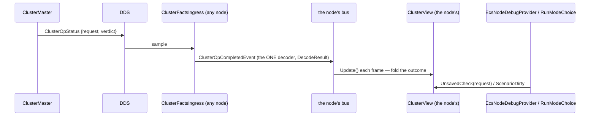
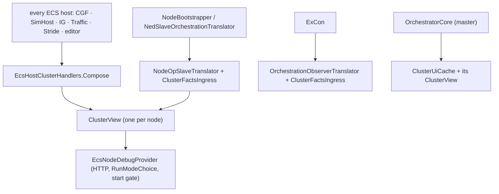

<!--STATUS
state: LIVE — backend design for ui's frame CE-1436 (one cluster ingress, one cluster read model, on every node)
updated: 2026-10-29
build-state: READY-TO-BUILD — V1–V5 APPROVED by the user 2026-10-29 (R-3066)
current-answer: §2 the picture · §3 decisions V1–V5 · §4 build slices
stale-below: nothing
known-rot: none
known-conflict: none
related-designs:
  - blueprints/batches/NOTE_Ui_To_Backend_One_Cluster_Ingress_And_Read_Model.md — the FRAME (ui, CE-1436): goal, leans, fences, acceptance
  - blueprints/Architect_Question_108_Run_Mode_Picker.md — §4b the check round whose answer must reach every host; §2.6 CE-4096's ClusterSlave follow-fields; §2.8a the gap
  - projects/Hrot/Network/Hrot.Network.Orchestration.md — §5 the observer path (ExCon's passive reader) this design folds into one ingress
  - blueprints/Architect_Question_109_Retire_ExCon.md — ExCon's retirement (proposed 2026-10-29) would remove V2's difference and the observer translator
  - projects/Hrot/Subsystems/Hrot.ExCon.md — the observer bus + ClusterUiCache on ExCon (the monitoring half stays there, V2)
-->

# DESIGN — one cluster view on every node (CE-1436)

🔒 ui frame, quoting the user (`2026-10-29`): *"How comes cgf is different from other nodes? We need to share and unify, the features need to be
available to all nodes by construction."*

## 1. INVENTORY (`2026-10-29`; graph `search_graph` on `.*(ClusterUiCache|ClusterSlave|ObserverTranslator|SlaveTranslator|SlaveOrchestration|ClusterView|ClusterReadModel|EcsNodeDebugProvider|NodeOrchestration).*` Class → 13 rows; grep for every reader of the events below)

| what | where | reads / publishes |
|---|---|---|
| `NodeOpSlaveTranslator` — every ECS node (CGF, SimHost, IG, Traffic) | `Hrot.Network.Orchestration/NodeOpSlaveTranslator.cs:28` | reads `NodeOpCommand` (filtered to its own node, `:119`), `ClusterStateTopic`, `AssetInventoryTopic`, `ReplaySessionTopic`; ⚠ WRITES its own heartbeat / capabilities / `NodeOpStatus` FROM bus events (`NodeHeartbeatEvent`, `NodeCapabilitiesEvent`, `NodeOpCompletedEvent`) |
| `OrchestrationObserverTranslator` — ExCon only | `…/OrchestrationObserverTranslator.cs:28` | the same 3 fact topics (shared decoders `StateOf`/`InventoryOf`) + `ClusterOpStatus`, `NodeHeartbeat`, `NodeCapabilitiesTopic`, `SwitchTimeModeWireDto`, and EVERY node's `NodeOpCommand`/`NodeOpStatus` (republished as `ExecuteNodeOpIntent`/`NodeOpCompletedEvent` for the transaction history) |
| `ClusterUiCache` — the master's core + ExCon | `Hrot.Orchestrator/Panels/ClusterUiCache.cs:27` | facts (state, exercise, recording flags, inventory, session, op outcomes, last unsaved check) **and** monitoring (heartbeats, tx history, planner reachability, diagnostics manifest) |
| `ClusterSlave` follow-fields — every ECS node | `Fdp.Toolkits/Orchestration/ClusterSlave.cs:615-650` | `HasFollowedState`, `MasterGone`, `KnownExercises`, `ReplayAxis`, `RunNotRecorded`, `RecordLiveRunsOff` — a SECOND owner of the same facts |
| `EcsNodeDebugProvider` | `Hrot.Presentation/DebugApi/EcsNodeDebugProvider.cs:23` | no read model ⇒ `ObservesUnsavedChecks` false on CGF / SimHost / IG |
| buses | `Program.cs:278` | ⭐ every subsystem in a runner process has its OWN bus — no node shares a bus with the master |

📐 **Who consumes the observer-only events** (grep, production): `NodeHeartbeatEvent` → ClusterMaster, ClusterUiCache, **NodeOpSlaveTranslator**;
`NodeCapabilitiesEvent` → ClusterMaster, **NodeOpSlaveTranslator**; `NodeOpCompletedEvent` → master, AssetPrefetch, ClusterUiCache,
**NodeOpSlaveTranslator**; `ExecuteNodeOpIntent` → **ClusterSlave**, NodeOpMasterTranslator, ClusterUiCache; `SwitchTimeModeEvent` → already reaches
nodes through `SwitchTimeModeDescriptorTranslator` (SlaveSyncController). `ClusterOpCompletedEvent` → master-side process managers and ClusterUiCache
only — none live on an ECS node's bus.

## 2. The picture

```mermaid
classDiagram
  class ClusterFactsIngress { <<NEW, Hrot.Network.Orchestration>> reads ClusterStateTopic · AssetInventoryTopic · ReplaySessionTopic · ClusterOpStatus → publishes the existing events (one decoder each) }
  class NodeOpSlaveTranslator { <<existing>> own commands · own heartbeat/capabilities/status egress · HAS-A ClusterFactsIngress }
  class OrchestrationObserverTranslator { <<existing>> HAS-A ClusterFactsIngress · + monitoring topics (heartbeat, capabilities, node-op mirror) }
  class ClusterView { <<NEW, Fdp.Toolkits.Orchestration>> State · MasterGone · ExerciseId · RunNotRecorded · RecordLiveRunsOff · Inventory · Session · ReplayAxis · OutcomeFor(requestId) · LastUnsavedCheck · Update() }
  class ClusterUiCache { <<existing>> HAS-A ClusterView (facts delegate) · keeps heartbeats, tx history, reachable targets }
  class ClusterSlave { <<existing>> follow-fields DELEGATE to ClusterView }
  class EcsHostClusterHandlers { <<existing>> Compose(): builds the node's ClusterView }
  class EcsNodeDebugProvider { <<existing>> reads ClusterView: ClusterState · UnsavedCheck · ScenarioDirty · ObservesUnsavedChecks }
  NodeOpSlaveTranslator *-- ClusterFactsIngress
  OrchestrationObserverTranslator *-- ClusterFactsIngress
  ClusterUiCache *-- ClusterView
  EcsHostClusterHandlers --> ClusterView : one per ECS node
  ClusterSlave --> ClusterView
  EcsNodeDebugProvider --> ClusterView
```

*What the picture shows that prose hid:* the split is two pairs, and only the FACTS half is unifiable as-is. The monitoring topics mirror other
nodes' ACTION topics; on a node whose own egress is driven by those very events they would be re-sent as its own (§1 consumers) — that is the
measured reason they stay where monitoring is the job.

*What the module picture shows:* the view is built where every ECS host already passes (`Compose`, the CE-3299 D16 rule), so no host can lack it;
the editor gets it from the same call.

## 3. Decisions (✅ APPROVED, R-3066)

🔒 User, `2026-10-29`: *"We need to pause any development until we enforce the unification and sharing."* · *"Approved both."*

| # | lean | rejected |
|---|---|---|
| **V1** | ONE `ClusterFactsIngress` reads the four FACT topics (state, inventory, session, op status) and publishes today's events through today's shared decoders (`StateOf`, `InventoryOf`, `DecodeResult`); BOTH translators own one — the slave gains op status by construction | add `ClusterOpStatus` to the slave only (ui's superseded note) — patches one topic, keeps two lists |
| **V2** | the four MONITORING topics (heartbeats, capabilities, the node-op command/status mirror) stay with the observer — **a necessary difference, measured** (§1): on an acting node those events drive its own egress and execution | publish them on every node (would re-send other nodes' heartbeats/statuses as its own and execute their commands); rename them to observation events now (touches the master's in-process ClusterUiCache inputs — a later slice if a node ever needs monitoring) |
| **V3** | ONE read model `ClusterView` (Fdp.Toolkits, beside `ClusterSlave`) owns the facts; `ClusterUiCache` composes one and its fact members delegate; `ClusterSlave`'s follow-fields (incl. CE-4096's `HasFollowedState` / `MasterGone`) delegate to the node's view — one owner | `ClusterUiCache` itself on every node (drags tx history, heartbeats and the planner — Hrot.Orchestrator types — onto nodes that need none) |
| **V4** | built once per ECS node in `EcsHostClusterHandlers.Compose` and drained where the slave ticks; ⛔ no per-host flag | per-host wiring (what produced the gap) |
| **V5** | `EcsNodeDebugProvider` reads the view ⇒ `ClusterState`, `UnsavedCheck`, `ScenarioDirty`, `ObservesUnsavedChecks` true on CGF / SimHost / IG; ui's `RunModeChoice` and start gate start answering with no ui change | — |

**Cost:** the view holds facts only — the last state, inventory arrays already held by `ClusterSlave`, 32 op outcomes — no tx history, no
heartbeats. To report on build: memory and per-frame drain on a 1000-entity scenario.

## 4. Build slices (after approval)

1. `ClusterView` + `ClusterFactsIngress`, both translators composing the ingress; `ClusterUiCache` delegating facts (its rails unchanged).
2. `Compose` builds the view; `ClusterSlave` follow-fields delegate; `EcsNodeDebugProvider` reads it.
3. Acceptance (ui's frame): on CGF, SimHost and IG hosts `ObservesUnsavedChecks` is true and an unsaved round's answer arrives — a rail per host
   family through the real composition; ExCon monitoring unchanged; `ClusterUiCache` and slave rails green.
