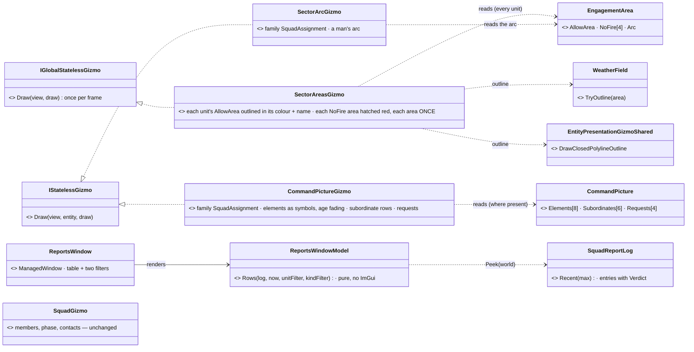
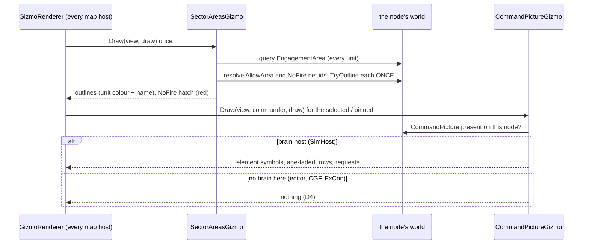
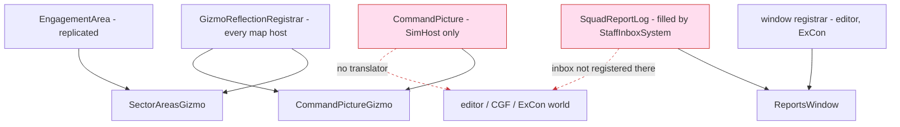

<!--STATUS
state: LIVE
updated: 2026-10-19
build-state: BUILT for D1–D3 (CE-1192, CE-1191); D4 (the picture and the log on a node with no brain) ✅ approved 2026-10-19, behaviors builds it (CE-2301)
current-answer: §1 what · §2 INVENTORY · §3 classes · §4 sequence · §5 modules · §6 decisions (leans) · §7 as built
stale-below: nothing.
known-rot: none.
known-conflict: none.
related-designs:
  - docs/designs/group-maneuvers/DESIGN_Command_Chain_Example.md — OWNS CommandPicture, the reports, SquadReportLog and the staff (§6, §7c); this design only DRAWS them
  - docs/designs/group-maneuvers/DESIGN_Defend_And_Attack_Position.md — OWNS sectors and NoFire areas (§13, §13a DA-24) and EngagementArea
  - docs/designs/group-maneuvers/DESIGN_Platoon_Attack_Defend_Clear.md — §13 the lane split (UI-5, UI-6), §12.4 PC-11 the report log
  - docs/DESIGN_Terrain_Combat_Tuning.md — §5b the squad gizmo this sits beside (SquadGizmo, family SquadAssignment)
  - docs/DESIGN_Map_3D_Mode.md — the map's 2-D primitives are drawn in 3-D too (§7)
-->

# Command display — the sectors, the command picture and the Reports window *(UI-5, UI-6)*

🔒 User, `2026-10-18` (R-2046, the platoon programme): the ui lane's part is *"displays that let a person watch a command chain work"* —
[hand-off](blueprints/batches/HANDOFF_Behaviors_To_Ui_Platoon_Demos.md) **UI-5** (the map shows the command picture) and **UI-6** (a
Reports window).

## 1. What

| | shows | from |
|---|---|---|
| **UI-5a** sectors | every unit's sector AREA outlined in that unit's colour, with its name; every NoFire area hatched red | `EngagementArea.AllowArea` / `.NoFire` (area network ids) — ✅ **replicated, on every node** |
| **UI-5b** the picture | for the SELECTED / pinned commander: its reported elements as symbols (size class, MG / sniper / AT flags, fading with age), its subordinates' last progress, open requests; a man's sector ARC | `CommandPicture` — ⚠ **brain-local** (registered on SimHost only, never replicated) |
| **UI-6** Reports | the report log: time, kind + subtype, from → to (names), SPOT fields, age, `Synthetic` marked; filters by unit and kind | `SquadReportLog` of the node — ⚠ filled only where the staff's inbox runs (brain nodes) |

## 2. INVENTORY *(graph CLI re-indexed `2026-10-19`, then grep; `check_index_coverage` is not available through the CLI)*

| query | result | ⇒ |
|---|---|---|
| `search_graph name_pattern=".*Gizmo$" label=Class` | 80 classes — the map overlays among them: `TacticalAreaGizmo`, `MapOverlayGizmo`, `TerrainZoneGizmo` (area outlines), `DangerAreaGizmo`, `SquadGizmo` (squad commander: members, phase, contacts), `DoorLeafGizmo` (a GLOBAL gizmo, once per frame) | ⭐ no gizmo reads `EngagementArea` or `CommandPicture` — new ones; the outline helper `EntityPresentationGizmoShared.DrawClosedPolylineOutline` is reused |
| `search_graph name_pattern=".*Window$" label=Class` | 90 — log-like windows: `MessageLogWindow`, `HsmEventsWindow` (rows + a frame snapshot model, U-obs-5) | ⭐ the Reports window follows `HsmEventsWindow`'s shape (a pure model + a thin `ManagedWindow`) |
| grep `CommandPicture` outside `Squad/Command` | registered by `Hrot.SimHost/CognitiveComponentRegistry.cs:34` only; read by `DebugApiService.Reports.cs` (`GET /entities/{id}/reports`), the commander nodes | ⚠ no translator, no descriptor — **not on the wire** (the design: *"read on the brain node"*, Command Chain CC-12 / CC-16) |
| grep `SquadReportLog` | filled by `StaffInboxSystem` (`StaffSystems.cs:228`) **after** `if (!IsComponentTypeRegistered<CommandPicture>()) return;` | ⚠ a node without the staff keeps no log, though `SquadReportNotification` reaches every node's bus (Command Chain §5: *"ingress on every node"*) |
| grep `EngagementArea` reads | `EngagementAreas` (the one reader), `DebugApiService.Sector.cs` (*"the replicated EngagementArea reads it back here"*) | ✅ replicated |
| area polygon | `WeatherField.TryOutline(repo, area, out outline)` — points relative to the area's `SimTransform` (the `EngagementAreas.InArea` reader) | ⭐ reused, not re-read |

## 3. Classes

*What the picture shows that prose hid:* the sectors are drawn by ONE global gizmo, not a per-unit one — many men list the same NoFire
area (it is looked up through the chain), so a per-unit projector would draw it once per man. And nothing here writes: all three only
read components the behaviours lane owns.

## 4. Sequence — a frame on any map host

## 5. Modules — who registers it, who calls it each frame, where the data is

*Caption — the dead edges (red, dashed):* the picture and the log never reach a node without a brain. The gizmos and the window are
registered there and draw nothing until D4 lands; on SimHost's map (and `--mode all`'s SimHost world) they work today.

## 6. Decisions *(leans — reply "approved" or name the one to change)*

| id | decision | ⭐ lean | rejected — one line each |
|---|---|---|---|
| **D1** | where sectors come from | ⭐ `EngagementArea` of every unit (replicated): `AllowArea` = the sector, outlined in the unit's colour (a palette by network id) with the unit's name at the polygon's centre; `NoFire` areas hatched red (diagonal lines every 3 m, clipped to the polygon) and outlined; each area drawn ONCE per frame however many units list it | style by the area's TKB kind — sectors and NoFire areas are ordinary area entities; only the UNIT says what an area is to it |
| **D2** | the picture | ⭐ `CommandPictureGizmo`, family `SquadAssignment` (selected + pinned, as `SquadGizmo`): each element a diamond at `At`, side ∝ `Size` (team / squad / platoon / company), a letter for the equipment flags (M machine gun · S sniper · A anti-tank), alpha `1 − age / 120 s` floored at 0.25, its `Count` and age as text; each subordinate row as a line to it labelled with its last `Progress`; each open request as a `?` at its point; a man's own arc as a wedge | draw on every unit — eight elements × every commander is noise; the hand-off says the SELECTED commander |
| **D3** | the Reports window | ⭐ a pure `ReportsWindowModel.Rows(log, now, unit, kind)` + a thin `ManagedWindow` (the `HsmEventsWindow` shape): newest first, columns time · kind/subtype · from → to (names) · SPOT fields · age (now − `ObservedAt`) · `SYN` mark · verdict; filters: a unit (from or to) and a kind | a second log of the ui's own — two logs of one stream drift (R-132) |
| **D4** | the picture and the log on a node with no brain | ✅ **APPROVED 2026-10-19 as leaned — behaviors builds it (`CE-2301`, [Command Chain §8b](designs/group-maneuvers/DESIGN_Command_Chain_Example.md))**; was ⭐ **behaviors' call** ([NOTE](blueprints/batches/NOTE_Ui_To_Behaviors_Command_Display_Data.md)) — ui's lean: ① the LOG: `StaffInboxSystem` appends to `SquadReportLog` BEFORE its `CommandPicture` guard, and is registered wherever `SquadReportNotification` is (verdict `not-owned-here` there) — one writer, every node; ② the PICTURE: replicate `CommandPicture` as a read-only Brain-group component (it is fixed-size and NoScenario already) | ⓑ fold a display copy on every node (the inbox ungated) — the brain-only resets (`OrderGiven`) would make the copies disagree · ⓒ the window asks the brain node over HTTP — the map is not an HTTP client |

## 7. As built

| | as built *(`CE-1192`, ui, `2026-10-19`)* — and the deviations, argued |
|---|---|
| **D1** `SectorAreasGizmo` | `Hrot.Presentation/ScenarioEditor/Gizmos/SectorAreasGizmo.cs`, a global gizmo (auto-registered): one query over `EngagementArea`, sectors keyed by area id (the first unit naming it gives the colour and the name), NoFire areas in a set ⇒ each drawn once; outline via `EntityPresentationGizmoShared.DrawClosedPolylineOutline`, the hatch `SectorAreasGizmo.Hatch` (45°, 3 m, even-odd pairs per line, so a concave area hatches only inside) |
| **D2** `CommandPictureGizmo` + ⚠ `SectorArcGizmo` | the picture as §6 D2 (diamonds by size class, flag letters, count + age + `SYN`, alpha `max(0.25, 1 − age / 120 s)`, dashed lines to subordinates with their last progress, `? kind` at requests). ⚠ **Deviation:** the man's arc is its OWN projector (`SectorArcGizmo`, on `EngagementArea` + `SimTransform`, family `SquadAssignment`) — a man has an arc and no picture, so it cannot ride the picture's projector |
| rails | `CommandDisplayGizmoTests` (`Hrot.Presentation.Tests`): two sectors in their units' colours with names and the NoFire room hatched ONCE though eleven units name it (the hand-off's fixture: two sectors, one NoFire room, three elements) · the hatch lies inside a concave L · the picture's three elements sized by class and fading with age · a man's arc along his bearings. Red-proved: dedup off, hatch pairing shifted, no fading, bearings swapped |

| id | built (CE-1191 for D3) | classes — where | registered | rails | deviation from §3 / §6 |
|---|---|---|---|---|---|
| **D3** Reports window | ✅ the log of the node as a table: time · kind / subtype · from → to · SPOT fields · age · SYN · verdict, newest first; unit combo (from OR to) and kind combo | `ReportsWindowModel` (pure: `Rows`, `Units`, `NameOf`, the two empty/no-match texts) + `ReportRow` / `ReportSpot` + `ReportsWindow` (`ManagedWindow`, with `BuildViewModel` → `ReportsWindowViewModel`, dumped through `PanelSnapshot`) — `Hrot/Engine/Hrot.Presentation/Windows/`. Shared words: `CommandReportText` (`SubtypeName`, `CarriesElementFields`, `UnitName`) — `FDP/Toolkits/Fdp.Toolkits/Squad/Command/`, **moved out of the HTTP route**: `DebugApiService.Reports.cs` now calls it too (subtype text, the SPOT-field kinds, the subordinate's name) — one copy | **Editor** (`editor_reports`, perspective Scenario, `EditorSubsystem.RegisterWindows`, non-headless) · **ExCon** (`excon_reports`, in the `_mock` block of `ExConSubsystem.RegisterWindows`) · **SimHost** (`simhost_reports`, `SimHostSubsystem.RegisterWindows`) — ids in `ScenarioPanelWindowIds`. `() => world` per host: editor `_world`, SimHost `vis.GetRepo()`, ExCon `() => null` | `Hrot.Presentation.Tests/Windows/ReportsWindowTests.cs` (the feature suite: 20-report fixture, order, unit/kind/both filters, SYN, age, names, SPOT only for SPOT/CONTACT, null/empty log, the empty text, the window's dump) | ① `Rows` takes the **world** as well as the log (`Rows(world, log, now, unit, kind)`): a name is an `EntityInfo` read on the world, the log holds entity handles only. ② also registered on **SimHost** — the one host where the log fills today (§5); the brief named editor and ExCon. ③ **ExCon keeps no world at all** (the map is remote), so its window shows the empty line permanently — it can only change when D4 puts a log where ExCon can read it, not by `StaffInboxSystem` writing it on every node. ④ a unit is named by `EntityInfo.Name`, else `#index` (no entity map in the model, so no network id) |
