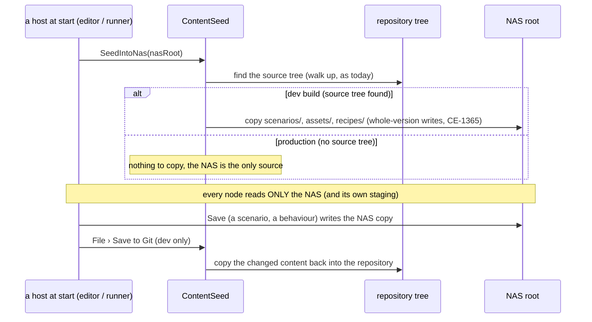
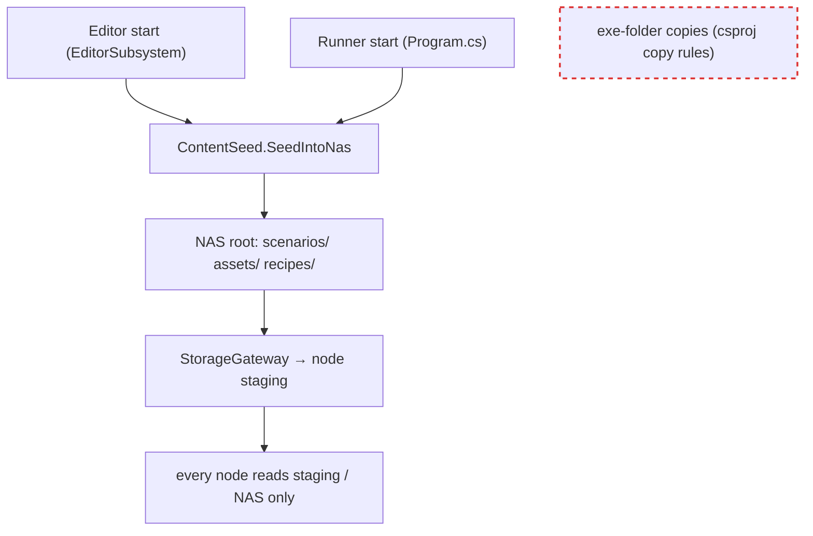

<!--STATUS
state: LIVE — ✅ APPROVED by the user 2026-10-28 (R-4097)
updated: 2026-10-28
build-state: READY-TO-BUILD — CE-4089; it lands BEFORE the AQ108 build (CE-4082), whose start surface lists recipes and scenarios
current-answer: §1 the tree · §2 the one pattern (classes, sequence, modules) · §3 decisions · §4 the move list
stale-below: nothing
known-rot: none
known-conflict: designs/main-toolbar-1/DESIGN.md §16 placed Assets/ and Recipes/ INSIDE the Hrot.AI.Behaviors project; this design keeps its rule (final assets and recipes in disjoint roots, AssetRoots the one authority) and moves both roots to the repository root
related-designs:
  - designs/main-toolbar-1/DESIGN.md — §16 OWNS the assets-vs-recipes split and the AssetRoots authority this design relocates; §10 the ONE asset browser
  - DESIGN_Artifact_Staging.md — OWNS how a node stages artifacts from the shared root (unchanged; it now reads the seeded tree)
  - DESIGN_Terrain_Zones_And_Assets.md — OWNS what a terrain is and how a node resolves one (TerrainCatalog: staging → shared → shipped); the shipped arm goes
  - DESIGN_Distributed_Scenario_Persistence.md — OWNS what a scenario folder holds after a distributed save
  - blueprints/Architect_Question_108_Run_Mode_Picker.md — the start surface (D16) lists `recipes/scenarios/` and `scenarios/`; D18's start-up option names a recipe by its root
-->

# DESIGN — content layout: `scenarios/`, `assets/` and `recipes/` at the repository root, one way to reach a run

🔒 **User, `2026-10-28`** (verbatim): *"I need them to be located in the subfolders of the root folder. Now they are buried somewhere under some
project. I would like to have the scenarios in the scenario subfolder under the root, and in assets subfolder all the assets like JSON behavior trees
and terrains and all its components, Later also sound samples and maybe textures and assets like that."* · *"Recipes should be separated from normal
assets. That means we might need a new top-level folder called recipes"* · *"if we take, for example, the textures, they do not belong to terrain or
to something else … They are just assets. So maybe also the buildings are just assets."* · *"By the root, I meant the repository root … In the
production installation, this root will be replaced by the NAS very likely … every run of the software starts from the development versions,
development assets that are baked in the repository … in the production. The code should simply fail to find the golden scenarios and assets baked
in the repository. So it will need to look at the NAS only."* · *"top-level recipes folder, and go with your lean on behaviours, All your leans
accepted."*

## 0. INVENTORY (`2026-10-28`, graph + grep)

| what | today | how a run gets it |
|---|---|---|
| scenarios | `scenarios/` (repo root, 345 files) | copied into the NAS working folder at start (`CuratedScenarios.SeedIntoWorking`, editor always, runner when its debug port is on); *File › Save Curated Scenarios to Git* copies back; no source tree ⇒ no-op |
| GUI layout | `layout/default/` | the same pattern (`LayoutPaths.TryFindSourceLayoutDirectory`) |
| behaviours (BTrees, HSMs, Blueprints, Params) | `Hrot/Subsystems/Hrot.AI.Behaviors/Assets` | read and written IN PLACE (`AssetRoots.ResolveBase`: configured root → the source project → the exe folder) |
| recipes (Blueprints, Buildings, Scenarios, Terrain) | `Hrot/Subsystems/Hrot.AI.Behaviors/Recipes` | in place / shipped |
| terrains, buildings | `…/Recipes/Terrain/<name>`, `…/Recipes/Buildings` | shipped into the exe folder; `TerrainCatalog.ForNode` looks in staging → NAS `terrain/` → the shipped copy |
| icons, audio | `Hrot/Engine/Hrot.Presentation/Assets/EntityIcons`, `…/assets/audio` | shipped with the exe |
| the NAS | `ClusterConfiguration.NasBasePath` (`/tmp/FDP_Temp/shared` in dev) | working scenarios, `terrain/`, `tkb/`, the exercise archive; the storage gateway pushes into each node's staging |

Hard-coded paths outside `AssetRoots`: ~15 files (`EntityIconLibrary`, `TerrainCatalog`, `TerrainAssets`, `AudioLayer`, two `.csproj` copy rules,
golden corpora, `IgVisualDef`, `VisualDefinitionDto`, `AssetRelPath`, two tests).

## 1. ⭐ The tree

```
<repo root>/                     (production: the NAS root — the same tree)
  scenarios/<name>/              saved scenarios (one folder each)
  assets/
    behaviors/ BTrees/ HSMs/ Blueprints/ Params/
    terrain/<name>/              GeoJSON + its terrain-specific files
    buildings/                   building assets — terrains USE them; they are not terrain parts
    icons/   audio/   textures/
  recipes/                       listed ONLY by "New …"; never by "Open …"
    scenarios/<seed>/
    behaviors/ BTrees/ HSMs/ Blueprints/
  layout/                        GUI defaults (unchanged)
```

## 2. ⭐ One pattern: the repository is the development seed of the NAS


*What the picture shows that prose hid:* every reader goes through ONE path authority, and only ONE class knows the repository exists
(`ContentSeed`) — so a production install, which has no source tree, cannot tell the difference except that the seed does nothing.





*What the picture shows:* the shipped exe-folder copies (red, dashed) disappear — today terrains, buildings, icons and audio reach a run that
way, a third pattern beside copy-at-start and edit-in-place.

## 3. Decisions (✅ all approved, R-4097)

| # | decision |
|---|---|
| L1 | the tree of §1 at the repository root; production uses the same tree at the NAS root |
| L2 | a top-level `recipes/` — recipes are never in an Open list, only in New (separation by construction, not a filter every listing must remember) |
| L3 | buildings, textures, icons, audio are plain assets; a terrain uses them |
| L4 | ONE pattern for every content type: a dev start seeds the NAS from the repository; every node reads only the NAS (and its staging); *Save to Git* copies changes back, for behaviours too (today they are edited in place); production has no source tree, so the seed does nothing |
| L5 | `AssetRoots` (renamed or kept) is the ONE path authority; every hard-coded path routes through it; the exe-folder copy rules go |
| L6 | a recipe is named by its root: `recipes/scenarios/<seed>` (AQ108 D18's start-up option) — the old `Recipes/<seed>` under the scenarios root goes |

## 4. The move list (CE-4089)

1. Move the files (git mv): `Hrot.AI.Behaviors/Assets/*` → `assets/behaviors/`, `Recipes/Terrain/*` → `assets/terrain/`, `Recipes/Buildings` →
   `assets/buildings/`, `Recipes/Scenarios/*` → `recipes/scenarios/`, `Recipes/{Blueprints,HSMs,BTrees}` → `recipes/behaviors/`, entity icons →
   `assets/icons/`, audio → `assets/audio/`, `SimHost/Assets/sample_road.json` → measure its user first.
2. `AssetRoots` gains the scenario / recipe / plain-asset roots; route the ~15 hard-coded sites through it; remove the `.csproj` copy rules.
3. Generalise `CuratedScenarios` into the one seed (scenarios + assets + recipes) and *Save to Git* per kind; keep its whole-version write (CE-1365).
4. `TerrainCatalog` drops the shipped arm; `TerrainAssets` reads buildings from the assets root.
5. The asset browser's Open lists `assets/` + `scenarios/`; New lists `recipes/`.
6. Rails: the existing suites of each touched class (`AssetRootsTests`, `CuratedScenariosTests`, `ShippedTerrainFilesAreDeployedTests` → rewritten
   for the seed, golden corpora paths) — a rail that a production layout (no source tree) reads only the NAS.
