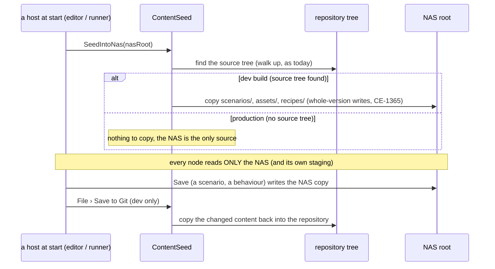
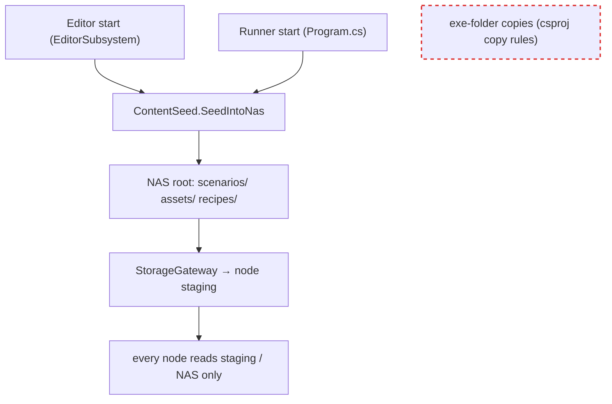
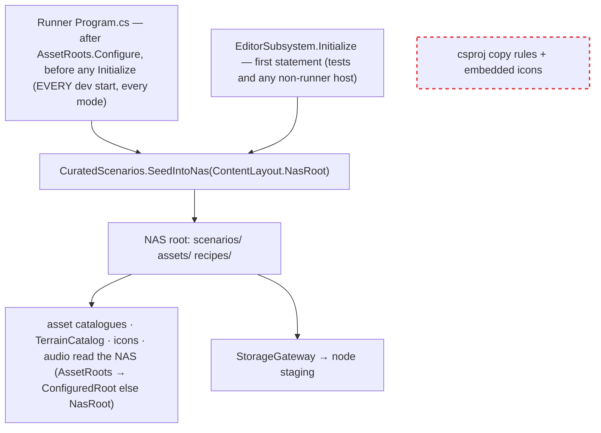
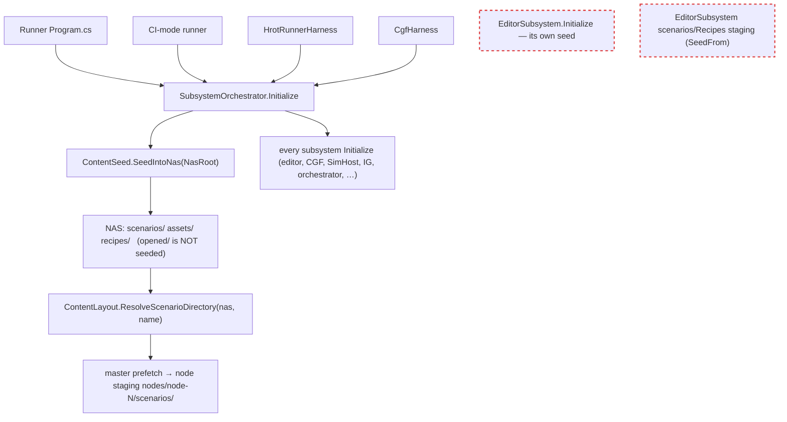
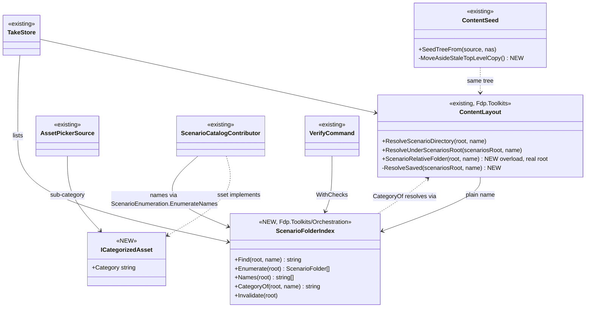
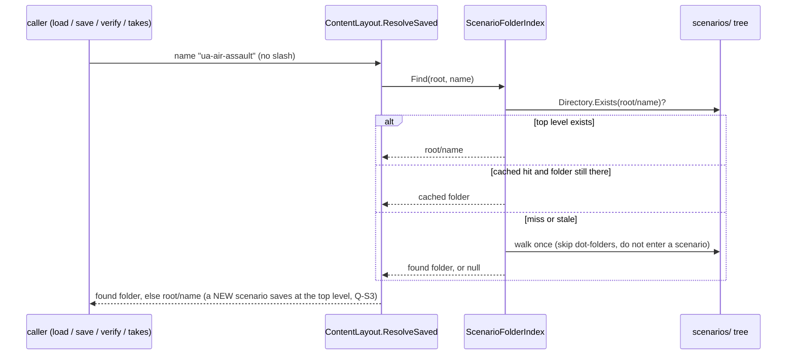

<!--STATUS
state: LIVE — ✅ APPROVED by the user 2026-10-28 (R-4097)
updated: 2026-11-10 (§6 AS-BUILT CE-4361 — the 128 scenarios filed; §6 AS-BUILT CE-4360; 2026-10-29: L6, the opened-copies home, the ONE host-start seed and the shared behaviour names built — §5b)
build-state: §6 CE-4360 BUILT + CE-4361 BUILT (2026-11-10, behaviors lane — see §6 AS-BUILT; only Q-S3's folder order + the *My scenarios* label remain); the rest BUILT — CE-4089 (2026-10-28) + part two (2026-10-29: L6, CE-3340 ①③④); it landed BEFORE the AQ108 build (CE-4082), whose start surface lists recipes and scenarios
current-answer: ⭐ §6 scenario categories = sub-folders (APPROVED R-4185, CE-4360, CE-4361) · §1 the tree · §5b AS BUILT, part two (the NEWEST: names, the opened area, the seed's one call site, the shared names) · §5 AS BUILT, part one (the classes; where §5b says SUPERSEDED, §5b wins) · §3 decisions · §4 the move list (done, except its step 5 — CE-4082)
stale-below: §5's D-7 and D-10, the "TWO call sites" line under §5's module graph, and its `CuratedScenarios` row (SUPERSEDED by §5b) · §2's CLASS NAMES (`ContentRoots`, `ContentSeed`) are the design-time names — SUPERSEDED by §5 (`ContentLayout` in Fdp.Toolkits, `AssetRoots` delegating, `CuratedScenarios` generalised in place). §2's sequence and module pictures still hold, with §5's two start points.
known-rot: §0's inventory table describes the layout BEFORE CE-4089 (it is the "from" state)
known-conflict: designs/main-toolbar-1/DESIGN.md §16 placed Assets/ and Recipes/ INSIDE the Hrot.AI.Behaviors project; this design keeps its rule (final assets and recipes in disjoint roots, AssetRoots the one authority) and moves both roots to the repository root
related-designs:
  - UX/DESIGN_Mission_Plan_Editor.md — §5.13 the task picker (R-4184), the sibling of §6's scenario categories
  - docs/DESIGN_Scenario_Macros.md — OWNS scenario macros (the expander, macro files, params + bindings, RefKey scoping); the macros/ content folder (SR-38)
  - docs/DESIGN_Scenario_Rules.md — §9 SR-38: a macros/ folder of scenario-like macro assets (parameterised, inserted by reference)
  - designs/main-toolbar-1/DESIGN.md — §16 OWNS the assets-vs-recipes split and the AssetRoots authority this design relocates; §10 the ONE asset browser
  - DESIGN_Artifact_Staging.md — OWNS how a node stages artifacts from the shared root (unchanged; it now reads the seeded tree)
  - DESIGN_Terrain_Zones_And_Assets.md — OWNS what a terrain is and how a node resolves one (TerrainCatalog: staging → shared → shipped); the shipped arm goes
  - DESIGN_Distributed_Scenario_Persistence.md — OWNS what a scenario folder holds after a distributed save
  - blueprints/Architect_Question_108_Run_Mode_Picker.md — the start surface (D16) lists `recipes/scenarios/` and `scenarios/`; D18's start-up option names a recipe by its root
-->

# DESIGN — content layout: `scenarios/`, `assets/` and `recipes/` at the repository root, one way to reach a run

🔒 **User, `2026-10-28`** (verbatim): *"I need them to be located in the subfolders of the root folder. Now they are buried somewhere under some
project. I would like to have the scenarios in the scenario subfolder under the root, and in assets subfolder all the assets like JSON behavior trees
and terrains and all its components, Later also sound samples and maybe textures and assets like that."* · *"Recipes should be separated from normal
assets. That means we might need a new top-level folder called recipes"* · *"if we take, for example, the textures, they do not belong to terrain or
to something else … They are just assets. So maybe also the buildings are just assets."* · *"By the root, I meant the repository root … In the
production installation, this root will be replaced by the NAS very likely … every run of the software starts from the development versions,
development assets that are baked in the repository … in the production. The code should simply fail to find the golden scenarios and assets baked
in the repository. So it will need to look at the NAS only."* · *"top-level recipes folder, and go with your lean on behaviours, All your leans
accepted."*

## 0. INVENTORY (`2026-10-28`, graph + grep)

| what | today | how a run gets it |
|---|---|---|
| scenarios | `scenarios/` (repo root, 345 files) | copied into the NAS working folder at start (`CuratedScenarios.SeedIntoWorking`, editor always, runner when its debug port is on); *File › Save Curated Scenarios to Git* copies back; no source tree ⇒ no-op |
| GUI layout | `layout/default/` | the same pattern (`LayoutPaths.TryFindSourceLayoutDirectory`) |
| behaviours (BTrees, HSMs, Blueprints, Params) | `Hrot/Subsystems/Hrot.AI.Behaviors/Assets` | read and written IN PLACE (`AssetRoots.ResolveBase`: configured root → the source project → the exe folder) |
| recipes (Blueprints, Buildings, Scenarios, Terrain) | `Hrot/Subsystems/Hrot.AI.Behaviors/Recipes` | in place / shipped |
| terrains, buildings | `…/Recipes/Terrain/<name>`, `…/Recipes/Buildings` | shipped into the exe folder; `TerrainCatalog.ForNode` looks in staging → NAS `terrain/` → the shipped copy |
| icons, audio | `Hrot/Engine/Hrot.Presentation/Assets/EntityIcons`, `…/assets/audio` | shipped with the exe |
| the NAS | `ClusterConfiguration.NasBasePath` (`/tmp/FDP_Temp/shared` in dev) | working scenarios, `terrain/`, `tkb/`, the exercise archive; the storage gateway pushes into each node's staging |

Hard-coded paths outside `AssetRoots`: ~15 files (`EntityIconLibrary`, `TerrainCatalog`, `TerrainAssets`, `AudioLayer`, two `.csproj` copy rules,
golden corpora, `IgVisualDef`, `VisualDefinitionDto`, `AssetRelPath`, two tests).

## 1. ⭐ The tree

```
<repo root>/                     (production: the NAS root — the same tree)
  scenarios/<name>/              saved scenarios (one folder each)
  assets/
    behaviors/ BTrees/ HSMs/ Blueprints/ Params/
    terrain/<name>/              GeoJSON + its terrain-specific files
    buildings/                   building assets — terrains USE them; they are not terrain parts
    icons/   audio/   textures/
  recipes/                       listed ONLY by "New …"; never by "Open …"
    scenarios/<seed>/
    behaviors/ BTrees/ HSMs/ Blueprints/
  layout/                        GUI defaults (unchanged)
```

## 2. ⭐ One pattern: the repository is the development seed of the NAS

```mermaid
classDiagram
  class ContentRoots { <<existing AssetRoots, grows>> Scenarios · Assets(kind) · Recipes(kind) — the ONE path authority }
  class ContentSeed { <<existing CuratedScenarios, generalised>> FindSourceTree() · SeedIntoNas(nasRoot) · SaveBackToGit(kind) }
  class TerrainCatalog { <<existing>> staging → NAS assets/terrain (shipped arm REMOVED) }
  class TerrainAssets { <<existing>> buildings from assets/buildings }
  class EntityIconLibrary { <<existing>> reads ContentRoots.Assets(icons) }
  class AudioLayer { <<existing>> reads ContentRoots.Assets(audio) }
  class AssetBrowserPanel { <<existing>> Open lists assets/ and scenarios/ only }
  class NewAssetDialog { <<existing>> lists recipes/ only }
  class StorageGatewayModule { <<existing>> pushes from the NAS into node staging }
  ContentSeed --> ContentRoots
  TerrainCatalog --> ContentRoots
  TerrainAssets --> ContentRoots
  EntityIconLibrary --> ContentRoots
  AudioLayer --> ContentRoots
  AssetBrowserPanel --> ContentRoots
  NewAssetDialog --> ContentRoots
  StorageGatewayModule ..> ContentRoots : the NAS tree
```



*What the picture shows that prose hid:* every reader goes through ONE path authority, and only ONE class knows the repository exists
(`ContentSeed`) — so a production install, which has no source tree, cannot tell the difference except that the seed does nothing.





*What the picture shows:* the shipped exe-folder copies (red, dashed) disappear — today terrains, buildings, icons and audio reach a run that
way, a third pattern beside copy-at-start and edit-in-place.

## 3. Decisions (✅ all approved, R-4097)

| # | decision |
|---|---|
| L1 | the tree of §1 at the repository root; production uses the same tree at the NAS root |
| L2 | a top-level `recipes/` — recipes are never in an Open list, only in New (separation by construction, not a filter every listing must remember) |
| L3 | buildings, textures, icons, audio are plain assets; a terrain uses them |
| L4 | ONE pattern for every content type: a dev start seeds the NAS from the repository; every node reads only the NAS (and its staging); *Save to Git* copies changes back, for behaviours too (today they are edited in place); production has no source tree, so the seed does nothing |
| L5 | `AssetRoots` (renamed or kept) is the ONE path authority; every hard-coded path routes through it; the exe-folder copy rules go |
| L6 | a recipe is named by its root: `recipes/scenarios/<seed>` (AQ108 D18's start-up option) — the old `Recipes/<seed>` under the scenarios root goes — ✅ BUILT (CE-4089 part two, §5b) |

## 4. The move list (CE-4089)

1. Move the files (git mv): `Hrot.AI.Behaviors/Assets/*` → `assets/behaviors/`, `Recipes/Terrain/*` → `assets/terrain/`, `Recipes/Buildings` →
   `assets/buildings/`, `Recipes/Scenarios/*` → `recipes/scenarios/`, `Recipes/{Blueprints,HSMs,BTrees}` → `recipes/behaviors/`, entity icons →
   `assets/icons/`, audio → `assets/audio/`, `SimHost/Assets/sample_road.json` → measure its user first.
2. `AssetRoots` gains the scenario / recipe / plain-asset roots; route the ~15 hard-coded sites through it; remove the `.csproj` copy rules.
3. Generalise `CuratedScenarios` into the one seed (scenarios + assets + recipes) and *Save to Git* per kind; keep its whole-version write (CE-1365).
4. `TerrainCatalog` drops the shipped arm; `TerrainAssets` reads buildings from the assets root.
5. The asset browser's Open lists `assets/` + `scenarios/`; New lists `recipes/`.
6. Rails: the existing suites of each touched class (`AssetRootsTests`, `CuratedScenariosTests`, `ShippedTerrainFilesAreDeployedTests` → rewritten
   for the seed, golden corpora paths) — a rail that a production layout (no source tree) reads only the NAS.

## 5. ⭐ AS BUILT (CE-4089, 2026-10-28) — SUPERSEDES §2's class names

```mermaid
classDiagram
  class ContentLayout { <<static, Fdp.Toolkits/Orchestration — NEW>> segment names · Scenarios/Assets/Recipes(root) · BehaviorAssets/Recipes(root,folder) · TerrainAssets/BuildingAssets/IconAssets/AudioAssets/TextureAssets(root) · AssetSyncRoot(root,kindId) · NasRoot · TryFindSourceTree(startDirs) }
  class OrchestrationConstants { <<existing>> ScenariosDirectoryName · NasAssetsDirectoryName · GetSharedRoot · GetNasAssetRoot → ContentLayout.AssetSyncRoot }
  class AssetRoots { <<existing, Hrot.Editor.AiShared — delegates>> ConfiguredRoot(--asset-root) else NasRoot · AssetsFor/RecipesFor/ResolveAssetsRoot · BehaviorAssetsRoot }
  class CuratedScenarios { <<existing, generalised IN PLACE>> SeedIntoNas · SaveToGit · SeedTreeFrom/SaveTreeTo (pure) · CE-1365 write }
  class TerrainCatalog { <<existing>> ForNode(staging, nasRoot) = staging + NAS assets/terrain — NO shipped arm }
  class TerrainAssets { <<existing>> DefaultSharedBuildingsRoot = NAS assets/buildings }
  class EntityIconLibrary { <<existing>> reads NAS assets/icons — nothing embedded }
  class AudioLayer { <<existing>> AssetFolder = NAS assets/audio }
  class StorageGatewayModule { <<existing>> terrain source = ContentLayout.TerrainAssets(nas) }
  class AssetSyncService { <<existing>> publish/refresh/probe over OrchestrationConstants.GetNasAssetRoot }
  OrchestrationConstants --> ContentLayout
  AssetRoots --> ContentLayout
  CuratedScenarios --> ContentLayout
  TerrainCatalog --> ContentLayout
  TerrainAssets --> ContentLayout
  EntityIconLibrary --> ContentLayout
  AudioLayer --> ContentLayout
  StorageGatewayModule --> ContentLayout
  AssetSyncService --> OrchestrationConstants
```



*What the picture shows that §2's prose hid:* `ContentLayout` lives in **Fdp.Toolkits** (not `Hrot.Editor.AiShared`) because `TerrainCatalog`/`TerrainAssets` are there and cannot
reference Hrot; `AssetRoots` kept its public API and now only composes through it. The asset-sync's NAS tree (`GetNasAssetRoot`) is routed through the same class — see D-2.



*What it shows:* ⛔ SUPERSEDED (§5b D-14): the seed had TWO call sites (the runner, the editor's `Initialize`) plus two harness static constructors; it now has ONE — `SubsystemOrchestrator.Initialize`.
The editor's seed moved from "after the master is built" to the FIRST statement of `Initialize`, because the asset catalogue it composes a few hundred lines earlier now reads the NAS.

### Decisions taken while building (each is a deviation from, or an addition to, §2–§4)

| # | what | why (measured) |
|---|---|---|
| D-1 | the runner seeds at **every** dev start, no longer only when the debug port is on (HN-029's gate) | the design's sequence has the seed at every start; ⚠ it force-writes only curated scenario NAMES and files whose bytes differ, deletes nothing |
| D-2 | `OrchestrationConstants.GetNasAssetRoot(nas, kind)` now answers `{nas}/assets/behaviors/<Folder>` for `blueprint`/`btree`/`hsm` (was `{nas}/assets/<kind>`) | ⛔ otherwise the NAS held TWO trees for one concept — the seeded `assets/behaviors/BTrees` and the asset-sync's `assets/btree`. Wire/staging protocol unchanged (the kind ids and `AssetSyncService` flows are the same; only the NAS folder name moved). Rails: `ContentLayoutTests.TheAssetSyncRootOfABehaviourKind_IsTheSeededTree`, `StorageGatewayTests` (6 paths) |
| D-3 | entity icons are **no longer embedded** in `Hrot.Presentation`; `EntityIconLibrary` reads `{nas}/assets/icons` (`EmbeddedNames` → `NamesIn(folder)`) | nothing needs the embedding: every consumer builds the library with the default folder; the exe-folder / embedded copy is the third delivery pattern L4 removes. A bare node with an empty NAS shows no art (`_point` fallback also absent) |
| D-4 | `AssetRoots.AssetsRoot`/`RecipesRoot` are now the TOP-LEVEL `assets/` and `recipes/`; `BehaviorAssetsRoot` (`assets/behaviors`) is new and is what `ParamsDtoStaleness` uses | the old `AssetsRoot` meant "behaviour assets"; `assets/` now also holds terrain, icons, audio |
| D-5 | `AssetRoots.ResolveProjectDir` stays — only for the one non-content need left: the `.csproj` a full rebuild / hot reload builds (`EditorSubsystem`, `EditorApplication`). `ResolveBase`/`ResolveAssetsRoot`/`ReportBase`/`DescribeBase` still take the project segments (≈30 call sites) and IGNORE them | measured: 2 production users of `ResolveProjectDir`, both non-content |
| D-6 | `ReportBase`'s warning is "the root the catalog reads has no `assets/` folder" (was "no config and no source tree") | there is always a root now (config, else the NAS); the fault left is "nothing seeded or published" |
| D-7 | ⛔ **SUPERSEDED (§5b D-12)** — `BehaviorGroups` (netstandard2.0 analyzer) spelled `assets/behaviors/<Kind>/` as literals | the claim "the generator assembly cannot reference `ContentLayout`" was true of a project REFERENCE only; it now shares the names by link |
| D-8 | `Hrot.AI.Behaviors.csproj` feeds the generators from `$(AssetsBehaviorsDir)` = `$(MSBuildThisFileDirectory)..\..\..\assets\behaviors\`; every `Content … CopyToOutputDirectory` rule is gone | rail: `FolderLayoutTests.TheBehaviorsProjectHoldsNoContentAndCopiesNone` |
| D-9 | an editor edit of a behaviour asset now writes the NAS copy; the C# generator still compiles the repository's `assets/behaviors` | this is L4's own consequence ("*Save to Git* for behaviours too — today they are edited in place"): a behaviour edited in the editor reaches the compiled assembly only after *Save to Git* + a rebuild. The menu label still says "Save Curated Scenarios to Git" (CE-4082's menu work) but the command saves every kind |
| D-10 | not done here: §4 step 5 (asset browser Open lists `assets/`+`scenarios/`, New lists `recipes/`) beyond what the new roots already give; ⛔ SUPERSEDED for L6: `Recipes/<seed>` under the scenarios root went in part two (§5b D-13) | out of this task's brief; the roots are separate by construction |
| D-11 | `Hrot.Core.Tests/Assets/sample_road.json` left in place | measured: no `.cs` reads it; it is a test-project `Content` item only (the other `sample_road.json` copies are unrelated) |

*Prior state (SUPERSEDED, kept so a reader does not re-derive it):* before CE-4089 content was read in place from the source project (`AssetRoots.ResolveBase`: config → source walk-up → exe folder), shipped through four csproj copy rules
(`Recipes/*`, icons embedded, audio copied), and `TerrainCatalog` searched staging → NAS `terrain/` → the shipped `{app}/Recipes/Terrain`.

## 5b. ⭐ AS BUILT, PART TWO (CE-4089 part two + CE-3340 ① ③ ④, 2026-10-29) — SUPERSEDES the §5 lines marked above

```mermaid
classDiagram
  class ContentLayout { <<static, Fdp.Toolkits — existing>> ResolveScenarioDirectory(root,name) · ScenarioRecipeName(seed) · OpenedCopyName(area,key) · Opened(root) · IsScenarioRecipeName · IsOpenedCopyName }
  class ContentTreeNames { <<internal static, Fdp.Toolkits/Orchestration/Shared — NEW, constants only>> Assets · Behaviors · BTrees · Hsms · Blueprints · BehaviorKindRootPrefix }
  class ContentSeed { <<static, Fdp.Toolkits — NEW home of the seed half>> SeedIntoNas · SeedTreeFrom · SeedFrom · CuratedRelPaths · CopyTree }
  class CuratedScenarios { <<existing, Hrot.Presentation — Save to Git only>> SaveToGit · SaveTreeTo · SaveTo · CanSaveToGit }
  class SubsystemOrchestrator { <<existing, Fdp.Toolkits/Runner>> Initialize() seeds FIRST (RunnerOptions.SeedContent, .NasRoot) }
  class RecordedScenarioNames { <<existing>> ForExercise → opened/recorded/id · DirectoryFor(nas,id) }
  class StorageGatewayModule { <<existing>> prefetch source = ResolveScenarioDirectory }
  class AssetInventoryProcessManager { <<existing>> snapshot · archive · StageRecordedScenario → ResolveScenarioDirectory / DirectoryFor }
  class ClusterMaster { <<existing>> content names = ResolveScenarioDirectory }
  class StorageProcessManager { <<existing>> save merge folder = ResolveScenarioDirectory }
  class ScenarioNewAssetService { <<existing>> SeedNameToScenarioName = ContentLayout.ScenarioRecipeName }
  class BehaviorGroups { <<existing, Hrot.AiEditor.Persistence netstandard2.0>> kind roots from ContentTreeNames (LINKED) }
  ContentLayout --> ContentTreeNames
  OrchestrationConstants --> ContentTreeNames
  BehaviorGroups ..> ContentTreeNames : source link
  SubsystemOrchestrator --> ContentSeed
  ContentSeed --> ContentLayout
  CuratedScenarios --> ContentSeed : CopyTree, CuratedRelPaths
  RecordedScenarioNames --> ContentLayout
  StorageGatewayModule --> ContentLayout
  AssetInventoryProcessManager --> RecordedScenarioNames
  AssetInventoryProcessManager --> ContentLayout
  ClusterMaster --> ContentLayout
  StorageProcessManager --> ContentLayout
  ScenarioNewAssetService --> ContentLayout
```



*What the picture shows that §5's prose hid:* every NAS-side reader of "the folder of scenario X" (prefetch, content names, the run's snapshot, the archive, the save merge, the opened-copy stager) goes through ONE resolver; the seed has ONE caller; the generators' behaviour-root spelling is the same file as the runtime's.



*What it shows:* the two dashed boxes are gone. A direct `new EditorSubsystem().Initialize(...)` (an editor unit test) is NOT a host start and no longer seeds; a test that needs content starts through the orchestrator or seeds a temp NAS itself.

| # | what | why (measured) |
|---|---|---|
| D-12 | ④ `BehaviorGroups` takes its kind roots from `ContentTreeNames`, a constants-only file compiled into `Fdp.Toolkits` and LINKED into `Hrot.AiEditor.Persistence`; `ContentLayout` and `OrchestrationConstants.NasAssetsDirectoryName` read the same constants | ⛔ the earlier claim "the analyzer assembly cannot reference `ContentLayout`" held only for a project REFERENCE: `Hrot.AiEditor.Persistence` is netstandard2.0 with no project references, but its csproj already links `OccurrenceSlotKey`, `BuiltInHsmEvents`, `HsmActionKey` from `Fdp.Toolkits`/`Fdp.Toolkits.Analyzers`. Whole `ContentLayout` is not linkable (it uses `OrchestrationConstants`, `AssetTokens`); the names were the only thing the analyzer needed. Rail: `BehaviorGroupsSpellTheContentLayoutTests` |
| D-13 | L6 — a recipe is loaded by `recipes/scenarios/<seed>` (`ContentLayout.ScenarioRecipeName`); `ContentLayout.ResolveScenarioDirectory(nasRoot, name)` is the ONE name → NAS-folder resolver (saved name → `scenarios/`, recipe name → `recipes/scenarios/`, `opened/…` → `opened/`; `..` refused). Users: `StorageGatewayModule` (prefetch source), `ClusterMaster` (content names), `AssetInventoryProcessManager` (run snapshot, archive, opened-copy stager), `StorageProcessManager` (save merge); readers that hold only the scenarios root — `TakeStore` (the director's takes, `CopyTakes`) and `EditorScenarioSession.CopyTakes` ("new from a recipe" carries the recipe's takes) — use `ContentLayout.ResolveUnderScenariosRoot` (the same rule against the SIBLING roots). The editor no longer stages the seeds under `scenarios/Recipes/` (its `SeedFrom` block is gone); `ScenarioNewAssetService.SeedSubfolder` is gone | node STAGING keeps the name as a relative path (`nodes/node-N/scenarios/recipes/scenarios/<seed>`) — it is a per-run cache keyed by name, not the content tree. ⚠ A saved scenario named `recipes/scenarios/…` or `opened/…` would now resolve elsewhere: those two top-level names are reserved (no such scenario exists in the repository). Rails: `ContentLayoutTests.L6_*`, `AssetInventoryProcessManagerTests.L6_ThePrefetchOfARecipeName_*` |
| D-14 | ③ the content seed runs in ONE place: `SubsystemOrchestrator.Initialize` (`RunnerOptions.SeedContent`, default true; `RunnerOptions.NasRoot` for a test) — before any subsystem initialises. The seed half of `CuratedScenarios` moved to `Fdp.Toolkits` as `ContentSeed` (the orchestrator cannot reference `Hrot.Presentation`); `CuratedScenarios` keeps *Save to Git*. Removed: `Program.cs`, `EditorSubsystem.Initialize` (two blocks), both harness static constructors; `CgfHarness` now starts through a `SubsystemOrchestrator` | measured: every production host start is an orchestrator `Initialize` (`.Initialize(config)` appears in `SubsystemOrchestrator` and the `CiSubsystem` decorator only). ⚠ ONE host start is not the orchestrator and keeps its own call: the Stride desktop app hosts `EditorSubsystem` in `EditorStrideSubsystem.InitializeHosted` (its config differs — `IsActiveMapOwner = () => false`, `NodeId` — and it is Windows-only, so it was not rerouted blind); the rail names it, so a third cannot appear unnoticed. To end the exception, start the hosted editor through `SubsystemOrchestrator` once that config difference is measured on Windows. A bare `new EditorSubsystem().Initialize(...)` in a test is not a host start: a test that needs content starts through the orchestrator (`TheWorldChangeCheckOnTheEditorTests` does). The orchestrator is generic framework code: the seed does nothing when no `HROT.sln` + `assets/` is found above the working or base directory, and a unit test with fakes can opt out. Rails: `TheContentSeedRunsAtTheOneHostStartTests`, `EveryHostSeedsThroughTheOneHostStartRails` |
| D-15 | ① opened copies of recordings (and later never-saved autosaves, AQ108 §4c A8) live in the NAS **opened-not-saved area**: `{nas}/opened/<area>/<key>` (`ContentLayout.Opened`, `OpenedCopyName`); a recorded copy is `opened/recorded/<exerciseId>` (`RecordedScenarioNames`). It is a sibling of `scenarios/` and `recipes/`, never seeded, never saved to git | so "Open" (lists `scenarios/`) and "New from a recipe" (lists `recipes/scenarios`) cannot offer it BY CONSTRUCTION. Rails: `TheOpenedCopiesAreNeverOfferedTests`, `ContentLayoutTests.CE3340_*`, `AssetInventoryProcessManagerTests.CE4091_OpeningARecordedCopy_*` (the stager writes there) |

*Prior state (SUPERSEDED):* the recorded copy was staged at `scenarios/Recipes/Recorded/<id>` (inside the folder the old design reserved for recipes); recipes were opened as `Recipes/<seed>` after the editor staged them into `scenarios/Recipes/`; the seed was called from four places.

## 6. ✅ APPROVED `2026-11-09` (R-4185) — scenario CATEGORIES = SUB-FOLDERS *(coordinator; Q-S1…Q-S4 approved — user: "Approved"; CE-4360 backend, CE-4361 behaviors; the sibling of the task picker, Mission plan editor §5.13 / R-4184)*

🔒 User: *"Something similar is needed for scenario picking as well - many are feature demos … few are complex showcases."* — then: *"New
category field in scenario header only if the category cannot be mapped from folder. No problem moving to different subfolders. That's the most
natural way how to organize scenarios. So the folder might be the primary grouping mechanism."*

| measured | where |
|---|---|
| 127 scenarios, all directly under `scenarios/`; none carries a category; the prefixes are a code habit (`ua-` 67 of every area, `showcase-` 2 …) | `scenarios/*/scenario.json` |
| the picker ALREADY groups by a sub-category (`Kind/<sub>`); for a scenario the sub is null ⇒ one flat folder of 127 | `RecipePickerSource.cs:171-186`, `RecipeMetadataAdapter.RecipeCategory` `:73-77` |
| ⭐ ONE resolver turns a scenario NAME into its folder: `ContentLayout.ResolveUnderScenariosRoot` (and `ScenarioRelativeFolder` for NAS-relative paths) — a name may already carry segments (`recipes/scenarios/x`, `macros/x`) | `ContentLayout.cs:177-191` |
| ⚠ **41 files build `"scenarios/" + name` by hand** — 6 production (`VerifyCommand`, `HrotRunnerConfiguration`, 3 in SumoSharp, `ContentLayout` itself), 35 tests | grep |

| # | question | ⭐ lean | rejected — one line |
|---|---|---|---|
| **Q-S1** | where the category lives | **the sub-folder**: `scenarios/<category path>/<name>/scenario.json`; the picker's sub-category = that path. ⛔ No header field now — only if a real multi-category case appears (none known) | a header field: a second grouping beside the folder (the user) |
| **Q-S2** | the NAME of a scenario | **stays its leaf folder name** (`ua-air-assault`), unique across all sub-folders (a rail) — the ONE resolver finds it under any sub-folder (an index built once, refreshed when the folder changes), so recordings, recent picks, HTTP, tests and docs that name a scenario do not change | the name becomes the path (`demos/air/ua-air-assault`): every stored name and doc reference breaks |
| **Q-S3** | the folders, in this order | **Recent** (the picker's) · **My scenarios** (`scenarios/` top level — where *Save as* puts a new one) · **showcases/** · **demos/** with **air/ · infantry-and-squads/ · platoons-and-vehicles/ · weapons-and-fires/ · buildings-and-doors/ · civilians-and-crowd/ · sensing-and-weather/ · rules-objectives-directors/ · navigation-and-terrain/ · players-and-possession/** · **tests/** (fixtures, perf, regression — hidden behind an off *Show tests (N)* tick) | by prefix: `ua-` holds every area |
| **Q-S4** | who does it | **backend first** (the content-path owner): the resolver finds a leaf name under sub-folders + the leaf-uniqueness rail + the 41 hand-built paths go through the resolver; **then behaviors** moves and files the 127 (they wrote most demos; the list in their report) | moving first: 41 hand-built paths break at once |

### ⭐ AS-BUILT — CE-4360 (done by the behaviors lane; R-4185 named backend, which was busy on nav tiles) — `2026-11-10`

> ⛔ **No real scenario was moved by CE-4360** (that is CE-4361, below). Everything in this block was proven on temp-dir fixtures and over the real flat tree.



*Caption — what the picture shows that prose hides:* the index is reached ONLY through `ContentLayout` for a load/save path, and directly by the
LISTERS (picker, verify, takes, storage gateway) which need the whole set; the seed never calls the index (it moves the stale copy by a plain file test).



| what was built | where |
|---|---|
| the index + enumerator (`Find`, `Enumerate`, `Names`, `CategoryOf`) | `FDP/Toolkits/Fdp.Toolkits/Orchestration/ScenarioFolderIndex.cs` |
| plain name → index; a name with segments exactly as before | `ContentLayout.ResolveSaved` (`ResolveScenarioDirectory`, `ResolveUnderScenariosRoot`); `ScenarioRelativeFolder(root, name)` for the real root |
| editor + CGF scenario lists offer LEAF names | `ScenarioEnumeration.EnumerateNames` ← `EditorSubsystem`, `CgfSubsystem` |
| picker sub-category = sub-folder path; `tests/` hidden behind a "Show tests" tick (CE-4359's `PickerHideToggle`, reused) | `ICategorizedAsset`, `AssetPickerSource.ToEntry`, `AssetFolderDerivation`, `AssetPickerLauncher` |
| production sites routed: slice save, session write, takes, verify (`all`), debug API, terrain importer, storage gateway scan | `HrotScenarioSaveHandler`, `EditorScenarioSession`, `TakeStore`, `VerifyCommand.WithChecks`, `DebugApiHost.Director`, `DebugApiService`, `TerrainImporter`, `StorageGatewayModule` |
| tests that read real repo scenarios | `TestRepo.ScenarioFile` / `ScenarioDirectory` (`FDP/TestShared/TestRepo.cs`) |

**The 41 hand-built sites — as measured, not as listed above.** The design's own list could not be reproduced exactly (`VerifyCommand`,
`HrotRunnerConfiguration` and the SumoSharp ones are not hand-built scenario NAMES: the SumoSharp `scenarios/_bench` / `_ped` address benchmark datasets that do not exist in the
repo, `HrotRunnerConfiguration.cs:203` is help text). The grep found 41 `"scenarios"` literals: real-repo readers routed through `TestRepo`
(`TerrainHeightTests`, `ScenarioWorldSectionTests`, `PostureScenarioTests`, `TheEditorsRecording…`, `ScenarioTwin`, `TheWorldChangeCheckOnTheEditorTests`,
`ReplayBrowserSubsystemTests`); `FilmDirectorTests` roots routed by construction through `TakeStore`; `ScenarioEntityKeySweepTests` and `ReadableScenarioJsonTests` already recursive;
temp-tree fixture builders left alone (they create at the top level, which is where a new scenario goes).

**Deviations and decisions**

| # | what | why |
|---|---|---|
| 1 | ⭐ **stale top-level copy (CE-4361's hazard)** — `ContentSeed` never deletes, so after a scenario is filed in git its old `scenarios/<leaf>` in the NAS would win the lookup (the top level wins). **Settled by construction in the seed:** `SeedTreeFrom` MOVES a top-level folder aside (to `<nas>/.superseded-scenarios/<leaf>`, outside `scenarios/` so no lister or Save-to-Git sees it) when the SOURCE files that leaf in a sub-folder. Never a delete; never touches a top-level scenario the source does not file (user-made). | the alternative (lookup prefers the filed copy) cannot tell a stale copy from a user's deliberate top-level one and would make a save write to the filed copy while the user edited the other |
| 2 | the editor / CGF lists return LEAF names; a leaf shared by two scenarios falls back to its relative path (still loadable). `EnumerateRelPaths` stays for readers of folder paths; the nested-name rails (`ScenarioNestedNameTests`) still test it, and `TheCgfPickerIsNotEmptyTests` now asserts the leaf (`Ambush`, not `Combat/Ambush`) | Q-S2 |
| 3 | the Q-S3 folder ORDER and the "My scenarios" label are not built — top-level scenarios have a null category | left to CE-4361 with the move |
| 4 | the index is cached per scenarios root and rebuilt on a miss or a stale hit; no FileSystemWatcher | brief; a steady lookup is a dictionary read + `Directory.Exists` |

Rails: `ContentLayoutTests.CE4360_*` (resolver, index rebuild, enumerator, real-tree leaf uniqueness, seed moves a stale copy aside), `StorageProcessManagerTests`, `ClusterMasterNewScenarioTests`,
`HrotScenarioSaveHandlerTests`, `EditorScenarioSessionLoadTests`, `AssetPickerLauncherTests`, `VerifyCommandScenariosTests` (each red-proved by a compiling mutation).

### ⭐ AS-BUILT — CE-4361 (behaviors lane) — `2026-11-10`: the 128 scenarios are FILED

The move is done: every committed scenario sits in a category sub-folder, **names unchanged** (Q-S2), found by the CE-4360 resolver. *(128, not the 127 of the row — `bd-destruction`, the destruction demo of CE-4391 S-5, arrived with the merge.)*

```
scenarios/
  showcases/                                  2
  demos/air/                                 10
  demos/infantry-and-squads/                 26
  demos/platoons-and-vehicles/               15
  demos/weapons-and-fires/                   20
  demos/buildings-and-doors/                  6
  demos/civilians-and-crowd/                 24
  demos/sensing-and-weather/                  5
  demos/rules-objectives-directors/           3
  demos/navigation-and-terrain/               6
  demos/players-and-possession/               0   (none fits: the two multi-player showcases live in showcases/; no demo of its own yet)
  tests/                                     11
```

**Classified by what each `scenario.json` description says it SHOWS, not by prefix** (`ua-` spreads over 8 folders; `ts-*` temperament duels → infantry; `rf-*` reflexes under fire → weapons-and-fires; `pc-*` → platoons; `uc-*` support chain → weapons-and-fires, convoy ambushes → platoons-and-vehicles; `hill-attack*` are the Berlin-flat judged regression twins of `ua-hill-attack` → `tests/`). `demos/players-and-possession/` was NOT created — no scenario shows possession on its own (the two that do are showcases); create it with its first scenario.

<details><summary>The move table — all 128 (name → folder → why)</summary>


**`showcases/`** (2)

- `showcase-bridgehead` — multi-player showcase (SHOWCASE_Scenarios.md)
- `showcase-crossfire` — multi-player showcase (SHOWCASE_Scenarios.md)

**`demos/air/`** (10)

- `ua-air-assault` — air operations
- `ua-air-attack` — air operations
- `ua-air-defence` — air operations
- `ua-air-rescue` — air operations
- `ua-air-strike` — air operations
- `ua-airborne-drop` — air operations
- `ua-drone-shelter` — air operations
- `ua-eject` — air operations
- `ua-fast-rope-roof` — air operations
- `ua-shootdown-eject` — air operations

**`demos/infantry-and-squads/`** (26)

- `df-lone-soldier-reflex` — lone soldier reflex under fire
- `ia-area-clear` — area clear/defend, house hunt, idle life, squad defend house
- `ia-area-defend` — area clear/defend, house hunt, idle life, squad defend house
- `ia-house-hunt` — area clear/defend, house hunt, idle life, squad defend house
- `il-idle-life` — area clear/defend, house hunt, idle life, squad defend house
- `sq-defend-house` — area clear/defend, house hunt, idle life, squad defend house
- `ts-aggression` — temperament and stress duels / squads
- `ts-fire-discipline` — temperament and stress duels / squads
- `ts-house-defenders` — temperament and stress duels / squads
- `ts-three-defenders` — temperament and stress duels / squads
- `ua-attack-approach` — infantry posture / approach / threat / squad movement / casualty care
- `ua-bounding-overwatch` — infantry posture / approach / threat / squad movement / casualty care
- `ua-casualty-care` — infantry posture / approach / threat / squad movement / casualty care
- `ua-casualty-care-heavy` — infantry posture / approach / threat / squad movement / casualty care
- `ua-casualty-care-leader` — infantry posture / approach / threat / squad movement / casualty care
- `ua-fire-and-movement` — infantry posture / approach / threat / squad movement / casualty care
- `ua-fire-and-movement-pairs` — infantry posture / approach / threat / squad movement / casualty care
- `ua-fire-distribution` — infantry posture / approach / threat / squad movement / casualty care
- `ua-posture` — infantry posture / approach / threat / squad movement / casualty care
- `ua-squad-bound-open-ground` — infantry posture / approach / threat / squad movement / casualty care
- `ua-squad-march-loose` — infantry posture / approach / threat / squad movement / casualty care
- `ua-threat-ranking` — infantry posture / approach / threat / squad movement / casualty care
- `ua-three-hosts` — infantry posture / approach / threat / squad movement / casualty care
- `ua-universal-soldier` — infantry posture / approach / threat / squad movement / casualty care
- `uf-alone-under-fire` — soldier / squad under fire
- `uf-squad-under-fire` — soldier / squad under fire

**`demos/platoons-and-vehicles/`** (15)

- `cc-platoon-bound` — platoon bound / platoon march
- `pc-ambush-bypass` — platoon on cqb-village (urban movement/attack/defend)
- `pc-attack-dry` — platoon on cqb-village (urban movement/attack/defend)
- `pc-defend-dry` — platoon on cqb-village (urban movement/attack/defend)
- `pc-defend-house` — platoon on cqb-village (urban movement/attack/defend)
- `pc-urban-ambush` — platoon on cqb-village (urban movement/attack/defend)
- `pc-urban-move` — platoon on cqb-village (urban movement/attack/defend)
- `sl0-platoon-march` — platoon bound / platoon march
- `ua-hill-attack` — tank / IFV / vehicle platoons
- `ua-ifv-standoff` — tank / IFV / vehicle platoons
- `ua-tank-corner` — tank / IFV / vehicle platoons
- `ua-technical-scoot` — tank / IFV / vehicle platoons
- `uc-convoy-hit` — convoy ambush on demo-city
- `uc-convoy-hit-ifv` — convoy ambush on demo-city
- `uc-urban-battle` — convoy ambush on demo-city

**`demos/weapons-and-fires/`** (20)

- `bt-grenade-posture` — grenade posture / mortar on a roof
- `bt-mortar-roof` — grenade posture / mortar on a roof
- `rf-car-duel` — reaction to fire / grenades / cover
- `rf-car-squads` — reaction to fire / grenades / cover
- `rf-grenade-reaction` — reaction to fire / grenades / cover
- `rf-house-obstacle` — reaction to fire / grenades / cover
- `rf-pinned-in-open` — reaction to fire / grenades / cover
- `rf-wall-hugger` — reaction to fire / grenades / cover
- `ua-grenade-or-rifle` — weapon choice / grenade-or-rifle / indirect fire / Javelin / M2 / RPG / tank ammo
- `ua-indirect-fire` — weapon choice / grenade-or-rifle / indirect fire / Javelin / M2 / RPG / tank ammo
- `ua-javelin-lock` — weapon choice / grenade-or-rifle / indirect fire / Javelin / M2 / RPG / tank ammo
- `ua-m2-engage` — weapon choice / grenade-or-rifle / indirect fire / Javelin / M2 / RPG / tank ammo
- `ua-rpg-window` — weapon choice / grenade-or-rifle / indirect fire / Javelin / M2 / RPG / tank ammo
- `ua-tank-ammo` — weapon choice / grenade-or-rifle / indirect fire / Javelin / M2 / RPG / tank ammo
- `ua-weapon-choice` — weapon choice / grenade-or-rifle / indirect fire / Javelin / M2 / RPG / tank ammo
- `ua-weapon-systems` — weapon choice / grenade-or-rifle / indirect fire / Javelin / M2 / RPG / tank ammo
- `uc-a10-zu23-dry` — fire support requests (HQ, Apache, A-10, mortar)
- `uc-reinforce-dry` — fire support requests (HQ, Apache, A-10, mortar)
- `uc-request-chain` — fire support requests (HQ, Apache, A-10, mortar)
- `uc-request-chain-dry` — fire support requests (HQ, Apache, A-10, mortar)

**`demos/buildings-and-doors/`** (6)

- `bc-house-clear` — CQB house clearing
- `bc-house-defended` — CQB house clearing
- `bc-room-clear` — CQB house clearing
- `bd-destruction` — destructible buildings (S-5)
- `bt-doors` — doors / window defence in House A
- `bt-window-duel` — doors / window defence in House A

**`demos/civilians-and-crowd/`** (24)

- `df-civilian-ordered` — civilian ordered to stand
- `ua-armed-blend-back` — armed civilians / police and crowd
- `ua-armed-bomber` — armed civilians / police and crowd
- `ua-armed-celebration` — armed civilians / police and crowd
- `ua-armed-draw-aim` — armed civilians / police and crowd
- `ua-armed-gas-throwback` — armed civilians / police and crowd
- `ua-armed-self-defence` — armed civilians / police and crowd
- `ua-armed-shield` — armed civilians / police and crowd
- `ua-armed-surrender` — armed civilians / police and crowd
- `ua-car-bomb` — armed civilians / police and crowd
- `ua-civ-contagion` — civilians and crowd
- `ua-civ-cower` — civilians and crowd
- `ua-civ-escalation` — civilians and crowd
- `ua-civ-escalation-warn` — civilians and crowd
- `ua-civ-gathering` — civilians and crowd
- `ua-civ-melee` — civilians and crowd
- `ua-civ-neutral-gate` — civilians and crowd
- `ua-civ-police-line` — civilians and crowd
- `ua-civ-protest` — civilians and crowd
- `ua-civ-provocation` — civilians and crowd
- `ua-civ-riot-stone` — civilians and crowd
- `ua-civ-routine-alarm` — civilians and crowd
- `ua-civ-shelter` — civilians and crowd
- `ua-civ-surrender` — civilians and crowd

**`demos/sensing-and-weather/`** (5)

- `ld-sentry-surprise` — sentry field-of-view surprise
- `ld-sentry-surprise-360` — sentry field-of-view surprise
- `ua-night-sensing` — night / weather sensing
- `ua-weather-regions` — night / weather sensing
- `ua-weather-sensing` — night / weather sensing

**`demos/rules-objectives-directors/`** (3)

- `mission-demo-bp` — a mission written as a blueprint (Advance/Defend/Return)
- `sr-objectives-march` — scenario rules: objectives / triggers
- `sr-triggers-march` — scenario rules: objectives / triggers

**`demos/navigation-and-terrain/`** (6)

- `tt-nav-los` — EQS and navigation fixture (LOS, route round a block)
- `ua-danger-crossing` — danger crossing (roads, route choice)
- `ua-danger-crossing-bp` — danger crossing (roads, route choice)
- `ua-squad-danger-crossing` — danger crossing (roads, route choice)
- `ua-squad-danger-crossing-contact` — danger crossing (roads, route choice)
- `ua-squad-danger-crossing-hold` — danger crossing (roads, route choice)

**`tests/`** (11)

- `hill-attack` — Berlin flat judged regression (superseded by ua-hill-attack)
- `hill-attack-close` — Berlin flat judged regression (superseded by ua-hill-attack)
- `hsm-channel-e2e` — end-to-end check of an HSM behaviour on Berlin
- `perf-stress` — perf: 1000-soldier stress load
- `test-director-early` — test harness: simplest move/fire/macro/director fixture
- `test-director-late` — test harness: simplest move/fire/macro/director fixture
- `test-fire` — test harness: simplest move/fire/macro/director fixture
- `test-macro-insert` — test harness: simplest move/fire/macro/director fixture
- `test-macro-insert-order` — test harness: simplest move/fire/macro/director fixture
- `test-macro-two-teams` — test harness: simplest move/fire/macro/director fixture
- `test-move` — test harness: simplest move/fire/macro/director fixture

</details>

**What addressed a moved scenario by a top-level path, and how it was fixed**

| where | how |
|---|---|
| tests: `Path.Combine(TestRepo.Root, "scenarios", "<name>", …)` in `Hrot.ClusterRunner.Integration.Tests` (6 files), `Hrot.SimHost.Tests` (4), `Hrot.Common.Tests` (`Phase2ConventionTests`) | `TestRepo.ScenarioFile(name)` / `ScenarioDirectory(name)`; `CheckpointClusterTests` (`TryFindSourceTree()`) → `ContentLayout.ResolveScenarioDirectory`; `ScenarioRulesTests` lost its own walk-up |
| `scripts/thumbnails.py` (preview.jpg), `perf-stress.py`, `scenario_builder.py` (every `gen-*-scenarios.py`), `gen-showcase-*.py`, `gen-ts-scenarios.py`, `multiplayer-cycle.py`, `scenario-height-lint.py` | NEW `scripts/scenario_dir.py` (`find` / `folder` / `all_scenarios` — the python mirror of the resolver: the existing folder, else a NEW top-level one); a generator re-writes a filed scenario IN PLACE instead of creating a duplicate at the top level |
| `docs/ci/scenario-regression.workflow.yml` (`ls scenarios/*/checks.json`) | `find scenarios -name checks.json` → leaf names |
| docs | `scenarios/<name>` → `scenarios/<folder>/<name>` in 60 files, 135 references (a script; `recipes/scenarios/…` and paths under another root untouched; `.dev/` history untouched) |
| NOT touched (comments only) | `///` / `//` mentions of `scenarios/<name>` in test sources; `recipes/scenarios/*` (the seed recipes are a different tree) |

**Still unbuilt (Q-S3):** the picker's folder ORDER (Recent · My scenarios · showcases · demos · tests) and the *My scenarios* label for the top level — the folders come in whatever order CE-4360 left them and a top-level scenario has a null category; *Show tests (N)* (CE-4360) already hides `tests/`.

