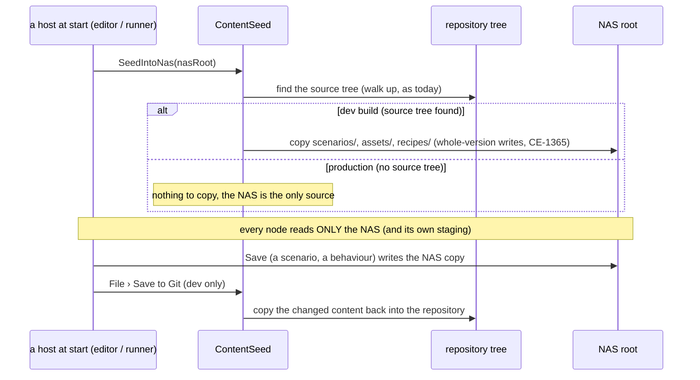
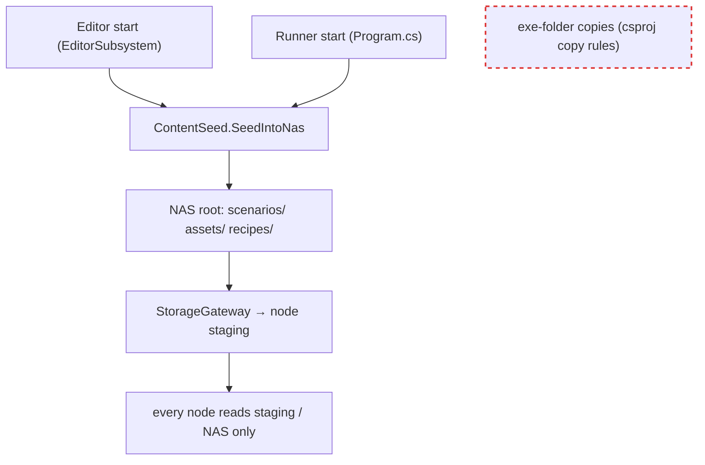
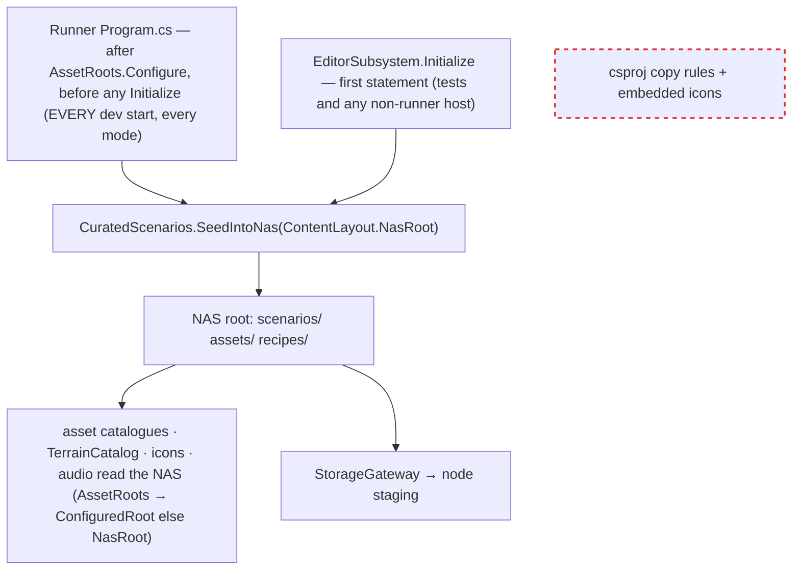

<!--STATUS
state: LIVE — ✅ APPROVED by the user 2026-10-28 (R-4097)
updated: 2026-10-28
build-state: BUILT — CE-4089 (2026-10-28); it lands BEFORE the AQ108 build (CE-4082), whose start surface lists recipes and scenarios
current-answer: §1 the tree · §5 AS BUILT (the classes, where each lives, what deviated) · §3 decisions · §4 the move list (done, except its step 5 — CE-4082)
stale-below: §2's CLASS NAMES (`ContentRoots`, `ContentSeed`) are the design-time names — SUPERSEDED by §5 (`ContentLayout` in Fdp.Toolkits, `AssetRoots` delegating, `CuratedScenarios` generalised in place). §2's sequence and module pictures still hold, with §5's two start points.
known-rot: §0's inventory table describes the layout BEFORE CE-4089 (it is the "from" state)
known-conflict: designs/main-toolbar-1/DESIGN.md §16 placed Assets/ and Recipes/ INSIDE the Hrot.AI.Behaviors project; this design keeps its rule (final assets and recipes in disjoint roots, AssetRoots the one authority) and moves both roots to the repository root
related-designs:
  - designs/main-toolbar-1/DESIGN.md — §16 OWNS the assets-vs-recipes split and the AssetRoots authority this design relocates; §10 the ONE asset browser
  - DESIGN_Artifact_Staging.md — OWNS how a node stages artifacts from the shared root (unchanged; it now reads the seeded tree)
  - DESIGN_Terrain_Zones_And_Assets.md — OWNS what a terrain is and how a node resolves one (TerrainCatalog: staging → shared → shipped); the shipped arm goes
  - DESIGN_Distributed_Scenario_Persistence.md — OWNS what a scenario folder holds after a distributed save
  - blueprints/Architect_Question_108_Run_Mode_Picker.md — the start surface (D16) lists `recipes/scenarios/` and `scenarios/`; D18's start-up option names a recipe by its root
-->

# DESIGN — content layout: `scenarios/`, `assets/` and `recipes/` at the repository root, one way to reach a run

🔒 **User, `2026-10-28`** (verbatim): *"I need them to be located in the subfolders of the root folder. Now they are buried somewhere under some
project. I would like to have the scenarios in the scenario subfolder under the root, and in assets subfolder all the assets like JSON behavior trees
and terrains and all its components, Later also sound samples and maybe textures and assets like that."* · *"Recipes should be separated from normal
assets. That means we might need a new top-level folder called recipes"* · *"if we take, for example, the textures, they do not belong to terrain or
to something else … They are just assets. So maybe also the buildings are just assets."* · *"By the root, I meant the repository root … In the
production installation, this root will be replaced by the NAS very likely … every run of the software starts from the development versions,
development assets that are baked in the repository … in the production. The code should simply fail to find the golden scenarios and assets baked
in the repository. So it will need to look at the NAS only."* · *"top-level recipes folder, and go with your lean on behaviours, All your leans
accepted."*

## 0. INVENTORY (`2026-10-28`, graph + grep)

| what | today | how a run gets it |
|---|---|---|
| scenarios | `scenarios/` (repo root, 345 files) | copied into the NAS working folder at start (`CuratedScenarios.SeedIntoWorking`, editor always, runner when its debug port is on); *File › Save Curated Scenarios to Git* copies back; no source tree ⇒ no-op |
| GUI layout | `layout/default/` | the same pattern (`LayoutPaths.TryFindSourceLayoutDirectory`) |
| behaviours (BTrees, HSMs, Blueprints, Params) | `Hrot/Subsystems/Hrot.AI.Behaviors/Assets` | read and written IN PLACE (`AssetRoots.ResolveBase`: configured root → the source project → the exe folder) |
| recipes (Blueprints, Buildings, Scenarios, Terrain) | `Hrot/Subsystems/Hrot.AI.Behaviors/Recipes` | in place / shipped |
| terrains, buildings | `…/Recipes/Terrain/<name>`, `…/Recipes/Buildings` | shipped into the exe folder; `TerrainCatalog.ForNode` looks in staging → NAS `terrain/` → the shipped copy |
| icons, audio | `Hrot/Engine/Hrot.Presentation/Assets/EntityIcons`, `…/assets/audio` | shipped with the exe |
| the NAS | `ClusterConfiguration.NasBasePath` (`/tmp/FDP_Temp/shared` in dev) | working scenarios, `terrain/`, `tkb/`, the exercise archive; the storage gateway pushes into each node's staging |

Hard-coded paths outside `AssetRoots`: ~15 files (`EntityIconLibrary`, `TerrainCatalog`, `TerrainAssets`, `AudioLayer`, two `.csproj` copy rules,
golden corpora, `IgVisualDef`, `VisualDefinitionDto`, `AssetRelPath`, two tests).

## 1. ⭐ The tree

```
<repo root>/                     (production: the NAS root — the same tree)
  scenarios/<name>/              saved scenarios (one folder each)
  assets/
    behaviors/ BTrees/ HSMs/ Blueprints/ Params/
    terrain/<name>/              GeoJSON + its terrain-specific files
    buildings/                   building assets — terrains USE them; they are not terrain parts
    icons/   audio/   textures/
  recipes/                       listed ONLY by "New …"; never by "Open …"
    scenarios/<seed>/
    behaviors/ BTrees/ HSMs/ Blueprints/
  layout/                        GUI defaults (unchanged)
```

## 2. ⭐ One pattern: the repository is the development seed of the NAS

```mermaid
classDiagram
  class ContentRoots { <<existing AssetRoots, grows>> Scenarios · Assets(kind) · Recipes(kind) — the ONE path authority }
  class ContentSeed { <<existing CuratedScenarios, generalised>> FindSourceTree() · SeedIntoNas(nasRoot) · SaveBackToGit(kind) }
  class TerrainCatalog { <<existing>> staging → NAS assets/terrain (shipped arm REMOVED) }
  class TerrainAssets { <<existing>> buildings from assets/buildings }
  class EntityIconLibrary { <<existing>> reads ContentRoots.Assets(icons) }
  class AudioLayer { <<existing>> reads ContentRoots.Assets(audio) }
  class AssetBrowserPanel { <<existing>> Open lists assets/ and scenarios/ only }
  class NewAssetDialog { <<existing>> lists recipes/ only }
  class StorageGatewayModule { <<existing>> pushes from the NAS into node staging }
  ContentSeed --> ContentRoots
  TerrainCatalog --> ContentRoots
  TerrainAssets --> ContentRoots
  EntityIconLibrary --> ContentRoots
  AudioLayer --> ContentRoots
  AssetBrowserPanel --> ContentRoots
  NewAssetDialog --> ContentRoots
  StorageGatewayModule ..> ContentRoots : the NAS tree
```



*What the picture shows that prose hid:* every reader goes through ONE path authority, and only ONE class knows the repository exists
(`ContentSeed`) — so a production install, which has no source tree, cannot tell the difference except that the seed does nothing.





*What the picture shows:* the shipped exe-folder copies (red, dashed) disappear — today terrains, buildings, icons and audio reach a run that
way, a third pattern beside copy-at-start and edit-in-place.

## 3. Decisions (✅ all approved, R-4097)

| # | decision |
|---|---|
| L1 | the tree of §1 at the repository root; production uses the same tree at the NAS root |
| L2 | a top-level `recipes/` — recipes are never in an Open list, only in New (separation by construction, not a filter every listing must remember) |
| L3 | buildings, textures, icons, audio are plain assets; a terrain uses them |
| L4 | ONE pattern for every content type: a dev start seeds the NAS from the repository; every node reads only the NAS (and its staging); *Save to Git* copies changes back, for behaviours too (today they are edited in place); production has no source tree, so the seed does nothing |
| L5 | `AssetRoots` (renamed or kept) is the ONE path authority; every hard-coded path routes through it; the exe-folder copy rules go |
| L6 | a recipe is named by its root: `recipes/scenarios/<seed>` (AQ108 D18's start-up option) — the old `Recipes/<seed>` under the scenarios root goes |

## 4. The move list (CE-4089)

1. Move the files (git mv): `Hrot.AI.Behaviors/Assets/*` → `assets/behaviors/`, `Recipes/Terrain/*` → `assets/terrain/`, `Recipes/Buildings` →
   `assets/buildings/`, `Recipes/Scenarios/*` → `recipes/scenarios/`, `Recipes/{Blueprints,HSMs,BTrees}` → `recipes/behaviors/`, entity icons →
   `assets/icons/`, audio → `assets/audio/`, `SimHost/Assets/sample_road.json` → measure its user first.
2. `AssetRoots` gains the scenario / recipe / plain-asset roots; route the ~15 hard-coded sites through it; remove the `.csproj` copy rules.
3. Generalise `CuratedScenarios` into the one seed (scenarios + assets + recipes) and *Save to Git* per kind; keep its whole-version write (CE-1365).
4. `TerrainCatalog` drops the shipped arm; `TerrainAssets` reads buildings from the assets root.
5. The asset browser's Open lists `assets/` + `scenarios/`; New lists `recipes/`.
6. Rails: the existing suites of each touched class (`AssetRootsTests`, `CuratedScenariosTests`, `ShippedTerrainFilesAreDeployedTests` → rewritten
   for the seed, golden corpora paths) — a rail that a production layout (no source tree) reads only the NAS.

## 5. ⭐ AS BUILT (CE-4089, 2026-10-28) — SUPERSEDES §2's class names

```mermaid
classDiagram
  class ContentLayout { <<static, Fdp.Toolkits/Orchestration — NEW>> segment names · Scenarios/Assets/Recipes(root) · BehaviorAssets/Recipes(root,folder) · TerrainAssets/BuildingAssets/IconAssets/AudioAssets/TextureAssets(root) · AssetSyncRoot(root,kindId) · NasRoot · TryFindSourceTree(startDirs) }
  class OrchestrationConstants { <<existing>> ScenariosDirectoryName · NasAssetsDirectoryName · GetSharedRoot · GetNasAssetRoot → ContentLayout.AssetSyncRoot }
  class AssetRoots { <<existing, Hrot.Editor.AiShared — delegates>> ConfiguredRoot(--asset-root) else NasRoot · AssetsFor/RecipesFor/ResolveAssetsRoot · BehaviorAssetsRoot }
  class CuratedScenarios { <<existing, generalised IN PLACE>> SeedIntoNas · SaveToGit · SeedTreeFrom/SaveTreeTo (pure) · CE-1365 write }
  class TerrainCatalog { <<existing>> ForNode(staging, nasRoot) = staging + NAS assets/terrain — NO shipped arm }
  class TerrainAssets { <<existing>> DefaultSharedBuildingsRoot = NAS assets/buildings }
  class EntityIconLibrary { <<existing>> reads NAS assets/icons — nothing embedded }
  class AudioLayer { <<existing>> AssetFolder = NAS assets/audio }
  class StorageGatewayModule { <<existing>> terrain source = ContentLayout.TerrainAssets(nas) }
  class AssetSyncService { <<existing>> publish/refresh/probe over OrchestrationConstants.GetNasAssetRoot }
  OrchestrationConstants --> ContentLayout
  AssetRoots --> ContentLayout
  CuratedScenarios --> ContentLayout
  TerrainCatalog --> ContentLayout
  TerrainAssets --> ContentLayout
  EntityIconLibrary --> ContentLayout
  AudioLayer --> ContentLayout
  StorageGatewayModule --> ContentLayout
  AssetSyncService --> OrchestrationConstants
```



*What the picture shows that §2's prose hid:* `ContentLayout` lives in **Fdp.Toolkits** (not `Hrot.Editor.AiShared`) because `TerrainCatalog`/`TerrainAssets` are there and cannot
reference Hrot; `AssetRoots` kept its public API and now only composes through it. The asset-sync's NAS tree (`GetNasAssetRoot`) is routed through the same class — see D-2.



*What it shows:* the seed has TWO call sites (the runner for a cluster start, the editor's `Initialize` for hosts that do not go through the runner — every editor test); the second finds identical bytes and writes nothing.
The editor's seed moved from "after the master is built" to the FIRST statement of `Initialize`, because the asset catalogue it composes a few hundred lines earlier now reads the NAS.

### Decisions taken while building (each is a deviation from, or an addition to, §2–§4)

| # | what | why (measured) |
|---|---|---|
| D-1 | the runner seeds at **every** dev start, no longer only when the debug port is on (HN-029's gate) | the design's sequence has the seed at every start; ⚠ it force-writes only curated scenario NAMES and files whose bytes differ, deletes nothing |
| D-2 | `OrchestrationConstants.GetNasAssetRoot(nas, kind)` now answers `{nas}/assets/behaviors/<Folder>` for `blueprint`/`btree`/`hsm` (was `{nas}/assets/<kind>`) | ⛔ otherwise the NAS held TWO trees for one concept — the seeded `assets/behaviors/BTrees` and the asset-sync's `assets/btree`. Wire/staging protocol unchanged (the kind ids and `AssetSyncService` flows are the same; only the NAS folder name moved). Rails: `ContentLayoutTests.TheAssetSyncRootOfABehaviourKind_IsTheSeededTree`, `StorageGatewayTests` (6 paths) |
| D-3 | entity icons are **no longer embedded** in `Hrot.Presentation`; `EntityIconLibrary` reads `{nas}/assets/icons` (`EmbeddedNames` → `NamesIn(folder)`) | nothing needs the embedding: every consumer builds the library with the default folder; the exe-folder / embedded copy is the third delivery pattern L4 removes. A bare node with an empty NAS shows no art (`_point` fallback also absent) |
| D-4 | `AssetRoots.AssetsRoot`/`RecipesRoot` are now the TOP-LEVEL `assets/` and `recipes/`; `BehaviorAssetsRoot` (`assets/behaviors`) is new and is what `ParamsDtoStaleness` uses | the old `AssetsRoot` meant "behaviour assets"; `assets/` now also holds terrain, icons, audio |
| D-5 | `AssetRoots.ResolveProjectDir` stays — only for the one non-content need left: the `.csproj` a full rebuild / hot reload builds (`EditorSubsystem`, `EditorApplication`). `ResolveBase`/`ResolveAssetsRoot`/`ReportBase`/`DescribeBase` still take the project segments (≈30 call sites) and IGNORE them | measured: 2 production users of `ResolveProjectDir`, both non-content |
| D-6 | `ReportBase`'s warning is "the root the catalog reads has no `assets/` folder" (was "no config and no source tree") | there is always a root now (config, else the NAS); the fault left is "nothing seeded or published" |
| D-7 | `BehaviorGroups` (netstandard2.0 analyzer) spells `assets/behaviors/<Kind>/` as literals | the generator assembly cannot reference `ContentLayout`; rail: `BTreeJsonGeneratorTests.CE3164_*` |
| D-8 | `Hrot.AI.Behaviors.csproj` feeds the generators from `$(AssetsBehaviorsDir)` = `$(MSBuildThisFileDirectory)..\..\..\assets\behaviors\`; every `Content … CopyToOutputDirectory` rule is gone | rail: `FolderLayoutTests.TheBehaviorsProjectHoldsNoContentAndCopiesNone` |
| D-9 | an editor edit of a behaviour asset now writes the NAS copy; the C# generator still compiles the repository's `assets/behaviors` | this is L4's own consequence ("*Save to Git* for behaviours too — today they are edited in place"): a behaviour edited in the editor reaches the compiled assembly only after *Save to Git* + a rebuild. The menu label still says "Save Curated Scenarios to Git" (CE-4082's menu work) but the command saves every kind |
| D-10 | not done here: §4 step 5 (asset browser Open lists `assets/`+`scenarios/`, New lists `recipes/`) beyond what the new roots already give; `Recipes/<seed>` under the scenarios root (L6) stays until CE-4082 | out of this task's brief; the roots are separate by construction |
| D-11 | `Hrot.Core.Tests/Assets/sample_road.json` left in place | measured: no `.cs` reads it; it is a test-project `Content` item only (the other `sample_road.json` copies are unrelated) |

*Prior state (SUPERSEDED, kept so a reader does not re-derive it):* before CE-4089 content was read in place from the source project (`AssetRoots.ResolveBase`: config → source walk-up → exe folder), shipped through four csproj copy rules
(`Recipes/*`, icons embedded, audio copied), and `TerrainCatalog` searched staging → NAS `terrain/` → the shipped `{app}/Recipes/Terrain`.
