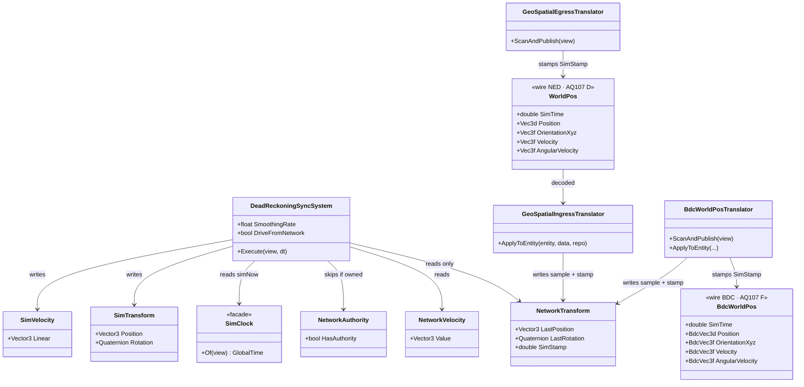
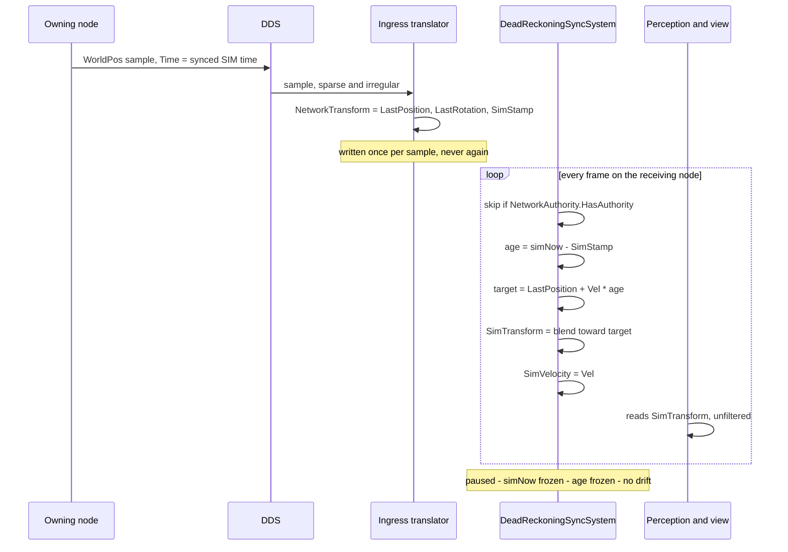
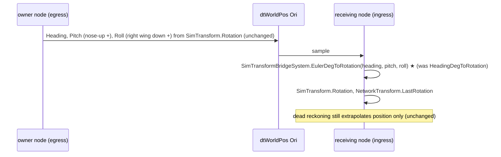
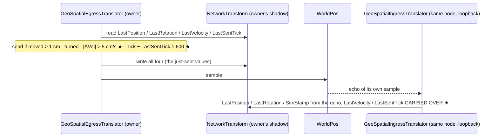

<!--STATUS
state: LIVE
build-state: READY-TO-BUILD
updated: 2026-10-27 (AQ107 D / F — the sample is a local-ENU pose with `double SimTime`; §"Encoding"; the old encoding is in the HISTORY at the bottom)
approved: 2026-09-07 by the user ("go"). CE-211 is slice S0 of the Stride build order and is IN FLIGHT
  on claude/reset-working-branch-qd1qpv (started marker bbd976a7d).
current-answer: the whole file. It is the ONE owning design for dead reckoning / remote-entity
  smoothing across every node and BOTH replication stacks (NED and BDC). CE-211 is its implementation.
design-basis: user rulings 2026-09-05/06/07 (quoted verbatim in §2) · measured against
  DeadReckoningSyncSystem.cs, NedReplicationModule.cs, BdcReplicationModule.cs, SimDescriptors.cs,
  BdcEntityMessages.cs, GeoSpatialEgress/IngressTranslator.cs, EqsResultUpdateSystem.cs ·
  NotebookLM architect input on the clock domain (job 20260907T055024Z-b217f7b7), verified in
  Blueprint_Issues_Tracker CE-211.
known-rot: §9 (pitch and roll on the wire, Euler `Ori`) describes the pre-AQ107 wire — superseded at its head, kept as history; the Euler helpers it names remain only for the attribute routes.
known-conflict: it SUPERSEDES three places that frame DR as an IG-only presentation feature —
  docs/designs/dds-to-ecs/DESIGN.md §6.3 (the birth design, which specifies the accumulator this
  removes), docs/designs/IG/DESIGN-IG.md, and docs/projects/relationships/FDP-Network-Stack.md §12.6.
  Each is marked at the site.
related-designs:
  - docs/designs/airborne/DESIGN_Airborne_Insertion.md — a canopy's bank rides the replicated roll (D-5); a descending man is an air body whose position moves on its owner only
  - docs/designs/air-attack/DESIGN_Air_Operations.md — §9c: the live miss that produced R6 (a brain read a plane's SimVelocity)
  - DESIGN_Weapon_Layers.md — W-10 applies this model to TurretPose (azimuth, elevation, rates, sim stamp).
  - docs/blueprints/Architect_Question_93_Sumo_Traffic_Node.md — SUMO cars are NOT NED entities: they use SumoSharp's own lane-based dead reckoning on cluster sim time (R-4020, R-4022).
-->

# DESIGN — dead reckoning: every node, both stacks, from the sample and its stamp

## Headline

⭐⭐⭐ **Dead reckoning is not a rendering feature.** It is how a node holds a usable position for an
entity it does **not** own, between the sparse samples the owner sends — which is what lets the network
send sparsely at all. ⇒ **every node owes it**, and the extrapolation must be a **pure function of
replicated data** so that time-synced nodes agree by construction.

| | before | after |
|---|---|---|
| who runs it | ⛔ NED: only roles containing `ImageGenerator`. ✅ BDC: **already everyone** | ⭐ **every node, both stacks** |
| the anchor | ⛔ `NetworkTransform` advanced by `Vel × frameDt` — an **accumulator** that extrapolates from its own previous guess | ⭐ **read-only: the last received sample** |
| the target | `Lerp(sim, anchor, frameDt × rate)` — frame-rate shaped, per-node | ⭐ `LastPosition + Vel × (simNow − stamp)` — **recomputed fresh** |
| the clock | wall (`DateTime.UtcNow`) | ⭐⭐ **cluster-synced SIMULATION time**, for the stamp **and** the target |
| pause | needs a guard | ⭐ **none** — the input stops, so extrapolation stops |

---

## 1. INVENTORY

⭐ `search_graph` + grep, `2026-09-06/07`, branch `claude/reset-working-branch-qd1qpv`.
⚠ `check_index_coverage` is not reachable from this session, so no count is a completeness proof.

| query | result | what it settled |
|---|---|---|
| `grep -rliE "dead.?reckon" docs/` | **20 files, 0 owning designs** | ⭐ **this document is the first** — §7 lists the three that touched it |
| `grep "DeadReckoningSyncSystem"` | **3 production registrations** | `NedReplicationModule:333/339` *(both behind `_roleHasIG`)* · `BdcReplicationModule:87` *(unconditional)* |
| `grep "class GeoSpatialDRTranslator"` | **test class only** | ⛔ there is **no second DR implementation** — one system, two registration sites |
| `grep "new WorldPos"` production | **1** — `GeoSpatialEgressTranslator:211` | the only NED producer, and it stamps |
| readers of `WorldPos.Time` | 🔴 **zero** | ⇒ re-pointing the field breaks no consumer |
| perception queries | `LocalGridBuilderSystem:94` = `Query().With<SimTransform>()`, no authority/lifecycle filter; `VisionBroadphaseSystem`, `LosRequestBatchingSystem` alike | ⭐⭐ **ghost `SimTransform` IS simulation input** — DR is not cosmetic |

---

## 2. THE RULINGS — user, verbatim

| # | ruling |
|---|---|
| **D1** `2026-09-05` | *"dead reckoning (and maybe also related smooth inter/extrapolation) of remote entities is basically something that every node needs to be doing for remote entities (for which the node does not own the simTransform) as dead reckoning is used to reduce network traffic. So likely not specific to IG nodes, they might just do smoothing on higher rate as they are usually running on higher fps … in general DR/smoothing is nothing special to IG role only."* |
| **D2** `2026-09-06` | *"dr writes simtransform. networktransform stays the last received sample. extrapolate dt = current time on node minus nettransform.timestamp"* |
| **D3** `2026-09-06` | *"there should be no unstamped mode"* |
| **D4** `2026-09-07` | *"stamping with wall time is wrong, synced sim time is what should be used for stamping and for target extrapolation time on unowning nodes. no special pause guard should be needed then, sim time does not advance when paused/stepped clusterwide."* |
| **D5** `2026-09-07` | *"bdc stack uses same principles so it needs same treatment as ned."* |

---

## 3. THE MODEL

⭐ **Existing** — everything except `NetworkTransform.SimStamp`, which is the one added field.

### The per-frame contract

---

## 4. THE RULES

| # | rule | why |
|---|---|---|
| **R1** | ⭐⭐⭐ **Every node registers it.** The drive flag is derived from **ownership**, not from a presentation role: `driveFromNetwork = !roleHasMuscle && !roleHasBrain` — *"this node owns nothing"* | 🔒 `D1`. ⭐ **This predicate is BDC's, at `BdcReplicationModule:58` — NED adopts it rather than inventing one** |
| **R2** | ⭐⭐ **`NetworkTransform` is READ-ONLY on the receiving side** — the last received sample and its stamp, written by ingress and by nothing else | 🔒 `D2`. ⛔ Advancing it makes the anchor an accumulator that drifts with frame rate and extrapolates from its own guess |
| **R3** | ⭐⭐ **The target is recomputed FRESH EVERY FRAME** from `LastPosition + Vel × (simNow − SimStamp)` | ⇒ a **pure function of replicated data** — time-synced nodes agree by construction, with no accumulator to diverge |
| **R4** | ⭐⭐⭐ **Both the stamp and `simNow` are cluster-synced SIMULATION time** | 🔒 `D4`. ⭐ Matches the codebase's only prior art for cross-node sample age — EQS `BecomesStale` ages over `view.Time` *(`EqsResultUpdateSystem.cs:65`)*, chosen so Brain/Muscle clock skew cannot corrupt the delta |
| **R5** | ⭐⭐ **No pause guard.** Extrapolation freezes because `simNow` stops | 🔒 `D4`. ⛔ This deliberately avoids the `IsPaused`/`IsAdvancing` landmine *(`M-42`: `IsPaused` is **false** while paused — pause switches to `Stepping` with `DeltaTime → 0`)* |
| **R6** | ⭐ *(`2026-10-15`, behaviors, CE-2173)* **A brain reads a unit whose MOTION another node owns through `ReplicatedMotion.Of`, never `SimVelocity`** — on a brain node such a unit is neither owned nor a ghost, so R1's predicate skips it and its `SimVelocity` stays the zero `SpatialCoreTkbTranslator` gave it. `ReplicatedMotion.Project` is R3's formula; `DeadReckoningSyncSystem` calls it too, so there is one | 📌 the A-10 never released its bomb live (`DESIGN_Air_Operations.md` §9c). ⭐ Second reader routed `2026-10-15`: `VehicleCover.IsStanding` (every vehicle read as parked on a brain node; rail `CoverPointsGizmoTests.CE2173_AVehicleAnotherNodeDrives_IsNotStanding`) |
| **R6** | ⭐⭐ **No unstamped mode.** An unstamped sample is a **defect, logged loudly** | 🔒 `D3`. ⛔ Not a silent degraded path — the "make an omission loud" habit. ⭐ **AQ107 D (`2026-10-27`):** the stamp is a plain `double SimTime`, so the old "0 ticks = unspecified" sentinel is gone (sim time 0.0 is legitimate); the loud diagnostic now fires on `SimTime <= 0` once the receiver's sim clock is past 1 s (`GeoSpatialIngressTranslator.CheckSimStamp`, `BdcWorldPosTranslator.CheckSimStamp`) |
| **R7** | ⭐ **Smoothing RATE is per-host, not per-role** — a constructor parameter | 🔒 `D1`: renderers *"might just do smoothing on higher rate as they are usually running on higher fps"* |
| **R8** | ⭐⭐ **Both stacks, identically** | 🔒 `D5` |

### Encoding

⭐ **AQ107 D / F (`2026-10-27`, [AQ107](blueprints/Architect_Question_107_NED_Wire_Frame_And_Names.md) R-4092/R-4093):** `SimStamp` is carried in
**`double SimTime`** (cluster-synced simulation SECONDS) on both wire types — `WorldPos.SimTime` and `BdcWorldPos.SimTime`. The sample around it is
a local-ENU pose (`Position` m, `OrientationXyz` quaternion vector part with `w` implied, `Velocity` m/s, `AngularVelocity` rad/s); the receiver
copies it into `NetworkTransform` (`LastPosition`, `LastRotation`, `SimStamp = SimTime`) and `NetworkVelocity` and projects with `ReplicatedMotion.Project`
**unchanged** — the velocity it reads is the sender's `SimVelocity.Linear`, no azimuth/elevation arithmetic in between.
⭐ One mapping per stack: NED `WorldPosCodec`, BDC `BdcWorldPosCodec`; both call `QuaternionWireCodec` for the orientation.

---

## 5. THE TWO STACKS

| | **NED** | **BDC** |
|---|---|---|
| wire type · IDL | `WorldPos` · `hrot-sim-desc` | `BdcWorldPos` · `bdc-entity-msgs`, topic `BDC_WorldPos` |
| timestamp field | `double SimTime` *(AQ107 D)* | ⭐ **the same field, same type** *(AQ107 F)* |
| velocity | `Velocity` (m/s ENU) + `AngularVelocity` (rad/s) | ⭐ **the same** |
| DR registration | ⛔ `NedReplicationModule:333/339` — **gated on `_roleHasIG`** | ✅✅ **`:87` — UNCONDITIONAL** |
| drive predicate | hard-coded per arm | ⭐⭐ **`!roleHasMuscle && !roleHasBrain`** *(`:58`)* |

### 🔴 5.1 MEASURED AT BUILD TIME `2026-09-07` — **NED ALREADY COMPUTES THE RIGHT PREDICATE AND THROWS IT AWAY**

📐 `NedReplicationModule.cs:194` computes **`_driveFromNetwork = !_roleHasMuscle && !_roleHasBrain`** —
⭐⭐ **character-for-character BDC's `:58` predicate** — and exposes it as a public property
`DriveFromNetwork` at `:124`. ⛔⛔ **Neither DR call site uses it:** `:333` and `:339` both pass a
hard-coded **`driveFromNetwork: false`**.

⇒ ⭐⭐⭐ **This is the SILENT-DEFAULT PATTERN exactly as `CLAUDE.md` defines it** — *"a production caller
that HAS a dependency must PASS it"*. ⚠ It is the **third** measured instance, and the cheapest: the
value is already right, already named, already public.

⇒ ⭐ **`R1` is therefore a SMALLER change than the design assumed**: not *"invent a predicate for NED"*
but *"delete the two `_roleHasIG` arms and register once with the field the constructor already set"*,
which makes the two stacks textually identical.

### 🔴🔴 5.2 SUPERSEDED AT BUILD TIME `2026-09-07` — **BDC's DR WAS REGISTERED AND INERT**

⛔⛔ **The line below — *"BDC is the one that matches the rulings"* — is TRUE OF THE REGISTRATION LINE AND
FALSE OF THE MECHANISM.** 📐 Measured while building `CE-211`:

| what BDC had | measured |
|---|---|
| ✅ `DeadReckoningSyncSystem` registered unconditionally | `BdcReplicationModule.cs:87` — real |
| 🔴 the components DR **queries** | ⛔ `BdcWorldPosTranslator` wrote **`SimTransform` only** — never `NetworkTransform`, never `NetworkVelocity`. DR's query requires both ⇒ on a BDC node it matched **zero entities** |
| 🔴 the velocity it extrapolates **along** | ⛔ egress published **`Vel = { 0, 0, 0 }` hard-coded** ⇒ even with the components wired there was nothing to project |

⇒ ⭐⭐⭐ **This is the `CLAUDE.md` distinction that matters: *"the seam is unused"* has two meanings — an
interface nobody calls, versus one called every frame with a dead parameter.** ⚠ BDC was the second kind,
and a registration-count check *(the shape the NED rails use)* could never have seen it. ⭐ **`D5`'s
*"same treatment as ned"* was therefore BIGGER than a stamp** — it was the whole ingress/egress path.
✅ Built: egress encodes `SimVelocity` the way NED does, ingress writes both components plus the stamp.

⇒ ⭐⭐ **The corrected verdict:** ⛔ **neither stack matched the rulings.** NED had the mechanism and
mis-gated it; BDC had the gate right and no mechanism. ⚠ **The table below is kept because its
per-column facts are still accurate** — only the conclusion under it was wrong.

⇒ ⛔ ~~**The stacks already disagreed and BDC is the one that matches the rulings.**~~ *(SUPERSEDED — §5.2)*
⭐ What stands: **NED is the outlier on the GATE.** ⚠ `Acc` is on the NED wire and unused — second-order DR is available later, and is **not** part
of this design.

---

## 6. WHY IT IS NOT COSMETIC

📐 `LocalGridBuilderSystem.cs:94` queries `view.Query().With<SimTransform>().Build()` — **no authority or
lifecycle filter** — and `VisionBroadphaseSystem` and `LosRequestBatchingSystem` are the same shape.
⇒ ⭐⭐ **a ghost's `SimTransform` is an input to perception, LOS and AI.** Freezing it between packets is a
*simulation* inaccuracy, not a visual one; and extrapolating it with a per-node frame delta would make
nodes **disagree about what they can see**. ⭐ `R3` + `R4` are what prevent that.

---

## 7. WHAT THIS SUPERSEDES

| document | status |
|---|---|
| `docs/designs/dds-to-ecs/DESIGN.md` **§6.3** *("Deviation 3 — Hard-Snapping vs. Dead Reckoning")* | ⭐ **the birth design — still correct about the PROBLEM** *(hard-snapping, irregular packets)*. ⛔ **Its Part B mechanism is SUPERSEDED**: *"Advance `NetworkPosition` by `NetworkVelocity * deltaTime` each frame"* is precisely `R2`'s accumulator |
| `docs/designs/IG/DESIGN-IG.md` | ⛔ **its IG-only framing is SUPERSEDED by `D1`.** ⭐ Still correct that IG *wants* smoothing; wrong that IG is *where it belongs* |
| `docs/projects/relationships/FDP-Network-Stack.md` **§12.6** *("Dead Reckoning for IG Nodes")* | ⛔ **SUPERSEDED** — role-scoped, and it claims velocity **and acceleration** are used; ⚠ `Acc` is on the wire and **not read** |

---

## 8. IMPLEMENTATION AND GATE

⭐ **`CE-211` is the implementation** — 📄 [`Blueprint_Issues_Tracker.md`](blueprints/Blueprint_Issues_Tracker.md).
⛔ **`CE-211` is a hard prerequisite of `CE-207`** *(Stride mode 2)*: it is what lets Stride drop the
`ImageGenerator` flag without losing smoothing — 📄 [`DESIGN_Stride_Node_Modes.md` §6](DESIGN_Stride_Node_Modes.md).

| ⚠ blast radius | |
|---|---|
| ⭐⭐ **ghost positions on SimHost and CGF will start moving between packets** | that is the intent — ⛔ **and it will move test expectations that assert a frozen ghost.** Expectations get **reviewed**, never silently adjusted |
| ⭐ **`R-142` — the feature's own suites** | `SplitAuthoritySpawnTests` · `Hrot.ClusterRunner.Integration.Tests`, **baselined BEFORE any change** |
| ⭐ a rail worth having | two nodes at different frame rates must compute the **same** ghost position for the same `simNow` — the property `R3`+`R4` exist to guarantee |

## 9. Pitch and roll on the wire (ui handoff P3, `2026-10-15`)

⛔ **SUPERSEDED `2026-10-27` by AQ107 D:** the wire no longer carries `Ori { Heading, Pitch, Roll }` — `WorldPos.OrientationXyz` is a quaternion, so pitch and roll cross by construction and the Euler helpers named below are not on the wire path (they still serve the JSON/binary attribute routes). The rail `P3_PitchAndRoll_CrossTheWire_…` was replaced by `GeoSpatialIngressTranslatorTests.AQ107D_APose_RoundTripsEcsToWorldPosToEcs`. Read the rest of this section as history.

📐 **Measured:** egress already writes `Ori { Heading, Pitch, Roll }` (`GeoSpatialEgressTranslator.cs:193-236`, `RotationToPitchRollDeg`);
every ingress site rebuilds the rotation from the HEADING only (`GeoSpatialIngressTranslator.cs:73,148`, `DescriptorMapper.cs:130,362`) — so
a banking aircraft flies level on a receiving node.

| rule | why |
|---|---|
| ONE inverse helper beside `HeadingDegToRotation`: `EulerDegToRotation(h, p, r) = SimMath.FromYawPitchRoll((90 − h)°, −p°, r°)` — the exact inverse of `RotationToHeadingDeg` + `RotationToPitchRollDeg` | one formula, every ingress site — the Q59-C1 rule (*"one formula, three callers, zero copies"*) |
| with pitch = roll = 0 it equals `HeadingDegToRotation` exactly (`FromYawPitchRoll(y, 0, 0)` IS `FromYaw(y)`) | a level ground vehicle's numbers do not move; a vehicle on a slope now tilts on the receiving node too |

**As built (`2026-10-15`)** — as designed, at SIX sites: `GeoSpatialIngressTranslator` (2), `DescriptorMapper` (2) and
`BdcWorldPosTranslator` (2 — ⭐ found during the build; the BDC wire carries the same `Ori`). Rail:
`GeoSpatialIngressTranslatorTests.P3_PitchAndRoll_CrossTheWire_AHeadingOnlySampleIsUnchanged` (heading / pitch / roll round-trip to 0.01°;
level ⇒ equal to `HeadingDegToRotation`).

**Row 7 of the ui steer (`2026-10-15`,
[STEER_Backend_P3_Every_Ingress_Restores_Attitude](blueprints/batches/STEER_Backend_P3_Every_Ingress_Restores_Attitude.md))** — a
HEADING-ONLY patch keeps the body's pitch and roll: `SimTransformBridgeSystem.WithHeadingDeg(current, h)` (the current attitude read with
`RotationToPitchRollDeg`, rebuilt with `EulerDegToRotation`; a never-set rotation counts as level), called by `SimTransformHeadingInstaller`
(binary) and `AttributeCompilerFactory`'s `"Heading"` (JSON). Rails: `SimTransformBridgeSystemTests.P3_…` (125-case round trip to ±80° /
±60° within 0.1°; a heading change keeps the bank) · `TheHeadingConversionIsSharedTests.AHeadingOnlyPatch_OnABankedBody_KeepsItsBank`,
`TheDescriptorRoute_CarriesPitchAndRoll`.

## 10. When the owner sends — a stop is a sample (`CE-2348` ②, `2026-10-21`)

📐 **Measured live** (`uc-urban-battle`, `--mode all`, behaviors note ②): an APC killed while creeping kept its last `Vel` on CGF for
~200 s, so R3 slid the wreck across the map. Three causes, all in the owner's send rule:

*The picture shows what the code hid: the owner's shadow has TWO writers, and the echo's write came last every frame.*

| ★ | was | now | why |
|---|---|---|---|
| ① a velocity change is a send | moved / turned / heartbeat only | ⭐ also `\|Vel − LastVelocity\| > 5 cm/s` | a hull that stops does not move another centimetre, so its last sample (still creeping) was all the others had |
| ② the heartbeat counts ticks since the last send | `(Tick + salt) % 600 == 0` — one exact tick in 600 | ⭐ `Tick − LastSentTick ≥ 600` | a translator not called on every tick stepped over the one tick again and again |
| ③ the loopback keeps the egress's fields | the echo wrote a fresh `NetworkTransform` ⇒ both new fields read 0 every frame | ⭐ `LastVelocity` / `LastSentTick` carried over | without it, ① never saw a stop (0 vs 0) and ② fired every frame — every entity sending every frame |

⛔ **Rejected:** the echo skipping the write on the owner — split authority and the stamp may read the refreshed `SimStamp`; carrying two
fields costs nothing. ⛔ A velocity-only DR freeze on the receiver when `Health` reaches 0 — R2 keeps the receiver dumb; the fix belongs
to the sender, and it covers a stop for any reason (a mobility kill, a halt order).

**As built:** `GeoSpatialEgressTranslator` (rule ①②), `NetworkTransform.LastVelocity` / `LastSentTick` (egress-only fields),
`GeoSpatialIngressTranslator.Decode` (③). Rails: `GeoSpatialEgressTranslatorTests.AHullThatStops_PublishesTheStop_ThoughItDidNotMove_CE2348`,
`AStandingHull_GetsItsHeartbeat_HoweverOftenTheTranslatorRuns_CE2348`; `GeoSpatialIngressTranslatorTests.TheOwnersLoopback_KeepsWhatItsEgressLastSent_CE2348`.
📐 **Measured live after the fix** (`uc-urban-battle` unscripted, `--mode all`, 160 sim s, `2026-10-22`): the APC and the IFV both destroyed in combat — on CGF each reads `NetworkVelocity` (0, 0, 0) at the muscle's exact position from the first probe after death, and holds it (before: (2.11, 1.22) for 100+ s). ⭐ BDC needs no change (R8 holds): `BdcWorldPosTranslator.ScanAndPublish` sends every owned entity EVERY scan (`:123-147`), so a stop is always a sample.

## ⛔ HISTORY — the pre-AQ107 encoding (SUPERSEDED `2026-10-27`; do not quote as current)

⛔ `SimStamp` was carried in the existing `DateTime Time` field on both wire types, as **ticks from the exercise epoch plus one tick**
(`SimStampCodec`; 0 ticks = "unspecified"), to avoid an IDL change; velocity travelled as azimuth/elevation/length. AQ107 changed the IDL anyway
(the whole NED wire cut over once), so the bias, the sentinel and `SimStampCodec`'s use on these two types are gone (`SimStampCodec` still serves
`EntityTurretPose`).
