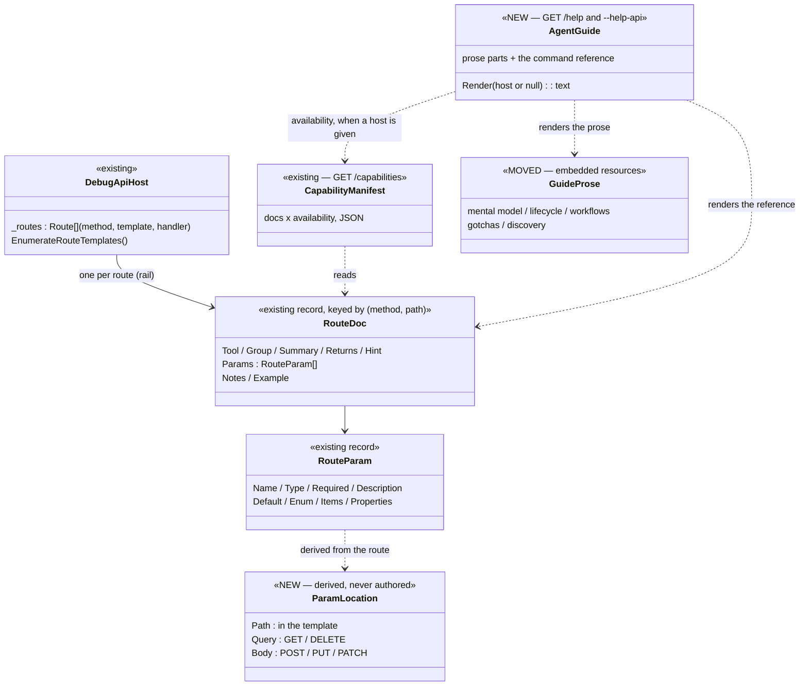
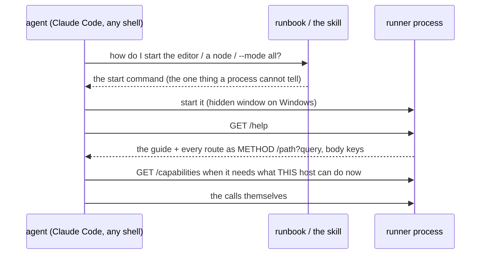
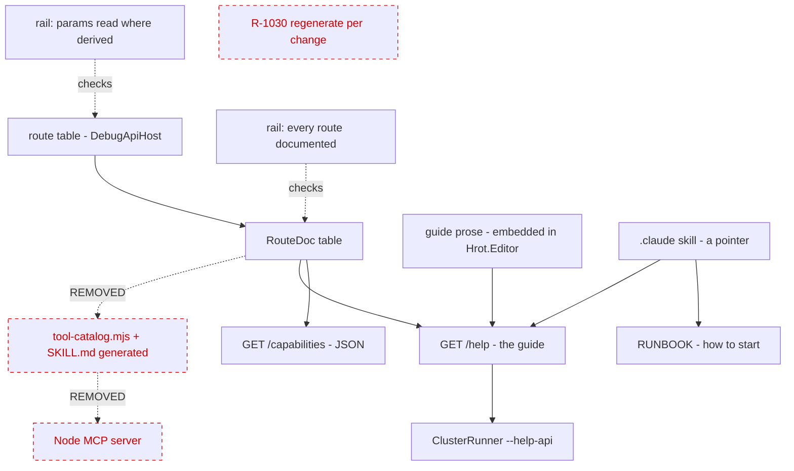
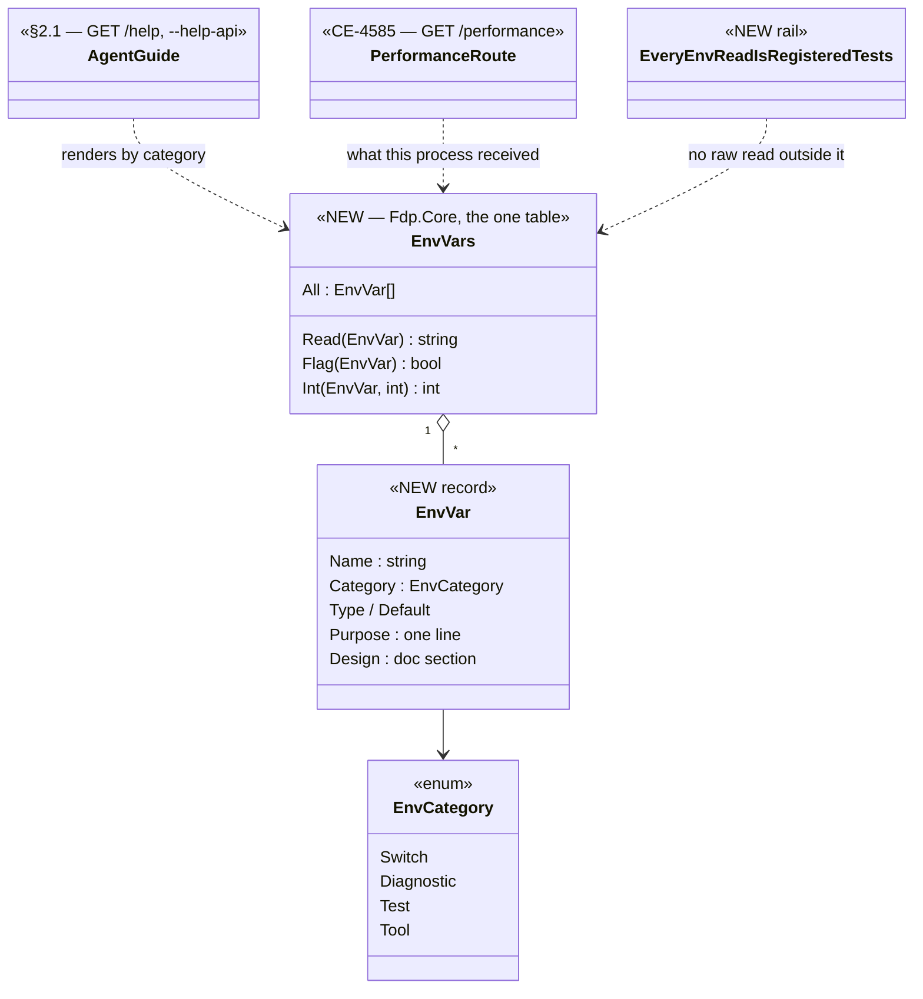
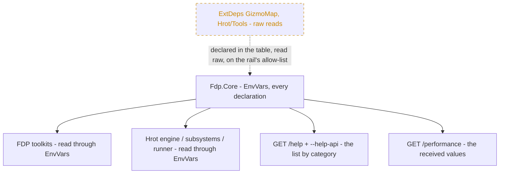

<!--STATUS
state: LIVE
build-state: BUILT — part A (§1–§5, CE-4523…CE-4529, `2026-11-14`); §6 (CE-4586) READY-TO-BUILD
updated: 2026-11-14 (§6 the environment-variable registry, CE-4586)
current-answer: §7 the as-built (read first where it differs), then the whole file (§1 the decision, §2 the diagrams, §3 where every piece of information lives, §4 rules, §5 acceptance, §6 the environment variables)
stale-below: nothing
known-rot: none
known-conflict: none — MCP_Integration.md and the other docs that name the removed server carry a HISTORY note (CE-4528)
related-designs:
  - designs/ai-debug-api/DESIGN.md — OWNS the WHY of the AI debug HTTP API and its endpoint groups A–N (historical, as designed); this file retires only its "companion MCP server" half
  - MCP_Integration.md — OWNS the API's as-built record on trunk; its MCP-server sections become HISTORY here, its endpoint record stays
  - RUNBOOK_Cluster_Debugging_Over_Http.md — OWNS how to START an editor, a node or `--mode all` and reach it over HTTP (the one thing a running process cannot tell you); the skill points there
  - DESIGN_MCP_System_Test_Harness.md — OWNS the C# system-test harness; it already drives the API over plain HTTP (its `McpClient` is an HTTP client) — unchanged
  - DESIGN_Agent_Shared_View.md — OWNS R-1030 (regenerate the docs with every API change), which this design makes true BY CONSTRUCTION and therefore supersedes as a chore
  - DESIGN_Mcp_Authoring.md — OWNS the authoring endpoints; their docs move with every other route doc (unchanged content)
-->

# DESIGN — the AI debug API is HTTP-only, and it describes itself (R-4223)

🔒 User, `2026-11-13`: *"ok, lets drop the MCP"* · *"unify and share, no duplication of information, we can keep generating but from single
source"* · *"guide generation is still ok but i guess this is what the GET help would return, correct?"*

## 1. The decision

**One source, three readings, no MCP server.** Every fact an agent needs about the debug API lives once, in the runner's C# project: the route
table (method + path template + handler), the route docs keyed by that route, and the guide's prose. The running process serves them as
`GET /capabilities` (JSON: docs × what this host can do now) and `GET /help` (the agent guide: prose + the command reference rendered from the
route docs, in HTTP terms); `ClusterRunner --help-api` prints the same `/help` text without starting a simulation. The Node MCP server, its
generated tool catalog, its generated `SKILL.md` and R-1030's regeneration chore are removed. The `.claude` skill becomes a pointer.

**Why:** the server is a 2 041-line hand-written 1:1 proxy (`tools/ai-debug-mcp/src/index.mjs`) whose only unique abilities are
`start_simulation` / `stop_simulation`; it rarely connects (it needs a prebuilt runner at a fixed path, `.mcp.json`); it addresses one port while a
cluster is one process per node; and every agent here has a shell — the VM lanes and Claude Code with Remote Control use HTTP already. A
shell-less client was the one thing it bought; the user ruled it out.

| rejected | the one fact that killed it |
|---|---|
| keep the MCP server, fix its start-up | still 2 000 lines and a regenerated catalog per API change, for a client nobody uses |
| a generic ~100-line MCP proxy attached to a running system | needs a shell-less client to be worth anything — ruled out; kept as a cheap future option because §3's param locations make it trivial |
| a new hand-written one-page skill | the content exists four times already (§3) — this design MOVES it into one home |
| annotate each route with its param locations | derivable: path params from the template, query vs body from the method — enforced by a rail (§4), nothing written per route |

## INVENTORY *(2026-11-13)*

| query | total | what it found |
|---|---|---|
| `scripts/cbm.sh search_graph '{"name_pattern":".*(RouteDoc\|Capabilit\|DebugApiHost\|McpClient\|RouteSide\|EveryRoute).*","label":"Class"}'` | 30 (the debug-API ones below; the rest are node capability classes, unrelated) | `DebugApiHost` (+ `.Director`), `DebugApiRouteDocs` (`ByRoute`, keyed `(method, path)`), `CapabilityManifest` (`GET /capabilities`), `EveryRouteIsDocumentedTests`, `AnUnwiredCapabilitySaysSoInsteadOfCrashingTests`, `CapabilitySmokeTests` (system tests). ⚠ The graph indexes `coordinator`; the route table on `exp/threaded-build` was read by grep |
| grep `_routes.Add(` in `DebugApiHost.cs` (exp/threaded-build) | 195 | the route table; handlers read `ctx.Query("k")`, `ctx.Body?["k"]`, path `{params}`. Of the one-line handlers: 0 POST read the query, 0 GET read the body (multi-line handlers unchecked — §4's rail checks all) |
| grep `ai-debug-mcp\|tool-catalog\|catalog-supplement\|generate-skill\|gen-catalog` (exp/threaded-build, excluding `.dev/`) | 14 tool files · 10 C# files · 2 scripts / code comments · 24 docs · 17 `.dev/` files | the server and its generators; C#: `DebugApiRouteDocs`, `CapabilityManifest`, `DebugApiHost`, `DebugApiFault`, `EditorSubsystem`, `Program.cs`, `HrotRunnerConfiguration`, `WindowManager` (comment), two tests; `scripts/ui-snapshot.py` (comment); the docs listed by the handoff's H-6 |
| the guide's content today | 4 places | `.claude/skills/ai-debug-mcp/SKILL.md` (47 lines, the trigger) · `tools/ai-debug-mcp/skill-parts/*.md` (6 prose parts) · `tools/ai-debug-mcp/SKILL.md` (1 189 lines, GENERATED from those + the route docs) · `docs/RUNBOOK_Cluster_Debugging_Over_Http.md` (610 lines: starting nodes, the HTTP traps) |
| CI | `.github/workflows/system-tests.yml` | no reference to the MCP server |

⚠ Coverage could not be checked (`check_index_coverage` is not in the CLI).

## 2. The design

### 2.1 Classes

*What it shows that prose hid: the guide adds no new facts — it is a RENDERING of the same `RouteDoc` table `/capabilities` already serves, plus
prose that moves in from `skill-parts/`. The only new type is derived (`ParamLocation`), so nothing new is ever authored per route.*

### 2.2 How an agent uses it

*What it shows: after start-up, everything comes from the process itself, so the guide can never describe a different build than the one
running. Before start-up, `ClusterRunner --help-api` prints the same text.*

### 2.3 One source, every reading — and what is removed

*What it shows: every arrow out of the route table reaches the agent through the running process; the red, dashed boxes are the three things
removed — a second copy of the docs in another language, its server, and the chore that kept them in step (now true by construction).*

## 3. Where every piece of information lives — once

| information | today (copies) | after |
|---|---|---|
| what each route does, its params, returns, hints | `DebugApiRouteDocs` → `/capabilities` → `tool-catalog.mjs` → `SKILL.md` (3) | ⭐ `DebugApiRouteDocs` only; `/capabilities` and `/help` render it |
| where each param goes (path / query / body) | only inside the hand-written Node handlers | ⭐ derived from the route (§4), rendered by `/help` |
| the mental model, lifecycle, workflows, gotchas, discovery | `skill-parts/*.md` → generated `SKILL.md` (2) | ⭐ embedded resources in `Hrot.Editor` (moved, not rewritten), rendered by `/help` |
| how to START an editor / node / `--mode all`; the HTTP traps (`localhost` not `127.0.0.1`, boots paused, one node per port) | the runbook + parts of the skill prose | ⭐ the runbook only (the process cannot tell you how to start it); a trap that applies once running moves to the prose |
| when the skill triggers | `.claude/skills/ai-debug-mcp/SKILL.md` | ⭐ `.claude/skills/ai-debug-http/SKILL.md` — a pointer: start per the runbook, then `GET /help` (or `--help-api`) |
| what this host can do NOW | `/capabilities` | unchanged |

## 4. Rules

| | |
|---|---|
| ⭐⭐⭐ **a fact about the API is written ONCE** — the route doc, or the guide prose | ⛔ no generated copy committed anywhere; generation happens at request time from the one source |
| ⭐⭐ **param location is derived, never authored**: a `{name}` in the template ⇒ path; otherwise GET / DELETE ⇒ query, POST / PUT / PATCH ⇒ body | ⭐ a rail fails when a handler reads a key from a place the derivation does not say (or reads an undocumented key) — ⚠ as built a SOURCE scan, not a recording `RouteContext` (§7) |
| ⭐⭐ **`EveryRouteIsDocumentedTests` stays**, and gains: the `/help` text names every documented route | ⭐ that is R-1030's intent ("regenerating the docs must be part of every change") made true by construction — nothing left to regenerate |
| ⭐ **`/help` is language-neutral** (R-4221: invariant formatting); it is a user action, so the 0 B steady-frame rule does not apply | — |
| ⭐ **no-tool routes keep their docs** | `RouteDoc.NotATool` becomes meaningless (there are no tools) — rename to `Internal` only if a route must stay out of `/help`; otherwise drop the flag |

## 5. Acceptance

1. `GET /help` on the editor and on a `--mode all` cluster returns the guide; every documented route appears with its method, path and param
   locations; `ClusterRunner --help-api` prints the same text (a rail compares them).
2. The param-location rail is green over every route (and red-proved: a handler moved to read a body key from the query ⇒ red).
3. `tools/ai-debug-mcp/` and the `.mcp.json` entry are gone; no file outside `.dev/` and HISTORY sections names them (grep); R-4223 supersedes
   R-1030.
4. The skill is a pointer; following it from a fresh VM (build, start per the runbook, `GET /help`, one call) works.
5. The system-test harness (`DESIGN_MCP_System_Test_Harness.md`) is unchanged and green.

## 6. The environment variables — one registry, read by `/help` *(CE-4586, `2026-11-14`)*

🔒 User, `2026-11-14`: *"how the ai aget knows what all environemtn variables are available? it needs to know them if the performanceseeting cant be
changed at runtime"* · *"agreed yes add the central registry"*.

**INVENTORY** *(2026-11-14)*: grep `"(HROT|FDP)_[A-Z0-9_]+"` over `*.cs` — 141 `HROT_*` + 12 `FDP_*` names (tests included); 96 production
`GetEnvironmentVariable("HROT_…" | "FDP_…")` sites; 40 FDP files read `HROT_*`, 3 Hrot files read `FDP_*` ⇒ the registry sits BELOW both, in
`Fdp.Core`. Readers outside `Fdp.Core`'s reach: `FDP/ExtDeps/GizmoMap` (2 files), `Hrot/Tools/*`. `scripts/cbm.sh search_graph
'{"name_pattern":".*(EnvVar|EnvSwitch|Environment(Variable|Switch)).*","label":"Class"}'` — no registry class exists (`HrotEnvironment` builds
the TKB, unrelated). The documents name them scattered (the tracker 35, Parallel Simulation 14, the runbook 2). ⚠ Graph coverage not checkable.

*What it shows that prose hid: the guide and `/performance` add no facts of their own — both RENDER the one table, and the rail is what keeps
the table complete; without it the table rots exactly as the scattered mentions did.*

*What it shows: everything the agent can read comes from the one table; the dashed box is the only place a raw read stays — projects that do not
reference `Fdp.Core` — and even there the NAME is declared in the table, so `/help` lists it.*

| rule | |
|---|---|
| ⭐⭐⭐ **every variable is declared once in `EnvVars`** — name, category, type, default, one line of purpose, its design section | ⛔ no second list in a doc: the runbook and CLAUDE.md point at `/help` (or `--help-api`) |
| ⭐⭐ **every read goes through it**; a rail scans the sources and fails on a raw `GetEnvironmentVariable("HROT_…"/"FDP_…")` outside `EnvVars` and the allow-list (the projects that cannot reference `Fdp.Core`), and on a name used but not declared | the rail is the completeness guarantee — R-1030's intent, by construction |
| ⭐ **`/help` lists them by category** with *"read once, at process start — set them when you start the process"*; `GET /performance` (CE-4585) lists which were set for this process | language-neutral (R-4221) |
| ⭐ **a read is cheap and allocation-free** where it sits on a hot path (cache the parsed value, as today's static switches do) | R-2084 |
| ⚠ **experiment leftovers are LISTED, not deleted** (category `Diagnostic`, purpose says so) | the user decides retirement from the report — "no rush removals" |

## 7. As built — part A *(CE-4523…CE-4529, `2026-11-14`, backend)*

| item | built | ⚠ deviation from §2–§5, and why |
|---|---|---|
| H-1 param locations | `ParamLocations` (the ONE derivation, rendered by `/help`) · rail `EveryRouteReadsItsParamsWhereDerivedTests` | ⭐ a **source scan** of every handler in `DebugApiHost*.cs` (224 routes), not a recording `RouteContext`: it sees every branch without a world; a recorded call sees one branch and stops at the first throw. Reach: the handler's own `ctx.Query` / `ctx.Body[…]` / `ctx.RouteValue`; a key read deeper (the body handed to a service) is not checked. Found and fixed: invoke's `scope` read from the query (→ body; `scripts/access-trace-session.py` ×4), 12 undocumented keys, and 5 `owner…` params documented on the GET variable route whose handler never reads them (→ the POST) |
| H-2 prose | `Hrot.Editor/DebugApi/Guide/*.md`, embedded (`Hrot.Editor.Guide.*`) | moved, tool names mechanically turned into `METHOD /path` (the route docs' own map); the lifecycle part now points to the runbook for starting (no `start_simulation` exists); the "when the MCP server drops" gotcha became "driving it with curl" |
| H-3 `/help`, `--help-api` | `AgentGuide.Render` · `DebugApiHost.HelpText` · `GET /help` (classified `host`) · `Program.cs` `--help-api` (before argument parsing) | ⭐ `/help` answers **`text/markdown`**, not the JSON envelope (`RouteResult.Text`) — it is read, not parsed. Availability: a route whose capability the current perspective (the editor: its cells) cannot serve is marked `⛔ not here: <cap>`. Rails `AgentGuideTests` (every documented route named; `--help-api` = `/help` minus availability; `cs-CZ` identical; prose HTTP-worded), red-proved. Live: the editor's `/help` 2 637 lines, `--help-api` 2 636 |
| H-4 removal | `tools/ai-debug-mcp/` and the `.mcp.json` entry deleted; the catalog rail removed | ⭐ `RouteDoc.NotATool` **dropped** (its one route, `POST /breakpoints/step`, documented like any other); ⚠ `RouteDoc.Tool` **kept** as each route's short unique id — hints and rails name routes by it, and removing it touches 224 entries for nothing. `--mode dump-api` kept (the route table as JSON, offline) |
| H-5 skill | `.claude/skills/ai-debug-http/SKILL.md` — start per the runbook, then `GET /help` / `--help-api` | — |
| H-6 docs | a HISTORY note at the top of the 31 docs that name the server; `MCP_Integration.md`'s HN-030 section retitled HISTORY | ⚠ a note per doc, not section moves — the docs own other content and are not rewritten (the handoff's rule) |

