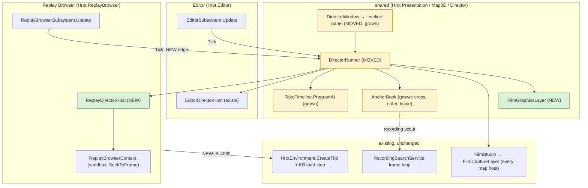
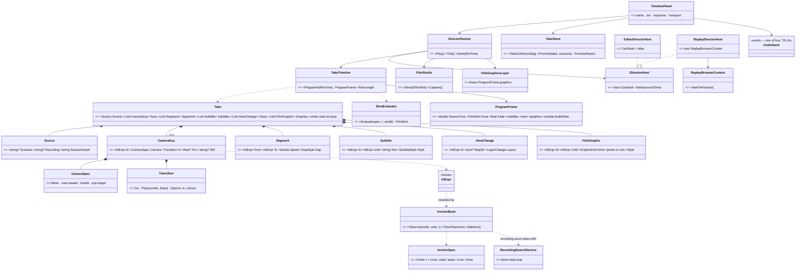
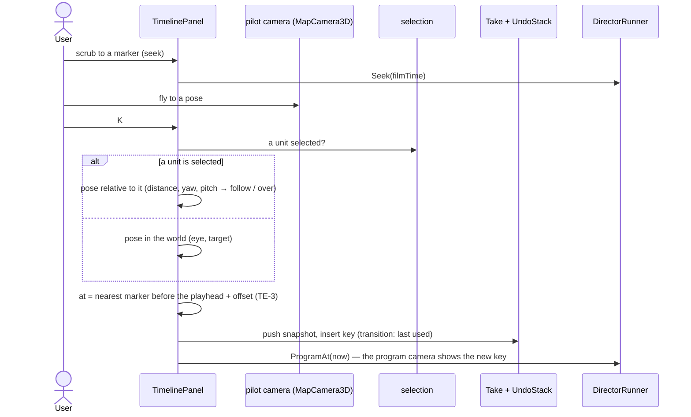
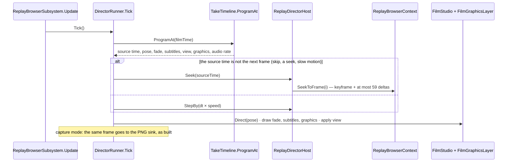
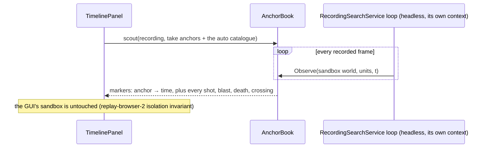
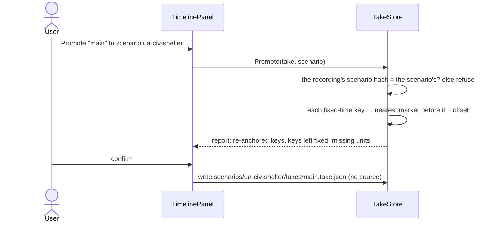

<!--STATUS
state: LIVE
build-state: DESIGN (approved in part, 2026-10-23: R-4067…R-4070 ruled; TE-1, TE-3…TE-16 are leans waiting for approval; TE-2 decided under the user's delegation)
updated: 2026-10-23 (first version — coordinator, from the user's request and their answers the same day)
current-answer: §0 the rulings and leans · §1 the picture · §2 the workspace · §3 classes · §4 sequences · §5 the take format v2 · §6 phases · §7 claim table · §8 INVENTORY
stale-below: none
known-rot: none
known-conflict: none
related-designs:
  - DESIGN_Film_Director.md — OWNS the take and reel formats, DirectorRunner, the stepping rule (R-3038), capture and the sound track; this design adds the EDITOR, the recording source, keys, tracks and promote. Its §3e / D-18 ("final films later from a recording") is the path this design builds
  - designs/replay-browser-2/DESIGN.md — OWNS the Replay Browser, its sandbox world (ReplayBrowserContext), its timeline panel and the headless RecordingSearchService whose frame-step loop the recording scout reuses (TE-4)
  - DESIGN_Scenario_Regression.md — OWNS the Verify mode and checks.json (the take anchor grammar extended); TE-10 adds still keys captured as regression artefacts
  - DESIGN_Agent_Shared_View.md — OWNS the /replay/* routes over one editor recording (R-1029) and the rule "a route only when no existing route answers" that TE-15 follows
  - DESIGN_Map_3D_Mode.md — OWNS the film camera (FilmStudio, FilmDirector, FilmCaptureLayer) on every map host and the 2-D ⇄ 3-D switch; §6b's finding "ReplayBrowser sets no TKB" is ruled here (R-4069)
  - DESIGN_Subsystem_Composition_Unification.md — OWNS "one catalogue per node" (§4.1ae.1, HrotNodeBuilder step 9) that TE-12 extends to the Replay Browser
  - designs/audio/DESIGN_FPS_Audio.md — OWNS the spatializer and the ear; TE-11 adds the rule for sound at a playback rate other than 1×
  - DESIGN_Terrain_Combat_Tuning.md — OWNS the map layers (§5e) a View track switches, through the film's transient override (R-4060)
  - designs/mgmt-1/DESIGN.md — OWNS the exercise archive (`exercises/<id>/` with the .fdp files and Orchestrator.json, §12) that TE-13 keeps films' recordings in
-->

# Director timeline editor — cut films in the Replay Browser, from one recording

🔒 **User, 2026-10-23:** *"I would like to talk about how to edit director's cuts (existing feature to filming clips) and whether we
could use such an editor in the replay browser where the exercise is recorded and its time line is known and we could easily jump to
desired time and position a camera to suitable position and angle by flying it in 3d map and then record it as new camera keyframe in
the clip, selecting optional type if cut (camera flies smoothly to new location or jumps immediayely with some darkening/undarkening)"*
· *"Also including skipping unimportant part of the exercise, adding subtitles to the time line, adding switching 2d and 3d maps and
some tactical map graphics, composing reels from takes."*

🔒 **User, 2026-10-23 (on the proposal):**
- *"scouting (offline recording search) can still fill the time line so we can easily see where time to jump to."*
- *"takes can be recording specific but be also used for usual scenarios as now so it can be used with live scenarios"*
- *"maybe the camera keyframes could be time-relative to some known events (like this entity fired at this target, or ammo exploded in this area, or entity crossed this phase line/entered this area...) so that if the scenario execution timing changes later the take prescription could still hold."*
- *"some of camera key frames from such a prescription) could become automatic screenshots added to the overnight regression tests as an artifact documenting the test run."*
- *"replay browser of course need to load same type database as other hosts."*
- *"films can be made from single recording only (coming from editor usually)."*
- *"Audio layer in replay browser would be nice (just not idea how to handle faster or slower that real time modes)."*
- On the five decisions: *"extend Take with a source: yes, but allow the take produced on a recording to be used with live scenario"* (with *"storing takes for replay on different place next to the recordings and promote to scenario-take only as explicit operation?"*) · *"sounds correct, you decide"* (camera keys) · *"One shared timeline panel.: for sure. also "unifying and sharing" is desired wherever to avoid duplications"* · *"sure film only; tactiocal graphics in scenario is different story"*

**Words used here.** A **key** is a camera keyframe: a time, a camera pose, and how the camera gets there. The **program** is the
film as cut (skips, speeds, cuts applied); the **source** is the raw recording or scenario run. The **pilot camera** is the one you fly
to author; the **program camera** is the one the film shows.

## 0. Rulings and leans

| # | | |
|---|---|---|
| ✅ **R-4067** | **A take names its source: a scenario (as today) or a recording. A film is made from ONE recording.** | user: decision 1 "yes"; "films can be made from single recording only" |
| ✅ **R-4068** | **One timeline panel and one runner on every host that plays a take: the editor and the Replay Browser. Unify and share; no second implementation.** | user: decision 3 |
| ✅ **R-4069** | **The Replay Browser loads the same type database (TKB) as every other host.** | user |
| ✅ **R-4070** | **Film graphics are film-only: stored in the take, drawn by the film, never written to a recording or a scenario.** Tactical graphics in a scenario are a separate subject | user: decision 5 |
| ⭐ **TE-2** *(decided, delegated)* | **The camera key is the unit.** A key = `at` + camera + transition in + fov + optional still. Today's `shots[]` read as keys (a shot → a cut key; its `to` → a fly key at the shot's end), so every seeded take keeps working | user: *"you decide"* |
| ⭐ TE-1 | **A recording's takes live beside the recording** (`exercises/<id>/takes/`). **Promote** is an explicit operation that copies a take to `scenarios/<s>/takes/`, drops `source`, and re-expresses each fixed-time key relative to the nearest marker before it (listed for you to confirm). ⭐ The reverse needs no operation: a scenario take plays on any recording of that scenario | rejected: a take with no source used everywhere — an unpromoted recording take would then sit in the scenario folder with recording-only times |
| ⭐ TE-3 | **Keys are anchored to events.** `at` is the existing anchor expression (`"fire-0.5"`). The anchor kinds gain **`cross`** (a unit crosses a line, with a side) and **`enter` / `leave`** (a unit enters or leaves an area). A line or area is points in the take, or the name of a scenario tactical graphic | rejected: times only — they hold on one recording and break on the next run |
| ⭐ TE-4 | **One scout, two sources.** `AnchorBook` resolves anchors everywhere. On a scenario it watches the stepped preview (as built); on a recording it watches the sandbox world stepped headless by `RecordingSearchService`'s frame loop. The scout fills the **Markers track**: every anchor of the take plus an automatic catalogue (each shot, blast, death, crossing) and bookmarks | rejected: translating anchors into search predicates — two vocabularies for one question |
| ⭐ TE-5 | **The runner moves to the shared assembly.** `DirectorRunner` and `DirectorWindow` move from `Hrot.Editor/Director` to `Hrot.Presentation/Map3D/Director` (their usings are already only director, window-manager and ImGui types). A new `ReplayDirectorHost : IDirectorHost` plays a recording; `IDirectorHost` gains `Seek` / `CanSeek` (default not supported, like `WriteCheckpoint`) | rejected: a replay copy of the runner — R-4068 |
| ⭐ TE-6 | **The program is one pure function:** `TakeTimeline.ProgramAt(filmTime)` → source time, camera pose, fade, subtitles, view, graphics, audio rate. The panel's scrub, the runner, capture and the regression stills all call it | rejected: the panel computing its own preview — it would drift from the film |
| ⭐ TE-7 | **Skips and speeds are the Time track**: segments kept at a speed (0.25× … 8×); a gap is crossed by a cut, a dip, or a fast-forward with an on-screen clock (*"+12 min"*). On a recording a skip is a seek. ⚠ On a scenario source a skip still steps one step per frame (R-3038), so it costs wall time: it shows a card, and long skips are why films come from recordings | — |
| ⭐ TE-8 | **Transitions: cut · fly (a smooth path through consecutive fly keys, eased) · dip (to black or a colour and back, two durations).** Crossfade later: it needs two renders | — |
| ⭐ TE-9 | **Graphics track** (R-4070): arrow, ring on a unit, route line, area, label, each with in/out and fade, drawn by a film overlay layer that reuses the tactical-graphic drawing (⛔ which class draws it: measure in R0) | — |
| ⭐ TE-10 | **Still keys become regression artefacts.** A key with `"still": "<name>"` is captured as a PNG by the Verify run (`DESIGN_Scenario_Regression.md`) into its report folder. An artefact that documents the run, ⛔ not a gate (no image comparison) | rejected: a separate screenshot list — the camera would be authored twice |
| ⭐ TE-11 | **Sound at any rate, one rule live and offline:** an event sound (shot, blast) starts at its film time at natural pitch; a continuous sound (engine) plays at natural pitch; above 2× only detonations sound, ducked; paused is silent. The offline track (`SoundTrack.RenderWav`) already maps each cue to film time, so it follows the same rule | rejected: resampling the mix (chipmunk / drone) · silence at every rate but 1× |
| ⭐ TE-12 | **The TKB (R-4069) is made the way every node makes it:** `HrotEnvironment.CreateTkb()` set as the world singleton (`HrotNodeBuilder.cs:262`), filled by the same knowledge-base load step from the recording's scenario (named in the exercise's `Orchestrator.json`) | rejected: a Replay Browser-only loader — a second catalogue path (CE-4013 D4/D5 removed four) |
| ⭐ TE-13 | **A film's recording is kept in the exercise archive layout** (`exercises/<id>/` with its `.fdp`, `Orchestrator.json` and the archived scenario). An editor run writes `/tmp/FDP_Temp/exercises/<id>/`; **"Keep for films"** copies it into the archive, and its takes live there | ⛔ whether an editor run is archived today: measure in R0 |
| ⭐ TE-14 | **Undo/redo is a snapshot of the take per edit**, kept by one of the four existing undo stacks (Blueprints `CommandHistory`, the two `GizmoUndoStack`s, NodeEditor `UndoStack`). ⛔ No fifth | — |
| ⭐ TE-15 | **HTTP** (R-1029's rule: a route only when none answers): the existing `/director/take`, `/director/play` and `/director/scout` take `recording=` beside `scenario=`; one new `POST /director/promote`. The MCP catalog is regenerated in the same commit (R-1030) | — |
| ⭐ TE-16 | **Reels are unchanged**; an item may name `{recording, take}`. The reel composer is the bin plus a sequence row in the same panel (reorder, trim, transition per item) | — |

## 1. The picture — who calls what each frame



*What the picture shows that prose hid: there is still ONE runner and ONE camera path. The only new frame edge is the Replay Browser
ticking the runner; everything a film needs below the runner already exists on every map host. The dotted edge is a reuse of the
search service's stepping loop, not of its predicates.*

## 2. The workspace


| track | holds | key operations |
|---|---|---|
| **Markers** | the scout's events + bookmarks (TE-4) | snap target; double-click jumps there |
| **Time** | kept segments, their speed, how each gap is crossed (TE-7) | ripple delete, speed, skip style |
| **Camera** | keys (TE-2) with their transition in (TE-8) | **K** adds a key from the pilot camera; update from view; go to key; tie to the selected unit (stored relative, so it follows a moving vehicle); path preview in 3-D |
| **Subtitles** | caption · title card · unit label · exercise-clock stamp; position; fade | the old per-shot `caption` reads as one item |
| **View** | 2-D ⇄ 3-D (the existing animated switch) and layer presets | through the transient override (R-4060) |
| **Graphics** | arrow, ring, route, area, label (TE-9) | drawn in world space, in/out, fade |
| **Audio** | on/off and gain per segment; cues at film time (TE-11) | music and voice-over later |

**Practical must-haves** (from Unreal Sequencer, Resolve, and the replay editors of racing and shooter games): pilot ⇄ program camera on
one key · keys tied to a unit · J/K/L shuttle, frame step, I/O · snapping · copy/paste/nudge keys · lock/mute/solo a track · undo/redo
and autosave (TE-14) · 16:9 safe frame, letterbox, thirds · film length and exercise clock · **shot templates from a marker**
(right-click a shot → over the shooter 0.5 s before, then the target, then the result; reuses D-10's draft rules) · a key whose unit is
gone holds its last pose · validation lists missing units and a stale recording.

## 3. Classes



*What the class picture forces: every new type is DATA in the take, plus one host and one layer. The pose maths stays in
`ShotEvaluator`, the anchors in `AnchorBook`, the timing in `TakeTimeline` — each grows, none is copied.*

## 4. Sequences

### 4a. Author a key — fly, press K



### 4b. One program frame, from a recording



### 4c. Scout a recording → the Markers track



### 4d. Promote a recording take to a scenario take



## 5. The take format, v2

```json
{
  "source": {"recording": "7f3a…", "scenarioHash": "…"},
  "anchors": {"fire": {"on": "shot", "who": "Tank 1", "n": 1},
              "blue": {"on": "cross", "who": "Tank 1", "line": "Phase line BLUE"}},
  "segments": [{"from": 0, "to": "blue-5", "speed": 1},
               {"from": "fire-1", "to": "fire+3", "speed": 0.25, "gap": "dip"}],
  "keys": [
    {"at": "blue-5", "lookAt": [105, 75, 1], "distance": 60, "pitch": -30, "in": "cut"},
    {"at": "blue-0.5", "over": "Tank 1", "toward": "Enemy", "in": {"fly": 2, "ease": "inOut"}, "still": "crossing"},
    {"at": "fire+1", "follow": "Enemy", "distance": 12, "in": {"dip": [0.4, 0.4]}}
  ],
  "subtitles": [{"at": "blue-4", "until": "blue", "text": "The platoon crosses phase line BLUE"}],
  "views": [{"at": 0, "map": "2d", "layers": {"on": ["Units.Cards"]}}, {"at": "blue-5", "map": "3d", "layers": {"off": ["Units.Cards"]}}],
  "graphics": [{"at": "fire-1", "until": "fire+3", "kind": "ring", "who": "Enemy"}]
}
```

A scenario take is the same with `source` absent. ⭐ `shots[]` is still read; the editor writes `keys[]`.

## 6. Phases and acceptance

| phase | builds | accepted when |
|---|---|---|
| **R0** *(measure)* | ① a recording plays back faithfully (types, effects, deaths, poses, doors) · ② what the recording holds for anchors (shots and blasts as recorded events? `ShotLog` / `DetonationLog` are kept beside the live world) · ③ the TKB from the recording's scenario (TE-12) · ④ sound sources in replay · ⑤ is an editor run archived (TE-13) · ⑥ which class draws tactical graphics (TE-9) | a report per item, each with its file:line; the TKB loaded in the Replay Browser |
| **R1** | format v2 + `shots[]` as keys · `ProgramAt` · move the runner and window (TE-5) · `ReplayDirectorHost` · the panel with Time and Camera tracks, K, cut / fly / dip · undo | a recording take plays in the Replay Browser with skips, slow motion and the three transitions; the same take's keys play in the editor |
| **R2** | the recording scout + Markers track · `cross` / `enter` / `leave` · Subtitles and View tracks · promote | a take authored on a recording, promoted, plays on a fresh editor run of its scenario with every event-anchored key on its event |
| **R3** | Graphics track + `FilmGraphicsLayer` · shot templates · audio at any rate (TE-11) · still keys in Verify (TE-10) | a regression run writes a PNG per still key; slow motion sounds as TE-11 says |
| **R4** | reel composer · render queue · HTTP (TE-15) + MCP catalog | a reel of two recording takes renders to one movie with sound |

## 7. Claim table — what the leans rest on

| claim | code — how it IS | design — how it was MEANT |
|---|---|---|
| a recording plays back faithfully | ⛔ not tried (user) | ⛔ `DESIGN_Film_Director.md` §3e: *"that slice starts by measuring both"* ⇒ R0 ① |
| the Replay Browser sets no TKB | ✅ no `ITkbDatabase` in `ReplayBrowserSubsystem.cs`; the node builder sets it at `HrotNodeBuilder.cs:262` | ✅ `DESIGN_Map_3D_Mode.md` (§6b, the finding) · ruled R-4069 |
| the runner can move to the shared assembly | ✅ `DirectorRunner.cs` usings: `Hrot.UI.Common.Map3D(.Director)` only; `DirectorWindow.cs`: + `Fdp.Presentation.WindowManager`, ImGui | ✅ R-4068 |
| the host seam takes a replay host | ✅ `IDirectorHost` (`DirectorHost.cs:13`): World, StepBy, SimTime, Hold, Pause…; optional members already default to NotSupported (`WriteCheckpoint`, `:53`) | ✅ `DESIGN_Film_Director.md` §8.1 (every editor dependency behind an interface) |
| every map host carries the film camera, the Replay Browser too | ✅ `MapInteractionPack.cs:539` (`FilmCaptureLayer`, every host) | ✅ `DESIGN_Map_3D_Mode.md` §6ab, §6b |
| the audio layer is on every map host | ✅ `MapInteractionPack.cs:533` (`AudioLayer.For`, given the host's TKB) | ✅ `designs/audio/DESIGN_FPS_Audio.md`; R-4059 |
| a seek is cheap | ✅ a keyframe every 60 frames (`RecorderTickSystem.cs:21`) | ✅ replay-browser-2 §4.2 |
| a headless frame loop over a recording exists, isolated from the GUI | ✅ `RecordingSearchService` | ✅ replay-browser-2 §1 isolation invariants, §6.3 |
| anchors already carry events + offsets | ✅ `AtExpr`, `AnchorSpec.Kinds` (shot, blast, hit, near, task, side, health, embark, gesture — `Take.cs:129`) | ✅ `DESIGN_Film_Director.md` §4, `DESIGN_Scenario_Regression.md` (checks.json reuses it) |
| a recording names its scenario | ✅ an archived exercise's `Orchestrator.json` carries the scenario id (`AssetInventoryProcessManager.cs:265`) · ⛔ an editor run's temp folder: not measured | ✅ mgmt-1 §12 · ⛔ R0 ⑤ |
| the anchors can be resolved from a recording | ⛔ `AnchorBook` reads `ShotLog` / `DetonationLog`, kept beside the LIVE world (`DESIGN_Film_Director.md` §8.3) — in a replay sandbox: not measured | ⛔ R0 ② — ⚠ load-bearing for TE-4; if they are not recorded, the scout reads the recorded events instead |
| sound at other rates | ✅ `SoundTrack.RenderWav` maps each cue to the film timeline (§8.3) | ⛔ no design for live playback at ≠ 1× — TE-11 is new |

## 8. INVENTORY

```
scripts/cbm.sh search_graph name_pattern=".*(Director|Replay|Film|Take|Timeline|Cinema|FrameSink|ShotWorld|Playback).*" label=Interface
   → total 7, has_more false: ICinema, IDirectorHost, IDirectorSound, IFrameSink, IShotWorld, IRecordReplayController, IReplayRestoreGated
scripts/cbm.sh search_graph name_pattern=".*" label=Class file_pattern="**/Director/**"   → total 94, has_more false
   → shared (Hrot.Presentation/Map3D/Director): Take, ShotSpec, CameraSpec, AnchorSpec, AtExpr, BakedAnchors, LayerChange, Reel, ReelItem,
     ReelWaiting, TakeJson, TakeStore, TakeTimeline, TimelineShot, ShotEvaluator, WorldUnits, AnchorBook, AnchorMismatch, PacedClock
   → editor (Hrot.Editor/Director): DirectorRunner, PlayRequest, CaptureOptions, ItemReport, CutSnapshot, VerifyOptions, DirectorWindow,
     EditorDirectorHost, EditorCinema, EditorLayerOverride, FilmFrameSink, EditorDirectorSound, ScenarioReadyProbe, ScenarioChecks,
     ScenarioVerification, CommandLineVerify, FreshVerifyJobs, EditorVerifyWorld
scripts/cbm.sh search_graph name_pattern=".*(Director|Take|Reel|Timeline|Replay).*" label=Class → total 114 (first 83 read): ReplayBrowserSubsystem,
   ReplayBrowserContext, FederatedReplayManager, ReplaySearchPanel, ReplayModule, RecordingModule, EcsRecordReplayController, … 
   ReplayTimelinePanel (Fdp.Presentation) — the Replay Browser's transport; the director panel REUSES its scrub/transport, not a second one
scripts/cbm.sh search_graph name_pattern=".*(Undo|Redo|CommandHistory|EditHistory).*" label=Class
   → four undo stacks: Blueprints CommandHistory, Fdp.Toolkits GizmoUndoStack, GizmoMap GizmoUndoStack, NodeEditor UndoStack (TE-14)
docs: DESIGN_Film_Director.md (§3e, D-18) · designs/replay-browser-2/DESIGN.md · DESIGN_Agent_Shared_View.md (R-1029) · DESIGN_Scenario_Regression.md ·
   DESIGN_Map_3D_Mode.md §6b · searched docs/ for "director editor", "camera keyframe", "timeline editor", "film graphics" → none found
check_index_coverage is not available through the CLI ⇒ these totals are not proof of completeness
```

*Reused as is:* `FilmStudio`, `FilmCaptureLayer`, `ShotEvaluator`, `CameraSpec`, `AtExpr`, `ReplayBrowserContext`, `RecordingSearchService`,
the reel format, capture and the sound track. *Grown:* `Take`, `AnchorSpec`, `AnchorBook`, `TakeTimeline`, `TakeStore`, `IDirectorHost`,
`DirectorWindow` (into the timeline panel). *New:* `ReplayDirectorHost`, `FilmGraphicsLayer`, the key/segment/subtitle/view/graphic records.
