<!--STATUS
state: LIVE
build-state: DESIGN — ⭐ APPROVED 2026-10-23 (R-4071: "looks good!") with three amendments the same day: anchors ARE the existing conditions (R-4072, TE-3 rewritten), the timeline is a central panel of its own (R-4073, TE-17), the recording's events are indexed and cached for a zoomable timeline (TE-4 rewritten, TE-18…TE-20). TE-3b approved (R-4074). TE-21 approved (R-4075): the Trace Timeline and this timeline are ONE panel. TE-22 approved 2026-10-25 (R-4076): the Behaviour group's four lanes over the brain's recorded histories (ui's handoff, BV-59). ⭐ HANDED to the ui lane: batches/HANDOFF_Coordinator_To_Ui_Director_Timeline.md
updated: 2026-10-27 (§11t "CE-1380 / CE-1379 as built" — ONE film pass in both modes (MapCanvas.DrawScene over the ISceneLayers, the gizmo layer filmed through RenderContext.Film + FilmLayers), the scenario's tactical graphics and routes are scene rows, the gizmo layer after the 3-D terrain (CE-1384), a film's end / Stop gives the person's map mode back (V7); CE-1380's premise measured wrong in part — the window shows the same 2-D picture — CE-1381…CE-1383 filed) · 2026-10-27 (§11t — P6: the View track (views[]: 2-D / 3-D + a layer set from a time; a take's layers and shot layers READ as views — one path through the ONE ILayerOverride; the map through FilmStudio.TwoD, honoured and filmed by the capture layer on every map host) and the Graphics track (graphics[]: ring, arrow, route, area, label on units or points, fade; ONE layout + ONE painter for the screen pass and every captured frame; FilmOverlay through IFrameSink) — BUILT, live still docs/img/film-p6-graphics.jpg) · 2026-10-27 (§11s — P4: ONE anchor resolver (CR-5: event cues are queries on the run's index — live or the recording's — through EventAnchors' one naming switch; ShotLog / DetonationLog reads leave AnchorBook, the logs keep their other readers; on a recording the index leads over a bake), promote = a copy (POST /director/promote, the Director window's button; the bake kept iff made for the scenario file as it is), TE-1's reverse (a recording's store reads its scenario's own takes) — BUILT) · 2026-10-27 (§11r — recording= on the director routes (opened through POST /replay's own EnterReplay; refused on the editor), POST /director/stills (a still = play-from held one frame through the film's own sink; a labelled contact sheet; refused on a host that cannot seek or has no renderer; plan:true anywhere), the MP4 rendered in the RB by the existing capture — BUILT, live-checked on a ua-tank-ammo recording) · 2026-10-27 (§11q — a key belongs to a SEGMENT (CR-7: the camera of the segment on screen, K / U scope to a replay, the drafter's reverse angle a key of its replay) + the drafter wired (P3: "Draft a shot sequence here" on an event of either host, the draft opened unsaved in the take session, the unit's kind from the world, GET /director/moments + POST /director/draft on the editor) — BUILT) · 2026-10-27 (§11o P2b — the Time track plays (FilmTimeMap: rate, skip, replay) on both hosts, a Subtitles track, update key from view + pilot view, the takes of a kept exercise — BUILT) · 2026-10-27 (§11m P2a — the director in the Replay Browser: ReplayDirectorHost, the same DirectorPack.Attach, the in-memory take, play from, loop shot — BUILT) · 2026-10-27 (§11 CR — films from recordings: the workflow (record → index → draft → look ⇄ adjust in the RB → save → render → promote), CR-1…CR-12, phases P0–P6 across coordinator / backend / ui — ✅ APPROVED by the user the same day (R-4091), rewritten from the user's statement of need; TE-5's premise and §9's D3 corrected) · 2026-10-26 (§10 T-L5 approved — the sim time per frame in the ONE shared per-frame step, R-4089) · 2026-10-26 (§2c — the review timeline: the sim axis, a left click only selects, the director's gestures merged with DAR §10c — R-4087) · 2026-10-26 (§9c — R-4078 one lane seam, the editor's ITraceLaneProvider moved to the shared toolkit; R-4079 lanes are registered definitions, the shipped ones too; TL-3 and the hard-coded lanes SUPERSEDED) · 2026-10-26 (§9b — the coordinator's review of R1-a…c: accepted, three gaps for R2 / R1-d, two questions for the user) · 2026-10-25 (TE-22 approved, R-4076 — the Behaviour lanes Changes / Orders / Reports / Decisions; the exercise group "Orders" renamed Tasks) · 2026-10-23 (TE-21 approved, R-4075) · 2026-10-23 (third pass — TE-3b approved, R-4074; TE-21 added after finding the designed, unbuilt Trace Timeline; handed to ui) · 2026-10-23 (second pass — the approval and three amendments: §0, §2a, §2b, §4c, §5, §6, §7, §8) · 2026-10-23 (first version — coordinator, from the user's request and their answers the same day)
current-answer: ⭐ §11t P6 — THE VIEW TRACK AND THE GRAPHICS TRACK (ui, 2026-10-27, BUILT; the as-built, the live still and "CE-1380 / CE-1379 as built" at its end) · ⭐ §11s P4 — ONE ANCHOR RESOLVER, PROMOTE (ui, 2026-10-27, BUILT; the as-built at its end) · ⭐ §11r P3 — recording=, STILLS, RENDER IN THE RB (ui, 2026-10-27, BUILT; the as-built and the live run at its end) · ⭐ §11q P3 WIRING + KEYS PER SEGMENT (ui, 2026-10-27, BUILT; the as-built at its end) · ⭐ §11o P2b — SEGMENTS PLAY, SUBTITLES, UPDATE KEY FROM VIEW (ui, 2026-10-27, BUILT; the as-built at its end) · ⭐ §11m P2a — THE DIRECTOR IN THE REPLAY BROWSER (ui, 2026-10-27, BUILT; the as-built at its end) · ⭐ §11 CR — FILMS FROM RECORDINGS: THE WORKFLOW AND THE PLAN (coordinator, 2026-10-27, ✅ APPROVED R-4091 — the leans CR-1…CR-12 and the phases P0–P6 as written; §11a the fresh look, §11b the workflow, §11e leans CR-1…CR-12, §11f phases P0–P6) · ⭐ §2e THE PANEL AND TOOLBAR ON A CLUSTER HOST — live / review / replay (ui, 2026-10-26, READY-TO-BUILD) · §10 R2-T — THE DIRECTOR'S TRACKS: the build plan (ui, 2026-10-26, DESIGN) · §2c THE INTERACTION RULES AFTER DAR (R-4087 — supersedes §2/§2a/§2b gestures) · §9c LANES REGISTERED (R-4078, R-4079) + §9d ITS AS-BUILT · §9 R1 BUILD PLAN + §9a R1-a…c AS BUILT (2026-10-26, measured: D1 the browser seeks through FederatedReplayManager, D2/D3 the panel lives in Fdp.Presentation — TL-1…TL-7, slices R1-a…e) · §0 the rulings and leans · §1 the picture · §2 the workspace · §2a the timeline on every host · §2b the event index · §3 classes · §4 sequences · §5 the take format v2 · §6 phases · §7 claim table · §8 INVENTORY
stale-below: none
known-rot: TE-5's premise "the runner's usings are already only director, window-manager and ImGui types" — FALSE, the runner carries the verifier (§11 INVENTORY, CR-1) · §9's D3 "Hrot.ReplayBrowser does not reference Hrot.Presentation" — it does, through Hrot.CGF (§11) · §2 Markers "double-click jumps there", §2b "drag to pan; drag on the ruler to zoom to a range", §2a's Replay Browser "a click in the past seeks", §9a's built "click seeks" and TL-4 "time is frame index + wall ticks" — SUPERSEDED by §2c (R-4087, R-3059) · gap ① (§9b: the builder decodes FrameSimTime) — SUPERSEDED: the v7 frame index carries the sim time (DAR P0, §8 rows 1–3, 11) · TE-19's and §2a's "a live host never seeks" — SUPERSEDED by R-3060 (the review, DESIGN_Replay_Time_Axis_And_Review §9) · §9c's `LaneProjection` is the model's `ResultProjectionDto`, and its Life lanes are structural (not `LifecyclePredicateDto`) — §9d · §9a's lane enum, extractors and `TimelineLane` mentions are SUPERSEDED by §9c/§9d · §9's TL-3 (ITimelineRowProvider + adapter) and the hard-coded lanes of §9 / §9a (TimelineLane, TimelineLaneGroup, the three extractors) are SUPERSEDED by §9c (R-4078, R-4079) · §1, §3 and §4b draw ReplayDirectorHost seeking through ReplayBrowserContext.SeekToFrame — overtaken by D1 the same way: it binds to the panel's ITimelineCursor (§9b ②) · §2a's ReplayBrowserTransportAdapter → ReplayBrowserContext.SeekToFrame and "TimelinePanel (NEW, Hrot.Presentation)" are overtaken by §9 D1 / D3 (TL-1, TL-2) · TE-4's first wording (a scout per take, AnchorBook watching the sandbox) and TE-3's first wording (three new anchor kinds) are SUPERSEDED the same day by the amended rows; nothing else quotes them
known-conflict: none
related-designs:
  - DESIGN_Film_Production.md — OWNS the INTENT of the whole film process (the workflow, its principles, the overnight documentation); §11 here is its build plan
  - DESIGN_Replay_Time_Axis_And_Review.md — OWNS the SIM axis (FrameSimTime in the frame index, paused stretches), the review (DAR) a live host's right-click seek enters, and §10 the panel's defects and input map (CE-3330); amended here in §2c (R-4087)
  - DESIGN_Replay_Browser_Debug_Http.md — GET /timeline/lanes, /timeline/events, POST /timeline/lanes over this design's index (RB-6), and seek to the next event in a lane
  - docs/DESIGN_Unit_Camera.md — the follow camera (orbit → shoulder → eyes) is a candidate shot type for the camera track
  - DESIGN_Film_Director.md — OWNS the take and reel formats, DirectorRunner, the stepping rule (R-3038), capture and the sound track; this design adds the EDITOR, the recording source, keys, tracks and promote. Its §3e / D-18 ("final films later from a recording") is the path this design builds
  - designs/replay-browser-2/DESIGN.md — OWNS the Replay Browser, its sandbox world (ReplayBrowserContext), its timeline panel and the headless RecordingSearchService whose frame-step loop the recording scout reuses (TE-4)
  - DESIGN_Scenario_Regression.md — OWNS the Verify mode and checks.json (the take anchor grammar extended); TE-10 adds still keys captured as regression artefacts
  - DESIGN_Agent_Shared_View.md — OWNS the /replay/* routes over one editor recording (R-1029) and the rule "a route only when no existing route answers" that TE-15 follows
  - DESIGN_Map_3D_Mode.md — OWNS the film camera (FilmStudio, FilmDirector, FilmCaptureLayer) on every map host and the 2-D ⇄ 3-D switch; §6b's finding "ReplayBrowser sets no TKB" is ruled here (R-4069)
  - DESIGN_Subsystem_Composition_Unification.md — OWNS "one catalogue per node" (§4.1ae.1, HrotNodeBuilder step 9) that TE-12 extends to the Replay Browser
  - designs/audio/DESIGN_FPS_Audio.md — OWNS the spatializer and the ear; TE-11 adds the rule for sound at a playback rate other than 1×
  - DESIGN_Terrain_Combat_Tuning.md — OWNS the map layers (§5e) a View track switches, through the film's transient override (R-4060)
  - blueprints/AI_Editor_Shared_Infrastructure.md — §15 OWNS the Trace Timeline (designed, a 50-line shell today: TraceTimelineWindow + ITraceLaneProvider); TE-21 makes it and this timeline ONE panel
  - DESIGN_Behaviour_Debugging.md — OWNS the ui lane's debugging workflow (CE-1270); the timeline's unit swimlanes and trace lanes serve it (TE-21)
  - DESIGN_Entity_Brain_View.md — OWNS the brain journal; its Trace Timeline lane (BV-30, deferred) becomes the timeline's Behaviour lane
  - Predicate-Infrastructure-Capabilities.md — OWNS the condition model this design's anchors ARE (SearchPredicateDto: DTOs, compiler, StructEdit editor and drawers, JSON) — R-4072. ⚠ its §6 row "enter the polygon" is a BOX (BoundingBox2D) today
  - designs/breakpoints-1/DESIGN.md — OWNS the data breakpoints that evaluate the same predicates LIVE and their editor (DataBreakpointManagerPanel / PredicateBuilderState)
  - blueprints/DESIGN_Time_Architecture.md — OWNS cluster replay and its seek (ClusterOpType.ReplaySeek, §11) and the transport facade (ITimeTransportFacade) the timeline's transport row drives (TE-19)
  - designs/mgmt-1/DESIGN.md — OWNS the exercise archive (`exercises/<id>/` with the .fdp files and Orchestrator.json, §12) that TE-13 keeps films' recordings in
-->

# Director timeline editor — cut films in the Replay Browser, from one recording

🔒 **User, 2026-10-23:** *"I would like to talk about how to edit director's cuts (existing feature to filming clips) and whether we
could use such an editor in the replay browser where the exercise is recorded and its time line is known and we could easily jump to
desired time and position a camera to suitable position and angle by flying it in 3d map and then record it as new camera keyframe in
the clip, selecting optional type if cut (camera flies smoothly to new location or jumps immediayely with some darkening/undarkening)"*
· *"Also including skipping unimportant part of the exercise, adding subtitles to the time line, adding switching 2d and 3d maps and
some tactical map graphics, composing reels from takes."*

🔒 **User, 2026-10-23 (on the proposal):**
- *"scouting (offline recording search) can still fill the time line so we can easily see where time to jump to."*
- *"takes can be recording specific but be also used for usual scenarios as now so it can be used with live scenarios"*
- *"maybe the camera keyframes could be time-relative to some known events (like this entity fired at this target, or ammo exploded in this area, or entity crossed this phase line/entered this area...) so that if the scenario execution timing changes later the take prescription could still hold."*
- *"some of camera key frames from such a prescription) could become automatic screenshots added to the overnight regression tests as an artifact documenting the test run."*
- *"replay browser of course need to load same type database as other hosts."*
- *"films can be made from single recording only (coming from editor usually)."*
- *"Audio layer in replay browser would be nice (just not idea how to handle faster or slower that real time modes)."*
- *"cool pls record it to a design document."*
- On the five decisions: *"extend Take with a source: yes, but allow the take produced on a recording to be used with live scenario"* (with *"storing takes for replay on different place next to the recordings and promote to scenario-take only as explicit operation?"*) · *"sounds correct, you decide"* (camera keys) · *"One shared timeline panel.: for sure. also "unifying and sharing" is desired wherever to avoid duplications"* · *"sure film only; tactiocal graphics in scenario is different story"*

🔒 **User, 2026-10-26:** *"we need to unify and share, not duplicate and fix with adapters. we can move the editor code to some shared place. what are built-in lanes, timeline should be extensible, not hardcoded."*

🔒 **User, 2026-10-23:** *"TE-21 approved"*

🔒 **User, 2026-10-23 (third pass):** *"TE-3b approved, write the handoff to ui lane; tell them about the whole idea we are solving (pointing to designs); they are designong behavior debuggoing with lots of ui tasks so that they can include this one in ther plans"*

🔒 **User, 2026-10-23 (second pass):** *"looks good!"* · *"these should the already existing conditions editable using already existing conditions editor, ple reuse do not invent anything new, if something missing (area/line picking or drawing) we will extend"* · *"timeline is usefull regardless of director cut window and i guess it should become one of the most important central pieces of the replay browser as separate panel allowing for navigation.  (needs thinking how other hosts should use it, if it is part of director cut panel only there)"* · *"of course the recording scout needs to read the recorded events and cache them for fast timeline rendering - this part is important, there could be thousands of events and entities  etc so it needs smart choices to make it usable -and zoomable without clutter etc. - use your experience from other products"*

**Words used here.** A **key** is a camera keyframe: a time, a camera pose, and how the camera gets there. The **program** is the
film as cut (skips, speeds, cuts applied); the **source** is the raw recording or scenario run. The **pilot camera** is the one you fly
to author; the **program camera** is the one the film shows.

## 0. Rulings and leans

| # | | |
|---|---|---|
| ✅ **R-4067** | **A take names its source: a scenario (as today) or a recording. A film is made from ONE recording.** | user: decision 1 "yes"; "films can be made from single recording only" |
| ✅ **R-4068** | **One timeline panel and one runner on every host that plays a take: the editor and the Replay Browser. Unify and share; no second implementation.** | user: decision 3 |
| ✅ **R-4069** | **The Replay Browser loads the same type database (TKB) as every other host.** | user |
| ✅ **R-4070** | **Film graphics are film-only: stored in the take, drawn by the film, never written to a recording or a scenario.** Tactical graphics in a scenario are a separate subject | user: decision 5 |
| ✅ **R-4071** | **The director timeline editor is APPROVED** — the leans of this table, as amended below | user: *"looks good!"* |
| ✅ **R-4072** | **An anchor IS an existing condition — a `SearchPredicateDto`, edited in the existing StructEdit predicate editor. Nothing new is invented; what is missing (a polygon area, a line, picking or drawing them on the map) is an EXTENSION of that model and editor** | user, second pass |
| ✅ **R-4073** | **The timeline is a panel of its own — the Replay Browser's central navigation — useful without the director; the director adds its tracks to it. The recording's events are read once and cached so the timeline draws fast** | user, second pass |
| ⭐ **TE-2** *(decided, delegated)* | **The camera key is the unit.** A key = `at` + camera + transition in + fov + optional still. Today's `shots[]` read as keys (a shot → a cut key; its `to` → a fly key at the shot's end), so every seeded take keeps working | user: *"you decide"* |
| ⭐ TE-1 | **A recording's takes live beside the recording** (`exercises/<id>/takes/`). **Promote** is an explicit operation that copies a take to `scenarios/<s>/takes/`, drops `source`, and re-expresses each fixed-time key relative to the nearest marker before it (listed for you to confirm). ⭐ The reverse needs no operation: a scenario take plays on any recording of that scenario | rejected: a take with no source used everywhere — an unpromoted recording take would then sit in the scenario folder with recording-only times |
| ⭐ TE-3 *(amended, R-4072)* | **Keys are anchored to conditions.** `at` stays the anchor expression (`"blue-0.5"`); an anchor is **the n-th time a `SearchPredicateDto` becomes true** — stored as the predicate's own JSON (`$type` discriminator, as the breakpoint clipboard and the search presets already save it), edited by the StructEdit predicate editor (`ReplaySearchPanel` and `DataBreakpointManagerPanel` host it today). **Enter / leave an area exist** (`SpatialBoundingPredicateDto`, `BoundaryEvent.Entry / Exit`, a map-picked box). ⭐ **Extensions, of that model only:** a polygon area and a line crossing (with a side) as spatial predicates, and drawing them on the map beside the existing box picker (`BoundingBoxFieldDrawer` → `ISpatialPickerContext`) | rejected: new anchor kinds `cross` / `enter` / `leave` (the first wording) — a parallel condition vocabulary |
| ✅ TE-3b — **R-4074** | **The nine existing anchor shorthands** (`shot`, `blast`, `hit`, `near`, `task`, `side`, `health`, `embark`, `gesture` — `Take.cs:129`, also used by `checks.json`) **are read as shorthands that LOWER to predicates**, so one evaluator answers every anchor and check. A shorthand that does not lower is a missing predicate to add, not a kind to keep. ⛔ Each lowering is measured in R0 ⑦ before it is built | keep the nine as a second vocabulary: two evaluators (AnchorBook and the compiler) that can disagree |
| ⭐ TE-4 *(amended)* | **The scout is the recording's INDEX, built once per recording, not per take** (§2b). It runs **automatically the first time a recording is opened** in any host, in the background, filling the timeline as it goes, and is cached beside the recording; every later open reads the cache (milliseconds). A take's anchors are QUERIES over the index; a predicate the index cannot answer (a new area drawn later) runs one targeted pass of the search service, narrowed by the index's position track, and its hits are added to the cache | rejected: scouting on every open (minutes per open on a long recording) · scouting per take (the same scan repeated for every take) |
| ⭐ TE-5 | **The runner moves to the shared assembly.** `DirectorRunner` and `DirectorWindow` move from `Hrot.Editor/Director` to `Hrot.Presentation/Map3D/Director` (their usings are already only director, window-manager and ImGui types). A new `ReplayDirectorHost : IDirectorHost` plays a recording; `IDirectorHost` gains `Seek` / `CanSeek` (default not supported, like `WriteCheckpoint`) | rejected: a replay copy of the runner — R-4068 |
| ⭐ TE-6 | **The program is one pure function:** `TakeTimeline.ProgramAt(filmTime)` → source time, camera pose, fade, subtitles, view, graphics, audio rate. The panel's scrub, the runner, capture and the regression stills all call it | rejected: the panel computing its own preview — it would drift from the film |
| ⭐ TE-7 | **Skips and speeds are the Time track**: segments kept at a speed (0.25× … 8×); a gap is crossed by a cut, a dip, or a fast-forward with an on-screen clock (*"+12 min"*). On a recording a skip is a seek. ⚠ On a scenario source a skip still steps one step per frame (R-3038), so it costs wall time: it shows a card, and long skips are why films come from recordings | — |
| ⭐ TE-8 | **Transitions: cut · fly (a smooth path through consecutive fly keys, eased) · dip (to black or a colour and back, two durations).** Crossfade later: it needs two renders | — |
| ⭐ TE-9 | **Graphics track** (R-4070): arrow, ring on a unit, route line, area, label, each with in/out and fade, drawn by a film overlay layer that reuses the tactical-graphic drawing (⛔ which class draws it: measure in R0) | — |
| ⭐ TE-10 | **Still keys become regression artefacts.** A key with `"still": "<name>"` is captured as a PNG by the Verify run (`DESIGN_Scenario_Regression.md`) into its report folder. An artefact that documents the run, ⛔ not a gate (no image comparison) | rejected: a separate screenshot list — the camera would be authored twice |
| ⭐ TE-11 | **Sound at any rate, one rule live and offline:** an event sound (shot, blast) starts at its film time at natural pitch; a continuous sound (engine) plays at natural pitch; above 2× only detonations sound, ducked; paused is silent. The offline track (`SoundTrack.RenderWav`) already maps each cue to film time, so it follows the same rule | rejected: resampling the mix (chipmunk / drone) · silence at every rate but 1× |
| ⭐ TE-12 | **The TKB (R-4069) is made the way every node makes it:** `HrotEnvironment.CreateTkb()` set as the world singleton (`HrotNodeBuilder.cs:262`), filled by the same knowledge-base load step from the recording's scenario (named in the exercise's `Orchestrator.json`) | rejected: a Replay Browser-only loader — a second catalogue path (CE-4013 D4/D5 removed four) |
| ⭐ TE-13 | **A film's recording is kept in the exercise archive layout** (`exercises/<id>/` with its `.fdp`, `Orchestrator.json` and the archived scenario). An editor run writes `/tmp/FDP_Temp/exercises/<id>/`; **"Keep for films"** copies it into the archive, and its takes live there | ⛔ whether an editor run is archived today: measure in R0 |
| ⭐ TE-14 | **Undo/redo is a snapshot of the take per edit**, kept by one of the four existing undo stacks (Blueprints `CommandHistory`, the two `GizmoUndoStack`s, NodeEditor `UndoStack`). ⛔ No fifth | — |
| ⭐ TE-15 | **HTTP** (R-1029's rule: a route only when none answers): the existing `/director/take`, `/director/play` and `/director/scout` take `recording=` beside `scenario=`; one new `POST /director/promote`. The MCP catalog is regenerated in the same commit (R-1030) | — |
| ⭐ TE-17 *(R-4073)* | **One Timeline panel, shared by every host** (`Hrot.Presentation`), over an `ITimelineSource`: the **recording** source (the index; seekable) and the **live** source (the same extractors run on the live world each frame, appended; history only). It **replaces** the Replay Browser's scrubber row (`ReplayTimelinePanel` keeps its export options). The director window becomes bin + inspector; its tracks are **contributed** to the Timeline when a take is open (§2a) | rejected: the timeline inside the director window (the user: useful without it) · a second scrubber beside the old one |
| ⭐ TE-18 | **Draw cost follows pixels, not events** (§2b): a level-of-detail pyramid per lane (counts, top priority, one representative per bucket) like an audio editor's peak file or a map's tiles; density strips when crowded, glyphs when sparse, clusters with a count, priority on top | rejected: drawing every event (thousands per lane per pixel when zoomed out) |
| ⭐ TE-19 *(⛔ its "editor and live cluster: `CanSeek = false`" SUPERSEDED `2026-10-26` by R-3060 — a live host seeks by entering a review, [DESIGN_Replay_Time_Axis_And_Review §9](DESIGN_Replay_Time_Axis_And_Review.md))* | **One transport for every host:** `ITimeTransportFacade` gains `CanSeek` + `Seek(t)`. Replay Browser: a new adapter over `ReplayBrowserContext`; cluster replay: the existing `ClusterOpType.ReplaySeek` round; editor and live cluster: `CanSeek = false` (R-3034: never rewind) — the past is a history to read | rejected: the timeline calling each host's seek itself |
| ⭐ TE-20 | **The event list reads the same index.** The shared Event Browser (`EventBrowserPanel`) shows the index around the playhead in a recording, so the list and the timeline cannot disagree | rejected: a second scan for the list |
| ✅ TE-21 — **R-4075** | **The Trace Timeline IS this timeline.** `AI_Editor_Shared_Infrastructure.md` §15 designed a shared, swim-lane timeline for the selected unit (lanes registered by `ITraceLaneProvider`, scrub in replay, click jumps, hover tooltip, right-click *Set Breakpoint Here*, a search box that dims); it is built only as a shell (`TraceTimelineWindow`, 50 lines, *"No trace data."*), and its first lane was deferred (BV-30). ⇒ **ONE panel:** `TimelinePanel` is §15 grown — the exercise lanes from the index, plus a pinned unit's swimlane whose rows are its trace lanes; **the row seam is the existing `ITraceLaneProvider`, generalised** (the director's tracks and search hits register through it); the `ITimelineTrackProvider` of the second pass is WITHDRAWN. `TraceTimelineWindow` becomes a host of the shared panel in the AI perspectives | rejected: two timelines (an exercise one and a trace one) — the same time axis, scrub and seek twice |
| ✅ TE-22 — **R-4076** | **The Behaviour lane group reads the brain's recorded histories** (🔒 user, `2026-10-25`: *"approve all 5"*; asked by ui, [handoff](blueprints/batches/HANDOFF_Ui_To_Coordinator_Timeline_Behaviour_History.md), BV-59). ① **four lanes**, one per source — **Changes** (`BrainJournal`, the entry's kind as glyph), **Orders** (`CommandOrderHistory`, sent and received, the why in the hover), **Reports** (`CommandReportHistory`, in and out, with fate), **Decisions** (a `UtilityDecisionLog` winner switch) · ② the index **diffs each ring frame to frame and emits only NEW entries**, keyed by the entry's own counter (`BrainJournal.Seq`; a history entry's time + counterpart), so a ring's eviction never loses an event the index took · ③ a Brain-tab row's *Seek here* calls the timeline's `Seek(time, unit)` (TE-19's transport); absent live · ④ the four lanes live on the **pinned unit's swimlane** (TE-21); Orders / Reports only on a commander · ⑤ *"where he changes his mind"* is the existing `BrainJournalBreak.Condition` in the ONE condition editor (R-4072), its hits on the Behaviour lanes. ⭐ The exercise-level group formerly called **Orders** (a unit's `MissionPlan` task states) is renamed **Tasks** — 🔒 user: *"Missions"* clashes with the mission-plan concept; two "Orders" would clash with ①. Built by ui with R1 (CE-1302) | rejected: one mixed Behaviour lane (a commander's traffic drowns his own changes) · re-reading every ring every frame (one entry emitted 32 times) · the tab driving `PlaybackController` (a second seek path) · every unit's lanes at once · a timeline-only filter |
| ⭐ TE-16 | **Reels are unchanged**; an item may name `{recording, take}`. The reel composer is the bin plus a sequence row in the same panel (reorder, trim, transition per item) | — |

## 1. The picture — who calls what each frame

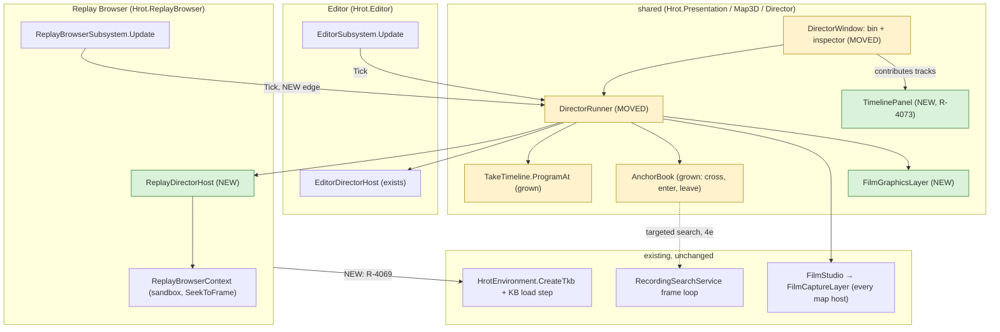

*What the picture shows that prose hid: there is still ONE runner and ONE camera path. The only new frame edge is the Replay Browser
ticking the runner; everything a film needs below the runner already exists on every map host. The dotted edge is a reuse of the
search service's stepping loop, not of its predicates.*

## 2. The workspace


| track | holds | key operations |
|---|---|---|
| **Markers** | the scout's events + bookmarks (TE-4) | snap target; double-click jumps there |
| **Time** | kept segments, their speed, how each gap is crossed (TE-7) | ripple delete, speed, skip style |
| **Camera** | keys (TE-2) with their transition in (TE-8) | **K** adds a key from the pilot camera; update from view; go to key; tie to the selected unit (stored relative, so it follows a moving vehicle); path preview in 3-D |
| **Subtitles** | caption · title card · unit label · exercise-clock stamp; position; fade | the old per-shot `caption` reads as one item |
| **View** | 2-D ⇄ 3-D (the existing animated switch) and layer presets | through the transient override (R-4060) |
| **Graphics** | arrow, ring, route, area, label (TE-9) | drawn in world space, in/out, fade |
| **Audio** | on/off and gain per segment; cues at film time (TE-11) | music and voice-over later |

**Practical must-haves** (from Unreal Sequencer, Resolve, and the replay editors of racing and shooter games): pilot ⇄ program camera on
one key · keys tied to a unit · J/K/L shuttle, frame step, I/O · snapping · copy/paste/nudge keys · lock/mute/solo a track · undo/redo
and autosave (TE-14) · 16:9 safe frame, letterbox, thirds · film length and exercise clock · **shot templates from a marker**
(right-click a shot → over the shooter 0.5 s before, then the target, then the result; reuses D-10's draft rules) · a key whose unit is
gone holds its last pose · validation lists missing units and a stale recording.

## 2a. The timeline — a panel of its own, on every host (R-4073, TE-17, TE-19)

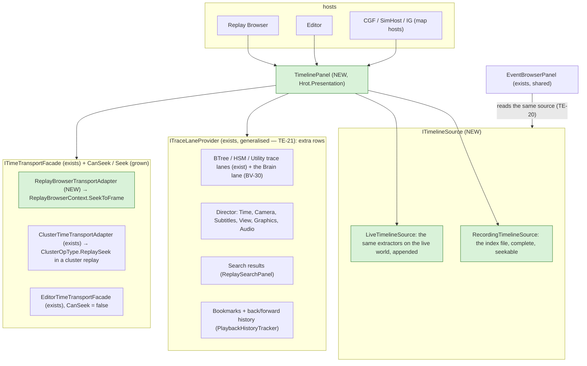

*What the picture shows that prose hid: the timeline knows nothing about any host. A host chooses a source and a transport; the
director, the search, the bookmarks and a unit's trace lanes are only extra rows (TE-21). That is what lets the Replay Browser make it central while the editor and
the cluster hosts show the same panel.*

| host · mode | source | seek | a click in the past |
|---|---|---|---|
| ⭐ **Replay Browser** | recording (the index) | ✅ local sandbox | seeks |
| **a node in a cluster REPLAY** | recording (its own `.fdp`, the same index) | ✅ through the master's `ReplaySeek` round | seeks the cluster |
| **editor preview, a live cluster** | live (appended) | ⛔ never rewind (R-3034) | shows the event; "Open in Replay Browser" when the run was recorded |
| **editor, a director take playing** | live + the take's tracks | ⛔ | the director's own controls (Play / Next) |

## 2b. The event index — read once, cached, drawn by pixels (TE-4, TE-18, TE-20)

**What goes in.** One background pass over the recording, on the search service's own isolated context (replay-browser-2's isolation
invariant: the GUI's sandbox is never touched, so a background thread is safe here):

| lane group | lanes | read from |
|---|---|---|
| **Combat** | shots, hits, detonations | recorded transient events (the event scanner, `IEventScannerCompiler`) — ⛔ which event types are recorded: R0 ② |
| **Life** | spawned, killed / destroyed | lifecycle (`GetDestructionLog`) and `Health` crossing zero |
| **Behaviour** *(TE-22)* | **Changes** · **Orders** · **Reports** · **Decisions** — per pinned unit; Orders / Reports on a commander only | `BrainJournal` (new `Seq`) · `CommandOrderHistory` · `CommandReportHistory` (newest entry changed; key = time + counterpart) · `UtilityDecisionLog` (winner switch) — all recorded (CE-1319); `BehaviorState` changes for a unit with no brain |
| **Movement** | area entries / exits, line crossings | each entity's **position track** (below) against the scenario's areas and lines |
| **Tasks** *(was "Orders", renamed by TE-22)* | a unit's mission-plan tasks: active, done, failed, skipped | `MissionPlan.Tasks[].State` (`eTaskState`) changes |
| *rows added by providers* | search hits, bookmarks, the director's tracks | §2a |

**What the cache holds** — a sidecar beside the recording (`<recording>.timeline`), invalidated by its header (the recording's size,
its last frame's ticks, the index schema version):

| table | per row | why |
|---|---|---|
| **events** | frame, lane, subject id, other id, x, y, one value | the glyphs, the tooltips, the queries — columns, so a lane is one contiguous array |
| **entities** | network id, name, type, side, spawn and despawn frame | names and side colours without opening the recording |
| **position track** | per entity, one sample per second, quantised | a NEW area or line is answered from the cache, then refined by a short local scan from the nearest keyframe (≤ 1 s) — no full rescan |
| **pyramid** | per lane, per level (each level halves the resolution): count, top priority, one representative event | drawing costs pixels × lanes, never events |

📐 Sizes are estimates to measure in R0 ⑧: an hour at 60 Hz is 216 000 frames; 100 000 events × ~24 bytes ≈ 2.4 MB; 1 000 entities ×
3 600 position samples × 8 bytes ≈ 29 MB (moving entities only, delta-coded, is much less).

**How it draws without clutter** — what works in Perfetto/Tracy (profilers), audio editors (peak files), video editors (marker
lanes), Grafana (annotations) and game replay timelines (kill markers):

| rule | |
|---|---|
| **density when crowded, glyphs when sparse** | more than ~1 event per pixel ⇒ a density strip (log-scaled intensity, side colour); fewer ⇒ an icon per event |
| **cluster, never overlap** | glyphs closer than their width merge into one with a count (*×37*); its tooltip lists them grouped by kind |
| **priority on top** | death > detonation > hit > shot > behaviour > movement; a cluster shows its highest |
| **collapsible lane groups** | Combat, Life, Behaviour, Movement, Tasks; collapsed, a group is ONE density strip |
| **focus, not filter** | "selected unit" dims every other event instead of hiding it, so context stays; a pinned unit gets its own swimlane (alive span, its shots, hits taken, behaviour bars, like a Gantt row) |
| **the overview strip** | the whole recording always visible above, with the zoomed window as a bracket you drag |
| **zoom about the cursor** | Ctrl+wheel; drag to pan; drag on the ruler to zoom to a range; the ruler's ticks adapt (hours … frames) with the exercise clock |
| **jump, don't hunt** | next / previous event in the lane under the cursor; a search box filters lanes from the index, not the file |
| **progressive** | while scanning, the scanned part is drawn and the rest shaded; the timeline is usable from the first second |

📐 **Budgets** (to hold in R1): the timeline draws in < 1 ms per frame at any zoom; a cached index opens in < 200 ms for an hour;
the first scan's rate is measured in R0 ⑧ — it bounds how soon the first open is useful, not whether.

## 2c. The interaction rules after During Action Review *(R-4087, coordinator, `2026-10-26`)*

🔒 **User, `2026-10-26`:** *"yes write the addendum note, and approved"* · R-3059: *"clicking timeline itself can not start review (accidental
click)"*. ⭐ **The input map is [DAR §10c](DESIGN_Replay_Time_Axis_And_Review.md)** (wheel, drags, double-click, right-click; zoom limits;
the ruler) and DAR §10b (follow, fit, range, hover, snapping, zoom history) — for EVERY host, the Replay Browser included (only its
toolbar is its own, R-3060). This section owns only what this design adds to it. Dispatched to ui:
[NOTE_Coordinator_To_Ui_Review_Timeline_Addendum](blueprints/batches/NOTE_Coordinator_To_Ui_Review_Timeline_Addendum.md) beside backend's
[NOTE_Backend_To_Ui_Review_Timeline](blueprints/batches/NOTE_Backend_To_Ui_Review_Timeline.md).

| # | rule | supersedes |
|---|---|---|
| 0 | **TL-4 grown: time has two axes.** A frame keeps its wall ticks AND its sim time (the v7 frame index — DAR P0); positions, the ruler and seeks are on the session's active axis (S / W, R-3058) | TL-4 (wall only); gap ① (decode `GlobalTime` in the builder) |
| 1 | **a left click only SELECTS** (an event, a key); seeking is the right-click menu and, in a review / replay / the Replay Browser, the playhead drag | §2a "a click in the past seeks", §9a "click seeks" |
| 2 | **director tracks take a left drag**: on a Time / Camera track a click selects a key or segment and a drag moves it — an edit of the TAKE (TE-14 undo), never of the world | — (DAR §10c's "nothing on empty space" still holds on empty space) |
| 3 | **one keymap** (panel focused): Space · ←/→ frame · Shift+←/→ event · Home / End · +/− · **K adds a camera key** (TE-2) · J / L slower / faster · I / O range in / out; ⛔ on a LIVE host the arrows move the selection, never seek | §2 Camera row's J/K/L shuttle (K is the key) |
| 4 | ⛔ no gesture seeks by itself: double-click = zoom to the cluster, a ruler drag = pan, Shift+drag = a range | §2 Markers "double-click jumps there", §2b "drag on the ruler to zoom to a range" |
| 5 | **the right-click menu is the mode's seek items + what the row under the mouse contributes** (*Set breakpoint here* — TE-21, *Add key here*, *Add bookmark*) through its provider — ⛔ no switch on the row's kind | — |
| 6 | **a selected event selects its unit through the ONE selection** (`SelectionRequestSystem`, as `POST /selection` — R-4083) | — |
| 7 | **`LiveTimelineSource` runs `TimelineIndexBuilder`'s per-frame step** on the live world (the same `IndexedLaneDefinition`s) — a live index equals the index rebuilt from its recording, lane by lane | — |
| 8 | **the end-of-run sidecar is written after the recorder closed the file**, by `TimelineSidecar` (TL-6's header holds the byte size) | — |
| 9 | ⚠ **"Loop range" in a review / replay is the master's clock**, not the panel's — ✅ BUILT (E5, §2e: `ITimelineCursor.SetLoop` → the facade → the master; the Replay Browser keeps its own clock loop) | — |
| 10 | **a take's keys stay in SIM seconds**; on the Wall axis drawn through the session's `ReplayTimeMap`; never inside a paused stretch | — |
| 11 | **events inside one collapsed pause** (Sim axis) draw as one cluster with a count at the pause's tick | — |

## 2d. CE-3330 — the panel's zoom, pan and menu, as built *(ui, `2026-10-26`; build-state: BUILT — the parts that need backend's data D wait, below)*

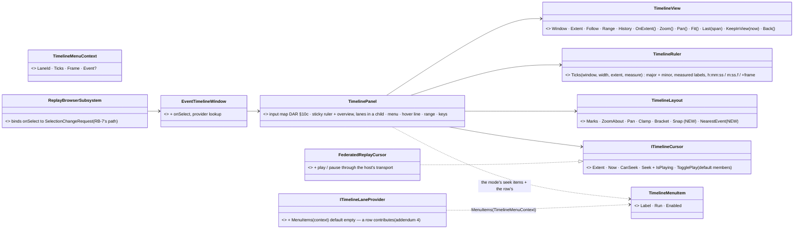
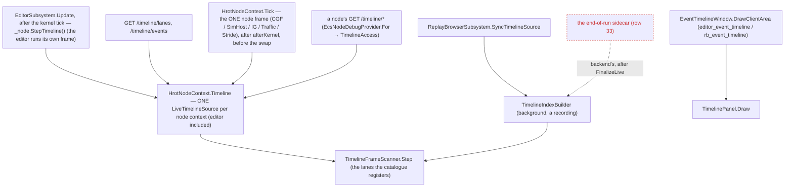
*What the picture shows that prose hid: ONE per-frame step under both sources — so "live lanes = recorded lanes" holds by construction — and
the dead edge: the sidecar at the end of a live run is backend's. ⭐ The cluster nodes' live source sits in the node frame itself, so no host can lack it (one catalogue, `ShippedTimelineLanes.Catalog()`, for the editor, the Replay Browser and every node).*

*What the picture shows that prose hid: every rule of DAR §10 that is not drawing — follow, fit, presets, history, the zoom limits, the ruler's
steps and labels, snapping — is in two PURE classes (`TimelineView`, `TimelineRuler`), so the panel only maps input to their calls and
they are tested without ImGui; and the menu is one list the mode and the row under the mouse both add to, so no lane kind is named in the panel.*

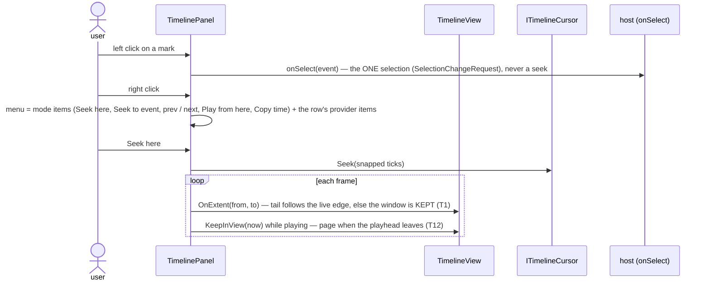

| DAR §10 / R-4087 | as built | rail (`TimelineInteractionTests` unless named) |
|---|---|---|
| T1 view reset | `TimelineView.OnExtent`: the first extent fits, a fitted view stays fitted, a view at the end TAILS (span kept), any other is clamped; a window shown before the first extent is kept | `CE3330_T1_*` ×2 (+ `TimelinePanelFrameRail`, which caught the "shown before" case) |
| T2 / T3 click seeks, drag pans | a left click SELECTS the nearest event (`OnSelect`); a left drag on empty lanes does nothing; seeks are the menu, the ▼ scrub (on release) and the keys | `CE3330_TheMenu_*` (a seek only when an item runs); RB `CE3330_ATimelineEvent_SelectsItsUnit_NeverSeeks` |
| T4 / T5 / T6 wheel | the wheel over the ruler / overview zooms about the mouse by `1.0015^(−Δ×120)`; over the lanes it scrolls them (Ctrl zooms); Shift+wheel, the horizontal wheel and a middle drag pan | `CE3330_T5_T7_*` |
| T7 closest zoom | `MinSpanFrames` = 10 frames at the index's median frame spacing | `CE3330_T5_T7_*` |
| T8 ruler | `TimelineRuler`: 0.01 s … 12 h steps, five minors per major, labels measured and skipped on collision, `h:mm:ss` past an hour, `+frame` at the closest zoom | `CE3330_T8_*` |
| T9 overview edges | the bracket's edges drag to zoom (resize cursor), its inside moves it, a click outside jumps it | — (ImGui input; read) |
| T10 stuck drag | a release anywhere ends the drag | — (read) |
| T11 sticky ruler | the lanes draw in a child window; the overview and the ruler stay | `TimelinePanelFrameRail` draws it |
| T12 follow | `KeepInView` pages the window (playhead 10 % in) while `ITimelineCursor.IsPlaying`; an arrow at the edge where it left, click = reveal | `CE3330_T12_*` |
| §10b fit · presets · range · history · hover · snapping · keys | F / double-click the ruler = fit; 0–3 = 30 s / 2 min / 10 min / all; Shift+drag = a range (duration shown; I / O set it; Esc clears); Backspace = back; a hover line with its time; seeks snap to an event within 7 px, else a frame; Space / ←→ / Shift+←→ / Home / End / + − — ⭐ arrows move the SELECTION where the cursor cannot seek (live) | `CE3330_FitPresetsRangeAndHistory`, `CE3330_Snapping_*` |
| §9b menu + addendum 4 | `TimelinePanel.MenuItems` (pure): Seek here / Play from here / Seek to this event / previous · next in the lane where `CanSeek`; zoom / clear the range; Copy the time — then `TimelineLaneCatalog.MenuItems` (the row's provider, `ITimelineLaneProvider.MenuItems`) | `CE3330_TheMenu_*`, `CE3330_TheRowUnderTheMouse_*` |
| addendum 5 selection | `EventTimelineWindow(onSelect, rowMenu)`; the Replay Browser binds `SelectTimelineEvent` → `SelectionChangeRequest` (RB-7) and play / pause to its transport | RB `CE3330_*` |
| ⭐ **addendum 6 / DAR row 28 — the live source** | `TimelineFrameScanner` = the builder's per-frame step, extracted; `TimelineIndexBuilder` runs it per played frame, `LiveTimelineSource` per live sim frame (`GlobalTime.FrameNumber` advancing; a paused world adds nothing; a new world / a rewind / a changed catalogue starts afresh; a snapshot at most every 0.25 s). `TimelineLaneContext.Live` (row 30) — the shipped indexed lanes apply when `Indexing` | `TimelineIndexTests.CE3330_ALiveIndex_EqualsTheIndexRebuiltFromItsRecording_LaneByLane`, `CE3330_TheLiveSource_*` |
| 🔴→⭐ **found by the parity rail** | on a LIVE world the recorder clears the destruction log INSIDE the tick, before the live step reads it ⇒ the Left lane missed every death. `StructuralScanner` now also reports a tracked entity that is no longer alive (once; playback unchanged — its log removed it first) | the parity rail (red-proved: without the sweep the death is missing) |
| ⭐ **R1-e — the editor hosts the panel** | `editor_event_timeline` (closed by default; Window menu) over its NODE CONTEXT's `LiveTimelineSource` (`_node.Timeline` / `TimelineLanes`, the access `EcsNodeDebugProvider.TimelineOf` — the same owner as every cluster node; the editor calls `StepTimeline()` from its own frame) with a `LiveTimelineCursor` (extent = the index, never seeks, Space through the editor's transport); a clicked event → `SetSelection2D` (the one selection); `GET /timeline/lanes \| events` read the live index (`DebugApiService.AttachTimeline`) | the live run below |
| ⭐ **the cluster nodes' live timeline** (the module diagram's former dead edge) | `HrotNodeContext.Timeline` (a `LiveTimelineSource` over `ShippedTimelineLanes.Catalog()`, built on first use) stepped inside `HrotNodeContext.Tick` after the host's post-kernel work and before the swap ⇒ CGF, SimHost, IG, Traffic and Stride all index by construction; `EcsNodeDebugProvider.For` serves it (`timeline.read`). The editor and the Replay Browser compose the same catalogue. ⚠ **cost, measured (1000 units, Release):** 1.7 → **≈ 1.0 ms / frame busy, ≈ 0.5 ms idle** after CE-1361 (ring lanes skip a byte-identical ring and read it in place; the structural lanes track by index + generation, no `IsAlive` sweep); the rest is the per-unit walk; a publish is O(1) — the snapshot SHARES the scanner's grow-only buffers up to its count (`SharedList`), never a copy (CE-1361 ②). ⭐ ALWAYS ON by user decision (`2026-10-26`); filling a node's index on first use from its recording is CE-1362 | `HrotNodeBuilderTests.CE3330_Node_*` ×2, `TimelineIndexTests.CE3330_Node_TheShippedCatalog_*`, RB `CE3330_Node_*` |
| ⚠ **one frame late** | the live step runs after the kernel tick, when the bus holds the PREVIOUS tick's events: a live event is one frame (≈ 16 ms) later than the recording files it | — |
| ⭐ **T13 / R10 — the Sim axis** (backend P0/P1: `ReplayTimeMap`, `FrameMetadata.SimTime` / `Flags`) | `TimelineAxis` (pure): Wall = the identity; `Sim(map)` projects the index's frame ticks, the extent, "now" and every seek through the map (`AxisCursor` — the host keeps seeking by wall ticks, TL-2); a pause collapses to one instant (its events cluster there — row 11) and a seek to it lands on its LAST frame (`Edge.AfterStretch` — what changed is shown); `Sim` of a v6 recording is Wall. The panel draws a pause as a shaded span on Wall and a zigzag + ◯ / ● (● = changed) on the ruler on Sim; an axis switch maps the window and range through wall time (`TimelineView.Remap`) so the same FRAMES stay in view. The Replay Browser's transport row has the **S / W** toggle (its `Axis`, disabled without sim time) | `CE3330_T13_OnTheSimAxis_APauseCollapses_ASeekLandsAtItsEnd`, `CE3330_T13_TheCursorOnTheSimAxis_AndASwitchKeepsTheFramesInView` |
| ⭐ **was "waits on backend's data D" — UNBLOCKED `2026-10-26`** (backend `5aa14d2b0` one facade, `0784f356c` `ReplaySessionTopic`) | the session layer, the review menu items, the toolbar's mode / axis icons, the slider on the axis — designed in **§2e** (Loop range: built, E5) | — |
| ⏳ not in this slice | addendum 1 / 9 (director tracks — R2 has none yet), K / J / L (no rate in the cursor) | — |

## 2e. The panel and the toolbar on a cluster host — live, review, replay *(ui, `2026-10-26`; build-state: BUILT (E1–E5, `2026-10-26`) — coordinator note B6–B9 on backend's facade `5aa14d2b0` + `ReplaySessionTopic` `0784f356c`)*

⭐ Spec: [DAR §9a / §9b / §9e](DESIGN_Replay_Time_Axis_And_Review.md) (the toolbar, the menu, the two layers) and §12m (the ONE facade,
as built). This section is HOW the ui half is built on it. INVENTORY (graph + grep, `2026-10-26`): `MainToolbarTimeControlSection`
(the toolbar's time section, one per host) · `ClusterTimeTransportAdapter` (THE facade, every host) + `ClusterReplayControls` /
`ReplaySessionIntents` (the one construction of the intents) · `ReplaySession` (the session layer, `ReplaySessionUpdateEvent`) ·
`CheckpointMark` (`Fdp.Core`) · `TimelinePanel` / `ITimelineCursor` / `AxisCursor` / `TimelineAxis` (§2d) · `LiveTimelineCursor` (§2d —
REPLACED here) · `HrotNodeContext.StepTimeline` (§2d) · `ClusterStates.IsReplaying` / `IsReview` · `ClusterScenarioPanel` (the slider) ·
`GlobalTime.TotalWallTicks` (the frame-locked wall clock). ⚠ The graph was indexed before the backend merge (`ReplaySession` absent there,
present in grep).

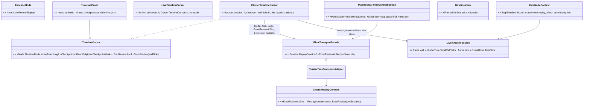
*What the picture shows that prose hid:* the panel and the toolbar reach the cluster through the ONE facade — no second seek or review path
(R-3059 "one path"); the only new type is a cursor, and it REPLACES one. Fdp.Presentation never sees the facade: the cursor is the seam.

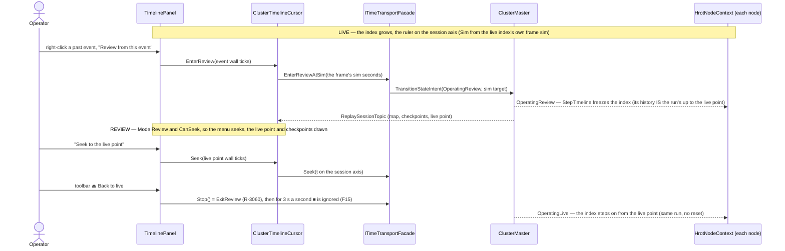
*What the picture shows that prose hid:* entering a review from LIVE has no session yet (no map, no wall zero on the host) — so the entry
goes by SIM seconds, which the master accepts on either axis ("the sim target wins", `ReplaySessionIntents`); inside the review every seek
goes by the session axis with the session's own zero and map.

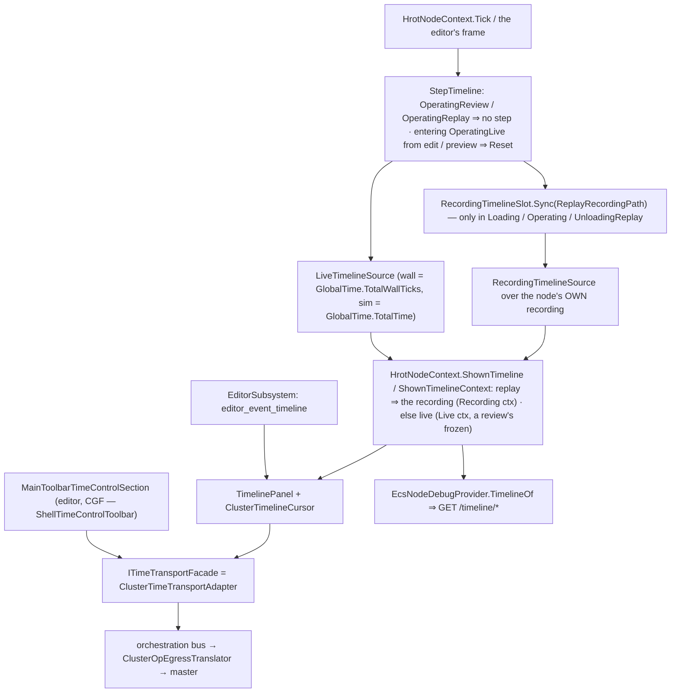
*What the picture shows that prose hid:* the freeze is in the node frame, so EVERY host's index survives a review (a review rewinds the world:
the frame counter going back would otherwise reset it); and a cluster REPLAY's index is NOT the live one (the previous run's, a different
exercise) — the node's own recording takes its place at `ShownTimeline`, ONE seam for the panel and the debug API. ✅ **The red edge of the
earlier picture ("not yet") is live — E6, below.**

#### 2e-E6 as built *(ui, `2026-10-26` — a cluster replay shows the node's OWN recorded lanes)*

| built | where | deviation from the design, and why |
|---|---|---|
| `RecordingTimelineSlot` — the ONE "reopen when the path or the catalogue `Version` changed" holder (`Sync(path)`, `Source`, `Dispose`) | `Fdp.Toolkits/ReplayBrowser/Timeline/RecordingTimelineSlot.cs` | the Replay Browser's `SyncTimelineSource` rule was **extracted**, not copied: the browser now holds a slot too (behaviour unchanged). `RecordingTimelineSource.IsDisposed` added so a dispose is observable |
| `HrotNodeContext.ShownTimeline` / `ShownTimelineContext` / `ReplayRecordingPath`; `StepTimeline` syncs the slot **before** its replay early-return (replay states open it, every other state `Sync(null)` — the index is rebuilt cheaply from the sidecar next replay) | `HrotNodeContext.cs` | replay = `Loading` / `Operating` / `UnloadingReplay`; a **review is NOT** (DAR §9e: the frozen live source). In a replay with no file yet `ShownTimeline` is **null** (nothing to show), not the live index of a world that is not running |
| `EcsNodeDebugProvider.TimelineOf` serves `ShownTimeline`; `TimelineAccess.Context` became a `Func` behind the same `Context` property (a fixed-context constructor remains for the browser / tests) | `EcsNodeDebugProvider.cs`, `ISubsystemDebugProvider.cs` | the per-context cache stays sound: both the source and the context are Funcs, so the ONE cached access follows the mode |
| the editor's window source = `_node.ShownTimeline`, lanes = `Lanes(_node.ShownTimelineContext)` | `EditorSubsystem.cs` | the `null`-in-Replay hack and the transport-mode test are gone |
| `ClusterTimelineCursor` **unchanged**: in Replay its extent / now / seek / loop / map come from the SESSION (`ZeroWallTicks`, `LengthSeconds`, `TimeMap`); the index only supplies the lane events | — | ✅ verified: the recording's frame ticks are `GlobalTime.TotalWallTicks` (`RecorderTickSystem.cs:112`), the same clock as the session's zero (`ReplayAnchorWallTicks` = the earliest first frame across the cluster, `ReplaySessionProcessManager.Build`) |
| rails | `TimelineIndexTests.CE3330_E6_TheRecordingSlot_*` · `HrotNodeBuilderTests.CE3330_E6_Node_ShownTimeline_*` ×2 | |

| ⭐ decision | why — the one fact |
|---|---|
| **the host cursor keeps WALL ticks** (`AxisCursor` converts the Sim axis back first, TL-2) and converts to the facade's axis itself | one conversion point; the panel and its rails are unchanged |
| **entering a review from LIVE goes by SIM** (`EnterReviewAtSim`, NEW on the facade — a backend file, a two-line cross-lane edit, said in the commit) | in live the host has no session: no map, no wall zero; the master takes a sim target on either axis |
| **the live index stamps frames with `GlobalTime.TotalWallTicks`** (was `DateTime.UtcNow`) and records `GlobalTime.TotalTime` | `GlobalTime.cs:56`: *"the single source of truth for wall-clock time within a frame … including the flight recorder"* — the live index then shares the recording's and the session's clock exactly |
| **`StepTimeline` freezes in a review / replay and starts afresh on entering live** (the node's `LocalClusterState`) | DAR §9e: *"review — the SAME live source, frozen at the live point"*; afresh at live ⇒ index frame 0 = the run's first frame (the wall zero in live) |
| ~~**in REPLAY the panel draws the session layer only**~~ ⛔ **SUPERSEDED by E6 (below)** — the replay shows the node's own `RecordingTimelineSource` | the live index is the previous run's; the replay's own recording is the right source (DAR §9e row "cluster replay") |
| **F15: for 3 s after a return to live, ■ is ignored, and its tooltip says why** | the design's own fix; no modal |
| ⛔ rejected: a seek path in the panel beside the facade | R-3059 one path |
| ⛔ rejected: converting live wall → wall-after-zero for the entry | the host has no zero in live; a guessed zero seeks the wrong frame |
| ⏭ deferred, one line each: "Review from here **and play**" (needs a play once the review lands — no seam yet) · "Seek to before / after the pause's edits" (needs an `Edge` on the facade seek) · ⚑ "Mark this moment" (no checkpoint intent found) · replay "⑂ Go live from here" (D18, behind its own confirmation) | |

**Build slices (each with its rails, red-proved):** **E1** — the live source's clock (`TotalWallTicks`, frame sim, `TimelineIndex.FrameSim`)
+ `StepTimeline` freeze / reset · **E2** — `TimelineMode` + the cursor members, `ClusterTimelineCursor`, the panel's menu by mode and the
session marks, the editor wired (`LiveTimelineCursor` deleted), the facade's `Session` + `EnterReviewAtSim` · **E3** — the toolbar: mode
glyph + menu, ⏏ + F15, the axis icon · **E4** — `ClusterScenarioPanel`'s slider on the active axis (row 24) · **E5** — the master's loop on the panel
(below).

#### 2e-E2 as built *(ui, `2026-10-26` — slice E2 BUILT; E1/E3 per their own commits; E4 open)*

| built | where | deviation from the diagrams above, and why |
|---|---|---|
| `TimelineMode` + `ITimelineCursor.Mode / LivePoint / Checkpoints / CanReview / EnterReview` (defaults: None / null / empty / false / no-op) | `Fdp.Presentation/ImGui/Panels/Timeline/ITimelineCursor.cs` | none. `FederatedReplayCursor` keeps the defaults (the Replay Browser has no review, DAR §9c) |
| `AxisCursor` forwards them: `LivePoint` and each checkpoint's `WallTicks` converted to the axis (checkpoints projected once per list the host hands out), `EnterReview` converted back to wall | `TimelineAxis.cs` | none |
| menu by `Mode` (`TimelinePanel.MenuItems`, still pure): Live + `CanReview` ⇒ "⟲ Review from \<time\>" + "⟲ Review from this event (\<lane\>)" and no seek item; Review ⇒ the seek items + "⏏ Seek to the live point" (when `LivePoint` is known); Replay ⇒ the seek items only | `TimelinePanel.cs` | none. The deferred items of the table above are NOT built |
| session marks: each checkpoint a `IconsFontAwesome6.Flag` on the ruler (label in the tooltip), the live point a vertical line labelled "live" over the lanes; off-screen ones not drawn | `TimelinePanel.DrawRuler` / `DrawOverlays`, `IconsFontAwesome6.Flag` | none |
| `ClusterTimelineCursor : ITimelineCursor` `(Func<ITimeTransportFacade?>, Func<ITimelineSource?>)` | `Hrot.Presentation/Adapters/` (beside `ClusterTimeTransportAdapter`, the facade's implementation; `Facades/` holds interfaces and the intents builder) | **"Now" in a review / replay is `Session.ZeroWallTicks + facade.TotalTime·TPS`, not `TimeMap.WallAt(TotalTime)`.** 📐 Measured: the cluster clock the facade reads is, after a seek, *wall seconds after the session's zero* (`ReferenceReplayLoadHandler` overwrites `RestoredTime.TotalTime` with exactly that; `ReplaySeekProcessManager` snaps the master clock to it; `ReplayClockProcessManager` reads it back as `anchor + TotalTime`) — so it is not sim seconds and a `WallAt` would double-convert on a paused session. Clamped to the extent. `TimeMap` is returned whatever the facade's axis (the Wall axis shades the pauses from it); `Axis` is `Sim` only when the facade's axis is Sim |
| `LiveTimelineCursor` deleted; the editor window's source func and the cursor's are ONE func, `null` while the facade's Mode is Replay | `EditorSubsystem.cs` (`editor_event_timeline`) | none |
| the live map is `ReplayTimeMap.FromFrames(FrameTicks, FrameSim, 0)` per index SNAPSHOT (cached by instance) | `ClusterTimelineCursor.TimeMap` | the snapshot is republished at the source's throttle (not per frame), so the O(n) rebuild is the same cost class as `TimelineAxis.Project`'s |
| rails | `Hrot.Presentation.Tests/ClusterTimelineCursorTests.cs` (mode, extent per mode, seek on both axes, review entry, live point / checkpoints, axis, play) · `Fdp.Presentation.Tests/…/TimelineInteractionTests.cs` `CE3330_E2_*` (menu by mode, `AxisCursor` session layer) · `Hrot.Presentation.Tests/Panels/TimelinePanelFrameRail.cs` `CE3330_E2_TheSessionLayer_…` | |


#### 2e-E5 as built *(ui, `2026-10-26` — Loop range: the MASTER's loop on the panel, review / replay only)*

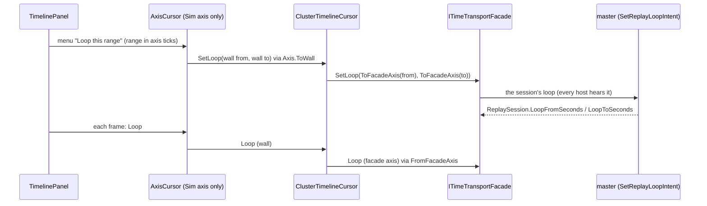

*Caption: the panel never owns a loop — it reads the master's every frame, so a loop set by another host or the toolbar draws too.*

| built | where | deviation from the design, and why |
|---|---|---|
| `ITimelineCursor.Loop / CanLoop / SetLoop / ClearLoop` (defaults: null / false / no-op; WALL ticks) | `ITimelineCursor.cs` | none. `FederatedReplayCursor` keeps the defaults (the Replay Browser's loop is its own clock, DAR §12n) |
| `AxisCursor` forwards them: `Loop` to axis ticks, `SetLoop` back to wall (a paused instant resolves to its END, like every conversion back) | `TimelineAxis.cs` | none |
| `ClusterTimelineCursor`: `CanLoop` in Review / Replay; `Loop` from `facade.Loop` to wall ticks; `SetLoop` / `ClearLoop` to the facade. ONE conversion pair (`ToFacadeAxis` / `FromFacadeAxis`) now serves `Seek` and the loop | `ClusterTimelineCursor.cs` | `Seek`'s inline conversion was extracted into the shared helper (one place, not a copy) |
| menu: "Loop this range" when a range is selected, "Clear the loop" when a loop exists — both only in Review / Replay with `CanLoop`, never in Live / None (`MenuItems` still pure) | `TimelinePanel.MenuItems` | none |
| drawing: a green bracket on the ruler (end bars + base strip) and a tinted band over the lanes, from `cursor.Loop` | `TimelinePanel.DrawRuler` / `DrawOverlays` | none |
| rails | `ClusterTimelineCursorTests` `CE3330_E5_*` ×3 · `TimelineInteractionTests` `CE3330_E5_*` ×2 · `TimelinePanelFrameRail.CE3330_E5_TheMastersLoop_*` | |


*What the class picture forces: every new type is DATA in the take, plus one host and one layer. The pose maths stays in
`ShotEvaluator`, the anchors in `AnchorBook`, the timing in `TakeTimeline` — each grows, none is copied.*

## 4. Sequences

### 4a. Author a key — fly, press K

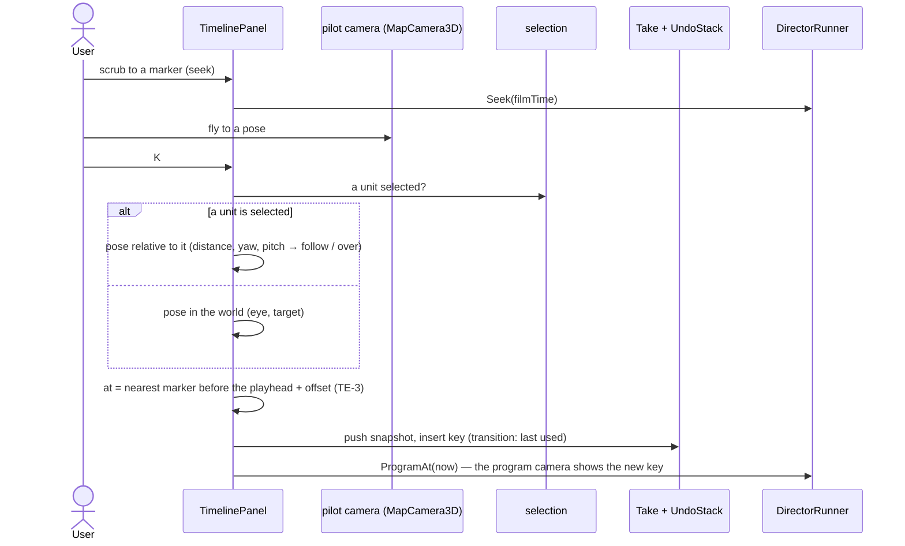

### 4b. One program frame, from a recording

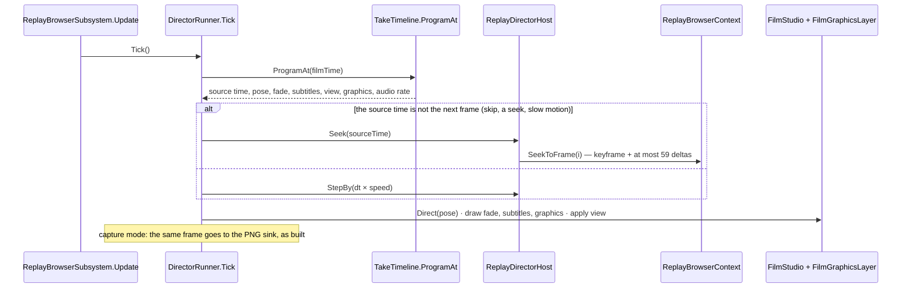

### 4c. Open a recording — the index, built once, then cached (TE-4)

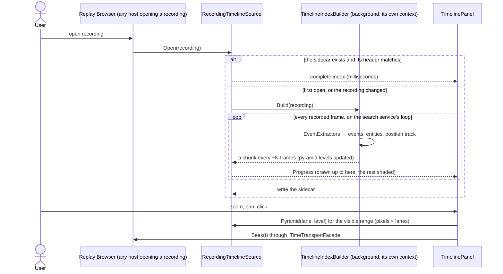

*What the sequence shows: the expensive pass happens once per recording; every take, search lane and later open reuses it. The GUI's
sandbox is never touched while it runs.*

### 4e. A take's anchor that the index cannot answer yet

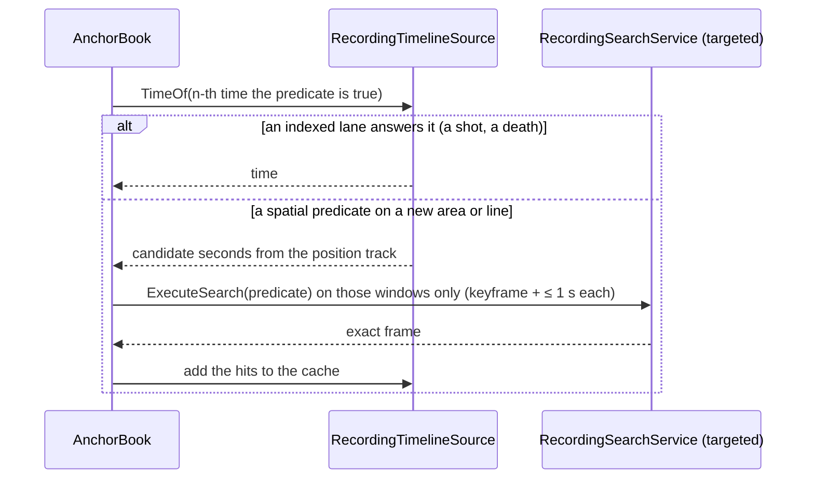

### 4d. Promote a recording take to a scenario take

⛔ *SUPERSEDED by CR-6 / [§11s](#11s-p4--one-anchor-resolver-promote) D5–D6: promote is a COPY (keys already hang on events); no re-anchoring step, no hash refusal — the bake is kept or dropped by the hash. The sequence below is the first form, kept as history.*

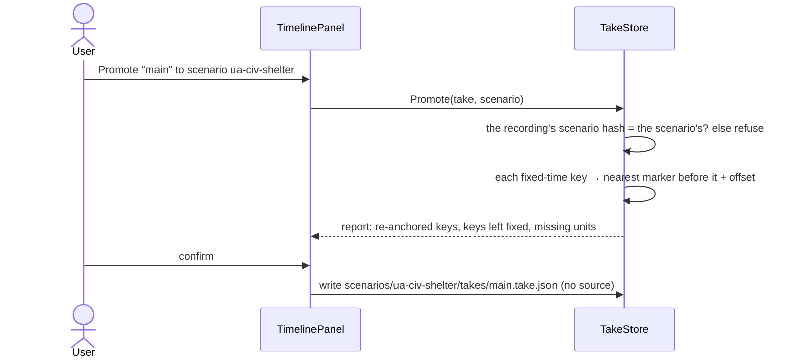

## 5. The take format, v2

```json
{
  "source": {"recording": "7f3a…", "scenarioHash": "…"},
  "anchors": {"fire": {"on": "shot", "who": "Tank 1", "n": 1},
              "blue": {"n": 1, "when": {"$type": "SpatialBounding", "TriggerEvent": "Entry",
                                        "Bounds": {"Min": [180, 40], "Max": [260, 90]}, "…": "the predicate's own JSON"}}},
  "segments": [{"from": 0, "to": "blue-5", "speed": 1},
               {"from": "fire-1", "to": "fire+3", "speed": 0.25, "gap": "dip"}],
  "keys": [
    {"at": "blue-5", "lookAt": [105, 75, 1], "distance": 60, "pitch": -30, "in": "cut"},
    {"at": "blue-0.5", "over": "Tank 1", "toward": "Enemy", "in": {"fly": 2, "ease": "inOut"}, "still": "crossing"},
    {"at": "fire+1", "follow": "Enemy", "distance": 12, "in": {"dip": [0.4, 0.4]}}
  ],
  "subtitles": [{"at": "blue-4", "until": "blue", "text": "The platoon crosses phase line BLUE"}],
  "views": [{"at": 0, "map": "2d", "layers": {"on": ["Units.Cards"]}}, {"at": "blue-5", "map": "3d", "layers": {"off": ["Units.Cards"]}}],
  "graphics": [{"at": "fire-1", "until": "fire+3", "kind": "ring", "who": "Enemy"}]
}
```

A scenario take is the same with `source` absent. ⭐ `shots[]` is still read; the editor writes `keys[]`. ⭐ CE-4059 (§11q K1): a segment may carry an
`"id"` and a key a `"segment"` naming it — that key plays only in that segment (a replay's own angle, `{"at": "fire-1", "segment": "replay", …}`); a key
with no `segment` plays in every pass, as before. ⭐ `"on": "shot"` is a shorthand that lowers to a predicate (TE-3b); `when` holds any predicate, written by the existing editor (R-4072). A line crossing is the extension TE-3 names; until it exists, an area entry is the box above.

## 6. Phases and acceptance

| phase | builds | accepted when |
|---|---|---|
| **R0** *(measure)* | ① a recording plays back faithfully (types, effects, deaths, poses, doors) · ② which events a recording holds (shots, hits, blasts as recorded transient events? `ShotLog` / `DetonationLog` live beside the live world only) · ③ the TKB from the recording's scenario (TE-12) · ④ sound sources in replay · ⑤ is an editor run archived (TE-13) · ⑥ which class draws tactical graphics (TE-9) · ⑦ each of the nine anchor shorthands as a predicate (TE-3b) · ⑧ the scan rate of the search service's loop and the index's size on a real hour | a report per item, each with its file:line; the TKB loaded in the Replay Browser |
| **R1** ⭐ *(the timeline first — useful without the director, R-4073)* | `TimelineIndexBuilder` + extractors + the sidecar · `ITimelineSource` (recording, live) · `TimelinePanel` with the rules of §2b · `ITimeTransportFacade.CanSeek / Seek` and the Replay Browser adapter · the Event Browser on the index | an hour's recording opens with its timeline filling progressively; the second open is instant; zoomed out it draws densities, zoomed in glyphs, < 1 ms per frame; a click seeks |
| **R2** | format v2 + `shots[]` as keys · `ProgramAt` · move the runner and window (TE-5) · `ReplayDirectorHost` · the director's tracks (Time, Camera) on the Timeline, K, cut / fly / dip · undo · anchors as predicates in the existing editor (R-4072) | a recording take plays in the Replay Browser with skips, slow motion and the three transitions; the same take's keys play in the editor |
| **R2b** | Subtitles and View tracks · promote · the predicate extensions (polygon area, line crossing, drawing them on the map) | a take authored on a recording, promoted, plays on a fresh editor run of its scenario with every condition-anchored key on its event |
| **R3** | Graphics track + `FilmGraphicsLayer` · shot templates · audio at any rate (TE-11) · still keys in Verify (TE-10) | a regression run writes a PNG per still key; slow motion sounds as TE-11 says |
| **R4** | reel composer · render queue · HTTP (TE-15) + MCP catalog | a reel of two recording takes renders to one movie with sound |

## 7. Claim table — what the leans rest on

| claim | code — how it IS | design — how it was MEANT |
|---|---|---|
| a recording plays back faithfully | ⛔ not tried (user) | ⛔ `DESIGN_Film_Director.md` §3e: *"that slice starts by measuring both"* ⇒ R0 ① |
| the Replay Browser sets no TKB | ✅ no `ITkbDatabase` in `ReplayBrowserSubsystem.cs`; the node builder sets it at `HrotNodeBuilder.cs:262` | ✅ `DESIGN_Map_3D_Mode.md` (§6b, the finding) · ruled R-4069 |
| the runner can move to the shared assembly | ✅ `DirectorRunner.cs` usings: `Hrot.UI.Common.Map3D(.Director)` only; `DirectorWindow.cs`: + `Fdp.Presentation.WindowManager`, ImGui | ✅ R-4068 |
| the host seam takes a replay host | ✅ `IDirectorHost` (`DirectorHost.cs:13`): World, StepBy, SimTime, Hold, Pause…; optional members already default to NotSupported (`WriteCheckpoint`, `:53`) | ✅ `DESIGN_Film_Director.md` §8.1 (every editor dependency behind an interface) |
| every map host carries the film camera, the Replay Browser too | ✅ `MapInteractionPack.cs:539` (`FilmCaptureLayer`, every host) | ✅ `DESIGN_Map_3D_Mode.md` §6ab, §6b |
| the audio layer is on every map host | ✅ `MapInteractionPack.cs:533` (`AudioLayer.For`, given the host's TKB) | ✅ `designs/audio/DESIGN_FPS_Audio.md`; R-4059 |
| a seek is cheap | ✅ a keyframe every 60 frames (`RecorderTickSystem.cs:21`) | ✅ replay-browser-2 §4.2 |
| a headless frame loop over a recording exists, isolated from the GUI | ✅ `RecordingSearchService` | ✅ replay-browser-2 §1 isolation invariants, §6.3 |
| anchors already carry events + offsets | ✅ `AtExpr`, `AnchorSpec.Kinds` (shot, blast, hit, near, task, side, health, embark, gesture — `Take.cs:129`) | ✅ `DESIGN_Film_Director.md` §4, `DESIGN_Scenario_Regression.md` (checks.json reuses it) |
| a recording names its scenario | ✅ an archived exercise's `Orchestrator.json` carries the scenario id (`AssetInventoryProcessManager.cs:265`) · ⛔ an editor run's temp folder: not measured | ✅ mgmt-1 §12 · ⛔ R0 ⑤ |
| the anchors can be resolved from a recording | ⛔ `AnchorBook` reads `ShotLog` / `DetonationLog`, kept beside the LIVE world (`DESIGN_Film_Director.md` §8.3) — in a replay sandbox: not measured | ⛔ R0 ② — ⚠ load-bearing for the Combat lanes; the index reads RECORDED events (the event scanner), which is why it is the source and not AnchorBook's logs |
| the existing condition model is one, shared, editable and serialisable | ✅ `SearchPredicateDto` (`SearchPredicateDto.cs`, `$type` discriminators) used by data breakpoints (`Hrot.Diagnostics.Breakpoints`), Replay Browser search, `/replay/search`, BTree/HSM/Blueprint breakpoint menus; StructEdit editor hosted by `ReplaySearchPanel` and `DataBreakpointManagerPanel` | ✅ `Predicate-Infrastructure-Capabilities.md` §1–§5 · R-4072 |
| enter / leave an area exists; a polygon and a line do not | ✅ `SpatialBoundingPredicateDto` + `BoundaryEvent { Entry, Exit, EntryOrExit }` over a `BoundingBox2D` (`SearchPredicateDto.cs:161-183`), picked with `[MapPickableBoundingBox]` · ⛔ no polygon, no line predicate found (graph + grep; coverage not checkable) | ⚠ the capabilities doc §6 calls the box "the polygon" — it is a box |
| the predicates evaluate both on a recording and live | ✅ `RecordingSearchService` (recording) · `DataBreakpointManager` (live, per tick) | ✅ capabilities doc §3.3 |
| no event index or cache of a recording exists | ✅ `PlaybackController` keeps only an in-memory FRAME index (`_frameIndex`: offsets, wall ticks, keyframes — `PlaybackController.cs:30-47, 354`) · ⛔ searched graph + grep for an index / cache / summary file: none (coverage not checkable) | ⛔ searched `docs/`: none |
| a cluster replay can seek; the transport facade cannot yet | ✅ `ClusterOpType.ReplaySeek` / `NodeReplaySeek` (`OrchestrationMessages.cs:34, 74`), `ClusterMaster.Replay.cs` · `ITimeTransportFacade` has no seek (`ITimeTransportFacade.cs:11-47`) | ✅ `DESIGN_Time_Architecture.md` §11 |
| a timeline for one unit was already designed, not built | ✅ `TraceTimelineWindow.cs` (50 lines, draws *"No trace data."*), `ITraceLaneProvider` + three providers (BTree, HSM, Utility) | ✅ `AI_Editor_Shared_Infrastructure.md` §15 · BV-30 deferred (`DESIGN_Entity_Brain_View.md`) ⇒ TE-21 |
| a background index pass is safe | ✅ the search and export services build their own `ReplayBrowserContext`; export already runs `LongRunning` | ✅ replay-browser-2 §1 "Isolation invariants" |
| sound at other rates | ✅ `SoundTrack.RenderWav` maps each cue to the film timeline (§8.3) | ⛔ no design for live playback at ≠ 1× — TE-11 is new |

## 9. R1 — the build plan, refined by measurement *(ui, `2026-10-26`; build-state: READY-TO-BUILD for R1-a…R1-c)*

**INVENTORY** *(`scripts/cbm.sh search_graph` name_pattern `.*(Timeline|TraceLane|TimeTransport|EventBrowser).*` label Class → **31**,
label Interface → **2**)*: the timeline-shaped types that exist are `ReplayTimelinePanel` + `ReplayTimelineWindow` (Fdp.Presentation —
the browser's transport and slider), `TraceTimelineWindow` (a shell) + `ITraceLaneProvider` with `BTree/Hsm/UtilityTraceLaneProvider`
(descriptors only), `EventBrowserPanel` (+ two `FdpEventBrowserWindow`s), `ITimeTransportFacade` with `EditorTimeTransportFacade` and
`ClusterTimeTransportAdapter`; the rest are SUMO's `ActivityTimeline*` (unrelated). ⛔ No index, builder, source or event-lane type exists.

📐 **Measured before building** (a read-only survey of the code + grep; ⚠ `check_index_coverage` is not reachable through the CLI, so an
"absent" here is absent in the searched paths):

| finding | file:line | what it changes |
|---|---|---|
| **D1** the Replay Browser's scrubber does NOT seek through `ReplayBrowserContext.SeekToFrame`: it drives `FederatedReplayManager` (`SetBaseWallTicks` + `SeekAll`/`StepForwardAll`) | `ReplayTimelinePanel.cs:539-543`, `FederatedReplayManager.cs:125-183`; `ReplayBrowserSubsystem.cs:835` | §2a's `ReplayBrowserTransportAdapter → SeekToFrame` is wrong: the adapter fronts the MANAGER (TL-2) |
| **D2** `ITraceLaneProvider` lives in `Hrot.Editor.AiShared` and only DESCRIBES lanes (id, name, levels) — no rows | `Hrot.Editor.AiShared/Debug/ITraceLaneProvider.cs` | the row seam cannot live there (TL-3) |
| **D3** `Hrot.ReplayBrowser` does not reference `Hrot.Presentation` (it references `Fdp.Presentation`, `Fdp.Toolkits`, `Hrot.Core`, `Hrot.CGF`, `Hrot.SimHost`) | `Hrot.ReplayBrowser.csproj` | ⛔ the panel cannot live in `Hrot.Presentation` as §2a says — it lives in `Fdp.Presentation`, beside today's `ReplayTimelinePanel` (TL-1) |
| the combat events a recording carries — `WeaponFireNotification`, `HitEvent`, `DetonationNotification`, `DamageAssessedEvent` — are `Fdp.Toolkits` types without `NoReplay`; `ShotLog` / `DetonationLog` are per-world side stores, not recorded | `Combat/Events/WeaponFireEvents.cs:94`, `Combat/HitEvent.cs:19`, `Combat/DetonationNotification.cs:24`; `Combat/ShotLog.cs:68` | R0 ②: the Combat lanes come from the recorded EVENTS (TL-5) |
| the behaviour histories are recorded components: `BrainJournal` (24, `Seq`), `CommandOrderHistory` / `CommandReportHistory` (32 each), `UtilityDecisionLog` | `BrainJournal.cs:133`, `CommandHistory.cs:61,95`, `UtilityDecisionLog.cs:63` | TE-22's lanes read them frame to frame |
| `RecordingSearchService`'s loop returns finished lists only (no chunks, no progress) | `RecordingSearchService.cs:39,85` | the builder runs its OWN loop, on its own repository — the same isolation invariant |

| # | ⭐ decision (lean) | rejected |
|---|---|---|
| **TL-1** | the index, its builder and the sources in **`Fdp.Toolkits/ReplayBrowser/Timeline`**; the panel and its pure layout in **`Fdp.Presentation/ImGui/Panels/Timeline`** — every host references both | `Hrot.Presentation` (§2a) — the Replay Browser cannot see it (D3) |
| **TL-2** | the panel seeks through **`ITimelineCursor { Extent, Now, CanSeek, Seek(ticks) }`**, a one-method adapter each host binds to ITS OWN transport: the Replay Browser to `FederatedReplayManager` (D1), the Hrot hosts to `ITimeTransportFacade` grown `CanSeek / Seek` (R1-e) — ⛔ not a second transport, no state of its own | the panel calling `ITimeTransportFacade` — not visible from `Fdp.Presentation`; `SeekToFrame` — not the browser's path |
| **TL-3** | a row seam **`ITimelineRowProvider`** in `Fdp.Presentation` (rows for a time range); `ITraceLaneProvider`'s providers get an adapter when the Trace Timeline hosts the panel (R1-e, TE-21) | generalising `ITraceLaneProvider` in place — an editor assembly the browser cannot reference |
| **TL-4** | time is **frame index + the recording's wall-clock ticks** (`PlaybackController.GetFrameMetadata`): events keep their frame; the index keeps one frame → ticks table; seek is by ticks | sim seconds — a recording's frames carry wall ticks, and the browser's manager seeks by them |
| **TL-5** | R1's lanes: **Life** (a network id appearing / leaving), **Combat** (shots = `WeaponFireNotification`, hits = `HitEvent`, blasts = `DetonationNotification`), **Behaviour** per unit (Changes = `BrainJournal.Seq` advancing, Orders / Reports = the history's newest entry changing, Decisions = a `UtilityDecisionLog` winner switch). ⏳ **Movement** and **Tasks** wait (they need the scenario's areas and mission plans — R2b) | every §2b lane at once — the two need data the index does not hold yet |
| **TL-6** | the sidecar **`<recording>.timeline`**: a header (magic, schema version, the recording's byte size, its last frame's ticks) then the tables; a header mismatch ⇒ rebuild | a database — one file beside the recording is what §2b asks |
| **TL-7** | the builder runs on a **background task with its own `PlaybackController` + repository + bus**; it publishes immutable snapshots every ~N frames (progressive, §2b) — the GUI's sandbox is never touched | stepping the GUI's sandbox — the isolation invariant forbids it |


*Caption:* what the picture shows that prose hid — nothing in the index or the panel knows a host: the browser binds a cursor to its
manager and a source to its file; the Hrot hosts bind the same two to their facade and the live world (R1-e). The pure `TimelineLayout`
is where §2b's drawing rules live, so they are tested without ImGui.

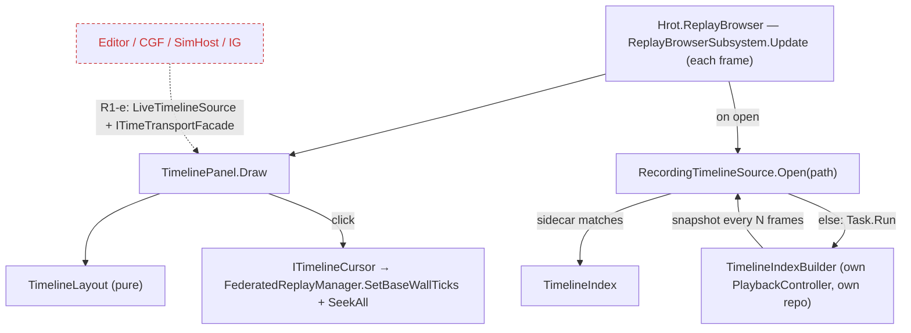
*Caption:* the dead edges — the editor and the cluster hosts do not show the panel in R1-a…c; they need a live source and the grown
facade (R1-e). The builder never runs on the frame thread.

| slice | builds | accepted when |
|---|---|---|
| **R1-a** | `TimelineIndex`, `TimelineEvent`, the three extractors, `TimelineIndexBuilder`, `TimelineSidecar`, `RecordingTimelineSource` | a recorded run's shots, hits, blasts, spawns, deaths and a commander's orders come out of one pass in frame order; the second open reads the sidecar; a changed recording rebuilds |
| **R1-b** | `TimelineLayout` (density / glyph / cluster / priority, zoom-about-cursor maths) + `TimelinePanel` + `ITimelineCursor` | §2b's rules as rails on the pure layout; < 1 ms per draw on an hour's index |
| **R1-c** | the Replay Browser hosts the panel over its manager; R0 ⑧ (scan rate, index size) measured on a real recording | §6 R1's acceptance in the browser |
| **R1-d** | the pinned unit's swimlane + TE-22's acceptance (the `hill-attack` commander's Orders lane, hover why, click seeks) | TE-22 |
| **R1-e** | `LiveTimelineSource`, `ITimeTransportFacade.CanSeek / Seek`, the Trace Timeline hosting the panel (TE-21), the Event Browser on the index | the editor shows the same panel live |

### 9a. R1-a as built *(ui, `2026-10-26`)*

Built in `FDP/Toolkits/Fdp.Toolkits/ReplayBrowser/Timeline/` as the class diagram above draws it; rails `TimelineIndexTests` (Fdp.Toolkits.Tests).

| what | as built | deviates from the plan |
|---|---|---|
| `TimelineIndex` | per lane a sorted `TimelineEvent[]`, `FrameTicks`, `ScannedFrames` / `TotalFrames`; `Events` / `Count` are binary searches; `FrameAt(ticks)` | ⚠ no `Entities` table — every event carries its ids (network id, else `-(index+1)`), so nothing needs one yet |
| `TimelineEventSink` | the builder's growing per-lane lists; `Snapshot` copies them into an immutable index | new — the `sink` the extractor signature names |
| `LifeExtractor` | a set diff of NETWORKED entities per frame; X / Y where it appeared or was last seen | ⚠ entities without a network id (rounds) are not indexed — they would drown the lane. Frame 0 reports every unit present as Spawned |
| `CombatExtractor` | Shot = a fired `WeaponFireNotification` (a refusal is not a shot; value = rounds), Hit = `HitEvent`, Blast = `DetonationNotification` (value = damage) | — |
| `BehaviourExtractor` | Change per new `BrainJournal` entry (value = kind); Order / Report: one event per NEW history entry, found by the previous newest entry's key (time + counterpart, TE-22 ②) — two orders in a frame are two events — plus the same order REPEATED, which the history counts rather than lists; Decision when a slot's `SwitchCount` rises (other = winner, value = decision id) | the first frame a unit is seen is its baseline (its rings hold the past) |
| `TimelineIndexBuilder.Build` | its own `PlaybackController` + repository (+ the repository's bus), `RecordingSearchService.RegisterAllComponents`; a snapshot every `chunkFrames` (default 2000) | — |
| `TimelineSidecar` | `<recording>.timeline`: magic, schema version, the recording's **byte size and last-write time**, then the tables; written via a temp file, only when complete | ⚠ TL-6 said "its last frame's ticks": reading those needs the recording opened; size + write time is checked without opening it |
| `RecordingTimelineSource` | `Open(path)`: the sidecar if it matches, else a `Task.Run` build publishing snapshots into a volatile field, then the sidecar; `Dispose` cancels | — |

**R1-b / R1-c as built** *(same day)* — in `Fdp.Presentation/ImGui/Panels/Timeline/` + `Windows/Timeline/`; rails `TimelineLayoutTests`
(Fdp.Presentation.Tests) and `CE1302_TheEventTimeline_*` (Hrot.ReplayBrowser.Tests):

| what | as built | deviates from the plan |
|---|---|---|
| `TimelineLayout` (pure) | `Marks(index, lanes, window, width)`: more events than pixels ⇒ contiguous density bins (frame edges, log-scaled intensity), else glyphs clustered within 7 px across the row's lanes (a k-way merge), each mark carrying its top-priority lane and frame range; `ZoomAbout` / `Pan` / `Clamp` / `Bracket` / `RulerStep`; `MarkAt` + `Describe` (the tooltip, events counted per lane) | ⭐ the bin edges are cached per window, so the rows of one draw share them — 📐 **0.59 ms per draw** for 9 rows × 1600 px over an hour (216 000 frames, 100 000 events), Debug build; before the cache 1.5 ms |
| `TimelinePanel` | overview strip + bracket (drag moves it), ruler, Life / Combat / Behaviour groups (collapsed = one row), unscanned part shaded, "now" line; Ctrl+wheel zooms about the mouse, drag pans, click seeks, hover lists the mark | ⏳ not yet: jump to next / previous event, the search box, focus-dimming (R1-d with the pinned unit) |
| `ITimelineCursor` + `FederatedReplayCursor` | Extent / Now / CanSeek / Seek over `FederatedReplayManager`; a seek subtracts the node's offset and calls `SetBaseWallTicks` (which seeks every node) | — |
| `EventTimelineWindow` + `TimelinePanelViewModel` | the window (U-obs-5: declared, dumps scanned / total frames, window, now, per-lane counts in window and in total) | ⚠ named *Event* Timeline: "Replay Timeline" is already the browser's transport window |
| Replay Browser hosting | `rb_event_timeline` registered beside `rb_timeline`; `SyncTimelineSource()` opens the primary node's recording each update when it changes (sidecar or background build), disposed on shutdown | — |

📐 **Seen in a real ImGui frame** (`TimelinePanelFrameRail`, Hrot.Presentation.Tests — Xvfb + software GL, a synthetic ten-minute
firefight; screenshots to `HROT_TIMELINE_SHOTS`): the first render found three defects the pure-layout rails could not — ① `ImGui.Text*`
take a printf FORMAT, so *"Indexing… 50%"* read garbage after its `%` (⇒ all panel text goes through `TextUnformatted`); ② the editor font
has no `–` / `…` (drawn as `?`); ③ `×N` count labels overprinted each other where clusters sit closer than the label's width (⇒ a label is
drawn only where it fits before the next mark; the overview strip draws marks only). `TimelinePanel.Show(window)` was added so a host
(and R1-d's jump) can set the zoom.

📐 **Measured on a real recording (R0 ⑧):** a component type from an assembly the process never LOADED stops the playback
(`PlaybackSystem.cs:332`, "Component type ID 238 not found" — `CharacterAnimationDefRuntime`, `Hrot.MuscleCharacter.Animation`):
`RecordingSearchService.RegisterAllComponents` sees loaded assemblies only. ⚠ The Replay Browser's own sandbox registers the same way
(`ReplayBrowserContext.cs:68`), so the index fails exactly where the browser would; `RecordingTimelineSource` now keeps the part scanned,
sets `Error`, and the panel says why — ⛔ never a faulted task and an endless "Indexing…".

📐 **R0 ⑧ measured** (`CE1301_R0_8_*`, a 216 MB / 14 245-frame / 596 s recording, editor assemblies loaded): one pass **46 s = 309 frames/s,
12.9× real time**; sidecar **115 kB**, reopened in **1.1 ms** (budget 200 ms). ⚠ Its frames 0–2 carry relative wall ticks (0.26–0.58 s) and frame 3
absolute ones — the mixed clock `6052a75a1` fixed in `RecorderTickSystem` the same day; a recording made before it shows its span squashed
(the browser's own scrubber too). ⛔ No timeline workaround: the cure is a fresh recording.

⏳ **Of §2b's cache tables only `events` is built.** `entities` (names, side) waits for R1-d's swimlane, which is its first reader; the
`position track` for R2b (Movement); the `pyramid` is replaced in R1-b by a binary search per pixel column (`Count(lane, from, to)`),
which already costs pixels × lanes × log(events) — a pyramid only if R1-b's < 1 ms budget is missed.

### 9b. Coordinator review of R1-a…c *(coordinator, `2026-10-26` — merged `ui@42f1ff7b5`)*

⭐ **Verdict: it is the timeline the design asked for, and it is measured.** One background pass on its own playback (12.9× real
time), a sidecar reopened in 1.1 ms, drawing by pixels in 0.59 ms, density / glyph / cluster / priority, zoom about the cursor, progress
shading, a failed build reported, clicks that seek. 🔒 The deviations of §9 / §9a are ACCEPTED as argued: D1 / TL-2 (seek through the
browser's manager, a per-host cursor), D3 / TL-1 (the panel in `Fdp.Presentation`), TL-6 (size + write time), the pyramid replaced by
a per-column count while under budget.

| # | gap — for the slice named | why it matters | lean |
|---|---|---|---|
| ① | **sim time per frame** — the index keeps `FrameTicks` (wall clock) only; `FrameMetadata` carries `Tick` and `WallClockTicks`, no sim time (`PlaybackController.cs:426-433`) | a take is written in SIM seconds (`AtExpr`, `TakeTimeline`), and so are `checks.json`'s windows; a recorded run that paused has wall gaps that sim time does not | **R2:** the builder also stores `FrameSimTime[]` from `GlobalTime.TotalTime` as it plays (it already holds the repository) |
| ② | **the director host's seek** — §1 / §3 / §4b say `ReplayBrowserContext.SeekToFrame` (known-rot) | D1: the browser seeks through `FederatedReplayManager` | **R2:** `ReplayDirectorHost` binds to the same `ITimelineCursor` as the panel — one seek path |
| ③ | **the TKB in the Replay Browser (R-4069)** is in §6's R1 and the handoff's R1 row, but in no slice of §9 | the swimlane's names, types and sides (R1-d) and the 3-D bodies need it | **R1-d** |
| ④ | the recording-replay defect found in R0 ⑧ had no tracker row | the browser itself cannot open such a recording | filed: **CE-4050** (replay harness) |

| ❓ answered by the user, `2026-10-26` | |
|---|---|
| **Q-a — TL-3 against R-4075** | 🔒 *"we need to unify and share, not duplicate and fix with adapters. we can move the editor code to some shared place."* ⇒ **R-4078**: ⛔ no `ITimelineRowProvider`, ⛔ no adapter — the editor's `ITraceLaneProvider` (+ `TraceLaneDescriptor`, `TraceLevel`) MOVES to the shared toolkit and becomes the ONE lane seam (§9c). TL-3 is SUPERSEDED |
| **Q-b — the extractors against R-4077** | 🔒 *"what are built-in lanes, timeline should be extensible, not hardcoded."* ⇒ **R-4079**: there are no built-in lanes — every lane is a REGISTERED definition; the ones shipped are definitions like any other. The `TimelineLane` / `TimelineLaneGroup` enums and the three hand-written extractors are SUPERSEDED (§9c) |

### 9c. Lanes are registered, never hard-coded *(R-4078, R-4079 — coordinator, `2026-10-26`)*

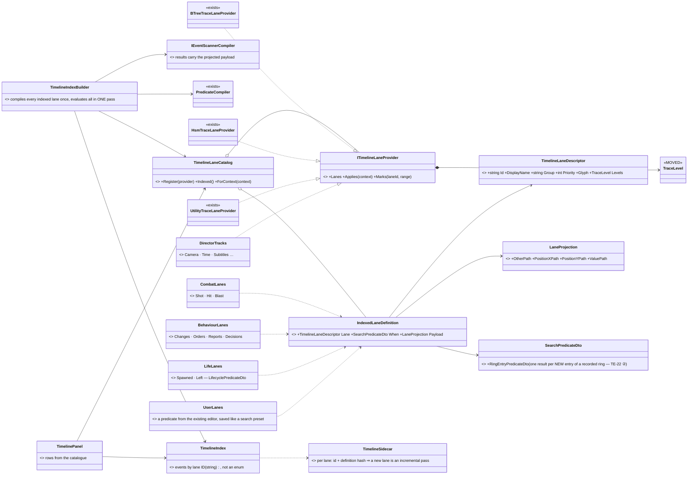

*What the picture shows that prose hid: ONE lane seam and ONE condition model. A lane either comes from the recording's index (a
predicate + which fields to keep) or is drawn by its provider for a range (live trace rings, the director's tracks, search hits) — and
both are registered the same way §15.2 already registers the trace lanes. Nothing in the index, the builder or the panel names a lane.*

| | how | measured basis |
|---|---|---|
| **the move** | `ITraceLaneProvider`, `TraceLaneDescriptor`, `TraceLevel` go from `Hrot.Editor.AiShared` to `Fdp.Toolkits` (`ReplayBrowser/Timeline`), which the index, the panel (`Fdp.Presentation`), the Replay Browser and the editor all reference. `AssetKind Kind` becomes `Applies(context)` — the asset kind is one key of the context. A rename, if any, by Roslyn (CLAUDE.md ②) | 7 files use it (`ITraceLaneProvider.cs`, `TraceTimelineWindow.cs`, three providers, two test files); `Fdp.Presentation` and `Hrot.Editor.AiShared` both reference `Fdp.Toolkits` |
| **an indexed lane** | a descriptor + a `SearchPredicateDto` (*when*) + a projection (*what to keep*: the counterpart, the point, the value) | R-4077; the scanner returns frame + entity + a message only today (`IEventScannerCompiler.cs:14-19`) ⇒ the projection is an EXTENSION of the model |
| **the shipped lanes as data** | Spawned / Left = `LifecyclePredicateDto` (exists) · Shot / Hit / Blast = `TransientEventPredicateDto` on `WeaponFireNotification` (fired) / `HitEvent` / `DetonationNotification` + projections · Changes / Orders / Reports / Decisions (R-4076) = the NEW `RingEntryPredicateDto` (one result per new ring entry, keyed by the entry's own counter — TE-22 ②) | today's `LifeExtractor`, `CombatExtractor`, `BehaviourExtractor` say exactly what each lane is (`TimelineExtractors.cs:64-121`) — they become their definitions' tests |
| **who registers them** | the module that owns the data — the combat toolkit its lanes, the behaviour toolkit its four, the trace editors theirs — as §15.2 already does | §15.2 *"Subsystems register their categories"* |
| **a user's lane** | built in the existing predicate editor (R-4072), saved like a search preset; the next open indexes it | the presets' JSON round-trip (capabilities doc §5) |
| **the cache** | events keyed by lane id; the sidecar keeps each lane's definition hash ⇒ a new or changed lane is ONE incremental pass for that lane, never a rebuild of the rest | — |
| **groups, priority, glyph** | descriptor fields, not enums | `TimelineLaneGroup` (3 values) and the priority order were enums (`TimelineIndex.cs:10, 33`) |

⛔ **Superseded by this section:** TL-3 (`ITimelineRowProvider` + an adapter); TL-5's lane list as code; `TimelineLane` /
`TimelineLaneGroup` (29 production references) and the three extractors as the index's source of events.

### 9d. §9c as built *(ui, `2026-10-26` — steer [STEER_Coordinator_To_Ui_Timeline_Lanes_Unified](blueprints/batches/STEER_Coordinator_To_Ui_Timeline_Lanes_Unified.md))*

**INVENTORY** *(run before building)*:
```
scripts/cbm.sh search_graph name_pattern=".*(TraceLane|TimelineLane|LaneProvider|LaneDescriptor).*" → 31 rows: ITraceLaneProvider + TraceLaneDescriptor
   (Hrot.Editor.AiShared/Debug), BTree / Hsm / UtilityTraceLaneProvider and their tests — no other lane seam
scripts/cbm.sh search_graph name_pattern=".*PredicateDto$" label=Class → 13, has_more false (grep adds BehaviourStepPredicateDto, newer than the index)
scripts/cbm.sh search_graph name_pattern=".*(Scanner|PredicateCompiler).*" label=Interface → 2: IEventScannerCompiler, IPredicateCompiler
   label=Class → EventScannerCompiler, PredicateCompiler (+ test doubles), DataBreakpointManager.CompiledEventScanner (the live breakpoints' own)
scripts/cbm.sh search_graph name_pattern=".*(History|Journal|DecisionLog)$" label=Class → UtilityDecisionLog (+ unrelated); the rings
   BrainJournal / CommandOrderHistory / CommandReportHistory are structs ([InlineArray] fields), read by grep
roslyn_find_references ITraceLaneProvider (Hrot.Editor.AiShared.csproj, is_msbuild_workspace true) → 6, = grep's 6 code sites
check_index_coverage is not available through the CLI ⇒ these totals are not proof of completeness
```

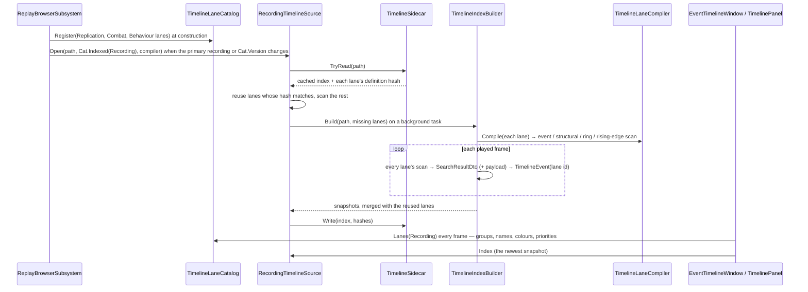
*What it shows that prose hid: the only place lanes are NAMED is each toolkit's provider; the host lists providers, the index and the panel
iterate the catalogue. A lane added later costs one pass over the recording for THAT lane — the sidecar's per-lane hash decides.*

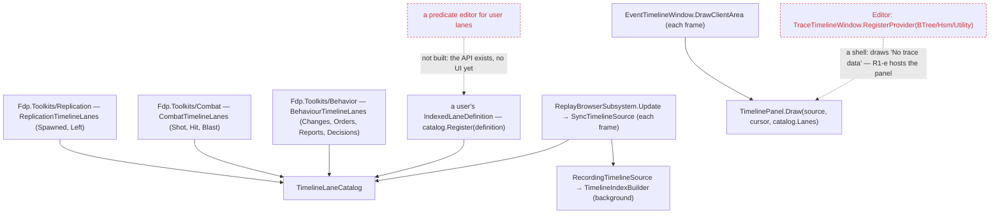
*The dead edges (red): the editor's Trace Timeline still registers its providers into a shell that draws nothing (R1-e makes it host the
panel), and nothing yet lets a user BUILD a lane — `TimelineLaneCatalog.Register(IndexedLaneDefinition)` is the seam the existing
predicate editor will call.*

| | as built | deviates from §9c |
|---|---|---|
| **① the move** | `ITimelineLaneProvider`, `TimelineLaneDescriptor` (renamed by Roslyn over stdio, 6 + 6 files), `TraceLevel` now in `Fdp.Toolkits/ReplayBrowser/Timeline`; the descriptor gained `Group`, `Priority`, `Color`, `Glyph` (defaulted, so the trace providers' 3-argument constructions stand); `AssetKind Kind` → `Applies(TimelineLaneContext)` (`AssetKind` + `Recording`); `Indexed` and `Marks(laneId, range, into)` are default interface members | — |
| **an indexed lane** | `IndexedLaneDefinition(descriptor, SearchPredicateDto, ResultProjectionDto?)` | ⚠ no separate `LaneProjection`: the projection is the predicate model's own `ResultProjectionDto` (R-4077 — one model), and search results carry it too (`SearchResultDto.Payload`) |
| **③ the model, extended** | `ResultProjectionDto` (subject / other / x / y / value paths, read off the match or off a component of the matched entity) + `CompiledProjection` (getters by the model's `PropertyEvaluator.BuildGetter`); `IEventScannerCompiler.CompileScanner(predicate, projection)` — one result per event; `RingEntryPredicateDto` (component, `[InlineArray]` field, count, key fields, optional filter) + `RingEntryScanner` (keys mixed without boxing; the first frame an entity is seen is its baseline); the Replay Search evaluates ring predicates too, and both use ONE `StructuralScanner` | ⚠ **behaviour fix**: an `Added`-only structural search no longer reports a destroyed entity as "Lost" (it did, regardless of the predicate) |
| **② shipped lanes as data** | Spawned / Left = **`StructuralPredicateDto`** on `NetworkIdentity` (gain / loss or destruction; X/Y from `SimTransform`) · Shot (fired: `Refusal == None`) / Hit / Blast = `TransientEventPredicateDto` + projections · Changes / Orders / Reports / Decisions = `RingEntryPredicateDto` (Orders' key includes `Repeats`, so a repeated order is news; Decisions keep slots whose `SwitchCount > 0`) | ⚠ Life lanes are structural, not `LifecyclePredicateDto`: measured, that predicate matches ONE named / numbered entity (`MatchesLifecycleCriteria` treats a network id as an entity index) — it cannot say "every unit". ⚠ "Destroyed" is named **Left** (a unit also leaves when its id is removed). ⚠ Reports' counterpart is the SENDER (`FromNetId`) — a projection reads one field, it has no "the other end" condition |
| **the compiler** | `TimelineLaneCompiler(IEventScannerCompiler, IPredicateCompiler?)`, passed in by the host | ⚠ `Fdp.Toolkits` does not reference `StructEdit.Reflection`, so the host supplies the edit service, as it does for the Replay Search |
| **④ the cache** | sidecar schema 2: per lane its id, a definition hash (SHA-256 of the id + the predicate's polymorphic JSON + the projection) and its events; `RecordingTimelineSource` reuses matching lanes and scans only the rest (`ScannedLanes`); the panel shows reused lanes at once | an unserialisable predicate hashes fresh — rebuilt every open rather than reused wrongly |
| **the extractors' knowledge** | `TimelineExtractors.cs` deleted; every rule it held is now asserted against the DEFINITIONS (`TimelineIndexTests`): a refused shot is not a shot, two orders in a frame are two events, a repeat is one more, the pre-recording order is a baseline, a death keeps its last position | — |
| **⑤ user lanes** | `TimelineLaneCatalog.Register(IndexedLaneDefinition)` + per-lane hashing ⇒ a user lane indexes like a shipped one, incrementally (rail: "who was hit") | ⏳ no editor UI to author one yet (dead edge above) |

## 10. R2-T — the director's tracks on the panel: the build plan *(ui, `2026-10-26`; build-state: T1 · T2 · T3 · T4 BUILT — dispatched by [NOTE_Coordinator_To_Ui_After_Review_Timeline](blueprints/batches/NOTE_Coordinator_To_Ui_After_Review_Timeline.md) item A1)*

**Scope** — the part of R2 (§6) that puts a take on the timeline: format v2 `keys[]` / `segments[]` (§5), the **Time** and **Camera**
tracks drawn and edited on the ONE panel (§2c rows 2, 3, 10), **K** / **J** / **L**, undo (TE-14). ⛔ Not here: TE-5 (the runner's move)
and `ReplayDirectorHost` — a take from a RECORDING plays once those land (§6 R2's acceptance); here a take plays on the editor's live run.

**INVENTORY** (`2026-10-26`, graph re-indexed — `search_graph` `.*Timeline.*` Interface → 3 / Class → 34, `.*(Director|Take|Shot|Reel).*`
Interface → 4 / Class, `.*Undo.*` → 2 interfaces, 2 stacks; `search_code` `ProgramAt|ReplayDirectorHost|CameraKey` → 0): the panel
(`TimelinePanel`, `TimelineView`, `TimelineLayout`, `TimelineAxis`, `ITimelineCursor`, `TimelineMenuItem`) draws only index EVENTS — ⛔ no
editable item, no track seam; the take (`Take`, `ShotSpec`, `CameraSpec`, `AtExpr`, `TakeJson`, `TakeTimeline.Plan`) has only `shots[]`;
`ProgramAt`, `keys[]`, `segments[]`, `ReplayDirectorHost` do not exist; the undo stacks are `GizmoUndoStack` (Fdp.Toolkits — a record per
edit), its GizmoMap twin, NodeEditor's `UndoStack` (graph commands only) and Blueprints' `CommandHistory` (not reachable from Presentation).

| the plan rests on | code — how it is | design basis |
|---|---|---|
| the panel cannot reference the take (FDP below Hrot) | ✅ `TimelinePanel` in `Fdp.Presentation`; `Take` in `Hrot.Presentation/Map3D/Director` | ✅ §9 D2/D3 (the panel lives in Fdp.Presentation) |
| the panel's rows are the index's lanes only | ✅ `TimelinePanel.Draw` → `DrawRow(index, lanes…)` | ✅ §2a: a track is a row of the SAME panel (R-4073) |
| a key is the unit; old `shots[]` read as keys | ✅ `ShotSpec` (`At`, `Seconds`, `Camera`, `To` = a fly) | ✅ TE-2 |
| keys stay in SIM seconds; drawn through the session's map on Wall | ✅ `ITimelineCursor.TimeMap`, `TimelineAxis.IsSim` | ✅ §2c row 10 |
| an edit is undoable by an EXISTING stack | ✅ `GizmoUndoStack.Push(IGizmoUndoRecord)` (Fdp.Toolkits, reachable) | ✅ TE-14 ("no fifth") |
| a drag never moves the world | — | ✅ §2c row 2 |

```mermaid
classDiagram
  direction LR
  class TimelinePanel { <<exists, grows>> Tracks : Func~IReadOnlyList~ITimelineTrack~~ · Draw(source, cursor, lanes) unchanged · tracks above the lanes }
  class TrackLayout { <<NEW, static, pure>> AxisTicks / SimSeconds · SpanOf · HitTest · SimAtX · OfferKey }
  class TrackGesture { <<NEW, pure>> Press · Update · Release — select / preview / commit once }
  class ITimelineTrack { <<NEW, Fdp.Presentation>> Id · Label · Items · Select(id) · Move(id, toSimSeconds, commit) · Key(char, atSimSeconds) bool · MenuItems(id?) }
  class TimelineTrackItem { <<NEW, record>> Id · From · To? (sim s) · Label · Kind (key / segment) · Selected }
  class DirectorTracks { <<NEW, Hrot.Presentation/Map3D/Director>> HOLDS the Camera + Time ITimelineTracks over the edited take · pilot Func · rate Action }
  class DirectorTakeSession { <<NEW, Hrot.Editor/Director>> the open take: ONE TakeEditor + the editor's GizmoUndoStack + Speed · Open / Save / Close · UndoLast / RedoLast }
  class TakeEditor { <<NEW>> Take (current) · Apply(edit) · Undo / Redo via GizmoUndoStack · Dirty · Save → TakeStore }
  class TakeEditRecord { <<NEW>> IGizmoUndoRecord: before / after take snapshots (TE-14) }
  class Take { <<exists, grows>> + Keys · + Segments (format v2) }
  class CameraKey { <<NEW, record>> At · Camera (CameraSpec) · In (cut / fly(s, ease) / dip(a, b)) · Fov? · Still? }
  class TimeSegment { <<NEW, record>> From · To · Speed · Gap (cut / dip) }
  class TakeJson { <<exists, grows>> reads keys[] / segments[]; shots[] read AS keys (TE-2); writes v2 }
  class TakeTimeline { <<exists, grows>> + ProgramAt(simTime) → key, blend, fade }
  class GizmoUndoStack { <<exists, Fdp.Toolkits>> }
  TimelinePanel --> ITimelineTrack : draws, hit-tests, drags
  TimelinePanel --> TrackLayout : places items on the active axis
  TimelinePanel --> TrackGesture : one per panel
  TrackGesture ..> ITimelineTrack : Select / Move(preview) / Move(commit)
  DirectorTracks o-- ITimelineTrack : Camera, Time
  DirectorTakeSession --> DirectorTracks : while a take is open
  DirectorTakeSession --> GizmoUndoStack : owns the editor's one
  TimelinePanel ..> DirectorTakeSession : Tracks / Undo / Redo hooks
  DirectorTracks --> TakeEditor
  TakeEditor --> Take
  TakeEditor --> GizmoUndoStack : Push(TakeEditRecord)
  Take *-- CameraKey
  Take *-- TimeSegment
  TakeJson ..> Take
  TakeTimeline ..> CameraKey
```
*What the picture shows that prose hid:* the panel learns one small interface and nothing about takes; the take's editor owns undo and
saving, so a drag on the panel and an edit in the Director window are the SAME edit path.

```mermaid
sequenceDiagram
  actor U as User
  participant P as TimelinePanel
  participant D as DirectorTracks
  participant E as TakeEditor
  participant S as GizmoUndoStack
  participant R as DirectorRunner
  U->>P: press on a Camera key, drag
  P->>D: Select(item) then Move(item, simSeconds, commit:false) each frame (preview only)
  U->>P: release
  P->>D: Move(item, final, commit:true) once
  D->>E: Apply(MoveKey(id, at))
  E->>S: Push(TakeEditRecord(before, after))
  Note over E,R: the runner loads the SAVED file at Play — an unsaved edit is not played until Save (T3 as built)
  Note over P,E: the world is never touched — an edit of the TAKE (§2c row 2)
  U->>P: K (panel focused)
  P->>D: Key(K, playhead sim s)
  D->>E: Apply(AddKey(pilot camera pose, at, in: last used))
```

| # | slice | builds | accepted when |
|---|---|---|---|
| **T1** ✅ BUILT `2026-10-26` | format v2 | `CameraKey`, `TimeSegment`, `Take.Keys` / `Segments`; `TakeJson` reads `keys[]` / `segments[]`, reads `shots[]` AS keys (a shot → a cut key at `at`; a shot with `to` → a fly key at its end), writes v2; `TakeTimeline.ProgramAt` | every seeded take loads and lays out as before (55 takes); a v2 file round-trips |
| **T2** ✅ BUILT `2026-10-26` | the track seam | `ITimelineTrack` + `TimelineTrackItem`; the panel draws tracks above the lanes, hit-tests, selects on a click, drags (preview each frame, commit on release); keys on the active axis through the time map | a frame rail: a drag moves the item, a click only selects, empty space still does nothing |
| **T3** ✅ BUILT `2026-10-26` | the director's tracks | `DirectorTracks` (Camera = keys, Time = segments), `TakeEditor` + `TakeEditRecord` on `GizmoUndoStack`, save through `TakeStore`; **K** adds a key from the pilot camera (relative to a selected unit, TE-2); **J** / **L** the rate; the open take (`DirectorTakeSession`) on the Event Timeline | a key moved on the panel is where the saved file says; undo puts it back; K adds one at the playhead |
| **T4** ✅ BUILT `2026-10-26` | playing keys | `DirectorRunner` plays `ProgramAt`: cut, fly (eased), dip (TE-8) | a take plays from the panel with its keys where the take's file says (note A1's acceptance) |

**T2 as built** — `ITimelineTrack` + `TimelineTrackItem` (`Id`, `From`, `To?` in SIM seconds, `Label`, `Kind` key / segment, `Selected`) in
`Fdp.Presentation/ImGui/Panels/Timeline/`; the panel takes `Tracks` (a `Func<IReadOnlyList<ITimelineTrack>>?` PROPERTY — `Draw`'s signature is
unchanged, every existing host untouched) and draws them as rows at the top of the lanes child, so the "now" line, range and pause shading cover them.
The rules are two pure classes: `TrackLayout` (sim seconds ⇄ axis ticks ⇄ x on BOTH axes — Sim: seconds × ticks; Wall: `ReplayTimeMap.WallAt` / `SimAt`,
so a key inside a collapsed pause draws at the pause's wall END and a drop there reads back as the pause's instant; no map ⇒ not drawable, the row's
tooltip says so) and `TrackGesture` (press on an item selects, a drag past 3 px previews `Move(commit:false)` each frame with the grab offset kept, the
release — wherever — commits ONCE; a press on empty space starts nothing). A drop snaps to the nearest frame of the axis-projected index. Right-click
adds `MenuItems(itemId)` (null on empty space) in front of the mode's items. **K / J / L** are offered through `TrackLayout.OfferKey` to the track holding
the selected item, before the panel's keymap (which has no K/J/L; every existing key unchanged). **Deviations from the diagram above (corrected):**
`Items` takes no axis argument (the panel converts, §2c row 10); `Move` carries `commit`; `MenuItems` takes the item id, not a context; `Tracks` is a
property, not a `Draw` parameter; two helper classes were added. Rails: `TimelineInteractionTests.CE1364_T2_*` ×6 (placement on both axes through a
pause, frame snap, click-only-selects, drag preview + one commit, empty space, K to the selected track) and the frame rail
`CE1364_T2_ATrackWithTwoKeys_*` (injected `AddMousePosEvent` / `AddMouseButtonEvent`; precedent `tools/ui-probe/synthetic-input`). ⚠ Not built:
event-snapping within 7 px on a drop (frame snap only).

**T1 as built** — `KeyTransition` (Cut / Fly(s, ease) / Dip(out, in)), `CameraKey`, `TimeSegment`, `Take.Keys` / `Segments`; `CameraKeys.Of(take)`
is the ONE place a take's keys come from (its own `keys[]`, else its `shots[]` per TE-2); `TakeJson` reads / writes v2 and the camera read /
write is now one helper shared by shots and keys (`ParseCamera` / `WriteCamera`); `TakeTimeline.ProgramAt` reuses `ShotEvaluator.Eased` (no
second easing). Rails `FilmDirectorTests.TE2_*` ×5, `T1_ProgramAt_*` — each red-proved; the 55 seeded takes read unchanged and write back v1.

**T3 as built** *(ui, `2026-10-26`)* — `TakeEditor` (`Apply(TakeEdit)` — `MoveKey` · `AddKey` · `RemoveKey` · `MoveSegment(Whole | From | To)`; `Preview` for a drag in
flight; `Dirty`; `Save()` = `TakeStore.Save`, **a no-op when the take was not edited** — T-L4) pushes one `TakeEditRecord` (before / after take) per edit; `DirectorTracks` holds the
Camera track (items = `CameraKeys.Of(take)` at their RESOLVED sim seconds, so an anchored key sits at anchor + offset; a drop on an anchored key changes the OFFSET and keeps the
anchor) and the Time track (segments From–To; a move keeps the length); `PilotCamera.Of(pose, unit?, unitAt?)` makes K's camera — a look-at key of the map camera's pose, or, with a
unit selected, a follow key from the SAME eye looking at the unit (the film's follow camera looks at `unit + lift`). A v1 take's first edit turns its shots into `keys[]` as they
PLAY (`CameraKeys.Played`) but keeps the anchor of any key the layout did not move. Deviations, each superseding the text above:
- **⛔ SUPERSEDED: "the editor's EXISTING `GizmoUndoStack`".** Measured: the editor had **none** (only `IgApplication` holds one) and no global Ctrl+Z. `DirectorTakeSession` (Hrot.Editor)
  owns the editor's ONE stack for take edits; `TimelinePanel` gained `Undo` / `Redo` hooks fired by Ctrl+Z · Ctrl+Y · Ctrl+Shift+Z **only while the panel is focused and shows tracks**
  (⛔ never stolen from the map or another editor), and the Director window has Undo / Redo buttons on the same session.
- **`DirectorTracks` is not itself an `ITimelineTrack`** — it holds the two (`Camera`, `Time`); the diagram's realisation edge is corrected.
- **The Director window edited nothing before T3** (it only played), so there was no second edit path to route: its "Edit on the timeline" button (One take) opens the take in the session,
  and Save / Undo / Redo / Close sit beside it. **The runner loads the saved FILE at Play**, so an unsaved edit is not played; the window says so while the take is dirty
  (the sequence's old "the runner reads the edited take" arrow is replaced by that note).
- **`TrackLayout.OfferKey` changed** (the T2 text above): the selected item's track first, then the others in order — it used to ask nobody when nothing was selected, which left K no way
  to add the FIRST key. The T2 rail `CE1364_T2_K_IsOfferedToTheSelectedItemsTrack_Only` was updated to match.
- **The seams found:** the pilot camera is `EditorSubsystem._camera as MapCamera3D` (`LookAt` · `Distance` · `Yaw` · `Pitch` → `CameraPose`), the unit is `Selected2DEntity` with a non-empty
  `EntityInfo.Name`; the rate is `DirectorRunner.SetSpeed` fed by the window's slider — now ONE number, `DirectorTakeSession.Speed`, stepped by J / L through 0.25 · 0.5 · 0.75 · 1 · 1.5 · 2 and
  handed to the runner while it plays.
- ⚠ Known edges (⛔ SUPERSEDED, built since: segment add / delete and edge handles, K's lens — see "Leftovers as built" below): deleting the LAST key of a take that still has `shots[]` makes `CameraKeys.Of` read the shots as keys again; a move of an anchored key whose anchor has no baked time is refused.
Rails: `DirectorTracksTests.CE1364_T3_*` ×11 (Hrot.Presentation.Tests) · `DirectorTracksOnTheEditorTests.CE1364_T3_*` ×2 (a headless editor: the panel's `Tracks` are the open take's, the panel's
`Undo` is the editor's stack) · the frame rail `CE1364_T3_CtrlZ_OnTheFocusedPanel_CallsTheHostsUndo`.

**Leftovers as built** *(ui, `2026-10-26` — CE-1364 "Left")* — the three things T3 listed as not built:
```mermaid
sequenceDiagram
  actor U as User
  participant P as TimelinePanel
  participant G as TrackGesture
  participant T as TimeTrack
  participant E as TakeEditor
  U->>P: press on a segment's first or last 5 px
  P->>P: TrackLayout.HitPart gives Body, StartEdge or EndEdge
  P->>G: Press(track, item, x, edgeX, part)
  loop each frame while held
    G->>T: Move(id, sim, commit false, part)
    T->>E: SetPreview(id, sim, edge)
  end
  U->>P: release
  G->>T: Move(id, sim, commit true, part)
  T->>E: Apply(MoveSegment(i, From or To or Whole, sim))
  U->>P: right click on empty Time space
  P->>T: MenuItems(null, simAtClick)
  T->>E: Apply(AddSegment) when "Add a segment here" is run
```
*What the picture shows that prose hid:* the edge is a PART of the hit, carried by the gesture to the track — the panel still knows nothing about takes — and the
preview carries the edge, so a half-dragged edge shows only that edge moved while the take stays untouched.
- **The seam grew two default interface members, nothing else:** `TrackItemPart { Body, StartEdge, EndEdge }`; `ITimelineTrack.Move(id, sim, commit, part)` (default: the 3-argument `Move`) and
  `ITimelineTrack.MenuItems(itemId, atSimSeconds)` (default: the plain menu) — a track with no edges or no empty-space items is untouched. `TrackLayout.HitPart` (a segment's first / last
  `EdgePx` = 5 px, at most a third of its width; a key and a narrow segment are all body); `TrackGesture.Press` takes the part (the grab offset is the EDGE's x) and hands it to every preview and the commit.
  The panel draws a 3 px handle at each edge and shows the resize cursor over one.
- **Edges cannot cross:** `TakeEditor.MinSegmentSeconds` = **0.1 sim s** (chosen, not measured: short enough to be a real cut, long enough to stay a grabbable item) —
  `MoveSegment(From|To)` stops an edge that short of the other, in the preview and the commit. ⚠ Changed from T3's "an edge stops AT the other" (a zero-length segment).
- **Add / delete:** `TakeEdit.AddSegment` / `RemoveSegment` (undo descriptions "Add time segment" / "Delete time segment", through the same `TakeEditRecord`); the Time track's menu offers
  "Add a segment here" on empty space (`DefaultSegmentSeconds` = 2 sim s at the clicked time, speed 1, cut gap, selected after) and "Delete segment" on a segment. Neither converts a v1 take's shots to keys (only camera edits do).
- **K's lens:** the map camera's field of view is `MapCamera3D.FovyDegrees` (default 45°, `FpsZoom.NormalFovDegrees`; a possession zoom changes it for the moment it is held, and K then stores that
  lens). `EditorSubsystem.PilotCameraSpec` passes it to `PilotCamera.Of(…, fov:)`, which sets `CameraSpec.Fov` for both the look-at and the follow camera; K copies it to `CameraKey.Fov`.
  A pilot with no 3-D camera still makes no key.
Rails: `DirectorTracksTests.CE1364_AnEdgeDrag_*` · `CE1364_TheEdges_CannotCross_*` · `CE1364_AddASegmentHere_*` · `CE1364_DeleteSegment_*` · `CE1364_K_StoresThePilotsLens_*` (Hrot.Presentation.Tests),
`TimelineInteractionTests.CE1364_AnEdgeOfASegment_*` (Fdp.Presentation.Tests), `DirectorTracksOnTheEditorTests.CE1364_K_OnTheEditorsTimeline_StoresTheMapCamerasFov` (Hrot.Editor.Tests).

**T4 as built** *(ui, `2026-10-26`)* — `DirectorRunner.DirectUpcoming` now holds the camera `ShotEvaluator.Evaluate(ProgramFrame)` returns for
`TakeTimeline.ProgramAt(CameraKeys.Played(take, plan), anchors, t)` — `Played` is `Of` with each shot's start taken from `Plan`'s layout (a shot
listed after one still running starts LATER than its `at`; measured in `scenarios/pc-defend-house/takes/main.take.json`, whose third shot's anchor
precedes its second's end — keyed at the raw `at`, that seeded take would have filmed differently, so `Played` re-times it; same per-shot helper as `Of`); ⛔ there is no second shot-playing path (a v1 take is read AS keys, TE-2). `Plan`'s
shots stay, but only as the **stretches the film runs in** (captions, layers, speed, capture, the end) — and a take with `keys[]` and no `shots[]`
gets one stretch per placed key (`TakeTimeline.Stretches`), so a v2 take runs at all. The dip's black is the same frame's `Fade`, carried by one new
mailbox value `FilmStudio.Fade` (set by the runner, cleared by `Release`), drawn over the live picture by `EditorCinema` and over every captured scene
frame in `Film.cs`'s capture. Deviations, each SUPERSEDING the T1 text:
- **⛔ SUPERSEDED (T1): "a fly key blends from the key before it over its seconds AFTER its time."** A fly **arrives AT its key's time**, over the
  seconds before it (clamped to start no earlier than the key it leaves) — TE-8's "how the camera gets TO a key", the dip's out-window shape, and the only
  reading under which `CameraKeys.Of`'s "fly key at the shot's end" reproduces a shot's `to`. T1's `ProgramAt` rail was moved to match (`T1_ProgramAt_*`).
- `ProgramFrame.Key` is the key flown INTO while a fly is under way; new `Since` = sim seconds since the key the camera leaves (an orbit's clock).
- A fly between cameras of **different kinds** (a follow into a look-at) has nothing to blend: the leaving camera stays, the arriving one cuts in at the
  fly's end. Same-kind cameras blend their numbers with the arithmetic `ShotEvaluator.At` already used.
- Gap hold unchanged: in a gap the camera is the NEXT stretch's at its start; the black is of NOW.
Rails `FilmDirectorTests.CE1364_T4_*` ×4 (fly, dip, keys-only layout, and ⭐ all 55 seeded takes + a hand-made one play the SAME shots through the key path
as through the old per-shot path, 0.25 s samples) and `DirectorRunnerTests.CE1364_T4_TheRunner_PlaysTheKeys_*`.

✅ **T-L5 APPROVED `2026-10-26` (R-4089)** — 🔒 user: *"T-L5 approved"* — with the coordinator's amendment: the sim time per frame goes into
the ONE per-frame step both timelines share (`TimelineFrameScanner` — the live source AND the recording's builder), so every index carries
`FrameSimTime` beside its wall ticks (this IS backend's never-built DAR §8 row 11, built once for both); a recording's builder takes it from
the v7 frame index when present. The live cursor's map is `ReplayTimeMap.FromFrames` over the live index until a `ReplaySessionTopic`
session exists (replay / review), then the session's map — one owner at a time.

⚠ **(was) OPEN before T2 — ✅ BUILT by CE-3330 E1 / E2 (`TimelineIndex.FrameSim`, `ClusterTimelineCursor`) — the live panel has no sim axis** *(measured `2026-10-26`)*: the editor's live index records only WALL ticks
(`LiveTimelineSource.cs:61` → `TimelineFrameScanner.Step(…, wallTicks, …)`) and its cursor carries no time map
(`EditorSubsystem.cs:5285`, `new LiveTimelineCursor(...)` with no `timeMap`) ⇒ a key in SIM seconds (§2c row 10) has nothing to be placed
through on a live host. ⭐ Lean **T-L5**: the live scanner records each frame's sim time beside its wall ticks (it already steps the world
every frame) and the live cursor exposes `ReplayTimeMap.FromFrames` over them — the SAME map a recording's v7 frame index gives, one node's
own frames; ⛔ not a second map owner: when backend's `ReplaySessionTopic` (note B, item 6) lands, the session's map replaces it on the
cursor. Rejected: wait for B (blocks A1, which the note says nothing blocks) · place keys on wall ticks (breaks §2c row 10 the moment a
pause collapses).

**Leans** (ask before building any that the user overturns): **T-L1** the seam is a NEW `ITimelineTrack`, ⛔ not a lane provider (lanes are
READ from an index; a track's items are EDITED — two different lifetimes) · **T-L2** undo on `GizmoUndoStack` (its `IEntityCommandBuffer`
argument is unused by a take record — a wart, not a fifth stack) · **T-L3** one `TakeEditor` per open take, shared by the panel and the
Director window (one edit path) · **T-L4** T1 keeps reading `shots[]` and WRITES v2 only when a take is edited (seeded takes stay as they are
until touched).

## 11. CR — films from recordings: the workflow and the plan *(coordinator, `2026-10-27`; build-state: ✅ APPROVED `2026-10-27` (R-4091) — READY-TO-BUILD per phase; P0 measured, CR-1 building as CE-4061)*

🔒 **User, `2026-10-27`:** *"approved, do the measurements first, then update the tasks and plans, then note to lanes"* — ⭐ every lean of §11e (CR-1…CR-12) and every phase of §11f (P0–P6) is APPROVED as written; ⛔ nothing here waits on the user.

🔒 **User, `2026-10-27`:** *"I need clip preparation in replay browser, with the edit possibilities as planned and of course the unification
and sharing cross hosts."* · then, the NEED: *"I need you as an AI agent to be able (have all the means) to prepare the movie clips … by
analyzing the interesting points in the scenario run to demonstrate a feature … using the Scout or … the event on the time line of a recorded
scenario … based on the list of features to film … and your general knowledge of filming. Then I would like to be able to play these prepared
movie clips and check what they look like, using a deterministic run in the editor or replay run in the replaybrowser. Then … run those clips
in the replay browser from the recording and adjust the camera timing, camera cuts, position and viewing angles, subtitles and their timing …
save that as takes and reels for the recording and … promote these to a live scenario so the filming can be repeated any time if scenario
timing or conditions change. This feature is not just for demonstrating, but also for automatic documenting of regression test scenarios that
are running overnight … snapshots or short movie clips. … The adjusting phase in the replay browser is critical … in the replay browser I can
simply seek to any time and start the replay of the take from whatever time. So it's easy to iterate."*

### 11a / 11b. The intent and the workflow — MOVED

⭐ The intent of the whole process — the workflow (record → index → draft → look ⇄ adjust in the Replay Browser → save → render → promote),
its principles, what a recording makes possible, who does what, and the overnight documentation — lives in its own design,
[`DESIGN_Film_Production.md`](DESIGN_Film_Production.md) (R-4091). This section keeps the BUILD plan: what exists, the shape, the leans, the phases.

### 11c. INVENTORY — measured `2026-10-27`

Two read-only surveys + grep, every load-bearing row re-read by hand; `search_graph` `.*ReplayDirectorHost.*` → **0**, `.*FilmGraphic.*` →
**0**, `.*Director.*Host.*` → `IDirectorHost` + `EditorDirectorHost` only (⚠ the graph predates ui's last merge; coverage cannot be checked
through the CLI).

| what exists | where | for this plan |
|---|---|---|
| the RB reaches `Hrot.Presentation` (through `Hrot.CGF`) and already calls its map attach | `Hrot.CGF.csproj:62`; `ReplayBrowserSubsystem.cs:213` | ⛔ **§9's D3 is OUTDATED** — the director's types are reachable from the RB |
| ⛔ **no TKB in the RB** (R-4069 unbuilt): bodies, effects, audio get a null catalogue | `ReplayBrowserSubsystem.DebugSurface.cs:51`; `MapInteractionPack.cs:508` | P0 |
| ⛔ **a recording does not know its scenario**: `RecordingMetadata` has `ExerciseId`, `TerrainName`, no scenario, no hash; an editor run writes only `node_1.fdp` + `.meta.json` under the TEMP root | `RecordingMetadata.cs:8-97`; `/tmp/FDP_Temp/nodes/node-1/exercises/<id>/` | P0 — the TKB, recording takes and promote all need it |
| ⛔ **CE-4050**: a component type from an assembly the process never loaded stops playback, the RB's sandbox included | `PlaybackSystem.cs:332`; `ReplayBrowserContext.cs:68` | P0 |
| slow motion in the RB repeats whole frames (`dt × rate`, 1/60 s frames, no interpolation) | `ReplayBrowserSubsystem.cs:400-417` | CR-9 |
| ⛔ **TE-5's premise is FALSE** — `DirectorRunner` (1185 lines) carries the verifier: six verify types of its own namespace and 19 verify-only members on `IDirectorHost` | `DirectorRunner.cs:20-40, 472-1035`; `DirectorHost.cs:51-102` | P1 (CR-1) |
| the editor's director adapters are thin: `EditorCinema` (`WindowManager.Cinema`), `EditorLayerOverride` (`LayerControlGizmo`, `Hrot.Common`), `FilmFrameSink` (`FilmStudio.Capture`), `EditorDirectorSound` (`AudioDirector`, `Hrot.Presentation`); `DirectorTakeSession` needs only `Func<DirectorRunner?>` | `EditorDirector.cs:116-238`; `DirectorTakeSession.cs:53` | P1 — they MOVE |
| ⛔ **the runner plays the SAVED file** — an unsaved edit is not seen (§10 T3) | §10 T3 as built | ⛔ kills ⑤'s iteration ⇒ CR-4 |
| ⛔ **`Take.Segments` is never played** (no reader in the runner, `TakeTimeline`, `AnchorBook`, `CameraKeys`) | grep over `Hrot/` | CR-7 |
| anchors: baked first, else `AnchorBook.Observe` — `shot` / `blast` / `hit` read `ShotLog` / `DetonationLog` (side stores, **never recorded**), the six state cues read components | `AnchorBook.cs:56, 80-191`; `CombatTimelineLanes.cs:11` | CR-5 — ✅ BUILT in [§11s](#11s-p4--one-anchor-resolver-promote) (event cues from the index) |
| ⏳ the index has **no position track** (planned in §2b, not built) | §9a "Of §2b's cache tables only `events` is built" | CR-6 (anticipation, auto-framing) |
| `CameraKey.Still` is read and written, never captured (TE-10 unbuilt) | `Take.cs:139`; `TakeJson.cs:331` | CR-10 |
| `/director/*` answer 503 on every host but the editor | `DebugApiHost.Director.cs:25-46`; `EditorSubsystem.cs:2634` | P3 |
| the RB films only when windowed (no canvas headless) | `ReplayBrowserSubsystem.cs:181, 515` | a capture needs Xvfb — as the editor's |

### 11d. The shape — one director, two hosts, one resolver

```mermaid
classDiagram
  direction LR
  class DirectorRunner { <<MOVED, film only>> Play · Tick · PlayFrom(film t) · Stop · capture · stills }
  class IRunExtension { <<NEW seam>> OnItem · OnFrame · OnItemEnd · extra phases }
  class ScenarioVerifyRun { <<NEW, editor>> the verify phases cut out of the runner }
  class IDirectorHost { <<SPLIT>> World · Takes · StepBy · SimTime · Hold · CanSeek · Seek · Rate }
  class IVerifyHost { <<NEW, editor>> checkpoints · live · review · replay }
  class EditorDirectorHost { <<exists>> live · CanSeek false }
  class ReplayDirectorHost { <<NEW>> over ReplayBrowserTransport · CanSeek true }
  class DirectorPack { <<NEW>> Attach: runner · session · window · panel tracks · adapters · debug routes }
  class DirectorTakeSession { <<MOVED>> the IN-MEMORY take the runner plays }
  class Drafter { <<NEW>> feature + grammar + index → a take }
  class AnchorResolver { <<AnchorBook grown>> event cues from ITimelineSource · state cues from the world }
  class ITimelineSource { <<exists>> live or recording }
  class TakeTimeline { <<grown>> ProgramAt reads Segments · replay segments }
  class TakeStore { <<grown>> takes of a scenario · takes of a recording · Promote }
  DirectorRunner --> IDirectorHost
  DirectorRunner --> IRunExtension : 0..1
  ScenarioVerifyRun ..|> IRunExtension
  ScenarioVerifyRun --> IVerifyHost
  EditorDirectorHost ..|> IDirectorHost
  EditorDirectorHost ..|> IVerifyHost
  ReplayDirectorHost ..|> IDirectorHost
  DirectorPack --> DirectorRunner
  DirectorPack --> DirectorTakeSession
  DirectorRunner --> DirectorTakeSession : plays its take
  DirectorRunner --> TakeTimeline
  DirectorRunner --> AnchorResolver
  AnchorResolver --> ITimelineSource
  Drafter --> ITimelineSource
  Drafter --> TakeStore
  DirectorRunner --> TakeStore
```
*What the picture shows that prose hid:* three new behaviour types only — the verify seam, the recording host, the drafter — plus one registrar;
everything else MOVES or grows. The anchor resolver reads the SAME `ITimelineSource` live and from a recording, so a promoted take resolves
on a live run with the code that resolved it on the recording.

```mermaid
graph TD
  subgraph ED["Editor — EditorSubsystem.Update"]
    EDA["DirectorPack.Attach(EditorDirectorHost) + the Verify tab + ScenarioVerifyRun"]
  end
  subgraph RB["Replay Browser — ReplayBrowserSubsystem.Update"]
    RBA["DirectorPack.Attach(ReplayDirectorHost)"]:::new
  end
  RUN["DirectorRunner.Tick (shared) — once per frame"]
  EDA --> RUN
  RBA -->|"NEW frame edge"| RUN
  RUN -->|"live: one step per frame (R-3038)"| EH["EditorDirectorHost → the master"]
  RUN -->|"recording: Seek · rate"| RH["ReplayDirectorHost → ReplayBrowserTransport"]:::new
  RUN --> FS["FilmStudio → FilmCaptureLayer (every map host)"]
  RBA --> PAN["the RB's Event Timeline: Camera · Time · Subtitles tracks"]
  RBA --> DBG["DebugApiHost.AttachDirector — /director/* + draft + stills"]:::new
  EDA --> DBG
  classDef new fill:#d9f2d9,stroke:#2a7a2a
```
*What the picture shows that prose hid:* the RB gains one frame edge, and its director drives the SAME transport the panel's cursor drives —
no second seek path (R-3059).

```mermaid
sequenceDiagram
  actor U as Operator or agent
  participant P as Event Timeline (RB)
  participant S as DirectorTakeSession
  participant R as DirectorRunner
  participant H as ReplayDirectorHost
  participant F as FilmStudio
  U->>P: right-click the shot event, "Draft a shot sequence here"
  P->>S: Drafter → keys anchored on the event (establish · set-up · moment · consequence · replay)
  U->>R: Play from 2 s before the moment, loop the shot
  loop each frame
    R->>S: the take NOW (in memory, no save)
    R->>R: ProgramAt(film t) → source sim, rate, camera, fade, subtitle
    R->>H: Seek on a jump or a replay segment, else play at the rate
    R->>F: Direct(pose) · Fade · subtitle
  end
  U->>P: fly the camera, "Update key from view" · drag the cut 0.3 s earlier
  Note over R,S: the next loop already plays the edit
  U->>S: Save (beside the recording) · Promote (to the scenario)
```

### 11e. Decisions — ✅ APPROVED `2026-10-27` (R-4091)

| # | ⭐ decision (lean) | rejected — the one fact |
|---|---|---|
| **CR-1** | **Split before moving:** the verify phases leave `DirectorRunner` for an editor `ScenarioVerifyRun` behind one `IRunExtension`; the 19 verify members move to an editor `IVerifyHost`. ⭐ The **coordinator** does it (the verify code is CE-4042 / CE-4045) | moving the runner whole — it drags the verifier into the shared assembly · a replay copy of the runner — R-4068 |
| **CR-2** | **One registrar, `DirectorPack.Attach(host)`** in `Hrot.Presentation`, called by the editor and the RB: runner, take session, Director window, the panel's tracks / undo / redo, the four adapters (moved), K's pilot camera, the debug routes | each host wiring its own director (`EditorSubsystem.cs:2461-2517` copied) — two wirings drift |
| **CR-3** | **The host contract grows `CanSeek`, `Seek(sourceSim)`, `Rate`**; the recording host binds to `ReplayBrowserTransport` (it already seeks by sim, the same path as the panel's cursor) | binding to `ITimelineCursor` (§9b ②) — the facade is the narrower contract and seeks by sim itself |
| **CR-4** | ⭐ **The runner plays the session's IN-MEMORY take**, and **`PlayFrom(filmTime)`** seeks the source to `ProgramAt(t)` and plays; a loop over a shot or a range. ⭐ An edit is seen on the next frame — no Save | playing the saved file (§10 T3) — it makes every adjustment a save-and-replay, the exact cost the user names |
| **CR-5** | ⭐ **One anchor resolver for live and recordings:** event cues (`shot`, `hit`, `blast`, and the behaviour lanes) are queries on an `ITimelineSource` — the live index on a live run, the recording's index on a recording; state cues (`near`, `task`, `side`, `health`, `embark`, `gesture`) observe the world (live, or the recording scout's own playback, TL-7). `AnchorBook`'s `ShotLog` / `DetonationLog` reads retire | two resolvers (live side stores, recorded lanes) that can disagree — the same failure TE-3b removed for checks |
| **CR-6** | ⭐ **Keys anchor to EVENTS, automatically:** K and the drafter store a key as *the nearest preceding index event + an offset* (`"shot:Tank#2+0.4"`), shown on the key; a fixed time only when nothing precedes it. ⇒ **promote is a copy** (TE-1's re-anchoring done at authoring time) and the take survives a run whose timing changed | re-anchoring at promote (TE-1 first form) — the person cannot see then what a key was tied to |
| **CR-7** | **The Time track plays, on both hosts; a segment may go BACK** in source time: an instant / multi-angle replay is a segment that repeats a stretch (a recording seeks; live skips it, R-3034). Speed ramps are per-segment rates; a skip is a seek with a cut, a dip, or a fast-forward card | a separate "replay shot" kind (`ShotSpec` today) — a second timing mechanism beside segments |
| **CR-8** | ⭐ **The drafter is ONE engine component** (`Hrot.Presentation/Map3D/Director`), used by the person (*"draft here"*, the §2 shot template) and the agent (`/director/draft`): it turns a feature (the take's caption, its anchors, the clip's `why`) + the grammar of PLAN_Feature_Films §1a (establish → set-up → the moment → consequence → replay; height by subject; the 180° line; 3–6 s shots) + the index (events, **positions over the shot's window**) into a take. The agent then edits with its own judgement. ⭐ Needs the **position track** in the index (a few samples a second per networked unit) for anticipation and framing | the agent drafting in Python on its own (film.py) — a second drafter the person cannot use; LLM-only drafting with no engine rules — unrepeatable overnight |
| **CR-9** | **Slow motion first as the transport's rate** (repeated frames); smoothness (interpolated drawn poses) after a measured judder | interpolating now — touches every drawing layer, unmeasured |
| **CR-10** | ⭐ **Regression documentation is the same pipeline with a generated take:** an overnight verify run records itself (`--verify-replay`); a **doc take** is drafted from the scenario's `checks.json` verdicts (each passed condition = a beat with its time and units; a FAILED one = the frame where it should have happened, framed on its units); **stills** (TE-10) by default, a short clip per scenario where asked; rendered in the RB from the recording into the verify report folder with a contact sheet. ⛔ Not a gate (no image comparison) | authoring doc shots per scenario by hand — 103 scenarios; rendering live — each still steps the whole run |
| **CR-11** | **Subtitles move UP** (from R2b to the first RB slice): a Subtitles track (text, in / out, position, fade) drawn by the film overlay; the take's `caption` and each clip's `why` seed it | leaving them in R2b — the user lists them with the first adjustments |
| **CR-12** | **Rendering goes to the RB**; the editor keeps live preview of scenario takes. The night pipeline becomes *verify run (headless, fast) → render from its recording* | rendering by stepping the editor (today: ~0.8 s / frame, `features` ≈ 4.2 h) — ⚠ the RB's cost per frame is NOT measured yet (P0) |

### 11f. Phases — ordered by the user's need

| phase | lane | builds | accepted when | after |
|---|---|---|---|---|
| **P0 — the recording is a good source** (**CE-4058**) | **backend** | ⭐ measured `2026-10-27` by the coordinator ([Film Production §6](DESIGN_Film_Production.md)): time, place and effects replay exactly; ⛔ the bodies are boxes. ⇒ builds: **the RB loads the TKB** (R-4069, TE-12) — first, it decides whether a film from a recording is watchable · the recording names its scenario + hash · *"Keep for films"* keeps the exercise with its scenario (TE-13) · CE-4050 · rule on frames recorded while paused (75 MB / 14 268 frames for 41 s of sim) · then re-measure: people, animation, wrecks, deaths, doors, sound | the same still pairs with typed bodies; a kept editor recording opens in the RB | — |
| **P1 — one director** | coordinator, then **ui** | CR-1 (coordinator) · then the film runner, session, window, adapters, pilot camera → `Hrot.Presentation` + `DirectorPack` (CR-2), the editor using it | the editor unchanged: the 55 seeded takes play the same shots (`CE1364_T4_*`), every director and verify rail green | — |
| **P2 — adjust in the RB** ⭐ *the critical phase* | **ui** | `ReplayDirectorHost` (CR-3) · `DirectorPack` in the RB · CR-4 in-memory take + play-from + loop · CR-7 segments (speed, skip, replay) on both hosts · CR-11 Subtitles · keys tied to events (CR-6) · *"update key from view"*, pilot ⇄ program camera · takes and reels saved beside the recording (TE-1) | the person opens a recording, plays a take from any time, changes a cut / an angle / a subtitle and sees it on the next loop, saves it | P0, P1 |
| **P3 — the agent's means** | **ui** (routes) + **coordinator** (the drafter's rules, the agent workflow) | the position track in the index · `Drafter` (CR-8) · `/director/*` on the RB with `recording=` · `/director/draft` · `/director/stills` · render to MP4 in the RB · the MCP catalog (R-1030) | ⭐ the agent drafts a feature's take from a recording, looks at its contact sheet, adjusts it, and renders it — without the person | P2 |
| **P4 — promote and repeat** | **ui** | promote = copy with event anchors (CR-6) · CR-5 one resolver (live index + recording index) · a promoted take plays on a fresh live run and on its new recording | a take adjusted on recording A plays its beats on recording B of the same scenario, run later | P2 |
| **P5 — overnight documentation** | **coordinator** | CR-10: verify runs record; doc takes from `checks.json`; stills (+ clips where asked) rendered from the recordings into the verify report, with a contact sheet | the morning report shows each scenario's beats as stills, a failed condition framed where it should have happened | P3 |
| **P6 — polish** | **ui** (+ backend) | View track (2-D ⇄ 3-D, layers) · Graphics track (TE-9) · audio at any rate (TE-11) · smooth slow motion (CR-9) · the reel composer + render queue (R4) · polygon / line conditions (R-4072) · picture-in-picture tactical inset (an idea, needs a second render) | §6 R2b / R3 / R4 | P4 |

⭐ **Parallel from the start:** P0 (backend) and CR-1 (coordinator). ⭐ **Tracker:** P0 = **CE-4058** (backend) · CR-1 = **CE-4061** (coordinator) · P1 + P2 ⊂ **CE-1303** (ui) · P3 = **CE-4059** (ui routes + coordinator drafter) · P4 + View ⊂ **CE-1304** (ui) · P5 = **CE-4060** (coordinator) · P6 ⊂ **CE-1305 / CE-1306** (ui).

⭐ **P3 step — `/director/*` on the Replay Browser, BUILT `2026-10-27` (coordinator; 🔒 user: *"if its one call feel free to do it yourself"*).**
The Replay Browser serves the SAME debug host as every node (`DebugApiHost`, R-4081), so no route was written: `DirectorPack.LayerControl` +
one `DebugApiHost.AttachDirector(DirectorPack)` (the editor uses it too, in place of three arguments) + `IProvidesDirector` on
`ReplayBrowserSubsystem`, which the runner attaches (`ClusterDebugApiComposition.Director`, `Program.cs`). Every `/director/*` and `/map/layers`
route now answers on the RB over ITS director and the takes beside the open recording. 📐 Live: `--mode replaybrowser --headless` ⇒
`GET /director/status` 200 (Idle), `GET /director/takes` 200 (no recording open: empty). Rail `ReplayBrowserSubsystemTests.CE1303_P3_*`
(503 "no film director" before the attach — the red — 200 after). ⏭ Still P3's: `recording=` on the routes (TE-15; today the open recording
is the one — `POST /replay` opens it), `/director/draft`, `/director/stills`, MP4. ⭐ **All BUILT** — `/director/draft` in §11q, `recording=`, `/director/stills` and the MP4 in the RB in [§11r](#11r-p3--recording-stills-render-in-the-rb).

### 11g. Claim table — what the plan rests on

| the plan rests on | code — how it IS | design — how it was MEANT |
|---|---|---|
| a replayed fight shows its effects | ✅ **SEEN `2026-10-27`** ([Film Production §6](DESIGN_Film_Production.md)): muzzle glow, round, tracer and blast at the same place and moment as live; ⛔ the BODIES are plain boxes (no TKB in the RB) | ✅ Film Director §3e: *"that slice starts by measuring both"* — measured |
| the RB can host a director camera and capture | ✅ `MapInteractionPack.cs:581` (re-read) | ✅ `DESIGN_Map_3D_Mode.md` §6ab — the film on every map host |
| the runner cannot move whole | ✅ `DirectorRunner.cs:20-40, 232-235` (re-read) | ⛔ TE-5 assumed it could — corrected here |
| a recording does not name its scenario | ✅ `RecordingMetadata.cs` (re-read); an exercise folder holds `node_1.fdp` + meta only (measured) | ✅ TE-13 *"measure in R0"* — measured: not archived |
| combat cues cannot be observed on a replayed world, but are in the index | ✅ `CombatTimelineLanes.cs:11` (re-read) | ✅ §9 R0 ②, TL-5 |
| one index step serves live and recordings | ✅ `LiveTimelineSource.cs:19` over `TimelineFrameScanner` | ✅ R-4089 (T-L5 amended: ONE per-frame step) |
| the RB transport seeks by sim | ✅ `DebugSurface.cs:491-496` (re-read) | ✅ DAR §9c |
| the runner plays the saved file; segments never play | ✅ §10 T3 as built; grep over `Hrot/` (re-run) | ✅ TE-6 / TE-7 say the program plays them |
| rendering from the RB is cheaper than stepping the editor | ✅ **measured `2026-10-27`**: 0.26 s vs 0.32 s per 1280×720 frame (~20 % cheaper; the renderer dominates) — the gain of CR-12 is the iteration, not the render time | — |

### 11h. CR-1 — the verify seam *(coordinator, `2026-10-27`, CE-4061; build-state: ✅ BUILT `2026-10-27` — as built below)*

⭐ What the runner keeps: **load → enter → play → capture → encode** (film, scout, capture). What leaves: every verify field, method and
phase, into the editor's **`ScenarioVerifyRun`**, which plugs in through ONE seam; the verify-only host members leave `IDirectorHost` for an
editor **`IVerifyHost`**. The runner then names no verify type, so ui can move it (P1).

```mermaid
classDiagram
  direction LR
  class DirectorRunner { <<film, shared after P1>> Play · Tick · Stop · Next · the stepping rule }
  class RunPlan { <<abstract record>> what an extension runs instead of a take }
  class PlayRequest { Reel · Speed · Capture · Scout · Inline · Plan RunPlan? }
  class IRunExtension { <<NEW seam>> Attach(ctx) · Accepts(plan) · Validate · LoadsLive · BeforeLoad · Load · IsLoaded · BeginItem → RunStart? · OnFrame · HoldsStep · BeforeStep · Finish → owns phases? · Tick · PhaseName · Reset · Stop }
  class IRunContext { <<NEW>> Host · Units · Request · Item · Report · Rel · T0 · Fail · EndItem · ResumePlaying · EnterExtensionPhase }
  class IRunResult { <<NEW>> Kind · Passed · ToJson }
  class ItemReport { Result IRunResult? }
  class IDirectorHost { <<film members only>> }
  class IVerifyHost { <<NEW, editor>> checkpoints · live · review · replay · HasLoadedAScenario }
  class ScenarioVerifyRun { <<NEW, editor>> BeginVerify · R1 · H1a · H1b · H5 look-back }
  class VerifyOptions { <<editor>> RunPlan }
  class VerifyResult { <<editor>> IRunResult }
  DirectorRunner --> IRunExtension : 0..1
  DirectorRunner ..|> IRunContext : gives itself
  PlayRequest --> RunPlan
  ItemReport --> IRunResult
  ScenarioVerifyRun ..|> IRunExtension
  ScenarioVerifyRun --> IVerifyHost
  VerifyOptions --|> RunPlan
  VerifyResult ..|> IRunResult
  EditorDirectorHost ..|> IDirectorHost
  EditorDirectorHost ..|> IVerifyHost
```
*What the picture shows that prose hid:* the runner sees a plan, a result and an extension — three abstractions with no verify meaning — and the
verifier owns its own phases (`Checking`, `Reviewing`, `Returning` become the extension's phase NAMES while the runner sits in one
`Extension` phase), so a phase added to the verifier never touches the runner.

```mermaid
sequenceDiagram
  participant R as DirectorRunner
  participant X as ScenarioVerifyRun
  participant H as EditorDirectorHost
  R->>X: Validate(request, item) at Play
  R->>X: BeforeLoad · LoadsLive?
  alt a live verify run
    R->>X: Load(scenario) — X calls IVerifyHost.LoadLive
  else
    R->>H: LoadScenario · EnterPreview
  end
  R->>X: BeginItem (each frame until it returns a start: R1 restores first)
  loop each frame while playing
    R->>X: OnFrame(rel) — observe the checks
    R->>X: HoldsStep(rel) — the H5 review takes over here
    R->>X: BeforeStep(rel) — R1 checkpoint, due actions
    R->>H: StepBy (the ONE step)
  end
  R->>X: Finish(report) — judged, or "I go on" (H1a, H1b)
  loop X's own phases
    R->>X: Tick — then X calls ctx.EndItem() or ctx.ResumePlaying()
  end
```


**As built** *(CE-4061)* — exactly the diagrams above. Files: `Director/RunExtension.cs` (`RunPlan`, `IRunResult`, `RunStart`, `IRunContext`,
`IRunExtension`) · `Director/ScenarioVerifyRun.cs` (the verifier; `VerifyOptions`, `ReviewCheck`, `RestoreCheck`; `ItemReport.Verify()`) ·
`DirectorHost.cs` (`IVerifyHost` split out; `EditorDirectorHost` implements both) · `DirectorRunner.cs` **1185 → 800 lines**, no verify name.
Deviations: none of substance — `IRunContext.ResumePlaying` also pauses the host first (what the H5 return did inline). Callers moved to
`Plan:` / `r.Verify()` (Director window, command-line verify, `/director/verify`, `VerifyCommand`). Rails: all 29 director tests green (the 12
verifier rails now run THROUGH the seam) + `CE4061_TheFilmRunner_NamesNoVerifyType_TheVerifierIsAnExtension` (reflection over the runner, the film
host, the request, the report, the seam), 🔴 red-proved: a `VerifyResult` property planted in the runner ⇒ *"DirectorRunner names VerifyResult"*.
⭐ **P1 is unblocked** — the film runner, its host contract and the seam can move to `Hrot.Presentation`; `ScenarioVerifyRun` and `IVerifyHost` stay in the editor.

| decision | rejected — the one fact |
|---|---|
| **composition through `IRunExtension`**, the runner passing itself as `IRunContext` | a subclass `VerifyingDirectorRunner` — the hooks would be `protected virtual` members of the shared class, and the editor's verifier would compile against its private state |
| **`PlayRequest.Plan` (an abstract `RunPlan`)** replaces `PlayRequest.Verify`; **`ItemReport.Result`** (an `IRunResult`) replaces `ItemReport.Verify`; the report JSON keeps its key from `IRunResult.Kind` (`"verify"`) | keeping the typed `Verify` members — they ARE the verify types the move must not drag |
| **one `DirectorPhase.Extension`**; the status reports the extension's phase name | three verify phases in the shared enum |
| `DirectorMode.Verify` becomes `DirectorMode.Plan`; the status `mode` is the extension's name (`"Verify"`) | — |

### 11k. CR-6 detail — K hangs the key on an event *(ui, `2026-10-27`; build-state: BUILT — CE-1303 P2 slice CR-6)*

**What an anchor could already say (measured before designing).** `AtExpr(Offset, Anchor?)` (`Take.cs:14`) is a time or `"name[+-off]"` where **`name` is a key of `Take.Anchors`**
(an `AnchorSpec`: `shot` by a unit and its n-th round, `blast` the n-th burst, `hit` a target, the six state cues). It resolves through ONE path: `Take.Baked.Times[name] + Offset`
(`TakeEditor.Resolve`, `TakeEditor.cs:90`; `AnchorBook.TimeOf`, `AnchorBook.cs:56` — baked first, else the live `Observe`). So `"shot:Tank#2+0.4"` already PARSES (the name is
`shot:Tank#2`, the offset `+0.4`; the parse is name-agnostic). What was missing was only a producer: nothing named an index event as an anchor, K stored `new AtExpr(sim)`.
Tracks drag an anchored key by changing its offset already (`TakeEditor.Retimed`, T3).

**Choice — no new `AtExpr` form, no second resolver.** An *event anchor* is an ordinary named `AnchorSpec` the take defines plus a baked time. K defines
`shot:Tank#2` = `{on: shot, by: Tank, n: 2}` with `baked.times["shot:Tank#2"]` = that round's sim time in the index, and the key is `AtExpr(0.4, "shot:Tank#2")`. `AnchorBook`
then finds the round again on a live run exactly as it finds `fire` in the seeded takes. CR-5 (one resolver over `ITimelineSource`) stays P4 and is not forked: the
event anchor survives it unchanged, because it is data in the take.

| decision | choice | why (the one fact) |
|---|---|---|
| ordinal | **per shooter** (`Tank#2` = the unit's 2nd round) | `AnchorBook.CountShots` counts rounds `by` a unit (`AnchorBook.cs:121`); a global ordinal would renumber when another unit's timing changes — the case CR-6 exists for |
| lanes offered | `combat.shot` · `combat.blast` · `combat.hit` (`EventAnchors.DefaultLanes`); nearest event wins, a tie goes to the earlier lane | these are the lanes whose cue an `AnchorSpec` can express. ⛔ `life.*` (spawned / left) is NOT offered — `AnchorSpec.Kinds` has no spawn cue, and a name `AnchorBook` cannot find on a live run would drift; CR-5 grows the cues |
| blast / hit | `blast#n` (global n, as `AnchorBook` counts it) · `hit:Unit` for a unit's FIRST hit only | `AnchorBook.Hit` ignores `n`; a second hit is skipped, the nearest expressible event is used |
| the unit | `EntityInfo.Name` of the event's subject, via the host's world | the name `By`/`Target` use and `TakeStore.Validate` checks; a subject with no name (gone, unnamed) is skipped |
| the index | the one the host's timeline SHOWS (`HrotNodeContext.ShownTimeline.Index`) | the editor's live index; a host with no index (or no sim clock) stores a fixed time |
| offset | `playhead − baked time of the anchor`, rounded to 1 ms | a take that already bakes the anchor keeps its time: the key lands on the playhead and stays consistent with its other keys |
| no preceding event | a fixed time (`AtExpr(sim)`), no anchor, no bake | CR-6 |

```mermaid
classDiagram
  direction LR
  class EventAnchors { <<NEW, static, Hrot.Presentation/Map3D/Director>> DefaultLanes · NearestBefore(index, sim, unitName) · FrameAt · Label(AtExpr) }
  class EventAnchor { <<NEW, record>> Name · Spec : AnchorSpec · EventSim }
  class DirectorTracks { <<exists, grows>> eventAt : Func~double, EventAnchor?~ · K stores event + offset · Describe shows the anchor }
  class TakeEdit_AddKey { <<exists, grows>> Key · Anchor : EventAnchor? }
  class TakeEditor { <<exists, grows>> WithAnchor: defines the AnchorSpec and bakes its time in the SAME undo step · Retimed unchanged }
  class AtExpr { <<exists>> Offset · Anchor }
  class AnchorSpec { <<exists>> on shot / blast / hit · by · target · n }
  class BakedAnchors { <<exists>> Times · TickHz · ScenarioHash }
  class AnchorBook { <<exists>> resolves the SAME anchor live — unchanged }
  class DirectorTakeSession { <<exists, Hrot.Editor>> passes eventAt to DirectorTracks }
  class EditorSubsystem { <<exists>> EventAnchorAt : ShownTimeline.Index + UnitNameOf }
  class TimelineIndex { <<exists, Fdp.Toolkits>> Lane · Before · FrameSim }
  EventAnchors ..> TimelineIndex : reads lanes + FrameSim
  EventAnchors --> EventAnchor : returns
  EditorSubsystem --> EventAnchors : NearestBefore
  EditorSubsystem --> DirectorTakeSession : eventAt
  DirectorTakeSession --> DirectorTracks : eventAt
  DirectorTracks --> TakeEdit_AddKey : K
  TakeEdit_AddKey --> TakeEditor : Apply
  EventAnchor --> AnchorSpec
  TakeEditor --> AnchorSpec : Take.Anchors
  TakeEditor --> BakedAnchors : Take.Baked.Times
  DirectorTracks --> AtExpr : offset + anchor name
  AnchorBook ..> AnchorSpec : finds the event live
```
*What the picture shows that prose hid:* the only NEW behaviour is `EventAnchors` (read an index, name an event in the take's existing anchor vocabulary); every box that resolves,
stores, drags or plays an anchor already existed and is untouched — `AnchorBook`, `Retimed`, `TakeJson`, the runner.

```mermaid
sequenceDiagram
  actor U as User
  participant P as Event Timeline (K)
  participant D as DirectorTracks (Camera track)
  participant X as EditorSubsystem.EventAnchorAt
  participant A as EventAnchors
  participant E as TakeEditor
  U->>P: K at the playhead (sim 1.4 s)
  P->>D: Key('K', 1.4)
  D->>X: eventAt(1.4)
  X->>A: NearestBefore(ShownTimeline.Index, 1.4, UnitNameOf)
  A-->>D: shot:Tank#2 {on shot, by Tank, n 2}, event at 1.0 s
  D->>E: Apply(AddKey(key at shot:Tank#2 +0.4, anchor))
  E->>E: WithAnchor — define the AnchorSpec, bake 1.0 s, add the key (ONE undo record)
  Note over D,E: Resolve(shot:Tank#2 +0.4) = 1.0 + 0.4 = 1.4; a drag changes the offset (Retimed), the label reads "shot Tank#2 +0.4s"
```

**As built.** `EventAnchors.cs` (new) · `TakeEdit.AddKey(Key, EventAnchor? Anchor = null)` + `TakeEditor.WithAnchor` · `DirectorTracks` (K, `Describe`; every anchored key's label now ends in
` @ <anchor>`, seeded ones too) · `DirectorTakeSession` and `EditorSubsystem.EventAnchorAt` / `UnitNameOf` pass the editor's index in. `TakeJson` and `AnchorBook` needed no change (the
anchor is a normal anchor + bake). **Deviations from the coordinator's one-liner:** the name is `shot:Unit#n` with a per-shooter ordinal (decided above), lanes are the three combat
lanes, not "combat + life". **Known edges:** (1) the baked time is the index frame's sim time, `AnchorBook` records `ShotRecord.FiredAt` — they differ by under one step (the
runner's tolerance is 0.02 s; at 15 Hz one step is 0.067 s, so a 15 Hz take may list a drift); (2) a take whose bake is stale for its scenario hash keeps the stale bake (the runner already
says so and cuts on live cues); (3) the Replay Browser has no director yet (P2 `ReplayDirectorHost`) — its K will pass the recording's index through the same `eventAt`.
⭐ *P4 ([§11s](#11s-p4--one-anchor-resolver-promote)):* edge (1) is gone — `AnchorBook` now finds an event anchor in the index too (CR-5), so the bake and the live time come from the same
frame table; edge (3) was closed by P2a. ⚠ The `hit` naming rule grew: a unit's first strike is a `combat.hit` OR a blast that struck it (§11s D2).
Rails: `EventAnchoredKeysTests.CE1303_CR6_*` ×8 (Hrot.Presentation.Tests) · `DirectorTracksOnTheEditorTests.CE1303_CR6_K_OnTheEditorsTimeline_UsesTheEditorsLiveIndex` (Hrot.Editor.Tests).

### 11l. P3 position track detail *(ui, `2026-10-27`; CE-4059 step 1; build-state: BUILT — the as-built is stated in each row; no deviation from the plan below)*

⭐ **What it is.** CR-8's drafter needs *"positions over the shot's window"* (anticipation, framing). The index (§2b) holds events, not places, so
it gets a second column family: **each networked unit's place, sampled by the ONE per-frame step** both timelines share (R-4089,
`TimelineFrameScanner`) — ⛔ not a second scanner, ⛔ not the drafter reading the world.

```mermaid
classDiagram
  direction LR
  class TimelineFrameScanner { <<exists, CE-3330>> Step(repo, frame, ticks, ..., sim) · Snapshot() }
  class PositionTrackWriter { <<NEW, internal>> interval 0.5 s of sim · fallback stride 15 frames · Step · Snapshot cached per round }
  class GrowOnlyBuffer { <<exists, CE-1361>> Add · Snapshot }
  class SharedList { <<exists, CE-1361>> view of the first Count items }
  class PositionTrack { <<NEW>> Samples(unit) · Between(unit, from, to) · At(unit, frame) · UnitsWithin(frame, x, y, r) }
  class PositionSample { <<NEW, 20 bytes>> Frame · X · Y · Z · Heading }
  class TimelineIndex { <<exists>> Positions · PositionsOf · PositionAt }
  class TimelineIndexBuilder { <<exists>> recording pass }
  class LiveTimelineSource { <<exists>> live Step }
  class TimelineSidecar { <<exists, schema 2 to 3>> track after the lanes }
  class RecordingTimelineSource { <<exists>> sidecar or build }
  class Drafter { <<NEW later, CR-8>> reads the track }
  TimelineIndexBuilder --> TimelineFrameScanner : same step
  LiveTimelineSource --> TimelineFrameScanner : same step
  TimelineFrameScanner *-- PositionTrackWriter : one per scanner
  PositionTrackWriter *-- GrowOnlyBuffer : one per unit id, SimTransform + NetworkIdentity
  GrowOnlyBuffer ..> SharedList : Snapshot
  PositionTrackWriter ..> PositionTrack : Snapshot
  PositionTrack o-- SharedList : per unit
  PositionTrack o-- PositionSample
  TimelineIndex o-- PositionTrack
  TimelineSidecar ..> TimelineIndex : writes / reads Positions
  RecordingTimelineSource --> TimelineSidecar
  Drafter ..> TimelineIndex : PositionAt / PositionsOf / UnitsWithin
```

*What the picture shows that prose hid:* the recording builder and the live source reach the writer ONLY through the scanner — there is no
third path that could sample differently; the writer reuses the lanes' grow-only buffers, so a published snapshot stays O(1) per unit.

| decision | ⭐ as built | why / the fact |
|---|---|---|
| **component** | `SimTransform` (position, rotation) of every entity that also has `NetworkIdentity`; the key is the **network id** (> 0) | `SimTransform` is `DataPolicy.Default` — recorded, and every spatial entity of a live world has it. ⛔ `NetworkTransform` is `NoReplay` (`NetworkTransform.cs`) and absent from a recording; a unit with no network id has no cross-node identity (the index's negative ids are entity indices) |
| **fields** | `Frame`, `X`, `Y`, `Z` (up), `Heading` (yaw about up from the rotation, radians, 0 = east) = 20 bytes | a framing needs the place and the way it faces; pitch / roll do not move a camera |
| **rate** | every **0.5 s of SIM time** (bucket = floor(sim / 0.5); the first frame of a bucket samples); a frame with no sim time (a v6 recording, a bare world) samples every **15 frames** | "a few a second" (the P3 row); at 15 m/s a unit moves 7.5 m between samples, enough to interpolate a shot; sim-time buckets make a paused world add nothing and give a live index and its recording the same frames |
| **storage** | **one grow-only buffer per unit**, shared by snapshots like the lanes; snapshot = a dictionary of `SharedList` views, **reused unchanged between sample rounds** | the drafter's dominant question is *"unit U in [a, b]"* (a binary search in one buffer); *"who is within R of P at t"* is `At` over the units (no spatial index: see the cost below). A flat time-ordered buffer answers the second in one slice but makes the first a scan |
| **API** | `TimelineIndex.Positions` · `PositionsOf(unit, from, to)` (a span, frames [from, to)) · `PositionAt(unit, frame)` (linear between the two samples around the frame, heading along the shorter arc; **null** before the first / after the last sample — a unit that left is not extrapolated) · `Positions.UnitsWithin(frame, x, y, r, results)` (ground-plane, ascending id) | interpolation is by FRAME index, not sim time: the sidecar does not keep `FrameSim`, and frame spacing inside a 0.5 s window is uniform enough |
| **sidecar** | persisted after the lanes, **`SchemaVersion` 2 → 3**; an old sidecar fails the version check and the open rebuilds | a reopened recording does not rescan for places; the lanes' per-lane hash reuse is untouched (the track belongs to the recording, not to a lane) |
| **a partial rescan** | `Merge` keeps the sidecar's complete track when it has one, else the fresh pass's | a new lane rescans every frame, so the fresh pass would rebuild the same track |
| **sizing** *(measured `2026-10-27`, Release, 60 fps, units moving every frame, 5 min of sim after a 10 s warm-up; harness in the ui scratchpad `p4059`, the S5 idea)* | **cost** — a sample round (once per 0.5 s = every 30th frame): **0.89 ms at 1 000 units**; every other frame of `LiveTimelineSource.Step`: 0.06 ms (the lanes' own work, unchanged) ⇒ **+0.03 ms per frame on average**; a forced publish + round: 0.47 ms. **Memory** — 20 B × units × 2 per s: **200 units = 28 MB / hour, 1 000 units = 144 MB / hour** of samples (the measured heap growth was ~1.6× that: the buffers double). The sidecar writes the same 20 B a sample. `UnitsWithin`: 0.07 ms at 200 units, **0.16 ms at 1 000** | the levers if a night run is too big: 1 Hz (halves it), or hold-samples for a stationary unit (costs the "left" signal, above) |

⛔ **Not done, by choice:** delta-compression of a stationary unit (a hold sample would make `PositionAt` after a departure ambiguous — the
cost is stated above); a spatial index for `UnitsWithin`.

### 11n. CR-8 — the DRAFTER: the grammar as rules *(coordinator, `2026-10-27`, CE-4059 — the coordinator's half; build-state: ✅ BUILT `2026-10-27` — the pure core; as built at the end)*

⭐ **What it is:** ONE pure function from *a moment* of a recording to a take that films it — the grammar of
[PLAN_Feature_Films §1a](PLAN_Feature_Films.md) written as rules over the timeline index and its position track (ui, CE-4059). The person
reaches it by right-clicking an event (*"Draft a shot sequence here"*), the agent by `POST /director/draft` (both ui, P3); the overnight
documentation (CE-4060) by a moment per passed check. ⛔ It plays nothing and edits nothing: it RETURNS a take, which the take session
opens like any other (so every drafted key is adjusted with the same tools).

INVENTORY (`2026-10-27`, grep + graph): no drafter exists (`search_code` `Drafter|DraftTake|/director/draft` → design docs only). It builds
on `EventAnchors` (CR-6 — naming an index event in the take's anchor vocabulary), `TimelineIndex` (`Lane`, `FrameSim`, `PositionAt`),
`CameraSpec` / `CameraKey` / `KeyTransition` / `TimeSegment` / `Take` (format v2), `AtExpr`, `BakedAnchors`.

```mermaid
classDiagram
  direction LR
  class Drafter { <<NEW, static, Hrot.Presentation/Map3D/Director>> Moments(index, names) · Draft(index, moment, names, options) Take }
  class DraftMoment { <<NEW record>> Lane · EventIndex · Frame · Sim · Actor long · Subject long? }
  class DraftOptions { <<NEW record>> Scenario · Name · Caption? · Kind Func~long,SubjectKind~ · Replay bool · AspectRatio · FovDeg }
  class SubjectKind { <<NEW enum>> Person · Vehicle · Aircraft · Group · Unknown }
  class EventAnchors { <<exists, CR-6>> names an index event: shot:Unit#n · blast#n · hit:Unit }
  class TimelineIndex { <<exists>> Lane · FrameSim · PositionAt }
  class Take { <<exists, v2>> Keys · Segments · Anchors · Baked }
  Drafter --> TimelineIndex : events, positions
  Drafter --> EventAnchors : the moment's anchor name
  Drafter --> DraftMoment
  Drafter --> DraftOptions
  Drafter --> Take : returns
```
*What the picture shows that prose hid:* the drafter has no state and no host — the person's menu, the agent's route and the night run call
the same function, and what it returns is an ordinary take.

```mermaid
sequenceDiagram
  participant C as caller (menu / route / night run)
  participant D as Drafter
  participant I as TimelineIndex
  C->>D: Moments(index, names) — candidates, scored
  C->>D: Draft(index, moment, names, options)
  D->>I: the actor's and subject's positions over [t-8, t+6]
  D->>D: the 180° side · the height by kind · the framing distance
  D-->>C: a Take: anchors {moment}, baked {moment: t}, keys establish · set-up · moment · consequence, a replay segment when asked
```

**The rules** — every key's time is an `AtExpr` on the MOMENT's anchor (`"shot:Tank#2-0.7"`), so the take holds when the run's timing moves
(CR-6); the moment's index time is baked (`Baked.Times`), as K does.

| beat | when (from the moment t) | camera | rule (§1a) |
|---|---|---|---|
| ① establish | `t − 8` for 4 s (or from 0 when t < 8, shortened, never < 2 s) | `LookAt` the actor–subject midpoint over the whole clip window, `Pitch −40°`, distance to fit both with a 1.3 margin, `Yaw` across the line on the clip's side | wide and high: the geography first |
| ② set-up | `t − 4` | `Over` the actor, `Toward` the subject (the existing over-the-shoulder camera); a subject-less moment: `Follow` the actor | the actor's view |
| ③ the moment | `t − 0.7` | `LookAt` the actor–subject midpoint over `[t−0.7, t+2]`, `Yaw` across the line on the clip's side, distance to fit; **past 100 m between them**: `Follow` the subject from the actor's side with `Fov` 18° (telephoto) | cut on anticipation, never after |
| ④ consequence | `t + 2` for 4 s — or from the NEXT hit / blast on the subject within 5 s of t, then `−0.3` | `Follow` the subject, `Pitch −35°` (from above, the same side) | the result |
| ⑤ replay *(DraftOptions.Replay; a fast beat only: shot, hit, blast)* | a time segment going BACK: `[t − 1, t + 1.5]` at speed 0.4 after ④, its key across the line (the reverse angle) — ⭐ a key OF the replay at t−1 (§11q K5) | `LookAt` as ③, `Yaw + 180°` | the one crossing of the line; slow motion |
| end | ④'s end | — | 15–30 s of film |

| craft rule | as a rule |
|---|---|
| **the 180° line** | the side is chosen ONCE per take: the side of the actor→subject line the establish camera sees both from without the subject behind the actor — the camera's yaw on ①, ③, ④ stays on it; only ⑤ crosses |
| **height by kind** | `Pitch` per `SubjectKind` of the ACTOR: Person −8° (eye level, 5–12°) · Vehicle −6° (low, 3–10°) · Group −55° (high, 45–75°) · Aircraft +10° (from below) · Unknown −20° — ① stays −40° (it establishes) |
| **framing distance** | the half-width to fit is the spread of the actor's and subject's positions over the shot window across the camera's view, times 1.3; `d = halfWidth / tan(hfov / 2)`, `hfov` from `FovDeg` (default 45) and `AspectRatio` (16:9); clamped to [8 m, 600 m] |
| **no dead seconds** | no key holds longer than 6 s of source time unless a unit in it moves more than 1 m in that window |
| **anticipation** | ③ and ④ frame where the units WILL be (the position track over the window), not where they are at the cut |

**`Moments(index, names)` — the candidates, scored** (for the agent's choice and the night run; the person picks by right-click):
every event of the expressible lanes (`combat.shot` — the FIRST shot of each shooter at each target, `combat.hit`, `combat.blast`), each
`(lane, index, frame, sim, actor, subject)` with a score: blast 3 + damage / 100 · hit 2 · first shot 1; a moment within 2 s after a better one
merges into it. ⏭ Behaviour lanes (orders, decisions) join when CR-5 grows the anchor cues.

**Acceptance (rails, `DrafterTests` in Hrot.Presentation.Tests)** on a synthetic index (two units 60 m apart; one shot; a hit 0.8 s later):
① the take has 4 keys in time order at t−8, t−4, t−0.7, t+0.8−0.3 (the hit pulls ④ in), each `At` anchored on the shot's anchor name with
the right offset, and `Baked` holds the shot's sim time · ② ①, ③, ④ yaw on ONE side of the line (and ⑤, when asked, on the other) · ③'s
distance fits both units over its window (both inside the frustum at every sample) · ④ follows the subject · ③ switches to a telephoto follow
when the units are 150 m apart · a moment at t = 3 s shortens ① to start at 0 with ≥ 2 s · `Moments` scores a blast over a first shot and
merges a hit 0.8 s after a shot into one moment. Each red-proved by a mutation that compiles.

**As built** *(`2026-10-27`, coordinator via a Sonnet build, reviewed)* — `Map3D/Director/Drafter.cs` (`SubjectKind`, `DraftMoment`, `DraftOptions`,
`Drafter.Moments` / `Draft`) + `EventAnchors.Of(index, lane, eventIndex, names)` (the ONE naming switch: `NearestBefore` now calls it). Rails
`DrafterTests.CE4059_CR8_*` ×11 (Hrot.Presentation.Tests), each red-proved by a compiling mutation. ⏭ ui wires it: the right-click item and
`POST /director/draft` (P3). Deviations, each SUPERSEDING the rule text above:
- **merge** — a LATER moment within 2 s merges into the EARLIER one (which anchors the take; the score is the better of the two) — the rule's
  *"into a better one"* contradicted its own acceptance (a hit, scored 2, merging into a shot, scored 1). `Moments` is in time order.
- **a hit's actor** — a hit event names only who was hit (`CombatTimelineLanes.cs:32-34`): the actor is the last unit that shot at it within 5 s.
- **the side of the line** — chosen by "the camera looks north-ish" (the map stays the way up), not by visibility; ⏭ a visibility rule needs
  occlusion the index does not carry.
- **framing** — depth-aware: a unit nearer the camera than the look-at point pushes the camera out further (it sat at the frame's edge).
- **⑤ the replay** — ⛔ SUPERSEDED `2026-10-27` by §11q K5: the reverse-angle key is a key OF the replay segment (`"segment": "replay"`) at its real
  source time t−1, and the two segments are named `main` / `replay`. *(Was: keys are placed by SOURCE time, so the reverse-angle key was parked at ④'s
  end and the replay never showed it.)* The take still lists TWO segments (the main pass, then `[t−1, t+1.5]` at 0.4) — a take with segments plays
  only those listed.
- **film length** — ~12–14 s (more with the replay), under §1a's 15–30 s; no beat stretched to reach it.
- a moment with no expressible anchor falls back to fixed times (no anchor, no bake); a unit with no samples sits at the event's X/Y.
- ⭐ `2026-10-27` (CE-4060): the framing of one moment is a private `Framing`, used by `Draft` and by the new public `MomentCamera` (③ alone — the documentation stills); `GroupCamera` frames a set of units from high (a check that names no unit). [Film Production §4a](DESIGN_Film_Production.md).

## 8. INVENTORY

```
scripts/cbm.sh search_graph name_pattern=".*(Director|Replay|Film|Take|Timeline|Cinema|FrameSink|ShotWorld|Playback).*" label=Interface
   → total 7, has_more false: ICinema, IDirectorHost, IDirectorSound, IFrameSink, IShotWorld, IRecordReplayController, IReplayRestoreGated
scripts/cbm.sh search_graph name_pattern=".*" label=Class file_pattern="**/Director/**"   → total 94, has_more false
   → shared (Hrot.Presentation/Map3D/Director): Take, ShotSpec, CameraSpec, AnchorSpec, AtExpr, BakedAnchors, LayerChange, Reel, ReelItem,
     ReelWaiting, TakeJson, TakeStore, TakeTimeline, TimelineShot, ShotEvaluator, WorldUnits, AnchorBook, AnchorMismatch, PacedClock
   → editor (Hrot.Editor/Director): DirectorRunner, PlayRequest, CaptureOptions, ItemReport, CutSnapshot, VerifyOptions, DirectorWindow,
     EditorDirectorHost, EditorCinema, EditorLayerOverride, FilmFrameSink, EditorDirectorSound, ScenarioReadyProbe, ScenarioChecks,
     ScenarioVerification, CommandLineVerify, FreshVerifyJobs, EditorVerifyWorld
scripts/cbm.sh search_graph name_pattern=".*(Director|Take|Reel|Timeline|Replay).*" label=Class → total 114 (first 83 read): ReplayBrowserSubsystem,
   ReplayBrowserContext, FederatedReplayManager, ReplaySearchPanel, ReplayModule, RecordingModule, EcsRecordReplayController, … 
   ReplayTimelinePanel (Fdp.Presentation) — the Replay Browser's transport; the director panel REUSES its scrub/transport, not a second one
scripts/cbm.sh search_graph name_pattern=".*(Undo|Redo|CommandHistory|EditHistory).*" label=Class
   → four undo stacks: Blueprints CommandHistory, Fdp.Toolkits GizmoUndoStack, GizmoMap GizmoUndoStack, NodeEditor UndoStack (TE-14)
scripts/cbm.sh search_graph name_pattern=".*(Condition|Predicate|Trigger|Zone|Area|PhaseLine|Region).*" label=Interface → 7: IAreaOutline,
   IDangerAreaProvider, IPredicateCompiler, ISearchPredicateRegistry, IZoneAuthoringController, IZoneRowRenderer, IZoneTileLoader
scripts/cbm.sh search_graph name_pattern=".*(PredicateDto|ConditionDto|TriggerDto|Trigger|MissionCondition|…Crossing|Enter).*" label=Class
   → the SearchPredicateDto family (Compound, PropertyMatch, Numeric, String, Enum, TransientEvent, Lifecycle, SpatialBounding, Structural,
     BehaviorParam, TraceBufferScan, BlueprintVariable, ExternalHitTag) · MissionTrigger (string-typed: TimerElapsed, HealthCritical,
     BehaviorFinished, UnderAttack — no area or line) · no line-crossing or polygon condition
scripts/cbm.sh search_graph name_pattern=".*(Condition|Predicate|Trigger).*(Editor|Panel|Window|Drawer|Inspector|Widget).*" label=Class
   → PredicateValueFieldDrawer, PredicateValueFieldEditor; hosts found by grep: ReplaySearchPanel, DataBreakpointManagerPanel (+ PredicateBuilderState)
grep "SearchPredicateDto" → 31 production files: breakpoints (8), debug API (5), BTree/HSM/Blueprint breakpoint menus, compiler, Replay Browser
cluster seek: ClusterOpType.ReplaySeek, NodeReplaySeek, ClusterMaster.Replay, ReplaySeekProcessManager · transports: ITimeTransportFacade,
   EditorTimeTransportFacade, ClusterTimeTransportAdapter, MainToolbarTimeControlSection, ShellTimeControlToolbar
⛔ MISSED in the first two passes, found 2026-10-23 from the ui lane's DESIGN_Behaviour_Debugging.md: TraceTimelineWindow + ITraceLaneProvider
   (+ BTree / HSM / Utility lane providers) — the first query's 114 results were read only to 83 (truncated) — a coverage stop, not a fit
   stop, would have caught it. ⇒ TE-21
docs: AI_Editor_Shared_Infrastructure.md §15 · DESIGN_Behaviour_Debugging.md · DESIGN_Entity_Brain_View.md BV-30 · Predicate-Infrastructure-Capabilities.md · designs/breakpoints-1/DESIGN.md · DESIGN_Time_Architecture.md §11 ·
   DESIGN_Film_Director.md (§3e, D-18) · designs/replay-browser-2/DESIGN.md · DESIGN_Agent_Shared_View.md (R-1029) · DESIGN_Scenario_Regression.md ·
   DESIGN_Map_3D_Mode.md §6b · searched docs/ for "director editor", "camera keyframe", "timeline editor", "film graphics" → none found
check_index_coverage is not available through the CLI ⇒ these totals are not proof of completeness
```

*Reused as is:* `FilmStudio`, `FilmCaptureLayer`, `ShotEvaluator`, `CameraSpec`, `AtExpr`, `ReplayBrowserContext`, `RecordingSearchService`,
the reel format, capture and the sound track. *Grown:* `Take`, `AnchorSpec`, `AnchorBook`, `TakeTimeline`, `TakeStore`, `IDirectorHost`,
`DirectorWindow` (into the timeline panel). *New:* `ReplayDirectorHost`, `FilmGraphicsLayer`, the key/segment/subtitle/view/graphic records.

### 11j. P1 detail — one director, the move *(ui, `2026-10-27`, CE-1303; build-state: ✅ BUILT `2026-10-27` — as built below)*

⭐ Frame: [NOTE_Coordinator_To_Ui_Films_From_Recordings](blueprints/batches/NOTE_Coordinator_To_Ui_Films_From_Recordings.md) P1 +
[NOTE_…_Verifier_Split_Landed](blueprints/batches/NOTE_Coordinator_To_Ui_Verifier_Split_Landed.md) (what moves / what stays). INVENTORY
(grep + graph, `2026-10-27`): `Hrot/Subsystems/Hrot.Editor/Director/` — 15 files, 3 701 lines; the editor wires the director in ONE block
(`EditorSubsystem.cs` §8a, `:2461-2520`) + three call sites (`_director?.Tick()` `:2919`, `_debugApiHost.AttachDirector` `:2636`, the
window `:5309`); every type the moving files use is already reachable from `Hrot.Presentation` (`Map3D/Director` holds `Take`, `TakeStore`,
`TakeEditor`, `DirectorTracks`, `PilotCamera`; `Fdp.Presentation` the panel and windows).

```mermaid
classDiagram
  direction LR
  class DirectorPack { <<NEW, Hrot.Presentation/Map3D/Director>> Attach(DirectorPackHost) · Runner · Takes · Session · Window · Tick() }
  class DirectorPackHost { <<NEW record>> Host IDirectorHost · Wm · Layers · Headless · Pilot · Timeline TimelinePanel · Extension IRunExtension? · WindowTabs }
  class DirectorRunner { <<MOVED>> }
  class IDirectorHost { <<MOVED>> }
  class IRunExtension { <<MOVED>> }
  class ICinema { <<MOVED>> }
  class WindowCinema { <<MOVED, was EditorCinema>> over the WindowManager }
  class MapLayerOverride { <<MOVED, was EditorLayerOverride>> over LayerControlGizmo }
  class FilmFrameSink { <<MOVED>> }
  class AudioDirectorSound { <<MOVED, was EditorDirectorSound>> }
  class DirectorTakeSession { <<MOVED>> }
  class DirectorWindow { <<MOVED>> film tabs · extra tabs from the host }
  class IDirectorWindowTab { <<NEW seam>> Name · Draw(runner, store) }
  class PilotCamera { <<exists, grown>> FromMap(MapCamera3D, selected) — K's pose, was EditorSubsystem.PilotCameraSpec }
  class EditorDirectorHost { <<STAYS, editor>> IDirectorHost + IVerifyHost }
  class ScenarioVerifyRun { <<STAYS, editor>> IRunExtension }
  class VerifyTab { <<NEW, editor>> IDirectorWindowTab — the Verify tab cut out of DirectorWindow }
  DirectorPack --> DirectorRunner
  DirectorPack --> DirectorTakeSession
  DirectorPack --> DirectorWindow
  DirectorPack --> DirectorPackHost : built from
  DirectorRunner --> IDirectorHost
  DirectorRunner --> IRunExtension : 0..1
  DirectorRunner --> ICinema
  WindowCinema ..|> ICinema
  DirectorWindow --> IDirectorWindowTab : 0..n
  VerifyTab ..|> IDirectorWindowTab
  EditorDirectorHost ..|> IDirectorHost
  ScenarioVerifyRun ..|> IRunExtension
  DirectorTakeSession --> PilotCamera
```
*What the picture shows that prose hid:* the editor keeps only its host, its verifier and a Verify TAB — the window's one editor-only part
becomes a contributed tab (the same shape as the runner's `IRunExtension`), so `DirectorWindow` can move whole and the Replay Browser
gets the same window with film tabs only.

```mermaid
graph TD
  ED["EditorSubsystem.Initialize §8a"] -->|"DirectorPack.Attach(host: EditorDirectorHost, extension: ScenarioVerifyRun, tabs: VerifyTab)"| DP["DirectorPack"]
  EDU["EditorSubsystem.Update"] -->|"pack.Tick()"| DP
  DP --> RUN["DirectorRunner.Tick"]
  DP -->|"sets Tracks / Undo / Redo"| PAN["the host's TimelinePanel (editor_event_timeline)"]
  DP -->|"RegisterWindow"| WIN["DirectorWindow"]
  ED -->|"_debugApiHost.AttachDirector(pack.Runner, pack.Takes, …)"| DBG["/director/* (unchanged)"]
  RB["ReplayBrowserSubsystem (P2)"]:::later -.->|"DirectorPack.Attach(ReplayDirectorHost)"| DP
  classDef later stroke:#c33,stroke-dasharray:4 3,color:#c33
```
*Caption:* one registrar, one Tick; the red edge is P2.

**✅ As built `2026-10-27`.** Matches the diagrams, with these differences (the diagrams above stay true):
- **Files.** Moved to `Hrot/Engine/Hrot.Presentation/Map3D/Director/`: `DirectorRunner.cs`, `RunExtension.cs`, `ScenarioReadyProbe.cs`, `DirectorTakeSession.cs`, `DirectorWindow.cs`. Split: `DirectorHost.cs` (the film interfaces `IDirectorHost` / `ICinema` / `ILayerOverride` / `IFrameSink` / `IDirectorSound` moved; `IVerifyHost` stays in the editor's file of that name) and `EditorDirector.cs` (the four adapters moved to `DirectorAdapters.cs`, renamed by Roslyn `WindowCinema` / `MapLayerOverride` / `AudioDirectorSound`; `EditorDirectorHost` stays). New: `DirectorPack.cs` (`DirectorPack`, `DirectorPackHost`), `DirectorWindowTab.cs` (`IDirectorWindowTab`, `IDirectorTabContext`); editor-side `Director/VerifyTab.cs`. `PilotCamera.FromMap(MapCamera, world, selected)` in `DirectorTracks.cs`. `EditorSubsystem` §8a is one `DirectorPack.Attach` (`_directorPack`).
- **Deviation 1 — the window is registered by the host, through the pack.** The window manager does not exist when §8a runs, so `Attach` builds the window and the host's window-registration site calls `pack.RegisterWindow(wm)`; `DirectorPackHost.Wm` is a late-bound `Func<WindowManager?>`, as the cinema's was.
- **Deviation 2 — the tab seam also words the tab's report rows.** `IDirectorWindowTab` has, besides `Name` and `Draw(context)`, default-null `ReportLine` / `ReportDetail` / `Again`: the window's status table showed a verify row's verdicts and its *Again* button, which are the tab's, not the window's. `DirectorPackHost` also carries `EventAt` (CR-6) and `TitleBarColor` (the window's colour was an editor type). `DirectorRunner.Extension` and `DirectorWindow.Tabs` are read-only accessors for the rails.
- **Reachability** (the claim above) held: no project reference was added; `Hrot.Presentation` references no `Hrot.Editor*` assembly.
- **Rails.** `CE1303_P1_TheDirectorAssembly_HasNoEditorDependency` (`Hrot.Presentation.Tests/Map3D/DirectorPackTests.cs`: no editor reference; every director type in the one namespace of the one assembly; a bare host with no extension and no tabs gets a runner that plays a reel to `Loading`); `CE1303_P1_TheEditor_AttachesTheDirectorThroughThePack_WithTheVerifyTab` (`Hrot.Editor.Tests/Director/DirectorTracksOnTheEditorTests.cs`). The existing director rails ran unchanged (usings only).

| decision | why |
|---|---|
| the pack lives in `Hrot.Presentation/Map3D/Director`, namespace `Hrot.UI.Common.Map3D.Director` | where `Take` / `TakeStore` / the tracks already are — the director's model and its runner in one place |
| adapters renamed for WHAT they are (`WindowCinema`, `MapLayerOverride`, `AudioDirectorSound`; `FilmFrameSink` kept) | the note's rule; nothing in them is editor-specific (each takes a Func) |
| the Verify tab becomes an `IDirectorWindowTab` the editor contributes | the window's only verify code; the same seam shape as `IRunExtension` |
| tests stay in their projects (`DirectorRunnerTests`, `DirectorTracksOnTheEditorTests` in `Hrot.Editor.Tests`; `FilmDirectorTests`, `DirectorTracksTests` in `Hrot.Presentation.Tests`) — renamed usings only | the move is proven by the SAME rails: `CE1364_T4_*` (55 takes play the same shots), `CE4061_TheFilmRunner_NamesNoVerifyType_*`, every director rail green |
| ⛔ rejected: a second registrar in the Replay Browser | R-4068 / CR-2 |
| ⛔ rejected: renaming the editor-side `Director/` namespace now for symmetry | it holds only verify types after the move; renaming them is churn without a reader |

### 11i. ✅ As built `2026-10-27` — P0 items ①, ② and ④ (backend; NOTE_Coordinator_To_Backend_Films_From_Recordings)

```mermaid
classDiagram
  class HrotEnvironment {
    <<exists>>
    CreateTkb() the built-in catalogue
  }
  class ReplayBrowserSubsystem {
    <<exists, grown>>
    _tkb = CreateTkb() ONCE
    PrepareRepo() sets ITkbDatabase on every repo it binds
  }
  class ScenarioLoadStep {
    <<exists, grown>>
    stamps name + hash with the description
  }
  class ScenarioDescription {
    <<exists, grown>>
    HashOf(json) THE scenario hash
    IdentityOf(world)
  }
  class RecorderTickSystem {
    <<exists, grown>>
    StampWorld: TerrainName, ScenarioName, ScenarioHash
  }
  class TakeStore {
    <<exists>>
    ScenarioHash() uses HashOf
  }
  class RecordedAssemblies {
    <<new>>
    EnsureLoaded(meta) loads the named assemblies
  }
  class PlaybackController {
    <<exists>>
    ctor calls EnsureLoaded before Validate
  }
  ReplayBrowserSubsystem --> HrotEnvironment : the same call every node makes
  ScenarioLoadStep --> ScenarioDescription : Stamp(world, text, name, hash)
  RecorderTickSystem --> ScenarioDescription : IdentityOf
  TakeStore --> ScenarioDescription : HashOf
  PlaybackController --> RecordedAssemblies
```
*What the picture shows that the prose hid:* nothing here is browser-only. The TKB comes from the call every node makes, the scenario's
identity rides the resident record the load step already stamps (CE-3288), one hash serves takes and recordings, and the assembly load sits
at the one place every replay path opens a recording (the browser, the index builder, the dumper, node replays).

| item | as built | ⚠ deviation |
|---|---|---|
| **① the TKB** | `ReplayBrowserSubsystem._tkb = HrotEnvironment.CreateTkb()`, set by `PrepareRepo` on every repo it binds and handed to the debug surface (`tkbDb`, a listed absence closed) | ⚠ **not "from the recording's scenario"** (TE-12's wording): 🔒 R-4018 — *"the name comes from the FILE SYNC, never from the scenario"*, one TKB per deployment. The built-in catalogue IS what the knowledge-base step falls back to with no archive staged (the default deployment). ⏭ a deployment with a staged TKB file: the meta should name the TKB a recording ran with (`ActiveTkbName`) so the browser can load the same archive — not built |
| **② the scenario** | `RecordingMetadata.ScenarioName` / `ScenarioHash`, stamped by `RecorderTickSystem.StampWorld` from `ScenarioDescription.IdentityOf(world)`; the load step stamps both with the description; `ScenarioDescription.HashOf` (SHA-256 of the JSON text, 16 hex) is the ONE rule — `TakeStore.ScenarioHash` now calls it | ⚠ only the node that READ the scenario (the scenario creator; the editor in a one-node cluster) names it — another node's meta is empty |
| **④ CE-4050** | `ComponentSchemaInfo.Assembly` written for every recorded component and event type; `RecordedAssemblies.EnsureLoaded` in the `PlaybackController` constructor; a type still unresolved skips its data with one warning (`PlaybackSystem.UnresolvedTypes`) instead of throwing | a recording made before this has no assembly names — it relies on the skip |

Rails (each red-proved by a compiling mutation): `ReplayBrowserSubsystemTests.CE4058_EveryReplayWorld_CarriesTheNodesCatalogue` ·
`CE3126_TheRecordingCarriesItsOrigin_AndTheReplayUsesIt` (now also the scenario) · `ScenarioLoadStepTests.CE3288_LoadThenSave_…` (name + hash,
cleared by a new scenario) · `FlightRecorderTests.CE4050_*` (the manifest names assemblies, an unknown one is reported; an unresolved type
is skipped). ⏭ ①'s acceptance is a still pair (Film Production §6) — not taken yet.

### 11p. ✅ As built `2026-10-27` — P0 items ③ and ⑤ (backend)

| item | as built | measured |
|---|---|---|
| **③ "Keep for films"** (TE-13) | ⭐ NOT a new copier — the cluster's existing **Export** op (CE-278 §5) already pulls every node's `.fdp` + meta into `{shared}/exercises/<id>/`, writes `Orchestrator.json` and archives the scenario as it was loaded (`AssetInventoryProcessManager.ArchiveScenario`). Added: `POST /exercises/keep {exerciseId?}` (`keep_exercise`; the newest when none is named) publishing that intent through the master, and the timeline sidecar (`.fdp.timeline`) in the node's archive manifest (`ReferenceArchiveHandler`). The Replay Browser already lists the archive beside the nodes' own copies (`RecordingGroupInventory`) | 📐 live: an editor run of demo-city kept → `{shared}/exercises/<id>/` holds `node_1.fdp`, its meta (naming `Recipes/demo-city` + its hash), `Orchestrator.json`, `scenario/scenario.json`; with the node's own copy deleted (a relaunch), the Replay Browser listed it and opened it (`OperatingReplay`, 27.7 s) |
| **⑤ paused frames** | ruled and built in [DAR §12s](DESIGN_Replay_Time_Axis_And_Review.md): kept (the Wall axis needs every stamp), but a chunk written with unchanged bytes is not written again | 📐 89 KB/s running · 15 KB/s paused |

⚠ The editor's live timeline index stays in memory (no sidecar file), so an editor run's archive has none — the manifest takes one when it exists.
⏭ **①'s still pair and ⑥ (people, animation, wrecks, deaths, doors, sound):** asked of the coordinator, who owns the measured method (Film
Production §6, `ua-tank-ammo`). 📐 My own attempt on demo-city was inconclusive (the follow shot did not hold in the Replay Browser, and
`POST /replay {atSimSeconds}` there opens at the recording's start) — not evidence either way.

### 11m. P2a detail — the director in the Replay Browser *(ui, `2026-10-27`, CE-1303 P2a; build-state: ✅ BUILT `2026-10-27` — as built at the end; §11j's red P2 edge is the green RB box here)*

⭐ Frame: [NOTE_Coordinator_To_Ui_Films_From_Recordings](blueprints/batches/NOTE_Coordinator_To_Ui_Films_From_Recordings.md) (P2 row),
[Film Production](DESIGN_Film_Production.md) (R-4091), §11e CR-2 / CR-3 / CR-4 / CR-6. 🔒 *"in the replay browser I can simply seek to any time and
start the replay of the take from whatever time. So it's easy to iterate the change and see and change and see."* Scope: the recording host,
the pack in the RB, the in-memory take, play-from, loop a shot. ⏭ P2b: CR-7 segments, CR-11 subtitles, "update key from view", CR-5.

**INVENTORY** *(`2026-10-27`, graph of this worktree, 278 329 nodes)*

```
search_graph name_pattern=".*(Replay|Recording).*(Director|Take|Film).*" label=Class      → total 0 (no recording host yet)
search_graph name_pattern=".*(PlayFrom|LoopShot).*" label=Method                           → 1, a time-facade test (no director play-from)
search_graph name_pattern=".*Director.*" label=Interface                                   → 4: IDirectorHost, IDirectorSound, IDirectorTabContext, IDirectorWindowTab
search_graph name_pattern=".*(Seek|Advance|Step).*" label=Method file=**/Hrot.ReplayBrowser/** → 16: SeekToSeconds, SeekReplay (master), Seek /
   Step / StepBy (transport), SeekFrameViaManager, TryStepForwardViaManager, SeekToNextChangeAsync + tests
search_graph name_pattern=".*(ITimeTransportFacade|ITimelineCursor|IDirectorHost)" label=Interface → 3
grep ": IDirectorHost" → EditorDirectorHost (editor), FakeEditor (Hrot.Editor.Tests), BareHost (Hrot.Presentation.Tests)
grep "DirectorPack.Attach\|new DirectorRunner(" → the editor's §8a only (+ rails)
grep "SetBaseWallTicks" Hrot.ReplayBrowser + ITimelineCursor.cs → every RB seek ends there: SeekToSeconds :222, TickLocalLoop :191,
   SeekFrameViaManager :1175, FederatedReplayCursor.Seek :142
check_index_coverage is not available through the CLI ⇒ these totals are not proof of completeness
```

```mermaid
classDiagram
  direction LR
  class IDirectorHost { <<exists, grown>> CanSeek false by default · Seek(sourceSim) }
  class ReplayDirectorHost { <<NEW, Hrot.ReplayBrowser>> every member a delegate on the subsystem · CanSeek true }
  class EditorDirectorHost { <<exists>> CanSeek false }
  class ReplayBrowserSubsystem { <<exists, grown>> DirectorSimSeconds · MoveDirectorPlayhead(sim) · _directorPack }
  class FederatedReplayCursor { <<exists>> the Event Timeline's cursor: Seek = SetBaseWallTicks }
  class FederatedReplayManager { <<exists>> SetBaseWallTicks — every playhead move lands here }
  class DirectorPack { <<exists, grown>> sets Runner.OpenTake from the session · Perspective }
  class DirectorRunner { <<exists, grown>> OpenTake · PlayFrom(request, t) · LoopShot · t0 = 0 on a seekable host }
  class PlayRequest { <<exists, grown>> StartAt · Cinema }
  class DirectorTakeSession { <<exists>> Editor.Take — the IN-MEMORY take }
  class DirectorWindow { <<exists, grown>> Play from playhead · Loop shot · perspective from the host }
  class TakeStore { <<exists, grown>> optional scenario-hash source }
  class EventAnchors { <<exists>> NearestBefore(index, sim, names) }
  ReplayDirectorHost ..|> IDirectorHost
  EditorDirectorHost ..|> IDirectorHost
  ReplayDirectorHost --> ReplayBrowserSubsystem : delegates (StepBy, Seek)
  ReplayBrowserSubsystem --> FederatedReplayManager : MoveDirectorPlayhead
  FederatedReplayCursor --> FederatedReplayManager
  ReplayBrowserSubsystem --> DirectorPack : Attach once, Tick each frame
  DirectorPack --> DirectorRunner
  DirectorPack --> DirectorTakeSession
  DirectorRunner --> DirectorTakeSession : OpenTake
  DirectorRunner --> IDirectorHost
  DirectorWindow --> DirectorRunner : PlayFrom, LoopShot
  ReplayDirectorHost --> TakeStore : beside the recording
  ReplayBrowserSubsystem --> EventAnchors : EventAt over the shown index
```
*What the picture shows that prose hid:* ONE new type (the host). Everything else is a member on an existing box, and the recording host reaches the
recording only through `FederatedReplayManager.SetBaseWallTicks` — the call the Event Timeline's cursor makes; the director's step and seek are one
method (`MoveDirectorPlayhead`, sim → wall through the group's time map), with no history (the director plays, it does not navigate).

```mermaid
sequenceDiagram
  actor U as Operator
  participant W as Director window (RB)
  participant R as DirectorRunner
  participant S as DirectorTakeSession
  participant H as ReplayDirectorHost
  participant M as FederatedReplayManager
  U->>W: open a recording, Edit on the timeline, playhead at 3.1 s
  U->>W: Play from playhead (Loop shot on)
  W->>R: PlayFrom(take, 3.1)
  R->>H: LoadScenario = Seek(0), EnterPreview(paused)
  R->>S: OpenTake = the in-memory take (unsaved)
  R->>H: Seek(t0 + 3.1)
  H->>M: MoveDirectorPlayhead(3.1), SetBaseWallTicks(WallAt(3.1))
  loop each frame
    R->>R: shot = At(rel), ProgramAt, FilmStudio.Direct
    R->>H: StepBy(1/60) = MoveDirectorPlayhead(sim + 1/60), no history
  end
  U->>S: drag the key 0.5 s later (TakeEditor.Apply, no Save)
  R->>R: rel reaches the shot's end, Loop shot
  R->>S: OpenTake = the edited take, Replan
  R->>H: Seek(t0 + the shot's start)
  Note over R,M: the next pass plays the edit
```

```mermaid
graph TD
  subgraph ED["Editor — EditorSubsystem"]
    EDI["Initialize §8a: DirectorPack.Attach(EditorDirectorHost, ScenarioVerifyRun, VerifyTab)"]
    EDU["Update: pack.Tick()"]
  end
  subgraph RB["Replay Browser — ReplayBrowserSubsystem"]
    RBI["Initialize (windowed AND headless): DirectorPack.Attach(ReplayDirectorHost)"]:::new
    RBU["Update, first: pack.Tick()"]:::new
    RBW["RegisterWindowsCore: pack.RegisterWindow"]:::new
  end
  DP["DirectorPack (one registrar)"]
  EDI --> DP
  RBI --> DP
  EDU --> RUN["DirectorRunner.Tick"]
  RBU --> RUN
  RBW --> WIN["DirectorWindow (perspective ReplayBrowser, film tabs only)"]
  DP --> PAN["the host's Event Timeline: the open take's tracks"]
  RUN -->|"editor: StepBy to ITimeCommands (CanSeek false)"| EH["the master"]
  RUN -->|"RB: StepBy / Seek"| RH["ReplayDirectorHost to FederatedReplayManager"]:::new
  DBG["/director/* routes"]
  EDI --> DBG
  RBI -.->|"not wired (P3)"| DBG
  classDef new fill:#d9f2d9,stroke:#2a7a2a
  linkStyle 9 stroke:#c33,stroke-dasharray:4 3
```
*Caption:* the dashed red edge is what is NOT reached in P2a: the `/director/*` routes stay editor-only (P3 puts them on the RB). The RB's
director ticks FIRST in its frame, so the map systems after it draw the world the step just moved to. ⚠ The RB's own playback (Space,
`IsPlaying`) is paused by the runner when it enters and must stay paused: both advancing would be two steppers.

**Claim table** *(the load-bearing rows; each measured)*

| the plan rests on | code — how it IS | design — how it was MEANT |
|---|---|---|
| the RB resolves a SIM second to the playhead through the group's time map | ✅ `ReplayBrowserSubsystem.DebugSurface.cs:369-382` (`SeekReplay`: `TargetSimSeconds` → `TimeMap.WallAt`) — the director uses the same map | ✅ §11e CR-3, §11g row 7 |
| a master-control seek fills the playback history | ✅ `DebugSurface.cs:216-224` (`SeekToSeconds` pushes two waypoints) ⇒ not the director's path | ✅ §12n's loop wrap keeps none (`TickLocalLoop`) |
| every RB playhead move ends in `SetBaseWallTicks` | ✅ `DebugSurface.cs:191, 222`, `ReplayBrowserSubsystem.cs:1175`, `ITimelineCursor.cs:142` | ✅ R-3059 (one seek path) |
| a v7 recording carries each frame's sim time | ✅ `AsyncRecorder.cs:286-296` (`GlobalTime.TotalTime`) | ✅ DAR P0 |
| a probe with no count is ready on the state alone | ✅ `ScenarioReadyProbe.Observe` (`!HadWorldAnchor`) | ✅ its header: *"A host with no world (no count) has no edge to watch"* |
| the runner's step bookkeeping assumes sim only grows | ✅ `DirectorRunner.cs:461-464` (`retired = rel / step`, `masterBehind`) ⇒ a seek must rebase it | ⛔ searched §11 and Film Director §0, none — a live run never jumps (R-3034) |
| the runner reads each take at `Play` and at `Entering`, both through `LoadTake` | ✅ `DirectorRunner.cs:239-243, 394, 442-445` | ✅ CR-4 names this seam |
| the cinema hides every panel | ✅ `DirectorAdapters.cs` `WindowCinema.Enter` (`wm.Cinema = true`) | ✅ Film Director D-6 — for a FILM; ⛔ not for an iteration pass (D7) |
| the window is bound to the "Scenario" perspective | ✅ `DirectorWindow` ctor | ⛔ none — it was written for the editor |
| takes live beside the recording | ✅ `TakeStore` takes a root func | ✅ TE-1 |

**Decisions** *(the lean; the rejected alternatives one line each)*

| # | decision | rejected — the one fact |
|---|---|---|
| **D1** | **`ReplayDirectorHost`**: every member a delegate on the subsystem (as `EditorDirectorHost`). `LoadScenario` = seek to the recording's start (the recording IS the world); `IsOperatingEdit` = a recording is open; `EntityCount` = null (nothing reloads: no edge to watch); `InPreview` = a recording is open, `EnterPreview` / `ExitPreview` only pause (never close); `SimTime` = the recording's sim at the playhead (v6: wall seconds after zero); `StepBy` and `Seek` = ONE subsystem method, `MoveDirectorPlayhead(sim)` → `SetBaseWallTicks(TimeMap.WallAt(sim))`, the call the Event Timeline's cursor makes, with no history (as the viewer's loop wrap) | the master control's `SeekReplay` — it pushes two history waypoints per call, so every loop pass would fill the viewer's back / forward · binding to `ITimelineCursor` — it seeks by wall ticks, the director by sim · reporting a count — the probe would wait for an edge that never comes (2 s grace on every play) |
| **D2** | **`IDirectorHost.CanSeek` / `Seek(sourceSim)` as default members** (false / not supported) | abstract members — three hosts and two fakes change for a capability one host has |
| **D3** | **t0 = 0 on a seekable host**: the recording's sim clock IS the run's, so a take's times mean the same there as in the editor | t0 = the sim at entering — a recording that starts mid-run would shift every key |
| **D4** | **CR-4: `Runner.OpenTake`** (set by the pack from the session) — `LoadTake` reads inline → the OPEN take → the file; the take is re-read at each item start and at each loop wrap | re-reading mid-pass — a pass that changes under itself cuts the camera mid-shot · saving on Play — the cost the user names |
| **D5** | **`PlayFrom(request, t)` = `PlayRequest.StartAt`**: a seekable host seeks to t0 + t and the step counters rebase; ⭐ **the editor (no seek) FAST-FORWARDS**: no hold and no capture until t, then paced — one step per frame throughout (R-3038) | refusing on the editor — scenario takes need the same iteration · a second stepping path for fast-forward — the stepping rule |
| **D6** | **Loop shot** (`Runner.LoopShot`): at the shot's end a seekable host seeks back to its start (and D4 re-reads the take); the editor reports once that it cannot loop and plays on | the viewer's `LocalLoop` — a wall-time range of the transport that knows no shot, while the director owns the playhead |
| **D7** | **`PlayRequest.Cinema`** (default true): the window's *Play from playhead* plays WITHOUT the cinema, so the Event Timeline stays on screen to edit | always cinema — the panels the edit needs are hidden |
| **D8** | **the store beside the recording** (TE-1): a `TakeStore` rooted at the recording's folder, keyed by the recording's `ScenarioName`, its scenario hash from the recording's meta — ⚠ deviation: `<exercise>/<scenario>/takes/`, one level more than TE-1's `exercises/<id>/takes/`, so the store's one layout holds and promote stays a copy · ⚠ an editor recording's folder is under the TEMP root until backend's *keep* (CE-4058 ③) | the scenarios root — a recording take would sit in the scenario's folder (TE-1 rejects it) |
| **D9** | **`Rate` not added** (CR-3 named it): the director steps itself one step per frame at the take's speed; the transport's rate is the viewer's own playback, paused while the director plays — ⏭ CR-9 / P6 | an unused member |
| **D10** | **K's event anchor in the RB**: `EventAt` = `EventAnchors.NearestBefore(the shown recording's index, sim, the shown world's unit names)` — CR-6's seam, unchanged | — |
| **D11** | **the window's perspective comes from the host** (`DirectorPackHost.Perspective`, default "Scenario") | a second window class — R-4068 |
| **D12** *(found while building)* | **a seekable source that did not move on a step has ENDED**: the item ends there with *"the source ends at X s, before the take does"* (a take longer than its recording) | waiting for the take's end — the playhead clamps at the recording's end, so the run would never finish |

**✅ As built `2026-10-27`** — the diagrams above are true. Files: `Hrot.ReplayBrowser/ReplayDirectorHost.cs` (new) · `ReplayBrowserSubsystem.Director.cs`
(new partial: `AttachDirector`, `DirectorSimSeconds`, `MoveDirectorPlayhead`, `DirectorTakesRoot`, `DirectorEventAt`) · `ReplayBrowserSubsystem.cs`
(`AttachDirector()` at the end of `Initialize`; `Tick` first in `Update`, the viewer's playback held paused while the runner is busy;
`RegisterWindow` in `RegisterWindowsCore`) · `Map3D/Director`: `DirectorHost.cs` (`CanSeek` / `Seek` default members), `DirectorRunner.cs`
(`OpenTake`, `PlayFrom`, `StartAt`, `LoopShot`, `SeekSource` rebasing the step counters, the fast-forward, D12; status `loopShot`),
`DirectorPack.cs` (`Runner.OpenTake = session.OpenTakeOf`, `Perspective`, the window's playhead = `Host.SimTime`), `DirectorTakeSession.cs`
(`OpenTakeOf`), `DirectorWindow.cs` (*Play from playhead*, *Loop shot*, the perspective; the "unsaved — Play runs the saved file" note now says
Play plays the edits), `TakeStore.cs` (optional scenario-hash source).
**Deviations from the decisions above:** (1) D1's `Seek` was first drawn through the master control's `SeekReplay`; measured that it pushes two
history waypoints a call ⇒ step and seek are one no-history method (the table and diagrams now say so). (2) D12 is new. (3) *film second* =
the source's sim second minus t0 — true until CR-7 plays segments (P2b), which separates the two.
**Known edges:** while the director plays, the viewer's own play (Space) is held off; `/director/*` is not on the RB (P3); a recording take's folder
is under the TEMP root for an editor recording until CE-4058 ③; the RB's window id is still `editor_director` (one window per process, harmless).
**Rails:** `ReplayBrowserSubsystemTests.CE1303_P2a_*` ×6 (on a real 6 s v7 recording opened headless) — `TheDirector_PlaysATake_OverARecording`,
`PlayFrom_SeeksTheRecording_ToTheShot`, `TheNextPlay_ShowsTheUnsavedEdit`, `LoopShot_ReturnsToTheShotStart` (the edit made mid-pass shows on the
NEXT wrap), `ATakeLongerThanItsRecording_EndsWhereTheRecordingEnds`, `TheReplayBrowser_AttachesTheDirectorThroughThePack_Only` ·
`DirectorPackTests.CE1303_P2a_*` ×2 (a live host: the unsaved edit on the next play; PlayFrom fast-forwards with no hold, Loop shot refused).
The RB's two window-inventory rails (`RegisterWindowsCore_*`) now expect the Director window too — and their "every window is in the
ReplayBrowser perspective" check is what D11 satisfies.

### 11o. P2b detail — segments, subtitles, update key from view *(ui, `2026-10-27`, CE-1303 P2b; build-state: ✅ BUILT `2026-10-27` — as built at the end)*

⭐ Frame: [NOTE_Coordinator_To_Ui_Films_From_Recordings](blueprints/batches/NOTE_Coordinator_To_Ui_Films_From_Recordings.md) (P2 row), §11e CR-7 / CR-11,
§10 (the Time track; TE-7), §5 (the format's `subtitles[]`), §11m (P2a). 🔒 *"adjust the camera timing, camera cuts, position and viewing angles,
subtitles and their timing … save that as takes and reels for the recording"*. Scope: CR-7 the Time track PLAYS (rate, skip, replay) on both hosts ·
CR-11 a Subtitles track · *update key from view* + a pilot ⇄ program toggle · the takes of a KEPT exercise live in the kept folder (TE-1).

**INVENTORY** *(`2026-10-27`; graph of this worktree, 278 573 nodes, + grep)*

```
search_graph name_pattern=".*(Segment|Subtitle|Caption|TimeMap|ProgramAt|FilmOverlay|FilmGraphic).*" label=Class → 20, has_more false:
   the director's TimeSegment + the TakeEdit segment records; ReplayTimeMap (wall ↔ sim); the rest are unrelated (SumoSharp, JsonPath, roads)
search_graph name_pattern=".*(Subtitle|Caption|Overlay|Cinema).*" label=Class → 28: the film's text is drawn by WindowCinema only (+ the rails'
   Cinema recorder); every other hit is a map / behaviour overlay — no subtitle type exists
search_graph name_pattern=".*(TimeMap|FilmTime|SourceTime|Program).*" label=Class → 22: ProgramFrame, ReplayTimeMap, SourceTimeOrder
   (replication), Program × 15 — no film ↔ source map
search_graph name_pattern=".*(Cinema|FrameSink|DirectorHost|TimelineTrack).*" label=Interface → 4: ICinema, IDirectorHost, IFrameSink, ITimelineTrack
search_graph name_pattern=".*(Pilot|FromView|KeyCamera|FastForward|SeekSource|PlayFrom).*" label=Method → 21: DirectorRunner.PlayFrom /
   SeekSource, PlaybackController.FastForward (frames, not the director), the K rails — no "update key" member
grep "Segments" Hrot/ FDP/ (non-test) → TakeJson, TakeEditor, DirectorTracks only — ⛔ no reader in the runner
grep "ProgramAt|FilmTime|SourceAt|FilmAt(" → TakeTimeline.ProgramAt (camera at a SOURCE time), SoundTrack.FilmTime (a cue → a captured frame)
grep "Caption" director → DirectorRunner.EnterShot / Capture, WindowCinema, FilmText (capture burn-in) — the two drawers of the film's text
grep "local copy wins" → RecordingGroupInventory.Scan (+ rail RB1_*): a kept exercise is opened from the node's temp copy while it exists
check_index_coverage is not available through the CLI ⇒ these totals are not proof of completeness
```

**The time model, in one line:** keys, subtitles and segments are all in SOURCE sim seconds (§2c row 10 — the panel draws every track on the
source axis); the SEGMENTS alone define FILM time: segment *i* (in LIST order) plays source `[From, To)` at `Speed` sim s per film s, from film
second `Σ (To−From)/Speed` of the segments before it. A segment whose `From` lies before where the previous one ended goes BACK (a replay).

```mermaid
classDiagram
  direction LR
  class FilmTimeMap { <<NEW, TakeTimeline.cs>> Of(take, anchors) · IsIdentity · Segments · FilmEnd · At(film) · FilmOf(source) · GapFade(film) }
  class FilmSegment { <<NEW, record>> Number · From · To · Speed · Gap · FilmStart · FilmEnd · Back }
  class TimeSegment { <<exists>> From · To · Speed · Gap }
  class Subtitle { <<NEW, record>> At · Until · Text · Position · Fade }
  class TakeSubtitles { <<NEW, static>> Of(take, layout) · At(list, anchors, source) }
  class SubtitleFrame { <<NEW, record>> Text · Position · Alpha }
  class Take { <<exists, grown>> Subtitles }
  class TakeJson { <<exists, grown>> subtitles[] }
  class TakeEditor { <<exists, grown>> subtitle edits · SetSegment · SetKeyCamera · AddSegment in source order · ReplaySegment }
  class DirectorTracks { <<exists, grown>> Camera · Time · Subtitles · UpdateKeyFromView · U }
  class SpanTrack { <<NEW, private>> the ONE span row of Time and Subtitles }
  class DirectorRunner { <<exists, grown>> plays the map · FilmTime · Rate · FilmTimeAt · a subtitle each frame }
  class ICinema { <<exists, grown>> Subtitle(frame) default to Caption }
  class WindowCinema { <<exists, grown>> draws the subtitle on and off the cinema }
  class FilmStudio { <<exists, grown>> Pilot }
  class FilmCaptureLayer { <<exists, grown>> the camera back to the operator while Pilot }
  class DirectorWindow { <<exists, grown>> Play from playhead via FilmTimeAt · Update key from view · Pilot view · selected segment and subtitle fields }
  class ReplayBrowserSubsystem { <<exists, grown>> DirectorTakesRoot prefers the KEPT folder }
  FilmTimeMap o-- FilmSegment
  FilmTimeMap ..> TimeSegment : laid out from
  Take *-- Subtitle
  TakeSubtitles ..> Subtitle
  TakeSubtitles --> SubtitleFrame
  DirectorRunner --> FilmTimeMap : one per item, rebuilt with the take
  DirectorRunner --> TakeSubtitles
  DirectorRunner --> ICinema : Subtitle(frame)
  WindowCinema ..|> ICinema
  DirectorTracks *-- SpanTrack : Time, Subtitles
  DirectorTracks --> TakeEditor
  DirectorWindow --> DirectorRunner : PlayFrom(FilmTimeAt(playhead))
  DirectorWindow --> DirectorTracks : UpdateKeyFromView
  DirectorWindow --> FilmStudio : Pilot
  FilmCaptureLayer ..> FilmStudio : Shot, Pilot
```
*What the picture shows that prose hid:* ONE new behaviour type — `FilmTimeMap`, the only place film time meets source time — that the runner,
PlayFrom, Loop shot and the window's playhead all go through; subtitles are the take's second span list beside segments and reuse the Time
track's row (one `SpanTrack`), and they reach the screen through the seam that already carried the caption (`ICinema`), so a host whose cinema is
a plain recorder still gets the text.

```mermaid
sequenceDiagram
  actor U as Operator
  participant W as Director window (RB)
  participant R as DirectorRunner
  participant M as FilmTimeMap
  participant H as ReplayDirectorHost
  participant C as WindowCinema
  participant E as TakeEditor
  Note over M: segments 0-2 at 1x, 2-4 at 0.5x, 1-2 at 1x (back)
  U->>W: Play from playhead (source 3.0 s)
  W->>R: FilmTimeAt(request, 3.0) = 4.0, then PlayFrom(request, 4.0)
  R->>M: At(4.0) = segment 2, source 3.0
  R->>H: Seek(3.0), the step counters rebase
  loop each frame in segment 2
    R->>R: rate = request x shot x 0.5 (the clock holds twice as long)
    R->>C: Subtitle(TakeSubtitles.At(source))
    R->>H: StepBy(1/60)
  end
  R->>R: source reaches 4.0, segment 2 ends, segment 3 starts at 1.0 (back)
  R->>H: Seek(1.0) - a cut, the first frame shows source 1.0
  U->>E: drag the subtitle's end 0.5 s later (Subtitles track, no Save)
  R->>R: source reaches 2.0 - the film ends (Loop shot: back to the shot start in THIS segment)
  Note over R,E: the next pass reads the open take again (CR-4) - the new end is on screen
```

```mermaid
graph TD
  subgraph ED["Editor - EditorSubsystem.Update"]
    EDU["pack.Tick()"]
  end
  subgraph RB["Replay Browser - ReplayBrowserSubsystem.Update"]
    RBU["pack.Tick() first"]
    ROOT["DirectorTakesRoot: the kept folder, else the recording's"]:::new
  end
  RUN["DirectorRunner.TickPlaying"]
  MAP["FilmTimeMap per item"]:::new
  EDU --> RUN
  RBU --> RUN
  RUN --> MAP
  RUN -->|"seekable: a gap = Seek, cut or dip; back = Seek"| RH["ReplayDirectorHost"]
  RUN -->|"live: a gap = fast-forward, one step a frame, no hold; back = skipped, reported once"| EH["EditorDirectorHost"]
  RUN -->|"Subtitle(frame) each frame"| CIN["WindowCinema overlay, on and off the cinema"]
  RUN -->|"capture: the subtitle text burned in"| SINK["FilmFrameSink"]
  PAN["Event Timeline: Camera, Time, Subtitles"]:::new --> TE["TakeEditor, one undo stack"]
  WIN["Director window"] -->|"Pilot view"| FS["FilmStudio.Pilot"]:::new
  FS --> FCL["FilmCaptureLayer: the camera back to the operator"]
  SND["SoundTrack.FilmTime"] -.->|"not reached: a replayed stretch logs no second sound"| RUN
  classDef new fill:#d9f2d9,stroke:#2a7a2a
  linkStyle 10 stroke:#c33,stroke-dasharray:4 3
```
*Caption:* both hosts reach the map through the SAME runner frame; they differ only at the two arrows that say what a gap and a back segment
become. The dashed red edge is what is NOT reached: the sound track maps a cue's sim time to the first frame showing it, so a replayed stretch is
silent the second time (TE-11, P6) — and the RB renders no film yet (P3).

**Claim table** *(load-bearing rows)*

| the plan rests on | code — how it IS | design — how it was MEANT |
|---|---|---|
| no film ↔ source map exists; segments are never played | ✅ graph + grep above: `ProgramAt` is the CAMERA at a source time (`TakeTimeline.cs:121`), `SoundTrack.FilmTime` maps a cue to a captured frame (`SoundTrack.cs:94`); `Take.Segments` has no reader in the runner | ✅ TE-6, TE-7, §11c *"Take.Segments is never played"* |
| `ReplayTimeMap` cannot be the film map | ✅ it maps wall ↔ sim, monotonic (`SimAt` / `WallAt`); a back segment makes film → source many-to-one | ✅ §2c row 10 (the axis map is the SESSION's) |
| keys and segments are SOURCE sim seconds; every track is drawn on the source axis | ✅ `CameraKey.At`, `TimeSegment.From/To` are `AtExpr`; `TimelineTrackItem`: *"Times are SIM seconds"* | ✅ §2c row 10 · §5 `"subtitles": [{"at": "blue-4", "until": "blue"}]` (anchors = source time) |
| speed = sim seconds per film second | ✅ the `TimeSegment` and `ShotSpec.Speed` docs; `PacedClock.SetSpeed` | ✅ TE-7 |
| one step a frame on both hosts; real time is kept by HOLDING | ✅ `DirectorRunner.StepOnce`, `_host.Hold(_clock.HoldFor(…))` | ✅ R-3038 |
| a seek rebases the step counters | ✅ `DirectorRunner.SeekSource` (P2a) | ✅ §11m D5 |
| a live host already fast-forwards unheld | ✅ `fastForward` in `TickPlaying` (P2a D5); a gap between shots is stepped unheld | ✅ TE-7: *"a skip still steps one step per frame … it shows a card"* |
| the caption reaches the screen only in the cinema | ✅ `WindowCinema.Draw` returns when `!Active`; an iteration pass (`Cinema: false`, D7) never calls `Enter` | ⛔ searched §11 / Film Director: none — the iteration pass is new in P2a |
| a kept exercise is opened from the NODE's temp copy while that exists | ✅ `RecordingGroupInventory.Scan` *"the local copy wins"*; rail `RB1_*` asserts the node's path | ✅ §11p ③ (kept = `{shared}/exercises/<id>/`) ⇒ ⛔ P2a's "beside the recording" puts its takes in the TEMP folder |
| the map camera can be given back while a shot is held | ✅ `FilmCaptureLayer.Direct`; rail `CE3289_TheLayer_*` builds the layer headless | ✅ the doc's *pilot camera / program camera* words |

**Decisions** *(the lean; the rejected alternatives one line each)*

| # | decision | rejected — the one fact |
|---|---|---|
| **S1** | **`FilmTimeMap`** (`TakeTimeline.cs`): the segments in LIST order are the film; none = the identity (film = source: today's behaviour, every seeded take unchanged); a segment with no resolvable time or `From ≥ To` is left out and named | `ReplayTimeMap` — monotonic, a replay breaks it · sorting by source time — a replay could not be said |
| **S2** | **the runner keeps its clock in SOURCE time** (`Rel`) and derives film time from the segment it is in; the rate = request × shot × segment | a second, film-time stepping loop — two clocks to keep in step, the stepping rule lives on one |
| **S3** | **a forward gap** — seekable: `Seek(next.From)`, a cut (a `dip` gap = 0.4 s of black out and 0.4 s in, in film time, through the same `FilmStudio.Fade`); live: **fast-forward** — one step a frame, no hold, no capture, the card *"fast-forward +N s"* in the cinema (TE-7) | a dip on live — the run cannot jump, the black would last the whole gap |
| **S4** | **a back segment** — seekable: `Seek(From)` (the instant replay); live: skipped, ONE report line naming it (R-3034) | live playing the forward part of an overlapping back segment — half a replay is not a replay |
| **S5** | **PlayFrom(film t)** = `At(t)` then seek / fast-forward; the window's *Play from playhead* turns the playhead (a SOURCE second) into film time with `FilmTimeAt` (the first segment that holds it, else the next after it) | the window passing the source second as film time (P2a) — wrong once a segment is slower or skips |
| **S6** | **Loop shot loops within the segment on screen** (back to max(shot start, segment start)) | the shot's start in another segment — a replay's loop would leave the replay |
| **S7** | **subtitles are in SOURCE time** (`AtExpr` at / until — anchorable, CR-6 promote-safe); a replay that covers one shows it again | ⚠ the frame said *film* time — a subtitle tied to an event would drift off it whenever a segment changes, and it could not be drawn on the source axis every track uses |
| **S8** | **seed = the captions READ as subtitles** (`Subtitles.Of`, TE-2's pattern): no `subtitles[]` ⇒ each laid-out shot's `caption ?? take.caption` over its stretch, equal neighbours merged — exactly what plays today; the first subtitle edit writes them | seeding each shot's `why` (CR-11's wording) — the director's NOTE would appear in every existing film that has one; instead the track offers *"Add the shot's note as a subtitle"* where the shot has a `why` |
| **S9** | **the cinema seam carries the subtitle** (`ICinema.Subtitle(frame)`, default → `Caption(text)`), drawn ON and OFF the cinema (an iteration pass must show it); the card, the fade and *Esc* stay cinema-only | a second overlay class — two drawers of one caption |
| **S10** | **one span row** (`SpanTrack`) for Time and Subtitles: body / edge drags, add here, delete; every edit through `TakeEditor` (one undo stack) | a copy of the Time track |
| **S11** | **update key from view** = `TakeEdit.SetKeyCamera(i, pilot)` (one undo step) on the SELECTED key, else the key on screen at the playhead — the key's menu, **U**, the window. **Pilot view** = `FilmStudio.Pilot`: the capture layer gives the camera to the operator while the program plays; a capture turns it off | copying a pose into a key's fields by hand |
| **S12** | **AddSegment inserts in source order** (before the first segment starting later); *"Replay this segment"* inserts a copy right after it — the explicit way to make a back segment | appending (T3) — a segment added earlier on the axis would silently become a replay |
| **S13** | **the takes of a kept exercise live in the kept folder**: `DirectorTakesRoot` = `{shared}/exercises/<exercise id>/` (of `RecordingsRoot`) when it exists, else beside the recording | the recording's folder only (P2a D8) — the node's temp copy is what opens while it exists, so its takes die with the temp folder |

**✅ As built `2026-10-27`** — the diagrams above are true (one name changed while building: the static `Subtitles` is **`TakeSubtitles`** — a
static class named like `Take.Subtitles` read ambiguously inside `Take`). Files, all in `Hrot.Presentation/Map3D/Director` unless named:
`TakeTimeline.cs` (`FilmSegment`, `FilmTimeMap`) · `Take.cs` (`Subtitle`, `SubtitlePosition`, `SubtitleFrame`, `TakeSubtitles`, `Take.Subtitles`) ·
`TakeJson.cs` (`subtitles[]`: `ParseSubtitle` / `WriteSubtitle`) · `TakeEditor.cs` (`ReplaySegment`, `SetSegment`, `SetKeyCamera`, `MoveSubtitle`,
`AddSubtitle`, `RemoveSubtitle`, `SetSubtitle`; the ONE span rule `MoveSpan` now under `MoveSegment` and `MoveSubtitle`; `AddSegment` in source
order; `WithSubtitles` beside `WithKeys`) · `DirectorTracks.cs` (`SpanTrack` replaces the private `TimeTrack`; `Subtitles` track; `UpdateKeyFromView`,
**U**, *"Update key from view (U)"* on a key's menu, *"Replay this segment"*, *"Add the shot's note as a subtitle"*; `SelectedSegment` /
`SelectedSubtitle`) · `DirectorRunner.cs` (`AdvanceSegments`, `FilmTimeAt`, `FilmTime`, `Rate`, `SubtitleNow`; status `filmTime` / `segment` / `rate`
/ `subtitle`) · `DirectorHost.cs` (`ICinema.Subtitle` default member) · `DirectorAdapters.cs` (`WindowCinema.Subtitle` / `Shown`, drawn off the
cinema) · `DirectorTakeSession.cs` (`Director`) · `DirectorWindow.cs` (*Play from playhead* through `FilmTimeAt`, *Update key from view*, *Pilot
view*, the selected segment's speed / dip and the selected subtitle's text / position / fade) · `Map3D/Film.cs` (`FilmStudio.Pilot`;
`FilmCaptureLayer.Direct` honours it) · `Hrot.ReplayBrowser/ReplayBrowserSubsystem.Director.cs` (`KeptExerciseFolder` first in `DirectorTakesRoot`).

**Deviations and edges found while building** (each now in the decisions above):
- **S7 vs the frame:** subtitles are in SOURCE time (the frame said film time) — argued in S7.
- **The segments play only on a FILM or a CAPTURE**: a scout (it bakes anchors over the whole run) and an extension's run (the verifier) see the
  identity map — ⛔ a segment must never hide a beat from the scout.
- **"At" a boundary:** a step can overshoot a segment's end; a source within ONE step of the next segment's start is AT it (no seek, no live skip) —
  otherwise every contiguous pair would read as a tiny gap or a replay.
- **A live run's film clock counts a skipped replay** (film time jumps by its length): film seconds then mean the same on both hosts, so a
  `PlayFrom(t)` from one host is the same moment on the other wherever the live run can reach it.
- **The caption is now the subtitle of each frame** (set every playing frame, not at each cut); a capture burns in `SubtitleNow`'s text — the same
  text as before for every take without `subtitles[]` (rail below). ✅ **CE-1370 as built:** the capture is handed the `SubtitleFrame` (text + position + fade alpha), and
  `FilmText.Caption` and the cinema overlay (`WindowCinema`) both place the band through ONE `SubtitleBand.Of` (top / middle / bottom, text and band alpha) — a rendered
  film shows what the screen showed. The text size minimum is now 14 px in both (the burned-in caption was 12).
- **The fast-forward card** shows only in the cinema (an iteration pass keeps the panels; nothing covers the picture there).
- Two existing rails changed with the behaviour, deliberately: `CE1364_AddASegmentHere_*` (the new segment is at index 1, between 0–4 and 8–12 —
  S12) and `CE1364_DeleteSegment_*` (the segment menu now has two items); `CE1364_T3_ATakeOpenInTheDirector_*` on the editor names three tracks.
- `DirectorPackTests` joined the serial `Map3DFrameRail` collection (it reads `FilmStudio`, which now also holds the pilot view).

**Known edges:** live, a back segment is skipped whole even where it partly lies ahead. ✅ Closed since: a replayed stretch sounds in EVERY pass of a rendered
film (CE-1369: `SoundTrack.FilmTimes` gives every film time of a cue's sim time and `RenderWav` mixes the cue at each — a loop ends at the first stop shown after its start);
a burned-in subtitle keeps its position and fade (CE-1370); takes saved before the exercise was kept go with the keep (CE-1371: `ReferenceArchiveHandler` adds each
`<scenario>/takes/*.take.json` beside the recording to the archive manifest — the one copy rule, no Replay Browser migration).

**Rails** (each red-proved by a compiling mutation — the report lists mutation and message): `ReplayBrowserSubsystemTests.CE1303_P2b_*` ×3 (on a
real 6 s recording: slow + replay segments, PlayFrom across a slow segment, a kept exercise's takes) · `DirectorPackTests.CE1303_P2b_*` ×2 (a live
host: gap fast-forward + back segment skipped once; the overlay's subtitle at a film second + an unsaved edit) · `FilmDirectorTests.CE1303_P2b_*` ×3
(the map; the JSON round-trip + the 55 seeded takes without `subtitles`; the captions read as subtitles = what played before, over all 55) ·
`DirectorTracksTests.CE1303_P2b_*` ×4 (the Subtitles track with undo; a v1 caption read + the note offered; update key from view + undo; replay this
segment) · `FilmTests.CE1303_P2b_ThePilotView_*`.

**§11m/§11o live proof** *(`2026-10-27`, ui — the coordinator's P2 gate: one adjusted key, before and after, from the RB)*

| before — the seeded key (`over Tank toward Enemy Tank`, back 14, height 4.5) | after — the same key moved in the OPEN take (back 42, height 18), not saved |
|---|---|
| 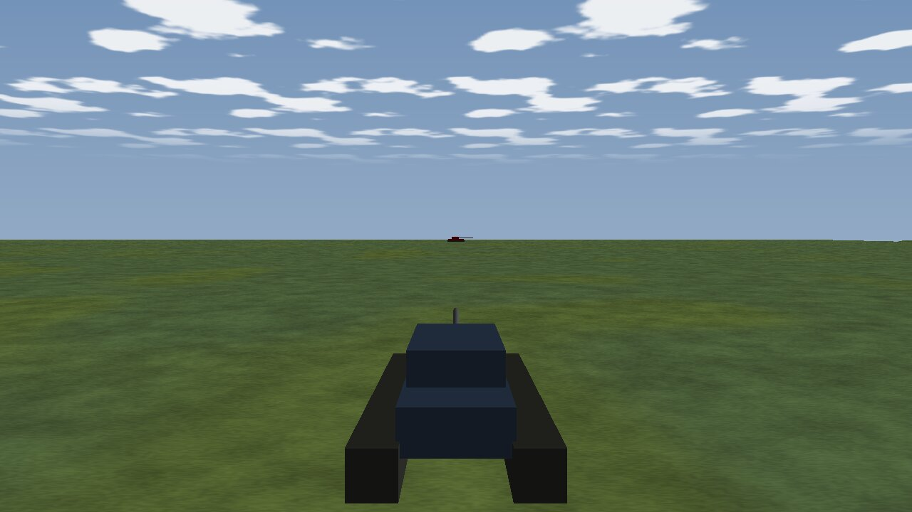 | 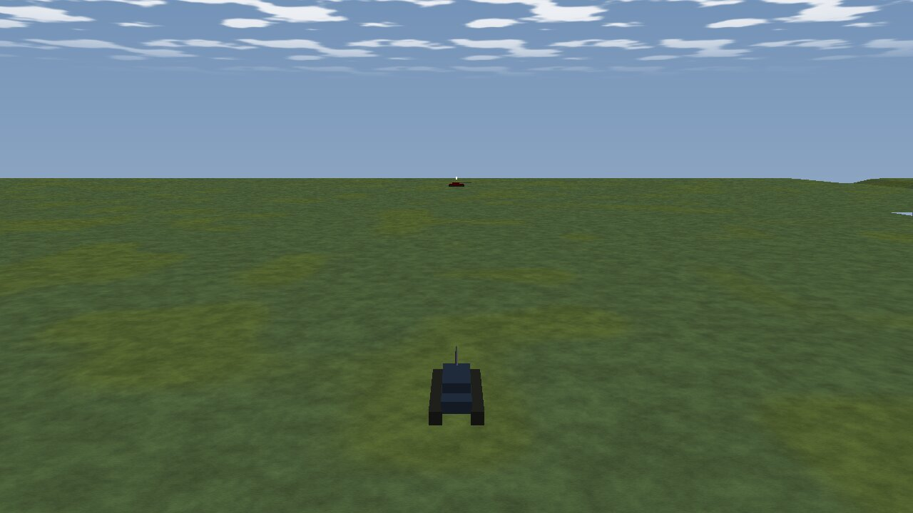 |

*What it shows:* film time 9.1 s of `ua-tank-ammo/main` (shot 1, 0.17 s after the first round) played by the ONE pack's runner over a REAL live
recording in a WINDOWED Replay Browser; both frames are at source 9.117 s (the director's sim and the captured frame's sim agree). Before: the
over-the-shoulder shot close behind the M1 — hull, turret, tracks and gun as the TKB's tank kit (real bodies, not boxes: §11i ① holds), the T-72
small and red on the horizon of `basic-desert`. After: the camera three times further back and four times higher, the M1 small in the lower
middle and the T-72 still on the line of fire — CR-4 (the next play shows the unsaved edit) on a real recording.

*How:* ① the recording — `dotnet Hrot.ClusterRunner.dll --mode editor --headless --verify ua-tank-ammo --verify-replay` (H1a: the run is LIVE
and records; `REPLAY same, 61 snapshots matched`): `node_1.fdp`, 60 s, 3607 frames, meta `ScenarioName ua-tank-ammo`, hash `346794a367ebdc52`
(= the take's bake), terrain `basic-desert`. ⚠ The verify itself FAILED one check (the soft round at the technical at 51.07 s, outside its
window) — that is [CE-4055](blueprints/Blueprint_Issues_Tracker.md), not this proof. Not kept (`/exercises/keep` is a cluster route; the
editor run had ended) — the file stays in the node's temp folder. ② the browser and the director — the RB has no `/director/*` routes (P3,
backend's), so an in-process harness: `ReplayBrowserSubsystemTests.CE1303_P2_LiveProof_OneAdjustedKey_BeforeAndAfter_InAWindowedReplayBrowser`
(`[Trait Category Manual]`, skipped unless `HROT_FILM_PROOF=1`): `DISPLAY=:99 HROT_FILM_PROOF=1 HROT_FILM_PROOF_RECORDING=<node_1.fdp>
HROT_FILM_PROOF_OUT=<dir> dotnet test Hrot/Subsystems/Hrot.ReplayBrowser.Tests --no-build --filter FullyQualifiedName~CE1303_P2_LiveProof`. It
initializes the subsystem WINDOWED (raylib + ImGui on Xvfb, llvmpipe; the runner's shell is internal to `Hrot.ClusterRunner`), opens the
recording through the debug provider (`POST /replay`'s path), copies the seeded take BESIDE it (TE-1), `Session.Open` → `Runner.PlayFrom(9.1)`
(`Cinema: false`) → pause on the first playing frame → `FilmStudio.Capture` (the path `POST /film/capture` uses, 1280×720); then
`TakeEdit.SetKeyCamera(0, …)` and the same again. Optional env: `HROT_FILM_PROOF_AT`, `_KEY`, `_SCENARIO`, `_TAKE`.

*What looked wrong:* ⚠ the first harness runs played nothing — the recording had silently not opened (`frames 0`, an empty world ⇒ *"no unit
named 'Tank'"*): the schema check refuses a recorded component this process has not REGISTERED, though CE-4050 loaded its assembly
([CE-1372](blueprints/Blueprint_Issues_Tracker.md); the runner's RB process is not affected — measured, the same file opens there). The
capture called directly burns no subtitle (the runner's capture path does). Nothing else: the follow framing held across both plays, the time
was right, the bodies were models.

### 11q. P3 wiring + keys per segment *(ui, `2026-10-27`, CE-4059 P3 (ui half) + CE-1303 CR-7 input; build-state: ✅ BUILT `2026-10-27` — as built at the end)*

⭐ Frame: [NOTE_Coordinator_To_Ui_Drafter_Core_Ready](blueprints/batches/NOTE_Coordinator_To_Ui_Drafter_Core_Ready.md) — two items: **A.** a key belongs
to a SEGMENT (the CR-7 input: §11n's replay key had to be parked at ④'s end because a key placed by source time alone would cut the main pass) and
**B.** the drafter wired (P3, the non-RB-HTTP part): *"Draft a shot sequence here"* on an event, the draft opened in the take session, `DraftOptions.Kind`
from the world, `GET /director/moments` + `POST /director/draft` on the editor's routes. ⛔ Fence: no route on the Replay Browser's HTTP (backend's lane).

**INVENTORY** *(`2026-10-27`; graph of this worktree, 279 088 nodes, + grep)*

```
search_graph name_pattern=".*(Draft|Moment).*" label=Class      → 5, has_more false: DraftMoment, DraftOptions, Drafter (§11n), DrafterTests,
   OrderDraft (orders, unrelated) — no drafting service, no host wiring
search_graph name_pattern=".*(Draft|Moments).*" label=Method    → 25: Drafter.Draft / Moments + rails; DocumentationTakes (CE-4060) calls
   Drafter.MomentCamera / GroupCamera; MissionPanel drafts (unrelated) — no route, no menu
search_graph name_pattern=".*(Segment|Scope).*" label=Class     → 52: the director's TimeSegment, FilmSegment and the TakeEdit segment records;
   nothing scopes a key — every other hit is unrelated (roads, JsonPath, StructEdit scopes, pedestrians)
search_graph name_pattern=".*(MenuItems|RowMenu|EventMenu|ContextMenu).*" label=Method → 60 (the cap): node-editor / BTree / HSM / IG menus;
   the timeline's are TimelinePanel.MenuItems (pure, the mode's items) and TimelineLaneCatalog.MenuItems (RowMenu = the lane provider's)
search_graph name_pattern=".*(IsVehicle|IsPerson|IsAircraft).*" label=Method → 6: Locomotions.IsAircraft, AircraftPart.IsAircraft,
   PhysicsColliderReaders.IsPerson, VehicleCover.IsVehicle, PathRequests.IsVehicle — all read Locomotion / VehicleParams
search_graph name_pattern=".*Director.*" label=Interface        → 4: IDirectorHost, IDirectorSound, IDirectorTabContext, IDirectorWindowTab
grep "RowMenu =\|rowMenu:" → EventTimelineWindow sets panel.RowMenu from the host's lane catalogue (editor, RB) — a second writer would
   overwrite it ⇒ the director needs its OWN seam on the panel
grep "NetworkIdResolver.ResolveNetworkId" director → EditorSubsystem.UnitNameOf and ReplayBrowserSubsystem.DirectorUnitName: the SAME 7 lines
grep "Locomotions.Of" → the ONE body-class reading (descent → Locomotion → VehicleParams preset), MD-A
grep "director/" Hrot.Editor.Tests → no route rail for /director/*; the HTTP pattern is DebugApiFoundationTests (a real host, the queue drained)
check_index_coverage is not available through the CLI ⇒ these totals are not proof of completeness
```

```mermaid
classDiagram
  direction LR
  class CameraKey { <<exists, grown>> At · Camera · In · Fov · Still · Segment? }
  class TimeSegment { <<exists, grown>> Id? · From · To · Speed · Gap }
  class FilmSegment { <<exists, grown>> Number · From · To · Speed · Back · Id? }
  class CameraKeys { <<exists, grown>> Of · Played · OnScreenIn(keys, segmentId) }
  class TakeJson { <<exists, grown>> key segment · segment id · names a dangling or doubled id }
  class TakeEditor { <<exists, grown>> AddKey with a segment index · RemoveSegment takes its keys · a replay copy has no id · unsaved ctor }
  class DirectorRunner { <<exists, grown>> camera over OnScreenIn · SegmentOf(scenario, take) }
  class DirectorTracks { <<exists, grown>> segmentNow · K and U scope to a replay · a scoped key coloured and labelled }
  class Drafter { <<exists, grown>> MomentAt(lane, eventIndex) · Lanes · the reverse key OF the replay at t-1 }
  class DirectorUnits { <<NEW, static>> NameOf(world, id) · KindOf(world, id) }
  class DirectorDrafts { <<NEW>> Moments · Draft(lane, eventIndex) opens it · MenuItems(index, ctx) }
  class DirectorTakeSession { <<exists, grown>> OpenDraft(take) unsaved · Store · Opened }
  class DirectorPack { <<exists, grown>> Drafts · sets Timeline.EventMenu }
  class DirectorPackHost { <<exists, grown>> Index · Scenario }
  class TimelinePanel { <<exists, grown>> EventMenu(index, ctx) beside RowMenu }
  class TimelineTrackItem { <<exists, grown>> Colour? }
  class DebugApiHost { <<exists, grown>> GET /director/moments · POST /director/draft }
  class Locomotions { <<exists>> Of(world, e) }
  CameraKey --> TimeSegment : Segment names Id
  FilmSegment ..> TimeSegment : laid out from
  DirectorRunner --> CameraKeys : OnScreenIn
  DirectorRunner --> FilmSegment : the one on screen
  DirectorTracks --> DirectorRunner : segmentNow via the session
  DirectorTracks --> TakeEditor : AddKey with a segment
  DirectorPack --> DirectorDrafts : builds once
  DirectorPack --> TimelinePanel : EventMenu
  DirectorDrafts --> Drafter : MomentAt, Draft
  DirectorDrafts --> DirectorUnits : names, kinds
  DirectorDrafts --> DirectorTakeSession : OpenDraft
  DirectorUnits --> Locomotions : the body's class
  DebugApiHost --> DirectorDrafts : the pack's
```
*What the picture shows that prose hid:* TWO new types only — `DirectorUnits` (which REPLACES two identical host copies) and `DirectorDrafts` (the one
place the drafter meets a host: index, names, kinds, session). The key's scope is a field on an existing record read by ONE function (`OnScreenIn`)
that the runner and the tracks both call; the menu and the route reach the same `Draft`.

```mermaid
sequenceDiagram
  actor U as Operator (editor or RB)
  participant P as TimelinePanel (Event Timeline)
  participant D as DirectorDrafts
  participant F as Drafter
  participant S as DirectorTakeSession
  participant R as DirectorRunner
  U->>P: right-click the shot event
  P->>D: EventMenu(the index drawn, ctx with the event)
  D-->>P: Draft a shot sequence here
  U->>P: choose it
  P->>D: Draft(lane, eventIndex, index)
  D->>F: MomentAt, then Draft(Kind = DirectorUnits.KindOf)
  F-->>D: keys 1-4 unscoped, the reverse key of segment replay at t-1, segments main + replay
  D->>S: OpenDraft(take) - a new take draft, unsaved, a fresh undo history
  U->>R: Play (the open take, CR-4)
  loop the main pass
    R->>R: OnScreenIn(keys, main) = the unscoped keys, ProgramAt(source)
  end
  R->>R: the next segment goes back: Seek(t-1) (live: skipped, R-3034)
  loop the replay, source t-1 to t+1.5 at 0.4
    R->>R: OnScreenIn(keys, replay) = unscoped before t-1 + its own key = the reverse angle throughout
  end
```

```mermaid
graph TD
  subgraph ED["Editor - EditorSubsystem"]
    EDA["DirectorPack.Attach with Index = ShownTimeline.Index, Scenario = LoadedScenarioName"]
    EDR["DebugApiHost.AttachDirector with pack.Drafts"]
  end
  subgraph RB["Replay Browser - ReplayBrowserSubsystem"]
    RBA["DirectorPack.Attach with Index = the recording's index, Scenario = its meta's ScenarioName"]
  end
  PK["DirectorPack: DirectorDrafts, once"]:::new
  EDA --> PK
  RBA --> PK
  PK -->|"Timeline.EventMenu"| PAN["the host's Event Timeline: right-click an event"]:::new
  EDR --> RT["/director/moments, /director/draft"]:::new
  RT --> PK
  RBH["RB HTTP /director/*"] -.->|"not reached: backend's lane (fence)"| PK
  PK --> SES["DirectorTakeSession.OpenDraft"]
  RUN["DirectorRunner.Tick (both hosts)"] -->|"camera: OnScreenIn(keys, the segment on screen)"| FS["FilmStudio"]
  classDef new fill:#d9f2d9,stroke:#2a7a2a
  linkStyle 5 stroke:#c33,stroke-dasharray:4 3
```
*Caption:* both hosts reach the drafter through the ONE pack (the menu cannot be on one host and not the other); the routes are the editor's only — the
dashed red edge is the Replay Browser's HTTP, which this slice does not reach (the user's fence; a lane question is open with the coordinator).

**Claim table** *(load-bearing rows)*

| the plan rests on | code — how it IS | design — how it was MEANT |
|---|---|---|
| a key placed by source time cannot sit inside the main pass for a replay | ✅ `Drafter.cs` (§11n as built: parked at ④'s end); `TakeTimeline.ProgramAt` takes the LAST key at or before the source second | ✅ §11n deviation ⑤ · the note's CR-7 input |
| the runner knows the segment on screen every frame | ✅ `DirectorRunner.Segment` (`_seg` into `FilmTimeMap.Segments`), advanced in `AdvanceSegments` | ✅ §11o S1 / S2 |
| segment list positions move | ✅ `TakeEditor.AddSegment` inserts in source order, `ReplaySegment` inserts after | ✅ §11o S12 ⇒ an index is not a stable name |
| the panel's `RowMenu` has ONE writer, the host's window | ✅ `EventTimelineWindow` ctor sets it from the lane catalogue | ✅ §2d (addendum 4: the row's provider's items) |
| the panel hands its menu the event, not its position in the lane | ✅ `TimelineMenuContext(LaneId, Ticks, Frame, Event)`; lanes are frame-ordered (`TimelineIndex.Before`) | ⛔ searched §2d / §9c: none — the position is found by frame + equality |
| a unit's body class is read ONE way | ✅ `Locomotions.Of` (descent → `Locomotion` → `VehicleParams`) | ✅ MD-A (`DESIGN_Motion_Domains`) |
| a squad is an entity with `SquadStateMarker` (recorded) | ✅ `SquadCognitiveState.cs` `SquadStateMarker` `[DataPolicy(Default)]` | ⛔ searched for a "group kind" rule: none |
| the open take is what Play plays, unsaved | ✅ `DirectorRunner.LoadTake` → `OpenTake` | ✅ CR-4, §11m D4 |
| `TakeEditor.Dirty` is "differs from the file" | ✅ `ReferenceEquals(Take, _saved)` | ✅ T-L4 — a draft has no file ⇒ dirty from the start |

**Decisions** *(the lean; the rejected alternatives one line each)*

| # | decision | rejected — the one fact |
|---|---|---|
| **K1** | **a key names its segment by a stable `id`** (`"segment": "replay"`; the segment `"id": "replay"`); none = every pass (every take before this). While segment X plays the camera is looked up among the UNSCOPED keys and X's OWN — which take over from the first of them for the rest of X (`CameraKeys.OnScreenIn`); a key of another segment is never seen; no segment playing (identity, scout, verify) = unscoped only | `segment: n` (a list position) — S12 inserts segments: every scoped key would move to another segment · unscoped ∪ own by time — the drafter's moment key (t−0.7) is later than the replay's (t−1): the union cuts back to the main angle 0.3 s into the replay · a key list per segment — two places a key lives, two Camera rows |
| **K2** | **a scoped key is drawn on the Camera track at its SOURCE time** (the one axis, §2c row 10), in its own colour (`DirectorTracks.ScopedKeyColour` through the new `TimelineTrackItem.Colour`) with *"\| segment &lt;id&gt;"* ending its label | a Camera row per replay — the panel has no per-segment axis; the replay is the same source stretch |
| **K3** | **K and *update key from view* scope a NEW key to the segment on screen when it is a REPLAY** (`FilmSegment.Back`, via `DirectorRunner.SegmentOf(the open take)`); U in a replay on a key that is not the replay's own ADDS the replay's own key with the view (where that key took the screen, not before the replay's start) instead of changing the main pass's; the segment gets an id `s<n>` in the same undo step | scoping every K to the segment on screen — a key made while the main pass plays would leave every other pass · U changing the unscoped key in place — the main pass changes too, the bug CR-7 exists to stop |
| **K4** | **deleting a segment deletes its keys** (one undo step); a *Replay this segment* copy has NO id (the original's keys stay the original's); a key naming a segment the take does not have, or an id used twice, is a named read problem | keeping orphaned keys — no pass could ever show them |
| **K5** | **the drafter's reverse-angle key is a key OF the replay at its real source time** (t−1, the replay's first frame); the segments are `main` and `replay` (`Drafter.MainSegmentId` / `ReplaySegmentId`) | parking it at ④'s end (§11n as built) — the replay never showed it; ⛔ SUPERSEDED |
| **D1** | **the drafter is wired ONCE, in the pack**: `DirectorPackHost.Index` / `Scenario` → `DirectorDrafts` (names and kinds from `Host.World`), and the panel's NEW `EventMenu` seam (`TimelinePanel`, handed the index it draws) offers *"Draft a shot sequence here"* on a shot / hit / blast event (`Drafter.Lanes`); `Drafter.MomentAt` is the ONE event → moment rule (`Moments` now calls it) | the panel's `RowMenu` — one writer (the window): the director would overwrite the lane catalogue's items · each host wiring its own item — two wirings drift (CR-2) |
| **D2** | **a draft opens as a NEW, unsaved take** (`draft`, `draft-2`, … in the shown scenario; `TakeEditor(unsaved: true)` — dirty, Save writes it; a fresh undo history); refused while another take has unsaved edits (as Open is); **undoing the draft is closing it**; the Director window lists the open take and moves its pick to it | one undo step over the open take — a draft replaces every key AND the name: an undo would silently change which file Save writes · saving at once — a draft is a starting point; the person adjusts it first (CR-4) |
| **D3** | **`DraftOptions.Kind` = `DirectorUnits.KindOf`**: a squad (`SquadStateMarker`) → Group; else `Locomotions.Of`: pedestrian / rope / parachute → Person, rotorcraft / fixed-wing → Aircraft, wheeled / tracked / amphibious / surface → Vehicle, else Unknown. ⭐ `DirectorUnits.NameOf` is the ONE network-id → name reading (the editor's and the RB's copies now call it) | the TKB's entity class (`EntityClassTable`) — the RB has no TKB yet (P0) and the class tree has no "person" node; `Locomotion` is stamped from the TKB on every node and recorded |
| **D4** | **`GET /director/moments`, `POST /director/draft {lane, eventIndex, replay?}` on the EDITOR's routes**, calling the pack's `DirectorDrafts` (the menu's code): 409 with no index shown or with an unsaved open take; `recording=` refused (*"that is the Replay Browser's route"*); the MCP catalog regenerated (`director_moments`, `director_draft`) | a route that drafts without opening — the agent's draft and the person's would land in different places · routes on the RB — the user's fence (backend's lane) |
| **D5** | the draft's **title** names the moment (*"Draft: Alpha, shot, Bravo"*); its **caption stays empty** | the caption — a take's caption is READ AS its subtitle (§11o S8): it would be on screen for the whole film |

**✅ As built `2026-10-27`** — the diagrams above are true. Files, in `Hrot.Presentation/Map3D/Director` unless named: `Take.cs` (`CameraKey.Segment`,
`TimeSegment.Id`, `CameraKeys.OnScreenIn`) · `TakeTimeline.cs` (`FilmSegment.Id`) · `TakeJson.cs` (`segment` / `id` read and written; the two named
problems) · `TakeEditor.cs` (`TakeEdit.AddKey(.., Segment)`, the id `s<n>` given in the same step, `RemoveSegment` takes its keys, a replay copy has no id,
`TakeEditor(.., unsaved)`) · `DirectorRunner.cs` (`DirectUpcoming` over `OnScreenIn`; `SegmentOf`) · `DirectorTracks.cs` (`segmentNow`, `ReplayOnScreen`,
K / U scoping, `ScopedKeyColour`, the label) · `Drafter.cs` (`Lanes`, `MomentAt` — `Moments` now calls it, `MainSegmentId` / `ReplaySegmentId`, the reverse
key of the replay) · `DirectorDrafts.cs` (new: `DirectorUnits`, `DirectorDrafts`) · `DirectorTakeSession.cs` (`OpenDraft`, `Store`, `Opened`) ·
`DirectorPack.cs` (`DirectorPackHost.Index` / `Scenario`, `Drafts`, `Timeline.EventMenu`) · `DirectorWindow.cs` (the open take listed and followed) ·
`Fdp.Presentation/.../Timeline/TimelinePanel.cs` (`EventMenu`; a track item's own colour) and `ITimelineTrack.cs` (`TimelineTrackItem.Colour`) ·
`Hrot.Editor/EditorSubsystem.cs` (the pack gets `Index` / `Scenario`; `UnitNameOf` calls `DirectorUnits.NameOf`; the debug host gets `pack.Drafts`) ·
`Hrot.Editor/DebugApi/DebugApiHost.Director.cs` + `DebugApiRouteDocs.cs` (the two routes) · `tools/ai-debug-mcp/tool-catalog.mjs` + `SKILL.md`
(regenerated, purely additive: `director_moments`, `director_draft`) · `Hrot.ReplayBrowser/ReplayBrowserSubsystem.Director.cs` (`Index` / `Scenario`;
`DirectorUnitName` calls `DirectorUnits.NameOf`).

**Deviations:** none of substance. Two things the diagrams do not say: the stretches a keys-only take is laid out in (`TakeTimeline.Plan`, the gating
of captions / layers / capture) still count every key, scoped or not — a scoped key inside the main pass adds a cut entry to its report, never a camera;
and a rail needed a SEEKING fake host (`DirectorPackTests.SeekHost`) — a live one skips a back segment, so a replay's own key never plays on the editor
(R-3034, §11o S4), as designed.

**Known edges:** the draft's names and kinds come from the host's world AT THE PLAYHEAD (the RB's world is the recording at the playhead): a unit not yet
spawned, or gone, has no name there — the menu item is then disabled (*"the drafter cannot name it"*); K / U scope a key to a replay only while the
runner PLAYS the open take (`SegmentOf`), so a key added with the director stopped is unscoped; the RB has no `/director/*` routes (the fence; the lane
question is with the coordinator) — its agent path waits for it.

**Rails** (each red-proved by a compiling mutation; the report lists mutation and message):
`DirectorPackTests.CE4059_CR7_AKeyOfTheReplay_IsSeenOnlyInTheReplay_OnASeekingHost` and
`ReplayBrowserSubsystemTests.CE4059_CR7_AKeyOfTheReplay_IsSeenOnlyInTheReplay_OverARecording` (main pass never shows the replay's key; the replay shows
key 1 until 1.5 s, then its own) · `FilmDirectorTests.CE4059_CR7_AKeyOfASegment_RoundTrips_AndTheSeededTakesStayUnscoped` (+ the 55 seeded takes: no
scope, the lookup hands each its own list) · `DirectorTracksTests.CE4059_CR7_DuringAReplay_KAndU_GiveTheReplayItsOwnKeys` ·
`DrafterTests.CE4059_CR7_TheReplaysReverseAngle_IsAKeyOfTheReplay_AtItsRealSourceTime` · `DirectorPackTests.CE4059_P3_DraftHere_OnAnEvent_OpensTheDraftersTake_InTheSession`
(the shared panel model) · `ReplayBrowserSubsystemTests.CE4059_P3_DraftHere_OnTheReplayBrowsersTimeline_OpensTheDraft` (the RB host) ·
`DirectorDraftRoutesTests.CE4059_P3_TheEditorsDraftRoutes_ListTheMoments_AndOpenTheDraft` (Hrot.Editor.Tests, a real `DebugApiHost`). One existing rail
changed deliberately: `DrafterTests.CE4059_CR8_TheLine_IsCrossedOnlyByTheReplay` keeps its assertions (five keys, the sides, the two segments); the reverse
key's new scope and time are asserted by the new `CE4059_CR7_*` rail beside it.

### 11r. P3 — `recording=`, stills, render in the RB *(ui, `2026-10-27`, CE-4059 P3 (the routes' remaining half); build-state: ✅ BUILT `2026-10-27` — as built at the end)*

⭐ Frame: [NOTE_Coordinator_To_Ui_RB_Director_Routes_Done](blueprints/batches/NOTE_Coordinator_To_Ui_RB_Director_Routes_Done.md) "Still yours" — `recording=`
(TE-15), `/director/stills`, MP4 in the RB, the MCP catalog. Basis: CR-10 (stills + contact sheet, the night's documentation), CR-12 (rendering is the
RB's), [Film Production](DESIGN_Film_Production.md) §3 ④ *"a still is one seek and one frame"*, §4a (the documentation take's still keys render through
this route), [Replay Browser Debug HTTP](DESIGN_Replay_Browser_Debug_Http.md) (the RB answers the SAME routes; RB-only routes only for RB-only meaning).

**INVENTORY** *(`2026-10-27`)* — ⚠ **this worktree's graph could not be built: the VM's root disk was full** (`persist_failed`, 390 MB free); the queries ran
on the main checkout's `ui` index (`home-user-HROT`, built `2026-10-25`, before §11j moved the runner to `Hrot.Presentation`) **and** grep over this tree.

```
search_graph name_pattern=".*(Still|Contact|FrameSink|FilmStudio|Ffmpeg|CaptureOptions|ReplayBrowserControl|RecordingOpen).*" label=Class
   → 32, has_more false: CaptureOptions, Ffmpeg, FilmFrameSink (then in the editor; now Hrot.Presentation), FilmStudio — every other hit an AI
     "contact" (BreakContact…, SquadContact…) — no stills job, no contact sheet, no recording opener beside the RB's own
grep "contact.?sheet|director/stills|Stills" → only designs/notes + DocumentationTakes.cs:15 ("rendering its still keys is /director/stills") — nothing built
grep '"/replay"' → ONE route: DebugApiHost.cs:1032 → DebugApiService.EnterReplay: {path|paths} → IReplayBrowserControl.Open (RB only);
   {exerciseId} → PublishTransition → the RB's ReplayBrowserMasterControl.Transition (RecordingGroupInventory.Scan → OpenGroup)
grep "FilmStudio.Capture|IFrameSink" → ONE capture path: FilmFrameSink → FilmStudio mailbox → Film.cs Serve (the map on screen); null sink when headless
grep "CaptureOptions|DirectorMode.Capture" → the runner's capture: one step per captured frame (no Hold), the movie by Ffmpeg.Encode — host-agnostic
which ffmpeg → /usr/bin/ffmpeg (installed)
check_index_coverage is not available through the CLI ⇒ these totals are not proof of completeness
```

```mermaid
classDiagram
  direction LR
  class DebugApiHost { <<exists, grown>> OpenRecording(recording) · POST/GET /director/stills · recording= on play, draft, moments }
  class DebugApiService { <<exists, grown>> EnterReplay(body) · OpensRecordingFiles }
  class IReplayBrowserControl { <<exists>> Open(paths, at) }
  class ReplayBrowserMasterControl { <<exists>> Transition(OperatingReplay) }
  class DirectorPack { <<exists, grown>> Stills · Tick = Runner.Tick + Stills.Tick }
  class DirectorStills { <<NEW>> PlanOf(take, times, everyKey) · Start · Tick · Status · Refusal }
  class ContactSheet { <<NEW, static>> Layout(n, w, h) · Compose(paths, labels, out) }
  class DirectorRunner { <<exists, grown>> TakeOf(request) · PlayFrom · Pause · Stop · capture mode }
  class FilmFrameSink { <<exists>> Frame(path, w, h) }
  class FilmTimeMap { <<exists>> Of(take) · At(film) · FilmOf(source) }
  DebugApiHost --> DebugApiService : recording= opens through EnterReplay
  DebugApiService --> IReplayBrowserControl : a path
  DebugApiService --> ReplayBrowserMasterControl : an exercise id
  DebugApiHost --> DirectorStills : the pack's
  DirectorPack --> DirectorStills : builds once, ticks
  DirectorStills --> DirectorRunner : PlayFrom, Pause, Stop
  DirectorStills --> FilmFrameSink : the SAME sink a film captures through
  DirectorStills --> FilmTimeMap : film to source
  DirectorStills --> ContactSheet : when done
```
*What the picture shows that prose hid:* `recording=` adds NO opener — it is one call into the very method `POST /replay` runs; the stills job adds no camera
and no capture path — it is the runner's play-from held on one second plus the film's own sink. Two new types, both in the shared pack.

```mermaid
sequenceDiagram
  actor A as Agent
  participant H as DebugApiHost (RB process)
  participant S as DebugApiService
  participant RB as ReplayBrowser control
  participant J as DirectorStills
  participant R as DirectorRunner
  participant M as the map (FilmStudio)
  A->>H: POST /director/stills {recording, take, times}
  H->>S: EnterReplay({path} or {exerciseId}) - the /replay call
  S->>RB: Open(paths) - the group opens, the takes root moves beside it
  H->>R: TakeOf(take) - the open take, else the file
  H->>J: PlanOf(take, times) then Start(plan, dir beside the take)
  loop each still
    J->>R: PlayFrom(film t) - the recording SEEKS to the source of t
    R-->>J: Phase Playing
    J->>R: Pause - the camera of t held, no step
    J->>M: Frame(path) after 3 settle frames
    M-->>J: written
    J->>R: Stop
  end
  J->>J: ContactSheet.Compose - a labelled grid
  H-->>A: {state done, stills[path, film, source, shownSim], sheet, sheetGrid}
```

```mermaid
graph TD
  subgraph RBP["--mode replaybrowser (windowed)"]
    RBH["DebugApiHost: /director/* (one attach: DirectorPack)"]
    RBJ["DirectorStills (sink = FilmFrameSink)"]:::new
    RBO["recording= : EnterReplay -> RB control / master"]:::new
  end
  subgraph RBX["--mode replaybrowser --headless"]
    RXJ["DirectorStills (sink = null)"]
  end
  subgraph ED["Editor (EditorSubsystem)"]
    EDJ["DirectorStills (CanSeek false)"]
  end
  PK["DirectorPack.Attach - builds the stills once, ticks it after the runner"]:::new
  PK --> RBJ
  PK --> RXJ
  PK --> EDJ
  RBH --> RBJ
  RBH --> RBO
  RXJ -.->|"refused: no renderer (plan:true answers)"| X1["400"]
  EDJ -.->|"refused: cannot seek; recording= refused"| X2["400"]
  classDef new fill:#d9f2d9,stroke:#2a7a2a
  linkStyle 5 stroke:#c33,stroke-dasharray:4 3
  linkStyle 6 stroke:#c33,stroke-dasharray:4 3
```
*Caption:* every host gets the SAME stills job from the pack (one wiring, CR-2), so the route is the same everywhere; only a windowed Replay Browser can
take a still — the two red dashed edges are the hosts where the job exists and is never reached past its refusal (headless: no map is drawn; the editor:
its source cannot seek, and it opens no recordings).

**Claim table**

| the plan rests on | code — how it IS | design — how it was MEANT |
|---|---|---|
| `POST /replay` has ONE open path, RB-specific underneath | ✅ `DebugApiService.Master.cs` `EnterReplay` → `OpenRecordingFiles` → `IReplayBrowserControl.Open`; exercise id → `ReplayBrowserMasterControl.Transition` | ✅ RB-1 / RB-2 (Replay Browser Debug HTTP) · TE-15 *"a route only when no existing route answers"* |
| the open recording moves the takes root and the drafter's index | ✅ `ReplayBrowserSubsystem.Director.cs` `DirectorTakesRoot` (dynamic) · ⚠ the index followed only on the next `Update` (`SyncTimelineSource`) — fixed here (R5) | ✅ TE-1 (takes beside the recording) |
| a seekable `PlayFrom` stands on the film second's source before the first playing frame | ✅ `CE1303_P2a_PlayFrom_SeeksTheRecording_ToTheShot` (re-read) | ✅ CR-4, §11m D5 |
| a paused runner still directs the camera of its second, without a step | ✅ `DirectorRunner.Tick`: `DirectUpcoming(rel)` before `if (_paused) return` | ⛔ searched §11m / §11o: not stated — measured |
| a still and a film frame are captured the same way | ✅ `FilmFrameSink.Frame` → `FilmStudio.Capture` → `Film.cs` `Serve` | ✅ CR-10 / Film Production §3 ④ |
| the runner's capture is already paced by the take on a seeking host | ✅ `DirectorRunner.Tick`: capture mode never `Hold`s; `StepOnce` per frame; the frame waits for `_pendingCapture` | ✅ CR-12, Film Director §4a |
| a headless host has no sink | ✅ `DirectorPack.Attach`: `h.Headless ? null : new FilmFrameSink()`; the runner refuses capture *"no map to film"* | ✅ §11m (headless RB) |
| the contact sheet can be drawn | ✅ raylib's CPU `Image*` calls (`ImageDraw`, `ImageDrawText` with the window's default font) — the only image library in the tree (grep: no ImageSharp / Skia) | ⛔ none — measured |

**Decisions** *(the lean; the rejected alternatives one line each)*

| # | decision | rejected — the one fact |
|---|---|---|
| **R1** | **`recording=` opens through `DebugApiService.EnterReplay`** — the method `POST /replay` calls (`{path}`, a folder's `{paths}`, or `{exerciseId}`); refused 400 with ONE message (`DebugApiHost.RecordingRefused`) on a host whose provider has no Replay Browser control (`OpensRecordingFiles`) — on play, draft, moments and stills | a pack seam `DirectorPackHost.OpenRecording` (the brief's suggestion) — a second place that parses path-vs-exercise-id and opens beside `POST /replay`'s own · refusing on the pack's `CanSeek` — a cluster replay seeks too, and the question is "does this host open files" |
| **R2** | **stills are ONE job in the pack (`DirectorStills`)**: per film second `PlayFrom` → Pause on the first playing frame → 3 settle frames → the pack's own `FilmFrameSink` → Stop; then a contact sheet. The route answers when done (`wait`, default true; `GET /director/stills` reads a running one) | a runner mode for stills — the runner's capture is continuous at fps; a per-still mode would thread a second meaning through its tick · stills by `/film/capture` from the agent — N round trips and the agent doing the seeking |
| **R3** | **the editor is REFUSED** (cannot seek), `plan:true` answers anywhere; a headless RB is refused (no renderer) | fast-forward on the editor — each still reloads and re-runs the scenario from 0 (`PlayFrom` on a live host), CE-3294's reload leaks, and CR-12 puts rendering in the RB |
| **R4** | **film seconds are mapped to source seconds by the take's segments** (`FilmTimeMap`, baked anchors) — the plan names both; `everyKey` = each key once ON screen (cut: its time; fly: its end; dip: its in-half); neither = the keys naming a `Still` (the documentation take, CE-4060); a PNG is named by its key's `Still`, else `<nn>-film-<t>s`; default folder BESIDE the take (`takes/<take>.stills/`) | stills at source seconds — the agent thinks in the film it watches; a replayed stretch has two film seconds for one source second |
| **R5** | **the RB's drafter index is synced on read** (`SyncTimelineSource()` in the `Index` func) | leaving it to the next `Update` — `GET /director/moments?recording=B` would answer recording A's moments |
| **R6** | **MP4 on the RB is the existing `/director/play {capture}`** — no new route; `capture.dir` defaults beside a single take (`takes/<take>.render/`), `recording=` opens first, and on the RB an omitted `scenario` is the open recording's; a play while a stills job holds the runner is 409 | a `/director/render` route — the same runner call under a second name |

**✅ As built `2026-10-27`** — the diagrams above are true. Files: `Hrot.Presentation/Map3D/Director/DirectorStills.cs` (new: `StillPlan`,
`DirectorStills`, `ContactSheet`) · `DirectorPack.cs` (`Stills`, built once over the runner and the SAME sink; `Tick` = runner then stills) ·
`DirectorRunner.cs` (`TakeOf(request)` — the take a play reads, the open one first) · `Hrot.Editor/DebugApi/DebugApiHost.Director.cs` (`OpenRecording`,
`RecordingRefused`, `POST`/`GET /director/stills`, `recording=` on play / draft / moments, moments' `complete`, a single take's capture dir beside it, the
RB's play defaulting to the open recording's scenario) · `DebugApiService.Master.cs` (`OpensRecordingFiles`) · `DebugApiRouteDocs.cs` (the two stills
routes, the `recording` param on three) · `Hrot.ReplayBrowser/ReplayBrowserSubsystem.Director.cs` (R5: the drafter's index synced on read) ·
`tools/ai-debug-mcp/tool-catalog.mjs` + `SKILL.md` (regenerated: `director_stills`, `director_stills_status` added; `director_play`, `director_draft`,
`director_moments` gained `recording`).

**Deviations:** ① R1 — the brief leaned to a pack seam (`IDirectorHost` capability / a `DirectorPackHost` func); built instead as ONE call into
`EnterReplay` (the decision row says why: the seam would be the second opener). ② The editor's draft refusal message changed to the shared
`RecordingRefused` (same 400). ③ `/director/play` on the RB takes the open recording's scenario when none is named (the editor still needs one) — found
by the windowed rail. ④ `ContactSheet` draws its labels with raylib's default font, so it needs the window; it is reached only by a job that a
headless host never starts.

**Known edges:** a still of an ANCHORED key needs the anchor BAKED (the plan resolves through `Baked.Times`; an unbaked anchor is a named problem, not a
guess) — CR-5's one resolver (P4) removes that; `GET /director/moments?recording=` right after the open answers `complete: false` and few moments while
the recording's index is read in the background (ask again); the stills job holds the runner (the director's own Play is refused while it runs, and it
refuses while the director plays); the rail's GL work must stay on the window's thread (an `await` hop broke the shader compile — the windowed rail
drives its frames synchronously, `CallOnThisThread`).

**Live run** *(`2026-10-27`, a windowed `-m replaybrowser` under Xvfb, `HROT_DEBUG_API_PORT`)* — the recording of a `ua-tank-ammo` verify run
(3 607 frames, 67 s), the scenario's seeded `main` take beside it. One `POST /director/stills {recording: <node_1.fdp>, take: "main", times: [8.6, 9.6,
17.4, 18.6, 22.0, 23.5], width: 960, height: 540}` opened the recording (nothing was open), took six stills and answered `done` with each still's
`shownSim` EQUAL to its planned second, no problems; then `POST /director/play {recording, take, capture: {fps: 15, size: "640x360"}}` rendered the take
beside it (`takes/main.render/ua-tank-ammo-main.mp4`: 640 × 360, 15 fps, 133 frames = the title card + 7.4 s of shots, 8.9 s; one step per captured frame, 213 s of wall time under Xvfb's software GL — paced by the take, never real time). ⚠ Its report says `beat-missing` (`s1`, `s2`) while the shots played at their BAKED times (`usedBake: true`): a replayed world is not observed for combat cues — exactly §11g's row and CR-5's one resolver (P4).

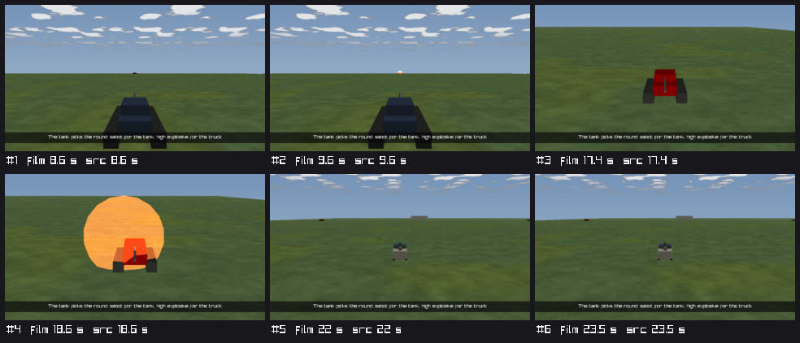

*What it shows:* a 3 × 2 sheet, each cell labelled with its film and source second. **#1 (8.6 s)** over the shoulder of the Tank (dark blue), the enemy
on the horizon; **#2 (9.6 s)** the same angle, the round's glow at the target; **#3 (17.4 s)** the follow on the Enemy Tank (red) before the second shot;
**#4 (18.6 s)** the second round's blast engulfing it (orange); **#5 / #6 (22.0 / 23.5 s)** the wide follow on the Technical (the truck) the HE goes
to. The take's caption is burned in as the subtitle on every cell. The bodies are the TKB's low-poly models (hull, turret, tracks, gun — P0 ① built, §11i), as in the P2 live proof; ⛔ *corrected on review: an earlier line here said "boxes, no TKB in the RB yet" — the image shows the models.*

**Rails** (each red-proved by a compiling mutation; the report lists mutation and message):
`ReplayBrowserSubsystemTests.CE4059_P3_RecordingIsOpenedThroughTheReplayRoute_AndStillsArePlannedButRefused_OnAHeadlessBrowser` (headless: `recording=`
by path opens the file — the control's path and frame count — and by exercise id opens a second one; the plan through the segments 0.5 / 3.0 / 4.5 →
1.25 / 2.5 / 4.0 and everyKey's 0 / 4; the sheet grid 2 × 2; stills and the MP4 refused with their reasons) ·
`ReplayBrowserSubsystemTests.CE4059_P3_StillsAndTheContactSheet_AndAnMp4_FromARecording_InAWindowedReplayBrowser` (env-gated `HROT_FILM_WINDOW=1`,
Xvfb: three 320 × 180 PNGs beside the take, each `shownSim` within one step of its source second, the sheet 658 × 422, the MP4 beside the take with
15 + 55 frames) · `DirectorDraftRoutesTests.CE4059_P3_OnTheEditor_RecordingIsRefused_OnEveryDirectorRoute_AndStillsNeedASourceThatSeeks`.

### 11s. P4 — one anchor resolver, promote *(ui, `2026-10-27`, CE-1304 P4; build-state: ✅ BUILT `2026-10-27` — as built at the end)*

⭐ The phase's acceptance (§11f): **a take adjusted on recording A plays its beats on recording B of the same scenario, run later** — and on a fresh live run.
Two things stood in the way: event cues were found in side stores a recording never carries (CR-5), and a recording's take had no way into its scenario (promote).

**INVENTORY** *(graph + grep; this worktree indexed fresh; ⚠ `check_index_coverage` is not available through the CLI, so no absence below is proven complete)*

| query | result |
|---|---|
| `search_graph name_pattern=.*Anchor.* label=Class` | 11 — `AnchorBook`, `AnchorMismatch`, `AnchorSpec`, `BakedAnchors`, `EventAnchor`, `EventAnchors` (+ unrelated `EffectAnchor`, `RopeAnchorDto`, `SpatialAnchorEntry`, `GizmoAnchorIdentityException`, a test class) ⇒ ONE resolver exists (`AnchorBook`) and ONE namer (`EventAnchors`) |
| `search_graph name_pattern=.*TimelineSource.*` | `ITimelineSource` (interface), `LiveTimelineSource`, `RecordingTimelineSource` (+ diagram nodes) ⇒ the two indexes CR-5 needs exist; `DirectorPackHost.Index` already hands the host's SHOWN index to the drafter (§11q D1) |
| `search_graph name_pattern=.*Promot.*` | no code symbol — docs only (TE-1, §4d, F-4) ⇒ promote is NEW |
| `search_code (ShotLog\|DetonationLog)\.(Peek\|For)` (regex) + `grep -rnE` over `FDP/ Hrot/ Stride/` | the readers below |

| reader of `ShotLog` / `DetonationLog` | what it is | P4 |
|---|---|---|
| `AnchorBook.Observe` / `Hit` / `CountShots` (before P4) | the director's event cues | ⛔ **RETIRED** — the index (D1) |
| `DirectorRunner` `_roundsAtStart`, `CutSnapshot` rounds | a cut's "rounds fired since the take began", in the report | ✅ CE-1376: counted on the run's index (`AnchorBook.RoundsUntil` → `EventAnchors.CountBetween`, `combat.shot`), so a recording reports the indexed shots; a LIVE index that has not caught up with the cut (it lags up to a quarter second of wall time) falls back to `ShotLog` (CE-1378) |
| `FireProcessingSystem`, `BallisticsSystem`, `GuidedRoundSystem`, `AreaEffectSystem`, `HitResolutionSystem` | the WRITERS (and their own bookkeeping) | kept |
| `CombatTraceSystem` | mirrors the logs into the RECORDED `ShotTraces` the map draws (CE-3117) | kept |
| `DebugApi/CombatReport.cs` (`GET /combat/shots`, `/combat/detonations`) | the combat report | kept |
| `ScenarioVerification` (the editor's verifier, live only — through the `/combat/shots`, `/combat/detonations` rows) | checks' combat conditions | kept — a live-only judge; folding it into the index is CE-1377 |
| `ClearingScenarioTests`, `WeaponSystemsAcrossNodesTests`, `CombatReportTests`, the Fdp.Toolkits combat tests | rails | kept |

⇒ **route, don't delete** ("no rush removals"): the logs keep every other reader; only the director's cue reading leaves them.

```mermaid
classDiagram
  direction LR
  class AnchorBook { <<exists, grown>> TimeOf · Observe(world, units, rel) · ObserveEvents(units) NEW · AwaitsIndex(rel) NEW · Mismatches }
  class EventAnchors { <<exists, grown>> Of(index, lane, i) names · TimeOf(index, spec, isUnit, since) NEW finds · IsEventCue NEW }
  class TimelineIndex { <<exists>> Lane · FrameSim }
  class LiveTimelineSource { <<exists>> the node's live index }
  class RecordingTimelineSource { <<exists>> the open recording's index }
  class DirectorRunner { <<exists>> Index NEW · NewBook(take, baked) NEW }
  class DirectorPack { <<exists>> runner.Index = host.Index · Promotion NEW }
  class DirectorPackHost { <<exists>> Index · ScenarioTakes NEW }
  class TakePromotion { <<NEW>> Promote(scenario, take, overwrite) · Copy(from, to, …) }
  class TakeStore { <<exists, grown>> ScenarioTakesSource NEW reads a scenario's own takes through · HasOwn }
  class DirectorWindow { <<exists>> Promote to scenario NEW }
  class DebugApiHost { <<exists>> POST /director/promote NEW }
  AnchorBook --> EventAnchors : event cues
  EventAnchors ..> TimelineIndex
  LiveTimelineSource --> TimelineIndex
  RecordingTimelineSource --> TimelineIndex
  DirectorRunner --> AnchorBook : one per item
  DirectorPack --> DirectorRunner : Index
  DirectorPack --> TakePromotion
  DirectorPackHost --> DirectorPack
  TakePromotion --> TakeStore : from beside the recording, to the scenarios root
  DirectorWindow --> TakePromotion
  DebugApiHost --> TakePromotion
```
*What the picture shows that prose hid:* nothing resolves anchors but `AnchorBook`, and nothing names them but `EventAnchors` — CR-5 adds the inverse of the
naming switch BESIDE it (`TimeOf` next to `Express`), so a name K or the Drafter gives is found by the same file's rules. The index reaches the runner the way
the drafter's already did (`DirectorPackHost.Index`): no host wires it.

```mermaid
sequenceDiagram
  participant W as Director window or POST /director/promote
  participant P as TakePromotion
  participant S as TakeStore (scenarios root)
  participant R as DirectorRunner (RB, recording B open)
  participant T as TakeStore (beside B)
  participant B as AnchorBook
  participant I as B's index (RecordingTimelineSource)
  W->>P: Promote("s-film", "main") on recording A
  P->>S: copy main.take.json (bake kept: made for this scenario file)
  Note over R: later: recording B opened (Alpha's 1st round at 2.6 s, not A's 2.0 s)
  R->>T: Load("s-film", "main"), none beside B
  T->>S: read through (TE-1's reverse) to the promoted take
  R->>B: NewBook(take, A's bake, index, t0 = 0, indexIsTheRun)
  B->>I: EventAnchors.TimeOf(shot by Alpha, n 1)
  I-->>B: frame 156, FrameSim 2.6 s
  B-->>R: TimeOf("shot:Alpha#1") = 2.6 (on a recording the index leads over A's bake)
  R->>R: key "shot:Alpha#1 +0.5" placed at 3.1 s, B's time
```

```mermaid
graph TD
  subgraph ED["Editor — EditorSubsystem.Update"]
    EIDX["Index: _node.ShownTimeline.Index (live; a cluster replay: the node's recording)"]
    ESC["ScenarioTakes: none — its takes ARE the scenario's"]:::dead
  end
  subgraph RB["Replay Browser — ReplayBrowserSubsystem.Update"]
    RIDX["Index: SyncTimelineSource, RecordingTimelineSource.Index"]
    RSC["ScenarioTakes: shared/scenarios (GetSharedScenariosRoot)"]
  end
  PACK["DirectorPack.Attach — runner.Index = h.Index · Promotion(h.Host.Takes to h.ScenarioTakes)"]
  EIDX --> PACK
  RIDX --> PACK
  RSC --> PACK
  ESC -.->|"promote answers 400"| PACK
  PACK --> RUN["DirectorRunner.Tick, AnchorBook.Observe (events: the index · state: the world)"]
  PACK --> PRO["TakePromotion: the Director window button · POST /director/promote"]
  CGF["CGF / IG / BDC — no director"]:::dead
  classDef dead fill:#f6d6d6,stroke:#a33
```
*What the picture shows that prose hid:* each host already HANDS the pack the index its timeline shows, so the resolver needed no new host wiring; the editor's
promote edge is dead by construction (it has no scenarios store apart from its own), and the cluster nodes have no director at all.

**Claim table**

| the build rests on | code — how it IS | design — how it was MEANT |
|---|---|---|
| a recording's index holds the combat events | ✅ `CombatTimelineLanes.cs:11` (shot / hit / blast lanes; `Applies` = indexing) · rail 1 asserts 2 shots indexed from a real `.fdp` | ✅ §9 R0 ②, TL-5, §11g row 5 |
| the index's frame time is the take's clock on the RB | ✅ the runner's t0 = 0 on a seekable host ("CE-1303 D3" in `DirectorRunner`); `DirectorSimSeconds` is the recording's sim axis | ✅ §11m D3 |
| the live index is the node's, stepped after the kernel, published every ¼ s | ✅ `HrotNodeContext.StepTimeline`, `LiveTimelineSource.PublishTicks` | ✅ R-4089 (one per-frame step) |
| a shot's index time = what the old cue recorded (`ShotRecord.FiredAt`) | ✅ `FiredAt = HitModel.Now(repo)` = the frame's `GlobalTime.TotalTime` (`FireProcessingSystem.cs:62`, `HitModel.cs:150`); the live index stamps the same `GlobalTime.TotalTime` after that frame (`LiveTimelineSource.Step`) ⇒ **0 drift** on one world; ⛔ not measured on a live editor run (known edge 1) | ✅ §11k known edge 1 named the risk |
| K's names and the resolver agree | ✅ both in `EventAnchors.cs` (`Express` / `TimeOf`); rail `CE1304_CR5_EveryNamedEvent_IsFoundAgain…` | ✅ §11k "the one naming switch", CR-5 |
| `hit` from the index loses nothing the takes use | ⚠ the old cue also took area-effect damage on a bystander (`DetonationRecord.Effects`), which the index does not carry; the struck target (`DetonationNotification.Target` = the blast's `Other`) and direct hits (`HitEvent`) are kept. The 4 seeded `hit` anchors are baked (live runs place them by the bake) | ⛔ searched `docs/` + `.dev/` for a ruling on area damage as a `hit`: none found |
| a scenario take should play on any recording of it | ✅ before P4 the RB's store read only beside the recording (`TakeStore.Load`) | ✅ TE-1: *"the reverse needs no operation: a scenario take plays on any recording of that scenario"* |
| the RB knows the scenarios root | ✅ `OrchestrationConstants.GetSharedScenariosRoot(stagingRoot)` — the rule `EditorBootstrap.ScenariosRoot` uses | ✅ `TheHostsAgreeOnTheScenarioRootTests` |

**Decisions**

| # | decision | rejected — the one fact |
|---|---|---|
| **D1** | event cues are `EventAnchors.TimeOf(index, spec, …)` inside `AnchorBook`; state cues keep observing the world; the `ShotLog` / `DetonationLog` reads leave `AnchorBook` | the RECORDED `ShotTraces` singleton on a replayed world — a ring of recent traces for drawing, a second source beside the index with its own counting |
| **D2** | ONE naming switch: `TimeOf` is written beside `Express` in `EventAnchors.cs` — `shot` = the n-th `combat.shot` by the named unit, `blast` = the n-th `combat.blast`, `hit` = the unit's FIRST strike (a `combat.hit` on it, or a `combat.blast` whose `Other` struck it). `Express` gained the blast half, so K never names a hit that is not the first strike | a resolver-side rule of its own — a name K gives could then resolve to another event |
| **D3** | **on a recording the index leads; live, the bake leads** (`AnchorBook(indexIsTheRun: host.CanSeek)`): a recording's index is the whole run, future included, and a bake may be another run's (A's, on B); a live index knows only the past, and a bake is exact on a repeating run (R-3038) — so the 55 seeded takes place their cuts exactly as before | the bake always first — on B a fresh-hash bake from A places B's beats at A's times (rail 2's mutation) · the index always first — live, a cut before its event would land late on every run |
| **D4** | the index reaches the runner as `DirectorRunner.Index`, set by `DirectorPack.Attach` from `DirectorPackHost.Index` (the index the host's timeline SHOWS) — every host by construction. A live take whose end comes before the ¼-s publish has caught up plays on (≤ `IndexGraceSeconds` = 1 s) instead of reporting a beat missing (`AwaitsIndex`) | `IDirectorHost.Index` — a second path for the same value (the pack already had it for the drafter) · forcing a publish — the runner holds a `TimelineIndex`, not the node's source |
| **D5** | **promote = a COPY** (`TakePromotion.Copy`): the take beside the recording → `<scenarios root>/<scenario>/takes/<take>.take.json`; ⛔ never over an existing scenario take unless `overwrite`; a take with unsaved edits is refused (the SAVED take is copied); keys still at a fixed time are LISTED in the answer (they will not follow a timing change) | re-anchoring at promote (TE-1 first form, §4d) — CR-6 moved it to authoring · promoting the open in-memory take — the person could promote what they never saved |
| **D6** | **the bake: kept when it was made for the scenario file as it is NOW** (its hash = the destination's `ScenarioHash`) — the file is then copied byte for byte, and a live run of that file places its cuts by it; **dropped otherwise** (it would only be reported stale on every live run). On recordings D3 makes a kept bake harmless | always drop — a promoted take's first live run would cut on live cues only (a cut before its event lands late) · always keep — a stale bake is noise on every run |
| **D7** | **TE-1's reverse is built** (`TakeStore(…, ScenarioTakesSource)`): the RB's store reads the recording's SCENARIO's own takes where none of that name is beside the recording (list and load); ⛔ never writes there — an adjustment on recording B saves beside B | promoting into each recording's folder — a take per recording again, the drift CR-6 removed |
| **D8** | `POST /director/promote {take, scenario?, recording?, overwrite?}` on the shared director routes; `recording=` opens first (refused on the editor, as on every route); 404 no take · 409 exists / unsaved · 400 nothing named or nothing to promote to (the editor) | an editor-side promote from a recording path — the editor opens no recordings (§11r) |

**As built.** `EventAnchors.TimeOf` / `IsEventCue` (+ `Express` knows a struck blast) · `AnchorBook` (index, t0, `indexIsTheRun`; `ObserveEvents`, `AwaitsIndex`;
the `ShotLog` / `DetonationLog` reads and `Matches` gone) · `DirectorRunner.Index`, `NewBook`, the priming `ObserveEvents` at item start (a recording's plan
places its event anchors before the first frame), `IndexGraceSeconds` · `DirectorPack` (`runner.Index = h.Index`, `Promotion`) · `DirectorPackHost.ScenarioTakes`
· `TakePromotion` (new) · `TakeStore` (`ScenarioTakesSource`, `HasOwn`) · `DirectorWindow` *Promote to scenario* (+ *replace*) · `POST /director/promote` ·
`ReplayBrowserSubsystem.Director.cs` (the shared scenarios store, `DirectorScenariosRoot`). **Deviation from the brief:** D7 (TE-1's reverse) was not named in
it, but the acceptance cannot pass without it — recording B has no take beside it.

**Known edges.** (1) *Measured by reading, not on a live editor run:* the live resolver's shot time is the frame's `GlobalTime.TotalTime`, which is what
`ShotRecord.FiredAt` held (0 drift); blast / hit times move from "the frame the runner first observed it" to the event's own frame — at most one step
EARLIER than before. Placement on the editor is unchanged (D3: the seeded takes' bakes lead; `CE1364_T4_*` green); only `mismatches` report lines can
differ. (2) `hit` no longer counts area-effect damage on a bystander (claim table). (3) ~~The runner's per-cut "rounds" figure still reads `ShotLog`~~ — SUPERSEDED (CE-1376): it counts `combat.shot` on the run's index; only a live run whose index lags still reads `ShotLog` (CE-1378).
(4) The verifier's checks still judge combat conditions from the logs, live only (CE-1377). (5) A state cue on a recording is observed only as the playhead
passes it: a cut placed BEFORE a state cue still needs a bake (as live).

**Rails** (each red-proved by a compiling mutation; the report lists mutation and message): `ReplayBrowserSubsystemTests.CE1304_CR5_OnARecording_EventAnchors_ResolveFromItsIndex_NoBeatMissing`
· `ReplayBrowserSubsystemTests.CE1304_P4_ATakeAdjustedOnRecordingA_IsPromoted_AndPlaysItsBeatsOnRecordingB_AtBsTimes` · `DirectorPackTests.CE1304_CR5_OnALiveHost_AnEventAnchor_ResolvesWhenItsEventAppearsInTheLiveIndex`
· `EventAnchoredKeysTests.CE1304_CR5_EveryNamedEvent_IsFoundAgain_ByTheResolver_AtItsOwnTime` · `DirectorDraftRoutesTests.CE1304_P4_Promote_CopiesTheRecordingsTake_RefusesAnOverwrite_UnlessAsked`.

### 11t. P6 — the View track and the Graphics track *(ui, `2026-10-27`, CE-1304 (View) + CE-1305 (Graphics, TE-9); build-state: ✅ BUILT `2026-10-27` — as built at the end)*

⭐ Two of P6's items (§11f): a **View** track (the film switches the map 2-D ⇄ 3-D and the layer set at film times — §2's View row) and a **Graphics**
track (TE-9 / R-4070: film-only arrow, ring, route, area, label, in/out and fade, drawn by the film). ⛔ The brief's fence: the View track EDITS what a take
already plays (no second layer mechanism); graphics are drawn by the film's own overlay path and captured into stills and movies.

**INVENTORY** *(graph + grep; this worktree indexed fresh; ⚠ `check_index_coverage` is not available through the CLI, so no absence below is proven complete)*

| query | result ⇒ |
|---|---|
| `search_graph name_pattern=(.*LayerOverride.*\|.*LayerControl.*\|.*ViewSwitch.*\|.*LayerChange.*)` (95, paged) | `ILayerOverride` · `MapLayerOverride` · `LayerControlGizmo` (`SetOverride` / `ClearOverride`, `Is3D`) · `LayerControlSets` (`RowNames`, `SceneRows`) · `LayerChange` (the take's) · `MapViewSwitch` · `MapInteractionPack.LayerControlFor` ⇒ **ONE layer override** (R-4060) and **ONE 2-D ⇄ 3-D switch** exist; a take already carries `LayerChange` at take level AND per shot |
| `search_graph name_pattern=.*(Overlay\|Cinema\|Subtitle\|Film).* label=Class` (52) | `WindowCinema` · `FilmCaptureLayer` · `FilmText` · `FilmStudio` · `FilmFrameSink` · `SubtitleBand` / `SubtitleFrame` / `TakeSubtitles` · `FilmCaptureRequest` (+ unrelated overlays: `MapStatsOverlay`, `LabelOverlay3D`, `NotificationOverlay`, the BTree/HSM runtime overlays, `MapOverlayGizmo`, …) ⇒ the film's overlay = cinema (screen, ImGui) + `FilmText` (capture, raylib), unified by `SubtitleBand` (CE-1370) |
| `search_graph name_pattern=.*(Tactical\|Graphic).* label=Class` (31) + `.*(Tactical\|Arrow\|Callout\|Route\|Area)Gizmo.*\|.*LabelOverlay.*` (6) | `MapGraphic` / `MapGraphicDef` (a scenario entity kind), `TacticalAreaGizmo`, `RouteGizmo`, `AuthoredRouteGizmo`, `DangerAreaGizmo`, `LabelOverlay3D` ⇒ **R0 ⑥ answered:** tactical graphics are SCENARIO ENTITIES drawn by stateless gizmos into the debug draw buffer (`MapOverlayGizmo`: `DrawLine` / `DrawFilledTriangle` on `DebugTraceLayers.TacticalGraphics`); no film graphic exists |
| `grep -rn "Is3D\|MapViewSwitch\|\.Set(true\|ShowPose"` over `Hrot/Engine/Hrot.Presentation` | the film camera FORCES 3-D (`FilmCaptureLayer.Direct`: `_view.Set(true, animate: false)`) and a capture in 2-D THROWS (`Serve`); `MapCanvas.DrawScene` draws nothing in 2-D ⇒ a 2-D film needs the capture layer to honour a program map |
| `grep -rn "_layers.Apply" DirectorRunner.cs` | two callers: item start (`take.Layers`) and `EnterShot` (take ∪ shot layers, B10's rule) ⇒ the View track must reproduce exactly these sets |
| `grep -l '"layers"' scenarios/**/*.take.json` | **0** of the 55 seeded takes carry layers ⇒ they all play a clean set |

```mermaid
classDiagram
  direction LR
  class Take { <<exists, grown>> Layers · Shots[].Layers · Views NEW · Graphics NEW }
  class LayerChange { <<exists>> On · Off }
  class ViewChange { <<NEW>> At · TwoD? · Layers? }
  class TakeViews { <<NEW>> Of(take, laidOut) · At(views, t) · OfShot }
  class FilmGraphic { <<NEW>> At · Until · Kind · Who · Toward · Points · Text · Radius · Colour · Fade }
  class FilmGraphics { <<NEW>> At(graphics, t, IShotWorld) }
  class GraphicLayout { <<NEW>> Of(frame, project, h) the ONE layout }
  class FilmFade { <<NEW>> Alpha — subtitles and graphics }
  class FilmOverlay { <<NEW>> Subtitle · Graphics }
  class TakeSubtitles { <<exists>> At uses FilmFade }
  class DirectorRunner { <<exists, grown>> ApplyView(rel) · GraphicsNow · OverlayNow }
  class ILayerOverride { <<exists>> Apply(on, off) · Clear }
  class MapLayerOverride { <<exists>> Applied NEW }
  class FilmStudio { <<exists, grown>> TwoD NEW · AnimateViewSwitch NEW · Graphics NEW }
  class FilmCaptureLayer { <<exists, grown>> Direct honours TwoD · DrawOverlay paints graphics · Serve films 2-D }
  class FilmText { <<exists, grown>> Caption · Card · Graphics NEW }
  class IFrameSink { <<exists, grown>> Frame(…, FilmOverlay) default member }
  class MapViewSwitch { <<exists>> Set · ShowPose }
  class DirectorTracks { <<exists, grown>> View NEW · Graphics NEW }
  class TakeEditor { <<exists, grown>> Add/Move/Remove/SetView · …Graphic }
  Take --> ViewChange
  Take --> FilmGraphic
  ViewChange --> LayerChange
  TakeViews ..> Take : reads Layers and shot layers when Views is empty
  DirectorRunner --> TakeViews
  DirectorRunner --> ILayerOverride : the view's set
  DirectorRunner --> FilmStudio : TwoD · Graphics
  DirectorRunner --> FilmGraphics
  DirectorRunner --> IFrameSink : FilmOverlay
  MapLayerOverride ..|> ILayerOverride
  FilmCaptureLayer --> MapViewSwitch
  FilmCaptureLayer --> FilmText
  FilmText --> GraphicLayout
  FilmGraphics --> FilmFade
  TakeSubtitles --> FilmFade
  DirectorTracks --> TakeEditor
```
*What the picture shows that prose hid:* nothing new talks to the map — the view reaches it through the two seams that already existed (the layer override
and the film mailbox the capture layer already reads for the camera), and the graphics through the painter that already burns the subtitle. The ONLY new
reader of the take's old layers is `TakeViews`, and the runner's two old `_layers.Apply` sites are gone — one path, not two.

```mermaid
sequenceDiagram
  participant R as DirectorRunner (Tick, source second t)
  participant V as TakeViews / FilmGraphics
  participant L as ILayerOverride (MapLayerOverride)
  participant S as FilmStudio (mailbox)
  participant C as FilmCaptureLayer (the map on screen)
  participant W as MapViewSwitch
  participant K as IFrameSink (FilmFrameSink)
  R->>V: At(views, t) → 2-D + {Units.Labels}
  R->>L: Apply(on, off) — only when the view changed
  R->>S: TwoD = true
  R->>V: At(graphics, t, units) → lower ring on Enemy at its position now
  R->>S: Graphics = [ring]
  C->>S: Direct(): Shot held, TwoD
  C->>W: Set(false, animate) once, then ShowPose(overhead of the shot) each frame
  C->>C: DrawOverlay: FilmText.Graphics(ring, 2-D projection)
  Note over R,K: the same frame captured (a film or a still)
  R->>K: Frame(path, w, h, ss, FilmOverlay(subtitle, [ring]))
  K->>C: FilmCaptureRequest(… Graphics)
  C->>C: Serve: the 2-D map at the frame's size · FilmText.Graphics · FilmText.Caption · the dip's black
```

```mermaid
graph TD
  subgraph ED["Editor — EditorSubsystem.Update"]
    EP["DirectorPack.Tick → DirectorRunner.Tick"]
    EM["map host: MapInteractionPack.AttachMapLayers → FilmCaptureLayer"]
  end
  subgraph RB["Replay Browser — ReplayBrowserSubsystem.Update (windowed)"]
    RP["DirectorPack.Tick → DirectorRunner.Tick"]
    RM["map host: MapInteractionPack.AttachMapLayers → FilmCaptureLayer"]
  end
  RBH["Replay Browser — headless (no map)"]
  RBH -.->|"layers to a null control · TwoD / Graphics unread"| RP
  EP --> LO["MapLayerOverride → LayerControlGizmo.SetOverride"]
  RP --> LO
  EP --> FS["FilmStudio: Shot · Fade · TwoD · Graphics"]
  RP --> FS
  FS --> EM
  FS --> RM
  CGF["CGF / IG / BDC — a map, no director"]:::dead
  CGF -.->|"FilmStudio never set: Direct and DrawOverlay do nothing"| FS
  classDef dead fill:#f6d6d6,stroke:#a33
```
*What the picture shows that prose hid:* the 2-D switch and the graphics live in the capture layer that `AttachMapLayers` gives EVERY map host, so no host
can lack them; on a host with no map (a headless browser, a rail) the runner still hands the view and the graphics on, and only nobody draws them — which
is why the rails assert on the seams (`MapLayerOverride.Applied`, `FilmStudio.TwoD` / `.Graphics`, the sink's `FilmOverlay`), not on pixels.

**Claim table**

| the build rests on | code — how it IS | design — how it was MEANT |
|---|---|---|
| a take's layers already play through ONE override | ✅ `DirectorRunner` item start + `EnterShot` → `_layers.Apply` (before P6); `MapLayerOverride` → `LayerControlGizmo.SetOverride` (`LayerControlGizmo.cs:391`) | ✅ R-4060 · §2 View row *"through the transient override"* · Film Director §4b |
| the override's set is ABSOLUTE (start clean, on, off) | ✅ `SetOverride`: every row off, `SceneRows` as the user has them, then on / off | ✅ `ILayerOverride.Apply` doc · Film Director §4b ("Default is off") |
| the 2-D ⇄ 3-D switch is one class, animated, with a pose restore | ✅ `MapViewSwitch.Set(on, animate)` / `ShowPose` (2-D = the overhead pose, `IsTwoDPose`) | ✅ Map 3-D Mode M10 / M12, CE-1342 |
| the film camera forced 3-D and refused a 2-D capture | ✅ `Film.cs` `Direct` (`Set(true, animate: false)`) / `Serve` (throw) before P6 | ⛔ searched `docs/` + `.dev/` (`2-D.*film\|film.*2-D`, Map 3-D §6ab): no ruling that a film is 3-D-only — §2's View row asks for the switch |
| tactical graphics have a drawer to reuse | ⚠ `MapOverlayGizmo` → debug draw buffer (`DebugTraceLayers.TacticalGraphics`); the buffer is a gizmo pass, not an `ISceneLayer`, so `DrawScene` (a capture) never draws it | ⚠ TE-9 *"reuses the tactical-graphic drawing"* — measured not to reach a captured frame ⇒ G3 below |
| the subtitle's band is ONE computation for screen and capture | ✅ `SubtitleBand.Of` in `WindowCinema.DrawSubtitle` and `FilmText.Caption` (CE-1370) | ✅ §11o S9, CE-1370 |
| a graphic's unit can be found by name every frame | ✅ `WorldUnits` / `IShotWorld` (the camera's lookup) | ✅ §5 `"who": "Enemy"` |
| graphics are film-only | ✅ stored in `Take.Graphics`, drawn from `FilmStudio` / the capture request only | ✅ R-4070 |

**Decisions**

| # | decision | rejected — the one fact |
|---|---|---|
| **V1** | a View item = `ViewChange { at, map?: 2d \| 3d, layers?: {on, off} }` — `layers` is the take's own `LayerChange`, an ABSOLUTE set (the override's semantics); a null field keeps the item before. JSON `views[]` (§5's shape), written only when present | a delta set (`on` adds, `off` removes) — the override starts clean every call; a delta would need a second accumulation rule beside it |
| **V2** | ⭐ **no second layer mechanism:** a take without views has its layers READ as views (`TakeViews.Of`: the take's at 0, at each laid-out shot's start the take's ∪ that shot's — B10's rule, equal neighbours merged); the runner plays ONLY views; the first view edit writes them (one undo step) — the `TakeSubtitles` pattern (S8) | keep `EnterShot`'s apply and add views beside it — two writers of one override, the later wins by frame order |
| **V3** | the View track: POINT items on the panel (`TimelineTrackItemKind.Key`); empty space *"2-D map here"* / *"3-D map here"*; an item *Delete* / *Switch to the other map*; drag moves it; the Director window edits its map and its layers (a checkbox per `LayerControlSets.RowNames` row — the Layers panel's names) | a span row like subtitles — a view holds until the next item; it has no end |
| **V4** | the runner applies the view every frame it plays but hands it on only when it CHANGES (`ViewFrame.Same`); ⛔ not in an extension's run (verify leaves the editor's layers alone — `StartPlan`'s intent) | apply on shot entry only — a View item between two shots would never fire |
| **V5** | the program's map is the film mailbox's `FilmStudio.TwoD` (beside `Shot` and `Fade`); `FilmCaptureLayer.Direct` honours it: 3-D as before; 2-D through `MapViewSwitch.Set(false, animate)` then `ShowPose(overhead of the shot)` each frame (the shot's look-at = the centre, its distance = the scale); the first held frame snaps, later switches animate unless `FilmStudio.AnimateViewSwitch` is off (a capture: frames are film frames, not wall time) | a new `IMapMode` seam on `IDirectorHost` — every host would wire it; the capture layer already owns the program camera on every map host |
| **V6** | a 2-D film frame is the 2-D map as the screen draws it (`MapCanvas.Draw`, its layers the take's), the 2-D camera re-centred at the frame's size for the capture; a capture during an animated switch is refused | `DrawScene` for 2-D (scene layers only) — the 2-D map's units and cards are not `ISceneLayer`s; it would film an empty ground |
| **G1** | a graphic = `FilmGraphic { at, until, kind: ring \| arrow \| route \| area \| label, who / toward (units) or points, text, radius, color, fade }` — TE-9's five kinds; JSON `graphics[]`, written only when present | title cards / lower thirds as graphics — §2 puts them on the Subtitles row (caption · title card · unit label) |
| **G2** | `FilmGraphics.At(graphics, t, units)` resolves the world points EVERY frame through `IShotWorld` (a ring follows its unit; a unit not here is not drawn); the fade is `FilmFade.Alpha`, now also the subtitle's (one rule) | resolving once at the graphic's start — a ring on a moving tank would stay behind |
| **G3** | ⭐ **one layout, one painter:** `GraphicLayout.Of(frame, project, h)` (pixels, from the picture's height — the `SubtitleBand` pattern) painted by `FilmText.Graphics` in BOTH the map's screen pass (`FilmCaptureLayer.DrawOverlay`, from `FilmStudio.Graphics`) and a captured frame (`Serve`, from the request), under the subtitle | the cinema (`WindowCinema`, ImGui) draws them on screen — it has no camera to project a world point and draws over the window, not the map; the debug draw buffer (the tactical graphics' path) — never reaches a captured frame (claim table) |
| **G4** | the capture carries the overlay as ONE value: `IFrameSink.Frame(…, FilmOverlay)` (a default member, so a text-only sink keeps working); the runner and the stills (`DirectorStills`) call it with `runner.OverlayNow(captions)` | a second `IFrameSink` method per overlay kind — every new overlay would grow every sink |
| **G5** | the Graphics track is the subtitle's span row (`SpanTrack`): *"Add a graphic here"* = a ring on the unit the pilot camera follows, else a label at its look-at; the Director window edits kind, unit(s), text, radius, fade and adds the pilot's look-at as a point | a graphic editor of its own — the span row already does add / move / resize / delete with one undo step each |

**As built.** `TakeViews.cs` (`ViewChange`, `ViewFrame`, `TakeViews`) · `FilmGraphics.cs` (`FilmGraphic`, `GraphicFrame`, `FilmOverlay`, `FilmFade`, `FilmGraphics`,
`GraphicPlot`, `GraphicLayout`) · `Take` (`Views`, `Graphics`; `TakeSubtitles.At` uses `FilmFade`) · `TakeJson` (`views[]`, `graphics[]`, `ParseView` / `ParseGraphic`,
`WriteView` / `WriteGraphic`) · `TakeEditor` (`Add/Move/Remove/SetView`, `…Graphic`; `WithViews`) · `DirectorTracks` (`View`, `Graphics`, `SelectedView` /
`SelectedGraphic`, `NewGraphic`, `PilotLookAt`) · `DirectorWindow` (the selected view's map + layers, the selected graphic's fields) · `DirectorRunner` (`ApplyView`,
`ViewNow`, `GraphicsNow`, `OverlayNow`; the two old `_layers.Apply` sites gone) · `IFrameSink.Frame(…, FilmOverlay)` · `FilmFrameSink` · `DirectorStills` ·
`MapLayerOverride.Applied` · `FilmStudio` (`TwoD`, `AnimateViewSwitch`, `Graphics`; `Release` clears the first and the last) · `FilmCaptureRequest.Graphics` ·
`FilmCaptureLayer` (`Direct` honours `TwoD`, `DrawOverlay` paints, `Serve` films 2-D and paints) · `FilmText.Graphics`. **Deviations:** (1) the brief named
`WindowCinema` as the graphics' screen painter; it is the capture layer's screen pass instead (G3: the cinema cannot project a world point) — the SAME painter
as the capture, which is the brief's intent. (2) An extension's (verify) run no longer applies a shot's layers (V4) — before P6 `EnterShot` did, against
`StartPlan`'s stated intent; no rail or seeded take relied on it.

**Known edges.** ⛔ (1) and (2) SUPERSEDED `2026-10-27` — see *"CE-1380 / CE-1379 as built"* below: the film's end and Stop give the person's map mode
back (V7); a 2-D frame is the ONE film pass, and (2)'s diagnosis was wrong in part (the symbols WERE drawn; the black ground is the 2-D map's own). ~~(1) A film that ends in 2-D leaves the map in 2-D (the release gives the camera back; the user's Ctrl+M switches). (2) A 2-D frame lacks the units' 2-D symbols and the terrain's colour — the gizmo buffer is not in the capture (CE-1380, CE-1379); layers with no
layer bit (the cursor, the rubber band) would be filmed — the live still shows none.~~ (3) An area's fill is a fan from its
centre (right for convex and star-shaped areas). (4) The graphics' text is raylib's font in both passes (the subtitle's on-screen text is ImGui's).

**§11t live still** *(`2026-10-27`, ui — success condition 5)*

⚠ The image file was REGENERATED after CE-1380 / CE-1379 (`2026-10-27`) — the text below describes the first still; the current picture is described under
*"CE-1380 / CE-1379 as built"*.

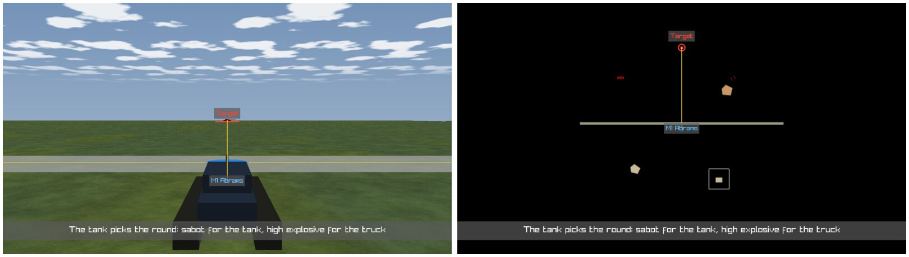

*What it shows (the FIRST still):* `ua-tank-ammo/main` played by the ONE pack's runner over a REAL live recording (`node_1.fdp`, 3607 frames, the take's scenario hash) in a
WINDOWED Replay Browser, both frames captured through the director's own sink with the runner's overlay (`FilmFrameSink.Frame(…, runner.OverlayNow)` —
the stills' path). The OPEN take (unsaved) was given three graphics from t − 1 (a red ring + *Target* on the Enemy Tank, a yellow arrow Tank → Enemy
Tank, a blue *M1 Abrams* label on the Tank) and a View item switching to the 2-D map at 9.4 s with a key pulling the camera up (follow Tank, 900 m).
**Left** (source 9.117 s): the 3-D over-the-shoulder shot — the M1's body, the T-72 on the horizon with its ring and caption, the arrow along the line of
fire, the label on the M1, the take's caption as the subtitle. **Right** (source 9.917 s): the 2-D map, centred on the Tank at the key's scale — the SAME
three graphics laid out through the 2-D camera (the ring small at 900 m, the arrow running north to it), the subtitle. *What looked wrong:* the 2-D
frame's ground is black and the units' 2-D symbols are missing — the capture does not see the gizmo buffer (CE-1380, with CE-1379); the first harness
run put the View item in a GAP between shots, where the camera is the next shot's, and filmed a 2-D map 50 px/m on the Enemy Tank — the harness now
places it inside shot 1. *How:* `DISPLAY=:99 HROT_FILM_PROOF=1 HROT_FILM_PROOF_RECORDING=<node_1.fdp> HROT_FILM_PROOF_OUT=<dir> dotnet test
Hrot/Subsystems/Hrot.ReplayBrowser.Tests --no-build --filter FullyQualifiedName~CE1305_P6_LiveProof` (`[Trait Category Manual]`).

**Rails** (each red-proved by a compiling mutation; the report lists mutation and message): `FilmDirectorTests.CE1304_P6_Views_RoundTrip_AndOldTakesStayWithout`
· `FilmDirectorTests.CE1304_P6_TheTakesLayers_ReadAsViews_AreWhatPlayedBefore` · `FilmDirectorTests.CE1305_P6_Graphics_RoundTrip_AndBadOnesAreNamed`
· `FilmDirectorTests.CE1305_P6_TheGraphicsAtATime_AndTheirLayoutOnAPicture` · `DirectorTracksTests.CE1304_P6_TheViewTrack_ShowsTheLayersPlayed_AddsMovesFlipsDeletes_AndUndoes`
· `DirectorTracksTests.CE1305_P6_TheGraphicsTrack_AddsMovesResizesDeletes_AndUndoes` · `DirectorRunnerTests.CE1304_P6_TheRunner_AppliesTheViewTrack_ThroughTheLayerOverride_AndTheMapMode`
· `DirectorRunnerTests.CE1305_P6_TheRunner_PutsTheGraphicsOnScreen_AtTheirFilmTime_OnTheirUnit` · `DirectorRunnerTests.CE1305_ACapturedFrame_IsHandedTheGraphics_WithTheSubtitle`
· `ReplayBrowserSubsystemTests.CE1304_P6_OnARecording_TheViewTrack_AndAGraphic_PlayThroughThePacksOwnSeams`. Unchanged and green: `CE1364_T4_*`, `CE1370_*`,
the CE-4038 reel rail (a take's `layers` still reach the override).

#### CE-1380 / CE-1379 as built *(ui, `2026-10-27` — the film's ONE pass in both modes, the scenario's graphics filmed, the person's map mode given back)*

**INVENTORY** *(graph + grep; ⚠ `check_index_coverage` is not available through the CLI, so no absence below is proven complete)*

| query | result ⇒ |
|---|---|
| `search_graph name_pattern=.*(DebugGizmoLayer\|SceneLayer\|FilmCapture\|MapCanvas\|GridMapLayer\|TerrainLayer2D\|LayerControlSets\|MapViewSwitch).* label=Class` (18, the `ui` index) + `label=Interface .*(SceneLayer\|MapLayer\|LayerOverride).*` (3: `IMapLayer`, `ISceneLayer`, `ILayerOverride`) | ONE canvas (`MapCanvas`: `Draw`, `DrawScene`), ONE marker for "the film draws me" (`ISceneLayer`: 5 implementers, all 3-D), ONE gizmo layer per map (`DebugGizmoLayer`, the buffer's only drawer), ONE layer authority (`LayerControlGizmo` + `LayerControlSets.SceneRows`), ONE 2-D ⇄ 3-D switch (`MapViewSwitch`) ⇒ nothing new to build beside them |
| `search_code DrawScene` (13) / `ISceneLayer` (13) · `grep -rn "AddLayer("` | `DrawScene`'s only caller is `FilmCaptureLayer.Serve`; every map host's layers come from `MapInteractionPack.AttachMapLayers` alone ⇒ one place to opt layers in |
| `search_code FilmStudio.Release` · `grep -n "_layers.Clear" DirectorRunner.cs` | the film's end (`EndItem`) and Stop (`EndRun`) both release the mailbox, beside `_layers.Clear()` — the layer restore; the map is put back by its reader (`FilmCaptureLayer.Direct`) when the mailbox is released |
| `grep -n "ClearBackground" Hrot FDP` · `TerrainPlan2D.Emit` | the window clears BLACK (`Hrot.ClusterRunner/Program.cs:707`); the 2-D plan skips open ground (`TerrainPlan2D.cs:47`, `Open ⇒ continue`) ⇒ the 2-D map has no ground colour on ANY host |

**Measured first — the screen** *(the live-proof harness now grabs the WINDOW's frame beside each capture: `2d-screen.png`, `3d-screen.png`)*. ⭐ The 2-D window
at the same moment is the capture to the pixel, bar the subtitle (the run plays without the cinema): the same black ground, the same terrain shapes, the
same graphics. ⇒ **CE-1380's diagnosis was wrong in two of three parts:** (a) the units' symbols WERE drawn — the 16 px floor of the 2-D renderer
(`DebugPrimitiveRenderer2D.cs:510`) on world-sized silhouettes, the M1's dark-blue outline under the film's own *M1 Abrams* label and the T-72 under the film's
own ring (the harness put both graphics on the units), the truck's red outline beside; (b) the black ground is the 2-D map's look everywhere (no open-ground
fill, a black window), and in a film the 2-D grid — the only thing drawn on empty ground — is off because a take starts clean (`Map.Grid` is not a scene
row). ⭐ What WAS wrong: the 2-D capture drew the WHOLE screen pass (`_canvas.Draw()`, `Film.cs` before this change) — cursor readout, stats HUD, the
selection ring, the UI panels' scheduling — while a 3-D capture drew no gizmo at all (`DrawScene` was 3-D-only and the gizmo layer not a scene layer:
CE-1379, and the screen's 3-D picture shows the roads' line the 3-D film lacked).

```mermaid
classDiagram
  direction LR
  class MapCanvas { <<exists, grown>> Draw() · DrawScene() both modes NEW · DrawLayers2D/3D(sceneOnly) · DrawOverlays(sceneOnly) }
  class RenderContext { <<exists, grown>> Film NEW }
  class ISceneLayer { <<exists>> the film draws me }
  class DebugGizmoLayer { <<exists, grown>> ISceneLayer NEW · FilmLayers NEW · InFilm(p, film) NEW }
  class TerrainLayer2D { <<exists>> ISceneLayer NEW }
  class GridMapLayer { <<exists>> ISceneLayer NEW }
  class LayerControlSets { <<exists, grown>> SceneRows + Map.TacticalGraphics, Command.Routes · FilmLayers NEW }
  class FilmCaptureLayer { <<exists, grown>> Serve → DrawScene in 2-D too · Direct keeps _personsMap NEW }
  class MapViewSwitch { <<exists>> Set(on, animate) }
  class MapInteractionPack { <<exists>> AttachMapLayers sets FilmLayers · gizmo layer after the 3-D terrain }
  DebugGizmoLayer ..|> ISceneLayer
  TerrainLayer2D ..|> ISceneLayer
  GridMapLayer ..|> ISceneLayer
  FilmCaptureLayer --> MapCanvas : DrawScene
  MapCanvas --> RenderContext : Film = sceneOnly
  MapInteractionPack --> DebugGizmoLayer : FilmLayers = LayerControlSets.FilmLayers
  FilmCaptureLayer --> MapViewSwitch : the person's mode back on release
```
*What the picture shows that prose hid:* no second renderer — the film is the screen's own two layer passes with a filter (`sceneOnly`), and the gizmo
buffer reaches a film through the layer that already draws it on screen, told by the context which of its primitives a film shows.

```mermaid
sequenceDiagram
  participant K as IFrameSink / FilmStudio.Capture
  participant C as FilmCaptureLayer.Serve
  participant M as MapCanvas.DrawScene
  participant G as DebugGizmoLayer
  participant R as DirectorRunner (EndItem / EndRun)
  K->>C: FilmCaptureRequest
  C->>M: DrawScene() (2-D or 3-D — the map's mode)
  M->>M: DrawLayers2D/3D(sceneOnly) — ISceneLayers only, ctx.Film = true
  M->>G: Draw / Draw3D(ctx) — FrameFor(ctx): InFilm(p, FilmLayers), no menus extracted
  M->>M: DrawOverlays(sceneOnly) — cards / labels the set turns on
  C->>C: FilmText.Graphics · Caption · the dip
  R->>R: FilmStudio.Release() · _layers.Clear()
  C->>C: Direct(): no shot ⇒ MapViewSwitch.Set(_personsMap) once, then forget it
```

**Decisions**

| # | decision | rejected — the one fact |
|---|---|---|
| **F1** | ⭐ ONE film pass: `MapCanvas.DrawScene` runs the SAME 2-D / 3-D layer loops as `Draw`, over the `ISceneLayer`s, plus their screen-space pass; `Serve` calls it in both modes | keep `_canvas.Draw()` for 2-D (V6) — films the cursor readout, the HUD and the selection ring; a second "film renderer" — two drawers of one map (ruling 9) |
| **F2** | the gizmo layer is a scene layer that, in a film's pass (`RenderContext.Film`), draws only `InFilm` primitives: anchors and the mask always, the UI (panels, menus, capture bindings) never, a drawn shape iff its layer bit is in `FilmLayers` | a per-gizmo "filmable" flag — 60+ projectors to touch; drawing the buffer from `FilmCaptureLayer` (the tracker's lean) — a second reader of the buffer beside the one that already resolves anchors, sorts and drapes |
| **F3** | `FilmLayers` = the bits the Layers panel toggles (`0 … LayerControlDto.FirstUntoggledLayer − 1`), set once in `AttachMapLayers` for every host; which of them a frame shows is the set in force (a take's start-clean override, or the person's) | the active mask alone — the selection (255) and the always-on bits sit above every row, so they would always be filmed |
| **F4** | the scenario's own drawing is SCENE: `SceneRows` + `Map.TacticalGraphics` (areas, overlay lines) + `Command.Routes` (route entities) — kept as the person has them when a take starts clean | leave them overlays — a take would have to name them to film the scenario's own picture (CE-1379's complaint) |
| **F5** | the 2-D plan (`TerrainLayer2D`) and grid (`GridMapLayer`) are scene layers, each still gated by its own row | grid always filmed — it is a helper; off in a clean take unless the take turns `Map.Grid` on |
| **F6** | the gizmo layer is attached AFTER the 3-D terrain (`AttachMapLayers`; the 2-D order is unchanged — the 3-D terrain draws nothing in 2-D): its ground fills draw with depth writes off (CE-1196 CA-4), so before the terrain they were painted over on every host's 3-D map — and so in every 3-D film (**CE-1384**, measured by the CE-1379 rail's anti-vacuity: the WINDOW showed no area) | depth writes on for fills — the CE-1196 flicker CA-4 removed |
| **V7** | ⭐ the person's map mode is taken when the film first holds the view and given back through the ONE switch when the mailbox is released — at the film's end and on Stop, the place the runner already clears the layer override; ⛔ not while the pilot view flies; a switch still landing finishes first | the runner remembering the mode — it never sees the map (`IDirectorHost` has no map), and a second owner of "which mode" beside the switch |
| **G6** | ⛔ the 2-D map's black ground is NOT a film defect — the window shows the same; a ground colour for the 2-D map is a look decision for every host → **CE-1381** | a film-only ground fill — a 2-D film would then differ from the 2-D map on screen |

**Known edges.** (1) Editor TOOL handles share layer 0 with the unit symbols (`DebugGizmoLayer` cannot tell them apart by layer), so an active tool's handles
would be filmed — the selection and the always-on bits are not (CE-1382). (2) The 2-D plan's and grid's culling read the WINDOW size
(`TerrainLayer2D.ViewOf`, `GridMapLayer.Draw`), so a capture LARGER than the window (supersampled stills) loses outlines, labels and grid lines toward its
right and bottom edges (CE-1383). (3) A reel item's end releases the mailbox, so between two 2-D items the map flips back for the frames before the
next item holds a shot — as the layers already do.

**Rails** (each red-proved by a compiling mutation; the report lists the message): `FilmFrameRail.CE1380_A2DFilmFrame_IsTheWindowsMap_TheGroundPlanAndTheUnitSymbol_AndNoToolSelectionOrHud`
(the production map over test-town: the 2-D film's ground plan ≥ 90 % of the window's non-background pixels, the unit's symbol from the production projector at
its projected position, no cyan clutter or selection — the window has both) · `FilmFrameRail.CE1379_AFilmFrame_DrawsTheScenariosTacticalGraphic_In3DAnd2D_AndNeverTheSelection`
· `DirectorRunnerTests.CE1304_P6_AFilmEndingIn2D_GivesThePersonTheirMapModeBack_AtItsEnd_AndOnStop` (a real runner over the fake editor and a real
`FilmCaptureLayer` on a headless map). Unchanged and green: `CE3289_AFilmFrame_IsTheSceneAlone_AtTheAskedSize`, `FilmTests.*`.

**The live still, regenerated** *(`2026-10-27`, the same harness, take, recording and moments as above; `docs/img/film-p6-graphics.jpg` replaced)* —
**left** (3-D, source 9.117 s): as before, plus what the window's 3-D map always showed and the old film lacked — the road under the M1 (its grey fill and
yellow centre line, `Map.Roads`, a scene row) and the M1's own symbol rim draped at its feet (`Units.Entities`); the fill shows because the gizmos now draw
after the 3-D terrain (F6). **Right** (2-D, source 9.917 s): unchanged in content, by design — it already was the 2-D window's picture: the road, the
terrain's two shapes and the walled plot, the truck's red outline (left) and the shot-up vehicle's red marks (right), the M1's dark-blue outline under the
film's *M1 Abrams* label and the T-72 under the film's ring; no cursor readout, HUD or selection (F1). The ground stays black because the 2-D map's is
(CE-1381). ⭐ **The window vs the film, the same 2-D moment** (`docs/img/film-p6-2d-window-vs-film.jpg`, the harness's `2d-screen.png` beside `2d.png`): the
same pixels but for the subtitle (the run plays without the cinema) and the graphics' text boxes, which are dark on black.


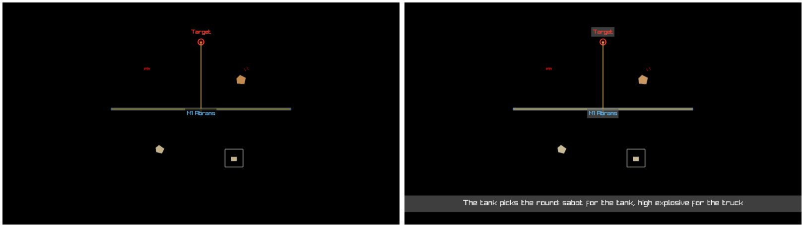
