<!--STATUS
state: LIVE
build-state: DESIGN — ⭐ APPROVED 2026-10-23 (R-4071: "looks good!") with three amendments the same day: anchors ARE the existing conditions (R-4072, TE-3 rewritten), the timeline is a central panel of its own (R-4073, TE-17), the recording's events are indexed and cached for a zoomable timeline (TE-4 rewritten, TE-18…TE-20). TE-3b approved (R-4074). TE-21 approved (R-4075): the Trace Timeline and this timeline are ONE panel. TE-22 approved 2026-10-25 (R-4076): the Behaviour group's four lanes over the brain's recorded histories (ui's handoff, BV-59). ⭐ HANDED to the ui lane: batches/HANDOFF_Coordinator_To_Ui_Director_Timeline.md
updated: 2026-10-25 (TE-22 approved, R-4076 — the Behaviour lanes Changes / Orders / Reports / Decisions; the exercise group "Orders" renamed Tasks) · 2026-10-23 (TE-21 approved, R-4075) · 2026-10-23 (third pass — TE-3b approved, R-4074; TE-21 added after finding the designed, unbuilt Trace Timeline; handed to ui) · 2026-10-23 (second pass — the approval and three amendments: §0, §2a, §2b, §4c, §5, §6, §7, §8) · 2026-10-23 (first version — coordinator, from the user's request and their answers the same day)
current-answer: ⭐ §9 R1 BUILD PLAN + §9a R1-a AS BUILT (2026-10-26, measured: D1 the browser seeks through FederatedReplayManager, D2/D3 the panel lives in Fdp.Presentation — TL-1…TL-7, slices R1-a…e) · §0 the rulings and leans · §1 the picture · §2 the workspace · §2a the timeline on every host · §2b the event index · §3 classes · §4 sequences · §5 the take format v2 · §6 phases · §7 claim table · §8 INVENTORY
stale-below: none
known-rot: §2a's ReplayBrowserTransportAdapter → ReplayBrowserContext.SeekToFrame and "TimelinePanel (NEW, Hrot.Presentation)" are overtaken by §9 D1 / D3 (TL-1, TL-2) · TE-4's first wording (a scout per take, AnchorBook watching the sandbox) and TE-3's first wording (three new anchor kinds) are SUPERSEDED the same day by the amended rows; nothing else quotes them
known-conflict: none
related-designs:
  - docs/DESIGN_Unit_Camera.md — the follow camera (orbit → shoulder → eyes) is a candidate shot type for the camera track
  - DESIGN_Film_Director.md — OWNS the take and reel formats, DirectorRunner, the stepping rule (R-3038), capture and the sound track; this design adds the EDITOR, the recording source, keys, tracks and promote. Its §3e / D-18 ("final films later from a recording") is the path this design builds
  - designs/replay-browser-2/DESIGN.md — OWNS the Replay Browser, its sandbox world (ReplayBrowserContext), its timeline panel and the headless RecordingSearchService whose frame-step loop the recording scout reuses (TE-4)
  - DESIGN_Scenario_Regression.md — OWNS the Verify mode and checks.json (the take anchor grammar extended); TE-10 adds still keys captured as regression artefacts
  - DESIGN_Agent_Shared_View.md — OWNS the /replay/* routes over one editor recording (R-1029) and the rule "a route only when no existing route answers" that TE-15 follows
  - DESIGN_Map_3D_Mode.md — OWNS the film camera (FilmStudio, FilmDirector, FilmCaptureLayer) on every map host and the 2-D ⇄ 3-D switch; §6b's finding "ReplayBrowser sets no TKB" is ruled here (R-4069)
  - DESIGN_Subsystem_Composition_Unification.md — OWNS "one catalogue per node" (§4.1ae.1, HrotNodeBuilder step 9) that TE-12 extends to the Replay Browser
  - designs/audio/DESIGN_FPS_Audio.md — OWNS the spatializer and the ear; TE-11 adds the rule for sound at a playback rate other than 1×
  - DESIGN_Terrain_Combat_Tuning.md — OWNS the map layers (§5e) a View track switches, through the film's transient override (R-4060)
  - blueprints/AI_Editor_Shared_Infrastructure.md — §15 OWNS the Trace Timeline (designed, a 50-line shell today: TraceTimelineWindow + ITraceLaneProvider); TE-21 makes it and this timeline ONE panel
  - DESIGN_Behaviour_Debugging.md — OWNS the ui lane's debugging workflow (CE-1270); the timeline's unit swimlanes and trace lanes serve it (TE-21)
  - DESIGN_Entity_Brain_View.md — OWNS the brain journal; its Trace Timeline lane (BV-30, deferred) becomes the timeline's Behaviour lane
  - Predicate-Infrastructure-Capabilities.md — OWNS the condition model this design's anchors ARE (SearchPredicateDto: DTOs, compiler, StructEdit editor and drawers, JSON) — R-4072. ⚠ its §6 row "enter the polygon" is a BOX (BoundingBox2D) today
  - designs/breakpoints-1/DESIGN.md — OWNS the data breakpoints that evaluate the same predicates LIVE and their editor (DataBreakpointManagerPanel / PredicateBuilderState)
  - blueprints/DESIGN_Time_Architecture.md — OWNS cluster replay and its seek (ClusterOpType.ReplaySeek, §11) and the transport facade (ITimeTransportFacade) the timeline's transport row drives (TE-19)
  - designs/mgmt-1/DESIGN.md — OWNS the exercise archive (`exercises/<id>/` with the .fdp files and Orchestrator.json, §12) that TE-13 keeps films' recordings in
-->

# Director timeline editor — cut films in the Replay Browser, from one recording

🔒 **User, 2026-10-23:** *"I would like to talk about how to edit director's cuts (existing feature to filming clips) and whether we
could use such an editor in the replay browser where the exercise is recorded and its time line is known and we could easily jump to
desired time and position a camera to suitable position and angle by flying it in 3d map and then record it as new camera keyframe in
the clip, selecting optional type if cut (camera flies smoothly to new location or jumps immediayely with some darkening/undarkening)"*
· *"Also including skipping unimportant part of the exercise, adding subtitles to the time line, adding switching 2d and 3d maps and
some tactical map graphics, composing reels from takes."*

🔒 **User, 2026-10-23 (on the proposal):**
- *"scouting (offline recording search) can still fill the time line so we can easily see where time to jump to."*
- *"takes can be recording specific but be also used for usual scenarios as now so it can be used with live scenarios"*
- *"maybe the camera keyframes could be time-relative to some known events (like this entity fired at this target, or ammo exploded in this area, or entity crossed this phase line/entered this area...) so that if the scenario execution timing changes later the take prescription could still hold."*
- *"some of camera key frames from such a prescription) could become automatic screenshots added to the overnight regression tests as an artifact documenting the test run."*
- *"replay browser of course need to load same type database as other hosts."*
- *"films can be made from single recording only (coming from editor usually)."*
- *"Audio layer in replay browser would be nice (just not idea how to handle faster or slower that real time modes)."*
- *"cool pls record it to a design document."*
- On the five decisions: *"extend Take with a source: yes, but allow the take produced on a recording to be used with live scenario"* (with *"storing takes for replay on different place next to the recordings and promote to scenario-take only as explicit operation?"*) · *"sounds correct, you decide"* (camera keys) · *"One shared timeline panel.: for sure. also "unifying and sharing" is desired wherever to avoid duplications"* · *"sure film only; tactiocal graphics in scenario is different story"*

🔒 **User, 2026-10-23:** *"TE-21 approved"*

🔒 **User, 2026-10-23 (third pass):** *"TE-3b approved, write the handoff to ui lane; tell them about the whole idea we are solving (pointing to designs); they are designong behavior debuggoing with lots of ui tasks so that they can include this one in ther plans"*

🔒 **User, 2026-10-23 (second pass):** *"looks good!"* · *"these should the already existing conditions editable using already existing conditions editor, ple reuse do not invent anything new, if something missing (area/line picking or drawing) we will extend"* · *"timeline is usefull regardless of director cut window and i guess it should become one of the most important central pieces of the replay browser as separate panel allowing for navigation.  (needs thinking how other hosts should use it, if it is part of director cut panel only there)"* · *"of course the recording scout needs to read the recorded events and cache them for fast timeline rendering - this part is important, there could be thousands of events and entities  etc so it needs smart choices to make it usable -and zoomable without clutter etc. - use your experience from other products"*

**Words used here.** A **key** is a camera keyframe: a time, a camera pose, and how the camera gets there. The **program** is the
film as cut (skips, speeds, cuts applied); the **source** is the raw recording or scenario run. The **pilot camera** is the one you fly
to author; the **program camera** is the one the film shows.

## 0. Rulings and leans

| # | | |
|---|---|---|
| ✅ **R-4067** | **A take names its source: a scenario (as today) or a recording. A film is made from ONE recording.** | user: decision 1 "yes"; "films can be made from single recording only" |
| ✅ **R-4068** | **One timeline panel and one runner on every host that plays a take: the editor and the Replay Browser. Unify and share; no second implementation.** | user: decision 3 |
| ✅ **R-4069** | **The Replay Browser loads the same type database (TKB) as every other host.** | user |
| ✅ **R-4070** | **Film graphics are film-only: stored in the take, drawn by the film, never written to a recording or a scenario.** Tactical graphics in a scenario are a separate subject | user: decision 5 |
| ✅ **R-4071** | **The director timeline editor is APPROVED** — the leans of this table, as amended below | user: *"looks good!"* |
| ✅ **R-4072** | **An anchor IS an existing condition — a `SearchPredicateDto`, edited in the existing StructEdit predicate editor. Nothing new is invented; what is missing (a polygon area, a line, picking or drawing them on the map) is an EXTENSION of that model and editor** | user, second pass |
| ✅ **R-4073** | **The timeline is a panel of its own — the Replay Browser's central navigation — useful without the director; the director adds its tracks to it. The recording's events are read once and cached so the timeline draws fast** | user, second pass |
| ⭐ **TE-2** *(decided, delegated)* | **The camera key is the unit.** A key = `at` + camera + transition in + fov + optional still. Today's `shots[]` read as keys (a shot → a cut key; its `to` → a fly key at the shot's end), so every seeded take keeps working | user: *"you decide"* |
| ⭐ TE-1 | **A recording's takes live beside the recording** (`exercises/<id>/takes/`). **Promote** is an explicit operation that copies a take to `scenarios/<s>/takes/`, drops `source`, and re-expresses each fixed-time key relative to the nearest marker before it (listed for you to confirm). ⭐ The reverse needs no operation: a scenario take plays on any recording of that scenario | rejected: a take with no source used everywhere — an unpromoted recording take would then sit in the scenario folder with recording-only times |
| ⭐ TE-3 *(amended, R-4072)* | **Keys are anchored to conditions.** `at` stays the anchor expression (`"blue-0.5"`); an anchor is **the n-th time a `SearchPredicateDto` becomes true** — stored as the predicate's own JSON (`$type` discriminator, as the breakpoint clipboard and the search presets already save it), edited by the StructEdit predicate editor (`ReplaySearchPanel` and `DataBreakpointManagerPanel` host it today). **Enter / leave an area exist** (`SpatialBoundingPredicateDto`, `BoundaryEvent.Entry / Exit`, a map-picked box). ⭐ **Extensions, of that model only:** a polygon area and a line crossing (with a side) as spatial predicates, and drawing them on the map beside the existing box picker (`BoundingBoxFieldDrawer` → `ISpatialPickerContext`) | rejected: new anchor kinds `cross` / `enter` / `leave` (the first wording) — a parallel condition vocabulary |
| ✅ TE-3b — **R-4074** | **The nine existing anchor shorthands** (`shot`, `blast`, `hit`, `near`, `task`, `side`, `health`, `embark`, `gesture` — `Take.cs:129`, also used by `checks.json`) **are read as shorthands that LOWER to predicates**, so one evaluator answers every anchor and check. A shorthand that does not lower is a missing predicate to add, not a kind to keep. ⛔ Each lowering is measured in R0 ⑦ before it is built | keep the nine as a second vocabulary: two evaluators (AnchorBook and the compiler) that can disagree |
| ⭐ TE-4 *(amended)* | **The scout is the recording's INDEX, built once per recording, not per take** (§2b). It runs **automatically the first time a recording is opened** in any host, in the background, filling the timeline as it goes, and is cached beside the recording; every later open reads the cache (milliseconds). A take's anchors are QUERIES over the index; a predicate the index cannot answer (a new area drawn later) runs one targeted pass of the search service, narrowed by the index's position track, and its hits are added to the cache | rejected: scouting on every open (minutes per open on a long recording) · scouting per take (the same scan repeated for every take) |
| ⭐ TE-5 | **The runner moves to the shared assembly.** `DirectorRunner` and `DirectorWindow` move from `Hrot.Editor/Director` to `Hrot.Presentation/Map3D/Director` (their usings are already only director, window-manager and ImGui types). A new `ReplayDirectorHost : IDirectorHost` plays a recording; `IDirectorHost` gains `Seek` / `CanSeek` (default not supported, like `WriteCheckpoint`) | rejected: a replay copy of the runner — R-4068 |
| ⭐ TE-6 | **The program is one pure function:** `TakeTimeline.ProgramAt(filmTime)` → source time, camera pose, fade, subtitles, view, graphics, audio rate. The panel's scrub, the runner, capture and the regression stills all call it | rejected: the panel computing its own preview — it would drift from the film |
| ⭐ TE-7 | **Skips and speeds are the Time track**: segments kept at a speed (0.25× … 8×); a gap is crossed by a cut, a dip, or a fast-forward with an on-screen clock (*"+12 min"*). On a recording a skip is a seek. ⚠ On a scenario source a skip still steps one step per frame (R-3038), so it costs wall time: it shows a card, and long skips are why films come from recordings | — |
| ⭐ TE-8 | **Transitions: cut · fly (a smooth path through consecutive fly keys, eased) · dip (to black or a colour and back, two durations).** Crossfade later: it needs two renders | — |
| ⭐ TE-9 | **Graphics track** (R-4070): arrow, ring on a unit, route line, area, label, each with in/out and fade, drawn by a film overlay layer that reuses the tactical-graphic drawing (⛔ which class draws it: measure in R0) | — |
| ⭐ TE-10 | **Still keys become regression artefacts.** A key with `"still": "<name>"` is captured as a PNG by the Verify run (`DESIGN_Scenario_Regression.md`) into its report folder. An artefact that documents the run, ⛔ not a gate (no image comparison) | rejected: a separate screenshot list — the camera would be authored twice |
| ⭐ TE-11 | **Sound at any rate, one rule live and offline:** an event sound (shot, blast) starts at its film time at natural pitch; a continuous sound (engine) plays at natural pitch; above 2× only detonations sound, ducked; paused is silent. The offline track (`SoundTrack.RenderWav`) already maps each cue to film time, so it follows the same rule | rejected: resampling the mix (chipmunk / drone) · silence at every rate but 1× |
| ⭐ TE-12 | **The TKB (R-4069) is made the way every node makes it:** `HrotEnvironment.CreateTkb()` set as the world singleton (`HrotNodeBuilder.cs:262`), filled by the same knowledge-base load step from the recording's scenario (named in the exercise's `Orchestrator.json`) | rejected: a Replay Browser-only loader — a second catalogue path (CE-4013 D4/D5 removed four) |
| ⭐ TE-13 | **A film's recording is kept in the exercise archive layout** (`exercises/<id>/` with its `.fdp`, `Orchestrator.json` and the archived scenario). An editor run writes `/tmp/FDP_Temp/exercises/<id>/`; **"Keep for films"** copies it into the archive, and its takes live there | ⛔ whether an editor run is archived today: measure in R0 |
| ⭐ TE-14 | **Undo/redo is a snapshot of the take per edit**, kept by one of the four existing undo stacks (Blueprints `CommandHistory`, the two `GizmoUndoStack`s, NodeEditor `UndoStack`). ⛔ No fifth | — |
| ⭐ TE-15 | **HTTP** (R-1029's rule: a route only when none answers): the existing `/director/take`, `/director/play` and `/director/scout` take `recording=` beside `scenario=`; one new `POST /director/promote`. The MCP catalog is regenerated in the same commit (R-1030) | — |
| ⭐ TE-17 *(R-4073)* | **One Timeline panel, shared by every host** (`Hrot.Presentation`), over an `ITimelineSource`: the **recording** source (the index; seekable) and the **live** source (the same extractors run on the live world each frame, appended; history only). It **replaces** the Replay Browser's scrubber row (`ReplayTimelinePanel` keeps its export options). The director window becomes bin + inspector; its tracks are **contributed** to the Timeline when a take is open (§2a) | rejected: the timeline inside the director window (the user: useful without it) · a second scrubber beside the old one |
| ⭐ TE-18 | **Draw cost follows pixels, not events** (§2b): a level-of-detail pyramid per lane (counts, top priority, one representative per bucket) like an audio editor's peak file or a map's tiles; density strips when crowded, glyphs when sparse, clusters with a count, priority on top | rejected: drawing every event (thousands per lane per pixel when zoomed out) |
| ⭐ TE-19 | **One transport for every host:** `ITimeTransportFacade` gains `CanSeek` + `Seek(t)`. Replay Browser: a new adapter over `ReplayBrowserContext`; cluster replay: the existing `ClusterOpType.ReplaySeek` round; editor and live cluster: `CanSeek = false` (R-3034: never rewind) — the past is a history to read | rejected: the timeline calling each host's seek itself |
| ⭐ TE-20 | **The event list reads the same index.** The shared Event Browser (`EventBrowserPanel`) shows the index around the playhead in a recording, so the list and the timeline cannot disagree | rejected: a second scan for the list |
| ✅ TE-21 — **R-4075** | **The Trace Timeline IS this timeline.** `AI_Editor_Shared_Infrastructure.md` §15 designed a shared, swim-lane timeline for the selected unit (lanes registered by `ITraceLaneProvider`, scrub in replay, click jumps, hover tooltip, right-click *Set Breakpoint Here*, a search box that dims); it is built only as a shell (`TraceTimelineWindow`, 50 lines, *"No trace data."*), and its first lane was deferred (BV-30). ⇒ **ONE panel:** `TimelinePanel` is §15 grown — the exercise lanes from the index, plus a pinned unit's swimlane whose rows are its trace lanes; **the row seam is the existing `ITraceLaneProvider`, generalised** (the director's tracks and search hits register through it); the `ITimelineTrackProvider` of the second pass is WITHDRAWN. `TraceTimelineWindow` becomes a host of the shared panel in the AI perspectives | rejected: two timelines (an exercise one and a trace one) — the same time axis, scrub and seek twice |
| ✅ TE-22 — **R-4076** | **The Behaviour lane group reads the brain's recorded histories** (🔒 user, `2026-10-25`: *"approve all 5"*; asked by ui, [handoff](blueprints/batches/HANDOFF_Ui_To_Coordinator_Timeline_Behaviour_History.md), BV-59). ① **four lanes**, one per source — **Changes** (`BrainJournal`, the entry's kind as glyph), **Orders** (`CommandOrderHistory`, sent and received, the why in the hover), **Reports** (`CommandReportHistory`, in and out, with fate), **Decisions** (a `UtilityDecisionLog` winner switch) · ② the index **diffs each ring frame to frame and emits only NEW entries**, keyed by the entry's own counter (`BrainJournal.Seq`; a history entry's time + counterpart), so a ring's eviction never loses an event the index took · ③ a Brain-tab row's *Seek here* calls the timeline's `Seek(time, unit)` (TE-19's transport); absent live · ④ the four lanes live on the **pinned unit's swimlane** (TE-21); Orders / Reports only on a commander · ⑤ *"where he changes his mind"* is the existing `BrainJournalBreak.Condition` in the ONE condition editor (R-4072), its hits on the Behaviour lanes. ⭐ The exercise-level group formerly called **Orders** (a unit's `MissionPlan` task states) is renamed **Tasks** — 🔒 user: *"Missions"* clashes with the mission-plan concept; two "Orders" would clash with ①. Built by ui with R1 (CE-1302) | rejected: one mixed Behaviour lane (a commander's traffic drowns his own changes) · re-reading every ring every frame (one entry emitted 32 times) · the tab driving `PlaybackController` (a second seek path) · every unit's lanes at once · a timeline-only filter |
| ⭐ TE-16 | **Reels are unchanged**; an item may name `{recording, take}`. The reel composer is the bin plus a sequence row in the same panel (reorder, trim, transition per item) | — |

## 1. The picture — who calls what each frame

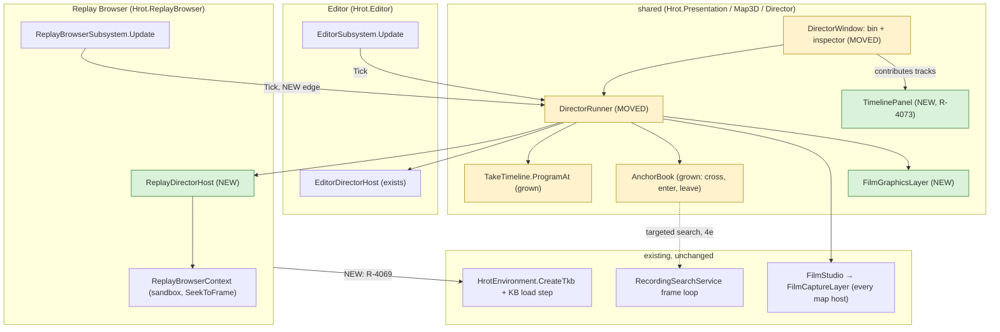

*What the picture shows that prose hid: there is still ONE runner and ONE camera path. The only new frame edge is the Replay Browser
ticking the runner; everything a film needs below the runner already exists on every map host. The dotted edge is a reuse of the
search service's stepping loop, not of its predicates.*

## 2. The workspace

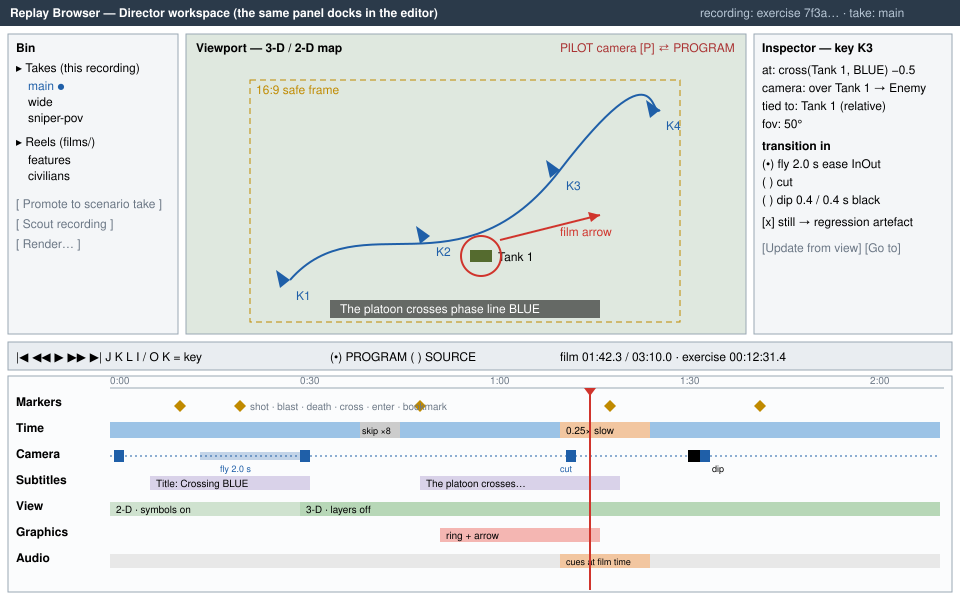

| track | holds | key operations |
|---|---|---|
| **Markers** | the scout's events + bookmarks (TE-4) | snap target; double-click jumps there |
| **Time** | kept segments, their speed, how each gap is crossed (TE-7) | ripple delete, speed, skip style |
| **Camera** | keys (TE-2) with their transition in (TE-8) | **K** adds a key from the pilot camera; update from view; go to key; tie to the selected unit (stored relative, so it follows a moving vehicle); path preview in 3-D |
| **Subtitles** | caption · title card · unit label · exercise-clock stamp; position; fade | the old per-shot `caption` reads as one item |
| **View** | 2-D ⇄ 3-D (the existing animated switch) and layer presets | through the transient override (R-4060) |
| **Graphics** | arrow, ring, route, area, label (TE-9) | drawn in world space, in/out, fade |
| **Audio** | on/off and gain per segment; cues at film time (TE-11) | music and voice-over later |

**Practical must-haves** (from Unreal Sequencer, Resolve, and the replay editors of racing and shooter games): pilot ⇄ program camera on
one key · keys tied to a unit · J/K/L shuttle, frame step, I/O · snapping · copy/paste/nudge keys · lock/mute/solo a track · undo/redo
and autosave (TE-14) · 16:9 safe frame, letterbox, thirds · film length and exercise clock · **shot templates from a marker**
(right-click a shot → over the shooter 0.5 s before, then the target, then the result; reuses D-10's draft rules) · a key whose unit is
gone holds its last pose · validation lists missing units and a stale recording.

## 2a. The timeline — a panel of its own, on every host (R-4073, TE-17, TE-19)

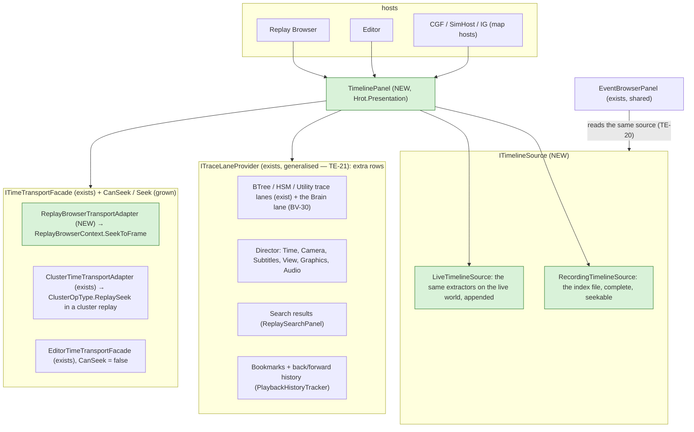

*What the picture shows that prose hid: the timeline knows nothing about any host. A host chooses a source and a transport; the
director, the search, the bookmarks and a unit's trace lanes are only extra rows (TE-21). That is what lets the Replay Browser make it central while the editor and
the cluster hosts show the same panel.*

| host · mode | source | seek | a click in the past |
|---|---|---|---|
| ⭐ **Replay Browser** | recording (the index) | ✅ local sandbox | seeks |
| **a node in a cluster REPLAY** | recording (its own `.fdp`, the same index) | ✅ through the master's `ReplaySeek` round | seeks the cluster |
| **editor preview, a live cluster** | live (appended) | ⛔ never rewind (R-3034) | shows the event; "Open in Replay Browser" when the run was recorded |
| **editor, a director take playing** | live + the take's tracks | ⛔ | the director's own controls (Play / Next) |

## 2b. The event index — read once, cached, drawn by pixels (TE-4, TE-18, TE-20)

**What goes in.** One background pass over the recording, on the search service's own isolated context (replay-browser-2's isolation
invariant: the GUI's sandbox is never touched, so a background thread is safe here):

| lane group | lanes | read from |
|---|---|---|
| **Combat** | shots, hits, detonations | recorded transient events (the event scanner, `IEventScannerCompiler`) — ⛔ which event types are recorded: R0 ② |
| **Life** | spawned, killed / destroyed | lifecycle (`GetDestructionLog`) and `Health` crossing zero |
| **Behaviour** *(TE-22)* | **Changes** · **Orders** · **Reports** · **Decisions** — per pinned unit; Orders / Reports on a commander only | `BrainJournal` (new `Seq`) · `CommandOrderHistory` · `CommandReportHistory` (newest entry changed; key = time + counterpart) · `UtilityDecisionLog` (winner switch) — all recorded (CE-1319); `BehaviorState` changes for a unit with no brain |
| **Movement** | area entries / exits, line crossings | each entity's **position track** (below) against the scenario's areas and lines |
| **Tasks** *(was "Orders", renamed by TE-22)* | a unit's mission-plan tasks: active, done, failed, skipped | `MissionPlan.Tasks[].State` (`eTaskState`) changes |
| *rows added by providers* | search hits, bookmarks, the director's tracks | §2a |

**What the cache holds** — a sidecar beside the recording (`<recording>.timeline`), invalidated by its header (the recording's size,
its last frame's ticks, the index schema version):

| table | per row | why |
|---|---|---|
| **events** | frame, lane, subject id, other id, x, y, one value | the glyphs, the tooltips, the queries — columns, so a lane is one contiguous array |
| **entities** | network id, name, type, side, spawn and despawn frame | names and side colours without opening the recording |
| **position track** | per entity, one sample per second, quantised | a NEW area or line is answered from the cache, then refined by a short local scan from the nearest keyframe (≤ 1 s) — no full rescan |
| **pyramid** | per lane, per level (each level halves the resolution): count, top priority, one representative event | drawing costs pixels × lanes, never events |

📐 Sizes are estimates to measure in R0 ⑧: an hour at 60 Hz is 216 000 frames; 100 000 events × ~24 bytes ≈ 2.4 MB; 1 000 entities ×
3 600 position samples × 8 bytes ≈ 29 MB (moving entities only, delta-coded, is much less).

**How it draws without clutter** — what works in Perfetto/Tracy (profilers), audio editors (peak files), video editors (marker
lanes), Grafana (annotations) and game replay timelines (kill markers):

| rule | |
|---|---|
| **density when crowded, glyphs when sparse** | more than ~1 event per pixel ⇒ a density strip (log-scaled intensity, side colour); fewer ⇒ an icon per event |
| **cluster, never overlap** | glyphs closer than their width merge into one with a count (*×37*); its tooltip lists them grouped by kind |
| **priority on top** | death > detonation > hit > shot > behaviour > movement; a cluster shows its highest |
| **collapsible lane groups** | Combat, Life, Behaviour, Movement, Tasks; collapsed, a group is ONE density strip |
| **focus, not filter** | "selected unit" dims every other event instead of hiding it, so context stays; a pinned unit gets its own swimlane (alive span, its shots, hits taken, behaviour bars, like a Gantt row) |
| **the overview strip** | the whole recording always visible above, with the zoomed window as a bracket you drag |
| **zoom about the cursor** | Ctrl+wheel; drag to pan; drag on the ruler to zoom to a range; the ruler's ticks adapt (hours … frames) with the exercise clock |
| **jump, don't hunt** | next / previous event in the lane under the cursor; a search box filters lanes from the index, not the file |
| **progressive** | while scanning, the scanned part is drawn and the rest shaded; the timeline is usable from the first second |

📐 **Budgets** (to hold in R1): the timeline draws in < 1 ms per frame at any zoom; a cached index opens in < 200 ms for an hour;
the first scan's rate is measured in R0 ⑧ — it bounds how soon the first open is useful, not whether.

## 3. Classes

```mermaid
classDiagram
  class Take { <<exists, grown>> +Source Source +List~CameraKey~ Keys +List~Segment~ Segments +List~Subtitle~ Subtitles +List~ViewChange~ Views +List~FilmGraphic~ Graphics +shots read as keys }
  class Source { <<NEW>> +string? Scenario +string? Recording +string ScenarioHash }
  class CameraKey { <<NEW>> +AtExpr At +CameraSpec Camera +Transition In +float? Fov +string? Still }
  class Transition { <<NEW>> Cut · Fly(seconds, Ease) · Dip(out, in, colour) }
  class Segment { <<NEW>> +AtExpr From +AtExpr To +double Speed +GapStyle Gap }
  class Subtitle { <<NEW>> +AtExpr At +AtExpr Until +string Text +SubtitleStyle Style }
  class ViewChange { <<NEW>> +AtExpr At +bool? Map3D +LayerChange Layers }
  class FilmGraphic { <<NEW>> +AtExpr At +AtExpr Until +GraphicKind Kind +points or unit +Style }
  class CameraSpec { <<exists>> follow · over-toward · lookAt · eye-target }
  class AtExpr { <<exists>> }
  class AnchorSpec { <<exists, grown>> +When SearchPredicateDto +N · nine shorthands lower to predicates (TE-3b) }
  class AnchorBook { <<exists, grown>> +Observe(world, units, t) +TimeOf(anchor) +Markers() }
  class TakeTimeline { <<exists, grown>> +ProgramAt(filmTime) ProgramFrame +FilmLength }
  class ProgramFrame { <<NEW>> +double SourceTime +FilmShot Pose +float Fade +subtitles +view +graphics +double AudioRate }
  class TakeStore { <<exists, grown>> +TakesOf(recording) +Promote(take, scenario) PromoteReport }
  class DirectorRunner { <<exists, MOVED>> +Play() +Tick() +Seek(filmTime) }
  class IDirectorHost { <<exists, grown>> +bool CanSeek +Seek(sourceTime) }
  class EditorDirectorHost { <<exists>> CanSeek = false }
  class ReplayDirectorHost { <<NEW>> over ReplayBrowserContext }
  class ReplayBrowserContext { <<exists>> +SeekToFrame(i) }
  class RecordingSearchService { <<exists>> frame-step loop }
  class DirectorWindow { <<exists, MOVED, grown>> bin · inspector · the director's track provider }
  class TimelinePanel { <<NEW, R-4073>> lanes · overview · zoom · transport row }
  class ITimelineSource { <<NEW>> +Extent +Lanes +Pyramid(lane, level) +Events(lane, range) +Progress }
  class RecordingTimelineSource { <<NEW>> over the index file }
  class LiveTimelineSource { <<NEW>> the extractors on the live world, appended }
  class TimelineIndexBuilder { <<NEW>> one pass, its own context; writes the sidecar }
  class EventExtractors { <<NEW>> shot · hit · blast · death · behaviour · movement · orders }
  class ITraceLaneProvider { <<exists, generalised — TE-21>> +Lanes +rows for a range }
  class TraceTimelineWindow { <<exists, a shell>> hosts TimelinePanel in the AI perspectives }
  class ITimeTransportFacade { <<exists, grown>> +bool CanSeek +Seek(t) }
  class SearchPredicateDto { <<exists — R-4072>> the anchor's condition }
  class PredicateCompiler { <<exists>> }
  class FilmGraphicsLayer { <<NEW>> draws ProgramFrame.graphics }
  class FilmStudio { <<exists>> +Direct(FilmShot) +Capture() }
  class ShotEvaluator { <<exists>> +Evaluate(spec, t, world) FilmShot }
  class UndoStack { <<exists — one of four, TE-14>> }

  Take *-- Source
  Take "1" *-- "many" CameraKey
  Take *-- Segment
  Take *-- Subtitle
  Take *-- ViewChange
  Take *-- FilmGraphic
  CameraKey *-- CameraSpec
  CameraKey *-- Transition
  CameraKey ..> AtExpr
  AtExpr ..> AnchorBook : resolved by
  AnchorBook ..> AnchorSpec
  TakeTimeline ..> Take
  TakeTimeline ..> ShotEvaluator
  TakeTimeline --> ProgramFrame
  DirectorRunner --> TakeTimeline
  DirectorRunner --> IDirectorHost
  DirectorRunner --> FilmStudio
  DirectorRunner --> FilmGraphicsLayer
  EditorDirectorHost ..|> IDirectorHost
  ReplayDirectorHost ..|> IDirectorHost
  ReplayDirectorHost --> ReplayBrowserContext
  DirectorWindow --> DirectorRunner
  DirectorWindow --> TakeStore
  DirectorWindow --> UndoStack
  DirectorWindow ..|> ITraceLaneProvider
  TraceTimelineWindow --> TimelinePanel
  TimelinePanel --> ITimelineSource
  TimelinePanel --> ITraceLaneProvider
  TimelinePanel --> ITimeTransportFacade
  RecordingTimelineSource ..|> ITimelineSource
  LiveTimelineSource ..|> ITimelineSource
  TimelineIndexBuilder --> EventExtractors
  LiveTimelineSource --> EventExtractors
  TimelineIndexBuilder ..> RecordingSearchService : steps with its loop
  AnchorSpec ..> SearchPredicateDto : IS one (R-4072)
  AnchorBook ..> RecordingTimelineSource : answers from the index first
  AnchorBook ..> PredicateCompiler
```

*What the class picture forces: every new type is DATA in the take, plus one host and one layer. The pose maths stays in
`ShotEvaluator`, the anchors in `AnchorBook`, the timing in `TakeTimeline` — each grows, none is copied.*

## 4. Sequences

### 4a. Author a key — fly, press K

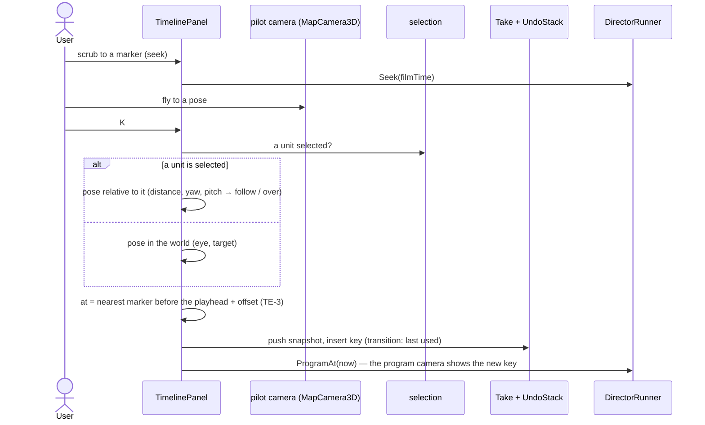

### 4b. One program frame, from a recording

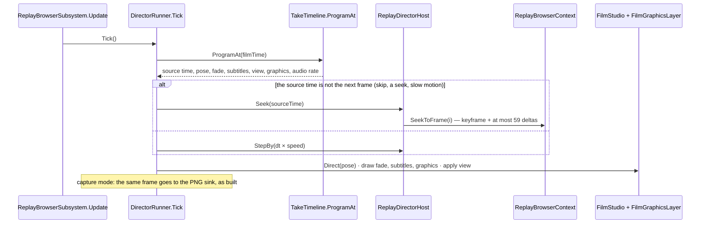

### 4c. Open a recording — the index, built once, then cached (TE-4)

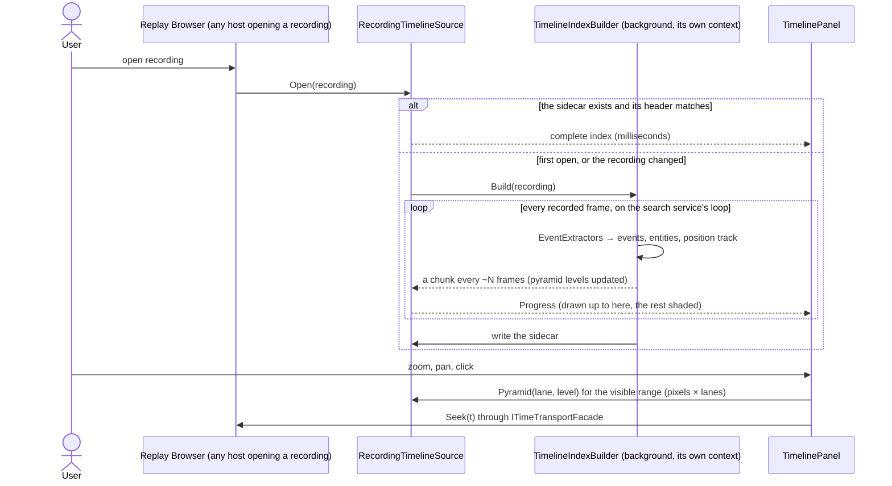

*What the sequence shows: the expensive pass happens once per recording; every take, search lane and later open reuses it. The GUI's
sandbox is never touched while it runs.*

### 4e. A take's anchor that the index cannot answer yet

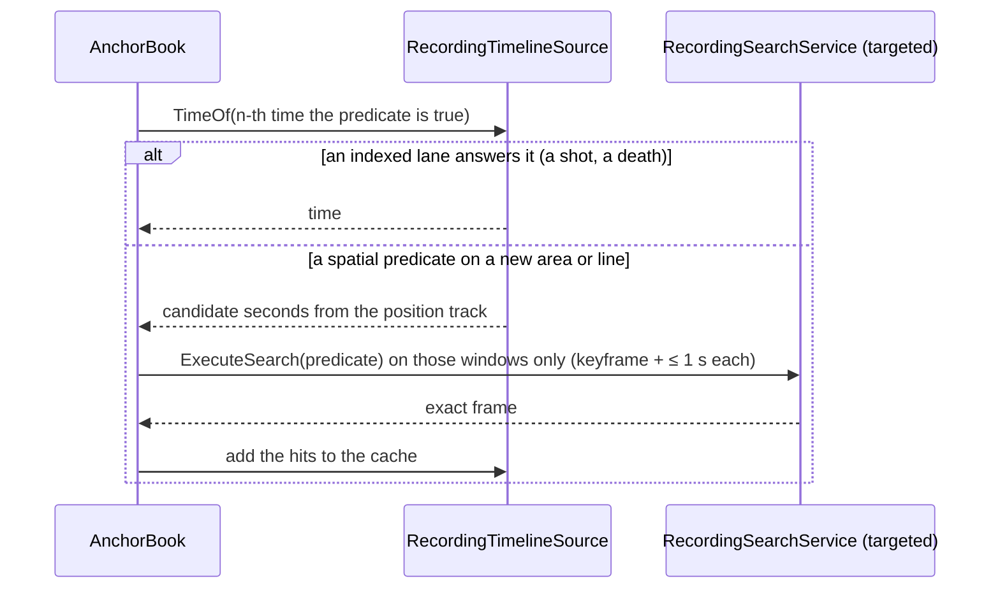

### 4d. Promote a recording take to a scenario take

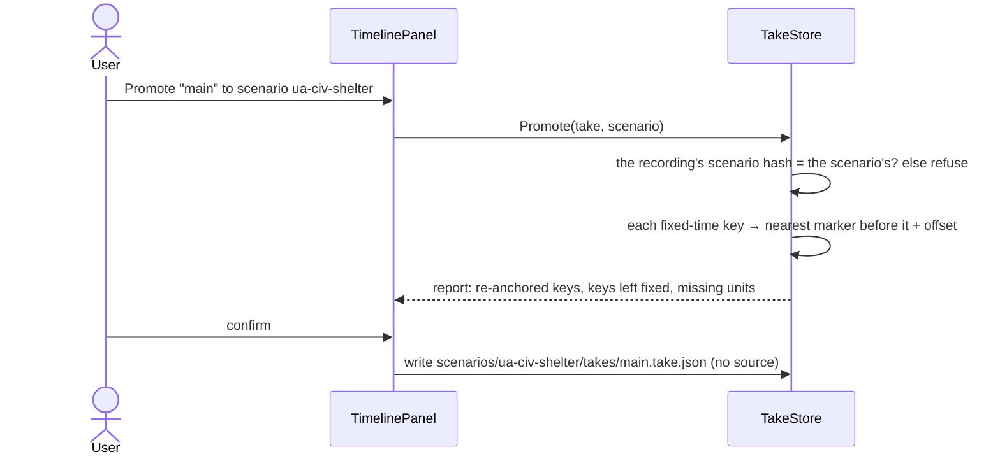

## 5. The take format, v2

```json
{
  "source": {"recording": "7f3a…", "scenarioHash": "…"},
  "anchors": {"fire": {"on": "shot", "who": "Tank 1", "n": 1},
              "blue": {"n": 1, "when": {"$type": "SpatialBounding", "TriggerEvent": "Entry",
                                        "Bounds": {"Min": [180, 40], "Max": [260, 90]}, "…": "the predicate's own JSON"}}},
  "segments": [{"from": 0, "to": "blue-5", "speed": 1},
               {"from": "fire-1", "to": "fire+3", "speed": 0.25, "gap": "dip"}],
  "keys": [
    {"at": "blue-5", "lookAt": [105, 75, 1], "distance": 60, "pitch": -30, "in": "cut"},
    {"at": "blue-0.5", "over": "Tank 1", "toward": "Enemy", "in": {"fly": 2, "ease": "inOut"}, "still": "crossing"},
    {"at": "fire+1", "follow": "Enemy", "distance": 12, "in": {"dip": [0.4, 0.4]}}
  ],
  "subtitles": [{"at": "blue-4", "until": "blue", "text": "The platoon crosses phase line BLUE"}],
  "views": [{"at": 0, "map": "2d", "layers": {"on": ["Units.Cards"]}}, {"at": "blue-5", "map": "3d", "layers": {"off": ["Units.Cards"]}}],
  "graphics": [{"at": "fire-1", "until": "fire+3", "kind": "ring", "who": "Enemy"}]
}
```

A scenario take is the same with `source` absent. ⭐ `shots[]` is still read; the editor writes `keys[]`. ⭐ `"on": "shot"` is a shorthand that lowers to a predicate (TE-3b); `when` holds any predicate, written by the existing editor (R-4072). A line crossing is the extension TE-3 names; until it exists, an area entry is the box above.

## 6. Phases and acceptance

| phase | builds | accepted when |
|---|---|---|
| **R0** *(measure)* | ① a recording plays back faithfully (types, effects, deaths, poses, doors) · ② which events a recording holds (shots, hits, blasts as recorded transient events? `ShotLog` / `DetonationLog` live beside the live world only) · ③ the TKB from the recording's scenario (TE-12) · ④ sound sources in replay · ⑤ is an editor run archived (TE-13) · ⑥ which class draws tactical graphics (TE-9) · ⑦ each of the nine anchor shorthands as a predicate (TE-3b) · ⑧ the scan rate of the search service's loop and the index's size on a real hour | a report per item, each with its file:line; the TKB loaded in the Replay Browser |
| **R1** ⭐ *(the timeline first — useful without the director, R-4073)* | `TimelineIndexBuilder` + extractors + the sidecar · `ITimelineSource` (recording, live) · `TimelinePanel` with the rules of §2b · `ITimeTransportFacade.CanSeek / Seek` and the Replay Browser adapter · the Event Browser on the index | an hour's recording opens with its timeline filling progressively; the second open is instant; zoomed out it draws densities, zoomed in glyphs, < 1 ms per frame; a click seeks |
| **R2** | format v2 + `shots[]` as keys · `ProgramAt` · move the runner and window (TE-5) · `ReplayDirectorHost` · the director's tracks (Time, Camera) on the Timeline, K, cut / fly / dip · undo · anchors as predicates in the existing editor (R-4072) | a recording take plays in the Replay Browser with skips, slow motion and the three transitions; the same take's keys play in the editor |
| **R2b** | Subtitles and View tracks · promote · the predicate extensions (polygon area, line crossing, drawing them on the map) | a take authored on a recording, promoted, plays on a fresh editor run of its scenario with every condition-anchored key on its event |
| **R3** | Graphics track + `FilmGraphicsLayer` · shot templates · audio at any rate (TE-11) · still keys in Verify (TE-10) | a regression run writes a PNG per still key; slow motion sounds as TE-11 says |
| **R4** | reel composer · render queue · HTTP (TE-15) + MCP catalog | a reel of two recording takes renders to one movie with sound |

## 7. Claim table — what the leans rest on

| claim | code — how it IS | design — how it was MEANT |
|---|---|---|
| a recording plays back faithfully | ⛔ not tried (user) | ⛔ `DESIGN_Film_Director.md` §3e: *"that slice starts by measuring both"* ⇒ R0 ① |
| the Replay Browser sets no TKB | ✅ no `ITkbDatabase` in `ReplayBrowserSubsystem.cs`; the node builder sets it at `HrotNodeBuilder.cs:262` | ✅ `DESIGN_Map_3D_Mode.md` (§6b, the finding) · ruled R-4069 |
| the runner can move to the shared assembly | ✅ `DirectorRunner.cs` usings: `Hrot.UI.Common.Map3D(.Director)` only; `DirectorWindow.cs`: + `Fdp.Presentation.WindowManager`, ImGui | ✅ R-4068 |
| the host seam takes a replay host | ✅ `IDirectorHost` (`DirectorHost.cs:13`): World, StepBy, SimTime, Hold, Pause…; optional members already default to NotSupported (`WriteCheckpoint`, `:53`) | ✅ `DESIGN_Film_Director.md` §8.1 (every editor dependency behind an interface) |
| every map host carries the film camera, the Replay Browser too | ✅ `MapInteractionPack.cs:539` (`FilmCaptureLayer`, every host) | ✅ `DESIGN_Map_3D_Mode.md` §6ab, §6b |
| the audio layer is on every map host | ✅ `MapInteractionPack.cs:533` (`AudioLayer.For`, given the host's TKB) | ✅ `designs/audio/DESIGN_FPS_Audio.md`; R-4059 |
| a seek is cheap | ✅ a keyframe every 60 frames (`RecorderTickSystem.cs:21`) | ✅ replay-browser-2 §4.2 |
| a headless frame loop over a recording exists, isolated from the GUI | ✅ `RecordingSearchService` | ✅ replay-browser-2 §1 isolation invariants, §6.3 |
| anchors already carry events + offsets | ✅ `AtExpr`, `AnchorSpec.Kinds` (shot, blast, hit, near, task, side, health, embark, gesture — `Take.cs:129`) | ✅ `DESIGN_Film_Director.md` §4, `DESIGN_Scenario_Regression.md` (checks.json reuses it) |
| a recording names its scenario | ✅ an archived exercise's `Orchestrator.json` carries the scenario id (`AssetInventoryProcessManager.cs:265`) · ⛔ an editor run's temp folder: not measured | ✅ mgmt-1 §12 · ⛔ R0 ⑤ |
| the anchors can be resolved from a recording | ⛔ `AnchorBook` reads `ShotLog` / `DetonationLog`, kept beside the LIVE world (`DESIGN_Film_Director.md` §8.3) — in a replay sandbox: not measured | ⛔ R0 ② — ⚠ load-bearing for the Combat lanes; the index reads RECORDED events (the event scanner), which is why it is the source and not AnchorBook's logs |
| the existing condition model is one, shared, editable and serialisable | ✅ `SearchPredicateDto` (`SearchPredicateDto.cs`, `$type` discriminators) used by data breakpoints (`Hrot.Diagnostics.Breakpoints`), Replay Browser search, `/replay/search`, BTree/HSM/Blueprint breakpoint menus; StructEdit editor hosted by `ReplaySearchPanel` and `DataBreakpointManagerPanel` | ✅ `Predicate-Infrastructure-Capabilities.md` §1–§5 · R-4072 |
| enter / leave an area exists; a polygon and a line do not | ✅ `SpatialBoundingPredicateDto` + `BoundaryEvent { Entry, Exit, EntryOrExit }` over a `BoundingBox2D` (`SearchPredicateDto.cs:161-183`), picked with `[MapPickableBoundingBox]` · ⛔ no polygon, no line predicate found (graph + grep; coverage not checkable) | ⚠ the capabilities doc §6 calls the box "the polygon" — it is a box |
| the predicates evaluate both on a recording and live | ✅ `RecordingSearchService` (recording) · `DataBreakpointManager` (live, per tick) | ✅ capabilities doc §3.3 |
| no event index or cache of a recording exists | ✅ `PlaybackController` keeps only an in-memory FRAME index (`_frameIndex`: offsets, wall ticks, keyframes — `PlaybackController.cs:30-47, 354`) · ⛔ searched graph + grep for an index / cache / summary file: none (coverage not checkable) | ⛔ searched `docs/`: none |
| a cluster replay can seek; the transport facade cannot yet | ✅ `ClusterOpType.ReplaySeek` / `NodeReplaySeek` (`OrchestrationMessages.cs:34, 74`), `ClusterMaster.Replay.cs` · `ITimeTransportFacade` has no seek (`ITimeTransportFacade.cs:11-47`) | ✅ `DESIGN_Time_Architecture.md` §11 |
| a timeline for one unit was already designed, not built | ✅ `TraceTimelineWindow.cs` (50 lines, draws *"No trace data."*), `ITraceLaneProvider` + three providers (BTree, HSM, Utility) | ✅ `AI_Editor_Shared_Infrastructure.md` §15 · BV-30 deferred (`DESIGN_Entity_Brain_View.md`) ⇒ TE-21 |
| a background index pass is safe | ✅ the search and export services build their own `ReplayBrowserContext`; export already runs `LongRunning` | ✅ replay-browser-2 §1 "Isolation invariants" |
| sound at other rates | ✅ `SoundTrack.RenderWav` maps each cue to the film timeline (§8.3) | ⛔ no design for live playback at ≠ 1× — TE-11 is new |

## 9. R1 — the build plan, refined by measurement *(ui, `2026-10-26`; build-state: READY-TO-BUILD for R1-a…R1-c)*

**INVENTORY** *(`scripts/cbm.sh search_graph` name_pattern `.*(Timeline|TraceLane|TimeTransport|EventBrowser).*` label Class → **31**,
label Interface → **2**)*: the timeline-shaped types that exist are `ReplayTimelinePanel` + `ReplayTimelineWindow` (Fdp.Presentation —
the browser's transport and slider), `TraceTimelineWindow` (a shell) + `ITraceLaneProvider` with `BTree/Hsm/UtilityTraceLaneProvider`
(descriptors only), `EventBrowserPanel` (+ two `FdpEventBrowserWindow`s), `ITimeTransportFacade` with `EditorTimeTransportFacade` and
`ClusterTimeTransportAdapter`; the rest are SUMO's `ActivityTimeline*` (unrelated). ⛔ No index, builder, source or event-lane type exists.

📐 **Measured before building** (a read-only survey of the code + grep; ⚠ `check_index_coverage` is not reachable through the CLI, so an
"absent" here is absent in the searched paths):

| finding | file:line | what it changes |
|---|---|---|
| **D1** the Replay Browser's scrubber does NOT seek through `ReplayBrowserContext.SeekToFrame`: it drives `FederatedReplayManager` (`SetBaseWallTicks` + `SeekAll`/`StepForwardAll`) | `ReplayTimelinePanel.cs:539-543`, `FederatedReplayManager.cs:125-183`; `ReplayBrowserSubsystem.cs:835` | §2a's `ReplayBrowserTransportAdapter → SeekToFrame` is wrong: the adapter fronts the MANAGER (TL-2) |
| **D2** `ITraceLaneProvider` lives in `Hrot.Editor.AiShared` and only DESCRIBES lanes (id, name, levels) — no rows | `Hrot.Editor.AiShared/Debug/ITraceLaneProvider.cs` | the row seam cannot live there (TL-3) |
| **D3** `Hrot.ReplayBrowser` does not reference `Hrot.Presentation` (it references `Fdp.Presentation`, `Fdp.Toolkits`, `Hrot.Core`, `Hrot.CGF`, `Hrot.SimHost`) | `Hrot.ReplayBrowser.csproj` | ⛔ the panel cannot live in `Hrot.Presentation` as §2a says — it lives in `Fdp.Presentation`, beside today's `ReplayTimelinePanel` (TL-1) |
| the combat events a recording carries — `WeaponFireNotification`, `HitEvent`, `DetonationNotification`, `DamageAssessedEvent` — are `Fdp.Toolkits` types without `NoReplay`; `ShotLog` / `DetonationLog` are per-world side stores, not recorded | `Combat/Events/WeaponFireEvents.cs:94`, `Combat/HitEvent.cs:19`, `Combat/DetonationNotification.cs:24`; `Combat/ShotLog.cs:68` | R0 ②: the Combat lanes come from the recorded EVENTS (TL-5) |
| the behaviour histories are recorded components: `BrainJournal` (24, `Seq`), `CommandOrderHistory` / `CommandReportHistory` (32 each), `UtilityDecisionLog` | `BrainJournal.cs:133`, `CommandHistory.cs:61,95`, `UtilityDecisionLog.cs:63` | TE-22's lanes read them frame to frame |
| `RecordingSearchService`'s loop returns finished lists only (no chunks, no progress) | `RecordingSearchService.cs:39,85` | the builder runs its OWN loop, on its own repository — the same isolation invariant |

| # | ⭐ decision (lean) | rejected |
|---|---|---|
| **TL-1** | the index, its builder and the sources in **`Fdp.Toolkits/ReplayBrowser/Timeline`**; the panel and its pure layout in **`Fdp.Presentation/ImGui/Panels/Timeline`** — every host references both | `Hrot.Presentation` (§2a) — the Replay Browser cannot see it (D3) |
| **TL-2** | the panel seeks through **`ITimelineCursor { Extent, Now, CanSeek, Seek(ticks) }`**, a one-method adapter each host binds to ITS OWN transport: the Replay Browser to `FederatedReplayManager` (D1), the Hrot hosts to `ITimeTransportFacade` grown `CanSeek / Seek` (R1-e) — ⛔ not a second transport, no state of its own | the panel calling `ITimeTransportFacade` — not visible from `Fdp.Presentation`; `SeekToFrame` — not the browser's path |
| **TL-3** | a row seam **`ITimelineRowProvider`** in `Fdp.Presentation` (rows for a time range); `ITraceLaneProvider`'s providers get an adapter when the Trace Timeline hosts the panel (R1-e, TE-21) | generalising `ITraceLaneProvider` in place — an editor assembly the browser cannot reference |
| **TL-4** | time is **frame index + the recording's wall-clock ticks** (`PlaybackController.GetFrameMetadata`): events keep their frame; the index keeps one frame → ticks table; seek is by ticks | sim seconds — a recording's frames carry wall ticks, and the browser's manager seeks by them |
| **TL-5** | R1's lanes: **Life** (a network id appearing / leaving), **Combat** (shots = `WeaponFireNotification`, hits = `HitEvent`, blasts = `DetonationNotification`), **Behaviour** per unit (Changes = `BrainJournal.Seq` advancing, Orders / Reports = the history's newest entry changing, Decisions = a `UtilityDecisionLog` winner switch). ⏳ **Movement** and **Tasks** wait (they need the scenario's areas and mission plans — R2b) | every §2b lane at once — the two need data the index does not hold yet |
| **TL-6** | the sidecar **`<recording>.timeline`**: a header (magic, schema version, the recording's byte size, its last frame's ticks) then the tables; a header mismatch ⇒ rebuild | a database — one file beside the recording is what §2b asks |
| **TL-7** | the builder runs on a **background task with its own `PlaybackController` + repository + bus**; it publishes immutable snapshots every ~N frames (progressive, §2b) — the GUI's sandbox is never touched | stepping the GUI's sandbox — the isolation invariant forbids it |

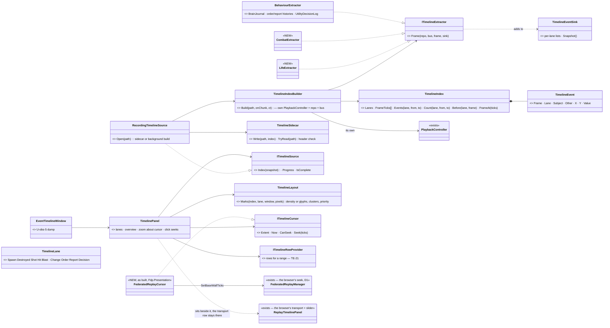
*Caption:* what the picture shows that prose hid — nothing in the index or the panel knows a host: the browser binds a cursor to its
manager and a source to its file; the Hrot hosts bind the same two to their facade and the live world (R1-e). The pure `TimelineLayout`
is where §2b's drawing rules live, so they are tested without ImGui.

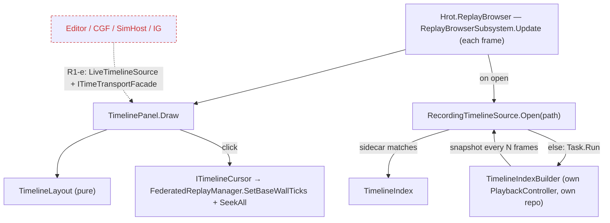
*Caption:* the dead edges — the editor and the cluster hosts do not show the panel in R1-a…c; they need a live source and the grown
facade (R1-e). The builder never runs on the frame thread.

| slice | builds | accepted when |
|---|---|---|
| **R1-a** | `TimelineIndex`, `TimelineEvent`, the three extractors, `TimelineIndexBuilder`, `TimelineSidecar`, `RecordingTimelineSource` | a recorded run's shots, hits, blasts, spawns, deaths and a commander's orders come out of one pass in frame order; the second open reads the sidecar; a changed recording rebuilds |
| **R1-b** | `TimelineLayout` (density / glyph / cluster / priority, zoom-about-cursor maths) + `TimelinePanel` + `ITimelineCursor` | §2b's rules as rails on the pure layout; < 1 ms per draw on an hour's index |
| **R1-c** | the Replay Browser hosts the panel over its manager; R0 ⑧ (scan rate, index size) measured on a real recording | §6 R1's acceptance in the browser |
| **R1-d** | the pinned unit's swimlane + TE-22's acceptance (the `hill-attack` commander's Orders lane, hover why, click seeks) | TE-22 |
| **R1-e** | `LiveTimelineSource`, `ITimeTransportFacade.CanSeek / Seek`, the Trace Timeline hosting the panel (TE-21), the Event Browser on the index | the editor shows the same panel live |

### 9a. R1-a as built *(ui, `2026-10-26`)*

Built in `FDP/Toolkits/Fdp.Toolkits/ReplayBrowser/Timeline/` as the class diagram above draws it; rails `TimelineIndexTests` (Fdp.Toolkits.Tests).

| what | as built | deviates from the plan |
|---|---|---|
| `TimelineIndex` | per lane a sorted `TimelineEvent[]`, `FrameTicks`, `ScannedFrames` / `TotalFrames`; `Events` / `Count` are binary searches; `FrameAt(ticks)` | ⚠ no `Entities` table — every event carries its ids (network id, else `-(index+1)`), so nothing needs one yet |
| `TimelineEventSink` | the builder's growing per-lane lists; `Snapshot` copies them into an immutable index | new — the `sink` the extractor signature names |
| `LifeExtractor` | a set diff of NETWORKED entities per frame; X / Y where it appeared or was last seen | ⚠ entities without a network id (rounds) are not indexed — they would drown the lane. Frame 0 reports every unit present as Spawned |
| `CombatExtractor` | Shot = a fired `WeaponFireNotification` (a refusal is not a shot; value = rounds), Hit = `HitEvent`, Blast = `DetonationNotification` (value = damage) | — |
| `BehaviourExtractor` | Change per new `BrainJournal` entry (value = kind); Order / Report: one event per NEW history entry, found by the previous newest entry's key (time + counterpart, TE-22 ②) — two orders in a frame are two events — plus the same order REPEATED, which the history counts rather than lists; Decision when a slot's `SwitchCount` rises (other = winner, value = decision id) | the first frame a unit is seen is its baseline (its rings hold the past) |
| `TimelineIndexBuilder.Build` | its own `PlaybackController` + repository (+ the repository's bus), `RecordingSearchService.RegisterAllComponents`; a snapshot every `chunkFrames` (default 2000) | — |
| `TimelineSidecar` | `<recording>.timeline`: magic, schema version, the recording's **byte size and last-write time**, then the tables; written via a temp file, only when complete | ⚠ TL-6 said "its last frame's ticks": reading those needs the recording opened; size + write time is checked without opening it |
| `RecordingTimelineSource` | `Open(path)`: the sidecar if it matches, else a `Task.Run` build publishing snapshots into a volatile field, then the sidecar; `Dispose` cancels | — |

**R1-b / R1-c as built** *(same day)* — in `Fdp.Presentation/ImGui/Panels/Timeline/` + `Windows/Timeline/`; rails `TimelineLayoutTests`
(Fdp.Presentation.Tests) and `CE1302_TheEventTimeline_*` (Hrot.ReplayBrowser.Tests):

| what | as built | deviates from the plan |
|---|---|---|
| `TimelineLayout` (pure) | `Marks(index, lanes, window, width)`: more events than pixels ⇒ contiguous density bins (frame edges, log-scaled intensity), else glyphs clustered within 7 px across the row's lanes (a k-way merge), each mark carrying its top-priority lane and frame range; `ZoomAbout` / `Pan` / `Clamp` / `Bracket` / `RulerStep`; `MarkAt` + `Describe` (the tooltip, events counted per lane) | ⭐ the bin edges are cached per window, so the rows of one draw share them — 📐 **0.59 ms per draw** for 9 rows × 1600 px over an hour (216 000 frames, 100 000 events), Debug build; before the cache 1.5 ms |
| `TimelinePanel` | overview strip + bracket (drag moves it), ruler, Life / Combat / Behaviour groups (collapsed = one row), unscanned part shaded, "now" line; Ctrl+wheel zooms about the mouse, drag pans, click seeks, hover lists the mark | ⏳ not yet: jump to next / previous event, the search box, focus-dimming (R1-d with the pinned unit) |
| `ITimelineCursor` + `FederatedReplayCursor` | Extent / Now / CanSeek / Seek over `FederatedReplayManager`; a seek subtracts the node's offset and calls `SetBaseWallTicks` (which seeks every node) | — |
| `EventTimelineWindow` + `TimelinePanelViewModel` | the window (U-obs-5: declared, dumps scanned / total frames, window, now, per-lane counts in window and in total) | ⚠ named *Event* Timeline: "Replay Timeline" is already the browser's transport window |
| Replay Browser hosting | `rb_event_timeline` registered beside `rb_timeline`; `SyncTimelineSource()` opens the primary node's recording each update when it changes (sidecar or background build), disposed on shutdown | — |

📐 **Seen in a real ImGui frame** (`TimelinePanelFrameRail`, Hrot.Presentation.Tests — Xvfb + software GL, a synthetic ten-minute
firefight; screenshots to `HROT_TIMELINE_SHOTS`): the first render found three defects the pure-layout rails could not — ① `ImGui.Text*`
take a printf FORMAT, so *"Indexing… 50%"* read garbage after its `%` (⇒ all panel text goes through `TextUnformatted`); ② the editor font
has no `–` / `…` (drawn as `?`); ③ `×N` count labels overprinted each other where clusters sit closer than the label's width (⇒ a label is
drawn only where it fits before the next mark; the overview strip draws marks only). `TimelinePanel.Show(window)` was added so a host
(and R1-d's jump) can set the zoom.

📐 **Measured on a real recording (R0 ⑧):** a component type from an assembly the process never LOADED stops the playback
(`PlaybackSystem.cs:332`, "Component type ID 238 not found" — `CharacterAnimationDefRuntime`, `Hrot.MuscleCharacter.Animation`):
`RecordingSearchService.RegisterAllComponents` sees loaded assemblies only. ⚠ The Replay Browser's own sandbox registers the same way
(`ReplayBrowserContext.cs:68`), so the index fails exactly where the browser would; `RecordingTimelineSource` now keeps the part scanned,
sets `Error`, and the panel says why — ⛔ never a faulted task and an endless "Indexing…".

📐 **R0 ⑧ measured** (`CE1301_R0_8_*`, a 216 MB / 14 245-frame / 596 s recording, editor assemblies loaded): one pass **46 s = 309 frames/s,
12.9× real time**; sidecar **115 kB**, reopened in **1.1 ms** (budget 200 ms). ⚠ Its frames 0–2 carry relative wall ticks (0.26–0.58 s) and frame 3
absolute ones — the mixed clock `6052a75a1` fixed in `RecorderTickSystem` the same day; a recording made before it shows its span squashed
(the browser's own scrubber too). ⛔ No timeline workaround: the cure is a fresh recording.

⏳ **Of §2b's cache tables only `events` is built.** `entities` (names, side) waits for R1-d's swimlane, which is its first reader; the
`position track` for R2b (Movement); the `pyramid` is replaced in R1-b by a binary search per pixel column (`Count(lane, from, to)`),
which already costs pixels × lanes × log(events) — a pyramid only if R1-b's < 1 ms budget is missed.

## 8. INVENTORY

```
scripts/cbm.sh search_graph name_pattern=".*(Director|Replay|Film|Take|Timeline|Cinema|FrameSink|ShotWorld|Playback).*" label=Interface
   → total 7, has_more false: ICinema, IDirectorHost, IDirectorSound, IFrameSink, IShotWorld, IRecordReplayController, IReplayRestoreGated
scripts/cbm.sh search_graph name_pattern=".*" label=Class file_pattern="**/Director/**"   → total 94, has_more false
   → shared (Hrot.Presentation/Map3D/Director): Take, ShotSpec, CameraSpec, AnchorSpec, AtExpr, BakedAnchors, LayerChange, Reel, ReelItem,
     ReelWaiting, TakeJson, TakeStore, TakeTimeline, TimelineShot, ShotEvaluator, WorldUnits, AnchorBook, AnchorMismatch, PacedClock
   → editor (Hrot.Editor/Director): DirectorRunner, PlayRequest, CaptureOptions, ItemReport, CutSnapshot, VerifyOptions, DirectorWindow,
     EditorDirectorHost, EditorCinema, EditorLayerOverride, FilmFrameSink, EditorDirectorSound, ScenarioReadyProbe, ScenarioChecks,
     ScenarioVerification, CommandLineVerify, FreshVerifyJobs, EditorVerifyWorld
scripts/cbm.sh search_graph name_pattern=".*(Director|Take|Reel|Timeline|Replay).*" label=Class → total 114 (first 83 read): ReplayBrowserSubsystem,
   ReplayBrowserContext, FederatedReplayManager, ReplaySearchPanel, ReplayModule, RecordingModule, EcsRecordReplayController, … 
   ReplayTimelinePanel (Fdp.Presentation) — the Replay Browser's transport; the director panel REUSES its scrub/transport, not a second one
scripts/cbm.sh search_graph name_pattern=".*(Undo|Redo|CommandHistory|EditHistory).*" label=Class
   → four undo stacks: Blueprints CommandHistory, Fdp.Toolkits GizmoUndoStack, GizmoMap GizmoUndoStack, NodeEditor UndoStack (TE-14)
scripts/cbm.sh search_graph name_pattern=".*(Condition|Predicate|Trigger|Zone|Area|PhaseLine|Region).*" label=Interface → 7: IAreaOutline,
   IDangerAreaProvider, IPredicateCompiler, ISearchPredicateRegistry, IZoneAuthoringController, IZoneRowRenderer, IZoneTileLoader
scripts/cbm.sh search_graph name_pattern=".*(PredicateDto|ConditionDto|TriggerDto|Trigger|MissionCondition|…Crossing|Enter).*" label=Class
   → the SearchPredicateDto family (Compound, PropertyMatch, Numeric, String, Enum, TransientEvent, Lifecycle, SpatialBounding, Structural,
     BehaviorParam, TraceBufferScan, BlueprintVariable, ExternalHitTag) · MissionTrigger (string-typed: TimerElapsed, HealthCritical,
     BehaviorFinished, UnderAttack — no area or line) · no line-crossing or polygon condition
scripts/cbm.sh search_graph name_pattern=".*(Condition|Predicate|Trigger).*(Editor|Panel|Window|Drawer|Inspector|Widget).*" label=Class
   → PredicateValueFieldDrawer, PredicateValueFieldEditor; hosts found by grep: ReplaySearchPanel, DataBreakpointManagerPanel (+ PredicateBuilderState)
grep "SearchPredicateDto" → 31 production files: breakpoints (8), debug API (5), BTree/HSM/Blueprint breakpoint menus, compiler, Replay Browser
cluster seek: ClusterOpType.ReplaySeek, NodeReplaySeek, ClusterMaster.Replay, ReplaySeekProcessManager · transports: ITimeTransportFacade,
   EditorTimeTransportFacade, ClusterTimeTransportAdapter, MainToolbarTimeControlSection, ShellTimeControlToolbar
⛔ MISSED in the first two passes, found 2026-10-23 from the ui lane's DESIGN_Behaviour_Debugging.md: TraceTimelineWindow + ITraceLaneProvider
   (+ BTree / HSM / Utility lane providers) — the first query's 114 results were read only to 83 (truncated) — a coverage stop, not a fit
   stop, would have caught it. ⇒ TE-21
docs: AI_Editor_Shared_Infrastructure.md §15 · DESIGN_Behaviour_Debugging.md · DESIGN_Entity_Brain_View.md BV-30 · Predicate-Infrastructure-Capabilities.md · designs/breakpoints-1/DESIGN.md · DESIGN_Time_Architecture.md §11 ·
   DESIGN_Film_Director.md (§3e, D-18) · designs/replay-browser-2/DESIGN.md · DESIGN_Agent_Shared_View.md (R-1029) · DESIGN_Scenario_Regression.md ·
   DESIGN_Map_3D_Mode.md §6b · searched docs/ for "director editor", "camera keyframe", "timeline editor", "film graphics" → none found
check_index_coverage is not available through the CLI ⇒ these totals are not proof of completeness
```

*Reused as is:* `FilmStudio`, `FilmCaptureLayer`, `ShotEvaluator`, `CameraSpec`, `AtExpr`, `ReplayBrowserContext`, `RecordingSearchService`,
the reel format, capture and the sound track. *Grown:* `Take`, `AnchorSpec`, `AnchorBook`, `TakeTimeline`, `TakeStore`, `IDirectorHost`,
`DirectorWindow` (into the timeline panel). *New:* `ReplayDirectorHost`, `FilmGraphicsLayer`, the key/segment/subtitle/view/graphic records.
