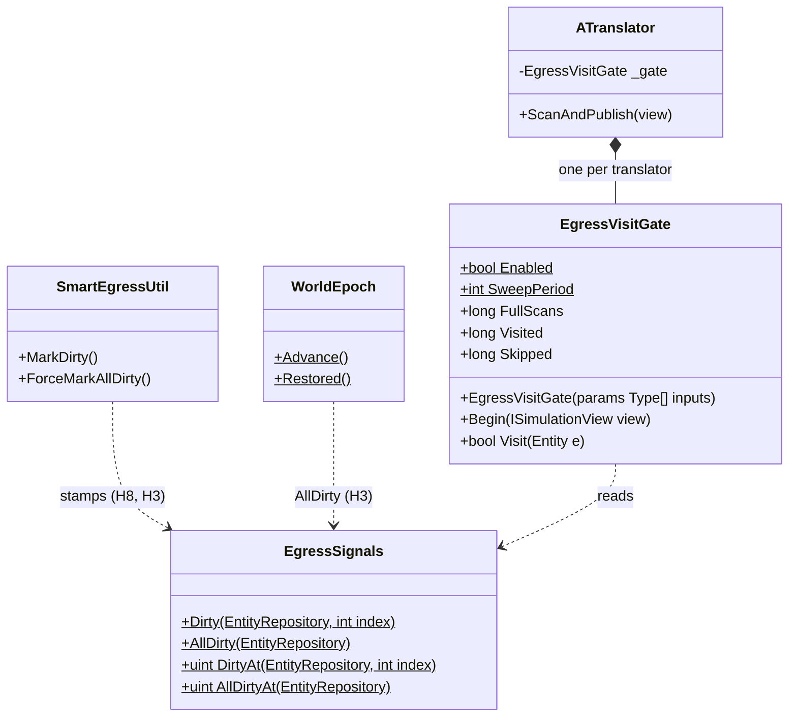
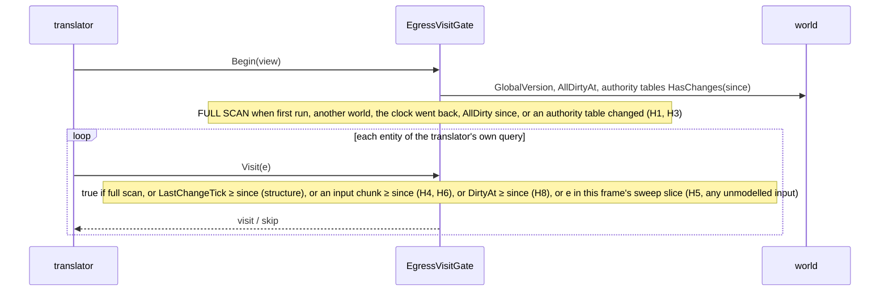
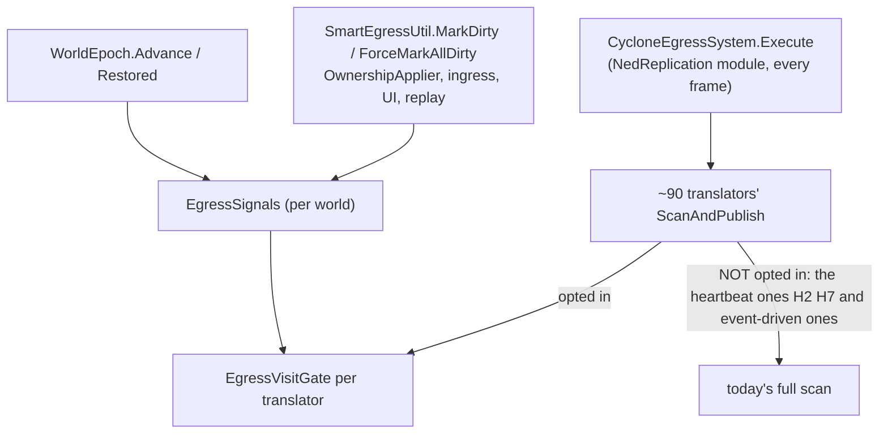

<!--STATUS
state: LIVE
updated: 2026-11-05 (§3a the real-node measurement; §4 write batching)
build-state: BUILDING — E1 approved by the user 2026-11-05 ("yes, build E1 with a rail per hazard"); §5 is the build design (CE-2407)
current-answer: §2 the measured hazards, §3 the options with a lean, §3a measured on real nodes (answers §3's 'what would change the lean'), §4 DDS write batching
stale-below: none
known-rot: docs/designs/dds-to-ecs/DESIGN.md:468 says "the egress translator checks the chunk version and skips unchanged entities" — only NavigationIntentEgressTranslator does (measured 2026-11-04)
known-conflict: none
related-designs:
  - docs/DESIGN_Evaluation_Cost_And_Cadence.md — OWNS the measurement that put egress at ≈ 15 ms/frame on Crossfire (§0) and filed this as C4 / T10 (CE-2391)
  - docs/designs/dds-to-ecs/DESIGN.md — OWNS egress (translators, ScanAndPublish); its chunk-version line (:468) is the aspiration this design measures
  - docs/projects/FDP/Core/Fdp.Core.md — OWNS the chunk-version rules and QueryDelta (:261, :398, :422–424, :847–876)
  - docs/DESIGN_Ownership_Groups_And_Grants.md — OWNS descriptor authority (a node gaining a descriptor marks it dirty, :400) — the case a version gate would miss
  - docs/DESIGN_Replay_Time_Axis_And_Review.md — OWNS the post-restore ForceMarkAllDirty (:323, :819) — another case a version gate would miss
-->

# Egress change detection — what a "skip unchanged entities" gate would have to get right

> **Tracker:** [CE-2391](blueprints/Blueprint_Issues_Tracker.md) (T10 of [DESIGN_Evaluation_Cost_And_Cadence](DESIGN_Evaluation_Cost_And_Cadence.md) §5 C4).
> 🔒 User, `2026-11-04`: *"the system has to handle thousands entities … if there is anything what would help all entities, it would be welcome"*.

## 0. Why

📐 Crossfire (365 → 524 entities), `--mode all`: `CycloneEgressSystem` ≈ **15 ms/frame** over the four in-process worlds. Every
translator (`EntityInfoEgressTranslator.cs:101–120` is the typical shape) queries **every** entity carrying its component **every frame**,
asks `HasAuthority` (2–3 component reads, root resolution for parts) and only then its own dirty test (`SmartEgressUtil.ShouldPublish`, or a
per-translator cache). ⇒ the cost is translators × entities per frame, whether anything changed or not — linear in the entity count that
must reach thousands.

## 1. INVENTORY *(an explorer pass, 2026-11-04 — graph + grep; ⚠ ~10 translator bodies read, the rest classified by pattern)*

| question | answer |
|---|---|
| the translator interface | `IDescriptorTranslator` (`Fdp.Core/Abstractions/IDescriptorTranslator.cs:82`); `CycloneEgressSystem` calls `INetworkTranslator.ScanAndPublish` (`CycloneEgressSystem.cs:99–111`); `search_graph` `.*EgressTranslator.*` = 93 classes incl. tests |
| how each decides to publish | `ShouldPublish` (reliable, dirty): EntityInfo, MapVisualOverlay, SensorConfig, EntityMission · own change cache: ~25 map translators (Lean, Damage, DoorState, TurretPose, WeaponPosture/Task, ObstacleShape, Possession, Gesture, Ammo …), MapRoute (`RoutePlan.Version`), 8 animation, BrainIntent, EqsSensorConfig, Macro · once per entity: EntityMaster · change + heartbeat: GeoSpatial (600 ticks), NavigationStatus (300) · `QueryDelta` + IntentId: NavigationIntent · always: `MultiInstanceCycloneTranslator` · event-driven (no scan): WeaponFire*, MunitionDetonation, DamageAssessed, spawn / destroy / update commands … |
| who marks dirty | `SmartEgressUtil.MarkDirty` (`:164–182`) from `EcsPatchContext:173`, `OwnershipApplier:105–106`, `UnitHierarchySystem`, `MissionControlExecutionSystem`, `SquadSensing:125`, `UpdateEntityDescriptorRequestSystem:214`, `SimHostApp:863` — ⚠ it mutates a HashSet in place: no chunk version moves |
| chunk versions | one per (component type, chunk of that type), a GlobalVersion STAMP on `GetRW` / `Set` / `Add` / the ECB (`NativeChunkTable.cs:158–161`); NOT on RO reads, raw pointers, or `RemoveUnmanagedComponent`; managed `SetRawObject` / `Clear` bump by +1 (can sit below the current tick); `QueryDelta` (`EntityRepository.DeltaQuery.cs:13–177`) skips a header chunk unless the first slot's type version moved |

## 2. The hazards — why a plain "T's chunk did not change ⇒ skip" gate is WRONG

| # | case | what a T-only version gate does |
|---|---|---|
| H1 | ⛔ **authority arrives** (a grant / takeover makes this node the owner) | the data did not change ⇒ skipped ⇒ the new owner never publishes; `HasAuthority` reads the ROOT's `NetworkAuthority` / `DescriptorOwnership`, a different entity for a part |
| H2 | ⛔ **heartbeats** (GeoSpatial 600 ticks, NavigationStatus 300) | must visit unchanged entities |
| H3 | ⛔ **re-publish after a seek / restore** (`ForceMarkAllDirty`, `WorldEpoch.Moved` cache clears) | touches no chunk |
| H4 | ⛔ **descriptors from several components** (EntityInfo also reads `UnitSubordinate`; GeoSpatial `SimVelocity`) | the gate must OR every input type |
| H5 | ⛔ **managed components mutated in place** (`GetManagedComponentRO` then a write; the +1 bump below the tick) | never seen |
| H6 | ⛔ **`QueryDelta`'s one-slot test** (`DeltaQuery.cs:118–120` assumes T's chunk is wider than the header's — unverified) | can miss a change in the rest of the chunk |
| H7 | ⛔ **GeoSpatial writes its own shadow with `GetComponentRW`** (`:168`) | stamps the chunk every visit ⇒ the gate never skips it |
| H8 | ⛔ **`MarkDirty` moves no version** | an explicit dirty is invisible to the gate |

## 3. Options — ⭐ lean for the user

| option | what | cost / risk |
|---|---|---|
| ⭐ **E1 — a per-world "egress candidates" set, fed by the writers that already exist** | each translator keeps its scan for the FIRST frame and after `ForceMarkAllDirty` / an epoch move; otherwise it visits (a) entities whose input chunks moved since its last scan (OR over its input types), (b) entities `MarkDirty` named, (c) entities whose authority changed (the `OwnershipApplier` / ingress events), (d) its heartbeat slice (1/N of the entities per frame, so a 600-tick heartbeat costs 1/600 of a scan) | ⭐ the only option that covers H1–H4, H8 by construction; H5 needs managed writes to go through `Set` (CLAUDE.md's immutable-managed rule already says so); H7 needs GeoSpatial's shadow write moved out of the gate's input set; H6 needs the per-entity version (`GetVersionForEntity`), not the one-slot test |
| E2 — gate on chunk versions only | the aspiration of dds-to-ecs :468 | ⛔ wrong on H1, H2, H3, H8 — loses publishes silently |
| E3 — cheaper per-entity checks, same scan | hoist `ShouldPublish` / the own cache BEFORE `HasAuthority`; C1's cached type ids (CE-2389, built) already cut each lookup | ⭐ safe and small, but still linear in entities × translators — a first step, not the fix · ⛔ **MEASURED `2026-11-04`, not built:** the hoist only pays on OWNED unchanged entities; a replica has no `EgressPublicationState` / cache entry, so the cheap check passes and `HasAuthority` still runs — net extra work where most scanned entities are replicas (3 of 4 worlds in `--mode all`). Built instead: the cheaper READ under `HasAuthority` (CE-2393, [DESIGN_Evaluation_Cost_And_Cadence.md](DESIGN_Evaluation_Cost_And_Cadence.md) §5b) |

⭐ **Lean: E3 now (no semantics change), E1 as its own built design with a rail per hazard H1–H8.** ⛔ Not E2.
⚠ **What would change the lean:** a measurement on a real cluster node (one world, not four) showing egress below ~2 ms at a few thousand
entities — then E3 alone is enough.

## 3a. 📐 Measured on REAL nodes — one node per process *(`2026-11-05`; answers §3's "what would change the lean")*

`scripts/cluster-node.sh` × orchestrator / simhost / cgf / ig, Crossfire playing ≈ 40 s (CGF ≈ 394 entities), `/diagnostics/architecture`
+ `dotnet-trace` (sampled thread time, 15 s) of the CGF and SimHost processes.

| | CGF | SimHost |
|---|---|---|
| `CycloneEgressSystem` per frame | **6.3–7.0 ms** | **4.9–5.6 ms** |
| … share of the main thread | 8.8 % | 6.7 % |
| samples SENT per frame (all translators) | **≈ 13** | **≈ 21** (WorldPos most of them) |
| the DDS write incl. the native send | 1.3 % (native 0.9) | 0.9 % (native 0.6) |
| `HasAuthority` | 1.4 % | 1.0 % |
| `ValueType.Equals` (the change caches) | 0.4 % → ✅ CE-2406 | 0.0 % |
| a translator that scans and sends ~nothing | ObjectiveStatus 1.0 ms · WeaponPosture 1.06 ms | EntityMaster 0.75 ms for 8 samples in 40 s · EntityInfo 0.43 ms for 0 |

⇒ ⭐ **egress is 5–7 ms per real node at only ~400 entities — far above the ~2 ms that would have made E3 enough.** ⭐⭐ The cost is the
SCAN (translators × entities to find the ~20 samples that changed), not the network. ⇒ **the lean stands, and E1 is the next lever**;
it needs the user's approval (it can lose publishes silently, §2) and a rail per hazard.

## 4. DDS write BATCHING *(user, `2026-11-05`: "I think the Cyclone DDS might support also some bundling … that reduces the time for sending")*

| fact | where |
|---|---|
| Cyclone has it: `dds_write_set_batch(bool)` (process-wide; the `Internal/WriteBatch` config) packs consecutive writes into one RTPS message; `dds_write_flush(writer)` sends what a writer holds | exported by the bundled `libddsc.so` (CycloneDDS.NET 1.2.20, `nm -D`) |
| ⛔ the .NET binding binds NEITHER, and `DdsWriter`'s native handle is private | `CycloneDDS.Runtime.dll` imports; `pjanec/CycloneDds.NET` `src/CycloneDDS.Runtime/DdsWriter.cs:25` |
| ⇒ it needs a binding change: `DdsApi.dds_write_flush` / `dds_write_set_batch`, `DdsWriter<T>.Flush()`, a `DdsWriteBatching.Enable` switch | a ~60-line patch is drafted (not built), to be applied in that repository |
| ⚠ the hazard: batching is PROCESS-WIDE, so EVERY writer — the event-driven ones (fire, detonation, commands, acks) too — must be flushed after its burst, or its last samples wait for the next write | ⇒ one flush point per frame for every writer of the participant, after egress and the event writers |
| 📐 what it can save today | ≤ the native send: **0.6–0.9 % of the main thread** at ≈ 13–21 samples per frame, plus fewer datagrams for the receivers |

⇒ ⭐ **lean: not now.** At today's sample rate batching saves well under 1 % per node, against a process-wide flush obligation that silently
delays samples if one writer is missed. ⭐ **Revisit when the sample rate grows** (thousands of MOVING entities ⇒ hundreds of WorldPos per
frame): then the per-datagram cost on the sender AND every receiver scales with it, and batching + one per-frame flush becomes worth its rule.
⚠ What would change the lean: a measured native send above ~3 % of a node's thread.

## 5. ⭐ E1 — AS DESIGNED for the build *(user, `2026-11-05`: "yes, build E1 with a rail per hazard"; CE-2407)*

**INVENTORY** (graph + grep, `2026-11-05`): the change signals that already exist — chunk versions stamped with `GlobalVersion` on
`GetRW`/`Set`/`Add`/ECB (`NativeChunkTable`), table-level `IComponentTable.HasChanges(since)` (`>`), the per-entity STRUCTURAL clock
`EntityMetadataCold.LastChangeTick` (create / destroy / a component added or removed / lifecycle — CE-3243, `EntityRepository.cs:1019–1023`),
`WorldEpoch.Advance`/`Restored`, `SmartEgressUtil.MarkDirty`/`ForceMarkAllDirty` (in-place, no version — H8/H3). Authority:
`HasAuthority` reads the ROOT's `NetworkAuthority` + `DescriptorOwnership` (`AuthorityExtensions.cs:16–66`); both are written through
stamping setters and only on change (`OwnershipApplier.cs:83,117`, `OwnershipRecomputeSystem.cs:323`, `DeferredTakeoverSystem.cs:137`,
`EntityMasterIngressTranslator.cs:251`). ⛔ No existing visit gate (`search_graph` `.*(Egress.*Gate|VisitGate|EgressSignal).*`: none).

*What the picture shows: every way an entity can need republishing feeds ONE per-world signal or a version the gate already reads — the
translator keeps its own loop and its own publish decision; the gate only removes entities that cannot have changed.*

*What it shows: the gate is per translator and opt-in; the heartbeat translators are deliberately left on the full scan.*

| hazard | how E1 handles it | rail (`EgressVisitGateTests`) |
|---|---|---|
| H1 authority arrives | any write to `NetworkAuthority` / `DescriptorOwnership` / `PartMetadata` since the last scan ⇒ a FULL scan that frame (covers a part whose ROOT changed) | `H1_*` |
| H2 heartbeats | GeoSpatial / NavigationStatus NOT gated; the sweep also bounds any entity's longest skip to `SweepPeriod` frames | `H2_*` (sweep bound) |
| H3 seek / restore / wipe | `ForceMarkAllDirty` and `WorldEpoch` ⇒ `EgressSignals.AllDirty` ⇒ full scan; the clock going BACK (playback `SetGlobalVersion`) ⇒ full scan | `H3_*` |
| H4 several inputs | the translator declares every component it reads; a write to ANY ⇒ visit (`NetworkIdentity` always included) | `H4_*` |
| H5 managed in place | not seen by versions ⇒ the sweep republishes within `SweepPeriod` frames (and the immutable-managed rule forbids it) | `H5_*` |
| H6 one-slot test | the entity's OWN chunk version (`GetVersionForEntity`), never `QueryDelta` | `H6_*` |
| H7 GeoSpatial writes its shadow | not gated (H2) | — |
| H8 `MarkDirty` moves no version | `MarkDirty` stamps `EgressSignals.Dirty` ⇒ visit | `H8_*` |
| (structure) a component REMOVED makes the entity match (`Without<ReplicationRoute>`) | the structural clock `LastChangeTick` ⇒ visit | `Structural_*` |
| (equivalence) | a scripted world: what the gated translator publishes = the ungated one, frame by frame, apart from sweep-bounded delays of unmodelled changes | `Equivalence_*` |

⭐ `SweepPeriod` = 8 (≤ 133 ms at 60 Hz for a change no signal names). ⭐ `EgressVisitGate.Enabled = false` restores today's behaviour
everywhere (A/B and a kill switch). ⭐ Visit is a few array reads — no allocation.

### 5a. ⚠ AS BUILT — one deviation from §5 *(found by its own equivalence rail, `2026-11-05`)*

⛔ **§5 as drawn visits an entity when its input's CHUNK version moved — too coarse to save anything.** 📐 The equivalence rail published
the same as the ungated translator but visited 87 225 and skipped 2 890: a chunk is 64 KB, so one write anywhere among thousands of small
components (and `ObjectiveStatus` / `WeaponPosture` are rewritten often) marks every entity in it.
⭐ **As built:** the chunk version stays the FIRST filter (unchanged chunk ⇒ skip at once); when it moved, the gate compares the entity's
own bytes for each UNMANAGED input with the copy taken at its last visit (`Same`, `Remember`; the CE-2398 technique) and visits only on a
difference. A managed input stays chunk-level (coarse, safe). An absent component compares as "the same" — its coming or going is
structural (`LastChangeTick`). ⭐ Bytes equal ⇒ every field equal ⇒ the translator would build the same sample; the only cost of the
copy is memory (index × size per input). Rail `ANeighboursWrite_AndASameBytesRewrite_DoNotVisit_ARealChangeDoes`.

### 5b. 📐 MEASURED — E1 on the real 4-process Crossfire cluster *(`2026-11-05`)*

`HROT_EGRESS_GATE_STATS=1` (the gate's process-wide counters, printed every ~10 s) and an on / off A/B (`HROT_EGRESS_GATE=0`), 60 s each, alternating:

| | CGF | SimHost |
|---|---|---|
| gate calls · full scans | 10 165 · 952 (≈ 9 %; 924 of them an AUTHORITY write) | 11 441 · 825 (≈ 7 %) |
| entity visits skipped | **66 %** | **78 %** |
| the 14 gated translators, ms/frame on / off | **2.92 / 3.34** | **1.16 / 1.36** |
| the ungated ones (WorldPos, EqsSensorConfig, lifecycle …) | 2.39 / 2.26 | 2.74 / 2.37 |
| samples sent in 60 s on / off | ≈ 7 600–8 100 / 7 700 | ≈ 18 500 / 18 000 (the same publishing) |

⇒ ⭐ **the gate skips most visits, but at ~400 entities a gated translator's per-entity work is the minor part of its cost** — the
translators got ≈ 13–15 % cheaper, egress overall moved within noise. ⭐ The saving scales with ENTITIES (the skipped work is per entity);
the CE-2408 stress run is where it should show. ⚠ Next levers inside egress: the per-translator FIXED cost (each costs ≈ 0.1–0.3 ms a frame
even when it skips nearly everything — to be profiled) and the ungated translators (WorldPos is the largest).
