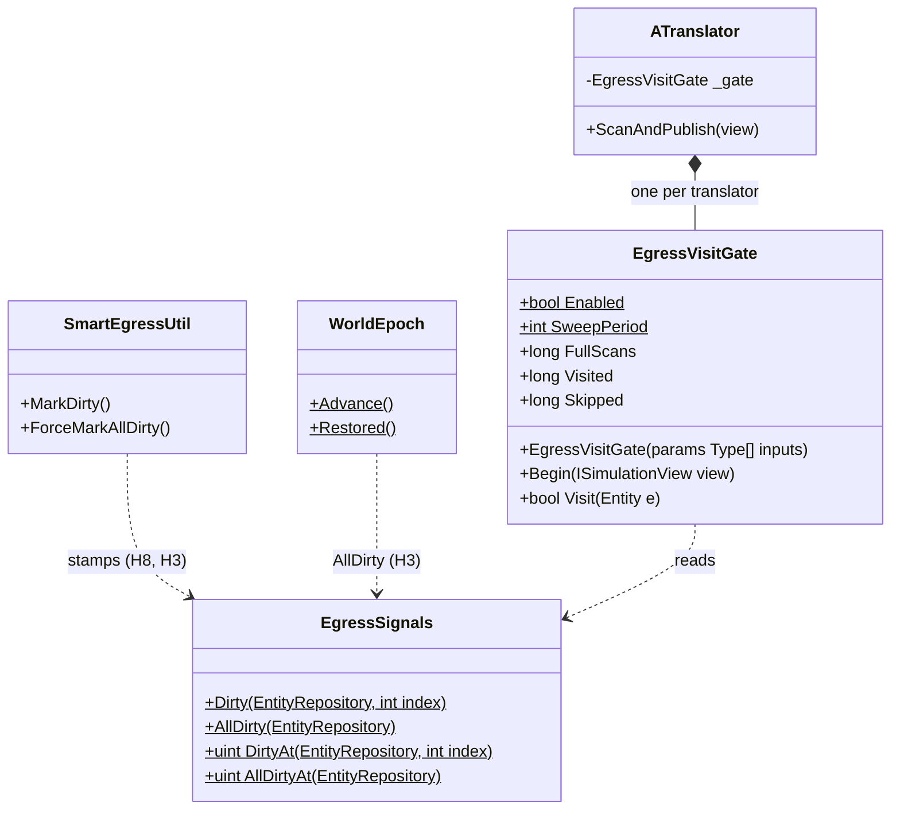
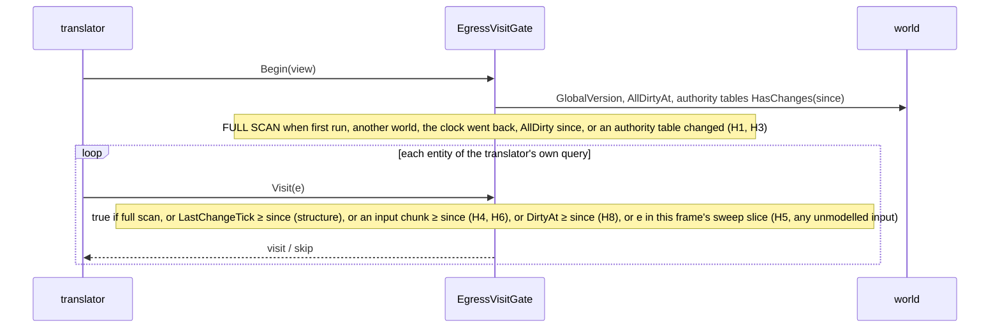
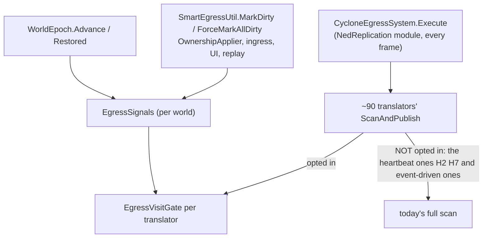
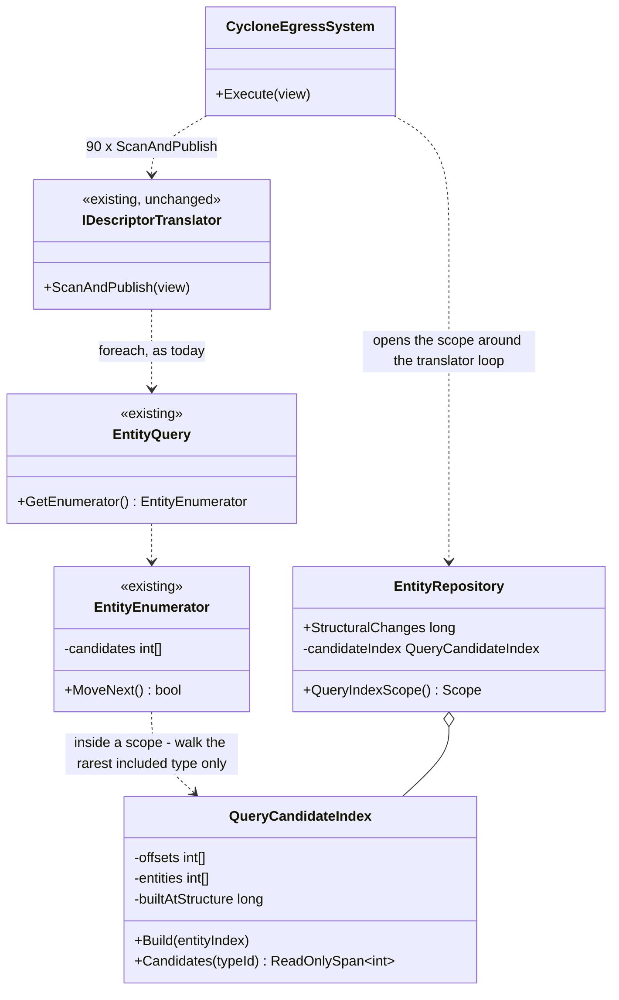
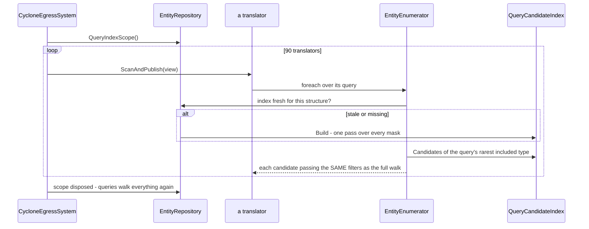
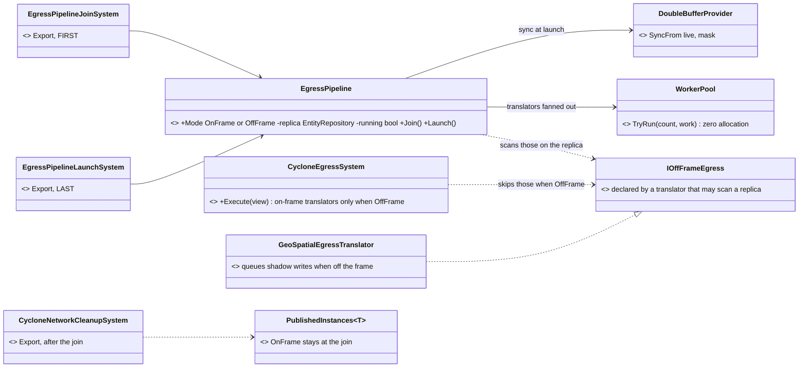
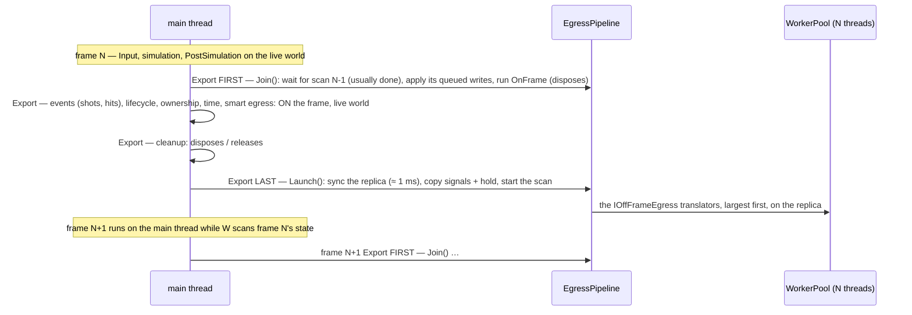
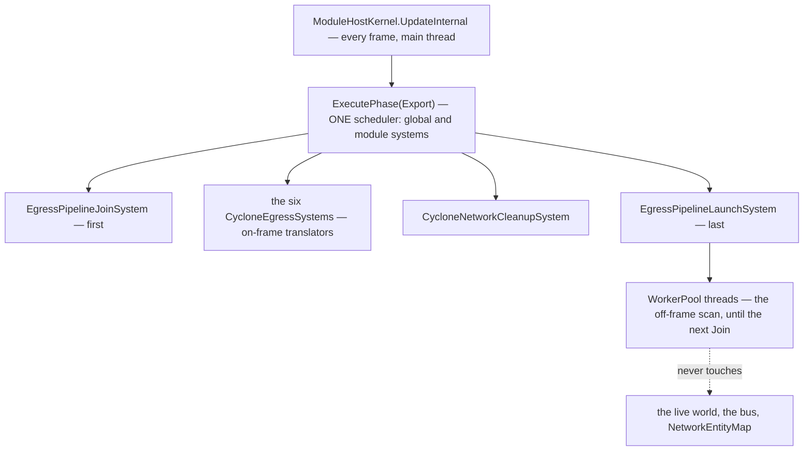

<!--STATUS
state: LIVE
updated: 2026-11-10 (§7 the state egress off the main thread — APPROVED as an experiment, READY-TO-BUILD, CE-3427 N-1) · 2026-11-05 (§3a the real-node measurement; §4 write batching)
build-state: BUILDING — E1 approved by the user 2026-11-05 ("yes, build E1 with a rail per hazard"); §5 is the build design (CE-2407)
current-answer: ⭐ §7 the state egress off the main thread (2026-11-10, APPROVED experiment, not built) · §2 the measured hazards, §3 the options with a lean, §3a measured on real nodes (answers §3's 'what would change the lean'), §4 DDS write batching
stale-below: none
known-rot: docs/designs/dds-to-ecs/DESIGN.md:468 says "the egress translator checks the chunk version and skips unchanged entities" — only NavigationIntentEgressTranslator does (measured 2026-11-04)
known-conflict: none
related-designs:
  - docs/DESIGN_Scale_Rig.md §7.8 — OWNS the measurements §7 rests on (egress by translator, the replica probe)
  - docs/DESIGN_Sensors_And_Doctrine.md §5.8 — OWNS the worker pool §7 shares (EqsSolveWorkers, P-1)
  - docs/DESIGN_Evaluation_Cost_And_Cadence.md — OWNS the measurement that put egress at ≈ 15 ms/frame on Crossfire (§0) and filed this as C4 / T10 (CE-2391)
  - docs/designs/dds-to-ecs/DESIGN.md — OWNS egress (translators, ScanAndPublish); its chunk-version line (:468) is the aspiration this design measures
  - docs/projects/FDP/Core/Fdp.Core.md — OWNS the chunk-version rules and QueryDelta (:261, :398, :422–424, :847–876)
  - docs/DESIGN_Ownership_Groups_And_Grants.md — OWNS descriptor authority (a node gaining a descriptor marks it dirty, :400) — the case a version gate would miss
  - docs/DESIGN_Replay_Time_Axis_And_Review.md — OWNS the post-restore ForceMarkAllDirty (:323, :819) — another case a version gate would miss
-->

# Egress change detection — what a "skip unchanged entities" gate would have to get right

> **Tracker:** [CE-2391](blueprints/Blueprint_Issues_Tracker.md) (T10 of [DESIGN_Evaluation_Cost_And_Cadence](DESIGN_Evaluation_Cost_And_Cadence.md) §5 C4).
> 🔒 User, `2026-11-04`: *"the system has to handle thousands entities … if there is anything what would help all entities, it would be welcome"*.

## 0. Why

📐 Crossfire (365 → 524 entities), `--mode all`: `CycloneEgressSystem` ≈ **15 ms/frame** over the four in-process worlds. Every
translator (`EntityInfoEgressTranslator.cs:101–120` is the typical shape) queries **every** entity carrying its component **every frame**,
asks `HasAuthority` (2–3 component reads, root resolution for parts) and only then its own dirty test (`SmartEgressUtil.ShouldPublish`, or a
per-translator cache). ⇒ the cost is translators × entities per frame, whether anything changed or not — linear in the entity count that
must reach thousands.

## 1. INVENTORY *(an explorer pass, 2026-11-04 — graph + grep; ⚠ ~10 translator bodies read, the rest classified by pattern)*

| question | answer |
|---|---|
| the translator interface | `IDescriptorTranslator` (`Fdp.Core/Abstractions/IDescriptorTranslator.cs:82`); `CycloneEgressSystem` calls `INetworkTranslator.ScanAndPublish` (`CycloneEgressSystem.cs:99–111`); `search_graph` `.*EgressTranslator.*` = 93 classes incl. tests |
| how each decides to publish | `ShouldPublish` (reliable, dirty): EntityInfo, MapVisualOverlay, SensorConfig, EntityMission · own change cache: ~25 map translators (Lean, Damage, DoorState, TurretPose, WeaponPosture/Task, ObstacleShape, Possession, Gesture, Ammo …), MapRoute (`RoutePlan.Version`), 8 animation, BrainIntent, EqsSensorConfig, Macro · once per entity: EntityMaster · change + heartbeat: GeoSpatial (600 ticks), NavigationStatus (300) · `QueryDelta` + IntentId: NavigationIntent · always: `MultiInstanceCycloneTranslator` · event-driven (no scan): WeaponFire*, MunitionDetonation, DamageAssessed, spawn / destroy / update commands … |
| who marks dirty | `SmartEgressUtil.MarkDirty` (`:164–182`) from `EcsPatchContext:173`, `OwnershipApplier:105–106`, `UnitHierarchySystem`, `MissionControlExecutionSystem`, `SquadSensing:125`, `UpdateEntityDescriptorRequestSystem:214`, `SimHostApp:863` — ⚠ it mutates a HashSet in place: no chunk version moves |
| chunk versions | one per (component type, chunk of that type), a GlobalVersion STAMP on `GetRW` / `Set` / `Add` / the ECB (`NativeChunkTable.cs:158–161`); NOT on RO reads, raw pointers, or `RemoveUnmanagedComponent`; managed `SetRawObject` / `Clear` bump by +1 (can sit below the current tick); `QueryDelta` (`EntityRepository.DeltaQuery.cs:13–177`) skips a header chunk unless the first slot's type version moved |

## 2. The hazards — why a plain "T's chunk did not change ⇒ skip" gate is WRONG

| # | case | what a T-only version gate does |
|---|---|---|
| H1 | ⛔ **authority arrives** (a grant / takeover makes this node the owner) | the data did not change ⇒ skipped ⇒ the new owner never publishes; `HasAuthority` reads the ROOT's `NetworkAuthority` / `DescriptorOwnership`, a different entity for a part |
| H2 | ⛔ **heartbeats** (GeoSpatial 600 ticks, NavigationStatus 300) | must visit unchanged entities |
| H3 | ⛔ **re-publish after a seek / restore** (`ForceMarkAllDirty`, `WorldEpoch.Moved` cache clears) | touches no chunk |
| H4 | ⛔ **descriptors from several components** (EntityInfo also reads `UnitSubordinate`; GeoSpatial `SimVelocity`) | the gate must OR every input type |
| H5 | ⛔ **managed components mutated in place** (`GetManagedComponentRO` then a write; the +1 bump below the tick) | never seen |
| H6 | ⛔ **`QueryDelta`'s one-slot test** (`DeltaQuery.cs:118–120` assumes T's chunk is wider than the header's — unverified) | can miss a change in the rest of the chunk |
| H7 | ⛔ **GeoSpatial writes its own shadow with `GetComponentRW`** (`:168`) | stamps the chunk every visit ⇒ the gate never skips it |
| H8 | ⛔ **`MarkDirty` moves no version** | an explicit dirty is invisible to the gate |

## 3. Options — ⭐ lean for the user

| option | what | cost / risk |
|---|---|---|
| ⭐ **E1 — a per-world "egress candidates" set, fed by the writers that already exist** | each translator keeps its scan for the FIRST frame and after `ForceMarkAllDirty` / an epoch move; otherwise it visits (a) entities whose input chunks moved since its last scan (OR over its input types), (b) entities `MarkDirty` named, (c) entities whose authority changed (the `OwnershipApplier` / ingress events), (d) its heartbeat slice (1/N of the entities per frame, so a 600-tick heartbeat costs 1/600 of a scan) | ⭐ the only option that covers H1–H4, H8 by construction; H5 needs managed writes to go through `Set` (CLAUDE.md's immutable-managed rule already says so); H7 needs GeoSpatial's shadow write moved out of the gate's input set; H6 needs the per-entity version (`GetVersionForEntity`), not the one-slot test |
| E2 — gate on chunk versions only | the aspiration of dds-to-ecs :468 | ⛔ wrong on H1, H2, H3, H8 — loses publishes silently |
| E3 — cheaper per-entity checks, same scan | hoist `ShouldPublish` / the own cache BEFORE `HasAuthority`; C1's cached type ids (CE-2389, built) already cut each lookup | ⭐ safe and small, but still linear in entities × translators — a first step, not the fix · ⛔ **MEASURED `2026-11-04`, not built:** the hoist only pays on OWNED unchanged entities; a replica has no `EgressPublicationState` / cache entry, so the cheap check passes and `HasAuthority` still runs — net extra work where most scanned entities are replicas (3 of 4 worlds in `--mode all`). Built instead: the cheaper READ under `HasAuthority` (CE-2393, [DESIGN_Evaluation_Cost_And_Cadence.md](DESIGN_Evaluation_Cost_And_Cadence.md) §5b) |

⭐ **Lean: E3 now (no semantics change), E1 as its own built design with a rail per hazard H1–H8.** ⛔ Not E2.
⚠ **What would change the lean:** a measurement on a real cluster node (one world, not four) showing egress below ~2 ms at a few thousand
entities — then E3 alone is enough.

## 3a. 📐 Measured on REAL nodes — one node per process *(`2026-11-05`; answers §3's "what would change the lean")*

`scripts/cluster-node.sh` × orchestrator / simhost / cgf / ig, Crossfire playing ≈ 40 s (CGF ≈ 394 entities), `/diagnostics/architecture`
+ `dotnet-trace` (sampled thread time, 15 s) of the CGF and SimHost processes.

| | CGF | SimHost |
|---|---|---|
| `CycloneEgressSystem` per frame | **6.3–7.0 ms** | **4.9–5.6 ms** |
| … share of the main thread | 8.8 % | 6.7 % |
| samples SENT per frame (all translators) | **≈ 13** | **≈ 21** (WorldPos most of them) |
| the DDS write incl. the native send | 1.3 % (native 0.9) | 0.9 % (native 0.6) |
| `HasAuthority` | 1.4 % | 1.0 % |
| `ValueType.Equals` (the change caches) | 0.4 % → ✅ CE-2406 | 0.0 % |
| a translator that scans and sends ~nothing | ObjectiveStatus 1.0 ms · WeaponPosture 1.06 ms | EntityMaster 0.75 ms for 8 samples in 40 s · EntityInfo 0.43 ms for 0 |

⇒ ⭐ **egress is 5–7 ms per real node at only ~400 entities — far above the ~2 ms that would have made E3 enough.** ⭐⭐ The cost is the
SCAN (translators × entities to find the ~20 samples that changed), not the network. ⇒ **the lean stands, and E1 is the next lever**;
it needs the user's approval (it can lose publishes silently, §2) and a rail per hazard.

## 4. DDS write BATCHING *(user, `2026-11-05`: "I think the Cyclone DDS might support also some bundling … that reduces the time for sending")*

| fact | where |
|---|---|
| Cyclone has it: `dds_write_set_batch(bool)` (process-wide; the `Internal/WriteBatch` config) packs consecutive writes into one RTPS message; `dds_write_flush(writer)` sends what a writer holds | exported by the bundled `libddsc.so` (CycloneDDS.NET 1.2.20, `nm -D`) |
| ⛔ the .NET binding binds NEITHER, and `DdsWriter`'s native handle is private | `CycloneDDS.Runtime.dll` imports; `pjanec/CycloneDds.NET` `src/CycloneDDS.Runtime/DdsWriter.cs:25` |
| ⇒ it needs a binding change: `DdsApi.dds_write_flush` / `dds_write_set_batch`, `DdsWriter<T>.Flush()`, a `DdsWriteBatching.Enable` switch | a ~60-line patch is drafted (not built), to be applied in that repository |
| ⚠ the hazard: batching is PROCESS-WIDE, so EVERY writer — the event-driven ones (fire, detonation, commands, acks) too — must be flushed after its burst, or its last samples wait for the next write | ⇒ one flush point per frame for every writer of the participant, after egress and the event writers |
| 📐 what it can save today | ≤ the native send: **0.6–0.9 % of the main thread** at ≈ 13–21 samples per frame, plus fewer datagrams for the receivers |

⇒ ⭐ **lean: not now.** At today's sample rate batching saves well under 1 % per node, against a process-wide flush obligation that silently
delays samples if one writer is missed. ⭐ **Revisit when the sample rate grows** (thousands of MOVING entities ⇒ hundreds of WorldPos per
frame): then the per-datagram cost on the sender AND every receiver scales with it, and batching + one per-frame flush becomes worth its rule.
⚠ What would change the lean: a measured native send above ~3 % of a node's thread.

## 5. ⭐ E1 — AS DESIGNED for the build *(user, `2026-11-05`: "yes, build E1 with a rail per hazard"; CE-2407)*

**INVENTORY** (graph + grep, `2026-11-05`): the change signals that already exist — chunk versions stamped with `GlobalVersion` on
`GetRW`/`Set`/`Add`/ECB (`NativeChunkTable`), table-level `IComponentTable.HasChanges(since)` (`>`), the per-entity STRUCTURAL clock
`EntityMetadataCold.LastChangeTick` (create / destroy / a component added or removed / lifecycle — CE-3243, `EntityRepository.cs:1019–1023`),
`WorldEpoch.Advance`/`Restored`, `SmartEgressUtil.MarkDirty`/`ForceMarkAllDirty` (in-place, no version — H8/H3). Authority:
`HasAuthority` reads the ROOT's `NetworkAuthority` + `DescriptorOwnership` (`AuthorityExtensions.cs:16–66`); both are written through
stamping setters and only on change (`OwnershipApplier.cs:83,117`, `OwnershipRecomputeSystem.cs:323`, `DeferredTakeoverSystem.cs:137`,
`EntityMasterIngressTranslator.cs:251`). ⛔ No existing visit gate (`search_graph` `.*(Egress.*Gate|VisitGate|EgressSignal).*`: none).

*What the picture shows: every way an entity can need republishing feeds ONE per-world signal or a version the gate already reads — the
translator keeps its own loop and its own publish decision; the gate only removes entities that cannot have changed.*

*What it shows: the gate is per translator and opt-in; the heartbeat translators are deliberately left on the full scan.*

| hazard | how E1 handles it | rail (`EgressVisitGateTests`) |
|---|---|---|
| H1 authority arrives | any write to `NetworkAuthority` / `DescriptorOwnership` / `PartMetadata` since the last scan ⇒ a FULL scan that frame (covers a part whose ROOT changed) | `H1_*` |
| H2 heartbeats | GeoSpatial / NavigationStatus NOT gated; the sweep also bounds any entity's longest skip to `SweepPeriod` frames | `H2_*` (sweep bound) |
| H3 seek / restore / wipe | `ForceMarkAllDirty` and `WorldEpoch` ⇒ `EgressSignals.AllDirty` ⇒ full scan; the clock going BACK (playback `SetGlobalVersion`) ⇒ full scan | `H3_*` |
| H4 several inputs | the translator declares every component it reads; a write to ANY ⇒ visit (`NetworkIdentity` always included) | `H4_*` |
| H5 managed in place | not seen by versions ⇒ the sweep republishes within `SweepPeriod` frames (and the immutable-managed rule forbids it) | `H5_*` |
| H6 one-slot test | the entity's OWN chunk version (`GetVersionForEntity`), never `QueryDelta` | `H6_*` |
| H7 GeoSpatial writes its shadow | not gated (H2) | — |
| H8 `MarkDirty` moves no version | `MarkDirty` stamps `EgressSignals.Dirty` ⇒ visit | `H8_*` |
| (structure) a component REMOVED makes the entity match (`Without<ReplicationRoute>`) | the structural clock `LastChangeTick` ⇒ visit | `Structural_*` |
| (equivalence) | a scripted world: what the gated translator publishes = the ungated one, frame by frame, apart from sweep-bounded delays of unmodelled changes | `Equivalence_*` |

⭐ `SweepPeriod` = 8 (≤ 133 ms at 60 Hz for a change no signal names). ⭐ `EgressVisitGate.Enabled = false` restores today's behaviour
everywhere (A/B and a kill switch). ⭐ Visit is a few array reads — no allocation.

### 5a. ⚠ AS BUILT — one deviation from §5 *(found by its own equivalence rail, `2026-11-05`)*

⛔ **§5 as drawn visits an entity when its input's CHUNK version moved — too coarse to save anything.** 📐 The equivalence rail published
the same as the ungated translator but visited 87 225 and skipped 2 890: a chunk is 64 KB, so one write anywhere among thousands of small
components (and `ObjectiveStatus` / `WeaponPosture` are rewritten often) marks every entity in it.
⭐ **As built:** the chunk version stays the FIRST filter (unchanged chunk ⇒ skip at once); when it moved, the gate compares the entity's
own bytes for each UNMANAGED input with the copy taken at its last visit (`Same`, `Remember`; the CE-2398 technique) and visits only on a
difference. A managed input stays chunk-level (coarse, safe). An absent component compares as "the same" — its coming or going is
structural (`LastChangeTick`). ⭐ Bytes equal ⇒ every field equal ⇒ the translator would build the same sample; the only cost of the
copy is memory (index × size per input). Rail `ANeighboursWrite_AndASameBytesRewrite_DoNotVisit_ARealChangeDoes`.

### 5b. 📐 MEASURED — E1 on the real 4-process Crossfire cluster *(`2026-11-05`)*

`HROT_EGRESS_GATE_STATS=1` (the gate's process-wide counters, printed every ~10 s) and an on / off A/B (`HROT_EGRESS_GATE=0`), 60 s each, alternating:

| | CGF | SimHost |
|---|---|---|
| gate calls · full scans | 10 165 · 952 (≈ 9 %; 924 of them an AUTHORITY write) | 11 441 · 825 (≈ 7 %) |
| entity visits skipped | **66 %** | **78 %** |
| the 14 gated translators, ms/frame on / off | **2.92 / 3.34** | **1.16 / 1.36** |
| the ungated ones (WorldPos, EqsSensorConfig, lifecycle …) | 2.39 / 2.26 | 2.74 / 2.37 |
| samples sent in 60 s on / off | ≈ 7 600–8 100 / 7 700 | ≈ 18 500 / 18 000 (the same publishing) |

⇒ ⭐ **the gate skips most visits, but at ~400 entities a gated translator's per-entity work is the minor part of its cost** — the
translators got ≈ 13–15 % cheaper, egress overall moved within noise. ⭐ The saving scales with ENTITIES (the skipped work is per entity);
the CE-2408 stress run is where it should show. ⚠ Next levers inside egress: the per-translator FIXED cost (each costs ≈ 0.1–0.3 ms a frame
even when it skips nearly everything — to be profiled) and the ungated translators (WorldPos is the largest).

## 6. ⭐ ONE WALK FOR EVERY TRANSLATOR — a query-candidate index scoped to the egress pass *(CE-2418, `2026-11-05`; user: "go to egress option b")*

📐 Why: egress was 78–109 ms / frame per node on the CE-2408 stress world, and **32–44 % of it was the query walk** — ~90 translators,
each walking every entity's mask once per frame, most matching few or none (`DESIGN_Evaluation_Cost_And_Cadence.md` §11e).

*What the picture shows that the prose hid: no translator changes — the single walk lives where every translator's walk already goes
(the enumerator), switched on only for the egress pass.*

| ⭐ the contract | |
|---|---|
| the candidates of type *t* | every entity whose component mask has bit *t* — built from the MASKS the full walk reads, never counted incrementally ⇒ ⛔ no under-count is possible |
| fresh | built at the first enumeration in the scope; a structural change (`EntityRepository.StructuralChanges`, CE-2411) voids it and the next enumeration rebuilds |
| the answer | the full walk's filters, unchanged, on the candidates (include, exclude, alive, lifecycle, authority, DIS) — the set is the walk's, in the same (index) order |
| scope | ONLY the egress pass on the live repository (main thread); every other query in the engine walks as today. A query with no included type walks as today |
| ⚠ cost model | one pass over ~6 000 masks + appends per set bit, instead of ~90 passes of 512-bit tests |

**Measured before kept** (the user's rule): an A/B on one binary on the 700-soldier world, egress ms per node, off / on / off / on.
Rejected: **rewriting 135 `ScanAndPublish` loops to a dispatched walk** — the same saving with a far larger, riskier edit.
**The engine-wide chunk skip (§11d of the cost design)** — needs counts kept on every path; this index is DERIVED, and scoped.

### 6a. ⚠ AS BUILT and MEASURED — the build is SHARED by the frame, not per scope *(CE-2418, `2026-11-05`)*

📐 **First A/B (one build per scope): NOT kept as built.** Each node runs SEVERAL egress systems (the NED module's, the SimHost's
pathfinding / perception / auxiliary sets, the time translators, the gizmos — all `SystemPhase.Export`); each opened its own scope and
rebuilt the index, so the small passes went from ~0.4 ms to 3–10 ms and ate the saving (CGF ~flat, SimHost slightly worse, traffic ~2×).

⭐ **As built:** the index is FRESH while the frame (`GlobalVersion`), the structural counter (`StructuralChanges`), the highest issued
index and a new `EntityIndex.MaskEpoch` (moved by every WHOLESALE mask rewrite — sync, restore, sanitize, clear, a forced restore,
`RebuildMetadata`) are unchanged — ⇒ ONE build per frame serves every egress system. Still at most one build per scope (a live
enumerator's array is never rewritten under it).

| ⚠ the one accepted limit | why it is safe today |
|---|---|
| a bit set by hand through a mask REF (ghost promotion, network spawning, the occurrence store) is seen at the NEXT frame's build | ⭐ those writers run outside the Export phase, i.e. before the frame's first egress scope builds; ⛔ none writes during the egress passes |

📐 **Second A/B, kept** (700 soldiers, one binary, off / on / off / on), egress per entity per frame: CGF 14.3 / 15.4 → 7.4 / 9.2 µs,
SimHost 25.1 / 26.4 → 5.4 / 14.1 µs, traffic 20.4 / 20.6 → 18.9 / 9.1 µs (the on1 traffic run had only filled 1 295 entities).
Rails `QueryCandidateIndexTests` (every query form inside vs outside a scope; a structural change inside it; a nested enumerator; an
out-of-band bit at the next frame; a wholesale rewrite in the same frame; no allocation on a steady scope) — red-proved four ways
(the frame key, the mask epoch, half the candidates, and — in the first form — the scope-end void).

## 7. ⭐ THE STATE EGRESS OFF THE MAIN THREAD — a replica scanned while the next frame runs *(CE-3427 N-1; user's idea `2026-11-10`; build-state: READY-TO-BUILD as an EXPERIMENT — leans O-A…O-G APPROVED by the user `2026-11-10`: "approved … take this big change as experiment that needs good testing"; OFF by default; build plan: [resume §0](blueprints/RESUME_Backend_Large_Terrain_Perf.md))*

> 🔒 User, `2026-11-10`: *"maybe the network egress could be done from a read only snapshot in parallel synchronously to the main thread, at the cost of
> 1 frame latency which could be ok for most slow entities like soldiers"* · *"some time sensitive stuff would still need to travel with priority
> (shots events, hit events...)"* · *"can the mode … be switchable at runtime depending on load?"*

📐 **Why** ([scale rig §7.8](DESIGN_Scale_Rig.md)), 1 000 men fighting, Windows, 16 cores: the SimHost main-thread frame is **≈ 35 ms**, of which
**egress ≈ 17.6 ms** (`WorldPos` 8.4, `EqsResultTopic` 1.4, `EntityLookState`, `EntityMaster`, `NavigationStatus`, …) against a 10 ms budget (R-4192).
A FULL replica of the SimHost world syncs in **0.86 ms** (max 1.7; probe `HROT_REPLICA_PROBE=1`). The CGF: egress 16 ms, full sync 5.9 ms.

📐 **And the measurement that shaped it:** neither node has a frame-locked (`FrameSynced`) module — all the simulation is `Synchronous`, on the main
thread (SimHost: sync modules 21.2 ms, global systems 13.8, background 47.9; CGF: sync 63.9, global 15.6). ⇒ ⛔ the kernel's `FastReplica` (a
frame-locked module on a GDB replica, dispatched beside the simulation modules) would overlap NOTHING. ⭐ The scan must overlap the NEXT frame.

**INVENTORY** *(`2026-11-10`; an explorer pass: `scripts/cbm.sh search_graph name_pattern ".*Translator$" label Class` — ~180 hits over 2 pages — plus
grep `new CycloneEgressSystem(` — 13 sites, 9 production; every SimHost egress `ScanAndPublish` read, the 45 small descriptor classes classified by
pattern after 2 read in full; `check_index_coverage` is not available through the CLI, so the set is not proven complete)*: the SimHost runs **six**
`CycloneEgressSystem`s, all `Export` — A `NedReplicationModule.cs:443` (shared + kinematic pack, peer lifecycle, deferred ownership) · B
`NedSimHostAuxiliaryTranslators.cs:48` · C `NedSimHostPerceptionTranslators.cs:55` · D `NedSimHostPathfindingTranslators.cs:65` · E
`SlaveTimeTranslatorRegistration.cs:95` · F `AnimationReplicationModule.cs:91`. No shared translator base: the common helper is
`PublishedInstances<T>` (`PublishedInstances.cs`), whose `OnFrame` reads `DestructionOrder` from the bus.

| hazard (what a naive move breaks) | where | ⭐ resolution |
|---|---|---|
| `WorldPos` (the biggest) WRITES the live world: the dead-reckoning shadow `NetworkTransform` (`AddComponent`, `SetAuthority`, `GetComponentRW`) | `GeoSpatialEgressTranslator.cs:151-192` | ⭐ O-C: the off-frame scan reads the shadow from the replica (= live at launch) and QUEUES its shadow writes; the join applies them on the main thread |
| smart egress writes `EgressPublicationState` (`MarkPublished` → `SetManagedComponent`); it is `Transient` ⇒ never copied to a replica | `SmartEgressUtil.cs:139-157`, `EgressPublicationState.cs:11` | ⭐ `EntityInfo`, `MapVisualOverlay` stay ON the frame (O-B) |
| `PublishedInstances.OnFrame` reads `DestructionOrder` from the BUS — a replica's bus is not the live one | `PublishedInstances.cs:77-90` | ⭐ `OnFrame` stays on the main thread, at the join; only the scan moves |
| the cleanup system disposes / releases on the SAME translator objects, same phase; a write after the dispose re-announces the entity to late joiners | `CycloneNetworkCleanupSystem.cs:292-362`, `PublishedInstances.cs:26-30` | ⭐ the join is FIRST in `Export`: the scan of frame N has finished before frame N+1's cleanup ⇒ last state, then dispose, as today |
| the change gate's signals (E1: seek / restore / wipe H3, dirty marks H8) and `EgressHold` live per repository / as unsynced singletons | `EgressSignals.cs:22-24`, `EgressHold.cs:54-56`, `EntityRepository.Sync.cs:119-130` | ⭐ O-D: the launch hands the replica the live world's signals and the hold flag |
| `NetworkEntityMap` is a plain `Dictionary`, mutated by ingress / spawning on the main thread while the scan would read it | `NetworkEntityMap.cs:15-16`; readers `Utterance`, `WeaponTask`, `WeaponPosture`, `EntityInfo` egress | ⭐ those translators stay ON the frame until they read the network id from the replica's components |
| bidirectional translators share state with their ingress half (`SwitchTimeMode._lastIngressed`, ownership) | `SwitchTimeModeTranslator` `:132`, `OwnershipUpdateTranslator` `:69-124` | ⭐ ON the frame (time, ownership, lifecycle) |
| a replica's managed components are SHALLOW copies of the live objects (`RoutePlan`, `EditablePolyline`, …) | `ManagedComponentTable.cs:327-331` | ⚠ safe only because managed components are IMMUTABLE and replaced whole (CLAUDE.md rule); the scan only reads. A rail reads them under mutation |

*What the picture shows that prose hid:* the translators do not change place — every egress system keeps its list; a translator that DECLARES
`IOffFrameEgress` is skipped by its system while the pipeline is `OffFrame` and scanned by the pipeline instead. ⭐ One flag moves all of them back.
⭐ The worker pool is ONE: the EQS solver's (`EqsSolveWorkers`, CE-3427 P-1) moves to FDP and both use it.

*What it shows:* state goes out one frame late and IN ORDER — the scan of frame N always finishes before frame N+1's events, cleanup and the next
scan; an event (a shot) is never delayed. A dispose can never be overtaken: the dispose of frame N+1 runs after the join.

*What it shows:* no kernel change — the pipeline is two systems bracketing `Export`. ⚠ To verify at build: that `[UpdateBefore]` / `[UpdateAfter]`
can put a system first / last across the global and module systems of one phase (a rail asserts the order).

| # | decision | ⭐ lean | rejected — the one fact that killed it |
|---|---|---|---|
| **O-A** | where the overlap comes from | ⭐ **pipelined across the frame boundary**: launch at the end of `Export`, join at the start of the next `Export` | the kernel's `FastReplica` (frame-locked) — measured: no node has a frame-locked module, so it would overlap nothing |
| **O-B** | what goes off the frame | ⭐ the STATE scans: `WorldPos`, the 38 `PublishedInstances` descriptors, `MapRoute`, `NavigationStatus`, stance / look-at status — declared by `IOffFrameEgress`. ON the frame: every event translator, lifecycle (`EntityMaster`, peer lifecycle), ownership, time, smart egress, the `NetworkEntityMap` readers | everything — events must not wait (user), and the rest each has a hazard above |
| **O-C** | world writes from an off-frame scan | ⭐ queued per translator, applied at the join (only `WorldPos` writes) | a command buffer per worker — the kernel plays thread buffers in no fixed order (P-1's finding) |
| **O-D** | what the replica lacks | ⭐ the launch copies the live world's egress signals and `EgressHold` to the replica; a mask of only the components the off-frame translators read | a full replica — fine on the SimHost (0.86 ms), ⚠ 5.9 ms on the CGF |
| **O-E** | parallel inside the scan | ⭐ translators fanned over the shared `WorkerPool`, largest last-time first ⇒ the scan ≈ `WorldPos` (8 ms), not the sum | one background thread — then 15 ms per scan, still inside the next frame but with less margin |
| **O-F** | the switch | ⭐ `EgressPipeline.Mode` — `FDP_EGRESS_OFFFRAME`, and at runtime through the debug API; it changes only at a join (the scan is finished there). ⏳ an automatic load rule (with hysteresis) is decided AFTER the numbers | automatic from day one — first measure what OffFrame costs at low load (one frame of latency, ≈ 1 ms of sync) |
| **O-G** | which nodes | ⭐ the SimHost first; the CGF after measuring its masked sync (full: 5.9 ms) | both at once — the CGF's numbers are not known |

📐 **Expected** (SimHost, 1 000 men): the main thread loses ≈ 15 ms of state scan and gains ≈ 1 ms of sync ⇒ **≈ 35 → ≈ 21 ms**; the scan (≈ 8 ms on
4 workers) ends well inside the next frame. ⚠ A projection, not a measurement — the build measures it.

**Rails** *(the egress suite: `Fdp.Network.Cyclone.Tests` / `ClusterRunner.Integration.Tests` egress classes — T-1 first)*:

| rail | red-proof |
|---|---|
| ⭐⭐ the same world, on vs off the frame: every state sample sent is the on-frame sample of ONE frame earlier; every event sample in the SAME frame | launch before the events ⇒ red |
| ⭐ an entity destroyed in frame N: its last state sample precedes its dispose; nothing after | join after the cleanup ⇒ red |
| ⭐ `WorldPos`'s shadow off the frame equals the shadow on the frame, one frame later | apply the queued writes at launch ⇒ red |
| ⭐ a seek / restore / hold mid-run: the off-frame scan honours it (signals and hold copied) | drop the signal copy ⇒ red |
| ⭐ switching mode every 10 frames under load: no sample lost or duplicated beyond the one documented frame | switch outside a join ⇒ red |
| 📐 the scale rig, 1 000 / 3 000 men, OnFrame vs OffFrame | — the numbers go to scale rig §7 |

**Design docs checked:** §5 / §6 here (the change gate and the one-walk index — kept; the index is built per repository, so the replica builds its
own) — applies. · `docs/designs/dds-to-ecs/DESIGN.md` (owns translators and `ScanAndPublish`) — applies: nothing in a translator's contract
changes except the marker. · `DESIGN_Time_Architecture.md` §17 — the time translators stay on the frame; stepped mode unaffected (state lags a frame
in both modes) — applies. · `FDP/Engine/Fdp.ModuleHost/docs/UserGuide/06_SimulationViewsAndExecutionModes.md` (GDB "use for: network") — its
mechanism is reused (`DoubleBufferProvider`) but not its frame-locked dispatch, which overlaps nothing here — partly applies.

### 7a. ⚠ AS BUILT — the deviations from §7 *(CE-3427 N-1, `2026-11-10`, the experiment's first build; ⏳ measured in §7b)*

| §7 said | as built | why |
|---|---|---|
| `EgressPipelineJoinSystem`, Export FIRST | ⛔ no join system: **every egress and cleanup system calls `EgressPipeline.Join()` first** (idempotent) | a "first" system cannot be ordered before all six egress systems with `[UpdateBefore]` (the scheduler orders against the FIRST instance of a type only — `SystemScheduler.BuildDependencyGraph`); joining in the systems that touch the translators is true by construction, whatever their order |
| `EgressPipelineLaunchSystem`, `[UpdateAfter]` | ⭐ `[UpdateLastInPhase]` — a NEW scheduler attribute: the system runs after every system of its phase not marked too | the same instance problem; opt-in, so no existing order moves |
| `OnFrame` runs at the join | ⭐ a marked translator's `BeginFrame(live)` runs **in its egress system's slot** (where `OnFrame` ran before), the scan at the launch | the same order as on the frame; no second list at the join |
| the marker `IOffFrameEgress` | ⭐ three members: `BeginFrame(live)` · `ScanState(view, offFrame)` · `ApplyDeferred(live)` (default no-op); `ScanAndPublish` = `BeginFrame` + `ScanState` | one scan body for both modes — no second implementation |
| the scan "on the WorkerPool" | ⭐ the pipeline's own thread runs the scan and fans the translators over the shared `WorkerPool` (`FDP_EGRESS_WORKERS`, default CPUs / 4, at most 4); a busy pool ⇒ the scan thread does them all | the launch must return at once; the pool's `TryRun` blocks its caller |
| — | ⭐ the replica's candidate index (§6) is built ONCE before the fan-out (`EntityRepository.PrepareQueryIndex`), inside one scope opened on the scan thread | the scope's depth counter and the lazy build are not thread-safe; the workers then only read |
| — | ⭐ a scan that throws puts the pipeline back ON the frame (logged once) | the switch must be safe to leave on |
| the runtime switch | ⭐ `GET` / `POST /diagnostics/egress {"mode":"offframe"\|"onframe"}`; `FDP_EGRESS_OFFFRAME=1` the start-up default | |
| a world with no launch system | ⭐ has no pipeline ⇒ never off the frame, whatever the switch | otherwise an egress system would skip what nothing scans |
| O-G "the SimHost first" | ⭐ the launch is registered by `NedReplicationModule` beside the egress EVERY networked node composes — every node CAN go off the frame, by construction; O-G is only which node is SWITCHED ON first (all OFF by default) | 🔒 user, `2026-11-10`: *"aren't we using shared and unified bootstrapper so technically any node needs to have it by construction? and wouldn't it be beneficial for brain nodes as well"* — ⛔ the first build registered it in the SimHost's `MuscleRoleInputs` alone. 📐 The CGF's egress is 16 ms of 87; the marked shared-pack translators run there too |
| `WorldPos`'s first-sight attach "queued" | ⭐ the queued attach ALSO grants authority when the shadow is already there at the join | 📐 found by `TheEgressShadowExistsAtBirthTests.TheOwnerHasAuthorityOverItsOwnShadow` with `FDP_EGRESS_OFFFRAME=1`: off the frame the first sample leaves a frame late and this node's own ingress can upsert the shadow (without authority) before the join (AX-011) |
| the mode changes at a join | ⭐ ONCE per Export — the first join after a launch takes the requested mode | 📐 found by its rail: the launch re-taking the mode let a mid-Export switch lose a frame (a system skipped its translators, the launch then did not scan them) |
