<!--STATUS
state: LIVE
updated: 2026-10-25 (§12b, R-1037 — the tab's layout) · 2026-10-23 (§10 live debugging of one unit + the parallel regions, BV-26…BV-33 — R-1029, approved on the proposal: "ok write it!"; value review the same day: BV-28 now fixes `Changed` exactly instead of a re-armed threshold, BV-30 deferred, BV-31 withdrawn)
build-state: BUILT 2026-10-23 for CE-1248 (the tab), CE-1249 (the journal + generic writers), CE-1257, CE-1258, CE-1261 — as-built §11; BUILT 2026-10-23 also Phase 3 CE-1251…CE-1256 (§11); BUILT 2026-10-23 also CE-1250 (behaviors: causes, play writers — §11 "causes — the behaviors half"); was READY: CE-1250 (behaviors: causes, play writers — ui half built); CE-1259 deferred; Phase 3 (§9, the running graph of a C#-only behaviour, in memory) APPROVED 2026-10-23 (R-1028); Phase 1 (the Brain tab, ui) and Phase 2 (the brain journal: ui the component and the generic writers, behaviors the causes and the play writers) APPROVED 2026-10-23 (R-1026); nothing built yet
current-answer: §12e DECIDED 2026-10-25 (R-1040: every Brain-tab input is a RECORDED component — the tab rebuilds in the replay browser; BV-61 approved) · §12d APPROVED 2026-10-25 (BV-55 approved R-1039: a graph follows its Brain tab; leans BV-52, BV-56…BV-59: one target-line drawing, "My units' contacts" at every level, report and order HISTORY per commander) · §12c APPROVED 2026-10-25 (R-1038: viewing is debugging; one brain-debug gizmo family per checkbox, no Path) · §12b DECIDED 2026-10-25 (R-1037: grouped settings, every running behaviour alike with the inspector's read-only dump, blueprints managed on the tab; BV-47 awaits the user) · §12a DECIDED 2026-10-24 (R-1036: the Brain tab replaces the AI tab, full only where the brain runs, local edits saved with the scenario) · §12 RECORDED next ideas (BV-34…BV-37) · §11 AS-BUILT (read first for what exists) · §1 what · §2 INVENTORY + claim table · §3 classes · §4 sequences · §5 modules · §6 decisions BV-1…BV-16 · §7 slices and owners · §8 acceptance · §9 Phase 3 the running graph (BV-17…BV-25, CE-1252…CE-1256) · §10 live debugging of one unit and the regions (BV-26…BV-33, CE-1257, CE-1258, CE-1261 to build; CE-1259 deferred, CE-1260 withdrawn; its HTTP routes in DESIGN_Agent_Shared_View.md)
stale-below: nothing
known-rot: none
known-conflict: none
related-designs:
  - docs/blueprints/DESIGN_Unified_Behaviour_Run.md — S5a/S5b OWN the hosted child's site slot [brain][start][block] that §12b BV-44's reader walks
  - docs/blueprints/Blueprint_Fixed_Collections_Design.md — OWNS the fixed-list shape and the F2 clamp §12b BV-45 applies to the dump
  - docs/designs/utility-ai/Runtime_Tuning_Console_and_AI_Overlays_Design_v1_0.md — the global / per-decision tuning console; §12b BV-41 owns PER-ENTITY component settings instead (its §4.3 PerEntity scope was never built)
  - docs/DESIGN_Director_Timeline_Editor.md — BV-30's Brain lane becomes the shared timeline's Behaviour lane (TE-21), read from the recorded journal by the index
  - docs/DESIGN_Behaviour_Debugging.md — OWNS the debugging WORKFLOW around this tab (CE-1270): the tab as the hub, the per-node Runtime view, the Variables view, one breakpoint list; it also records two measured faults in §10's build (the journal break's baseline is taken after Input — CE-1284; node breakpoints never break — CE-1291)
  - docs/DESIGN_Sensors_And_Doctrine.md — §7.6 OWNS the task / SOP / ROE editing model and THE one params form; ⛔ its AI tab (details.ai) is RETIRED by §12a BV-38 (R-1036) — the editing moves into Brain tab expanders
  - docs/DESIGN_Ai_Action_Status_Gizmo.md — OWNS ActionStatus (R-241), the per-channel "right now"; the journal copies its always-on, executor-written, recorded shape
  - docs/DESIGN_Decision_Layer.md — §4 OWNS the entry gate (origin rank, reaction urgency, pause / resume) the journal's task entries are written at
  - docs/designs/group-maneuvers/DESIGN_Squad_Tactics.md — §7.8.1 OWNS SquadDrillTrace (16 phase changes with their cause), the squad precedent; the journal adds the play entries beside it, it stays for GET /entities/{id}/squad
  - docs/designs/utility-ai/Utility_AI_Design_v1_1.md — §9 OWNS the "why did it pick this?" data (UtilityDecisionLog, observed only); the tab shows it while open
  - docs/designs/behav-diag-1/DESIGN.md — OWNS the BTree / HSM trace rings (opt-in, ~63 records): the deep dive the tab links to, not the journal
  - docs/DESIGN_Command_Display.md — OWNS the commander's picture and the Reports window the tab's squad section reads
  - docs/blueprints/DESIGN_Details_Panel_View_Switching.md — OWNS the Details panel's view registry the tab registers in
  - docs/DESIGN_Terrain_Combat_Tuning.md — §5b OWNS the gizmo family pins ("Show on map")
  - docs/designs/replay-browser-2/DESIGN.md — OWNS the replay browser; a recorded journal makes the tab work at a scrubbed frame
  - docs/OVERVIEW_Behaviour_Building_Blocks.md — the map; its diagnostics row points here
  - docs/blueprints/BTree_Editor_NodeEditor_Host_Design.md — OWNS the BTree canvas, its tidy-tree layout and runtime overlay (§3.4, §12.4) Phase 3 reuses
  - docs/blueprints/HSM_Editor_NodeEditor_Host_Design.md — OWNS the HSM canvas, the planned statechart layout (§3.4) and the live overlay (§13.4) Phase 3 completes
  - docs/blueprints/DESIGN_Editor_Entity_Selection_Source.md — §3.2 OWNS pinning, which Phase 3 uses to keep the overlay on one unit
  - docs/blueprints/DESIGN_Occurrence_Scoped_Storage.md — §32.22 (CE-348) OWNS the debug pump that follows the selection
  - docs/DESIGN_Agent_Shared_View.md — OWNS the AI debug HTTP routes for everything here (brain, journal, debug, journal break), live and over one editor recording, plus the shared view (camera, selection, marks)
  - docs/blueprints/AI_Editor_Shared_Infrastructure.md — §15 OWNS the Trace Timeline window; §10 BV-30 draws its first lane
  - docs/designs/ai-debug-api/DESIGN.md — OWNS the data breakpoints (group G) the journal break is built from
-->

# Entity Brain View — what a unit is doing and why *(Phase 1 the Brain tab, Phase 2 the brain journal)*

🔒 **User, `2026-10-23`:** *"When i am running the game scenario in the editor ui, i have hard time understanding what the game ai
on entities (both individuals as well as aggregated virtual units like squad or platoon) is currently doing … I need some quicker way
of seeing what the entities are thinking about and what they are doing. Some kind of brain view in the details panel … Basicaly i
need to be able to explain why the behavior is like what it is."* · on the proposal: *"Phase 1 looks right. I need to talk more about
the phase 2."* · after the Phase 2 analysis: *"Approved, write the design"*.

## 1. What

| | answers | data |
|---|---|---|
| **Phase 1 — the Brain tab** | *what is it doing, who ordered it, what is it doing right now, what is its squad doing, why this choice, what does it know* | everything already recorded on the brain node (§2) — **no new brain data** |
| **Phase 2 — the brain journal** | *what changed, when, and why* — the last ~24 changes, each with its cause | a new per-unit ring written where the brain already decides (§3, §4b) |

⭐ The tab is **read-only**; editing stays in the AI tab (`details.ai`). ⭐ Both work **live and in the replay browser** (§6 BV-11).

## 2. INVENTORY *(2026-10-23 — codebase-memory CLI `scripts/cbm.sh`, then grep and reads; `check_index_coverage` is not reachable through the CLI, so coverage is not proven)*

| query | total | what matters |
|---|---|---|
| `search_graph .*DetailsView.*` (Class) | 54 (`has_more`) | `DetailsViewRegistry`, `DetailsViewDescriptor`, `DetailsViewPredicates` (`OneEntityWithBrain`) — the tab extension point; `EntityDetailsBundle` adds Components + Summary on EVERY host |
| `search_graph .*(Brain\|AiDetails).*View.*` (Class) | 2 | `EntityAiDetailsView` + descriptor — the EDIT tab (`details.ai`, rank 45, Editor Scenario only); its `EntityAiEditModel.Read()` → `Snapshot` reads task / SOP / ROE with origins |
| `search_graph ActionStatus.*` (Class) | 5 | `ActionStatus`, `ActionStatusRow`, `ActionStatusOf` (writer helper, no-op when absent), `ActionStatusGizmo` |
| `search_graph .*(Journal\|DrillTrace\|DecisionLog\|FaultLog\|ReportLog)$` (Class) | 5 | `SquadDrillTrace` (per commander, 16 steps + cause, transient), `UtilityDecisionLog` (observed only), `SquadReportLog` (per world), `BehaviorFaultLog` (process message log), `UnknownsJournal` (serialization, unrelated). ⛔ **no per-unit history of task / decision / move changes** |
| grep `FinalDestination =` (non-test) | 4 brain writers | `MoveToExecutor`, `PlanRoute`, `Flee`, `ApproachDoor`; every move command starts in `LocomotionDispatcherSystem` (writes `ActionStatus` there) |
| grep `LocomotionMoveTo.Issue(` | 43 sites / 16 files | where a move POINT is decided (EQS cover, squad post, order param, wander…) — no source field today |
| grep `BehaviorState` writers in `BehaviorIngressSystem` | 4 + the admit gate | `Start` · `ResumePausedTask` · `Clear` · the no-definition hash path; `Admit` refusals are log lines + a counter only |

**Claim table** *(the leans below rest on these)*:

| claim | code — how it IS | design — how it was MEANT |
|---|---|---|
| every task change enters through ONE gate that knows origin and urgency | `BehaviorIngressSystem.Admit` / `Start` / `PauseRecord` / `ResumePausedTask` / `Clear` / `StartSop` / `EndSop` | Decision Layer §4; overview §1 *"ONE gate — no host has its own path"* |
| a refusal leaves no trace on the unit | `FdpLog.Info/Warn` + `RefusedCount` | — searched, none |
| a reaction does not say what it reacted to | `SopActions.Publish` → `AssignBehaviorEvent { Origin, Urgency }`, no sense; `RecentSenses` keeps per-`SensorChange` times only | — searched, none |
| a move point does not say where it came from | `MoveToParams` / `NavigationIntent` carry the point, no source; the squad's `SquadDrillTrace.Order.Cover` is the one exception | — searched, none |
| the utility "why" is kept only while observed | `UtilityScorer.LogDecision` writes only with `UtilityDecisionLog` attached + `TraceEnabled`; attach by `TraceBufferLifecycleSystem` from `DebugState.Behavior & EnableTraceBuffer` | Utility AI §9; Tuning §5a |
| an always-on, executor-written, recorded per-unit record is an accepted shape | `ActionStatus` attached in `BehaviorTkbTranslator` (:166), written via `ActionStatusOf`, `NoScenario` (recorded), brain-only | R-241, Action Status T2 *(deliberately not observed-only)* |
| the BTree / HSM trace rings cannot be the journal | opt-in, 63 × 16 B, BTree records leaf results only (no branch, no abort cause); HSM records the trigger event | behav-diag-1 §1 *"a few seconds of history for one or two debugged entities"* |
| brain events and recorded components replay | `RecorderSystem` skips only `NoReplay`; `AssignBehaviorEvent`, `SetRoeEvent`, `SquadReportNotification` … recorded; `ReplayBrowserContext.SeekToFrame` rebuilds the world | Checkpoint M4 classification; replay-browser-2 |
| most "why" data exists only on the unit's brain node | trace rings, `ActionStatus`, `UtilityDecisionLog`, `TargetMemory`, `SquadCognitiveState` have no translator; task / SOP / ROE / origin travel as `ReplicatedBrainIntent` | `GetOrder` already reports `onBrainNode` |
| ⚠ found on the way: the editor's HSM history list loses its states | `HsmDebugSession` stores `Guid.Empty` for the state ids of every Enter / Exit / Transition | — (filed, §7) |

## 3. Classes

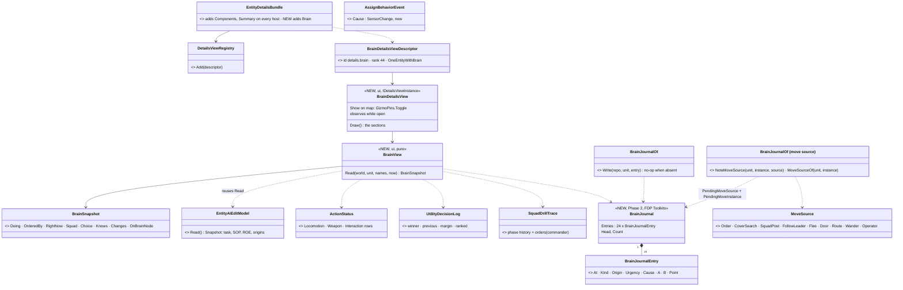
*What the picture shows that prose hid:* the tab adds ONE reader (`BrainView`) over records that already exist; the only new brain data
is `BrainJournal` and two small causes — `Cause` on the reaction's assign and the move's source — everything else is reused.
⚠ **SUPERSEDED `2026-10-23` (CE-1250):** the move's source was first drawn as a `Source` field on `MoveToParams`. That struct is at its
32-byte limit and all 8 `Flags` bits are taken, so the source is noted in the journal for the command INSTANCE (`NoteMoveSource`) and the
dispatcher's `MoveStarted` entry reads it — §11.
⚠ `EntityAiEditModel` lives in `Hrot.Editor`; the reader it holds moves to a shared assembly (or is re-read by `BrainView`) so the tab
works on every host — decided at build, the snapshot shape is unchanged.

## 4. Sequences

### 4a. The tab open on a unit (Phase 1)

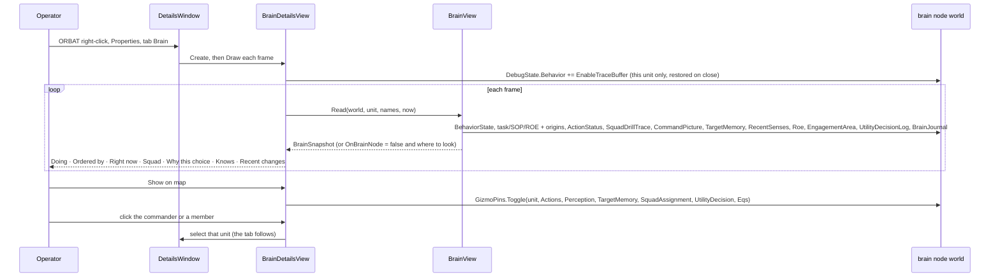

### 4b. A change written to the journal (Phase 2)

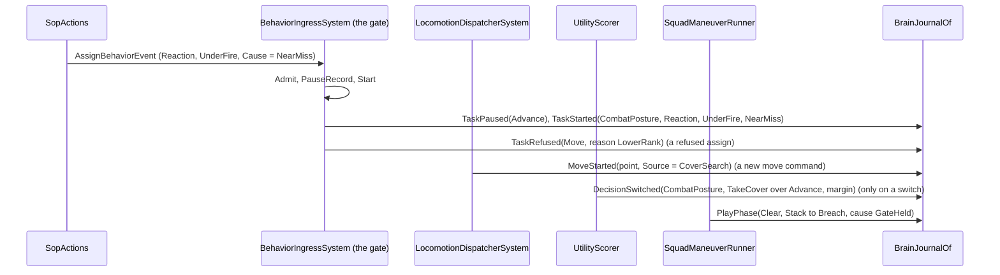
*What the sequences show that prose hid:* every write is at a place that ALREADY decides — no new system, no per-frame scan; a journal
entry is appended only when something changes, so the recorder stores a delta only then (the trace rings dirty every frame).

## 5. Modules — who registers it, who calls it each frame

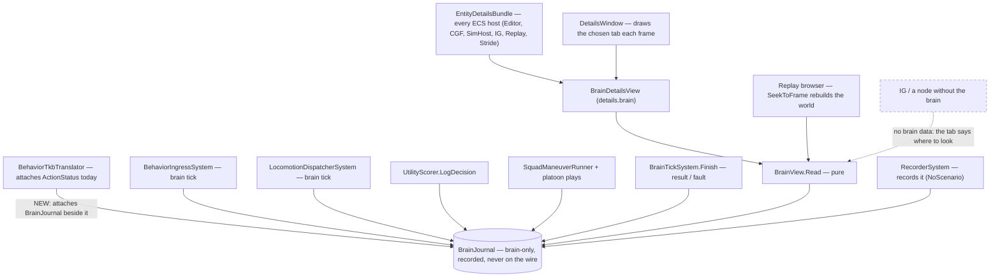
*What the picture shows that prose hid:* the tab runs on every host, but the data exists only where the brain ticks (and in that
node's recording). The dashed edge is the case to show honestly, never as empty rows.

## 6. Decisions *(approved 2026-10-23 as leaned — R-1026; BV-15, BV-16 R-1027)*

| id | decision | ⭐ lean | rejected — one line each |
|---|---|---|---|
| **BV-1** | where | a new read-only **Brain** tab (`details.brain`, rank 44) in `EntityDetailsBundle` ⇒ every host; the AI tab stays the editor | extend the AI tab — it is Editor-only and an editor |
| **BV-2** | the sections, as a story | **Doing** (task, since) · **Ordered by** (origin + who: operator / commander name / SOP / reaction + its sense) · **Right now** (ActionStatus rows, stance) · **Squad** (a leader: play, phase, member roles and orders; a man: commander, role, post, sector) · **Why this choice** (each utility decision: winner, margin, runner-up, top inputs) · **Knows** (top threat, contacts, recent hit / near miss, ROE) · **Recent changes** (the journal) | NotebookLM's five "tiers" — a taxonomy, not the questions an operator asks |
| **BV-3** | the scores | while the tab is open on a unit it sets `EnableTraceBuffer` on that unit (restored on close) ⇒ `UtilityDecisionLog` fills | make the log always on — per-consideration detail every tick on every unit |
| **BV-4** | show on map | one button pins that unit's gizmo families (R-227 pins) | new overlays — the gizmos exist, they lacked the narrative |
| **BV-5** | navigation | the commander and each member are links that select that unit | a tree of its own — the ORBAT is the tree |
| **BV-6** | a node without the brain | the tab says so and where to look (task / SOP / ROE / origin still shown — they are replicated) | empty rows · replicate all brain data now (wire cost, no remote need yet) |
| **BV-7** | low-level traces | a link "Open runtime trace" to the existing BTree / HSM runtime pane | trace rows in the tab — too low-level |
| **BV-8** | one model, three readers | `BrainView.Read` is pure ⇒ the tab, a `PanelSnapshot` dump and a `GET /entities/{id}/brain` route share it | a route of its own — two readers drift |
| **BV-9** | the journal | `BrainJournal`: 24 × 32 B ring per brain unit, **always on** (attached beside `ActionStatus`), `NoScenario` (recorded, not saved in scenarios), brain-only, never replicated; ids stored, names resolved at display | observed-only (the history must exist BEFORE you look) · a managed list (not recorded) |
| **BV-10** | the entries | `TaskStarted / Replaced / Paused / Resumed / Ended (result, fault) / Refused (reason)` · `SopStarted / SopEnded` · `DecisionSwitched` (only on a winner change) · `MoveStarted (point, source)` · `PlayStarted / PlayPhase (cause) / PlayEnded` · `OrderIssued` (a commander's order to a member) | every tick's state — that is the trace rings' job |
| **BV-11** | replay | free: the journal and the events are recorded ⇒ the tab works at a scrubbed frame in the replay browser | an offline reconstruction from events — they lack the two causes |
| **BV-12** | the two causes | `AssignBehaviorEvent.Cause` (a `SensorChange`, set by `SopActions` from the sense it reacted to) · `MoveToParams.Source` (`MoveSource`: Unknown, Order, CoverSearch, SquadPost, FollowLeader, Flee, Door, Route, Wander, Operator) — defaulting to Unknown, filled site by site (43), squad posts first | infer the source from the caller — unknowable after the fact |
| **BV-13** | refusals | the gate's refusal branches write `TaskRefused` with a reason (`LowerRank`, `LowerUrgency`, `StayOnTask`, `Unknown`, `ParseFailed`, `NoDefinition`) | keep them as log lines — the user cannot see the log per unit |
| **BV-14** | `SquadDrillTrace` | kept (the squad route reads it); the play writers ALSO write the journal | fold it into the journal now — a refactor of behaviors' live code for no user gain |
| **BV-15** | the storage and the hot path *(user, `2026-10-23`: "Will the ring … be implemented as ummanaged component to honor no allocation on hot path rule?")* | ⭐ **unmanaged**: `BrainJournal` = an `[InlineArray(24)]` of 32 B `BrainJournalEntry` + `Head`, `Count` (~0.8 KB, the `UtilityDecisionLog` shape); an entry holds numbers only (time, kind, origin, urgency, cause, two ids, a point); `BrainJournalOf.Write` takes the component by ref, copies 32 B, no-op when absent — no strings, no boxing, no allocation on the brain's path; names resolved only when the tab draws. The two causes: a byte on `MoveToParams` (unmanaged) and a byte on `AssignBehaviorEvent` (already a managed class allocated today — nothing new) | a managed list — allocates and is not recorded |
| **BV-16** | the cost, and the switch *(user, `2026-10-23`: "Recording cost is no issue, no need to toggle at runtime")* | ⭐ cost: memory ~0.8 KB per brain unit; a write = one presence check + 32 B, only on a change (⛔ ~0.2–1 per unit per second, estimated); no cost to systems that do not read it (a table per type); recording: a 64 KB chunk of journals (~83 units) is copied and LZ4-packed on a frame any of them changed (`RecorderSystem`, `FdpConfig.CHUNK_SIZE_BYTES`) — ✅ **accepted by the user, not measured as a gate**. ⭐ the switch: `BrainJournal` (default **on**, we are in engine development) in an FDP-side diagnostics settings singleton (the existing `GlobalDebugSettings` is in Hrot.Common, out of the brain code's reach), set from the host config / command line (`--brain-journal off`); read when the brain components are attached ⇒ **off = the component is never attached**, every writer costs one presence check, nothing in memory or the recording; the tab says "journal off". ⛔ **no runtime toggle** | a runtime add / remove system (the trace-ring shape) — not needed, the user ruled it out · observed-only — the history must exist before you look |

## 7. Slices and owners

| slice | owner | what | tracker |
|---|---|---|---|
| **P1** | ui | `BrainView` + `BrainSnapshot`, `BrainDetailsView` + descriptor in `EntityDetailsBundle`, observe-while-open, show-on-map, links, the no-brain line, `PanelSnapshot` dump, `GET /entities/{id}/brain` | `CE-1248` |
| **P2a** | ui *(cross-lane: FDP Toolkits Behavior)* | `BrainJournal` + `BrainJournalEntry` + `BrainJournalOf`; attach in `BehaviorTkbTranslator`, register in `CognitiveComponentRegistry`, brain-only in `HrotRoleComponentSets`; writers in the gate (`Start`, pause / resume, `Clear`, refusals, SOP), `BrainTickSystem.Finish`, `LocomotionDispatcherSystem`, `UtilityScorer.LogDecision`; the tab's Recent changes; the `BrainJournal` setting (BV-16, default on, attach-time only) | `CE-1249` |
| **P2b** | behaviors | `AssignBehaviorEvent.Cause` from `SopActions`; ⚠ the move source via `BrainJournalOf.NoteMoveSource` in `LocomotionMoveTo.Issue` (not `MoveToParams.Source` — §11) + the first sites (squad posts, EQS cover, orders, flee, door); the play / platoon phase and `OrderIssued` writers | `CE-1250` (filed by ui; behaviors may renumber in its own block on pickup — the row stays) |
| **bug** | behaviors or ui | `HsmDebugSession` stores `Guid.Empty` for state ids — the HSM history list cannot name its states | `CE-1251` |

⭐ P1 needs nothing from P2 (its Recent changes section appears when the journal exists). ⭐ P2a's entries carry `Cause = 0` / `Source =
Unknown` until P2b lands — the journal is useful from day one (task changes with origin and urgency, refusals, decisions, moves).

## 8. Acceptance

| | rail / check |
|---|---|
| P1 | a pure-model rail per section on a fixture unit (task + origin, ActionStatus row, squad phase + member orders, a utility decision, a top threat); the no-brain node line; the descriptor registered on every host bundle (a forwarding rail on the CONSTRUCTED bundle); a frame screenshot of the tab |
| P2a | a reaction pausing a task writes Paused + Started with origin and urgency; a refused assign writes Refused with its reason; a move command writes MoveStarted once (not per tick); a utility switch writes one DecisionSwitched and a steady winner writes none; the ring wraps at 24; the journal is recorded (a replay seek restores it); with the setting off the component is never attached and every writer is a no-op (BV-16); a write allocates nothing (an allocation-count rail around a burst of writes) |
| P2b | a near miss → the reaction's entry names NearMiss; a squad post move → `Source = SquadPost`; a play phase change → `PlayPhase` with its cause |
| live | `ua-*` / `pc-defend-house`: open the tab on a defender and on the platoon leader; every line reads true against what the unit visibly does |

## 9. Phase 3 — the running graph: a hard-coded behaviour shown as its graph *(approved 2026-10-23 — R-1028)*

🔒 **User, `2026-10-23`:** *"whether we could somehow show the currently running behavior on an entity as a read-only debug view of
the Btree or HSM, and if these are implemented as hard-coded in C#, if we can automatically convert them into their graph
representation"* · *"I meant conversions for behaviors that have never been a json graph asset, always just hardcided. Using auto
layout."* · *"for grubs that exist as assets, I do not need to decompile them because they are still existing on the disk"* · on the
lean: *"Approved, write it into the design. Is the auto-layouting code for btrees and hsms already existing? can the conversion to
graph for csharp only assets be done just in memory, not writing any assets to the disk?"*

### 9.1 INVENTORY *(2026-10-23 — `scripts/cbm.sh search_graph` + grep + reads; coverage not provable through the CLI)*

| query | total | what matters |
|---|---|---|
| `search_graph .*(AutoLayout\|AssetProjector\|AssetContributor)$` (Class) | 10 | `BTreeAutoLayout` (Reingold-Tilford tidy tree, 218 lines) · `HsmAutoLayout` (grid, 73 lines) · `BehaviorTreeAssetProjector` · `HsmAssetProjector` · `BTreeAssetContributor` / `HsmAssetContributor` (C#-side catalog) · `BTreeJsonAssetContributor` / `HsmJsonAssetContributor` (assets on disk) · `BlueprintAssetContributor` |
| grep `[BTreeDefinition(` / `[HsmDefinition(` (production) | 77 / 12 | curated C#: **74 BTrees** (`BTreeBuilder`) + **12 HSMs** (`HsmBuilder` → `StateMachineGraph`); plus 39 `*.btree.json` / 10 `*.hsm.json` assets on disk (not in scope — they open as they are) |
| `BehaviorDefinition.BrainTier` values | 3 | HSM, BTree, Blueprint — ⭐ **no plain-imperative brain**: every hard-coded behaviour is a builder graph |

| claim | code — how it IS | design — how it was MEANT |
|---|---|---|
| the compiled form holds the whole graph | HSM: `HsmDefinitionBlob` states (parent, children, flags, regions, history) + `TransitionDef` (source, target, event, guard, priority, polled) + `MachineMetadata` names and stable ids · BTree: `BehaviorTreeBlob` depth-first `Nodes[]` + `DebugMetadata` labels and visual ids | — |
| blob → editor graph already exists, **in memory** | `BehaviorTreeAssetProjector.Project` / `HsmAssetProjector.Project` build the editor model from a blob; auto-layout runs when no layout entry exists (`BehaviorTreeAssetProjector.cs:66`, `HsmAssetProjector.cs:290`) | BTree / HSM editor host designs §3.4 |
| ✅ **C#-only BTrees already open as graphs** (in memory, auto-laid out, debuggable) | `BTreeAssetContributor.LoadFrom` compiles builder-returning methods (CE-3160) | [Decision Layer §3.3h](DESIGN_Decision_Layer.md); R-266 |
| ⛔ the 12 C#-only HSMs never reach the HSM editor | `HsmAssetContributor.cs:37` accepts only methods returning `HsmDefinitionBlob`; all 12 return `StateMachineGraph` | — the CE-3160 fix was made on the BTree side only |
| ⛔ the live HSM highlight never draws (for asset HSMs too) | `HsmDebugSession.SetMetadata` has no production caller ⇒ `DecodeLeaves` returns empty | [HSM host design §13.4](blueprints/HSM_Editor_NodeEditor_Host_Design.md) |
| ⛔ nothing opens THE RUNNING behaviour of a chosen unit, pinned to it | the overlay lights the OPEN document only; `AiDebugSessionPump.SelectedEntity` follows the global selection; pinning deferred | [Occurrence storage §32.22](blueprints/DESIGN_Occurrence_Scoped_Storage.md) (CE-348); [entity selection §3.2](blueprints/DESIGN_Editor_Entity_Selection_Source.md) |
| nothing is written to disk unless a person asks | a code-built document has no `SourceFilePath` ⇒ Save falls to Save As (`ShellSaveCommands.cs:174`); "auto-layout saved on next save" applies to editor-owned documents | AI editor shared infrastructure (layout persistence) |
| ⛔ the HSM grid layout's readability on nested / parallel machines | **not measured** — `HsmAutoLayout` does top level in a row, children in a 3-wide grid; the host design itself says *"readable but not optimal. Users will manually arrange"* — and a read-only C# graph cannot be arranged by hand | HSM host design §3.4 |

### 9.2 Classes

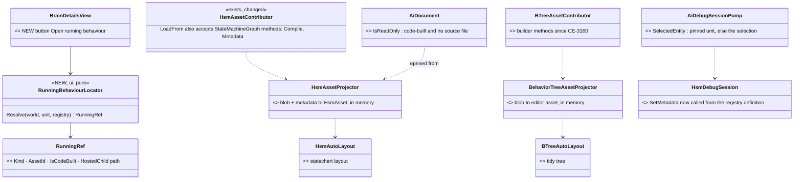
*What the picture shows that prose hid:* nothing new is built to CONVERT — the projectors and the two layouts exist; the work is one
missing catalog branch (HSM), one missing metadata call, a read-only flag, a pin, and one locator that turns "the unit's running
behaviour" into the catalog id the editor already opens by.

### 9.3 Sequence — "Open running behaviour" on a unit

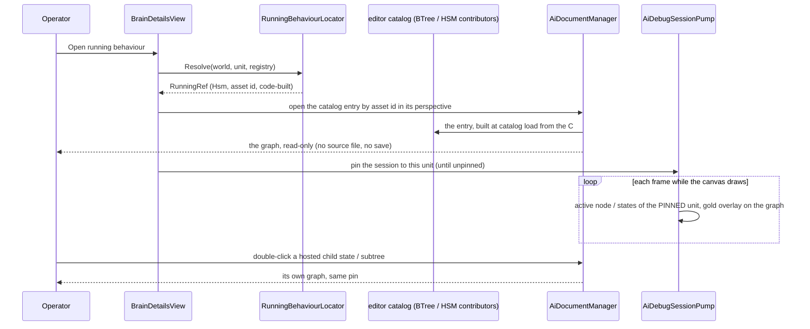

### 9.4 Modules

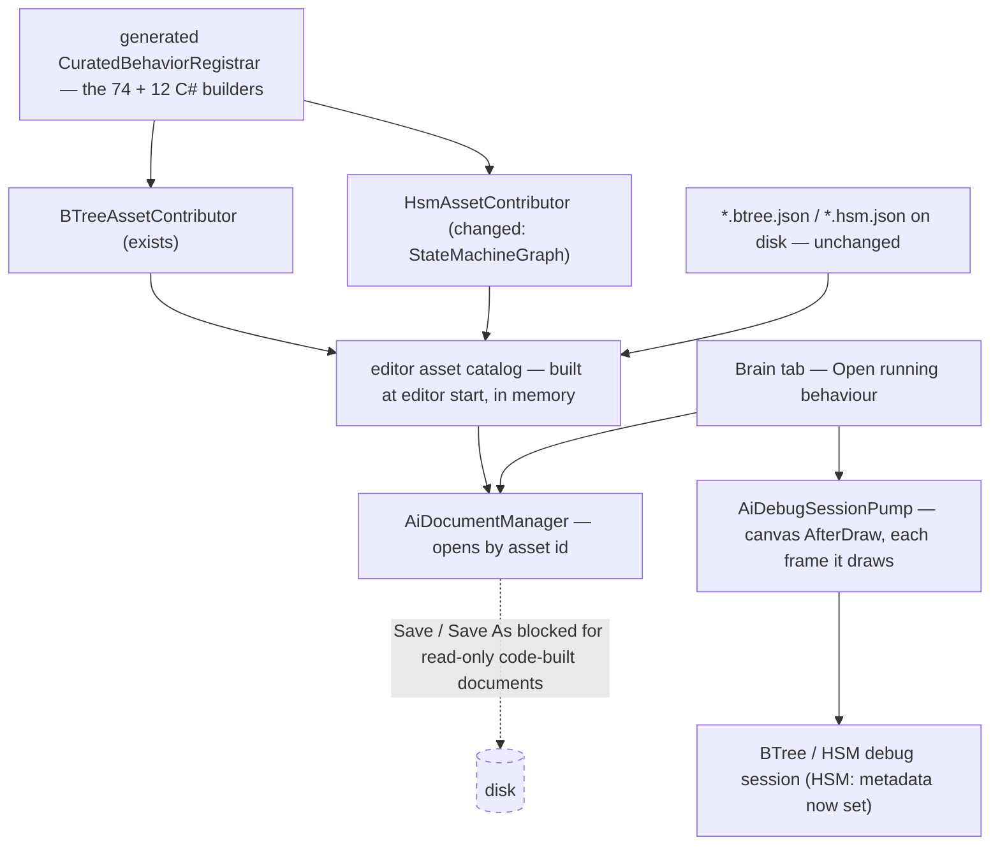
*Who calls it each frame:* only the canvas's `AfterDraw` hook while the graph is drawn — the brain never pays for this view.

### 9.5 Decisions *(approved 2026-10-23 as leaned — R-1028)*

| id | decision | ⭐ lean | rejected — one line each |
|---|---|---|---|
| **BV-17** | scope | only behaviours that have **never been a graph asset** (the 74 C# BTrees, the 12 C# HSMs); assets on disk open as they are | decompile assets too — they exist on disk |
| **BV-18** | how the graph is made | **from the compiled form, in memory, at editor catalog load**: builder → `Compile` → projector → auto-layout — the BTree path that exists since CE-3160, extended to HSMs (`StateMachineGraph` → `Compile()` + `.Metadata`) | Roslyn decompilation of the C# source — the compiled form already holds everything |
| **BV-19** | disk | ⛔ **nothing is written**: a code-built document is `IsReadOnly` (no source file) — edits and Save / Save As are blocked, with the line *"built in C# — edit `<Type>.<Method>`"*; the auto-layout is recomputed on every open | write JSON copies — a second copy of each behaviour, and R-223 / R-266 moved them TO C# |
| **BV-20** | the HSM live highlight | `HsmDebugSession.SetMetadata` fed from the registry's `HsmDefinition` / `HsmMetadata` (the session already resolves the running blob) — fixes every HSM, asset or C# | — |
| **BV-21** | opening the right graph | the Brain tab's **Open running behaviour**: `RunningBehaviourLocator` reads `BehaviorState` → the registry definition → the catalog asset id (the existing `AssetIdHasher` / attribute id) and asks the document manager to open it | search the catalog by name in the UI — the locator is one pure function, testable |
| **BV-22** | which unit the overlay follows | **pinned** to the unit the button was pressed on (the pump's `SelectedEntity` returns the pin while set, else the selection) — the pinning [entity selection §3.2](blueprints/DESIGN_Editor_Entity_Selection_Source.md) defined; unpin from the canvas toolbar | follow the global selection only — clicking elsewhere on the map loses the unit you are watching |
| **BV-23** | the HSM layout | ✅ **checked `2026-10-23` — unreadable (§11), CE-1255 built.** ~~⛔ check first:~~ a frame of PlatoonDefend / PlatoonAttack / CivilianHsm under `HsmAutoLayout`; if unreadable, implement the host design's §3.4 statechart layout (composites sized to their children, parallel regions as side-by-side strips, initial state first, children ordered by transitions) — a read-only graph cannot be tidied by hand | MSAGL or a new layout library — the BTree tidy tree exists, only the HSM needs better |
| **BV-24** | hosted children | an HSM state hosting a BTree, or a BTree subtree: double-click opens the child's graph with the same pin (`HsmHostedSubtrees`, `BTreeHostedSites` resolve it) | flatten children into one canvas — the editors already treat them as separate documents |
| **BV-25** | adjacent bug | the Blueprint live highlight follows whichever unit ran last (`BlueprintDebugSession.SetEntityFilter` has no production caller) — set it from the same pin | — |

### 9.6 Slices and acceptance

| slice | owner | what | tracker | acceptance |
|---|---|---|---|---|
| **P3a** | ui *(cross-lane: the HSM editor, behaviors' editor area)* | `HsmAssetContributor` accepts `StateMachineGraph` methods; `AiDocument.IsReadOnly` for code-built documents (edits, Save, Save As blocked) | `CE-1252` | all 12 C# HSMs listed in the HSM editor and open as graphs; a code-built document refuses an edit and a save; nothing new appears on disk |
| **P3b** | ui | `HsmDebugSession.SetMetadata` from the registry definition | `CE-1253` | a running HSM's active leaf is named in the runtime pane and glows on the canvas |
| **P3c** | ui | `RunningBehaviourLocator`, the Brain tab button, the pin in the pump, hosted-child step-in | `CE-1254` | from a unit's Brain tab the right graph opens with ITS node / state lit; clicking another unit on the map does not move the pin |
| **P3d** | ui | the HSM statechart layout — only if the BV-23 frame shows the grid unreadable | `CE-1255` | a frame of PlatoonDefend: composites enclose their children, parallel regions side by side, no overlaps |
| **bug** | ui or behaviors | Blueprint entity filter from the pin | `CE-1256` | a Blueprint graph lights only the pinned unit's nodes |

## 10. Live debugging of one unit, and the platoon's parallel regions *(approved 2026-10-23 on the proposal — R-1029)*

🔒 **User, `2026-10-23`:** *"the goal of the graph views is to see what they do in live run of course (likely stepped), together with
the decision history and various tracer stuff and watch window, how could it help giving the view of what is happening in entity's
brain? btw the platoon uses parallel regions each running its own behavior, how that is covered"* · on the proposal: *"ok write it!
turning "Debug this unit" ON as well the other debugging means need to be available to the ai debug http as well."*

⭐ The HTTP side of every item here — the routes, live and over a recording — is designed in
[`DESIGN_Agent_Shared_View.md`](DESIGN_Agent_Shared_View.md) §6. This section owns what the debugging DOES; that one owns how an agent
reaches it. One controller serves both (BV-26).

### 10.1 INVENTORY *(2026-10-23 — `scripts/cbm.sh search_graph` + grep + reads; coverage not provable through the CLI)*

| query | total | what matters |
|---|---|---|
| `search_graph .*(Breakpoint\|DebugSession\|TraceLane\|TraceTimeline).*` (Class) + reads | — | `DataBreakpointManager` (conditions are `SearchPredicateDto`, an optional filter entity, an occurrence threshold; `OnHit` pauses the clock and rewinds to the start of the tick, keeping a post-tick snapshot) · `BTreeDebugSession` / `HsmDebugSession` / `BlueprintDebugSession` · `TraceTimelineWindow` · `BTreeTraceLaneProvider`, `HsmTraceLaneProvider`, `UtilityTraceLaneProvider` |
| grep `RaiseBreakpointHit(` (non-test) | 0 callers | both sessions define it; only tests call it ⇒ the BTree / HSM Step and Continue commands stay greyed |
| read `TraceTimelineWindow.DrawClientArea` | 1 line | draws *"No trace data."*; `ITraceLaneProvider` (as built) carries lane DESCRIPTORS only, no data path; the BTree and HSM providers are registered (`EditorSubsystem.cs:4146`) and never drawn |
| read `PredicateCompiler.BuildConditionExpression` | — | the `Changed` operator compiles to `true` (`:433`) and relies on `QueryDelta(sinceVersion)` ⇒ it means *"this unit's CHUNK changed"*, not *"this unit's field changed"* |
| read `DataBreakpointSystem` + `DebugSnapshotProvider` | — | a component condition runs on every unit of a CHANGED CHUNK (`QueryDelta`), then the filter entity, then the condition; while any breakpoint is enabled the whole world is copied at the start of every tick (`DebugSnapshotProvider`, gated by `AdjustGate`) ⇒ an exact per-unit "changed" is one compare against that copy |
| read the AI debug commands (`AiDebugCommands`, `BTreeDebugSession`, `HsmDebugSession`) | 4 commands | Continue / Step Over / Step Into / Step Out, enabled only while the ACTIVE SESSION is paused; a step requests a pause once the tree's trace shows the next node (Into), the same stack depth (Over) or a shallower one (Out) — a pause lands between frames, so a step is *"run frames until this tree does X"*, never mid-tick |
| read `HsmRunner` around `HsmKernel.Update` | 1 site | one call per tick per HSM unit; `HsmKernel.GetActiveLeafIds(instance, size, out regionCount)` gives the active leaf of every region (already used at `HsmRunner.cs:233`) |
| platoon HSMs (read) | 3 | `PlatoonDefend`: root `Defending` is a Parallel — region 0 the phase (DPlan, Occupy / Ready, Engage, FallBack), region 1 the control (DWatch, OpBack, Supplementary, Reinforce, BlockStair, DLift, DAnswer). `PlatoonAttack` / `ReactToFireFromBuilding`: region 0 APlan … AWon / ABreaking, region 1 AWatch, ARelieve, AAnswer, AAbort. All transitions are polled named guards; no hosted children |

| claim | code — how it IS | design — how it was MEANT |
|---|---|---|
| a data breakpoint can already stop on ONE unit | `AddBreakpoint(condition, filterEntity, threshold, name)`, `POST /breakpoints {condition, filterNetworkId}` | ai-debug-api DESIGN group G |
| a pause shows the world BEFORE the tick that changed it | `DataBreakpointManager.OnHit`: `_postTickSnapshot.SyncFrom(live)`, then `live.SyncFrom(_preTickSnapshot)` | Blueprint debug protocol: break before, step to see |
| the timeline was meant to show swim lanes for the selected unit | the shell draws nothing | [AI editor shared infrastructure §15](blueprints/AI_Editor_Shared_Infrastructure.md) |
| the HSM's per-region state is readable after every tick | `GetActiveLeafIds` + `MachineMetadata` state names | HSM host design §13.4 (the live overlay) |
| one controller can hold the pin for the graph, the traces and the gizmos | `AiDebugSessionPump.SelectedEntity` is a `Func<Entity?>`; `EditorAiTracerCoordinator.ArmEntity`; gizmo pins (R-227) | §9 BV-22; [entity selection §3.2](blueprints/DESIGN_Editor_Entity_Selection_Source.md) |

### 10.2 Classes

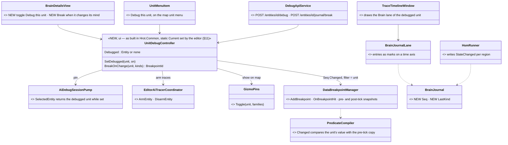
*What the picture shows that prose hid:* "Debug this unit" is ONE controller holding ONE pin that the graph overlay, the trace arming
and the gizmo pins all read — the Brain tab, the map menu and the HTTP route are three buttons on it, not three implementations. The
break-on-change adds no breakpoint machinery: it is an ordinary data breakpoint (`Seq` Changed, filtered to the unit) once `Changed` is made exact — a fix every `Changed` breakpoint gains.

### 10.3 Sequence — debug a unit, stop when it changes its mind, step

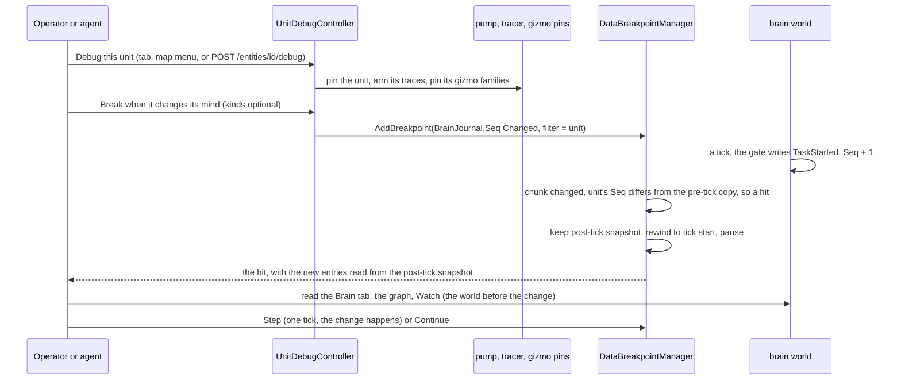
*What the sequence shows that prose hid:* the pause lands on the frame BEFORE the change (the manager rewinds), so the operator sees
the cause still in place and steps once to watch it happen; a neighbour in the same chunk changing its journal is no hit, because the
condition compares THIS unit's value with its own pre-tick copy.

### 10.4 Modules — who calls it each frame

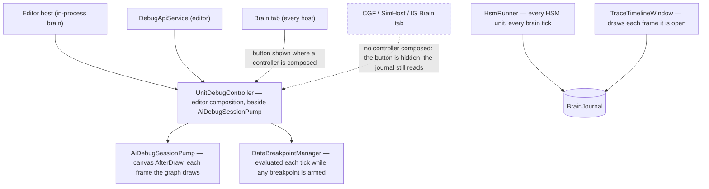
*What the picture shows that prose hid:* the controller lives where the debug sessions and the breakpoint manager live — the editor
(the `/breakpoints` routes are editor-only today, 501 on the cluster). Other hosts keep the read-only tab; they do not grow a
second debugger.

### 10.5 The regions in the tab and the journal

| shows | from |
|---|---|
| **Doing** for an HSM unit with regions: `Defending ‖ phase: Engage (since 12 s) · control: DWatch (since 3 s)` — one line per region, the parallel parent named once | `GetActiveLeafIds` + `MachineMetadata` names + `StateChanged` times from the journal |
| **Recent changes**: `StateChanged — control: DWatch → Reinforce (via ReinforceNeeded)` | the journal entry (BV-33); the guard resolved at display |
| the running graph (§9) | both regions lit at once — the HSM overlay already lights every active leaf |

### 10.6 Decisions *(approved 2026-10-23 as proposed — R-1029; BV-28's mechanism and BV-29 were measured while writing, flagged in the report)*

| id | decision | ⭐ lean | rejected — one line each |
|---|---|---|---|
| **BV-26** | "Debug this unit" | ⭐ ONE `UnitDebugController` in the editor composition; on = pin the pump (BV-22) and the Blueprint filter (BV-25), arm the unit's traces (`EditorAiTracerCoordinator.ArmEntity` — fills the BTree / HSM rings and `UtilityDecisionLog`), pin its gizmo families (BV-4); off = undo all of it. Buttons: the Brain tab, the map unit menu, `POST /entities/{id}/debug`. ⭐ One debugged unit at a time (the pin is single); arming traces on more units stays `POST /trace/observe` | three switches (pin, trace, gizmos) — the operator must remember all three · a route with its own logic — two debuggers drift |
| **BV-27** | the journal header | ⭐ `BrainJournal` gains `Seq` (uint, every entry ever written, never reset) and `LastKind` (the newest entry's kind) — `?since=` reads, the break condition and the replay dedupe all key on `Seq` | the ring `Head` — wraps at 24, cannot tell "one new" from "twenty-five new" |
| **BV-28** | break when it changes its mind *(revised 2026-10-23 on the user's question: "it can fire for any changed unit and be post processed by filtering if caused by desired unit, if not then automatic continue, no?")* | ⭐ **make `Changed` exact, then use it**: today a `Changed` condition is `true` for every unit of a chunk that changed (`PredicateCompiler.cs:433` + `QueryDelta`), so with a filter it still fires when a NEIGHBOUR in the chunk writes. The fix is the user's post-filter, done BEFORE the pause: the condition compares the unit's field with the same unit in the pre-tick copy the manager already takes every tick while a breakpoint is armed (`DebugSnapshotProvider`); a unit missing from the copy counts as changed. Then the journal break is `PropertyMatch(BrainJournal.Seq, Changed)` [AND `LastKind` in the chosen kinds], filtered to the unit — no new class. ⭐ Every other `Changed` breakpoint (health, position…) becomes exact too | pause on any chunk change, then auto-continue when it was not the unit — each false stop copies the whole world twice (`OnHit`: post-tick save + rewind) and stops / restarts the clock, possibly several times a tick · a re-armed `Seq > n` threshold — works for the journal only and leaves `Changed` wrong for everyone · a journal event per write — a second copy of every entry |
| **BV-29** | what a stop shows | ⭐ the world at the START of the tick (the manager's rewind) plus the new entries read from its post-tick snapshot (a read-only accessor is added) — the tab shows *"about to: TaskStarted CombatPosture (Reaction, NearMiss)"*; Step runs the tick | show the post-tick world — the cause is already overwritten |
| **BV-30** | the Trace Timeline — ⏸ **DEFERRED 2026-10-23 (value review):** the Brain tab's Recent changes lists the same entries; the timeline earns its build when the trace-ring lanes do | ~~draw a **Brain** lane from the journal for the debugged unit (every asset kind, always available because the journal is always on); hover = the entry, click = jump the replay scrub / select the entry. The §15 trace-ring lanes (states, events, actions) follow later — the provider has no data path yet~~ | ~~wait for the trace-ring lanes — they need the ring armed BEFORE the event, the journal does not~~ |
| **BV-31** | Step / Continue in the graph editors — ⛔ **WITHDRAWN 2026-10-23** on the user's question (*"what would that do? the main menu already shows these"*): the AI debug commands exist (Step Over / Into / Out, §10.1) but a brain tick cannot be split, so a step only means "run frames until this tree's trace shows the next node / same depth / shallower" — the main menu's frame Step plus the journal break (BV-28) cover that. They stay greyed after a data-breakpoint stop; nothing is built | ~~wire `DataBreakpointManager.OnBreakpointHit` to the active BTree / HSM session's `RaiseBreakpointHit` (no production caller today) and `OnPauseStateChanged` to clear it — the editors' step commands then work for every breakpoint, the journal break included~~ | ~~a second pause path in the sessions — the manager already owns pause (ruling 9)~~ |
| **BV-32** | regions in Doing | ⭐ one line per region (`region: leaf (since)`), the parallel parent named once; the region names from `MachineMetadata` (index when unnamed) | one flattened "current state" — hides that the control region is doing something else than the phase |
| **BV-33** | region changes in the journal | ⭐ `HsmRunner` copies the active leaves before `HsmKernel.Update` (a stack copy of `regionCount` ushorts) and writes `StateChanged(region, from, to)` for each region whose leaf changed — every HSM unit, not only platoons; the region in the entry's Origin byte; the guard named at display from the transition table (source ancestor-or-self of `from`, target ancestor-or-self of `to`), marked "?" when two fit | write only for platoon HSMs — the civilians' and squads' HSMs need the same answer · record the firing guard inside the kernel — an `ExtDeps/FastHSM` change for a name the table already holds |

### 10.7 Slices and acceptance

| slice | owner | what | tracker | acceptance |
|---|---|---|---|---|
| **P4a** | ui | `UnitDebugController`; the Brain tab toggle and the map unit menu item; `POST /entities/{id}/debug` | `CE-1257` | on: the graph overlay, the traces and the gizmo pins follow the unit and stay on it when the selection moves; off: all three restored; the route and the button produce the same state (one rail on the controller, one per button) |
| **P4b** | ui *(cross-lane: FDP Toolkits Behavior; FDP Toolkits ReplayBrowser Search for `Changed`)* | `Seq` + `LastKind`; `Changed` exact against the pre-tick copy (BV-28); the post-tick accessor; "Break when it changes its mind" in the tab; `POST /entities/{id}/journal/break` | `CE-1258` | a reaction pauses the sim once on that unit only (a neighbour in the same chunk changing does not); a `Changed` breakpoint on any field fires only when that unit's value changed; the hit names the new entry; Step shows the change applied |
| **P4c** ⏸ deferred | ui | the Trace Timeline's Brain lane | `CE-1259` | a frame of the timeline on a debugged defender: one mark per journal entry, hover names it |
| ~~**P4d**~~ ⛔ withdrawn | — | (BV-31) | `CE-1260` | — |
| **P4e** | ui *(cross-lane: FDP Toolkits Behavior; behaviors may take it)* | per-region Doing lines; `StateChanged` writes in `HsmRunner` | `CE-1261` | `PlatoonDefend`: the tab shows both regions; a control-region change writes one `StateChanged` with the right region, from and to; a tick with no change writes nothing; no allocation (the BV-15 rail) |

## 11. AS-BUILT *(2026-10-23 — CE-1248, CE-1249, CE-1257, CE-1258, CE-1261)*

| item | where | ⚠ deviation from the design above |
|---|---|---|
| **Brain tab** (CE-1248) | `Hrot.Editor.AiShared/Shell/EntityBrainView.cs`: `BrainSnapshot.Read` (pure; Doing, Ordered by, paused task, SOP, ROE, Right now, regions, squad, choices, contacts, journal), `EntityBrainView`, `EntityBrainViewDescriptor`; registered in `EntityDetailsBundle` (every host), names and definitions through `BehaviorStateRenderer.BehaviorRegistryAccessor` | ⚠ **rank 34, not 44**: the Summary card (35) is every host's default card and 44 would have replaced it for every brain unit — the tab is offered, Summary and the AI tab (45) stay defaults. ⚠ The squad section is one line (play, phase) and points at `GET /entities/{id}/squad`; the parallel parent's name is not shown (one line per region). ⚠ Show on map / member links (BV-4, BV-5) are not built — "Debug this unit" pins the gizmos |
| **brain journal** (CE-1249) | `FDP/Toolkits/Fdp.Toolkits/Behavior/Diagnostics/BrainJournal.cs` (component id **460**, ui block); attached in `BehaviorTkbTranslator` beside `ActionStatus`; registered in `CognitiveComponentRegistry`; brain-only in `HrotRoleComponentSets`; writers in `BehaviorIngressSystem` (start / pause / resume / clear / refusals with reason / SOP), `BrainTickSystem.Finish` (ended, result, fault), `LocomotionDispatcherSystem` (move start with the executor's destination), `UtilityScorer.ChooseOption` (option switch); `--brain-journal off` on the runner | ⚠ an entry carries its own `Seq`; ⚠ **a refusal identical to the newest entry refreshes its time instead of appending** (an SOP or a sense retrying every tick would wash the ring out); ⚠ `BrainRefusal`'s zero is `Unspecified` — the DDS IDL generator puts a file's enums in one scope, two `None` collide |
| **"Debug this unit"** (CE-1257) | `Hrot.Common/Diagnostics/Gizmos/UnitDebugController.cs` (static `Current`, set in `EditorSubsystem`); the Brain tab checkbox; the map's **AI trace ▸ Debug this unit (on / off)** (action 475, offered only where a controller is composed); the editor pump follows `Follow(...)` | ⚠ lives in `Hrot.Common`, not the editor composition — the menu, the tab and the route all reach it there; the label is static (menus are cached per flag set) |
| **break when it changes its mind** (CE-1258) | `PredicateCompiler.BuildChangedMatcher` + `PredicateChangeBaseline` (the breakpoint system sets the manager's pre-tick copy as the baseline); `BrainJournalBreak.Condition(kinds)`; `IDataBreakpointManager.ChangeBaseline` / `PostTickView`; the tab button; `POST /entities/{id}/journal/break` | — as designed (BV-28 revised). The hit report adds `journalWrittenByTheTick` from the post-tick copy |
| **causes — the ui half** (CE-1250) | `AssignBehaviorEvent.Cause` (`SensorChange`) → the ingress's `TaskStarted` entry `Cause`; `MoveSource` + `BrainJournalOf.NoteMoveSource` / `MoveSourceOf` (journal header `PendingMoveSource` + `PendingMoveInstance`, replacing `Reserved`) → `LocomotionDispatcherSystem`'s `MoveStarted` `Cause`; the tab / route text (*"… after NearMiss"*, *"… (CoverSearch)"*). The producers (`SopActions`, `LocomotionMoveTo.Issue` + its 46 callers, the `SquadDrillTrace` statics, the commander's order) are behaviors' — [HANDOFF](blueprints/batches/HANDOFF_Ui_To_Behaviors_Brain_Journal_Causes.md) | ⚠ **BV-12's `MoveToParams.Source` is NOT built — it cannot fit** (32-byte struct, every `Flags` bit used); the source rides in the journal per command instance. ⚠ a move not issued through `Issue` reads Unknown until its writer notes one |
| **causes — the behaviors half** (CE-1250, behaviors, 2026-10-23) | ① `SopConditions.SensedFresh` / `SensedWithin` note the sense they matched (`BrainJournalOf.NoteReactionCause`, journal header `PendingReactionCause` + `PendingReactionFrame`); `SopActions.React` takes it (`TakeReactionCause`: this frame only, then cleared) into `AssignBehaviorEvent.Cause` · ② `LocomotionMoveTo.Issue(…, source)` notes it for the new instance; all **43** callers pass one — cover (PeekAndFire, EQS cover, TakeCover, vehicle fight-from-cover) `CoverSearch` · danger-area crossings and push-through `Route` · shelter / eject / civilian panic `Flee` · civilian routine `Wander` · air attacks, the baton charge, a rioter's stone `Attack` · boarding `Embark` · carrying `Casualty` · hold-the-line / frame-watch `SquadPost` · an advance and an air order by the task's ORIGIN (`LocomotionMoveTo.OrderSource`: operator ⇒ `Order`, superior with a commander ⇒ `SquadPost`, superior without ⇒ `Order`; a hunted attack target ⇒ `Attack`) · ③ `SquadDrillTrace.Started / PhaseChanged / Ended` also write `PlayStarted / PlayPhase / PlayEnded` (A = the play kind, B = the phase, Cause = the trace's own event — `PhaseEventKind`, or Start / Retake / Timeout / End 200–203); the trace is unchanged (BV-14) · ④ `OrderIssued` in `CommandOrders.Assign` / `Order` (A = the member's network id, B = the behaviour hash, or `Order.<name>`'s for an abstract order). Rails: `SopSlotTests.CE1250_AnSopRowsMatchedSense…`, `SquadManeuverTests.CE1250_APlay_Writes…`, `CE1250_AnAdvance_IsASquadPostMove…` | ⚠ **three `MoveSource` members added** — `Attack`, `Embark`, `Casualty`: twelve call sites fitted none of the nine. ⚠ **`OrderIssued` is written in `CommandOrders`, not beside `SquadDrillTrace.Order`** — every commander (squad, platoon, HQ) gives its orders there, so one writer covers them all. ⚠ the reaction's cause is the LAST sense a row of this frame matched: a row whose condition matched but which then failed hands it to the next row's reaction in the same frame |
| **C#-built graphs, read-only** (CE-1252) | `HsmAssetContributor.LoadFrom` also compiles `StateMachineGraph` methods (`Compile()`, in memory) — all 12; `IEditableAsset.IsCodeBuilt` (a default member; `HsmAsset` / `BehaviorTreeAsset` set it from the contributor — the HSM graph branch and CE-3160's BTree builder branch); `AiDocument.IsReadOnly`; refused in both command sinks (except `isBreakpoint`), both inspectors' `ApplyFacet`, and Save / Save As (disabled, with the one line *"… is built in C#"*) | ⚠ **not "no source file"** as first written: assets built in code by tests or tools have none either, and the first gate refused 12 HSM tests' edits — the flag is explicit. ⚠ the code-built **BTrees** (CE-3160) are read-only too (BV-19 says "a code-built document") |
| **HSM highlight + history** (CE-1253, CE-1251) | `HsmDebugSession(coordinator, behaviors)`: per update it finds the unit's running machine (`ActiveBehaviorHash` → registry name) and takes the metadata the catalog registered for it (`RegisterMachine`, from `HsmAssetContributor`), else the registry definition's; the trace history decodes `TraceStateChange.StateIndex` / `TraceTransition.From/To` through it | ⚠ **the catalog's metadata, not the registry's**: a C#-built machine draws `Guid.NewGuid()` stable ids at every `Compile()`, so the running compile's ids never match the canvas; the state INDICES match (one builder, deterministic flattening). `AiAssetCatalogOptions.HsmDebugSession` passed by the editor and CGF |
| **open the running behaviour** (CE-1254) | `RunningBehaviourLocator.Resolve` (pure: `ActiveBehaviorHash` → name + tier) · the Brain tab's **Open running behaviour** · `UnitDebugController.OpenGraph` (the editor: the catalog entry of that name, `AiDocumentManager.Open`) | ⚠ **the pin is CE-1257's "Debug this unit"** (the pump already follows it) — the button turns it on; no second pin. ⚠ by NAME, not asset id: the catalog id is the attribute's or a hash, the name is what both sides share. ⚠ hosted-child step-in (BV-24) is the editors' existing double-click — not changed |
| **HSM statechart layout** (CE-1255) | `HsmAutoLayout` rewritten: bottom-up sizes, children in INTERIOR coordinates, initial state then transition order, near-square grid of content-sized cells, each region in its own band | ⭐ **BV-23 settled from the code, no frame needed:** the old grid wrote ABSOLUTE canvas positions into an interior-relative field (every composite after the first pushed out by its own offset) and gave a nested composite a cell narrower than itself |
| **Blueprint highlight** (CE-1256) | `UnitDebugController.Changed` → `BlueprintDebugSession.SetEntityFilter` (editor) | — |
| **regions** (CE-1261) | `HsmRunner` (root machine only) → `StateChanged`, Origin = region, **A = from \| to << 16, B = the behaviour** (so the display names the states from that behaviour's `HsmMetadata`); `BrainRegions.Of` for the tab's per-region lines | ⚠ the guard that fired is NOT named (BV-33's display-time lookup is not built) |

| rails *(red-proved by compiling mutations)* | |
|---|---|
| Phase 3 | `CodeBuiltMachinesTests` — the 12 listed ✅ red · an edit refused, a breakpoint taken ✅ red · the session names the running machine with the catalog's metadata ✅ red · every machine laid out with no overlaps and children inside ✅ red (the old absolute origin) · `TheBrainViewTests.TheLocator_NamesTheRunningBehaviour_AndItsTier` ✅ red · `ARegionEnteredFromNoState_ReadsEntered` ✅ red |
| CE-1250 ui half | `SopSlotTests.CE1249_AReactionPausingTheTask…` asserts the reaction's `Cause` · `BrainJournalTests.AMoveSource_BelongsToTheCommandItWasNotedFor` |
| `BrainJournalTests` (5) | ring order and wrap ✅ red · refusal coalescing ✅ red · zero allocation ✅ red · switch off · 32-byte entry |
| `SopSlotTests.CE1249_*` (3) | paused-then-started ✅ red · refusal reasons ✅ red (a value swap) · ended / cleared ✅ red |
| `TheChangedConditionIsPerEntityTests` | a neighbour's write does not hit, the unit's own does |
| `BrainTickSystemHsmArmTests.CE1261_*` | one `StateChanged` per move, none on a steady tick |
| `TheBrainViewTests` (3) · `UnitDebugControllerTests` (2) · `TheBrainAndViewRoutesAnswerTests` (3) | the reader (journal order ✅ red), the bundle offer and dump (registration dropped ✅ red) · on / move / off (move not undoing ✅ red) and the menu item (item removed ✅ red; ⚠ dropping the menu cache's 128 flag stayed green — the cache is rebuilt when the order vocabulary changes, so the flag is an unreached guard) · the routes (`?since` ✅ red, frustum behind-test ✅ red) |
| exact `Changed` · regions | old always-true answer ✅ red · inverted region compare ✅ red |

⭐ Suites after the build (2026-10-23): FDP toolkits 4068/0 · Breakpoints 165/0 · AI editor views 2135/0 · Editor 547/0 · SimHost 1851 + the 12 terrain / navmesh tests green after `dotnet restore` (the stale-restore trap: `BepuPhysics.dll` was missing from that test `bin`) · Presentation 824/2 — the two pre-existing reds `FilmDirectorTests.CE4038` and `EntityTypeCatalogTests.CE2138`, red on backend's head too.

## 12. RECORDED — the user's next ideas for the tab *(`2026-10-24`, ui — build-state: DESIGN, not yet designed in UML; leans for the user)*

🔒 User, `2026-10-24`: *"If there is anything on the character that can be runtime controlled using some settings for its behavior, I want to
be able to set it, like using sliders, for example, the aggressivity and stuff like that. It should be on the brain tab. And the stuff on the
brain tab, it should be hidden inside expanders."* · *"It was not just about character sliders, the sliders for any brain-equipped entity, of course."* · *"for the commander brain, I want to see his commander picture. For the squad, I would
like to see the merged target list or threat list … As well the reports incoming from their subordinate units. Next to those lists, probably
in the header of such a list, there should be a checkbox that turns on or off the gizmo which is showing where those targets are."*

**What exists today (measured, `scripts/cbm.sh search_graph` + grep; coverage not provable through the CLI):**

| need | exists | where |
|---|---|---|
| the tab's sections | flat — `Header()` + `Separator`, no expanders | `Hrot.Editor.AiShared/Shell/EntityBrainView.cs:395` |
| character settings | `CombatTemperament` {RiskAcceptance (bravery — the "aggressivity"), Obedience, Nerve, Resolve}, authored over type values by `Set` bits, read through `TemperamentOf`; `CombatProficiency` (what he CAN do: Untrained … Elite), read through `ProficiencyOf`; ROE / SOP / task (edited in the AI tab) | `Behavior/Components/CombatTemperament.cs`, `CombatProficiency.cs`; [Temperament & Stress](DESIGN_Temperament_And_Stress.md); [Sensors & Doctrine §7.6](DESIGN_Sensors_And_Doctrine.md) |
| behaviour params | every behaviour declares a params type; THE one form edits it (StructEdit), used by the AI tab and the mission panel; `[EditRange]` exists in StructEdit (`EditAttributes.cs:4`) | `Hrot.Presentation/Behavior/BehaviorParamsForm.cs:11` |
| a live write to the owner | `POST /entities/{id}/attribute` — *"locally where this node owns it, by request to the owner where it does not"* | `DebugApiRouteDocs.cs:2608` |
| the commander's picture | `CommandPicture` {Elements, Subordinates (last report, sitrep, seq), Requests} on a receiving commander; drawn by `CommandPictureGizmo` (family `SquadAssignment`) | `Squad/Command/CommandComponents.cs:107`; `CommandPictureGizmo.cs:53` |
| the squad's merged contacts | `SquadContactPool` (16 merged contacts, threat score, who reported) on the squad; drawn by `SquadGizmo` with the member lines | `Squad/State/SquadCognitiveState.cs:104-170`; `SquadGizmo.cs:16` |
| the reports | the Reports window + `GET/POST /entities/{id}/reports` | [Command Display](DESIGN_Command_Display.md) |

| # | idea | ⭐ lean | open point |
|---|---|---|---|
| **BV-34** | every section of the tab in an EXPANDER | `ImGui.CollapsingHeader` per section; open state remembered per section (not per unit); "Right now" and "Doing" open by default, the rest closed | — |
| **BV-35** ⛔ *reshaped by §12b BV-41…BV-43* | a **Settings** expander with SLIDERS on **every brain-equipped entity** (soldier, civilian, vehicle, aircraft, commander) — ⭐ built GENERICALLY, never a hand list per type: ① his TRAIT components, whichever he has (`CombatTemperament` — bravery shown as "Aggressiveness", obedience, nerve, resolve; `CombatProficiency`; a civilian's temperament), ② the **running behaviour's params** through THE one params form (`BehaviorParamsForm`, CE-3043 — the AI tab's own), ③ his blueprint variables (the staged write `POST /entities/{id}/variable` already does); every number with an `[EditRange]` draws as a slider (StructEdit); each shows the type's value and a reset; writes are LOCAL to the node that runs his brain — ⛔ nothing travels over the network (§12a BV-39); ⛔ disabled in the replay browser | ⚠ **supersedes BV-1's "read-only"** for this expander; ✅ a trait edit is a runtime component change and is SAVED with the scenario like any other (user, 2026-10-24); a changed running-behaviour param re-assigns that task with the new params, as the AI tab's edit does — lean: yes; fields with no `[EditRange]` get one added where the design gives a range (0–1 traits) |
| **BV-36** | the COMMANDER's lists | on a commander: three expanders — **Picture** (`CommandPicture`'s elements and requests), **Squad contacts** (`SquadContactPool`: who, threat, how old, how many members saw it), **Reports** (the subordinates' last report and sitrep, newest first — the Reports window's rows for this commander) | the brain tab runs on every host; the picture is replicated, the pool is brain-local — show "not on this node" where absent |
| **BV-37** | a CHECKBOX in each list's header that draws its gizmo | ticked = that gizmo draws for THIS commander, whatever is selected (it pins the unit for that family — the pinning `DESIGN_Editor_Entity_Selection_Source.md` §3.2 already owns), and turns the **Squad & command** layer on if it is off; ✅ **a LINE from the commander to every target the list holds a position for** (user, 2026-10-24) — so it is clear whose targets they are | the squad contacts are drawn inside `SquadGizmo` with the member lines — lean: split the contacts into their own family so the checkbox shows only them |

### 12a. ✅ DECIDED `2026-10-24` — the Brain tab REPLACES the AI tab; it is full only where the brain runs *(`R-1036`)*

🔒 User, `2026-10-24`, verbatim: *"The AI tab itself is quite unclear. The brain replaces it, so whatever is related to the AI should go to the
brain under separate expanders, no matter what, if it is read-only or editable. If it relates to brain, it needs to be on the brain tab, and
we can get rid of the AI tab. The Brain tab can be shown fully all only for the host where the brain is running. The settings do not need to
be replicated, do not need to travel over network. Because the sliders are changing the runtime state of the entity, likely as a component,
and that component is savable to the scenario, then it's natural that when we save the scenario, the new settings will be saved to the
scenario."* · *"regarding the target lists, if they keep the position of the target, there should be also lines leading from the commander
entity to the targets. So it is clear for who those target gizmos are displayed."*

| # | decided | supersedes |
|---|---|---|
| **BV-38** | ⭐ **everything about a unit's AI lives on the Brain tab**, each part in its own EXPANDER, read-only or editable alike: the AI tab's task / SOP / ROE editing and its instance-blueprint params rows ([Sensors & Doctrine §7.6, §7.6a](DESIGN_Sensors_And_Doctrine.md)) move in as expanders, THE one params form unchanged; ⛔ **the AI tab (`details.ai`, `EntityAiDetailsView`) is retired** once they have moved | ⛔ BV-1 *"a new read-only Brain tab … the AI tab stays the editor"* |
| **BV-39** | ⭐ **the tab is FULL only on the node that runs the unit's brain** (the editor in-process, a CGF node); elsewhere it shows one line saying where the brain runs. Edits are LOCAL there — ⛔ no replication, no owner request | BV-35's first wording (*"writes go to the OWNER … works on any node"*) |
| **BV-40** | ✅ a setting changed live is a runtime COMPONENT change; saving the scenario saves it like any other component | — |
| **BV-37+** | ✅ each target-list gizmo draws a LINE from the commander to every target it has a position for | — |

### 12b. ✅ DECIDED `2026-10-25` — the tab's LAYOUT: grouped settings, every running behaviour alike, blueprints managed here *(`R-1037`, build-state: DESIGN — UML below, ready to slice)*

🔒 User, `2026-10-25`, verbatim: *"the user who wants to see and tune the behavior doesn't care what component the settings lives in.
He just wants some tunable UI. So we can technically do it per component, but we need some way of aggregation to the user interface."* ·
*"the brain view is mostly the diagnostic view. So we might reuse the dump which is used by entity inspector … The goal is to be able to see
the variables of the behavior, no matter whether it is C# hard-coded or JSON asset defined."* · *"we need to show the currently running
behaviors and their variables and their parameters for every behavior which is running in parallel. And there are, of course, blueprints
that can be running on the entity. I think they should be listed on their own expander … treated as such from the user point of view."* ·
*"The brain view shoudl also allow/edit/remote new blueprint instances to be added to an antity - i guess there is a separate panel for
that now - should become ex expander on the brain view i guess"* · on the variables: *"let the variables as they are, no sliders there"* (edits go through the Watch window).

⛔ **Supersedes:** BV-35's three-part Settings expander (its ② params → the task / SOP / blueprint expander's params form, ③ blueprint
variables → that expander's read-only dump) · `DESIGN_Behaviour_Debugging.md` DBG-1 (deeper VIEWS → deeper EXPANDERS) and DBG-5 (a new
Variables view → the dump below) · the Entity Blueprints Details view (`details.entityblueprints`, CE-302) as a separate home.

**INVENTORY / measurements** *(`2026-10-25`, grep + reads; the codebase-memory CLI was indexing a fresh VM; ⚠ coverage not provable)*:

| the layout rests on | code — how it IS | design — how it was MEANT |
|---|---|---|
| a trait slider must set the authored bit, not just the value | ✅ `CombatTemperament.Set` — *"A clear bit ⇒ the type's value"* (`Fdp.Toolkits/Behavior/Components/CombatTemperament.cs:24-26`); reset = clear the bit | ✅ Temperament & Stress, CE-2269 TS-3 |
| the existing tuning console does not fit | ⛔ `Hrot.Diagnostics.Tuning`: global / per-decision values, NO production caller (grep), and it sits ABOVE `Fdp.Toolkits` so a component cannot carry `[Tunable]` | its §4.3 `PerEntity` scope was never built |
| the inspector's dump renders a behaviour's params + working state as C# values with the custom renderers | ✅ `BlueprintBlackboardRendererBase.cs:116-119` → `RootParamsProjection` / `StatefulWorkingStateProjection` → `ImGuiPropertyTree.Render` → `ImGuiRendererRegistry` (`ImGuiPropertyTree.cs:206`; `EntityRenderer` = `[index, vN]`) | ✅ Occurrence Storage §17 |
| it shows only the TASK slot | ⛔ `StatefulWorkingStateProjection.cs:58` reads `BehaviorState.ActiveBehaviorHash` only; the SOP slot (`SopState.SopHash`) runs beside it and storage keys by behaviour hash (`BrainSlotScope`) ⇒ the SOP is readable by its hash | ✅ Decision Layer §4, Sensors & Doctrine §6 |
| hosted children (an HSM in a BTree node, a subtree, a blueprint child) have their own state | ✅ a site slot `[brain][start][block]` laid out from the CHILD's definition, keyed by the nested occurrence key | ✅ `DESIGN_Unified_Behaviour_Run.md` S5a/S5b |
| attached blueprints' variables are NOT in the dump | ⛔ the inspector lists name / version / size only (`BlueprintBlackboardRendererBase.cs:84-104`); the editor's decoder is `BlueprintDebugSession.ReadInstanceState` (`Hrot.Blueprints.Editor`, unreachable from the Brain tab's assembly) | the types exist: `BlueprintDefinition.StateClrType` / `ParamsClrType` (`Fdp.Toolkits/Blueprints/BlueprintDefinition.cs:86-91`); the payload offset owner is `BlueprintBlackboardPartitions.TryGetSlotOffset`, which the debugger's own owner delegates to (`BlueprintDebugSession.cs:1848`) |
| a fixed list in the dump shows its whole buffer | ⚠ `ImGuiPropertyTree.cs:171` expands an `[InlineArray(N)]` to N elements, ignoring `Count` | ✅ `Blueprint_Fixed_Collections_Design.md` — F2 clamp `min(max(Count,0),N)`; `Fdp.Core.FixedListShape` is the one shape test |
| blueprint add / remove already has a staged model | ✅ `EntityBlueprintsEditModel` (StageAdd / StageRemove / BuildCommitPlan, paused vs running) + `EntityBlueprintsPanel` ("+ Add Blueprint…", Apply, Revert All) | ✅ `DESIGN_Editor_Entity_Selection_Source.md` §5 (CE-302) |
| blueprint params already have an editor | ✅ `EntityAiEditModel.InstanceRows` / `ApplyInstanceParams` + THE one params form | ✅ Sensors & Doctrine §7.6a (CE-2086) |
| the Brain tab is shown in PLANNING | ✅ predicate = one entity with `BehaviorState` (`EntityBrainView.cs:421`); `BehaviorTkbTranslator.cs:99` attaches it at spawn for every type with a behaviour profile, planning included | — |
| ⚠ but Entity Blueprints applies to ANY one entity | ⛔ `EntityBlueprintsDetailsView.Applies = ExactlyOneEntity` (`:120`) ⇒ an entity with NO brain can carry blueprints today and would lose its only place | ⛔ searched `docs/`, no ruling on brainless blueprint hosts |

```mermaid
classDiagram
  direction LR
  class EntityBrainView {
    <<EXISTS>>
    grows expanders per §12b layout
  }
  class BrainSettingsSection {
    <<NEW>>
    groups → sliders
  }
  class IBrainSettingProvider {
    <<NEW>>
    interface
    +Group string
    +AppliesTo(view, e) bool
    +Settings(view, e) BrainSetting list
    +Write(e, key, value)
    +Reset(e, key)
  }
  class BrainSetting {
    <<NEW>>
    record Key · Label · Value · TypeValue · Min · Max · IsAuthored
  }
  class CombatTemperamentSettings {
    <<NEW>>
    Group Temperament, Write sets the Set bit
  }
  class CombatProficiencySettings {
    <<NEW>>
    Group Combat skill
  }
  class BrainSettingRegistry {
    <<NEW>>
    providers; For(view, e) groups merged by Group
  }
  class BehaviourStateReader {
    <<NEW>>
    Hrot.Presentation
    +Running(session, e) RunningBehaviour list
  }
  class RunningBehaviour {
    <<NEW>>
    record Kind(Task·Sop·Hosted·Blueprint) · Name · Depth · Params object? · Variables object?
  }
  class RootParamsProjection {
    <<EXISTS>>
    routes through the reader
  }
  class StatefulWorkingStateProjection {
    <<EXISTS>>
    routes through the reader
  }
  class ImGuiPropertyTree {
    <<EXISTS>>
    grows: FixedListShape clamp
  }
  class ImGuiRendererRegistry {
    <<EXISTS>>
  }
  class BrainSlotScope {
    <<EXISTS>>
  }
  class HostedChildren {
    <<EXISTS>>
  }
  class BlueprintBlackboardPartitions {
    <<EXISTS>>
    TryGetSlotOffset
  }
  class BlueprintDefinition {
    <<EXISTS>>
    StateClrType · ParamsClrType
  }
  class EntityBlueprintsEditModel {
    <<EXISTS>>
    unchanged
  }
  class EntityBlueprintsPanel {
    <<EXISTS>>
    drawn inside the tab
  }
  class EntityAiEditModel {
    <<EXISTS>>
    InstanceRows · ApplyInstanceParams
  }
  class BehaviorParamsForm {
    <<EXISTS>>
    THE one params form
  }
  class EntityBlueprintsDetailsView {
    <<RETIRED>>
  }
  EntityBrainView --> BrainSettingsSection
  BrainSettingsSection --> BrainSettingRegistry
  BrainSettingRegistry o-- "*" IBrainSettingProvider
  IBrainSettingProvider <|.. CombatTemperamentSettings
  IBrainSettingProvider <|.. CombatProficiencySettings
  IBrainSettingProvider ..> BrainSetting
  EntityBrainView --> BehaviourStateReader
  BehaviourStateReader ..> RunningBehaviour
  BehaviourStateReader --> BrainSlotScope : SOP by hash
  BehaviourStateReader --> HostedChildren : nested, recursive
  BehaviourStateReader --> BlueprintBlackboardPartitions
  BehaviourStateReader --> BlueprintDefinition
  RootParamsProjection --> BehaviourStateReader
  StatefulWorkingStateProjection --> BehaviourStateReader
  EntityBrainView --> ImGuiPropertyTree : read-only dump
  ImGuiPropertyTree --> ImGuiRendererRegistry
  EntityBrainView --> EntityBlueprintsPanel
  EntityBlueprintsPanel --> EntityBlueprintsEditModel
  EntityBrainView --> BehaviorParamsForm : task · SOP · blueprint params
  BehaviorParamsForm ..> EntityAiEditModel
```
*What the picture shows that prose hid:* ONE new reader feeds BOTH the inspector and the tab (the two projections route through it), so
the SOP, hosted children and blueprints appear in both at once; the slider half is a registry of providers whose GROUP, not component,
is what the user sees; and blueprint management adds no class — the existing panel and model are drawn somewhere else.

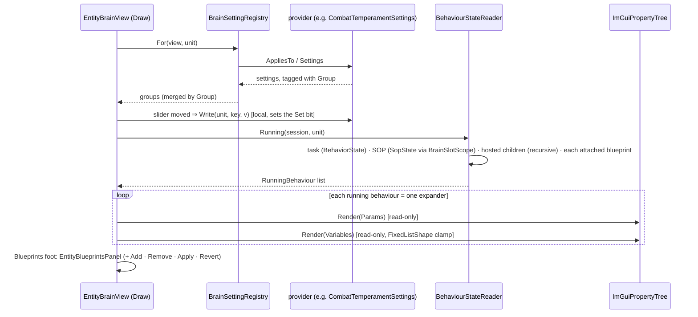
*What the picture shows that prose hid:* the slider is the ONLY write the tab does itself; params go through the existing form and
blueprint changes through the existing staged model, so the tab owns no new write path.

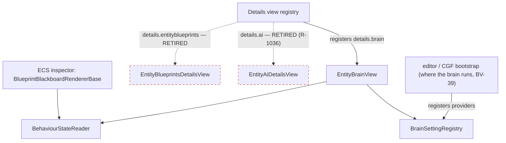
*What the picture shows that prose hid:* the tab and the inspector share one reader each frame; the two retired views are dashed — they
draw nothing once their content lives here.

| # | decided | ⭐ lean / rule |
|---|---|---|
| **BV-41** | **Settings = GROUPS, never components** | every component that steers a behaviour gets an `IBrainSettingProvider`; each declares a user-facing **Group** (*Temperament*, *Combat skill*, later e.g. *Weapon weights*); two providers may share a group and merge into it; the expander draws one sub-header per group, a slider per setting with the type's value and a reset. ⛔ Rejected: reflection over `[EditRange]` fields (misses the authored bit — the slider moves, the unit does not change) · the tuning registry (global / per-decision, unwired, wrong layer) |
| **BV-42** | **every running behaviour alike** | a *Running behaviours* section: one expander per behaviour — the task, the SOP, each attached blueprint — nested runs (HSM regions, subtrees, a hosted child of any tier) as sub-headers of their owner; each shows **Parameters** and **Variables** |
| **BV-43** | **the variables are the inspector's DUMP, read-only** | `ImGuiPropertyTree` with the registered renderers; no sliders, no inline edits — *Add to Watch* / the Watch window edit them. ⛔ Rejected: the asset-variable table (`VariableTableControl`) — it cannot show a C# behaviour (CE-1286) |
| **BV-44** | **ONE reader, shared with the inspector** | `BehaviourStateReader` (Hrot.Presentation) enumerates task + SOP (by hash, the `BrainSlotScope` rule) + hosted children (recursive, the S5 site slot) + attached blueprints (`TryGetSlotOffset` + `StateClrType` / `ParamsClrType`); `RootParamsProjection` / `StatefulWorkingStateProjection` route through it, so the inspector gains the SOP, the children and the blueprint variables too. ⛔ Rejected: a second decoder for the tab (two decoders drift) · calling `BlueprintDebugSession` (wrong assembly; its owner already delegates to `TryGetSlotOffset`) |
| **BV-45** | **a fixed list shows its Count** | `ImGuiPropertyTree`'s `[InlineArray]` arm asks `FixedListShape`; a list draws `Count` items (clamped, F2), a plain inline array keeps drawing N |
| **BV-46** | **blueprints are managed on the tab** | the task / SOP / blueprint expanders carry the params form (BV-38); at the section's foot **+ Add blueprint…**, a **Remove** per blueprint expander, **Apply / Revert all** — `EntityBlueprintsPanel` + `EntityBlueprintsEditModel` unchanged, drawn here; ⛔ `details.entityblueprints` is RETIRED once it moves; disabled in the replay browser |
| **BV-47** | ✅ *accepted by the user `2026-10-25`* — **an entity with no brain** | the tab applies to EVERY single entity; with no `BehaviorState` it shows only the Running-behaviours section (its blueprints, + Add). ⛔ Rejected: keep the Entity Blueprints view for brainless entities (two places again) · leave them without a home (the measured regression) |

### 12c. ✅ APPROVED `2026-10-25` — viewing IS debugging; the map gizmos one family at a time *(`R-1038`; build-state: DESIGN)*

🔒 User, `2026-10-25`: *"approved. just brain debug gizmos, not planned route or phase lines."* ⇒ ⛔ the **Path** family (`AuthoredRouteGizmo`, `MissionPresentationGizmo`, `PlannedPathGizmo` — the route and mission graphics) is NOT on the Brain tab; *Show on map* lists Perception · Contacts · EQS · Utility · Squad · Actions (+ BV-50's two).

🔒 User, `2026-10-25`, verbatim: *"that checkbox debug entity should not turn on every gizmo at once. It should just turn on some extended
tracing or something, but not all gizmos; turning all gizmos at once would be overwhelming and would not help. That needs to be more
granular."* · *"when I am watching an entity and its brain view is being shown, this is the place, this is the condition that should turn
this full debug on"* · *"the brain view tab should also allow turning on off the tactical map symbol gizmos that are related to the brain"*
· the commander's picture, the squad's merged target list, and *"a way how to show the targets in 3D as lines using gizmos, lines leading
from the commaner entity"* (already BV-36, BV-37, BV-37+).

| the leans rest on | code — how it IS | design — how it was MEANT |
|---|---|---|
| *Debug this unit* does three things at once | ✅ `UnitDebugController.Apply`: `AiTraceActions.Set(EnableTraceBuffer)` + **`GizmoPins.SetAll`** (`Hrot.Common/Diagnostics/Gizmos/UnitDebugController.cs:63-66`); the graph overlay follows `Debugged` (`Follow`, `:37`) | BV-26 (§10) — the "pins everything" half is what the user rejects |
| tracing alone fills what the tab shows | ✅ the trace flag makes `TraceBufferLifecycleSystem` attach `UtilityDebugFlags` (`:105`) ⇒ the utility log the *Why* section reads (`UtilityScorer.cs:253-257`), plus the BTree / HSM rings | ✅ Utility AI §9 (*"filled only while observed"*) |
| pins already exist per family | ✅ `GizmoPins.Set(view, unit, family, on)` (`GizmoPins.cs:49`); 7 families: Path · Perception · Contacts · EQS · Utility · Squad · Actions (`GizmoFamilies.All`); every family's scope defaults to selected-or-pinned (CE-1065) | ✅ `DESIGN_Terrain_Combat_Tuning.md` §5b/§5d |
| the commander's three gizmos are NOT separable today | ⛔ the command picture, its engagement areas AND the squad's contacts all draw under ONE family, `SquadAssignment` (`CommandPictureGizmo.cs:28,53,132`; `SquadGizmo.cs:23`) ⇒ one checkbox would show all of them | BV-37's open point already leaned "split the contacts into their own family" |
| the flag word has room | ✅ `AiOverlayFlags : ushort`, bits 0…6 used (`AiOverlayFlags.cs:12-22`) | — |

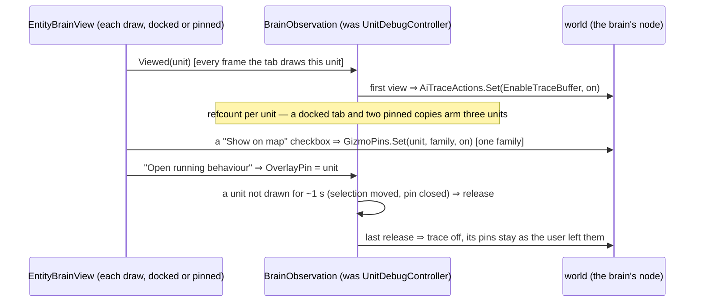
*What the picture shows that prose hid:* the tab's DRAW is the arming signal, so nothing has to be remembered; tracing and gizmos are two
separate switches with two separate owners — the observation owns tracing, the user owns each family.

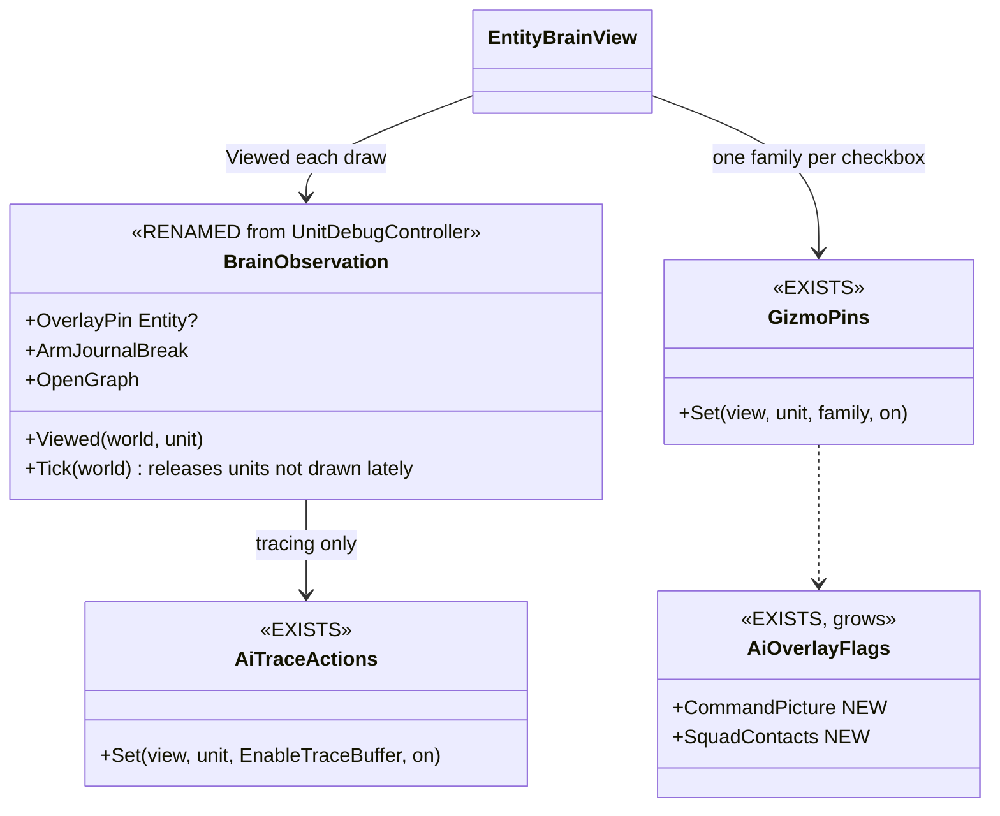
*What the picture shows that prose hid:* the controller loses `GizmoPins.SetAll` entirely — no path left turns every family on.

| # | idea | ⭐ lean | rejected — one line each |
|---|---|---|---|
| **BV-48** | **viewing a unit's Brain tab IS debugging it** | every unit a Brain tab is drawing (docked on the selection, or a pinned copy) has its traces armed — BTree / HSM rings and the utility log — refcounted, released ~1 s after no tab draws it; ⛔ the *Debug this unit* checkbox is REMOVED, and the *"kept only while … (Debug this unit)"* hint goes with it (the tab says *"recording since this tab opened"* until the first entry) | keep the checkbox — the user's ruling · arm on SELECTION — a selected unit with no tab open would pay for rings nobody reads |
| **BV-49** | **never every gizmo at once** | a **Show on map** expander: one checkbox per family the unit has data for — Path · Perception · Contacts · EQS · Utility · Squad · Actions — each `GizmoPins.Set` for that one family; nothing is pinned by opening the tab; ⛔ `GizmoPins.SetAll` loses its caller in the controller | pin all on view — the overwhelm the user named · keep a "pin all" button — the same overwhelm one click away |
| **BV-50** | **the commander's lists, separable** | two NEW families, `CommandPicture` (the picture + its engagement areas) and `SquadContacts` (the merged contact pool), split out of `SquadAssignment`; each list's header checkbox (BV-37) is that family's pin; each target with a position draws a LINE from the commander (BV-37+); `Squad` keeps the member / assignment lines | one family for all three — one checkbox would draw everything (measured) |
| ~~**BV-51**~~ ⛔ *superseded by §12d BV-55 (the document carries its own pin)* | **which unit the graph overlay follows** | *Open running behaviour* pins the overlay to the unit it was pressed on (BV-22's pin, without the checkbox); otherwise the overlay follows the selection | follow every viewed unit — one canvas cannot show two units |
| ✅ **closed** | *"tactical map symbol gizmos related to the brain"* | the brain DEBUG families only — ⛔ not the route / phase lines (the user, above) | — |

### 12d. RECORDED `2026-10-25` — target lines, the report / order flow, and which unit a graph follows *(build-state: DESIGN — leans for the user)*

🔒 User, `2026-10-25`, verbatim: *"lines to targets should be have chanckbox to turn on/off as other gizmos (not sure if targets are already
included in the exiting gizmos for EQS/sensors - we should not duplicate, but unify)"* · *"How could we show the report/order flow, i guess
commander entity should have an expander for incoming reports and likely also for orders sent to subordinates."* · *"live graph (decompiled
from csharp or from asset) should follow the entity shown in the brain view panel … For brain view pinned to concrete entity, if we open the
graph for one of the behaviors, the graph should be also pinned to the entity. The graph needs to indicate the pinning somehow - for what
entity network id it is shown - maybe in its tab header?"*

| the leans rest on | code — how it IS | design — how it was MEANT |
|---|---|---|
| a unit's lines to ITS targets already exist | ✅ `LineOfSightGizmo` (family **Contacts** = `TargetMemory`): a gradient line from the unit to each remembered contact, dashed when only heard, a sphere at the target (`Hrot.Common/Diagnostics/Gizmos/LineOfSightGizmo.cs:7-44`) | ✅ Terrain Combat Tuning §5b/§5d |
| the squad's merged contacts have NO lines | ⛔ `SquadGizmo` draws the pool as spheres only (`SquadGizmo.cs:62-64`); its lines are leader → members (`:57`) | BV-37+ asks for commander → target lines |
| EQS and Perception do not draw targets | ✅ EQS = scored candidate points (`EqsSensorGizmo`); Perception = cones (`VisibilityConeGizmo`) | — |
| incoming reports are recorded | ✅ `CommandPicture.Subordinates` (each subordinate's last report + sitrep + seq, `CommandComponents.cs:107`); `SquadReportLog` — the last 256 reports a brain node's inbox saw (`Squad/Command/ReportInjection.cs:30`); the Reports window | ✅ `DESIGN_Command_Display.md` |
| orders sent are recorded | ✅ `SubordinateOrders` — each member's latest order from this commander's run, brain-local (`Behavior/Components/SubordinateOrders.cs:19`); the journal's `OrderIssued` entries (A = member, B = behaviour — `BrainJournal.cs:39-40`) | ✅ `DESIGN_Orders_Params_Entity_Classes.md` §7 |
| the graph overlay follows ONE global unit today | ⛔ one pump per graph perspective; `SelectedEntity = UnitDebugController.Follow(..) ?? selection` (`EditorSubsystem.cs:4501`); the document knows no entity | BV-22 |
| one document per ASSET | ⛔ `AiDocumentManager.Open` re-focuses any open document with the same `AssetId` (`AiDocumentManager.cs:122-127`) ⇒ two pinned Brain views opening the same behaviour would share one document | — |

| # | idea | ⭐ lean | rejected — one line each |
|---|---|---|---|
| **BV-52** ✅ *approved `2026-10-25`* | **target lines, ONE drawing** | the squad pool's contacts and the command picture's element positions draw with the SAME contact line `LineOfSightGizmo` draws (one helper, the commander as the line's origin) under BV-50's `SquadContacts` / `CommandPicture` families — so *Contacts* (his own memory), *Squad contacts* and *Command picture* are three checkboxes over one look | a second line style per list — the duplication the user ruled out · fold the pool into *Contacts* — the commander's own memory and his squad's merged pool are different questions |
| ~~**BV-53**~~ ⛔ *reshaped by BV-57 (history)* | **Reports (incoming)** — a commander's expander | one row per subordinate from `CommandPicture.Subordinates` … | — |
| ~~**BV-54**~~ ⛔ *reshaped by BV-58 (history)* | **Orders (outgoing)** — a commander's expander | one row per member from `SubordinateOrders` … | — |
| **BV-55** ✅ *approved `2026-10-25` (R-1039)* | **a graph follows the Brain tab it was opened from** | *Open running behaviour* from a DOCKED tab ⇒ the graph follows the selection (what that tab shows); from a PINNED tab ⇒ the graph document is PINNED to that entity. `AiDocument` gains `PinnedEntity`; the pump reads the ACTIVE document's pin, else the selection; `Open` dedupes on (asset, pin), so two pinned tabs on one behaviour get two documents; the tab header reads **`PlatoonDefend · #1:2975`** when pinned and the plain name otherwise. ⛔ `UnitDebugController.Follow` / BV-51's overlay pin retire — the document carries it | a global debug pin — what exists, one unit for every graph · follow the selection always — breaks the pinned case the user named |

🔒 User, `2026-10-25`, verbatim: *"what are "squad contacts", why "squad", doesnt this work on any level of unit hierarchy? is squad
exceptional?"* · *"shouldn't orders and reports have some history? one row does not seem enough to understand why something is happening."*
· *"BV55 approved."*

| the answer rests on | code — how it IS | design — how it was MEANT |
|---|---|---|
| "squad" is a NAME, not a level | ✅ every entity with a `UnitRoster` is a commander and gets `SquadCognitiveState` (`Squad/State/SquadStateProvisioning.cs`, *"an entity that owns a UnitRoster is a commander, and a commander has squad state"*) — a platoon or company HQ too | ✅ the `O1` invariant in that file |
| the pool merges what his DIRECT subordinates themselves perceive | ✅ `SquadPerceptionMergeSystem`: each roster member's `TargetMemory` (`:47-51`) ⇒ under a body-less squad leader (no `TargetMemory`) a platoon HQ's pool stays EMPTY — above the first level the picture comes from REPORTS (`CommandPicture`) | ✅ `DESIGN_Command_Display.md` (the picture is report-fed) |
| one row is all the orders store keeps | ✅ `SubordinateOrders` = each member's LATEST order (`Behavior/Components/SubordinateOrders.cs:19`); `CommandPicture.Subordinates` = each one's LAST report | — |
| the existing histories are short or shared | ⚠ the brain journal holds **24** entries per unit, of EVERY kind (`BrainJournal.cs:135`) ⇒ a commander's orders compete with his own task changes; `SquadReportLog` holds **256** per brain node, for EVERY commander there (`ReportInjection.cs:30`) ⇒ a big fight evicts one commander's reports quickly | — |
| each journal entry carries its CAUSE | ✅ BV-15 / BV-27 (`OrderIssued` A = member, B = behaviour; the cause resolved at display) | ✅ §6 BV-15 |

| # | idea | ⭐ lean | rejected — one line each |
|---|---|---|---|
| **BV-56** ✅ *approved* | **name it by what it is, at every level** | the expander and its gizmo family say **"My units' contacts"** (merged from his direct subordinates' own eyes), shown on ANY commander; where the pool is empty because the subordinates have no eyes, the expander says so and points at **Command picture** (the report-fed view) — the two together answer *"what does this HQ know"* at every echelon; the code type `SquadCognitiveState` keeps its name (a rename is a separate Roslyn job, not this design) | "Squad contacts" — reads as squad-only, which is false |
| **BV-57** ✅ *approved; its ring is a COMPONENT (BV-60)* | **Reports — a HISTORY, not a row** | the expander: on top one summary line per subordinate (last report, sitrep, age); below a fixed-height scrolling list of every report **to and from** this commander, newest first (time · from → to · kind · content), each row's menu *Select the sender* / *Open his Brain tab* / *Seek here on the Timeline*. Store: a **per-commander ring** (e.g. 32), brain-local, written where `SquadReportLog` is written, on commanders only — so no other unit pays; `SquadReportLog` stays the node-wide record for HTTP | read only `SquadReportLog` — 256 shared per node, one commander's history evicted in a fight · raise the journal — every soldier would pay for a commander's traffic |
| **BV-58** ✅ *approved; its ring is a COMPONENT (BV-60)* | **Orders — both directions, with their WHY** | the expander: **Received** (from his superior — the task starts of origin *Superior*, already journal entries) and **Sent** (to each subordinate): a scrolling list, newest first (time · to whom · behaviour · its params summary · **why** = the journal cause of the change that issued it); a per-commander order ring beside the report ring (BV-57), written by the same writer that writes `OrderIssued`; `SubordinateOrders` stays the "current orders" header line per member | the latest-only `SubordinateOrders` — the user's objection · the 24-entry journal alone — orders compete with every other change |
| **BV-59** ✅ *approved — the replay browser's timeline scan does it* | **long history = the recording** | the rings answer *"the last few minutes"*; *"why, over the whole exercise"* is the Timeline over a recording (CE-1302, R-4075), whose Behaviour lane reads the same entries — each row's *Seek here* jumps there | an unbounded live list — memory grows with the run |

### 12e. ✅ DECIDED `2026-10-25` — every Brain-tab input is reconstructable in replay *(`R-1040`; build-state: DESIGN)*

🔒 User, `2026-10-25`, verbatim: *"i need the brain view inputs to be reconstructable in replay. Maybe the the "a small history ring per
commander (about 32 entries each)" should be a component so it gets saved to the recording and can be viewed in the replay browser"* ·
*"BV52 approved. 56, 57 and 58 approved. BV-59 long recording scan - the time line scan in replay browser can do the job, approved"*

**The audit — what each section reads, and whether the recording has it** *(`DataPolicy`: `NoScenario` = recorded + snapshotted, not in
the scenario file; the recorder skips only `NoReplay`, §2)*:

| section | reads | in the recording? |
|---|---|---|
| Doing / regions / SOP | `BehaviorState`, `SopState` (`NoScenario`) | ✅ |
| Recent changes, order causes | `BrainJournal` (`NoScenario`, always attached to a brain unit — `BrainJournal.Attach`) | ✅ |
| Running behaviours: params + variables | the occurrence store `BlueprintBlackboard*` (`NoScenario`) | ✅ |
| Settings | `CombatTemperament` / `CombatProficiency` (`Default`) | ✅ (and saved, BV-40) |
| Command picture | `CommandPicture` (`NoScenario`) | ✅ |
| My units' contacts | `SquadCognitiveState` (`NoScenario`) | ✅ |
| current orders line | `SubordinateOrders` (`NoPreview \| NoScenario`) | ✅ |
| ⛔ report HISTORY | `SquadReportLog` — a per-world SIDE STORE (`ConditionalWeakTable`, `ReportInjection.cs:33`), not a component | ⛔ **never recorded** |
| ⛔ Why (utility) | `UtilityDecisionLog` (`NoScenario`) — but ATTACHED ONLY while the unit is observed (`TraceBufferLifecycleSystem.cs:105`) | ⚠ only for units someone viewed while recording |
| ⛔ trace rings (graph overlay history) | `BTree/HsmTraceWorkingMemory1024` (`NoScenario`, 63 × 16 B, written every tick) — attached only while observed | ⚠ same |

| # | decided | ⭐ rule / lean |
|---|---|---|
| **BV-60** | ✅ **the report and order histories are COMPONENTS** (the user) | `CommandReportHistory` and `CommandOrderHistory`, on commanders only (a `UnitRoster` owner), `[DataPolicy(NoScenario)]` ⇒ recorded and snapshotted, never in the scenario file; each a fixed list — `int Count` + an `[InlineArray(32)]` ring buffer, the `FixedListShape` shape — so the dump (BV-45), the JSON converter and the watch formatter read it with no new code. An order entry COPIES its cause (the journal entry's cause code, not a reference into the 24-entry journal) so the *why* survives the journal's eviction. ⛔ `SquadReportLog` stays the node-wide HTTP record, never the tab's source |
| **BV-61** | ✅ *approved `2026-10-25`* — **what was not observed live** | the **Why** log is small (4 decisions × 8 ranked options) and changes only when a decision runs ⇒ ⭐ attach `UtilityDecisionLog` to EVERY unit with a utility reasoner, always — the *Why* section then replays for every unit. ⛔ The trace rings stay observe-only (1 KB per unit and tier, written every tick); in replay a unit that was not observed shows *"not traced during the recording"*, and DBG-2's **Observe all brain units** switch, on while recording, traces everyone. Rejected: trace every unit always — every recording pays 1 KB × units × ticks of churn |
| **BV-62** | ✅ **the rule, for every future section** | a Brain-tab section reads ONLY recorded components (no side stores, no live-only services); a new section that needs new data adds a component — the check is this table, extended in the same commit |
