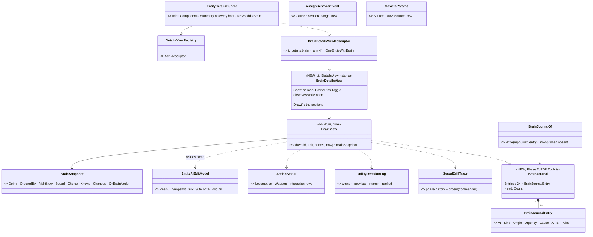
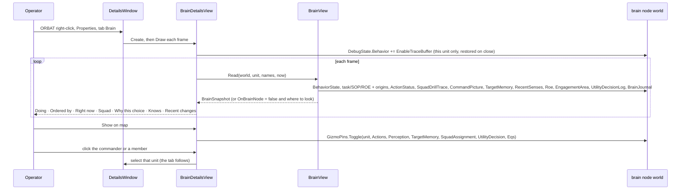
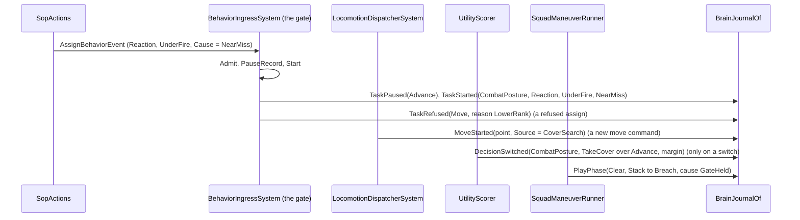
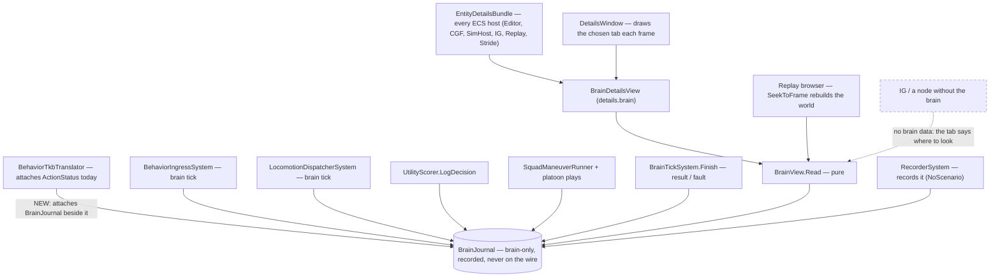
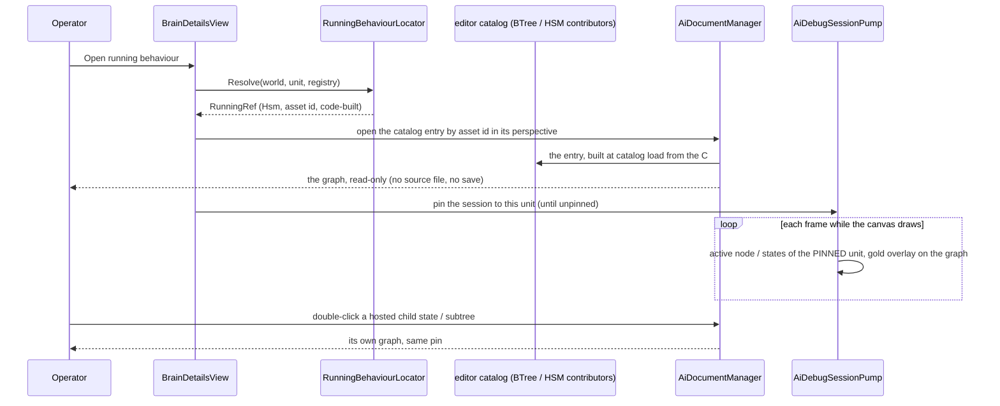
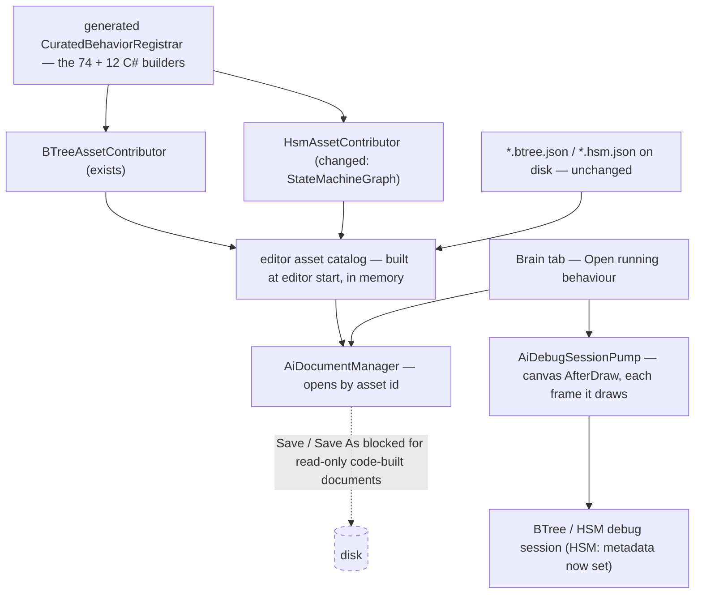

<!--STATUS
state: LIVE
updated: 2026-10-23 (BV-15, BV-16 folded in — R-1027)
build-state: READY-TO-BUILD — Phase 3 (§9, the running graph of a C#-only behaviour, in memory) APPROVED 2026-10-23 (R-1028); Phase 1 (the Brain tab, ui) and Phase 2 (the brain journal: ui the component and the generic writers, behaviors the causes and the play writers) APPROVED 2026-10-23 (R-1026); nothing built yet
current-answer: §1 what · §2 INVENTORY + claim table · §3 classes · §4 sequences · §5 modules · §6 decisions BV-1…BV-16 · §7 slices and owners · §8 acceptance · §9 Phase 3 the running graph (BV-17…BV-25, CE-1252…CE-1256)
stale-below: nothing
known-rot: none
known-conflict: none
related-designs:
  - docs/DESIGN_Sensors_And_Doctrine.md — §7.6 OWNS the AI section of Details (details.ai, EntityAiDetailsView): EDITING task / SOP / ROE; the Brain tab reads, links to it for edits
  - docs/DESIGN_Ai_Action_Status_Gizmo.md — OWNS ActionStatus (R-241), the per-channel "right now"; the journal copies its always-on, executor-written, recorded shape
  - docs/DESIGN_Decision_Layer.md — §4 OWNS the entry gate (origin rank, reaction urgency, pause / resume) the journal's task entries are written at
  - docs/designs/group-maneuvers/DESIGN_Squad_Tactics.md — §7.8.1 OWNS SquadDrillTrace (16 phase changes with their cause), the squad precedent; the journal adds the play entries beside it, it stays for GET /entities/{id}/squad
  - docs/designs/utility-ai/Utility_AI_Design_v1_1.md — §9 OWNS the "why did it pick this?" data (UtilityDecisionLog, observed only); the tab shows it while open
  - docs/designs/behav-diag-1/DESIGN.md — OWNS the BTree / HSM trace rings (opt-in, ~63 records): the deep dive the tab links to, not the journal
  - docs/DESIGN_Command_Display.md — OWNS the commander's picture and the Reports window the tab's squad section reads
  - docs/blueprints/DESIGN_Details_Panel_View_Switching.md — OWNS the Details panel's view registry the tab registers in
  - docs/DESIGN_Terrain_Combat_Tuning.md — §5b OWNS the gizmo family pins ("Show on map")
  - docs/designs/replay-browser-2/DESIGN.md — OWNS the replay browser; a recorded journal makes the tab work at a scrubbed frame
  - docs/OVERVIEW_Behaviour_Building_Blocks.md — the map; its diagnostics row points here
  - docs/blueprints/BTree_Editor_NodeEditor_Host_Design.md — OWNS the BTree canvas, its tidy-tree layout and runtime overlay (§3.4, §12.4) Phase 3 reuses
  - docs/blueprints/HSM_Editor_NodeEditor_Host_Design.md — OWNS the HSM canvas, the planned statechart layout (§3.4) and the live overlay (§13.4) Phase 3 completes
  - docs/blueprints/DESIGN_Editor_Entity_Selection_Source.md — §3.2 OWNS pinning, which Phase 3 uses to keep the overlay on one unit
  - docs/blueprints/DESIGN_Occurrence_Scoped_Storage.md — §32.22 (CE-348) OWNS the debug pump that follows the selection
-->

# Entity Brain View — what a unit is doing and why *(Phase 1 the Brain tab, Phase 2 the brain journal)*

🔒 **User, `2026-10-23`:** *"When i am running the game scenario in the editor ui, i have hard time understanding what the game ai
on entities (both individuals as well as aggregated virtual units like squad or platoon) is currently doing … I need some quicker way
of seeing what the entities are thinking about and what they are doing. Some kind of brain view in the details panel … Basicaly i
need to be able to explain why the behavior is like what it is."* · on the proposal: *"Phase 1 looks right. I need to talk more about
the phase 2."* · after the Phase 2 analysis: *"Approved, write the design"*.

## 1. What

| | answers | data |
|---|---|---|
| **Phase 1 — the Brain tab** | *what is it doing, who ordered it, what is it doing right now, what is its squad doing, why this choice, what does it know* | everything already recorded on the brain node (§2) — **no new brain data** |
| **Phase 2 — the brain journal** | *what changed, when, and why* — the last ~24 changes, each with its cause | a new per-unit ring written where the brain already decides (§3, §4b) |

⭐ The tab is **read-only**; editing stays in the AI tab (`details.ai`). ⭐ Both work **live and in the replay browser** (§6 BV-11).

## 2. INVENTORY *(2026-10-23 — codebase-memory CLI `scripts/cbm.sh`, then grep and reads; `check_index_coverage` is not reachable through the CLI, so coverage is not proven)*

| query | total | what matters |
|---|---|---|
| `search_graph .*DetailsView.*` (Class) | 54 (`has_more`) | `DetailsViewRegistry`, `DetailsViewDescriptor`, `DetailsViewPredicates` (`OneEntityWithBrain`) — the tab extension point; `EntityDetailsBundle` adds Components + Summary on EVERY host |
| `search_graph .*(Brain\|AiDetails).*View.*` (Class) | 2 | `EntityAiDetailsView` + descriptor — the EDIT tab (`details.ai`, rank 45, Editor Scenario only); its `EntityAiEditModel.Read()` → `Snapshot` reads task / SOP / ROE with origins |
| `search_graph ActionStatus.*` (Class) | 5 | `ActionStatus`, `ActionStatusRow`, `ActionStatusOf` (writer helper, no-op when absent), `ActionStatusGizmo` |
| `search_graph .*(Journal\|DrillTrace\|DecisionLog\|FaultLog\|ReportLog)$` (Class) | 5 | `SquadDrillTrace` (per commander, 16 steps + cause, transient), `UtilityDecisionLog` (observed only), `SquadReportLog` (per world), `BehaviorFaultLog` (process message log), `UnknownsJournal` (serialization, unrelated). ⛔ **no per-unit history of task / decision / move changes** |
| grep `FinalDestination =` (non-test) | 4 brain writers | `MoveToExecutor`, `PlanRoute`, `Flee`, `ApproachDoor`; every move command starts in `LocomotionDispatcherSystem` (writes `ActionStatus` there) |
| grep `LocomotionMoveTo.Issue(` | 43 sites / 16 files | where a move POINT is decided (EQS cover, squad post, order param, wander…) — no source field today |
| grep `BehaviorState` writers in `BehaviorIngressSystem` | 4 + the admit gate | `Start` · `ResumePausedTask` · `Clear` · the no-definition hash path; `Admit` refusals are log lines + a counter only |

**Claim table** *(the leans below rest on these)*:

| claim | code — how it IS | design — how it was MEANT |
|---|---|---|
| every task change enters through ONE gate that knows origin and urgency | `BehaviorIngressSystem.Admit` / `Start` / `PauseRecord` / `ResumePausedTask` / `Clear` / `StartSop` / `EndSop` | Decision Layer §4; overview §1 *"ONE gate — no host has its own path"* |
| a refusal leaves no trace on the unit | `FdpLog.Info/Warn` + `RefusedCount` | — searched, none |
| a reaction does not say what it reacted to | `SopActions.Publish` → `AssignBehaviorEvent { Origin, Urgency }`, no sense; `RecentSenses` keeps per-`SensorChange` times only | — searched, none |
| a move point does not say where it came from | `MoveToParams` / `NavigationIntent` carry the point, no source; the squad's `SquadDrillTrace.Order.Cover` is the one exception | — searched, none |
| the utility "why" is kept only while observed | `UtilityScorer.LogDecision` writes only with `UtilityDecisionLog` attached + `TraceEnabled`; attach by `TraceBufferLifecycleSystem` from `DebugState.Behavior & EnableTraceBuffer` | Utility AI §9; Tuning §5a |
| an always-on, executor-written, recorded per-unit record is an accepted shape | `ActionStatus` attached in `BehaviorTkbTranslator` (:166), written via `ActionStatusOf`, `NoScenario` (recorded), brain-only | R-241, Action Status T2 *(deliberately not observed-only)* |
| the BTree / HSM trace rings cannot be the journal | opt-in, 63 × 16 B, BTree records leaf results only (no branch, no abort cause); HSM records the trigger event | behav-diag-1 §1 *"a few seconds of history for one or two debugged entities"* |
| brain events and recorded components replay | `RecorderSystem` skips only `NoReplay`; `AssignBehaviorEvent`, `SetRoeEvent`, `SquadReportNotification` … recorded; `ReplayBrowserContext.SeekToFrame` rebuilds the world | Checkpoint M4 classification; replay-browser-2 |
| most "why" data exists only on the unit's brain node | trace rings, `ActionStatus`, `UtilityDecisionLog`, `TargetMemory`, `SquadCognitiveState` have no translator; task / SOP / ROE / origin travel as `ReplicatedBrainIntent` | `GetOrder` already reports `onBrainNode` |
| ⚠ found on the way: the editor's HSM history list loses its states | `HsmDebugSession` stores `Guid.Empty` for the state ids of every Enter / Exit / Transition | — (filed, §7) |

## 3. Classes

*What the picture shows that prose hid:* the tab adds ONE reader (`BrainView`) over records that already exist; the only new brain data
is `BrainJournal` and two small fields — `Cause` on the reaction's assign and `Source` on the move order — everything else is reused.
⚠ `EntityAiEditModel` lives in `Hrot.Editor`; the reader it holds moves to a shared assembly (or is re-read by `BrainView`) so the tab
works on every host — decided at build, the snapshot shape is unchanged.

## 4. Sequences

### 4a. The tab open on a unit (Phase 1)

### 4b. A change written to the journal (Phase 2)

*What the sequences show that prose hid:* every write is at a place that ALREADY decides — no new system, no per-frame scan; a journal
entry is appended only when something changes, so the recorder stores a delta only then (the trace rings dirty every frame).

## 5. Modules — who registers it, who calls it each frame

*What the picture shows that prose hid:* the tab runs on every host, but the data exists only where the brain ticks (and in that
node's recording). The dashed edge is the case to show honestly, never as empty rows.

## 6. Decisions *(approved 2026-10-23 as leaned — R-1026; BV-15, BV-16 R-1027)*

| id | decision | ⭐ lean | rejected — one line each |
|---|---|---|---|
| **BV-1** | where | a new read-only **Brain** tab (`details.brain`, rank 44) in `EntityDetailsBundle` ⇒ every host; the AI tab stays the editor | extend the AI tab — it is Editor-only and an editor |
| **BV-2** | the sections, as a story | **Doing** (task, since) · **Ordered by** (origin + who: operator / commander name / SOP / reaction + its sense) · **Right now** (ActionStatus rows, stance) · **Squad** (a leader: play, phase, member roles and orders; a man: commander, role, post, sector) · **Why this choice** (each utility decision: winner, margin, runner-up, top inputs) · **Knows** (top threat, contacts, recent hit / near miss, ROE) · **Recent changes** (the journal) | NotebookLM's five "tiers" — a taxonomy, not the questions an operator asks |
| **BV-3** | the scores | while the tab is open on a unit it sets `EnableTraceBuffer` on that unit (restored on close) ⇒ `UtilityDecisionLog` fills | make the log always on — per-consideration detail every tick on every unit |
| **BV-4** | show on map | one button pins that unit's gizmo families (R-227 pins) | new overlays — the gizmos exist, they lacked the narrative |
| **BV-5** | navigation | the commander and each member are links that select that unit | a tree of its own — the ORBAT is the tree |
| **BV-6** | a node without the brain | the tab says so and where to look (task / SOP / ROE / origin still shown — they are replicated) | empty rows · replicate all brain data now (wire cost, no remote need yet) |
| **BV-7** | low-level traces | a link "Open runtime trace" to the existing BTree / HSM runtime pane | trace rows in the tab — too low-level |
| **BV-8** | one model, three readers | `BrainView.Read` is pure ⇒ the tab, a `PanelSnapshot` dump and a `GET /entities/{id}/brain` route share it | a route of its own — two readers drift |
| **BV-9** | the journal | `BrainJournal`: 24 × 32 B ring per brain unit, **always on** (attached beside `ActionStatus`), `NoScenario` (recorded, not saved in scenarios), brain-only, never replicated; ids stored, names resolved at display | observed-only (the history must exist BEFORE you look) · a managed list (not recorded) |
| **BV-10** | the entries | `TaskStarted / Replaced / Paused / Resumed / Ended (result, fault) / Refused (reason)` · `SopStarted / SopEnded` · `DecisionSwitched` (only on a winner change) · `MoveStarted (point, source)` · `PlayStarted / PlayPhase (cause) / PlayEnded` · `OrderIssued` (a commander's order to a member) | every tick's state — that is the trace rings' job |
| **BV-11** | replay | free: the journal and the events are recorded ⇒ the tab works at a scrubbed frame in the replay browser | an offline reconstruction from events — they lack the two causes |
| **BV-12** | the two causes | `AssignBehaviorEvent.Cause` (a `SensorChange`, set by `SopActions` from the sense it reacted to) · `MoveToParams.Source` (`MoveSource`: Unknown, Order, CoverSearch, SquadPost, FollowLeader, Flee, Door, Route, Wander, Operator) — defaulting to Unknown, filled site by site (43), squad posts first | infer the source from the caller — unknowable after the fact |
| **BV-13** | refusals | the gate's refusal branches write `TaskRefused` with a reason (`LowerRank`, `LowerUrgency`, `StayOnTask`, `Unknown`, `ParseFailed`, `NoDefinition`) | keep them as log lines — the user cannot see the log per unit |
| **BV-14** | `SquadDrillTrace` | kept (the squad route reads it); the play writers ALSO write the journal | fold it into the journal now — a refactor of behaviors' live code for no user gain |
| **BV-15** | the storage and the hot path *(user, `2026-10-23`: "Will the ring … be implemented as ummanaged component to honor no allocation on hot path rule?")* | ⭐ **unmanaged**: `BrainJournal` = an `[InlineArray(24)]` of 32 B `BrainJournalEntry` + `Head`, `Count` (~0.8 KB, the `UtilityDecisionLog` shape); an entry holds numbers only (time, kind, origin, urgency, cause, two ids, a point); `BrainJournalOf.Write` takes the component by ref, copies 32 B, no-op when absent — no strings, no boxing, no allocation on the brain's path; names resolved only when the tab draws. The two causes: a byte on `MoveToParams` (unmanaged) and a byte on `AssignBehaviorEvent` (already a managed class allocated today — nothing new) | a managed list — allocates and is not recorded |
| **BV-16** | the cost, and the switch *(user, `2026-10-23`: "Recording cost is no issue, no need to toggle at runtime")* | ⭐ cost: memory ~0.8 KB per brain unit; a write = one presence check + 32 B, only on a change (⛔ ~0.2–1 per unit per second, estimated); no cost to systems that do not read it (a table per type); recording: a 64 KB chunk of journals (~83 units) is copied and LZ4-packed on a frame any of them changed (`RecorderSystem`, `FdpConfig.CHUNK_SIZE_BYTES`) — ✅ **accepted by the user, not measured as a gate**. ⭐ the switch: `BrainJournal` (default **on**, we are in engine development) in an FDP-side diagnostics settings singleton (the existing `GlobalDebugSettings` is in Hrot.Common, out of the brain code's reach), set from the host config / command line (`--brain-journal off`); read when the brain components are attached ⇒ **off = the component is never attached**, every writer costs one presence check, nothing in memory or the recording; the tab says "journal off". ⛔ **no runtime toggle** | a runtime add / remove system (the trace-ring shape) — not needed, the user ruled it out · observed-only — the history must exist before you look |

## 7. Slices and owners

| slice | owner | what | tracker |
|---|---|---|---|
| **P1** | ui | `BrainView` + `BrainSnapshot`, `BrainDetailsView` + descriptor in `EntityDetailsBundle`, observe-while-open, show-on-map, links, the no-brain line, `PanelSnapshot` dump, `GET /entities/{id}/brain` | `CE-1248` |
| **P2a** | ui *(cross-lane: FDP Toolkits Behavior)* | `BrainJournal` + `BrainJournalEntry` + `BrainJournalOf`; attach in `BehaviorTkbTranslator`, register in `CognitiveComponentRegistry`, brain-only in `HrotRoleComponentSets`; writers in the gate (`Start`, pause / resume, `Clear`, refusals, SOP), `BrainTickSystem.Finish`, `LocomotionDispatcherSystem`, `UtilityScorer.LogDecision`; the tab's Recent changes; the `BrainJournal` setting (BV-16, default on, attach-time only) | `CE-1249` |
| **P2b** | behaviors | `AssignBehaviorEvent.Cause` from `SopActions`; `MoveToParams.Source` + the first sites (squad posts, EQS cover, orders, flee, door); the play / platoon phase and `OrderIssued` writers | `CE-1250` (filed by ui; behaviors may renumber in its own block on pickup — the row stays) |
| **bug** | behaviors or ui | `HsmDebugSession` stores `Guid.Empty` for state ids — the HSM history list cannot name its states | `CE-1251` |

⭐ P1 needs nothing from P2 (its Recent changes section appears when the journal exists). ⭐ P2a's entries carry `Cause = 0` / `Source =
Unknown` until P2b lands — the journal is useful from day one (task changes with origin and urgency, refusals, decisions, moves).

## 8. Acceptance

| | rail / check |
|---|---|
| P1 | a pure-model rail per section on a fixture unit (task + origin, ActionStatus row, squad phase + member orders, a utility decision, a top threat); the no-brain node line; the descriptor registered on every host bundle (a forwarding rail on the CONSTRUCTED bundle); a frame screenshot of the tab |
| P2a | a reaction pausing a task writes Paused + Started with origin and urgency; a refused assign writes Refused with its reason; a move command writes MoveStarted once (not per tick); a utility switch writes one DecisionSwitched and a steady winner writes none; the ring wraps at 24; the journal is recorded (a replay seek restores it); with the setting off the component is never attached and every writer is a no-op (BV-16); a write allocates nothing (an allocation-count rail around a burst of writes) |
| P2b | a near miss → the reaction's entry names NearMiss; a squad post move → `Source = SquadPost`; a play phase change → `PlayPhase` with its cause |
| live | `ua-*` / `pc-defend-house`: open the tab on a defender and on the platoon leader; every line reads true against what the unit visibly does |

## 9. Phase 3 — the running graph: a hard-coded behaviour shown as its graph *(approved 2026-10-23 — R-1028)*

🔒 **User, `2026-10-23`:** *"whether we could somehow show the currently running behavior on an entity as a read-only debug view of
the Btree or HSM, and if these are implemented as hard-coded in C#, if we can automatically convert them into their graph
representation"* · *"I meant conversions for behaviors that have never been a json graph asset, always just hardcided. Using auto
layout."* · *"for grubs that exist as assets, I do not need to decompile them because they are still existing on the disk"* · on the
lean: *"Approved, write it into the design. Is the auto-layouting code for btrees and hsms already existing? can the conversion to
graph for csharp only assets be done just in memory, not writing any assets to the disk?"*

### 9.1 INVENTORY *(2026-10-23 — `scripts/cbm.sh search_graph` + grep + reads; coverage not provable through the CLI)*

| query | total | what matters |
|---|---|---|
| `search_graph .*(AutoLayout\|AssetProjector\|AssetContributor)$` (Class) | 10 | `BTreeAutoLayout` (Reingold-Tilford tidy tree, 218 lines) · `HsmAutoLayout` (grid, 73 lines) · `BehaviorTreeAssetProjector` · `HsmAssetProjector` · `BTreeAssetContributor` / `HsmAssetContributor` (C#-side catalog) · `BTreeJsonAssetContributor` / `HsmJsonAssetContributor` (assets on disk) · `BlueprintAssetContributor` |
| grep `[BTreeDefinition(` / `[HsmDefinition(` (production) | 77 / 12 | curated C#: **74 BTrees** (`BTreeBuilder`) + **12 HSMs** (`HsmBuilder` → `StateMachineGraph`); plus 39 `*.btree.json` / 10 `*.hsm.json` assets on disk (not in scope — they open as they are) |
| `BehaviorDefinition.BrainTier` values | 3 | HSM, BTree, Blueprint — ⭐ **no plain-imperative brain**: every hard-coded behaviour is a builder graph |

| claim | code — how it IS | design — how it was MEANT |
|---|---|---|
| the compiled form holds the whole graph | HSM: `HsmDefinitionBlob` states (parent, children, flags, regions, history) + `TransitionDef` (source, target, event, guard, priority, polled) + `MachineMetadata` names and stable ids · BTree: `BehaviorTreeBlob` depth-first `Nodes[]` + `DebugMetadata` labels and visual ids | — |
| blob → editor graph already exists, **in memory** | `BehaviorTreeAssetProjector.Project` / `HsmAssetProjector.Project` build the editor model from a blob; auto-layout runs when no layout entry exists (`BehaviorTreeAssetProjector.cs:66`, `HsmAssetProjector.cs:290`) | BTree / HSM editor host designs §3.4 |
| ✅ **C#-only BTrees already open as graphs** (in memory, auto-laid out, debuggable) | `BTreeAssetContributor.LoadFrom` compiles builder-returning methods (CE-3160) | [Decision Layer §3.3h](DESIGN_Decision_Layer.md); R-266 |
| ⛔ the 12 C#-only HSMs never reach the HSM editor | `HsmAssetContributor.cs:37` accepts only methods returning `HsmDefinitionBlob`; all 12 return `StateMachineGraph` | — the CE-3160 fix was made on the BTree side only |
| ⛔ the live HSM highlight never draws (for asset HSMs too) | `HsmDebugSession.SetMetadata` has no production caller ⇒ `DecodeLeaves` returns empty | [HSM host design §13.4](blueprints/HSM_Editor_NodeEditor_Host_Design.md) |
| ⛔ nothing opens THE RUNNING behaviour of a chosen unit, pinned to it | the overlay lights the OPEN document only; `AiDebugSessionPump.SelectedEntity` follows the global selection; pinning deferred | [Occurrence storage §32.22](blueprints/DESIGN_Occurrence_Scoped_Storage.md) (CE-348); [entity selection §3.2](blueprints/DESIGN_Editor_Entity_Selection_Source.md) |
| nothing is written to disk unless a person asks | a code-built document has no `SourceFilePath` ⇒ Save falls to Save As (`ShellSaveCommands.cs:174`); "auto-layout saved on next save" applies to editor-owned documents | AI editor shared infrastructure (layout persistence) |
| ⛔ the HSM grid layout's readability on nested / parallel machines | **not measured** — `HsmAutoLayout` does top level in a row, children in a 3-wide grid; the host design itself says *"readable but not optimal. Users will manually arrange"* — and a read-only C# graph cannot be arranged by hand | HSM host design §3.4 |

### 9.2 Classes

*What the picture shows that prose hid:* nothing new is built to CONVERT — the projectors and the two layouts exist; the work is one
missing catalog branch (HSM), one missing metadata call, a read-only flag, a pin, and one locator that turns "the unit's running
behaviour" into the catalog id the editor already opens by.

### 9.3 Sequence — "Open running behaviour" on a unit

### 9.4 Modules

*Who calls it each frame:* only the canvas's `AfterDraw` hook while the graph is drawn — the brain never pays for this view.

### 9.5 Decisions *(approved 2026-10-23 as leaned — R-1028)*

| id | decision | ⭐ lean | rejected — one line each |
|---|---|---|---|
| **BV-17** | scope | only behaviours that have **never been a graph asset** (the 74 C# BTrees, the 12 C# HSMs); assets on disk open as they are | decompile assets too — they exist on disk |
| **BV-18** | how the graph is made | **from the compiled form, in memory, at editor catalog load**: builder → `Compile` → projector → auto-layout — the BTree path that exists since CE-3160, extended to HSMs (`StateMachineGraph` → `Compile()` + `.Metadata`) | Roslyn decompilation of the C# source — the compiled form already holds everything |
| **BV-19** | disk | ⛔ **nothing is written**: a code-built document is `IsReadOnly` (no source file) — edits and Save / Save As are blocked, with the line *"built in C# — edit `<Type>.<Method>`"*; the auto-layout is recomputed on every open | write JSON copies — a second copy of each behaviour, and R-223 / R-266 moved them TO C# |
| **BV-20** | the HSM live highlight | `HsmDebugSession.SetMetadata` fed from the registry's `HsmDefinition` / `HsmMetadata` (the session already resolves the running blob) — fixes every HSM, asset or C# | — |
| **BV-21** | opening the right graph | the Brain tab's **Open running behaviour**: `RunningBehaviourLocator` reads `BehaviorState` → the registry definition → the catalog asset id (the existing `AssetIdHasher` / attribute id) and asks the document manager to open it | search the catalog by name in the UI — the locator is one pure function, testable |
| **BV-22** | which unit the overlay follows | **pinned** to the unit the button was pressed on (the pump's `SelectedEntity` returns the pin while set, else the selection) — the pinning [entity selection §3.2](blueprints/DESIGN_Editor_Entity_Selection_Source.md) defined; unpin from the canvas toolbar | follow the global selection only — clicking elsewhere on the map loses the unit you are watching |
| **BV-23** | the HSM layout | ⛔ check first: a frame of PlatoonDefend / PlatoonAttack / CivilianHsm under `HsmAutoLayout`; if unreadable, implement the host design's §3.4 statechart layout (composites sized to their children, parallel regions as side-by-side strips, initial state first, children ordered by transitions) — a read-only graph cannot be tidied by hand | MSAGL or a new layout library — the BTree tidy tree exists, only the HSM needs better |
| **BV-24** | hosted children | an HSM state hosting a BTree, or a BTree subtree: double-click opens the child's graph with the same pin (`HsmHostedSubtrees`, `BTreeHostedSites` resolve it) | flatten children into one canvas — the editors already treat them as separate documents |
| **BV-25** | adjacent bug | the Blueprint live highlight follows whichever unit ran last (`BlueprintDebugSession.SetEntityFilter` has no production caller) — set it from the same pin | — |

### 9.6 Slices and acceptance

| slice | owner | what | tracker | acceptance |
|---|---|---|---|---|
| **P3a** | ui *(cross-lane: the HSM editor, behaviors' editor area)* | `HsmAssetContributor` accepts `StateMachineGraph` methods; `AiDocument.IsReadOnly` for code-built documents (edits, Save, Save As blocked) | `CE-1252` | all 12 C# HSMs listed in the HSM editor and open as graphs; a code-built document refuses an edit and a save; nothing new appears on disk |
| **P3b** | ui | `HsmDebugSession.SetMetadata` from the registry definition | `CE-1253` | a running HSM's active leaf is named in the runtime pane and glows on the canvas |
| **P3c** | ui | `RunningBehaviourLocator`, the Brain tab button, the pin in the pump, hosted-child step-in | `CE-1254` | from a unit's Brain tab the right graph opens with ITS node / state lit; clicking another unit on the map does not move the pin |
| **P3d** | ui | the HSM statechart layout — only if the BV-23 frame shows the grid unreadable | `CE-1255` | a frame of PlatoonDefend: composites enclose their children, parallel regions side by side, no overlaps |
| **bug** | ui or behaviors | Blueprint entity filter from the pin | `CE-1256` | a Blueprint graph lights only the pinned unit's nodes |
