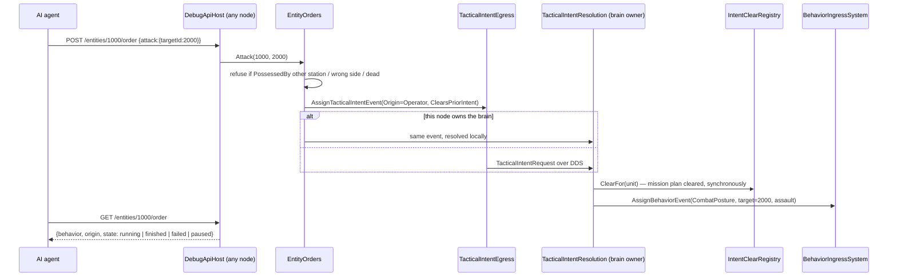
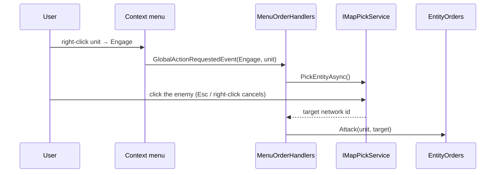
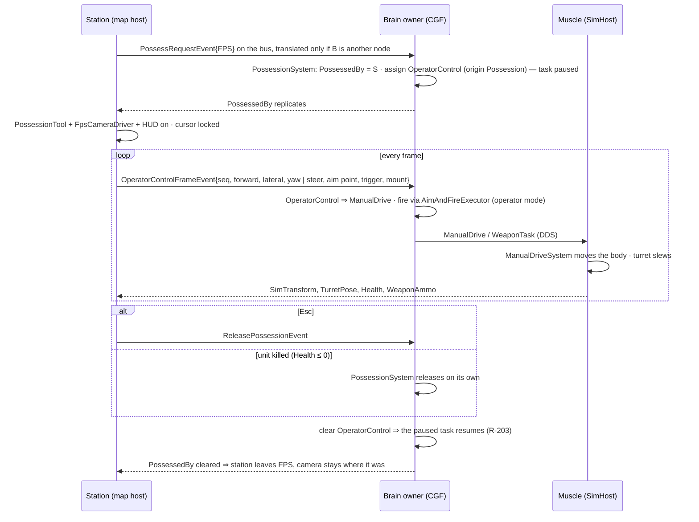
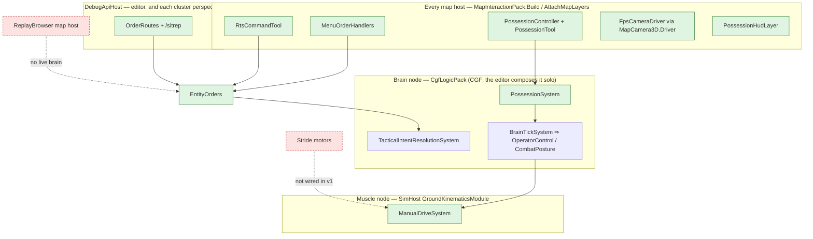

<!--STATUS
state: LIVE
updated: 2026-10-11
build-state: READY-TO-BUILD (all slices; M-1..M-10 approved 2026-10-11, R-271 (backend))
current-answer: §2 decisions · §2.3 messaging (FDP events; the networkless editor) · §3 classes · §4 sequences · §5 modules · §6 manual motion · §7 slices
stale-below: nothing
known-rot: nothing yet
known-conflict: docs/UX/UX_Feature_Entity_Commanding.md §1 maps Engage → FireAtTarget; this design maps it to the attack order (CombatPosture with a designated target, C-5). That doc's §1 is marked accordingly.
related-designs:
  - docs/UX/UX_Feature_Entity_Commanding.md — OWNS the right-click order vocabulary, the args channel, TKB command sets and ClearsPriorIntent/IntentClearRegistry (§2.5b-d); S1-S2 here build its §2.5b-d and §2.6 and bind its three ids
  - docs/blueprints/Architect_Question_83_Doctrine_And_Order_Origin.md — OWNS the origin rank (Operator > Superior > SOP) and "no SOP = brain-dead"; possession is an origin, never an autonomy switch
  - docs/DESIGN_Decision_Layer.md §4 — OWNS task / SOP / reaction and the paused task (R-199, R-203) that possession pauses and resumes
  - docs/DESIGN_Entity_Interactions.md — OWNS the one interaction topic (R-221); possession adds three union cases
  - docs/designs/tactical-intent/DESIGN.md — OWNS the intent pipeline (any node publishes, the owner resolves) every order here rides
  - docs/DESIGN_Weapon_Layers.md — OWNS the three weapon layers (R-261); operator fire enters at the behaviour layer
  - docs/DESIGN_Map_3D_Mode.md — OWNS MapCamera3D, Picker3D and the scenario camera entity (R-260) the FPS view drives and must not overwrite
  - docs/UX/UX_Feature_Tool_Model.md — OWNS ToolController / exclusive focus (R-144) the RTS and FPS tools register through
  - docs/designs/ai-debug-api/DESIGN.md + docs/MCP_Integration.md — OWN the HTTP debug API the order routes extend
  - FDP/Docs/projects/toolkits/FDP.Toolkit.CarKinem.md — OWNS ground kinematics (HumanGait R-247, BicycleModel) that manual drive extends
  - docs/DESIGN_Ownership_Groups_And_Grants.md — OWNS the Brain / MuscleGround groups the new components join
-->

# DESIGN — **entity control** *(orders over HTTP, RTS clicks, the menu, and FPS possession — one path)*

> 🔒 **User, `2026-10-11`** (the request, an attached proposal + audio transcript): *"enable control of these entities … by
> taking control over a single chosen entity … possession … First-Person Shooter … Real-Time Strategy … an entity can be
> possessed from exactly one operator station … without losing our current capabilities."* → *"make the entity control
> available via http debug api … replace the human operator with ai debug http api allowing you to play the game"* →
> *"Your leans accepted. … Shouldnt we control the motion channel directly … Vehicles cant strafe so they should turn their
> steering wheel … Fps view should run on our 3d map view. The generic entity command http way should be fixed … menu items …
> need some entity/point picker followup operation. Write design please."* → *"Approved. All the messaging needs to work in the
> networkless editor so ig needs using fdp bus events translated to network and back, accepting the latency."*

**The idea in one line:** taking control of a unit is **giving it an order of a high enough origin** — never an "AI off" switch
(AQ83 rejected *"a separate autonomy on/off mode"*). HTTP, RTS clicks and the menu send **high-level orders** through **one
order service**; FPS sends a **stream of control frames** to a behaviour of the highest origin. Every path ends on the node
that owns the unit's brain.

## 1. INVENTORY — measured `2026-10-11`

| query | result |
|---|---|
| `search_graph` `.*(Possess\|Manual\|Operator\|PlayerInput\|Teleop\|Joystick\|Hud\|Crosshair\|Reticle).*` Class | 7 — none about control; `Stride/…/Player/PlayerInput` is the Stride template, **removed at boot** (`StrideHrotGame.cs:1493`) |
| `search_graph` `.*Camera.*` Class | 23 — `MapCamera3D` (**sealed**, `MapCamera3D.cs:28`), `MapCamera`, `MapCameraLayer`, Stride `BasicCameraController`/`ThirdPersonCamera`; no follow/attach camera |
| `search_graph` `.*DebugApi.*` | 194 — `DebugApiHost` routes incl. `POST /entities/command`, `/missions/{id}/task`, `/behaviors`, `/entities/{id}/state\|memory\|trace\|weapons` |
| grep handlers for `GlobalActionIds.MoveHere\|Engage\|Stop` | **0** — on every unit's menu (`ContextMenuProjectorGizmo.cs:54-62`), handled nowhere |
| grep `DisableCursor\|HideCursor\|SetMousePosition` | 0 — no cursor lock |
| grep `AimYaw\|DesiredHeading\|YawRate`(field)`\|LocomotionClass\|Flying`(consumer) | 0 — no body-independent aim, no commandable yaw, no aircraft motion model |
| grep `StationId\|OperatorId\|ControlledBy\|possess` (code + docs) | 0 — no station identity, no possession design anywhere in `docs/` or `.dev/` |

⚠ The codebase-memory MCP server dropped mid-session; later inventory ran through its CLI and grep. `check_index_coverage` was
not run (not available via the CLI) — the zero rows are grep-and-graph zeros, coverage not checked.

## 2. Decisions

### 2.1 ✅ Accepted — user, `2026-10-11` (*"Your leans accepted."*) → `R-270`

| # | decision |
|---|---|
| **C-1** | **FPS runs in our 3-D map view** (the shared `MapCanvas` 3-D mode on every map host), the camera behind a driver hook so a final engine can take it over (R-250) |
| **C-2** | **The operator overrides the ROE** — a possessed unit fires when told, even under `HoldFire`; it is not held by its own seen-now gate either (the operator is the eyes) |
| **C-3** | **One station per unit, FPS only.** A second station's possess request takes the unit over; RTS / menu / HTTP orders to a unit another station holds in FPS are refused |
| **C-4** | **FPS release resumes the unit's earlier task** (the paused-task slot); an RTS / menu / HTTP order **replaces** it and clears the mission plan (Entity Commanding ruling 50) |
| **C-5** | **"Attack" = close in and fight** — one behaviour for RTS, menu and HTTP: CombatPosture with a designated target and `assault` (AQ89) — the unit picks route, cover and weapon |
| **C-6** | Network lag on FPS movement is accepted for v1 and **measured on the cluster**; looking around is local |
| **C-7** | **Ammo state crosses the network** (a new per-mount descriptor) so a HUD on any station can show it |
| **C-8** | **One operator per node** — the station id is the node id |
| **C-9** | The AI player sees **only what its side knows** (the sitrep is built from its units' target memory); `truth=true` for debugging |
| **C-10** | The AI player may be **locked to one side** per session; orders to the other side's units are then refused |
| **C-11** | HTTP orders carry origin **Operator**; build order = **HTTP orders first**, then menu/RTS, then FPS |
| **C-12** | *(this message)* FPS motion is a **direct manual-drive command**, not direct-to-point; vehicles steer instead of strafing, with free look and an optional view locked to the hull where the mouse steers; the generic `/entities/command` route is fixed; the menu orders get a follow-up point / entity pick |

### 2.2 ✅ Approved — the motion and plumbing decisions (user, `2026-10-11`: *"Approved."* → `R-271 (backend)`)

| # | question | ⭐ lean | rejected — one line each |
|---|---|---|---|
| **M-1** | how manual motion reaches the muscle | a NEW Brain-group component **`ManualDrive`** + its own descriptor, consumed under a NEW **`KinematicsMode.Manual`** (entered once via `NavigationMode.Manual`) | a manual mode inside `NavigationIntent` — its egress sends and the bridge applies **only when `IntentId` changes** (`NavigationIntentEgressTranslator.cs:138`, bridge `:127`), and every change resets nav status · reusing `KinematicsMode.None` — "manual control" in its comment but treated as Direct (`CarKinematicsSystem.cs:226`, CE-3176) |
| **M-2** | person axes | **forward/back + strafe in the body frame; body yaw = the camera's yaw**, turned at `HumanGait.TurnRate` (turn on the spot = mouse only). Back and strafe at **60 %** of the gait speed; sprint forward only; stance from the existing `StanceIntent` | a yaw-RATE axis — drifts under lag; an absolute yaw is latency-tolerant |
| **M-3** | vehicle axes | **throttle (− = brake, then reverse) + steer**; default **free look**, A/D steer; **`V` toggles hull-locked view where mouse X steers**. Reverse needs the integrators' `speed ≥ 0` clamp lifted (`BicycleModel.cs:179`) | strafe for vehicles — not physical |
| **M-4** | aircraft / pilot stick | **deferred** — no aircraft motion model exists (`DESIGN_Body_Geometry_And_Ground_Contact.md:154`); the stick axes join `ManualDrive` with that model (PLAN_3D_World_And_Realism D1) | reserving pitch/roll fields now — speculative wire |
| **M-5** | walls | a manual **person's step is refused where the navmesh is not walkable** (`INavmeshProvider.IsWalkable` / `ProjectToNavmesh`, slide along the projection); vehicles keep today's grounding + avoidance (known limit: they can drive into a building) | free movement — walks through walls |
| **M-6** | how control frames reach the brain | three **interaction union cases** on the one topic (R-221): `Possess{mode}`, `Release`, `ControlFrame{seq,…}`; the brain keeps the newest by `seq` | a new topic per message · moving the unit's ownership to the station (moves its brain and muscle) · frames straight to the muscle (two writers of motion; R-180 keeps the request on the brain) |
| **M-7** | possession's place in the decision layer | a NEW **`BehaviorOrigin.Possession`**, ranked above Operator: it **pauses** whatever runs (as a reaction does), no reaction may interrupt it, and clearing it **resumes** the paused task in all tiers (R-203) | Operator origin — an Operator order **drops** the paused task (`BehaviorIngressSystem.cs:388`), so C-4 could not hold |
| **M-8** | operator fire | the **existing** `AimAndFireExecutor` gains a point target and an **operator mode** (no seen-now gate, no aim time, ROE bypass): a turret mount gets `WeaponTask{Track, Point}` + granted rounds (the muscle already aims at `Point`, `WeaponTaskDispatcherSystem.cs:54`); a per-shot mount spends through the per-shot path | a new operator weapon executor — a second weapon brain (R-174) |
| **M-9** | the FPS camera | `MapCamera3D` gains an optional **`ICameraDriver`** (not unsealed — gizmos and labels draw only for `MapCamera3D`, `DebugGizmoLayer.cs:140,169`); while a driver is set `MapCameraLayer` **does not save the pose** into the scenario camera (R-260, `MapCameraLayer.cs:149`). `IInputProvider` gains **`SetCursorLocked`** | a second camera class — loses every 3-D gizmo, label and picker |
| **M-10** | the menu orders | handlers for the existing `MoveHere / Engage / Stop` ids, registered **once in `MapInteractionPack`** (every map host): Move → **location follow-up pick**, Engage → **entity follow-up pick**, Stop → immediate. The args channel and TKB command sets (Entity Commanding §2.2-2.4) stay later work there | an editor-only registration — the IG and CGF menus stay dead |

### 2.3 ✅ Messaging — FDP bus events first; the network is only a translator *(user, `2026-10-11` → `R-271 (backend)`; R-134)*

🔒 *"All the messaging needs to work in the networkless editor so ig needs using fdp bus events translated to network and back,
accepting the latency."* ⇒ **every message in this design is a typed FDP event or a component on the local world.** A sender
publishes on its own bus and never knows whether the receiver is local; the **owner's handler reads its own bus**, whichever
way the event arrived; an **egress translator forwards only what this node does not own**, and an ingress translator
republishes it on the owner's bus (the door pattern, `DoorCommands.cs:138-142`). ⇒ in the **editor** — which composes the
station, the brain (`CgfLogicPack`) and the muscle (`SimHostCoreLogicPack`) in ONE world (`EditorSubsystem.cs:1602-1632`) —
nothing is translated and everything works with no network; on an **IG / cluster** the same events cross by translator, and
the extra hops are accepted latency (C-6).

| message | FDP form *(what the sender publishes / the reader reads)* | owner-side reader | across nodes *(translator only)* |
|---|---|---|---|
| an order (HTTP · menu · RTS) | `AssignTacticalIntentEvent` *(existing; + `ClearsPriorIntent`)* | `TacticalIntentResolutionSystem` | `TacticalIntentRequest` *(existing)* |
| possess / release | **NEW** `PossessRequestEvent{Entity, Mode, StationNodeId, IsRemote}` · `ReleasePossessionEvent{…}` | `PossessionSystem` | interaction union cases `Possess` · `Release` |
| a control frame | **NEW** `OperatorControlFrameEvent{Entity, Seq, Forward, Lateral, Steer, Yaw, AimPoint, AimTarget, Trigger, Mount, Gait, Stance, IsRemote}` | `PossessionSystem` ⇒ `OperatorInput` | interaction union case `ControlFrame` |
| who holds a unit | **NEW** component `PossessedBy` *(Brain group)* | every station reads it | its descriptor |
| the manual drive demand | **NEW** component `ManualDrive` *(Brain group)* | `ManualDriveSystem` | its descriptor |
| ammo for the HUD | **NEW** component per mount `WeaponAmmo` *(Brain group)* | `PossessionHudLayer` | its descriptor |

| ⭐ rule | why |
|---|---|
| ⛔ **no sender or reader touches a DDS type** | R-134; and it is what makes the editor path the SAME code, not a second one |
| ⭐ **every slice's FIRST rail runs in the networkless editor world**; the cluster rail comes second | the editor is the path a broken translator cannot hide |
| ⭐ **`StationNodeId` is the local node id**, also in the editor | C-8; a second station is simulated in rails by a second id |

## 3. CLASSES

### 3.1 The order path *(HTTP · menu · RTS — one service)*

```mermaid
classDiagram
    direction LR
    class EntityOrders { <<NEW, Hrot.Common>> Move(netId, point, speed) · Attack(netId, targetNetId) · Stop(netId) · Hold(netId) · Behavior(netId, name, json) · Clear(netId) }
    class OrderRefusal { <<NEW>> Unknown · PossessedElsewhere · WrongSide · Dead }
    class AssignTacticalIntentEvent { <<existing>> Entity · IntentId · JsonParams · Origin · + ClearsPriorIntent }
    class TacticalIntentEgressTranslator { <<existing>> non-owner ⇒ TacticalIntentRequest }
    class TacticalIntentResolutionSystem { <<existing, owner>> mapper or pass-through ⇒ AssignBehaviorEvent }
    class IntentClearRegistry { <<NEW, Entity Commanding §2.5d>> Register(IIntentClearProvider) }
    class MissionPlanClearProvider { <<NEW, CGF>> clears MissionPlanQueue + ActiveMissionPlan }
    class CombatPosture { <<existing C# BTree>> + designated target (C-5) }
    class OrderRoutes { <<NEW, DebugApiHost>> POST GET DELETE entities/ID/order · POST orders · GET sitrep }
    class MenuOrderHandlers { <<NEW, MapInteractionPack>> MoveHere · Engage · Stop }
    class RtsCommandTool { <<NEW, ToolController tool>> LMB select · RMB ground = Move · RMB hostile = Attack }
    class IMapPickService { <<existing>> PickLocationAsync · PickEntityAsync }
    OrderRoutes --> EntityOrders
    MenuOrderHandlers --> EntityOrders
    MenuOrderHandlers --> IMapPickService : follow-up pick
    RtsCommandTool --> EntityOrders
    EntityOrders --> AssignTacticalIntentEvent : publishes, Origin=Operator
    EntityOrders ..> OrderRefusal
    AssignTacticalIntentEvent --> TacticalIntentEgressTranslator
    AssignTacticalIntentEvent --> TacticalIntentResolutionSystem
    TacticalIntentResolutionSystem --> IntentClearRegistry : ClearsPriorIntent
    MissionPlanClearProvider ..|> IntentClearRegistry
    TacticalIntentResolutionSystem ..> CombatPosture : Attack
```

*What the picture shows that prose hid:* three front-ends, **one** publish — the RTS tool, the menu and the AI player cannot
drift apart, and every rail written for the HTTP route covers the human paths too.

### 3.2 FPS possession and manual drive

```mermaid
classDiagram
    direction LR
    class PossessionController { <<NEW, station>> Request(netId) · Release() · State: Idle/Requesting/Possessed }
    class PossessionTool { <<NEW, exclusive-focus gizmo>> swallows clicks + menus · Esc = Release }
    class FpsInputSampler { <<NEW, station>> IsKeyDown W/A/S/D · MouseDelta · buttons · wheel ⇒ ControlFrame }
    class FpsCameraDriver { <<NEW>> ICameraDriver: eye / turret pose · free or hull-locked view }
    class ICameraDriver { <<NEW, Vis3D>> Drive(MapCamera3D, input, dt) }
    class MapCamera3D { <<existing, sealed>> + Driver }
    class PossessionHudLayer { <<NEW, IMapLayer.DrawOverlay>> crosshair · health · ammo per mount · selected weapon }
    class PossessRequestEvent { <<NEW FDP event>> Entity · Mode · StationNodeId · IsRemote }
    class OperatorControlFrameEvent { <<NEW FDP event>> Entity · Seq · axes · AimPoint · Trigger · Mount · IsRemote }
    class InteractionTransport { <<existing, R-221>> + Possess · Release · ControlFrame cases — only between nodes }
    class PossessionSystem { <<NEW, brain owner>> arbitrates (C-3) · death ⇒ release }
    class PossessedBy { <<NEW component, Brain group, replicated>> StationNodeId · Mode · Epoch }
    class OperatorInput { <<NEW component, brain-local>> newest ControlFrame }
    class OperatorControl { <<NEW behaviour>> origin Possession (M-7) }
    class ManualDriveExecutor { <<NEW, locomotion>> writes ManualDrive · Nav Mode=Manual once }
    class AimAndFireExecutor { <<existing>> + point target · operator mode (M-8) }
    class ManualDrive { <<NEW component, Brain group>> Forward · Lateral · Steer · Yaw · Gait · Seq }
    class ManualDriveSystem { <<NEW, muscle, GroundKinematicsModule>> person: strafe + yaw · vehicle: throttle + steer }
    class WeaponAmmo { <<NEW descriptor, C-7>> per mount: Ammo · MaxAmmo }
    PossessionController --> PossessRequestEvent : publishes on the local bus
    FpsInputSampler --> OperatorControlFrameEvent : publishes on the local bus
    PossessRequestEvent --> PossessionSystem : owner reads its bus
    OperatorControlFrameEvent --> PossessionSystem
    InteractionTransport ..> PossessRequestEvent : carries when not owned here
    InteractionTransport ..> OperatorControlFrameEvent
    PossessionController --> PossessionTool
    PossessionController --> FpsCameraDriver
    FpsCameraDriver ..|> ICameraDriver
    MapCamera3D o-- ICameraDriver
    PossessionSystem --> PossessedBy : writes
    PossessionSystem --> OperatorInput : writes
    PossessionSystem ..> OperatorControl : assigns / clears
    OperatorControl --> ManualDriveExecutor
    OperatorControl --> AimAndFireExecutor
    ManualDriveExecutor --> ManualDrive
    ManualDrive --> ManualDriveSystem : DDS
    PossessionController ..> PossessedBy : reads (replicated)
    PossessionHudLayer ..> WeaponAmmo
```

*What the picture shows that prose hid:* the station **never writes a unit component** — it publishes FDP events (§2.3), and reads back
`PossessedBy`, health and ammo. Exactly-one-station is enforced by **one writer** (the brain owner), and "station A lost it"
is A reading `PossessedBy` — no revoke message exists to get lost.

## 4. SEQUENCES

### 4.1 An AI player orders an attack over HTTP *(the same path a menu Engage takes after its pick)*

### 4.2 Menu *Engage* with its follow-up pick

### 4.3 FPS — possess, drive, fire, release

## 5. MODULES — who registers what, and who calls it each frame

*In the **editor** the three subgraphs are ONE world* — the station, the brain and the muscle exchange the §2.3 events and
components on one bus, with no translator. *On a cluster* each arrow that crosses a subgraph is an egress → DDS → ingress pair.
*The red edges are the ones nothing reaches:* the **ReplayBrowser** also builds `MapInteractionPack`, but a replay has no live
brain — orders, RTS and possession are **absent** there (not greyed). The **Stride** motors take `VehicleState`/`CrowdMotorIntent`
as their inputs (`KinematicVehicleMotor.cs:184`, `BulletCharacterMotor.cs:211`) and will need their own `ManualDrive`
consumer — not v1. *Who calls each frame:* the canvas' `Update` drives the station items; `BrainTickSystem` ticks
`OperatorControl`; `GroundKinematicsModule` (PostSimulation, before `CarKinematicsSystem`) runs `ManualDriveSystem`.

## 6. Manual motion *(M-1 … M-5)*

| | person | ground vehicle |
|---|---|---|
| **keys** | W/S forward/back · A/D strafe · Shift sprint · C crouch · Z prone | W throttle · S brake → reverse · A/D steer (free look) |
| **mouse X** | turns the body (camera yaw = body yaw) — on the spot when no key is held | looks around (free) · **steers when `V` locks the view to the hull** |
| **mouse Y** | aim pitch (camera only) | look / turret elevation |
| **`ManualDrive` fields** | `Forward`, `Lateral` ∈ [−1,1] · `Yaw` (absolute) · `Gait` | `Forward` = throttle ∈ [−1,1] · `Steer` ∈ [−1,1] |
| **muscle rule** | velocity = R(yaw)·(Forward, Lateral·0.6, back ·0.6) × gait speed × stance cap (`CarKinematicsSystem.cs:146`); facing turns toward `Yaw` at `HumanGait.TurnRate`; a step onto unwalkable navmesh slides or stops (M-5) | accel / brake from `VehicleParams`, steer angle slews to `Steer·MaxSteerAngle` at `MaxSteerRate` (set by the TKB, never enforced today); `BicycleModel` integrates — with reverse allowed |
| **leaves** | the crowd agent (`CrowdAgentUpdateSystem` would fight it) | Pure Pursuit (not run in `Manual`) |
| **turret** | — | mouse aim point ⇒ `WeaponTask{Track, Point}`; the muscle slews at the TKB traverse rate |

⚠ **Today's person model cannot strafe** (`vel.Linear = fwd * Speed`, `CarKinematicsSystem.cs:410`) and **nothing can
reverse** (`speed ≥ 0` clamps, `BicycleModel.cs:179`, `HumanGait.cs:66`) — M-2/M-3 add both inside the `Manual` branch only;
autonomous motion is unchanged.

## 7. SLICES

| slice | builds | acceptance (headless unless marked; ⭐ each slice railed FIRST in the networkless editor world, then on the cluster — §2.3) |
|---|---|---|
| **S1** `CE-3167` + `CE-3168` | `EntityOrders`; `ClearsPriorIntent` + `IntentClearRegistry` + `MissionPlanClearProvider` (Entity Commanding §2.5b-d); `POST/GET/DELETE /entities/{id}/order`, `POST /orders`, `GET /sitrep?side=&truth=`; the side lock; **`/entities/command` fixed** — field-aware options (the CE-225 shape, `DebugApiService.cs:1546`) + an `Entity` given as a network id | an HTTP move reaches the brain from a non-owner node · an order clears the mission plan and never leaves the unit brain-dead · `GET …/order` reports running → finished · the sitrep lists only contacts the side knows · a `/entities/command` payload's fields arrive (the rail that was missing, `DebugApiBatch04Tests.cs:168`) |
| **S2** `CE-3169` + `CE-3170` | the three menu handlers + follow-up picks on every map host; the location picker's **cancel completes the task** (today it never does, `FdpLocationPickerGizmo`); Attack = CombatPosture with a designated target | Engage → pick → the unit closes and fires on THAT target, ignoring a nearer threat · Esc cancels the pick · Stop idles it · IG and CGF menus work, the replay menu has no orders |
| **S3** `CE-3171` | `RtsCommandTool` (2-D and 3-D picks) | RMB ground moves the selection · RMB hostile attacks · menus suppressed while active · Esc leaves |
| **S4** `CE-3172` + `CE-3173` | possession interactions, `PossessionSystem`, `PossessedBy`, `BehaviorOrigin.Possession`, `OperatorControl`, operator fire (M-8), `ManualDrive` + `KinematicsMode.Manual` + `ManualDriveSystem`; **HTTP `POST /entities/{id}/possess` + control frames** so it is railable before any camera exists | a person strafes and turns on the spot · a vehicle steers and reverses · a second station takes over · death releases · release resumes the paused task · ROE `HoldFire` does not stop operator fire |
| **S5** `CE-3174` | `ICameraDriver` + `FpsCameraDriver`, cursor lock, `PossessionTool`, `PossessionHudLayer`, `WeaponAmmo` descriptor; "Possess ▸ FPS / RTS" on the unit menu | the scenario camera is unchanged after an FPS session · the HUD shows the unit's ammo from a non-brain station · **(V)** an Xvfb screenshot of the FPS view + HUD |

## 8. Known limits and defects found while designing

| | |
|---|---|
| ⚠ mission timers keep running during possession | a phase change while possessed is refused by rank (Possession outranks Superior); on release the unit resumes its OLD task while the plan has moved on — accepted for v1 |
| ⚠ a vehicle under manual drive can enter a building | M-5 checks walkability for people only |
| ⚠ `EntityBoxPicker` returns the entity's **position**, not the hit point | the operator's aim at an entity aims at its origin; fine for v1 |
| 🔴 `CE-3175` | the map canvas and the gizmo layer **both drain** Raylib's typed-key queue (`MapCanvas.cs:218` vs `DebugGizmoLayer.cs:363`) ⇒ typed keys likely never reach a raw-input tool. Read, not run |
| 🔴 `CE-3176` | `KinematicsMode.None` is driven as Direct (`CarKinematicsSystem.cs:226`), and the PathToPoint bridge writes None **with a speed and destination** while the path is pending (`NavigationIntentBridgeSystem.cs:156`) ⇒ a CarKinem unit may drive straight at its goal until the 10 Hz solver answers. Read, not run |
