<!--STATUS
state: LIVE
updated: 2026-10-14
build-state: BUILDING — S1 built 2026-10-11 (§9); S2 built — attack (CE-3170, §10) and menu orders (CE-3169, §11); S3 built (CE-3171, §8a design, §12 as-built); S4 built (§8b/§8c design, §13 as-built); S5 built (§8d design, §13.3 as-built, (V) screenshot §13.3); S6 operator weapons BUILT (§8e design, §13.7 as-built)
current-answer: §2 decisions · §2.3 messaging (FDP events; the networkless editor) · §3 classes · §4 sequences · §5 modules · §6 manual motion · §7 slices · §9 as-built (S1) · §10 as-built (S2 attack) · §11 as-built (S2 menu orders) · §8a + §12 (S3 RTS tool) · §8b + §13 (S4 possession, manual drive) · §8d + §13.3 (S5 FPS station) · §13.4 (M-5 navmesh check) · §13.5 (the operator's stance, the RTS tool live, first-person input) · §13.6 (the menu's keys on the map, the RTS right button) · §8e + §13.7 (the operator's weapons: click = one shot, weapon/ammo keys, HUD)
stale-below: nothing
known-rot: ⭐ CE-2143 (2026-10-12) — the SENDER-side mapping in §3.1 / §10 / §11 / §12 (Move → MoveToLocation, Engage/Attack → CombatPosture, Stop → Idle; the fixed Move Here · Engage · Stop menu ids 1-3) is SUPERSEDED by docs/DESIGN_Orders_Params_Entity_Classes.md §9: EntityOrders sends ORDERS (Order.<name>), the menu lists the orders the unit's class fulfils (ids 400+), RTS gestures come from [Order(Gesture)], HTTP kind = any order; the unit resolves its own behaviour (PersonMove / InfantrySquadMove …). The one-service shape, picks, possession and the rest here stand. · the station side of §3.2, §4.3, §5 and the §7 S5 row (PossessionController + PossessionTool + PossessionHudLayer) is SUPERSEDED by §8d / §13.3 — one PossessionStation layer plus FpsCameraDriver; the camera's own input pass is the exclusive focus · §3.1 and §10 map an order to a soldier behaviour inside EntityOrders (the SENDER) — OVERRULED 2026-10-12 by R-273 (behaviors): the receiver picks; how is AQ90 A1–A6, awaiting the user
known-conflict: docs/UX/UX_Feature_Entity_Commanding.md §1 maps Engage → FireAtTarget; this design maps it to the attack order (CombatPosture with a designated target, C-5). That doc's §1 is marked accordingly.
related-designs:
  - docs/designs/motion-models/DESIGN_Motion_Domains.md — makes manual drive per locomotion class (a Vertical axis, a control scheme per class at the station) so every motion model is possessable (MD-D)
  - docs/DESIGN_Orders_Params_Entity_Classes.md — D4 (CE-2143): EntityOrders / HTTP / menu / RTS become generic over the params-DTO registry
  - docs/blueprints/Architect_Question_90_Unit_Orders_Carry_Capacity.md — OWNS R-273 (behaviors): EntityOrders must publish order kinds, not behaviour names (A1); §3.1/§10 sender-side mapping is overruled
  - docs/UX/UX_Feature_Entity_Commanding.md — OWNS the right-click order vocabulary, the args channel, TKB command sets and ClearsPriorIntent/IntentClearRegistry (§2.5b-d); S1-S2 here build its §2.5b-d and §2.6 and bind its three ids
  - docs/blueprints/Architect_Question_83_Doctrine_And_Order_Origin.md — OWNS the origin rank (Operator > Superior > SOP) and "no SOP = brain-dead"; possession is an origin, never an autonomy switch
  - docs/DESIGN_Decision_Layer.md §4 — OWNS task / SOP / reaction and the paused task (R-199, R-203) that possession pauses and resumes
  - docs/DESIGN_Entity_Interactions.md — OWNS the one interaction topic (R-221); possession adds three union cases
  - docs/designs/tactical-intent/DESIGN.md — OWNS the intent pipeline (any node publishes, the owner resolves) every order here rides
  - docs/DESIGN_Weapon_Layers.md — OWNS the three weapon layers (R-261); operator fire enters at the behaviour layer
  - docs/designs/vehicle-tactics/DESIGN_Missiles_And_Ammo.md — OWNS the ammo loadout, AmmoChoice and the one-reload switch (D-I) that the operator's F key cycles (§8e)
  - docs/DESIGN_Map_3D_Mode.md — OWNS MapCamera3D, Picker3D and the scenario camera entity (R-260) the FPS view drives and must not overwrite
  - docs/UX/UX_Feature_Tool_Model.md — OWNS ToolController / exclusive focus (R-144) the RTS and FPS tools register through
  - docs/designs/ai-debug-api/DESIGN.md + docs/MCP_Integration.md — OWN the HTTP debug API the order routes extend
  - FDP/Docs/projects/toolkits/FDP.Toolkit.CarKinem.md — OWNS ground kinematics (HumanGait R-247, BicycleModel) that manual drive extends
  - docs/DESIGN_Ownership_Groups_And_Grants.md — OWNS the Brain / MuscleGround groups the new components join
  - docs/designs/gizmos-1/gizmo-input-focus-design.md §6.2d — OWNS the raw-input route to backend gizmos (the key queue's one reader, CE-3175)
  - docs/DESIGN_Peek_And_Fire.md §10.9 G4 — OWNS SquadAssignment.TargetOf, the ONE reader of "the target this unit was told to fight"; the attack order's DesignatedTarget (CE-3170) answers first there
-->

# DESIGN — **entity control** *(orders over HTTP, RTS clicks, the menu, and FPS possession — one path)*

> 🔒 **User, `2026-10-11`** (the request, an attached proposal + audio transcript): *"enable control of these entities … by
> taking control over a single chosen entity … possession … First-Person Shooter … Real-Time Strategy … an entity can be
> possessed from exactly one operator station … without losing our current capabilities."* → *"make the entity control
> available via http debug api … replace the human operator with ai debug http api allowing you to play the game"* →
> *"Your leans accepted. … Shouldnt we control the motion channel directly … Vehicles cant strafe so they should turn their
> steering wheel … Fps view should run on our 3d map view. The generic entity command http way should be fixed … menu items …
> need some entity/point picker followup operation. Write design please."* → *"Approved. All the messaging needs to work in the
> networkless editor so ig needs using fdp bus events translated to network and back, accepting the latency."*

**The idea in one line:** taking control of a unit is **giving it an order of a high enough origin** — never an "AI off" switch
(AQ83 rejected *"a separate autonomy on/off mode"*). HTTP, RTS clicks and the menu send **high-level orders** through **one
order service**; FPS sends a **stream of control frames** to a behaviour of the highest origin. Every path ends on the node
that owns the unit's brain.

## 1. INVENTORY — measured `2026-10-11`

| query | result |
|---|---|
| `search_graph` `.*(Possess\|Manual\|Operator\|PlayerInput\|Teleop\|Joystick\|Hud\|Crosshair\|Reticle).*` Class | 7 — none about control; `Stride/…/Player/PlayerInput` is the Stride template, **removed at boot** (`StrideHrotGame.cs:1493`) |
| `search_graph` `.*Camera.*` Class | 23 — `MapCamera3D` (**sealed**, `MapCamera3D.cs:28`), `MapCamera`, `MapCameraLayer`, Stride `BasicCameraController`/`ThirdPersonCamera`; no follow/attach camera |
| `search_graph` `.*DebugApi.*` | 194 — `DebugApiHost` routes incl. `POST /entities/command`, `/missions/{id}/task`, `/behaviors`, `/entities/{id}/state\|memory\|trace\|weapons` |
| grep handlers for `GlobalActionIds.MoveHere\|Engage\|Stop` | **0** — on every unit's menu (`ContextMenuProjectorGizmo.cs:54-62`), handled nowhere |
| grep `DisableCursor\|HideCursor\|SetMousePosition` | 0 — no cursor lock |
| grep `AimYaw\|DesiredHeading\|YawRate`(field)`\|LocomotionClass\|Flying`(consumer) | 0 — no body-independent aim, no commandable yaw, no aircraft motion model |
| grep `StationId\|OperatorId\|ControlledBy\|possess` (code + docs) | 0 — no station identity, no possession design anywhere in `docs/` or `.dev/` |

⚠ The codebase-memory MCP server dropped mid-session; later inventory ran through its CLI and grep. `check_index_coverage` was
not run (not available via the CLI) — the zero rows are grep-and-graph zeros, coverage not checked.

## 2. Decisions

### 2.1 ✅ Accepted — user, `2026-10-11` (*"Your leans accepted."*) → `R-270`

| # | decision |
|---|---|
| **C-1** | **FPS runs in our 3-D map view** (the shared `MapCanvas` 3-D mode on every map host), the camera behind a driver hook so a final engine can take it over (R-250) |
| **C-2** | **The operator overrides the ROE** — a possessed unit fires when told, even under `HoldFire`; it is not held by its own seen-now gate either (the operator is the eyes) |
| **C-3** | **One station per unit, FPS only.** A second station's possess request takes the unit over; RTS / menu / HTTP orders to a unit another station holds in FPS are refused |
| **C-4** | **FPS release resumes the unit's earlier task** (the paused-task slot); an RTS / menu / HTTP order **replaces** it and clears the mission plan (Entity Commanding ruling 50) |
| **C-5** | **"Attack" = close in and fight** — one behaviour for RTS, menu and HTTP: CombatPosture with a designated target and `assault` (AQ89) — the unit picks route, cover and weapon |
| **C-6** | Network lag on FPS movement is accepted for v1 and **measured on the cluster**; looking around is local |
| **C-7** | **Ammo state crosses the network** (a new per-mount descriptor) so a HUD on any station can show it |
| **C-8** | **One operator per node** — the station id is the node id |
| **C-9** | The AI player sees **only what its side knows** (the sitrep is built from its units' target memory); `truth=true` for debugging |
| **C-10** | The AI player may be **locked to one side** per session; orders to the other side's units are then refused |
| **C-11** | HTTP orders carry origin **Operator**; build order = **HTTP orders first**, then menu/RTS, then FPS |
| **C-12** | *(this message)* FPS motion is a **direct manual-drive command**, not direct-to-point; vehicles steer instead of strafing, with free look and an optional view locked to the hull where the mouse steers; the generic `/entities/command` route is fixed; the menu orders get a follow-up point / entity pick |

### 2.2 ✅ Approved — the motion and plumbing decisions (user, `2026-10-11`: *"Approved."* → `R-271 (backend)`)

| # | question | ⭐ lean | rejected — one line each |
|---|---|---|---|
| **M-1** | how manual motion reaches the muscle | a NEW Brain-group component **`ManualDrive`** + its own descriptor, consumed under a NEW **`KinematicsMode.Manual`** (entered once via `NavigationMode.Manual`) | a manual mode inside `NavigationIntent` — its egress sends and the bridge applies **only when `IntentId` changes** (`NavigationIntentEgressTranslator.cs:138`, bridge `:127`), and every change resets nav status · reusing `KinematicsMode.None` — "manual control" in its comment but treated as Direct (`CarKinematicsSystem.cs:226`, CE-3176) |
| **M-2** | person axes | **forward/back + strafe in the body frame; body yaw = the camera's yaw**, turned at `HumanGait.TurnRate` (turn on the spot = mouse only). Back and strafe at **60 %** of the gait speed; sprint forward only; stance from the existing `StanceIntent` | a yaw-RATE axis — drifts under lag; an absolute yaw is latency-tolerant |
| **M-3** | vehicle axes | **throttle (− = brake, then reverse) + steer**; default **free look**, A/D steer; **`V` toggles hull-locked view where mouse X steers**. Reverse needs the integrators' `speed ≥ 0` clamp lifted (`BicycleModel.cs:34` — ⚠ an earlier draft said `:179`) | strafe for vehicles — not physical |
| **M-4** | aircraft / pilot stick | **deferred** — no aircraft motion model exists (`DESIGN_Body_Geometry_And_Ground_Contact.md:154`); the stick axes join `ManualDrive` with that model (PLAN_3D_World_And_Realism D1) | reserving pitch/roll fields now — speculative wire |
| **M-5** | walls | a manual **person's step is refused where the navmesh is not walkable** (`INavmeshProvider.IsWalkable` / `ProjectToNavmesh`, slide along the projection); vehicles keep today's grounding + avoidance (known limit: they can drive into a building) | free movement — walks through walls |
| **M-6** | how control frames reach the brain | three **interaction union cases** on the one topic (R-221): `Possess{mode}`, `Release`, `ControlFrame{seq,…}`; the brain keeps the newest by `seq` | a new topic per message · moving the unit's ownership to the station (moves its brain and muscle) · frames straight to the muscle (two writers of motion; R-180 keeps the request on the brain) |
| **M-7** | possession's place in the decision layer | a NEW **`BehaviorOrigin.Possession`**, ranked above Operator: it **pauses** whatever runs (as a reaction does), no reaction may interrupt it, and clearing it **resumes** the paused task in all tiers (R-203) | Operator origin — an Operator order **drops** the paused task (`BehaviorIngressSystem.cs:388`), so C-4 could not hold |
| **M-8** | operator fire | the **existing** `AimAndFireExecutor` gains a point target and an **operator mode** (no seen-now gate, no aim time, ROE bypass): a turret mount gets `WeaponTask{Track, Point}` + granted rounds (the muscle already aims at `Point`, `WeaponTaskDispatcherSystem.cs:54`); a per-shot mount spends through the per-shot path | a new operator weapon executor — a second weapon brain (R-174) |
| **M-9** | the FPS camera | `MapCamera3D` gains an optional **`ICameraDriver`** (not unsealed — gizmos and labels draw only for `MapCamera3D`, `DebugGizmoLayer.cs:140,169`); while a driver is set `MapCameraLayer` **does not save the pose** into the scenario camera (R-260, `MapCameraLayer.cs:149`). `IInputProvider` gains **`SetCursorLocked`** | a second camera class — loses every 3-D gizmo, label and picker |
| **M-10** | the menu orders | handlers for the existing `MoveHere / Engage / Stop` ids, registered **once in `MapInteractionPack`** (every map host): Move → **location follow-up pick**, Engage → **entity follow-up pick**, Stop → immediate. The args channel and TKB command sets (Entity Commanding §2.2-2.4) stay later work there | an editor-only registration — the IG and CGF menus stay dead |

### 2.3 ✅ Messaging — FDP bus events first; the network is only a translator *(user, `2026-10-11` → `R-271 (backend)`; R-134)*

🔒 *"All the messaging needs to work in the networkless editor so ig needs using fdp bus events translated to network and back,
accepting the latency."* ⇒ **every message in this design is a typed FDP event or a component on the local world.** A sender
publishes on its own bus and never knows whether the receiver is local; the **owner's handler reads its own bus**, whichever
way the event arrived; an **egress translator forwards only what this node does not own**, and an ingress translator
republishes it on the owner's bus (the door pattern, `DoorCommands.cs:138-142`). ⇒ in the **editor** — which composes the
station, the brain (`CgfLogicPack`) and the muscle (`SimHostCoreLogicPack`) in ONE world (`EditorSubsystem.cs:1602-1632`) —
nothing is translated and everything works with no network; on an **IG / cluster** the same events cross by translator, and
the extra hops are accepted latency (C-6).

| message | FDP form *(what the sender publishes / the reader reads)* | owner-side reader | across nodes *(translator only)* |
|---|---|---|---|
| an order (HTTP · menu · RTS) | `AssignTacticalIntentEvent` *(existing; + `ClearsPriorIntent`)* | `TacticalIntentResolutionSystem` | `TacticalIntentRequest` *(existing)* |
| possess / release | **NEW** `PossessRequestEvent{Entity, Mode, StationNodeId, IsRemote}` · `ReleasePossessionEvent{…}` | `PossessionSystem` | interaction union cases `Possess` · `Release` |
| a control frame | **NEW** `OperatorControlFrameEvent{Entity, Seq, Forward, Lateral, Steer, Yaw, AimPoint, AimTarget, Trigger, Mount, Gait, Stance, IsRemote}` | `PossessionSystem` ⇒ `OperatorInput` | interaction union case `ControlFrame` |
| who holds a unit | **NEW** component `PossessedBy` *(Brain group)* | every station reads it | its descriptor |
| the manual drive demand | **NEW** component `ManualDrive` *(Brain group)* | `ManualDriveSystem` | its descriptor |
| ammo for the HUD | **NEW** component per mount `WeaponAmmo` *(Brain group)* | `PossessionHudLayer` | its descriptor |

| ⭐ rule | why |
|---|---|
| ⛔ **no sender or reader touches a DDS type** | R-134; and it is what makes the editor path the SAME code, not a second one |
| ⭐ **every slice's FIRST rail runs in the networkless editor world**; the cluster rail comes second | the editor is the path a broken translator cannot hide |
| ⭐ **`StationNodeId` is the local node id**, also in the editor | C-8; a second station is simulated in rails by a second id |

## 3. CLASSES

### 3.1 The order path *(HTTP · menu · RTS — one service)*

```mermaid
classDiagram
    direction LR
    class EntityOrders { <<NEW, Hrot.Common>> Move(netId, point, speed) · Attack(netId, targetNetId) · Stop(netId) · Hold(netId) · Behavior(netId, name, json) · Clear(netId) }
    class OrderRefusal { <<NEW>> Unknown · PossessedElsewhere · WrongSide · Dead }
    class AssignTacticalIntentEvent { <<existing>> Entity · IntentId · JsonParams · Origin · + Kind (Assign/Clear) · + ClearsPriorIntent }
    class OperatorOrderOutcome { <<NEW component, brain node>> BehaviorHash · Outcome · FaultCode · FinishedAt }
    class TacticalIntentEgressTranslator { <<existing>> non-owner ⇒ TacticalIntentRequest }
    class TacticalIntentResolutionSystem { <<existing, owner>> mapper or pass-through ⇒ AssignBehaviorEvent }
    class IntentClearRegistry { <<NEW, Entity Commanding §2.5d>> Register(IIntentClearProvider) }
    class MissionControlExecutionSystem { <<existing, + IIntentClearProvider>> ClearFor = CMD_ABORT_ALL's plan clear, no behaviour clear }
    class CombatPosture { <<existing C# BTree>> + designated target (C-5) }
    class OrderRoutes { <<NEW, DebugApiHost>> POST GET DELETE entities/ID/order · POST orders · POST orders/side-lock · GET sitrep }
    class MenuOrderHandlers { <<NEW, MapInteractionPack>> MoveHere · Engage · Stop }
    class RtsCommandTool { <<NEW, ToolController tool>> LMB select · RMB ground = Move · RMB hostile = Attack }
    class IMapPickService { <<existing>> PickLocationAsync · PickEntityAsync }
    OrderRoutes --> EntityOrders
    MenuOrderHandlers --> EntityOrders
    MenuOrderHandlers --> IMapPickService : follow-up pick
    RtsCommandTool --> EntityOrders
    EntityOrders --> AssignTacticalIntentEvent : publishes, Origin=Operator
    EntityOrders ..> OrderRefusal
    AssignTacticalIntentEvent --> TacticalIntentEgressTranslator
    AssignTacticalIntentEvent --> TacticalIntentResolutionSystem
    TacticalIntentResolutionSystem --> IntentClearRegistry : ClearsPriorIntent
    IntentClearRegistry o-- MissionControlExecutionSystem : provider
    TacticalIntentResolutionSystem ..> CombatPosture : Attack
    OrderRoutes ..> OperatorOrderOutcome : GET order reads it
```

*What the picture shows that prose hid:* three front-ends, **one** publish — the RTS tool, the menu and the AI player cannot
drift apart, and every rail written for the HTTP route covers the human paths too.

### 3.2 FPS possession and manual drive

```mermaid
classDiagram
    direction LR
    class PossessionController { <<NEW, station>> Request(netId) · Release() · State: Idle/Requesting/Possessed }
    class PossessionTool { <<NEW, exclusive-focus gizmo>> swallows clicks + menus · Esc = Release }
    class FpsInputSampler { <<NEW, station>> IsKeyDown W/A/S/D · MouseDelta · buttons · wheel ⇒ ControlFrame }
    class FpsCameraDriver { <<NEW>> ICameraDriver: eye / turret pose · free or hull-locked view }
    class ICameraDriver { <<NEW, Vis3D>> Drive(MapCamera3D, input, dt) }
    class MapCamera3D { <<existing, sealed>> + Driver }
    class PossessionHudLayer { <<NEW, IMapLayer.DrawOverlay>> crosshair · health · ammo per mount · selected weapon }
    class PossessRequestEvent { <<NEW FDP event>> Entity · Mode · StationNodeId · IsRemote }
    class OperatorControlFrameEvent { <<NEW FDP event>> Entity · Seq · axes · AimPoint · Trigger · Mount · IsRemote }
    class InteractionTransport { <<existing, R-221>> + Possess · Release · ControlFrame cases — only between nodes }
    class PossessionSystem { <<NEW, brain owner>> arbitrates (C-3) · death ⇒ release }
    class PossessedBy { <<NEW component, Brain group, replicated>> StationNodeId · Mode · Epoch }
    class OperatorInput { <<NEW component, brain-local>> newest ControlFrame }
    class OperatorControl { <<NEW behaviour>> origin Possession (M-7) }
    class ManualDriveExecutor { <<NEW, locomotion>> writes ManualDrive · Nav Mode=Manual once }
    class AimAndFireExecutor { <<existing>> + point target · operator mode (M-8) }
    class ManualDrive { <<NEW component, Brain group>> Forward · Lateral · Steer · Yaw · Gait · Seq }
    class ManualDriveSystem { <<NEW, muscle, GroundKinematicsModule>> person: strafe + yaw · vehicle: throttle + steer }
    class WeaponAmmo { <<NEW descriptor, C-7>> per mount: Ammo · MaxAmmo }
    PossessionController --> PossessRequestEvent : publishes on the local bus
    FpsInputSampler --> OperatorControlFrameEvent : publishes on the local bus
    PossessRequestEvent --> PossessionSystem : owner reads its bus
    OperatorControlFrameEvent --> PossessionSystem
    InteractionTransport ..> PossessRequestEvent : carries when not owned here
    InteractionTransport ..> OperatorControlFrameEvent
    PossessionController --> PossessionTool
    PossessionController --> FpsCameraDriver
    FpsCameraDriver ..|> ICameraDriver
    MapCamera3D o-- ICameraDriver
    PossessionSystem --> PossessedBy : writes
    PossessionSystem --> OperatorInput : writes
    PossessionSystem ..> OperatorControl : assigns / clears
    OperatorControl --> ManualDriveExecutor
    OperatorControl --> AimAndFireExecutor
    ManualDriveExecutor --> ManualDrive
    ManualDrive --> ManualDriveSystem : DDS
    PossessionController ..> PossessedBy : reads (replicated)
    PossessionHudLayer ..> WeaponAmmo
```

*What the picture shows that prose hid:* the station **never writes a unit component** — it publishes FDP events (§2.3), and reads back
`PossessedBy`, health and ammo. Exactly-one-station is enforced by **one writer** (the brain owner), and "station A lost it"
is A reading `PossessedBy` — no revoke message exists to get lost.

## 4. SEQUENCES

### 4.1 An AI player orders an attack over HTTP *(the same path a menu Engage takes after its pick)*

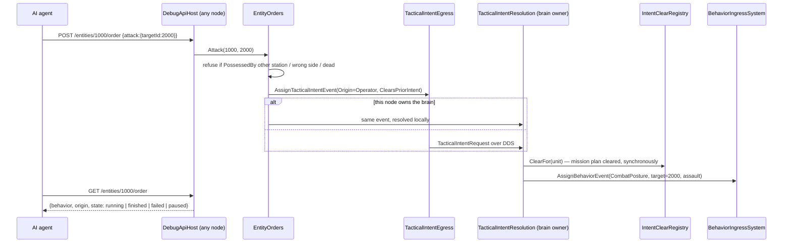

### 4.2 Menu *Engage* with its follow-up pick

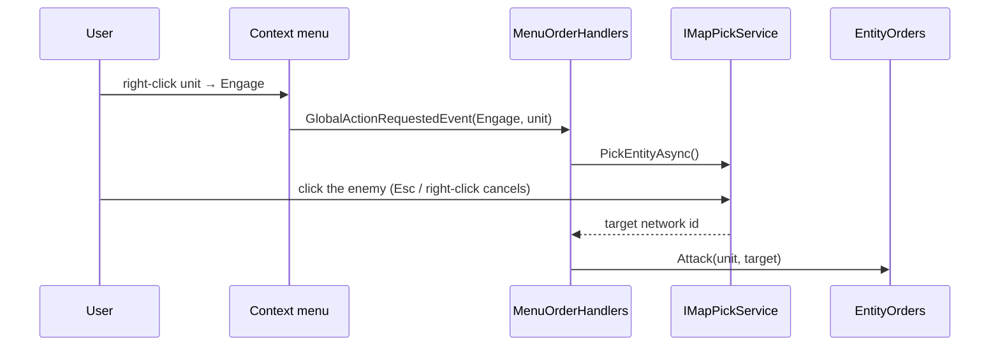

### 4.3 FPS — possess, drive, fire, release

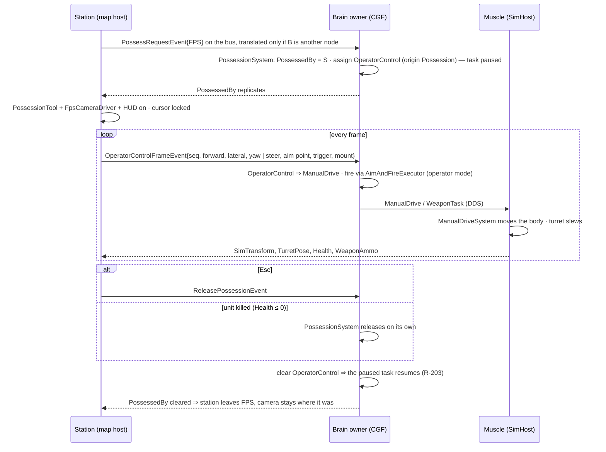

## 5. MODULES — who registers what, and who calls it each frame

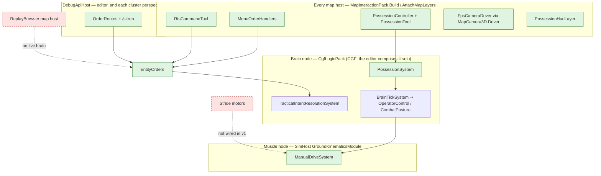

*In the **editor** the three subgraphs are ONE world* — the station, the brain and the muscle exchange the §2.3 events and
components on one bus, with no translator. *On a cluster* each arrow that crosses a subgraph is an egress → DDS → ingress pair.
*The red edges are the ones nothing reaches:* the **ReplayBrowser** also builds `MapInteractionPack`, but a replay has no live
brain — orders, RTS and possession are **absent** there (not greyed). The **Stride** motors take `VehicleState`/`CrowdMotorIntent`
as their inputs (`KinematicVehicleMotor.cs:184`, `BulletCharacterMotor.cs:211`) and will need their own `ManualDrive`
consumer — not v1. *Who calls each frame:* the canvas' `Update` drives the station items; `BrainTickSystem` ticks
`OperatorControl`; `GroundKinematicsModule` (PostSimulation, before `CarKinematicsSystem`) runs `ManualDriveSystem`.

## 6. Manual motion *(M-1 … M-5)*

| | person | ground vehicle |
|---|---|---|
| **keys** | W/S forward/back · A/D strafe · Shift sprint · C crouch · Z prone | W throttle · S brake → reverse · A/D steer (free look) |
| **mouse X** | turns the body (camera yaw = body yaw) — on the spot when no key is held | looks around (free) · **steers when `V` locks the view to the hull** |
| **mouse Y** | aim pitch (camera only) | look / turret elevation |
| **`ManualDrive` fields** | `Forward`, `Lateral` ∈ [−1,1] · `Yaw` (absolute) · `Gait` | `Forward` = throttle ∈ [−1,1] · `Steer` ∈ [−1,1] |
| **muscle rule** | velocity = R(yaw)·(Forward, Lateral·0.6, back ·0.6) × gait speed × stance cap (`CarKinematicsSystem.cs:146`); facing turns toward `Yaw` at `HumanGait.TurnRate`; a step onto unwalkable navmesh slides or stops (M-5) | accel / brake from `VehicleParams`, steer angle slews to `Steer·MaxSteerAngle` at `MaxSteerRate` (set by the TKB, never enforced today); `BicycleModel` integrates — with reverse allowed |
| **leaves** | the crowd agent (`CrowdAgentUpdateSystem` would fight it) | Pure Pursuit (not run in `Manual`) |
| **turret** | — | mouse aim point ⇒ `WeaponTask{Track, Point}`; the muscle slews at the TKB traverse rate |

⚠ **Today's person model cannot strafe** (`vel.Linear = fwd * Speed`, `CarKinematicsSystem.cs:410`) and **nothing can
reverse** (`speed ≥ 0` clamps, `BicycleModel.cs:179`, `HumanGait.cs:66`) — M-2/M-3 add both inside the `Manual` branch only;
autonomous motion is unchanged.

## 7. SLICES

| slice | builds | acceptance (headless unless marked; ⭐ each slice railed FIRST in the networkless editor world, then on the cluster — §2.3) |
|---|---|---|
| **S1** `CE-3167` + `CE-3168` | `EntityOrders`; `ClearsPriorIntent` + `IntentClearRegistry` + `MissionPlanClearProvider` (Entity Commanding §2.5b-d); `POST/GET/DELETE /entities/{id}/order`, `POST /orders`, `GET /sitrep?side=&truth=`; the side lock; **`/entities/command` fixed** — field-aware options (the CE-225 shape, `DebugApiService.cs:1546`) + an `Entity` given as a network id | an HTTP move reaches the brain from a non-owner node · an order clears the mission plan and never leaves the unit brain-dead · `GET …/order` reports running → finished · the sitrep lists only contacts the side knows · a `/entities/command` payload's fields arrive (the rail that was missing, `DebugApiBatch04Tests.cs:168`) |
| **S2** `CE-3169` + `CE-3170` | the three menu handlers + follow-up picks on every map host; the location picker's **cancel completes the task** (today it never does, `FdpLocationPickerGizmo`); Attack = CombatPosture with a designated target | Engage → pick → the unit closes and fires on THAT target, ignoring a nearer threat · Esc cancels the pick · Stop idles it · IG and CGF menus work, the replay menu has no orders |
| **S3** `CE-3171` | `RtsCommandTool` (2-D and 3-D picks) | RMB ground moves the selection · RMB hostile attacks · menus suppressed while active · Esc leaves |
| **S4** `CE-3172` + `CE-3173` | possession interactions, `PossessionSystem`, `PossessedBy`, `BehaviorOrigin.Possession`, `OperatorControl`, operator fire (M-8), `ManualDrive` + `KinematicsMode.Manual` + `ManualDriveSystem`; **HTTP `POST /entities/{id}/possess` + control frames** so it is railable before any camera exists | a person strafes and turns on the spot · a vehicle steers and reverses · a second station takes over · death releases · release resumes the paused task · ROE `HoldFire` does not stop operator fire |
| **S5** `CE-3174` | `ICameraDriver` + `FpsCameraDriver`, cursor lock, `PossessionTool`, `PossessionHudLayer`, `WeaponAmmo` descriptor; "Possess ▸ FPS / RTS" on the unit menu | the scenario camera is unchanged after an FPS session · the HUD shows the unit's ammo from a non-brain station · **(V)** an Xvfb screenshot of the FPS view + HUD |

## 8a. S3 DETAIL — the RTS command tool (`CE-3171`, designed `2026-10-11` after the prior-art sweep)

📐 **What the sweep measured, and what it decides:**

| fact | where | so |
|---|---|---|
| an EXCLUSIVE-focus gizmo already suppresses every map context menu (entity and canvas) | `GizmoMap…/DebugGizmoLayer.cs` :160 / :265 / :576 | "menus suppressed while active" needs **no new code** — the tool is exclusive |
| …and it suppresses the map's own LMB selection and the rubber band too | `DebugGizmoLayer.cs` :207 / :244; `SelectionInteractionSystem.cs:84` | the tool does its own click-select — **through `SelectionChangeRequest`**, the one write path (UX_Feature_Selection §2.7.3 rule 1), ⛔ never a second store |
| in 3-D the gizmo's `worldPos` is `MapCamera3D.Pick` (entity box → terrain → ground) and an entity hit lands ON the entity | `Vis2D/Layers/DebugGizmoLayer.cs:230`; `MapCamera3D.cs:257` | one hit test serves both views: `MapCanvas.PickTopmostEntity(xy)` |
| the canvas hit test lives in the station's `CanvasMapPickAdapter` | `CanvasMapPickAdapter.cs:101` | ⭐ `IMapPickService.EntityAt(xy)` (a default-`-1` interface member) — the tool reaches it through the pick the hosts already hand `MenuOrders` (§11): **no new per-host wiring** |
| tools register on the pack's `ToolController`; `ToolDescriptor` + an activation delegate | `ToolController.cs:78`; `ScenarioToolRegistrations.cs:107` (Measure — the analogue) | the pack registers `ScenarioToolIds.RtsCommand` on every live host |
| no toolbar exists outside the Editor; the every-host menu is the map's **View** main menu | `LayerControlGizmo.cs:154` | "View ▸ RTS command mode" (`GlobalActionIds.ToggleRtsCommand` = 254), only where `OrdersOffered` is set |

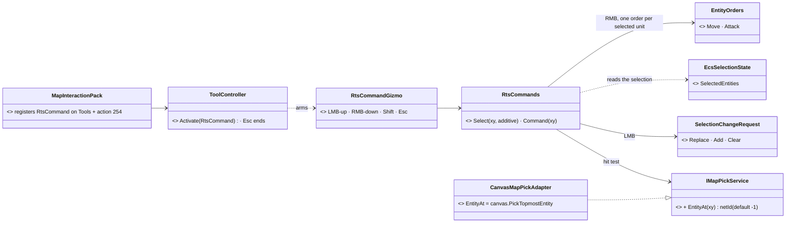

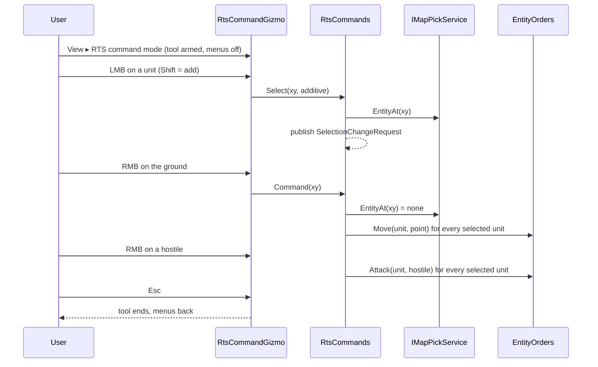

*What the pictures show that prose hid:* the tool owns **no** state of its own — selection is the map's, orders are
`EntityOrders`', the hit test is the station's pick. It is a router from three mouse gestures to three existing writes.

| ⭐ rule | |
|---|---|
| **hostile** = the clicked unit's `ForceId` differs from the ordering unit's and is not `Neutral` | a friendly or neutral under the cursor is a MOVE to its position (v1) |
| each selected unit gets its own order; a refused one (dead, other side under the side lock) is skipped | the same `EntityOrders` checks the HTTP route makes |
| ⚠ v1 has **no box select** inside the tool | the rubber band is suppressed with the menus; click / Shift-click select only. A box would be a second marquee — deferred, not duplicated |

## 8b. S4 DETAIL — possession and manual drive (`CE-3172` + `CE-3173`, designed `2026-10-11` after the inventory sweep)

📐 **What the inventory measured, and what it decides** *(file:line in the sweep's report, summarised)*:

| fact | where | so |
|---|---|---|
| rank is `Sop 1 · Superior 2 · everything else 3`; a Reaction PAUSES a non-SOP task into `PausedTask`; an order of any other origin DROPS the paused task | `BehaviorOrigin.cs:52`; `BehaviorIngressSystem.cs:238-260`, `:388-401` | `Possession` = rank **4**, and it behaves like a reaction toward the running task (**pause**), never an order (**no drop**); a Reaction over a running Possession is **refused** |
| a reaction resumes the paused task by clearing itself with `Self`, or by finishing (`BrainTickSystem.cs:445-453`) | `BehaviorIngressSystem.cs:131`, `:442` | releasing possession = a **clear with origin Possession that resumes** (the same `ResumePausedTask`) |
| the motion request crosses as `NavigationIntent` (Brain), applied by the bridge only on an `IntentId` change; `KinematicsMode.None` is driven as Direct | `NavigationIntentBridgeSystem.cs:127`, `CarKinematicsSystem.cs:226` | M-1 holds: `NavigationMode.Manual` entered ONCE, and a separate `ManualDrive` component carries the per-frame axes |
| a person's velocity is `fwd × speed` (no lateral); `HumanGait` and `BicycleModel` clamp speed ≥ 0 | `CarKinematicsSystem.cs:410`; `HumanGait.cs:66`; `BicycleModel.cs:34` *(the design's `:179` was wrong)* | the Manual branch is its OWN integrator — autonomous motion is untouched |
| `AimAndFireParams` has no point; `RoePermitsFire` knows no origin; the turret task already aims at `Point` | `AimAndFireExecutor.cs:35`, `:330`; `WeaponTaskDispatcherSystem.cs:53` | M-8 (S4d): a point target + an operator flag in the SAME executor |
| a descriptor joins a group in 11 steps (`dtWeaponTask`, `ed3434b4a`) | `HrotOwnershipGroups`, `NedOwnershipGroupBinding`, `AllDescriptors`, `SharedTranslatorPack` | S4e: `ManualDrive` (Brain) and `PossessedBy` (Brain) descriptors |

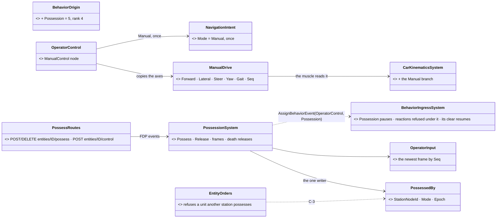

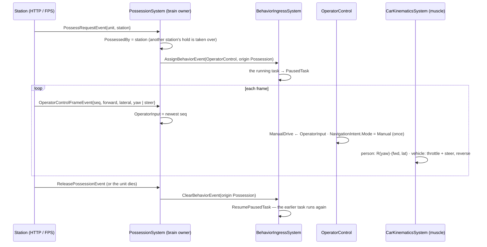

*What the pictures show that prose hid:* **one writer per thing** — `PossessedBy` only `PossessionSystem`, `ManualDrive` only the
`OperatorControl` behaviour (on the brain), the body only `CarKinematicsSystem` (on the muscle). Possession is a behaviour of a
new origin, ⛔ not a switch that turns the brain off (R-270).

| step | builds | its rails |
|---|---|---|
| **S4a** | `BehaviorOrigin.Possession` (5, rank 4): pauses like a reaction, never drops the paused task, refuses reactions over it, its own clear resumes | the ingress suite |
| **S4b** | `ManualDrive` (Brain) + `NavigationMode.Manual` → `KinematicsMode.Manual` + the Manual branch: person body-frame forward/strafe (back and strafe at 60 %), body yaw turned toward `Yaw` at `HumanGait.TurnRate`; vehicle throttle (− brakes, then reverses) + steer at `MaxSteerRate` | the kinematics suite |
| **S4c** | `PossessionSystem`, `PossessedBy`, `OperatorInput`, `OperatorControl`, the three FDP events, HTTP `possess` / `control` / release, `EntityOrders` refuses a unit held by another station | the networkless editor, end to end |
| **S4d** | operator fire: `AimAndFireParams` point + operator flag (no seen-now, no aim time, ROE bypass, C-2) | the combat suite |
| **S4e** | `ManualDrive` + `PossessedBy` descriptors; `Possess` · `Release` · `ControlFrame` interaction cases | the cluster |

⚠ ~~**Deferred, stated:** the navmesh wall check (M-5) lands with S4b only if the muscle's `INavmeshProvider` is reachable there;
otherwise it is its own row.~~ SUPERSEDED — it was reachable (a world singleton); built as `CE-3181`, §13.4. Aircraft (M-4) stay deferred.

## 8c. S4e DETAIL — possession on a cluster (`CE-3172` / `CE-3173`, designed `2026-10-11` from the measured templates)

📐 **Templates measured, both reused unchanged:** a hull component in the Brain group replicated to every node =
`dtWeaponPosture` (ui's WL-6: `AllDescriptors` · `SimDescriptors` · `HrotOwnershipGroups` · `NedOwnershipGroupBinding` · an egress +
ingress translator pair in `SharedTranslatorPack`, the ingress also in `EntityStatesIngressPack` for the pure IG); a request to an
entity this node does not own = the R-221 interaction topic (`InteractionCodecs`: one codec per FDP event, the transport and the
topic do not change).

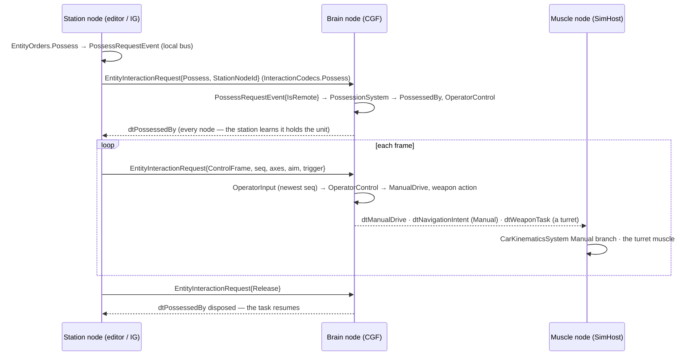

*What the picture shows that the prose hid:* the station never writes the unit — every arrow INTO the brain is a request, every
arrow OUT is replicated state, so the same code runs in the editor (one node) and on a cluster (three).

| new | id | group / case | why |
|---|---|---|---|
| `dtManualDrive` → `EntityManualDrive` | descriptor **128** | Brain (written by `OperatorControl`, read by the muscle) | M-1: per-frame axes cross to the muscle |
| `dtPossessedBy` → `EntityPossessedBy` | descriptor **129** | Brain (`PossessionSystem` the one writer), ingress on the pure IG too | C-3: every station sees who holds a unit; no revoke message |
| `Possess` · `ReleasePossession` · `ControlFrame` | interaction kinds **5 · 6 · 7** | the R-221 topic | after the reserved 2-4; the station's node id rides the payload |
| ⚠ `OperatorInput` | — | never sent | brain-local, filled from the frames |

⚠ **Stated, not hidden:** control frames ride a Reliable/KeepAll topic. M-6's *newest seq wins* makes a late or doubled frame harmless; a
lossy KeepLast topic per station would cut latency under load and is a later tuning, not a correctness change.

## 8d. S5 DETAIL — the FPS station: camera, controls, HUD (`CE-3174`, designed `2026-10-11` after the inventory)

📐 **INVENTORY** — what exists, and what it decides *(queries: `search_graph` `.*(InputProvider|CameraDriver|Hud).*` Class → 5
hits, no camera driver and no HUD exists; grep of `: IInputProvider` → 1 production + 3 test implementers; `AttachMapLayers(` → 5
hosts)*:

| fact | where | so |
|---|---|---|
| the canvas hands the WHOLE input provider to the camera BEFORE any layer, and a consumed input skips every click and context menu | `MapCanvas.cs:253`, `:256-270` | ⭐ **a camera driver that consumes input IS the exclusive focus** — §3.2's separate `PossessionTool` is not needed (rejected below) |
| every map host attaches its 3-D view through ONE function | `MapInteractionPack.AttachMapLayers` (5 callers) | the station layer is attached THERE — no per-host wiring (CE-1033's rule) |
| `MapCameraLayer` writes the scenario camera once the view is still | `MapCameraLayer.cs:149-178` | it must not save while a driver drives (M-9, acceptance "the scenario camera is unchanged") |
| one production input provider; `IInputProvider` has no cursor control | `RaylibInputProvider` | `SetCursorLocked` as a DEFAULT interface member — the test fakes need no change |
| the eye height of a person by posture | `TerrainWorldLosStrategy.EyeHeightFor` + `LogicalStance.Of` | the FPS eye is the same eye perception uses |
| a person vs a vehicle | `VehicleParams.Class == Pedestrian` (`CarKinematicsSystem.cs:327`) | the driver's axes: strafe + yaw, or throttle + steer |
| ammunition lives only on the brain (`WeaponState`, mount children) | no ammo on the wire (`SimDescriptors.cs`) | C-7: a NEW `WeaponAmmo` (Brain group) mirrored from `WeaponState` |
| health already crosses (`dtEntityDamage` → `Health`) | `SimDescriptors.cs:51` | the HUD reads `Health` as is |
| free action ids 255–259 on every lane | `GlobalActionIds.cs` (census) | `Possess` = 255 |

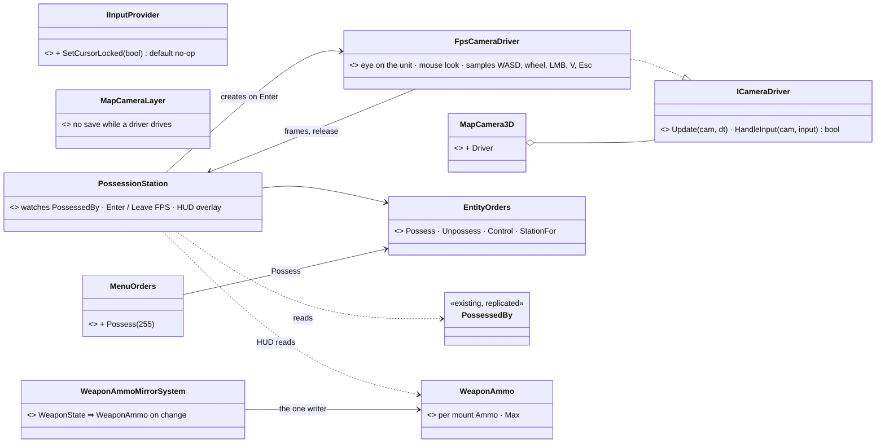

*What the picture shows that the prose hid:* the station never decides it is in FPS — it **follows the replicated `PossessedBy`**, so a
possess from the menu, from HTTP, or a take-over by another station all land the same way, and a lost unit leaves FPS by itself.

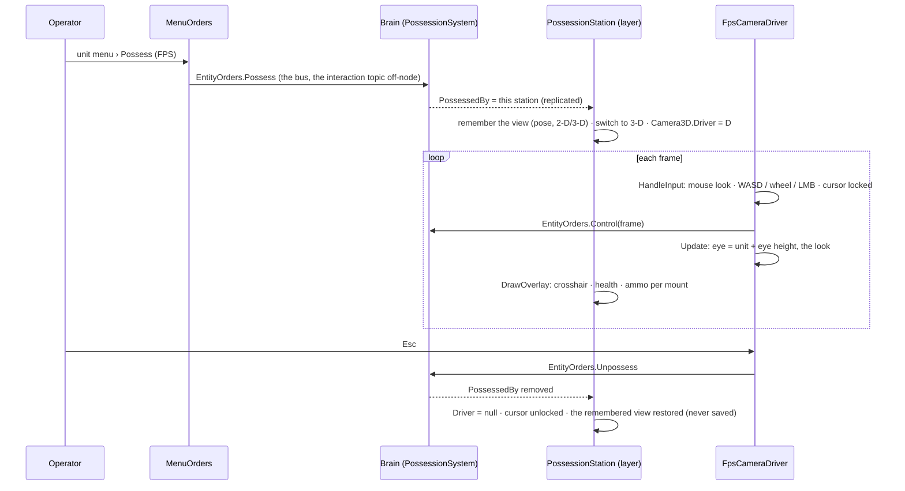

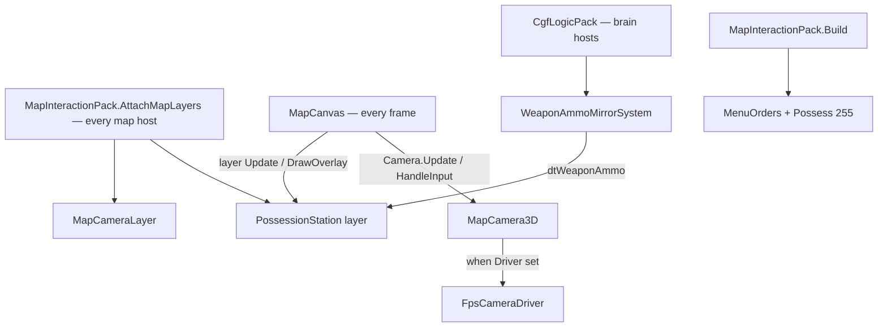

*Caption:* every arrow into the station comes from code that already runs on every map host each frame — the canvas and the shared
attach — so there is no host on which FPS could be silently missing.

| new | id | why |
|---|---|---|
| `WeaponAmmo` component | **365** | per mount (up to 4) ammo + max, Brain group |
| `dtWeaponAmmo` → `EntityWeaponAmmo` | descriptor **130** | C-7 |
| `GlobalActionIds.Possess` | **255** | the unit menu item |

**Rejected — one line each:**
- *A separate `PossessionTool` (exclusive gizmo)* — the camera already takes input before every layer (`MapCanvas.cs:253`); a second
  focus owner would duplicate what consuming in the driver does.
- *The station entering FPS from the menu click* — then HTTP possession and take-overs would not show; following `PossessedBy` covers all.
- *A second camera class* — M-9: gizmos, labels and pickers draw only for `MapCamera3D`.
- *Ammo read from the brain's `WeaponState` over HTTP* — a station on another node has no `WeaponState` (C-7).

⚠ **Deferred, stated:** a vehicle's turret-mounted eye (the view from the turret pose) — v1 puts the eye on the hull; the hull-locked
`V` view steers with the mouse as M-3 says. The `(V)` screenshot acceptance needs a windowed run.

## 8e. S6 DETAIL — the operator's weapons: a click is one shot, weapon and ammo keys, the HUD (`CE-1078` · `CE-1079` · `CE-1080`, designed `2026-10-14`, ui)

🔒 **User, `2026-10-14`:** *"when possessing the tank i would expect the turret to try to follow the FPS camera aiming direction and when
i press fire trigger the tank tries aiming to the clicked target and fire once the barrel is aimed … When possessing the soldier having
grenades and rifle, i need to switch the weapon/ammo to use when firing, defaulting to the main weapon; same for tanks - switching between
MG/cannon weapon and for each weapon selecting ammo and see in the HUD what is selected, cycling weapon/ammo using dedicated keys."* —
the leans below: *"approved"*.

📐 **INVENTORY** *(queries: `search_graph .*(Ammo|Round)(Choice|Select|Loadout|Request).*` → 0 production hits; `.*(Weapon|Mount)(Select|Choice|Cycle).*` →
`WeaponChoice`, `WeaponSelectionDecision` — the AI's mount choice only; grep `PickFilter.Terrain` in the station → 1)*:

| fact | where | so |
|---|---|---|
| trigger up ⇒ the turret task is `Track` at the crosshair point — the turret already follows the look | `AimAndFireExecutor.TurretPath` (operator `atPoint`), rail `CE3172` | ⭐ CE-1078 builds on it; no new turret code |
| rounds are granted only WHILE the trigger is held, and the muscle fires only `OnTarget` ⇒ a click shorter than the slew fires nothing | `AimAndFireExecutor.cs:421-433`, `WeaponTaskDispatcherSystem.cs:84` | ⛔ the defect CE-1078 fixes |
| the brain keeps only the NEWEST frame | `PossessionSystem` (`f.Seq <= …Seq ⇒ skip`) | ⛔ a press and release inside one brain tick vanish ⇒ presses travel as COUNTERS |
| the crosshair picks terrain only | `FpsCameraDriver.AimPoint` | ⛔ aiming at a tank aims at the ground behind it (CE-1080) |
| the wheel cycles mounts; mount 0 is the default | `FpsCameraDriver.Mount`, `NextMount` | ✅ kept |
| a mount's rounds: `AmmoLoadout` (≤ 4 types, `Loaded`, `SwitchRemaining` = one reload); only the AI's `AmmoChoice.Choose` switches | `AmmoChoice.cs:108-123` | ⭐ CE-1079 adds the operator's switch beside it (same reload cost — D-I) |
| the HUD mirror carries totals and magazines, no round type | `WeaponAmmo` (`dtWeaponAmmo`) | ⭐ grows (Missiles & Ammo §1 already said it would) |
| `AimAndFireParams` is full (32 bytes) and the operator mode leaves `Target` and `Rounds` unused | `AimAndFireParams.cs` | ⭐ they keep their meaning: the shot's target, and a round cap |

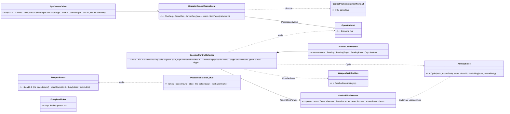

*What the picture shows that prose hid:* nothing new crosses the brain/muscle line — the latch lives in the OPERATOR BEHAVIOUR (brain), the
executor only learns two meanings it already had room for (a target, a round cap), and the turret muscle is untouched.

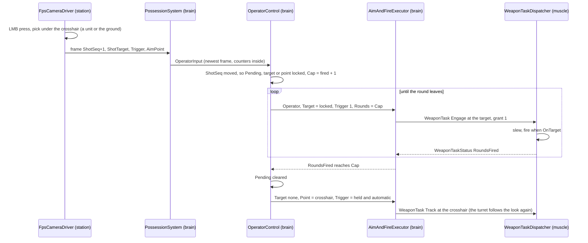

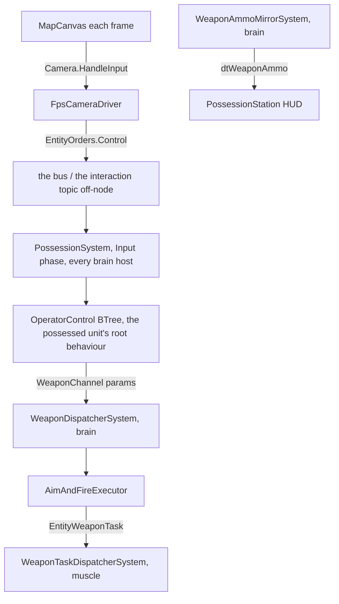

*Caption:* every box already runs each frame on the hosts that run possession today (§8c) — the change adds no system, so there is no host
on which the latch or the ammo switch could silently not tick.

| decision (✅ user, `2026-10-14`) | rule |
|---|---|
| **D-1 click semantics** | a PRESS locks one shot on what is under the crosshair (a unit is followed as it moves; else the ground point) and fires once the weapon bears; then the turret follows the look again. A new press replaces it; RMB cancels it. Held trigger: automatic weapons (small arms, MG, autocannon, untagged) keep firing at the crosshair; single-shot weapons (tank gun, ATGM, mortar, grenade) fire once per press |
| **D-2 keys** | wheel or `1`–`4` = weapon (mount 0 = the main one, the default) · `F` = the next round of the selected weapon · RMB = cancel the locked shot |
| **D-3 switch cost** | one reload — the AI's rule (D-I); the HUD says `LOADING` |
| **D-4 crosshair** | picks units too (never the own body); the aim point is where the ray meets the unit's box |

**Rejected — one line each:**
- *A separate operator turret system* — the turret task already slews then fires (WL-3).
- *Fire at once wherever the barrel points* — what the user asked to avoid.
- *The trigger as a level the brain edge-detects* — the brain keeps only the newest frame; a short click is lost (counters survive coalescing and the wire).
- *The latch in the station* — the station cannot see when the round left; the brain can, by the executor's own round count.
- *The AI's `AmmoChoice.Choose` for the operator* — the user chooses the round; `Cycle` shares the switch and its cost.
- *A new params field* — 32 bytes are full; `Target` and `Rounds` already mean "who" and "how many".

## 9. AS-BUILT — S1 (`CE-3167` + `CE-3168`, `2026-10-11`)

| design said | built | why |
|---|---|---|
| a `MissionPlanClearProvider` class (Entity Commanding §2.5d) | ⭐ **`MissionControlExecutionSystem` IS the provider** (`IIntentClearProvider.ClearFor`), sharing one `EmptyPlan` with `CMD_ABORT_ALL` | it owns the plan's per-unit task order and version (`_taskOrder`, `_missionVersions`); a separate class would clear the components and leave those stale |
| `DELETE …/order` releases the unit | ⭐ **`AssignTacticalIntentEvent.Kind` (`Assign` / `Clear`)**, a `Kind` byte + `Flags` byte on `TacticalIntentRequest` | `DESIGN_Sensors_And_Doctrine.md` §7.7 already named the intent topic as THE one wire path *"which gains a `Kind`"*; `ClearBehaviorEvent` has no translator, so a release from a non-owner node would have gone nowhere |
| `GET …/order` reports finished / failed | ⭐ **`OperatorOrderOutcome`** (component 358, NoScenario, never sent), written by `BrainTickSystem.Finish` for an Operator run | the run's state is cleared on finish (CE-449); its outcome had nowhere to live. Read on the brain node; elsewhere the route says so |
| the service reads the geo transform | ⭐ `EntityOrders(world, map, IGeographicTransform?)` — handed in | the user's `2026-09-08` ruling: one transform, read through the interface the host resolved, never looked up by each consumer |
| `attack` in S1 | ⏳ refused with *"arrives with CE-3170"* — ⛔ SUPERSEDED by §10 (built) | the designated-target CombatPosture is S2; ordering a combat behaviour by name works meanwhile |
| — | the flags constant lives in `TacticalIntentFlags`, outside the DDS struct | the DDS generator serialises every member of a `[DdsStruct]`, constants included |
| "any node publishes, the owner resolves" (tactical-intent design) | 🔴→⭐ **`TacticalIntentEgressTranslator` on EVERY node** (`SimHostAuxiliaryTranslatorPack`), the ingress still Brain-only | 📐 found writing the cross-node rail: the egress sat inside the `NodeRole.Brain` branch, so an order published on a SimHost / map node reached nobody. ⚠ **The IG builds no auxiliary pack** (`NedIgTranslators`) — an IG station's order still needs its own egress: **S2 owns it** (the menu is the first IG-issued order) |
| — | `EditorHarness(productionBehaviors: true)` + the harness passes its `BehaviorRegistry` to the debug API | the networkless-editor rail needs real behaviours; the API names and checks them (silent-default rule) |

📐 **Rails:** `TacticalIntentResolutionSystemTests` (+3), `TacticalIntent{Egress,Ingress}TranslatorTests` (+1 each),
`MissionControlExecutionSystemTests` (+1), `CgfLogicPackTests` (+1 forwarding rail), `SimHostAuxiliaryTranslatorPackTests` (+4 cases), `DebugApiOrdersTests` (7, networkless editor), `EntityOrdersAcrossNodesTests` (1, SimHost → CGF over DDS).

## 10. AS-BUILT — S2 attack (`CE-3170`, `2026-10-11`)

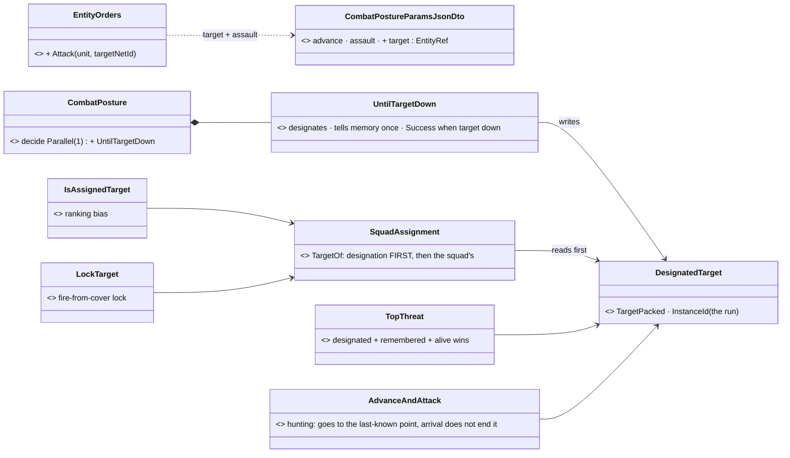

*What the picture shows that prose hid:* no branch of the posture was taught about orders. The designation joins the reader every
targeting step **already** asks (`SquadAssignment.TargetOf`, G4's one reader), plus `TopThreat`, which every fire, sensor and
close-to-throw step goes through. So Suppress, TakeCover's peek, Flank and the grenade close all follow the named enemy, with no
per-branch code.

| design said | built | why |
|---|---|---|
| "CombatPosture with a designated target" | ⭐ `DesignatedTarget` (component **360** — 359 at commit, moved at the ui merge, NoScenario, brain-local) keyed to the run's `BehaviorState.InstanceId`; nothing removes it | a later run carries a new instance id, so it never inherits the designation; no deactivator ordering to get wrong |
| — | ⭐ read through **`SquadAssignment.TargetOf`** (designation first, then the squad's) and **`EqsTacticsNodes.TopThreat`** (hard override while remembered + alive) | the seam law: the "target I was told to fight" reader already existed (CE-3158 G4). ⛔ No second reader. The squad's assignment stays a ranking **bias** |
| the order succeeds when the target is down | ⭐ `PostureNodes.UntilTargetDown` in the decide `Parallel(1)` — Success ⇒ the posture, so the order, **succeeds** (`OperatorOrderOutcome`) | RequireOne ends on the first Success (`Interpreter.cs` ExecuteParallel); "down" = `CombatLife.IsAlive` false (Health ≤ 0 keeps the body) |
| — | ⭐ the order **tells** the unit where the target is: once, as a memory contact with **no modality** (not "in sight") at the score of a contact just seen | an attack on a target the unit has not seen would otherwise rank nothing; with no modality `HasLineOfSight` stays 0, and fog of war applies again after that (it is forgotten ≈ 70 s unconfirmed) |
| — | 🔴→⭐ **`AdvanceAndAttack` hunts**: with a live designation its objective is the target's last-known point (re-issued when it moves more than the arrival radius), and **arriving does not end the posture** | 📐 found wiring it: the advance's arrival is a Success that ends the Parallel, so an attack would have reported "succeeded" on reaching the target's start point with the target alive |
| the HTTP `attack` kind | ⭐ `{kind:'attack', targetId}` → `EntityOrders.Attack` → `CombatPosture {"target":id,"assault":true}`; refuses self, unknown and killed targets (400) | `assault` per AQ89 D: obedience decides closing in, not bravery |

⚠ **Known limits:** 📐 **a HIDDEN named target is SUPPRESSED, not closed on** (`CE-3177`): the posture's utility decision has no "ordered to attack" input, so an unseen enemy scores Suppress (AQ89 A). The fire still goes to the named enemy, and a grenadier closes to throw under `assault`. A seen one is advanced on and hunted. Raising Advance under a live designation is a decision-scoring change for the behaviors lane. ROE `HoldFire` still holds the fire (the unit closes in without shooting), which is C-5's stated design. A target the unit
**forgets** drops out of `TopThreat`: the posture then fights whatever it ranks, and the order keeps running until the target is
down or the operator re-orders. An order from an IG station needs the IG egress (S2 `CE-3169`).

📐 **Rails:** `TacticsTreesTests` +3 (the named enemy is fought over a nearer one and the order succeeds when it is down · the designation dies with its run · an unknown target leaves the posture as authored) · `DebugApiOrdersTests` +1 (HTTP attack in the networkless editor: Operator origin, designation, `succeeded`, the three refusals).

## 11. AS-BUILT — S2 menu orders (`CE-3169`, `2026-10-11`)

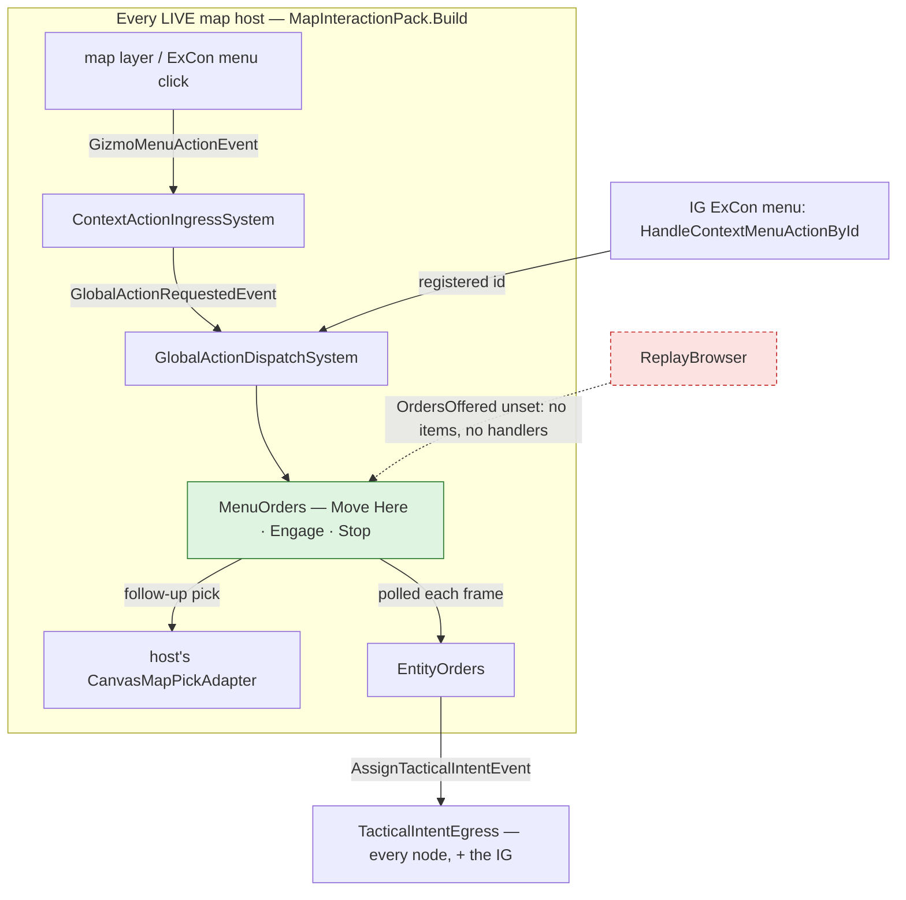

*What the picture shows that prose hid:* the click → ingress → dispatcher edge. 📐 **CGF and IG scheduled the dispatcher but ran
NO ingress** (`contextIngress: null`), so on those two hosts no map-menu click ever reached an action: not the orders, and not the
pins, AI trace or layer control the pack already registered "on every map host". The ingress is the fix, not the orders.

| design said | built | why |
|---|---|---|
| `MenuOrderHandlers` in `MapInteractionPack` | ⭐ `MenuOrders` (`Hrot.Presentation`, the pack builds it, scheduled in `InteractionSystems`, a `RequiredSystem`); the host sets `MenuOrders.PickService` (Editor, CGF, SimHost window, IG — a resolver, each builds its pick after the map) | the silent-default rule: every host that has a pick passes it |
| follow-up picks | ⭐ the pick task is **polled each frame**, never awaited | `PickerToolHost` makes continuations asynchronous: an `await` would publish on a pool thread |
| — | 🔴→⭐ **`ContextActionIngressSystem` on CGF and IG** | 📐 found by the agent sweep: `contextIngress: null` on both (`CgfSubsystem`, `IgApplication`) — every map-menu action dead there |
| IG's menu | 🔴→⭐ `HandleContextMenuActionById` runs a **registered** id through the map's registry | it forwarded every non-IG id as a `ContextActionTriggered` that nothing on the IG reads and no translator sends |
| the IG station's egress (§9) | ⭐ `TacticalIntentEgressTranslator` in `NedIgTranslators`; the IG also publishes its `NetworkEntityMap` world singleton | no host builds both packs (IG / auxiliary), so it is never doubled; IG was the one map host without the singleton |
| the picker's cancel | ⭐ `FdpLocationPickerGizmo(onCancelled)` → the adapter cancels the task | Esc / right-click only removed the gizmo: `PickLocationAsync` never completed |
| the replay menu has no orders | ⭐ `OrdersOffered` world singleton, set by the pack on live hosts; the unit menu offers the three items only there; a replay registers no handler | the replay records `BehaviorState`, so "has a brain" could not tell them apart |
| — | ⚠ orders are issued only where `PickService` answers (a station) — Stop too | a menu action relayed from a station to a headless node must not be ordered twice |

⚠ **Known limits:** ~~a WINDOWED node that also receives a station's relayed menu action would run it too (`CE-3178`).~~ ✅ FIXED `2026-10-11` —
measured by reading: the relay ingress accepts a batch on EVERY node whose world holds the anchor (`GizmoInteractionIngressTranslator`,
"is this id in my world"), not only the owner, so each windowed node with the unit would issue the order and open a pick. The relay
marks its `ContextActionTriggered` `Relayed`; the mark rides `GlobalActionRequestedEvent.Relayed` through the one ingress; the four
station actions register with `GlobalActionRegistry.RegisterLocal` and do not run for a relayed click (an ordinary action — Rotate —
still does). ⚠ So the external gizmo viewer's Move/Engage/Stop/Possess do nothing on the node it mirrors: it has no pick of its own
and an order needs one. The ReplayBrowser
~~runs no context ingress, so its own map-menu actions (Center View…) never fire either (`CE-3179`, pre-existing).~~ ✅ FIXED
`2026-10-11`: it runs the shared `ContextActionIngressSystem` in its world-following form (its world changes when a recording is
rebound), ticked before the dispatcher.

📐 **Rails:** `MenuOrdersTests` (7: move/engage picks → the order, cancel → nothing, Stop, headless → nothing, live vs replay menu,
the picker's cancel) · `SimHostAuxiliaryTranslatorPackTests` +2 (the IG pack carries the egress).

## 12. AS-BUILT — S3 RTS command tool (`CE-3171`, `2026-10-11`)

⭐ **Built as §8a draws it**, with no deviation in the classes or the sequence. `RtsCommands` and `RtsCommandGizmo` live in
`Hrot.Presentation/ScenarioEditor/Map/RtsCommands.cs`. The pack registers `ScenarioToolIds.RtsCommand` ("orders.rtsCommand",
Global arbiter, toggles on reactivate) and action `ToggleRtsCommand` (254) on live hosts only. `IMapPickService.EntityAt` is a
default-`-1` member; `CanvasMapPickAdapter` implements it.

| as-built detail | why |
|---|---|
| the tool arms only where `MenuOrders.PickService` answers | a headless host has no one to click; the tool reports Unserviceable (`ToolController` tells the operator) |
| the View menu item appears only with `OrdersOffered` (two `LayerControlGizmo` menu strings) | the same gate as the unit menu (§11): never in a replay |
| RMB on the clicked unit itself is skipped for that unit | a unit is never ordered to attack or walk onto itself |
| 🔴→⭐ found: `FdpPanelWindowsDumpTheirModelsTests`'s fixture used `[ComponentId(350)]` = `CoverClaim` | an order-dependent collision red; fixed with a test-only id. Two more fixtures in that suite reuse production ids (220, 221): `CE-3180` |

📐 **Rails:** `RtsCommandToolTests` (5: click / Shift / empty-ground select · RMB hostile attacks with every selected unit ·
RMB ground / friend / neutral moves · the gizmo is exclusive, routes its gestures, Esc leaves · offered and armed on a live map with
a pick, absent in a replay).
MCP tools: `order_entity` · `get_entity_order` · `release_entity` · `order_entities` · `lock_side` · `get_sitrep` (group Z).

## 13. AS-BUILT — S4a-S4c possession and manual drive (`CE-3172` part, `CE-3173` part, `2026-10-11`)

⭐ **Built as §8b's class and sequence diagrams draw them, with one moved responsibility:** the let-go after a possession ends is `PossessionSystem`'s, not `OperatorControl`'s (row below). The other deviations are additions:

| as-built detail | why |
|---|---|
| ⭐ **the possess / release / control calls live on `EntityOrders`** (`Possess` · `Unpossess` · `Control` · `HolderOf`), and the HTTP routes call them | §3.1's rule — ONE operator service (R-270): the FPS tool (S5) will call the same three, so HTTP and FPS cannot drift. §8b's `PossessRoutes` box is that service's HTTP face |
| ⭐ **`OperatorControl`'s node RE-ENTERS Manual whenever anything cleared it** (not strictly "once") | the paused task's MoveTo `OnExit` writes `Mode = None` when the possession pre-empts it; a strictly-once write could be overwritten in the same frames. Re-entering is idempotent (`IntentId++` only on a change) |
| a station is a NODE id: `EntityOrders.Station`, else the unit's `NetworkAuthority.LocalNodeId` (C-8) | every replicated unit carries this node's id, so no new singleton |
| `OrderRefusal.Possessed` (409): any order to a possessed unit, and control / release from a station that does not hold it | the ingress would refuse an Operator order under a Possession anyway — this says WHY instead of a silent drop |
| `PossessionSystem` is the first Input system of `CgfLogicPack` | its `AssignBehaviorEvent` is on the bus before the behaviour ingress reads |
| a unit with no frame yet holds still (axes 0, facing kept); once no possession runs, `PossessionSystem` zeroes `ManualDrive` and lets `NavigationIntent` go (the invariant *Manual lives only under a running possession*) | the resumed task starts from idle, never from the operator's last stick position. 🔴→⭐ **found by the rail:** the first build did it in an `OperatorControl` BTree deactivator, which never ran — a ROOT behaviour's deactivators do not fire on clear, by design (`DESIGN_Behaviour_Fault_And_Teardown.md`, rejected *"fire BTree deactivators on clear"*). The invariant also covers death and faults |
| ⚠ component ids: `DesignatedTarget` **360**, `OrdersOffered` **361**, `ManualDrive` **362**, `PossessedBy` **363**, `OperatorInput` **364** | 359 was allocated twice the same evening (ui's `WeaponPosture`); backend's three moved up one at the ui merge |
| event ids 5200-5202 (`PossessRequest` · `ReleasePossession` · `ControlFrame`) | a census of every event id on all lanes |

📐 **Rails:** `SopSlotTests` CE3172 ×3 (a possession pauses / refuses reactions / its release resumes; over a reaction; over the
idle choice, an Operator clear refused) · `CarKinematicsSystemTests` CE3173 ×4 (strafe at 60 %; turn on the spot, back at 60 %,
signed speed; a vehicle steers, brakes, reverses; no drive = hold still) · `DebugApiOrdersTests` CE3172 ×2 in the NETWORKLESS
editor world (possess pauses a hold, refuses an order, control frames walk the body east, an older frame is ignored, release stops
the body and resumes the hold; another station cannot drive or release but can take over).
MCP tools: `possess_entity` · `release_possession` · `control_entity` (group Z).

### 13.1 AS-BUILT — S4d operator fire (`CE-3172` part, `2026-10-11`)

⭐ **Built as M-8 decided it:** the existing `AimAndFireExecutor` gained an OPERATOR mode — `AimAndFireParams.Operator`, `Trigger` (in
its padding) and `Point` (fills the 32 bytes). No second weapon executor.

| as-built detail | why |
|---|---|
| ⭐ the per-shot round at a point is ONE function, `FireAtPointExecutor.ShootAtPoint`, now used by `FireAtPoint` and by operator fire | measured before building: `FireAtPointExecutor` already WAS the point-target, no-sight, no-aim-time path; operator fire differs only in skipping the ROE (C-2), so it reuses the round instead of copying it |
| a turreted mount goes through the existing turret path with `WeaponTask.Point` (Target null) | the muscle already aims and fires at `Point` when there is no target entity (`WeaponTaskDispatcherSystem.cs:55`, `:98`); a moved point re-aims WITHOUT a new epoch, so rounds in flight keep counting |
| kept for the operator: ammunition, magazine, cooldown, no DIRECT round through a friend; skipped: seen-now, aim time, ROE | C-2 lists exactly the three skipped; the friendly line is a rule, not a decision |
| `OperatorControl` starts the weapon action once and steers its params in place each frame; stamped with the run's id | ⭐ `ChannelArbitrationSystem` cancels a channel action whose run ended — so a release (or death, or fault) stops the weapon by construction, no extra teardown |
| ⚠ cooldown is a constant, `OperatorControlBehavior.OperatorCooldownSeconds` = 0.25 s | the TKB carries no cyclic rate (`WeaponMountDto` has aim time, magazine and reload only) |
| 🔴→⭐ found by the rail: a unit with no `ActorCapabilityState{CanShoot}` is never dispatched | the dispatcher's existing gate; production soldiers carry it — the rail's fixture did not |

📐 **Rails:** `AimAndFireExecutorTests` CE3172 ×3 (per-shot fires at the point under HoldFire only while held, 3 rounds in 0.5 s at a
0.2 s cooldown; the AI's aimed fire still obeys HoldFire; a turret tracks the point, engages while held, re-aims with no new epoch,
every round spent once) · `DebugApiOrdersTests` CE3172 ×1 (a possessed HoldFire rifleman fires at the aim point while the trigger is
held, holds when released, stops for good on release of the possession).

### 13.2 AS-BUILT — S4e possession on a cluster (`CE-3172` + `CE-3173`, `2026-10-11`)

⭐ **Built as §8c draws it** — `dtManualDrive` (128) and `dtPossessedBy` (129) in the Brain group, the `Possess` (5) ·
`ReleasePossession` (6) · `ControlFrame` (7) interaction cases, codecs keyed on `PossessionSystem.OwnsBrain`.

| as-built detail | why |
|---|---|
| `EntityPossessedBy.Held`: the egress sends ONE `Held = 0` when the component leaves the brain; the ingress removes it | a release must reach every station, and a TransientLocal topic keeps the last sample per key — a disposal alone would not tell a late joiner |
| ⚠ the `ManualDrive` ingress takes the latest sample, with NO `Seq` check | the one writer is the brain (samples in order); its let-go and a new station both restart the sequence, so a seq check would DROP the stop — M-6's newest-seq rule stays the brain's, on the frames it receives. (Found while writing the translator, before any test ran) |
| `PossessedBy` ingress also in `EntityStatesIngressPack` | a pure IG skips the shared pack's ingress (the WL-6 lesson): without it no IG station would see who holds a unit |
| the three possession events and both components registered in `HrotSharedComponentRegistry` | the R-221 rule: each kind's event on every host |

📐 **Rails:** `InteractionTransportTests` CE3172 (possess, frame and release cross as their cases and arrive as the same events, marked
remote, every axis intact) · `PossessionReplicationTests` ×2 (axes applied on the muscle, the let-go lands; `PossessedBy` set, taken
over, removed by one release sample) · ⭐ `EntityOrdersAcrossNodesTests` CE3172 — **a live 4-node cluster**: SimHost possesses the
Rifleman, CGF runs `OperatorControl` at origin Possession, the body walks 1.5 m on SimHost, the IG sees the hold, release resumes the
task and every node forgets it.

⏭ **S4 is complete.** M-5 (the navmesh refusal) is `CE-3181` — built, §13.4. S5 (`CE-3174`) — §13.3.

### 13.4 AS-BUILT — M-5 the navmesh wall check (`CE-3181`, `2026-10-11`)

⭐ **Built as M-5 states, people only.** The muscle reaches the navmesh after all: `INavmeshProvider` is a managed world singleton
on every host that has one (`EngineBackedNavigationModule`), so §8b's deferral ("only if the muscle's provider is reachable") is
SUPERSEDED. `ManualMotion.KeepOnNavmesh` runs after `ManualMotion.Person` in the `Manual` walker branch.

| as-built detail | why |
|---|---|
| the step's END is PROJECTED onto the mesh: within 5 cm it stands; further, it slides to the projection when that is no further from the start than the step; no projection ⇒ refused | ⛔ `IsWalkable` is not the test — Recast's answer is "a polygon lies within the query extent", so a point just inside a wall passes it. The nearest mesh point IS the slide along the wall |
| a body whose START is already off the mesh moves freely | refusing it every step would trap a unit spawned (or pushed) off the mesh |
| the layer is `NavLayerSelection.For` (a pedestrian ⇒ Infantry) | the mesh the person would be planned on |
| a host with no navmesh singleton walks freely, as before | no regression where there is no terrain mesh |

📐 Rails: `CarKinematicsSystemTests.CE3181_*` ×2 (slides along a Recast-like wall and never passes it; a step with no mesh under it is
refused, and a body already off the mesh is not trapped).

### 13.3 AS-BUILT — S5 the FPS station (`CE-3174`, `2026-10-11`)

⭐ **Built as §8d draws it** — the classes, the sequence and the module edges are the ones in §8d's three diagrams; no box moved.

| as-built detail | why |
|---|---|
| `MapCamera3D.Driver` setter: detaches the old driver, cancels any animation, clears look/pan; `Update` and `HandleInput` delegate wholly while it is set | a half-finished fly-to or a held pan from before the possess would otherwise fight the driver's eye on the first frame |
| `MapCameraLayer.Update` returns early (and forgets its last pose) while a driver drives | M-9 / R-260: the FPS eye is never saved into the scenario camera, and the first still frame after release is not mistaken for an operator's move |
| `PossessionStation.HeldHere` keys on `PossessedBy.StationNodeId == EntityOrders.StationFor(unit)` — the same node id the possess was sent with | one definition of "this station" for both sending and following; a networkless editor is node 0 on both sides |
| `WeaponAmmo` carries the magazine too (`Mag0..3`, −1 when the weapon has none); the HUD shows `[rounds in magazine]` | the HUD would otherwise show a total the operator cannot fire without a reload |
| `WeaponAmmoMirrorSystem` (CGF simulation phase, after `NearMissSensingSystem`) mirrors mount 0 + mount children for units with `BehaviorState` this node has authority over, writing only on change | one writer on the brain; replicas never write it; a write per change, not per frame, keeps the Reliable topic quiet |
| `Possess (FPS)` (action 255) is offered only on hosts that pass a `PickService` | the same rule as Move/Engage (§11): a headless node has no operator to put in first person |

📐 **Rails:** `PossessionStationTests` ×4 (the driver seam replaces update + input and is told when removed; the station follows
`PossessedBy` into FPS and back to the 2-D pose it had, saving nothing; WASD/mouse/LMB become ONE control frame, the cursor locks,
Esc releases, detaching unlocks; the HUD text) · `MenuOrdersTests` CE3174 (the menu item possesses for this station) ·
`WeaponAmmoMirrorSystemTests` (mount + children mirrored, spend updates it, replicas untouched) · `PossessionReplicationTests`
CE3174 (the brain's count reaches the station over `dtWeaponAmmo`).

✅ **(V) acceptance — `2026-10-11`**, a real frame under Xvfb (`Map3DFrameRail.CE3174_V_TheFpsStation_DrawsTheFirstPersonView_AndTheHud`):
the production canvas + switch + `PossessionStation` follow `PossessedBy` into first person on a rifleman on test-town's street — eye
at standing height, an M1 across the street under the crosshair, the HUD with health and ammo per mount (the selected one marked).


⚠ The turret-mounted eye stays deferred (§8d).

⏭ ~~**Still open in S4:** ~~S4d operator fire~~ (built, §13.1); S4e the `ManualDrive` + `PossessedBy` descriptors and the `Possess` / `Release` / `ControlFrame` interaction
cases (until then possession works where the station, brain and muscle share a world — the editor). M-5 (the navmesh wall check)
did not land: the muscle's manual branch has no navmesh reach today — it stays its own row.

### 13.5 AS-BUILT — the operator's stance, the RTS tool live, first-person input (`CE-1074`, `CE-1075`, `2026-10-14`, ui)

> 🔒 **User, `2026-10-14`:** *"I will need to be able to switch the possessed character to crouched as well as lying pose (cycling using a key
> press). In RTS mode the key shortcut do not work, not even mouse click do anything."*

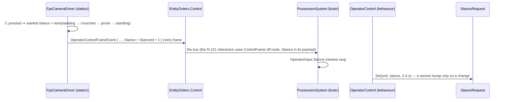

*What the picture shows that prose hid:* the stance rides the SAME frame as the stick — no new event, no new route — and reaches the body
through the brain's one stance writer (`StanceRequest`, CE-2121), so the hit model, the fire chain and perception read it the tick it
is asked for (Buildings §3f).

| as-built detail | why |
|---|---|
| `Stance` = `StanceId + 1`, 0 = no request — on the event, `OperatorInput` and the wire payload (`ControlFrameInteractionPayload.Stance`) | an HTTP or older frame that does not mention it keeps the stance the unit has |
| the station starts the cycle from the stance the unit HAS when first driven (`LogicalStance.Of`) and sends the wanted one every frame | a frame lost or a late joiner cannot leave it half-way; `StanceRequest.Set` is idempotent |
| HTTP `POST /entities/{id}/control` takes `"stance": "standing" | "crouched" | "prone"` | the AI player gets the same control |
| the HUD shows `STANCE …` and `C stance` | |
| 🔴→⭐ **the RTS tool received NO input in the editor** — its `InputCaptureBinding` was dropped from a FULL frame, so the terminal never routed a click or key to it (and the View menu lost its entries the same way) | fixed at the buffer, `CE-1071` (📄 [gizmos-1 §11.11](designs/gizmos-1/DESIGN.md)); ⭐ measured live: an XTest click on empty ground now publishes the tool's `SelectionChangeRequest` |
| 🔴→⭐ a Shift-click reached the tool as `Left \| ShiftMask` and matched no branch (`CE-1075`) | the gizmo masks the modifiers, as `SelectionInteractionSystem` and `EntityPlacementGizmo` already did; the mask IS the Shift |
| ⭐ a camera DRIVER holds the map's input: the gizmo terminal no longer polls the mouse under it, and the editor's hover card is off | every FPS shot was also a map click (a rubber band on the selection), and the card at the locked cursor was the possessed man's own |
| ~~⚠ the RTS tool's RMB is also the 3-D camera's look button~~ | ✅ answered by the user and built — §13.6 (`CE-1077`) |

📐 Rails: `DebugApiOrdersTests.CE1074_*` (networkless editor: crouched, kept, prone, standing — one version bump per change) ·
`PossessionStationTests.CE1074_*` (C cycles, every frame carries it, the HUD says it) · `RtsCommandToolTests.CE1075_*` (the armed tool
keeps its binding in a full frame and a bus click reaches it; Shift-click adds).

### 13.6 AS-BUILT — the menu's keys work on the map, and the RTS right button (`CE-1076`, `CE-1077`, `2026-10-14`, ui)

> 🔒 **User, `2026-10-14`:** *"in RTS mode a right click commands and a right drag only looks"* · *"i meant the keys shown next to the order
> name in the entity context menu (M = move, A = attack, ESC = cancel command), i supposed they would work plainly for the currently
> selected entity."*

```mermaid
sequenceDiagram
    participant K as MapCanvas (typed key)
    participant L as MenuShortcutKeyLayer
    participant S as MenuShortcuts (pack system)
    participant M as ContextMenuProjectorGizmo.MenuJsonFor
    participant I as ContextActionIngressSystem → dispatcher
    participant O as MenuOrders
    K->>L: HandleKeyInput(M) — only keys no panel took
    L->>S: MapShortcutKeyEvent{M, Ctrl/Alt?} — none in first person
    S->>S: a tool other than RTS armed? stop
    S->>M: the PRIMARY selected unit's menu
    M-->>S: the enabled item showing "M" = Move
    S->>I: GizmoMenuActionEvent{unit, Move} — what a click sends
    I->>O: Begin(Move, unit) → the location pick (Esc cancels it)
```

*What the picture shows that prose hid:* the key never names an action — it is looked up in the SAME menu the right click shows, and sent as
the SAME event a click sends, so the key, the menu and its follow-up pick cannot disagree (a disabled item stays disabled, a unit whose
class has no Attack has no A).

| as-built detail | why |
|---|---|
| ⭐ every item that shows a key works: M Move, A Attack, H Hold, P Possess, C Center View, Space Select, R Rotate (an area's E Edit Shape, a zone's L Load) | the shortcut text was a display hint only (gizmos-1 §10, Orders D4-D) — now it is what it says |
| ⭐ the target is the PRIMARY selected unit, else the only selected one | a menu click on that unit does the same; plain orders stay one unit (Orders §13.12 **O6** — "every menu order on the selection" was rejected there) |
| ⭐ Esc is not a menu item: it already cancels the pick a key opened (`CE-3175`), and leaves RTS mode | |
| not while a tool holds the map (a pick, a placement — `ToolController.ActiveModal`) — except the RTS command tool; not with Ctrl / Alt; not in first person | a tool owns its keys; Ctrl+C is the application's; in FPS W/A/S/D/C drive the unit |
| ⭐ **RTS: a right CLICK commands, a right DRAG only looks** (`CE-1077`) — the order goes on the release, at the PRESS point, when the mouse moved in at most `RtsCommandGizmo.ClickMaxMoves` (3) frames | it commanded on the press, so every 3-D look ordered a move too |
| `MapShortcutKeyEvent` = event id **8064** (after the gizmo interaction events 8061-8063; free on every lane) | |

📐 Rails: `MenuOrdersTests.CE1076_*` ×3 (the selected unit's M / A / H / P / C through the same menu action, nothing with no selection,
Ctrl, an unknown key or a busy tool, yes in RTS mode; the key layer forwards and is silent in first person; the shortcut text and a
disabled item) · `RtsCommandToolTests.CE1077_*` (a drag orders nothing, a jittery click orders at the press point) ·
`MapSelfCheckTests` (the new system is declared and scheduled).

### 13.7 AS-BUILT — the operator's weapons: a click is one shot, weapon and ammo keys, the HUD (`CE-1078`, `CE-1079`, `CE-1080`, `2026-10-14`, ui)

⭐ **Built as §8e draws it** — the class, sequence and module diagrams there are the as-built; no box moved. The details the diagrams do not
carry:

| as-built detail | why |
|---|---|
| the latch lives in `OperatorControlBehavior.ManualControlState` (`ShotSeq`/`CancelSeq`/`AmmoSeq` seen, `Pending`, `PendingTarget`, `PendingPoint`, `Cap`) | the behaviour sees the executor's round count (`AimAndFireExecutor.RoundsFiredOf`), so it knows when the locked round LEFT — the station only guesses (the mount's count dropping) for its HUD |
| a weapon action restarted while a shot waits (an out-of-arc failure, a new possession) re-arms the cap at 1 | the new action counts its rounds from 0 (`OnEnter`); keeping the old cap would let several rounds go |
| a frame `Seq` that goes BACKWARDS (a new station took the unit) zeroes the seen counters | each station's counters start at 0; without it a take-over would read as presses |
| operator `Rounds` = a CAP: `TurretPath` caps the grant (its existing `p.Rounds` line) and skips the `Success` end; the per-shot path refuses a round past it | the field already meant "how many rounds" (32 bytes are full — §8e rejected a new field) |
| operator `Target` set ⇒ `WeaponTask.Target` = the unit (the muscle aims at `AimPoint.Middle`, follows it as it moves); the epoch moves when the locked unit changes | the AI's own path — `fresh` now compares `p.Target` for both |
| the operator has no aim time / lock (`lockSeconds` only for `!op`) | C-2, unchanged |
| `FireAtPointExecutor.ShootAtPoint(…, ammo)` now stamps `WeaponFireIntent.AmmoGuid`; operator per-shot rounds also `SpendLoaded` | ⚠ §2a of Missiles & Ammo said operator fire "carries the loaded round" — true only on the turret path; the per-shot path now does too |
| `WeaponMountQuery.MountEntity` is public; `FireAtPointExecutor`'s private copy routes to it | one lookup for "the entity holding mount N's WeaponState" |
| `WeaponAmmo` + wire `EntityWeaponAmmo` grew `Load0..3`, `LoadRounds0..3`, `Busy` (appended) | the HUD on another node has no `AmmoLoadout` (Missiles & Ammo §1 — the mirror was always meant to carry the loaded round) |
| the crosshair: `FpsCameraDriver.Aim` picks `PickFilter.All`; `EntityBoxPicker` skips `EntityBodyLayer3D.FirstPerson` | measured: a ray from inside the own hull meets it on the way OUT (`RayBox` returns the exit distance), nearer than anything — the rail proves the own tank would win |
| HUD: `> 1 CANNON  120mm APFSDS 19  41/42  F: 120mm HEAT-MP  LOADING` — numbered as its key; names from the TKB (a trailing " round" dropped; no `/max` when the weapon states none); an orange box on the locked target; a yellow ring where the selected turret's gun points | ⚠ the ring follows the pose, which carries the ballistic elevation, so at long range it sits a little above a laid gun |
| 🔴→⭐ the HUD moved from the window's bottom-left corner to UNDER THE CROSSHAIR (`PossessionStation.HudOrigin`: 0.07 of the height below it, ending 0.05 of the width right of it), on a dark backing; the keys on two lines | measured live (a 2200×1200 window): the editor draws the map FIRST and ImGui after (`Program.cs`), so its docked left column and bottom log covered the corner HUD — it was never visible in the editor (the §13.3 (V) frame was a bare canvas); the crosshair sits right of the open map's centre, so a block centred on it was cut by the right panels |
| keys: `1`–`4` only select a weapon that exists; `F`, LMB press, RMB press are counters on the frame (`OperatorControlFrameEvent`, `ControlFrameInteractionPayload` appended, the HTTP control route's `shot` / `cancel` / `ammo` / `shotTarget`) | |

✅ **Seen live `2026-10-14`** (editor under Xvfb, a 2200×1200 window, XTest input; `tt-nav-los`, possessing the M1 "Hostile B"): the gun ring
settles on the crosshair after a 167° turn of the look (the turret follows); a click right after a 90° turn fires ONE round about 1.4 s later
(42 → 41, APFSDS 20 → 19) and nothing more; `F` cycles APFSDS → HEAT-MP → HE-FRAG → APFSDS with LOADING during each switch; `2` selects the
coax. ⚠ Two of eleven injected `F` presses were not seen (each was the first key after XTest pointer moves); 5 of 5 in a row were.


📐 **Rails** *(each in its feature's suite)*: `AimAndFireExecutorTests.CE1078_*` ×2 + `CE1079_*` (a locked shot turns the turret to the unit and
fires one round once it bears; per-shot one round at the unit; a round switch holds, then the loaded round leaves) · `AmmoChoiceTests.CE1079_*`
(next type with rounds, skip empty, wrap, one reload, the AI's choice forgotten) · `WeaponAmmoMirrorSystemTests.CE1079_*` (the breech, its rounds,
LOADING) · `PossessionStationTests.CE1078_*` + `CE1079_*` ×2 (counters, lock, RMB, F, 1-4; the HUD line; the HUD's place) ·
`Map3DPickingTests.CE1080_*` (the crosshair sees the unit, never the own hull, aims at the box hit) · `InteractionTransportTests.CE3172_*` and
`PossessionReplicationTests.CE3174_*` extended (the new frame and ammo fields cross) · `DebugApiOrdersTests.CE1078_*` ×2 (through the real
possession: one press one round, a press during a reload waits, RMB drops it; a grenade ignores a held trigger).

## 8. Known limits and defects found while designing

| | |
|---|---|
| ⚠ mission timers keep running during possession | a phase change while possessed is refused by rank (Possession outranks Superior); on release the unit resumes its OLD task while the plan has moved on — accepted for v1 |
| ⚠ a vehicle under manual drive can enter a building | M-5 checks walkability for people only (built, §13.4) |
| ⚠ `EntityBoxPicker` returns the entity's **position**, not the hit point | the operator's aim at an entity aims at its origin; fine for v1 |
| ✅ `CE-3175` | ~~the map canvas and the gizmo layer **both drain** Raylib's typed-key queue~~ — FIXED `2026-10-11`: the canvas is the one drain and hands the keys to the gizmo layer for its terminal. ⚠ Wider than first read: no key PRESS reached any backend gizmo, so Escape cancelled none of them. 📄 `docs/designs/gizmos-1/gizmo-input-focus-design.md` §6.2d |
| ✅ `CE-3176` | ~~`KinematicsMode.None` is driven as Direct and the PathToPoint bridge writes None with a speed~~ — FIXED `2026-10-11`: the pending state holds at speed 0 and the path response restores the intent's speed. 📄 `docs/designs/navig-2/Navigation_Design_v2_0.md` §3.1 |
