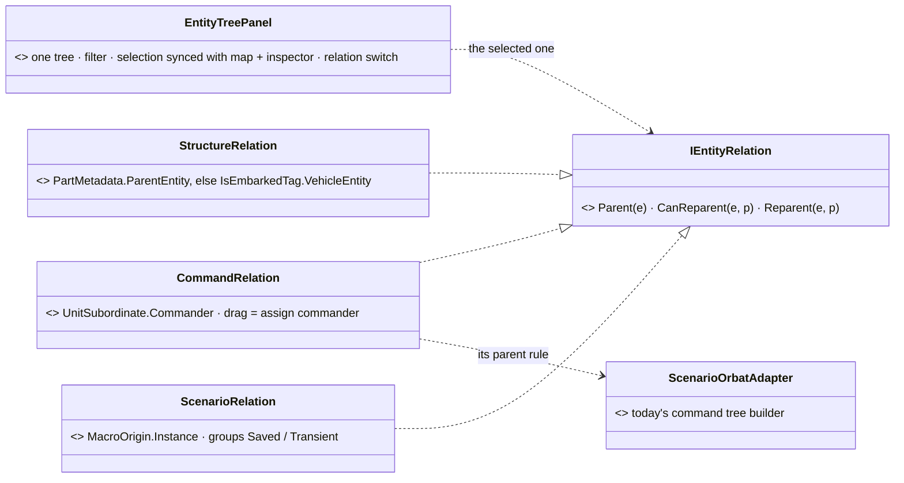

<!--STATUS
state: LIVE
build-state: DESIGN — ✅ HV-1 … HV-5 ACCEPTED 2026-11-02 (user: "approved the switchable hierarchy view") · tracker CE-4213 (ui)
updated: 2026-11-02 (first version)
current-answer: the whole note — §1 the relations that exist · §2 the views · §3 decisions
stale-below: nothing
known-rot: none
known-conflict: none
related-designs:
  - docs/DESIGN_Scenario_Macros.md — §14.2: the ORBAT stays the COMMAND tree (user); a macro's entities are shown in the Scenario view here, through MacroOrigin (SR-170)
  - docs/UX/UX_Golden_Path.md — step "Look at the outliner": every entity by name and type, in ORBAT hierarchy, selection agreeing with map and inspector — the Command view keeps that contract
  - docs/UX/UX_Seam_Inventory.md — row IHierarchyAdapter (0 implementers): the seam HV-4 adopts
  - docs/blueprints/Architect_Question_79_One_Ownership_Truth.md — §0.10 OWNS PartMetadata, the part relation the Structure view reads
-->

# DESIGN — **entity hierarchy views** *(one tree panel, switchable between the parent–child relations the engine has)*

> 🔒 **User, `2026-11-02`:** *"being created from macro doesn't change the commander hierarchy, so the current orbat panel has no need to somehow
> reflect the entity that are created by macros. It keeps showing by commander hierarchy. I think we need some other hierarchy view for the
> entities that are respecting the structural hierarchy, not the commander hierarchy. Like, for example, the sensors sitting under the entity
> that is using the sensor, and another kind of view, or the same view which is switchable to different parent-child relationships, like two
> macro view. Maybe let's suggest what kind of views we could use and for what purpose, if they are practical."*

## 1. The relations that exist — INVENTORY *(`2026-11-02`)*

**Queries:** grep `public (Entity|EntityRef|long|int|uint) (Parent|Host|Carrier|Vehicle|Commander|Leader|…)\w*;` over `FDP/Engine`, `FDP/Toolkits`,
`Hrot/Engine` (30 hits) · graph `.*(EntityTree|Orbat|Hierarchy|Outliner).*(Panel|Window|View|Model|Builder)$` Class (1) · grep `IHierarchyAdapter`,
`HierarchyNode`, `VisHierarchyNode` over code and `docs/` · ⚠ coverage unchecked

| relation | the component (child → parent) | who has it | shown today |
|---|---|---|---|
| **command** — who commands whom | `UnitSubordinate.Commander` (`Fdp.Core/CommandHierarchy/UnitSubordinate.cs:22`) + `UnitRoster` | units; 67 of 117 scenarios | ✅ the ORBAT (`ScenarioOrbatAdapter.cs:19, :61-75`), drag = assign commander, drag onto a vehicle = embark |
| **part** — what an entity is made of | `PartMetadata.ParentEntity` (`Replication/Components/PartMetadata.cs:16`) — sensors (1000+i), turrets (2000+i), mounts, behaviour sensors | vehicles, soldiers | ⛔ nowhere (parts have no `EntityInfo`, so the ORBAT skips them) |
| **carried** — who sits in what | `IsEmbarkedTag.VehicleEntity` (`Behavior/Components/InteractionComponents.cs:85-88`) + seats | passengers | ⚠ only as the ORBAT's embark gesture, not as a tree |
| **source** — where it came from | `MacroOrigin.Instance` (NEW, macros SR-170) · `ScenarioIgnoreTag` (transient: never saved) | macro entities, live additions | ⛔ nowhere |
| ✅ **CLASSIFIED `2026-11-02` (CE-4212): `VisHierarchyNode` — duplicate SURFACE, KEEP** | `VisHierarchyNode` (`Fdp.Presentation/Vis2D/Components/HierarchyComponents.cs:9`) — a saved "ORGBAT" linked tree (Parent/FirstChild/NextSibling), the map's own grouping | **0 of 117 scenarios** carry it; round-trips through `VisHierarchyNodeTranslator` → `InitialHierarchyIntent` → `GenesisMaterializationSystem` (3 test classes: `HierarchySerializationIntegrationTests`, `IntentTranslatorTests`, `GenesisMaterializationSystemTests`) | ⛔ not shown. ⭐ **Design record:** `cgf-scn-2/DESIGN.md:220-280` builds its translator on purpose; `DESIGN_Scenario_Entity_Keys.md` S8(B) makes it a GUID-keyed `EntityLink`; `DESIGN_Scenario_Rules.md:370` says *saved, NOT replicated, unused at runtime*; HV-4 adopts `IHierarchyAdapter` (whose `ChildEnumerator` walks it). ⭐ **Why not routed to `UnitSubordinate`:** a command tree cannot hold a grouping that differs from the chain of command (the ORGBAT a map draws vs who orders whom) — routing would drop that capability; the duplicated CODE is only the linked-list walk, which is the adapter's job (HV-4). ⛔ nothing deleted. ⚠ **`AggregateState` / `AggregateRoot` (same file, ids 82/83) are dead TODAY** — no writer, no reader, the *aggregation system* their comment promises was never built (census H0 `DESIGN_Replay_Census_H0.md:440, :558`); the design record neither retires nor schedules it and component ids are permanent, so they stay until a person rules the map aggregation will not be built. `HierarchyOrderSystem` is registered nowhere in production (only its scratch is listed in `EverySystemForgetsTheLastWorldTests`) and nothing reads its `SortedHierarchyData` — dormant with the aggregation |
| ✅ **CLASSIFIED `2026-11-02` (CE-4212): `HierarchyNode` + `HierarchyExtensions` — generic engine primitive, dormant, KEEP** | `HierarchyNode` (`Fdp.Core/HierarchyNode.cs:11`, doubly-linked) + `HierarchyExtensions.AddChild` | **no production user** — measured: only `Fdp.Core.Tests/HierarchyTests.cs` + the component-id test (⛔ `DESIGN_Replay_Census_H0.md:428` says *"17 refs: used by views and sim"* — those refs are FDP tests; `DESIGN_Scenario_Rules.md:370` has it right: DEAD) | ⛔ not shown. ⭐ **Design record:** `docs/projects/FDP/Core/Fdp.Core.md:508, :941` documents it as the engine's generic parent/child component (id 6, `DESIGN-RUNNER.md:1237`); no record retires it. ⭐ **Not a duplicate of the command relation:** `UnitSubordinate` is the command semantics, this is a structural list with no meaning of its own — the *Structure* view reads `PartMetadata.ParentEntity`, not this. Left in place (an engine primitive, not a Hrot decision); revisit when the engine is cut down, not here |
| ⭐ the generic seam | `IHierarchyAdapter { GetParent · GetChildren · IsSpatialLeaf }` (`Fdp.Presentation/Vis2D/Abstractions/IHierarchyAdapter.cs`) — *"generic hierarchy rendering without coupling to specific component types"* | ⛔ **0 implementers** (`UX_Seam_Inventory.md:63`); its `ChildEnumerator` walks `VisHierarchyNode` only | — |

## 2. The views — one panel, a relation switch

*What the picture shows that prose hid:* a view is only a PARENT RULE — the tree, the filter, the icons, the selection sync and the drag
plumbing are one implementation, so a new relation is one small class, never a new panel.

| view | the parent of an entity | for what | edits |
|---|---|---|---|
| **Command** *(today's ORBAT, unchanged)* | its commander | orders, task organisation, the ORBAT a trainer reads | ✅ drag = assign commander · drag onto a vehicle = embark · ⛔ a macro entity is refused (*"from macro X — edit the macro"*) |
| **Structure** | the entity it is a PART of; else the vehicle it RIDES in | *"what is this tank made of — its sensors, turret, who is inside"*; debugging perception, damage, seats | read-only (selecting a sensor opens it in the inspector) |
| **Scenario** | the macro instance it came from; top-level entities at the root; two root groups — **Saved** and **Transient** (live additions, runtime macro insertions) | authoring: *"what does this macro put in, what will be saved"* | read-only for macro entities; the instance itself edits as any entity |
| ⏭ *(optional)* **By side & class** | its side, then its class (R-280's table) | finding things in a big scenario | — |

## 3. Decisions *(✅ accepted `2026-11-02`)*

| # | decision | ⭐ lean |
|---|---|---|
| **HV-1** | the ORBAT and macros | ✅ the user's ruling: the ORBAT stays the COMMAND tree; being made by a macro changes nothing in it (supersedes macros SR-177) |
| **HV-2** | how many panels | ⭐ ONE — the existing ORBAT panel gains a relation switch *[Command \| Structure \| Scenario]*; ⛔ not three panels (three copies of one tree, filter and selection sync) |
| **HV-3** | the views to build | ⭐ Command (exists), Structure, Scenario; *By side & class* only if someone asks |
| **HV-4** | the seam | ⭐ ONE relation interface the panel asks for a parent and a re-parent; ⭐ adopt `IHierarchyAdapter` (0 implementers today, designed for exactly this) by widening its enumerator off `VisHierarchyNode` — ⛔ not a second interface beside it |
| **HV-5** | when | ⭐ Scenario view with macros S3a's editor work (ui, CE-4210's neighbour); Structure view on its own, any time — it reads only what exists |

**Rejected — one line each:**
- *Macro entities inside the ORBAT under their instance* — the user: a macro is a scenario part, not a unit; the command tree must stay the command tree.
- *A separate panel per relation* — three trees, three filters, three selection syncs for one concept.
- *A view that mixes relations (parts and commanders in one tree)* — an entity can have both parents; one tree cannot show both without duplicates.

## 4. AS BUILT — the Structure view *(ui, `2026-11-02`, CE-4213 `91d6b69be`)*

| decision | as built | deviation |
|---|---|---|
| HV-2 one panel | `SharedOrbatPanel` draws a relation switch *[Command \| Structure]* + a disabled *Scenario (needs macros)*; `IOrbatDataProvider.Relation` (`EntityTreeRelation`, default member so other providers are unaffected) | — |
| HV-4 the seam | `IHierarchyAdapter` adopted and widened: `ChildEnumerator(view, ReadOnlySpan<Entity>)` beside the `VisHierarchyNode` walk; default members `Includes` · `CanReparent` (false) · `Reparent` (no-op). `CommandHierarchyAdapter` (the `UnitSubordinate` rule moved out of `ScenarioOrbatAdapter.GetVisibleNodes`) and `StructureHierarchyAdapter` (`PartMetadata.ParentEntity`, else `IsEmbarkedTag.VehicleEntity`; a dead parent ⇒ a root). `GetVisibleNodes` builds its parent map through the selected adapter — one tree for both views | ⚠ the panel still reads `IOrbatDataProvider`, not the adapter directly; the adapter is the parent rule inside it |
| Structure is read-only | no drag sources / drop targets; assign / remove / embark requests do nothing; selection still syncs map + inspector | — |
| part names | parts have no `EntityInfo`: *parent name · the part's KIND from the component its creator gave it* (`PartLabels.Describe`, AQ79 §0.10 *"the descriptor type is the part's kind"*): `WeaponMountInfo` ⇒ *weapon mount i* (the weapon's name is not shown — the catalogue is not cheaply reachable), `TurretPose` ⇒ *turret i*, `SensorTag` ⇒ *sensor <modality>*, `EqsSensor` ⇒ *EQS sensor*, route part ⇒ *personal route*, else *part #N* · ⛔ SUPERSEDED: the instance-id ranges (1000+i sensors / 2000+i turrets) — the id is a per-descriptor index and says nothing about the kind | CE-4213 |

Rails: `EditorOrbatStructureViewTests` (5, in `AdapterTests.cs`): Command unchanged · a sensor and an embarked passenger under the vehicle ·
a part with a dead parent is a root · Structure refuses reparent · the span enumerator. Red-proof: Structure ignoring `PartMetadata` fails.
⚠ No frame rail — `SharedOrbatPanel` has none (model-dump and drop-logic tests only). Scenario view: ⏳ macros S3a (`MacroOrigin`).
