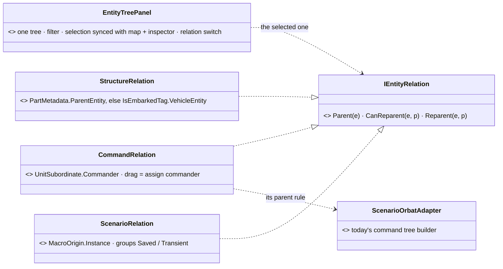

<!--STATUS
state: LIVE
build-state: DESIGN — ✅ HV-1 … HV-5 ACCEPTED 2026-11-02 (user: "approved the switchable hierarchy view") · tracker CE-4213 (ui)
updated: 2026-11-02 (first version)
current-answer: the whole note — §1 the relations that exist · §2 the views · §3 decisions
stale-below: nothing
known-rot: none
known-conflict: none
related-designs:
  - docs/DESIGN_Scenario_Macros.md — §14.2: the ORBAT stays the COMMAND tree (user); a macro's entities are shown in the Scenario view here, through MacroOrigin (SR-170)
  - docs/UX/UX_Golden_Path.md — step "Look at the outliner": every entity by name and type, in ORBAT hierarchy, selection agreeing with map and inspector — the Command view keeps that contract
  - docs/UX/UX_Seam_Inventory.md — row IHierarchyAdapter (0 implementers): the seam HV-4 adopts
  - docs/blueprints/Architect_Question_79_One_Ownership_Truth.md — §0.10 OWNS PartMetadata, the part relation the Structure view reads
-->

# DESIGN — **entity hierarchy views** *(one tree panel, switchable between the parent–child relations the engine has)*

> 🔒 **User, `2026-11-02`:** *"being created from macro doesn't change the commander hierarchy, so the current orbat panel has no need to somehow
> reflect the entity that are created by macros. It keeps showing by commander hierarchy. I think we need some other hierarchy view for the
> entities that are respecting the structural hierarchy, not the commander hierarchy. Like, for example, the sensors sitting under the entity
> that is using the sensor, and another kind of view, or the same view which is switchable to different parent-child relationships, like two
> macro view. Maybe let's suggest what kind of views we could use and for what purpose, if they are practical."*

## 1. The relations that exist — INVENTORY *(`2026-11-02`)*

**Queries:** grep `public (Entity|EntityRef|long|int|uint) (Parent|Host|Carrier|Vehicle|Commander|Leader|…)\w*;` over `FDP/Engine`, `FDP/Toolkits`,
`Hrot/Engine` (30 hits) · graph `.*(EntityTree|Orbat|Hierarchy|Outliner).*(Panel|Window|View|Model|Builder)$` Class (1) · grep `IHierarchyAdapter`,
`HierarchyNode`, `VisHierarchyNode` over code and `docs/` · ⚠ coverage unchecked

| relation | the component (child → parent) | who has it | shown today |
|---|---|---|---|
| **command** — who commands whom | `UnitSubordinate.Commander` (`Fdp.Core/CommandHierarchy/UnitSubordinate.cs:22`) + `UnitRoster` | units; 67 of 117 scenarios | ✅ the ORBAT (`ScenarioOrbatAdapter.cs:19, :61-75`), drag = assign commander, drag onto a vehicle = embark |
| **part** — what an entity is made of | `PartMetadata.ParentEntity` (`Replication/Components/PartMetadata.cs:16`) — sensors (1000+i), turrets (2000+i), mounts, behaviour sensors | vehicles, soldiers | ⛔ nowhere (parts have no `EntityInfo`, so the ORBAT skips them) |
| **carried** — who sits in what | `IsEmbarkedTag.VehicleEntity` (`Behavior/Components/InteractionComponents.cs:85-88`) + seats | passengers | ⚠ only as the ORBAT's embark gesture, not as a tree |
| **source** — where it came from | `MacroOrigin.Instance` (NEW, macros SR-170) · `ScenarioIgnoreTag` (transient: never saved) | macro entities, live additions | ⛔ nowhere |
| ⚠ a dormant second tree | `VisHierarchyNode` (`Fdp.Presentation/Vis2D/Components/HierarchyComponents.cs:9`) — a saved "ORGBAT" linked tree with map aggregation (`AggregateState`) | **0 of 117 scenarios** carry it | ⛔ — a possible duplicate of the command relation (CE-4212) |
| ⚠ a dormant generic tree | `HierarchyNode` (`Fdp.Core/HierarchyNode.cs`) + `HierarchyExtensions.AddChild` | no production user | ⛔ (CE-4212) |
| ⭐ the generic seam | `IHierarchyAdapter { GetParent · GetChildren · IsSpatialLeaf }` (`Fdp.Presentation/Vis2D/Abstractions/IHierarchyAdapter.cs`) — *"generic hierarchy rendering without coupling to specific component types"* | ⛔ **0 implementers** (`UX_Seam_Inventory.md:63`); its `ChildEnumerator` walks `VisHierarchyNode` only | — |

## 2. The views — one panel, a relation switch

*What the picture shows that prose hid:* a view is only a PARENT RULE — the tree, the filter, the icons, the selection sync and the drag
plumbing are one implementation, so a new relation is one small class, never a new panel.

| view | the parent of an entity | for what | edits |
|---|---|---|---|
| **Command** *(today's ORBAT, unchanged)* | its commander | orders, task organisation, the ORBAT a trainer reads | ✅ drag = assign commander · drag onto a vehicle = embark · ⛔ a macro entity is refused (*"from macro X — edit the macro"*) |
| **Structure** | the entity it is a PART of; else the vehicle it RIDES in | *"what is this tank made of — its sensors, turret, who is inside"*; debugging perception, damage, seats | read-only (selecting a sensor opens it in the inspector) |
| **Scenario** | the macro instance it came from; top-level entities at the root; two root groups — **Saved** and **Transient** (live additions, runtime macro insertions) | authoring: *"what does this macro put in, what will be saved"* | read-only for macro entities; the instance itself edits as any entity |
| ⏭ *(optional)* **By side & class** | its side, then its class (R-280's table) | finding things in a big scenario | — |

## 3. Decisions *(✅ accepted `2026-11-02`)*

| # | decision | ⭐ lean |
|---|---|---|
| **HV-1** | the ORBAT and macros | ✅ the user's ruling: the ORBAT stays the COMMAND tree; being made by a macro changes nothing in it (supersedes macros SR-177) |
| **HV-2** | how many panels | ⭐ ONE — the existing ORBAT panel gains a relation switch *[Command \| Structure \| Scenario]*; ⛔ not three panels (three copies of one tree, filter and selection sync) |
| **HV-3** | the views to build | ⭐ Command (exists), Structure, Scenario; *By side & class* only if someone asks |
| **HV-4** | the seam | ⭐ ONE relation interface the panel asks for a parent and a re-parent; ⭐ adopt `IHierarchyAdapter` (0 implementers today, designed for exactly this) by widening its enumerator off `VisHierarchyNode` — ⛔ not a second interface beside it |
| **HV-5** | when | ⭐ Scenario view with macros S3a's editor work (ui, CE-4210's neighbour); Structure view on its own, any time — it reads only what exists |

**Rejected — one line each:**
- *Macro entities inside the ORBAT under their instance* — the user: a macro is a scenario part, not a unit; the command tree must stay the command tree.
- *A separate panel per relation* — three trees, three filters, three selection syncs for one concept.
- *A view that mixes relations (parts and commanders in one tree)* — an entity can have both parents; one tree cannot show both without duplicates.
