<!--STATUS
state: LIVE
updated: 2026-10-14 (§7.5 team carry — a stretcher, a two-man weapon, R-2017; §7.2a CE-2163 — a round in flight is hidden from every candidate door)
build-state: BUILDING — I-1 built 2026-10-08; §7 (embarkation) is a separate task, CE-3110
current-answer: §7.5 team carry (R-2017; T-a BUILT — as built §7.5.5) · §7.4.10 C-b the carrier's actions (built; the squad's use is Squad Tactics §7.4) · §7.4.9 C-a as built · §7.4.8 the person carrier detailed (C5–C10 approved, R-2011) · §7.4 carrying is a type fact (R-274, approved 2026-10-13 R-2009 — READY-TO-BUILD) · §7.3 I-2d (the AI nodes, BUILT 2026-10-12) · §7.1 embarkation measured status + build plan (2026-10-11) · §7.1a/§7.1b I-2a details + as built (2026-10-12) · §7.1c/§7.1d I-2b design + as built (2026-10-12) · §7.2a/§7.2b I-2c design + as built (2026-10-12) · §2 the classes, §3 the sequence, §4 the modules, §5 the decisions, §6 the slices, §7 embarkation (I-2)
stale-below: nothing
known-rot: ⛔ 2026-10-13 (CE-3193 sweep) — superseded vocabulary in this file: [BehaviorContract] is deleted (CE-2134) → [Behavior(Params=…)] / the asset's ParamsDtoTypeId + ParamsDtoRegistry; blueprints declare no Parameters / Get Parameter (R-2004); no generated Inputs/_Blackboard mirror (CE-2135). Current model: docs/DESIGN_Orders_Params_Entity_Classes.md §13.10. Read older statements here as history.
  §7.1b's first host-deviation row said Stage B for the UrbanCombatNew applier — corrected in place to Stage A (CE-2126, 2026-10-12)
known-conflict: docs/DESIGN_Building_Interiors.md §3j "5d" — 5d-1 was built with a door-only topic (EntityDoorCommand) and door-only translators; slice I-1 here replaces them, and that section says so
related-designs:
  - OVERVIEW_Rules_And_Demos.md — the INDEX of the rules and demos built across the behaviour designs (rule → what implements it → demo); this design OWNS the rows that cite it
  - docs/DESIGN_Civilians_And_Crowd_Control.md — §5h AW-13 (R-2025): a person gets several carry stations (Hands, Back, Hidden — concealment is the station's), beside §7.4's one.
  - docs/DESIGN_Entity_Control.md — §8h (CE-1144, PRELIMINARY): the FPS use key starts this design's executors from a possessed unit
  - docs/designs/airborne/DESIGN_Airborne_Insertion.md — OWNS the DOOR exit into a descent (Embarkation.ExitIntoDescent, B-4): a rope / jump leaves at the seat's anchor and height, not beside the hull
  - docs/designs/indirect-fire/DESIGN_Indirect_Fire.md — OWNS mortars and artillery: the 81 / 120 mm mortar tubes carried as TwoMan loads (§7.5)
  - docs/designs/weapons/DESIGN_Weapon_Systems.md — OWNS the Station seat role, the weapon carry station and manning a weapon's Gunner seat (a TwoMan weapon uses §7.5's team carry) — mounting, carrying and manning a weapon are boarding (R-2016)
  - docs/designs/air-attack/DESIGN_Air_Operations.md — OWNS the air assault on the doors-off UH-60 (404) and LoadCasualty (a carried man seated in a vehicle) (R-2015)
  - docs/DESIGN_Map_3D_Mode.md §6m — DRAWS the carried / dragged casualty, the carrier, riders in their seats (SeatDto place / facing / pose) and the jump down
  - docs/DESIGN_Injury_States.md — OWNS the injury states (R-263 D1, CE-2155) that the person carrier's C3 gate reads
  - docs/blueprints/Architect_Question_90_Unit_Orders_Carry_Capacity.md — OWNS R-274 (behaviors): carry capacity and seats per vehicle type (B) and the human-carrier profile (C); R-275 (behaviors): Health in the cross-role set (D)
  - docs/designs/group-maneuvers/DESIGN_Squad_Tactics.md — §7.4 OWNS squad casualty care (L4: who carries, when, where to) that uses §7.4.10's actions; §5a OWNS the squad Dismount drill that uses I-2d's Disembark (and the convoy-ambush acceptance); §5 the measured state of embark/disembark (2026-10-11) and why the squad dismount (S3) needs I-2a/I-2b first
  - docs/DESIGN_Building_Interiors.md §3j "5d" — OWNS doors (DoorRules, the door actions, DoorCommandSystem); doors are this design's first kind
  - docs/designs/edit-1/DESIGN.md §3.A — OWNS the typed FDP domain commands EmbarkEntityCommand / DisembarkEntityCommand; this design carries such commands to the owner
  - docs/DESIGN_Ownership_Groups_And_Grants.md — OWNS who owns what (descriptor claims, F-10 edit requests to the owner); a handler's gate is that design's descriptor ownership
  - docs/DESIGN_Role_Affinity_Ownership.md §6 — OWNS which role writes embarkation state (PassengerBuffer, IsEmbarkedTag)
  - FDP/Docs/projects/behavior-control/Behavior Control Subsystem Design.json.md §3.A–B — OWNS the interaction channel and its executors (the actor side)
  - docs/DESIGN_Entity_Control.md — OWNS the Possess / Release / ControlFrame interaction cases (M-6)
  - docs/DESIGN_Subsystem_Composition_Unification.md §4.1ad — OWNS cross-role infrastructure capabilities (CE-221); embarkation is one (§7.1d)
  - docs/designs/group-maneuvers/DESIGN_Building_Clearing.md — OWNS the building-clearing drill (Battle Drill 6: stack, breach, points of domination, sectors, controlling and searching civilians, room order) — its breacher opens and breaches doors through the door interactions
-->

# DESIGN — **entity interactions** *(one way for an actor to act on an entity it does not own)*

> 🔒 **User, `2026-10-08`:** *"What if there are many other interactions with the world, like picking items, operating stuff in
> another way, boarding a vehicle, opening vehicle door… will we have separate topic for each, separate translator, separate
> event, separate handling system? It could grow."* → *"Wire compatibility matters. Dds fights this with data models. Extending
> data model is no issue on new interaction type. Arent dds unions good for that? Debuggability also matters. Fdp event with
> binary encoded data is opaque for anyone but the recipient."* → *"Measure just dds way but only if it matters, we anyway cant
> handle unknown interactions. Ignore dds monitor. Write design"*

**The rule:** each interaction kind is a **typed FDP event** (readable in every bus tool) applied by the **owner** of what it
changes. Every kind crosses the network on **one topic** whose payload is a **DDS union** with one case per kind. A new kind
extends the data model by adding a union case; it never adds a topic or a translator class.

## 1. INVENTORY — measured `2026-10-08`

| query | result |
|---|---|
| `search_graph` `.*(Executor)$` in `Behavior/Combat/Navigation.Executors` | 12. Interaction executors: `EjectPassengersExecutor`, `EmbarkExecutor`, the door actions (5d-1, after the graph snapshot) |
| `search_graph` `.*(Embark\|Disembark).*Command.*` | `EmbarkEntityCommand`, `DisembarkEntityCommand` (`Behavior/Events/`), designed in `edit-1/DESIGN.md` §3.A as **pure FDP domain commands**; one consumer, `EditorCargoSystem`. ⚠ The struct's doc names an `EmbarkationSystem` that does not exist, and `EmbarkExecutor` writes the vehicle's `PassengerBuffer` itself |
| `search_graph` / grep: request-to-owner wire messages *(the graph does not model the `[DdsTopic]` structs; grep)* | `CreateEntityRequest`, `DeleteEntityRequest`, `UpdateEntityDescriptorRequest`, `UpdateEntityAttributeRequest` (generic, VALUES), `WeaponFireRequest`, `EntityHitDamage` (one topic per kind), `MissionControlRequest`, `MapCommandRequest` (enum + JSON args, ExCon → IG UI), `EntityDoorCommand` (5d-1) |
| grep `[DdsUnion]` | `EntityDescriptorUnion` (`AllDescriptors.cs:75`), `AttributeValueUnion` (`GenericMessages.cs:72`): discriminator + `[DdsCase]` per kind. The bindings also have `DdsDefaultCase` and `DdsExtensibility`; nothing uses `DdsExtensibility` yet |
| `search_graph` `.*Event.*(Inspector\|Log\|Recorder).*` | `FdpEventBus.GetDebugInspectors()` (one inspector per event TYPE, events as objects with their fields), data breakpoints on bus events, the flight recorder records bus events |

## 2. CLASSES


*What it shows that prose hid:* the per-kind pieces are DATA (an event struct, a payload struct, a union case) plus one codec and
one handler. The transport, two translators and one topic, exists once. The FDP bus never sees the union, and the wire never sees
an entity handle.

## 3. SEQUENCE — an actor on node A opens a door owned by node B

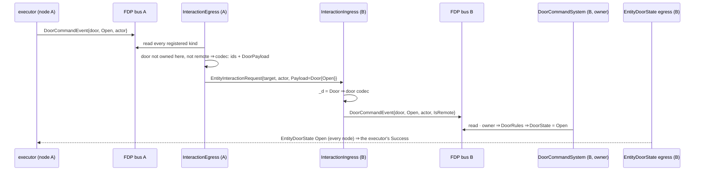

## 4. MODULES — who registers, who runs it each frame

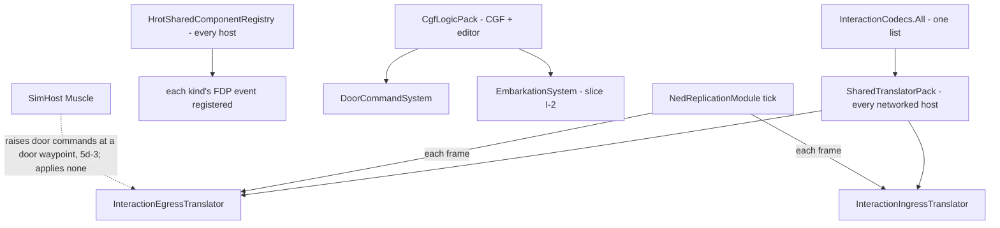
*What it shows that prose hid:* the translators tick wherever the NED module ticks, which is every networked host. Handlers tick
only on the Brain tier, where the doors and vehicles they change are owned. A command raised on a SimHost always crosses the
wire, even in `--mode all`, because each host keeps its own world. The dashed edge is 5d-3, not built.

## 5. DECISIONS

| decision | ⭐ lean | rejected (one line each) |
|---|---|---|
| the FDP side | ⭐ **one typed event per kind**, fields named for what they mean: readable in the bus inspectors, data breakpoints and the flight recorder. Existing typed domain commands (`EmbarkEntityCommand`) join as they are, plus `IsRemote` | one generic event with a byte block: opaque to every bus tool (user) · one event carrying the union: the inspector shows every case of it, not the one that happened |
| the wire | ⭐ **one topic, `EntityInteractionRequest`**, payload a **DDS union** keyed by `EInteractionKind`, one case per kind; Reliable + KeepAll (commands are events, CE-3095) | a topic per kind: grows the transport per kind (5d-1's shape) · a byte block: opaque on the wire (user) · `UpdateEntityAttributeRequest`: carries a VALUE, not an action the owner may refuse · `MapCommandRequest`'s JSON args: untyped, allocates, a UI channel |
| entities | ⭐ **target and actor in the header**, as network ids, mapped once by the generic translator; a payload names any further entity as an explicit network-id field its codec maps | entity handles in the payload: node-local, meaningless on another node |
| per-kind code | ⭐ a **codec** (`InteractionCodec<TEvent>`: target/actor accessors + event ↔ payload), listed in ONE `InteractionCodecs.All` | a translator class per kind: the growth this design removes |
| the loop guard | ⭐ each command event carries **`IsRemote`**; the egress skips remote events and events whose target this node owns | tracking which events the ingress injected: hidden state that a second publisher of the same event bypasses |
| the owner gate | ⭐ each **handler** gates on the ownership of the descriptor it writes (doors: `PackKey(dtDoorState,0)`, as built) | one gate in the transport: it cannot know which descriptor a kind changes |
| the answer | ⭐ the target's own replicated state; the actor's executor waits for it | a reply topic: a second message for what the state already says |
| wire compatibility | ⭐ **a cluster runs one build.** A new kind = a new enum member + a union case, appended; a node that does not know a kind drops it (it could not handle it anyway, user). ⛔ Not measured how CycloneDDS.NET decodes an unknown case on an older node. Per the user, it does not matter while every node runs one build | measure cross-version decoding now: no mixed-version cluster exists to need it |

**Known limits:**
- **Per-kind work:** every kind still needs its event, payload, codec, handler and executor. That is the kind's own data model and logic, and the transport needs nothing more.
- **Wire layout:** a payload's layout is wire format like any descriptor, so it changes only by appending.

## 6. SLICES

| slice | content | state |
|---|---|---|
| **I-1** | `EntityInteractionRequest` + `InteractionPayload` (case `Door`) + `EInteractionKind` (Door = 1; **Embark = 2, Disembark = 3, EjectPassengers = 4 RESERVED**, so §7's kinds cannot collide); `IInteractionCodec` / `InteractionCodec<T>` / `InteractionCodecs.All`; `InteractionEgressTranslator` + `InteractionIngressTranslator` in `SharedTranslatorPack`. Doors run on it; 5d-1's `EntityDoorCommand` and its two translators are DELETED, `dtDoorCommand` (121) retired, the topic is `dtInteractionRequest` (122) | ✅ built `2026-10-08` |
| **I-2** | embarkation onto this shape: ⛔ **split off as its own task, `CE-3110`** (user, `2026-10-08`: *"Leave the decision to be made as part of solving the embaraktion details later, as a separate task. I just need that iteraction shape unified now, so they do not collide later."*). §7 records the analysis and the open Q-1; I-1 reserves its kinds | ⏭ `CE-3110` |
| **I-3** | an `InteractionExecutor<TEvent>` base: reach + action time + one event + wait for the expected state. The door actions and Embark use it | ⏭ |

| rails | ✅ `EntityDoorStateTranslatorTests.Stage5d_*` re-pointed at the generic topic, unchanged in what it asserts · ✅ `InteractionTransportTests.R221_*`: the door round trip through its union case, the loop guard (a remote event and an owned target are never sent), an unknown kind dropped and counted · ⏭ Embark across two nodes (`CE-3110`) |
|---|---|

## 7. EMBARKATION — one applier, three callers *(slice I-2 → its own task, `CE-3110`)*

> ⚠ **Analysis, not a plan to build now.** The user split embarkation off as a separate task. Q-1 below is decided THERE.
> What I-1 guarantees today: the embark/disembark/eject kinds are reserved in `EInteractionKind`, so they will join this shape
> without colliding.

> 🔒 **User, `2026-10-08`:** *"Are embark and disembark similar logical category to open door and other interactions? If they
> fit, is there unification potential?"* → *"Yes, fold it in as I-2"*

**Same category, one difference.**
- **The same:** an actor acts on a target, under a precondition (reach, capacity), and the result is state on the target.
- **The difference:** a door changes only itself. Embark changes the vehicle (its passenger list) AND the passenger (its
  capabilities and its embarked tag). Eject changes the vehicle and every passenger.

| claim | code — how it IS | design — how it was MEANT |
|---|---|---|
| boarding is implemented three times | ✅ `EmbarkExecutor.cs:73-89` (Brain) · `EditorCargoSystem.cs:35-47` (editor) · `GenesisMaterializationSystem.cs:80-98` (SimHost, scenario load) | ⛔ ruling 9: one implementation per concept |
| leaving is implemented twice | ✅ `EjectPassengersExecutor.cs:48-90` · `EditorCargoSystem.cs:68-88` | same |
| the commands exist and were meant for a kernel applier that was never built | ✅ `EmbarkEntityCommand`/`DisembarkEntityCommand` name an `EmbarkationSystem` that does not exist; the editor is their only consumer | ✅ `edit-1/DESIGN.md` Phase 3: *"consumed by execution systems in the kernel"* |
| the state is cross-role, with no single owner | ✅ registered by `EmbarkationComponentRegistry` on SimHost, CGF and the editor | ✅ `DESIGN_Role_Affinity_Ownership.md` slice 3a: *"belongs to no single role"*; §3.9a: OWNED by SimHost (genesis writes it) |
| the state never replicates | ✅ no translator under `Hrot/Network` or `Replication/` names `PassengerBuffer` or `IsEmbarkedTag` | ⛔ nothing says how another node learns it |
| ⇒ a runtime boarding on CGF never reaches the SimHost that moves the bodies | ⛔ **inferred from the row above, not observed live** | — |


*What it shows that prose hid:*
- **One writer of the rules:** only `Embarkation` writes the passenger list, the tag and the capabilities.
- **Commands, not writes:** the executors and the editor's authoring raise commands; scenario load calls the rules directly.
  It resolves saved intents inside the load transaction, where a command would land a frame late.
- **The editor's system disappears**, because what it did is exactly the designed applier.

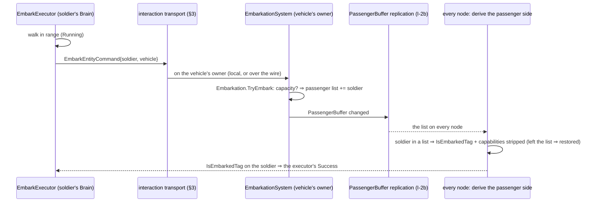

| decision | ⭐ lean | rejected (one line each) |
|---|---|---|
| where the rules live | ⭐ one static `Embarkation` (capacity, the list, the tag, the capabilities, the CE-321 dismount placement) | three copies, as today: they already differ (eject places passengers beside the hull, CE-321; the editor's disembark leaves them where they were) |
| who applies a command | ⭐ `EmbarkationSystem`, the consumer the commands were designed for (`edit-1` Phase 3), gated on owning the VEHICLE | the actor's node writes both entities: today's cross-node defect · `EditorCargoSystem` kept beside it: two appliers for one command |
| scenario load | ⭐ genesis calls `Embarkation` directly | genesis raises commands: the load transaction resolves intents and must not wait a frame |
| eject | ⭐ a new `EjectPassengersCommand { Vehicle }`; the vehicle's owner ejects everyone | one `DisembarkEntityCommand` per passenger: N commands for one action, and the dismount column needs them together |
| **Q-1: the passenger's side across nodes (I-2b)** | ⭐ **the vehicle's owner is the only arbiter; `PassengerBuffer` replicates from it (a new descriptor); every node DERIVES `IsEmbarkedTag` and the stripped capabilities from the list it holds.** One source of truth, one writer | the vehicle's owner also writes the passenger's components: needs the passenger's ownership too · a second request from the vehicle's owner to the passenger's owner: two round trips, and the two can disagree in between · replicate `IsEmbarkedTag` as well: a second copy of one fact |

✅ **Q-1 APPROVED `2026-10-08`** — 🔒 user: *"3110 lean approved"*: the vehicle's owner is the only arbiter of a boarding, `PassengerBuffer` replicates from it, every node derives the passenger's side. ~~**Q-1 needs your nod.** It adds a replicated descriptor and turns `IsEmbarkedTag` and the embark-capability bits into derived~~
state, which touches combat's `ActorCapabilityState` (SimHost-owned, §3.9a). ⛔ **Not yet measured:** which systems read
`IsEmbarkedTag` and the capability bits, and whether any of them would run before the derivation in a frame. That gets enumerated
before I-2b is built.

| I-2 slices | content |
|---|---|
| **I-2a** *(single node correct; no new replication)* | `Embarkation` rules · `EmbarkationSystem` + `EjectPassengersCommand` · `EmbarkExecutor`/`EjectPassengersExecutor` raise commands · `EditorCargoSystem` retired · genesis calls the rules · `IsRemote` on the two existing commands · both kinds registered with the interaction transport |
| **I-2b** *(across nodes, after Q-1)* | `PassengerBuffer` descriptor + translators (owner → every node) · the derivation system · the cross-node rail (a soldier on one node boards a vehicle owned by another) |

### 7.1 Measured status and the build plan *(behaviors lane, `2026-10-11`; 🔒 user: "Pls plan for fixing the embark/disembark … Ignore stride host" · "No handoffs to backend")*

| piece | state today *(measured)* | evidence |
|---|---|---|
| boarding (`EmbarkExecutor`) | ⛔ constructed only by its unit test — no host registers it, no `ActionId` exists for it | `EmbarkExecutorTests.cs:31` is the only `new EmbarkExecutor` |
| eject-all (`EjectPassengersExecutor`) | ✅ on CGF + Editor only (`CgfLogicPack.cs:184`); triggered only by the example APC HSM or a Blueprint node | — |
| per-passenger disembark at runtime | ⛔ none — only the editor's `EditorCargoSystem` (which leaves the soldier where it was) | `EditorCargoSystem.cs:68-88` |
| replication of the passenger list / tag / capabilities | ⛔ none — a dismount on CGF never reaches SimHost or the viewers | no translator under `Hrot/Network` |
| what "inside" means | ⛔ only CanMove/CanShoot stripped: the passenger stays where it boarded, is not carried, not hidden, still targetable and sensed | no reader of `IsEmbarkedTag` outside its writers |
| who reads the capability bits the derivation must set | CGF dispatchers (`LocomotionDispatcherSystem`, `WeaponDispatcherSystem`, `InteractionDispatcherSystem`, `CognitiveInterruptSystem`) **and** SimHost animation (`StanceTransitionSystem`, `AnimationDispatcherSystem`, `LookAtDispatcherSystem`) | grep `ActorCapabilityState` ⇒ the derivation runs on BOTH node kinds, before those systems |
| an AI way to ask | ⛔ no BTree node, no library behaviour; capacity is a hard-coded 8, no seats | `InteractionComponents.cs:14` |

| slice | content | acceptance |
|---|---|---|
| **I-2a** — one applier, single node | as §7's table (rules class, `EmbarkationSystem` on the vehicle's owner, `EjectPassengersCommand`, executors raise commands, `EditorCargoSystem` retired, genesis calls the rules) **+ an `ActionId` for embark and both executors registered in `CgfLogicPack`** | unit rails on one world: board, refuse when full, disembark one, eject all (CE-321 placement kept — R-137) |
| **I-2b** — across nodes (Q-1 / R-224) | `PassengerBuffer` descriptor + translators (vehicle owner → every node); a derivation system on CGF and SimHost that sets `IsEmbarkedTag` + the capability bits from the list, ordered before the readers above | cluster rail: a soldier boards on CGF, SimHost sees it inside; eject on CGF, SimHost sees the soldiers beside the hull |
| **I-2c** — what "inside" means *(✅ ruled 2026-10-11, R-271 — §7.2)* | carried (transform follows the vehicle), hidden from sensing and targeting unless the vehicle is OPEN, dies with the vehicle; the passenger carries its carrier's id itself | rails: a carried passenger moves with the vehicle; nobody sees or shoots an enclosed one; an open one is seen and shot; the vehicle destroyed ⇒ all inside dead |
| **I-2d** — the AI can ask | library nodes `Embark(vehicle)` / `Disembark` (raise the commands) and a commander-level `Dismount` drill for the squad (S3 of `DESIGN_Squad_Tactics.md`) | the convoy-ambush slice (catalogue P1) |

⭐ Order: I-2a → I-2b → I-2c → I-2d. Stride is out of scope (user).

#### 7.1a I-2a — the details the build needs *(build-state: BUILT `2026-10-12` — as-built §7.1b; behaviors lane; HANDOFF_Squad_Tactics_S3 item 2)*

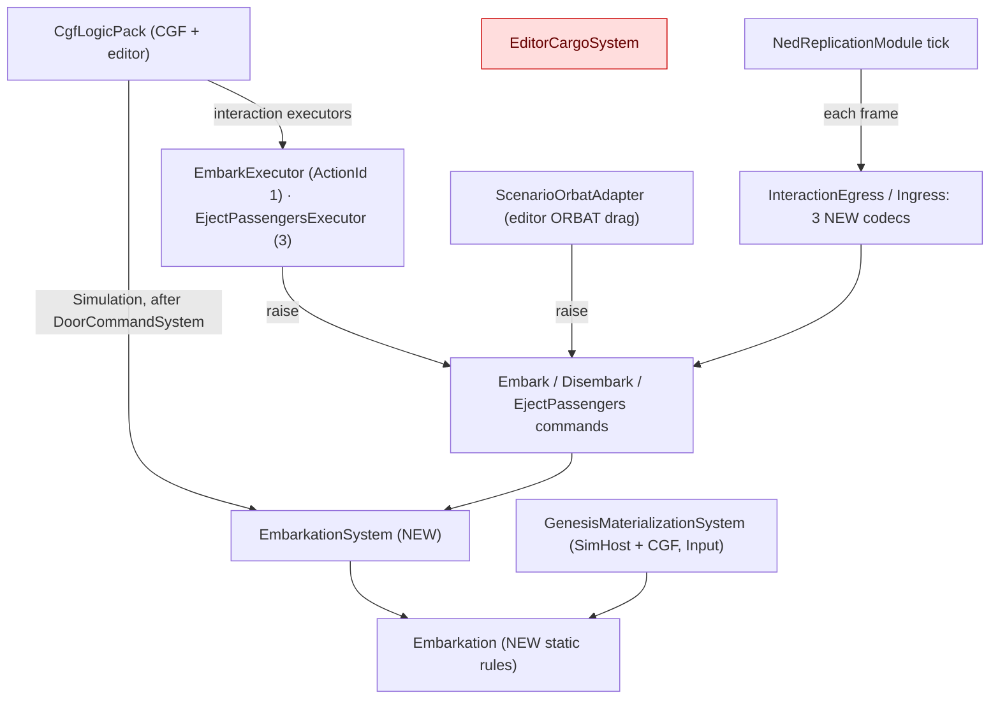
*What the picture shows that prose hid: the editor already builds `CgfLogicPack`, so registering `EmbarkationSystem` there serves CGF
AND the editor — `EditorCargoSystem` (red) is then a second applier for the same command and goes; and genesis is the only caller
that does not go through a command.*

| decision | ⭐ lean | measured |
|---|---|---|
| the owner gate before I-2b | `Embarkation.OwnsVehicle`: no `NetworkAuthority` ⇒ ours (one node, the editor) except a GHOST; else the vehicle's PRIMARY authority. I-2b swaps it for the `PassengerBuffer` descriptor key, as doors use `DoorStateKey` | `DoorCommandSystem.OwnsDoor` (`DoorCommands.cs:156`) is the shape; no `PassengerBuffer` descriptor exists yet |
| `DisembarkEntityCommand` has no vehicle | ⭐ add `Vehicle` (the raiser fills it; the system falls back to the passenger's tag when null) + `IsRemote` | the codec's target accessor sees only the event (`InteractionCodec<T>.EntityOf(in TEvent)`), and the wire's target must be the vehicle |
| eject | NEW `EjectPassengersCommand { Vehicle, IsRemote }` (event 3203) | ids 3201/3202 taken (`BehaviorConstants.cs:155-158`) |
| what the executors wait for | Embark: its own `IsEmbarkedTag` ⇒ Success; a full vehicle (seen locally) ⇒ Failure; no answer in 5 s ⇒ Failure. Eject: the vehicle's `PassengerBuffer.Count == 0` | §5 "the answer is the target's own state" |
| per-passenger disembark placement | beside the hull, the CE-321 column at the passenger's old slot | today the editor's disembark leaves the soldier where it was (`EditorCargoSystem.cs:68-88`) — inside the hull |
| genesis | `Embarkation.TryEmbark` per passenger, idempotent (an already-aboard passenger is a no-op), so the vehicle's list and the passenger's own intent both resolve through it | ⚠ today genesis writes the list and the tag but never strips `CanMove`/`CanShoot` (`GenesisMaterializationSystem.cs:65-99`) — a soldier loaded aboard could walk away |
| the embark ActionId | 1 (`ActionIdEmbark`, the executor's own documented value); 2 left for a per-passenger disembark action | action ids are PER CHANNEL (Combat and Navigation both start at 1); the interaction channel uses 3–8 (`BehaviorConstants.cs:111-122`) |
| the three wire cases | `Embark`/`Disembark`/`EjectPassengers` payloads carry one reserved byte; target = the vehicle, actor = the passenger (none for eject) | union cases 2–4 reserved by I-1 (`InteractionMessages.cs:15-17`) |

| rail (I-2a acceptance) | where |
|---|---|
| board · refuse when full · disembark one beside the hull · eject all beside the hull (CE-321) · a non-owner never applies · genesis strips capabilities | `EmbarkationTests` (`Fdp.Toolkits.Tests`), the re-homed `EditorCargoSystemTests` claims |
| the executors raise commands and wait for the state | `EmbarkExecutorTests` · `EjectPassengersExecutorTests` |
| the three kinds cross the one interaction topic | `InteractionTransportTests` |
| CGF registers both executors and the system | `CgfLogicPackTests` |

#### 7.1b I-2a as built *(behaviors, `2026-10-12`)*

| file | what |
|---|---|
| `Fdp.Toolkits/Behavior/Embarkation.cs` | the rules: `TryEmbark` (idempotent) · `Disembark` (beside the hull at its seat) · `EjectAll` · `DismountPoint` (CE-321, moved here from the executor) · `OwnsVehicle` |
| `Fdp.Toolkits/Behavior/Systems/EmbarkationSystem.cs` | the one applier, gated on `OwnsVehicle`; counts `Applied` / `Refused` |
| `Behavior/Events/EjectPassengersCommand.cs` (3203) · `IsRemote` on all three · `Vehicle` on `DisembarkEntityCommand` | — |
| `EmbarkExecutor` / `EjectPassengersExecutor` | raise once, wait for the state (5 s timeout); `ActionIdEmbark = 1` registered in `CgfLogicPack` |
| `GenesisMaterializationSystem` | both intents through `TryEmbark` (+ an empty `PassengerBuffer` when the vehicle has none) |
| `Hrot.Network.NED` `InteractionMessages` / `InteractionTransport` | three union cases + three codecs on the one topic |
| ⛔ `EditorCargoSystem` | deleted; the editor's ORBAT commands reach `EmbarkationSystem` through `CgfLogicPack` |

**Deviations from §7.1a — none in the design; two in the hosts, both measured:**

| found | done |
|---|---|
| the FDP `UrbanCombatNew` fixture swaps the bus after its Stage A and Stage B, **and the kernel swaps it again after the tick** (`ModuleHostKernel` `SwapBuffers`) — so a command raised in Stage C is readable in the next tick's **Stage A only** | ⭐ **CE-2126 (`2026-10-12`): the applier sits at the HEAD of Stage A** (`UrbanCombatNewScenario.cs`). ⛔ SUPERSEDED: I-2a put it in Stage B, reasoning without the kernel's swap — it *looked* right only because the ambush never hit (the scenario's `Action_AimAndFire` never stamped `BehaviorInstanceId`, so `ChannelArbitrationSystem` cleared it every tick and the aim clock never finished); 📐 once the shot landed, the eject was issued and timed out with 4 aboard. Hosts that swap once per frame (CGF, editor, `HeadlessDemoApp`) need nothing |
| the transport rail used `Embark` (2) as its "unknown kind" | it uses 999; `Embark` is known now |
| `EditorAuthoringIntegrationTests.ZoneAuthoring_ObstaclePlacement_*` red (2) | pre-existing: red at `c5281a5bb` too; unrelated to embarkation |

| rail | proves |
|---|---|
| `EmbarkationTests` (5, FDP) | the rules + the applier: board · a full vehicle refuses · disembark one beside the hull · a non-owner applies nothing · eject through the applier (re-homes `EditorCargoSystemTests`' three claims) |
| `EmbarkExecutorTests` (7) · `EjectPassengersExecutorTests` (5) | raise → owner applies → the executor reads the answer; full ⇒ Failure without raising; no answer ⇒ timeout |
| `GenesisMaterializationSystemTests.CE3110_APassengerLoadedAboard_…` | a passenger loaded aboard cannot move or shoot (🔴 red before: genesis never stripped) |
| `InteractionTransportTests.CE3110_…` | the three kinds cross the one topic; the owner applies; a remote command is never sent back |
| `CgfLogicPackTests` | 22 simulation systems (+ `EmbarkationSystem`) |
| `EditorAuthoringIntegrationTests.Embarkation_*` / `Disembark_*` (the real editor) | the editor still boards and leaves through the ORBAT — now via `CgfLogicPack` |
| ⛔ `UrbanCombatNewScenarioTests` (FDP) | end to end: the APC is hit, ejects, the squad kills the insurgent — 🔴 **cannot gate yet: red at the base commit too** (`hit=False`, with the ballistics suite; `CE-2126`). Identical 7/45/12 before and after I-2a |

#### 7.1c I-2b — the passenger list on every node *(build-state: BUILT `2026-10-12`, behaviors lane; R-224 / Q-1 approved — as built: §7.1d)*

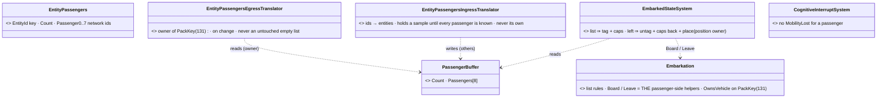

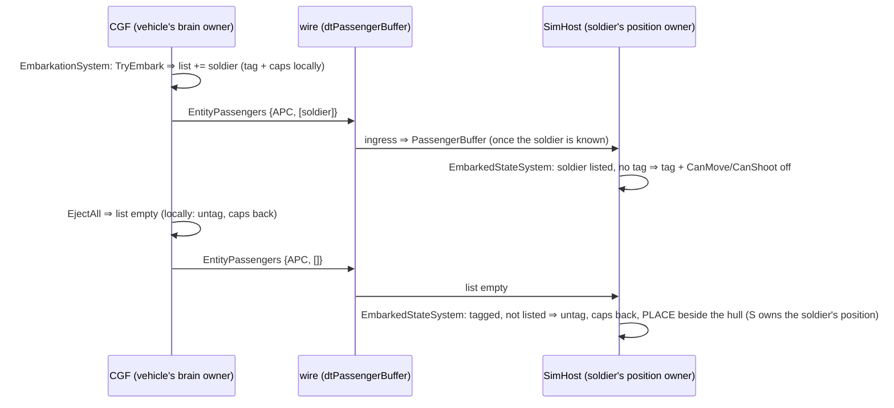

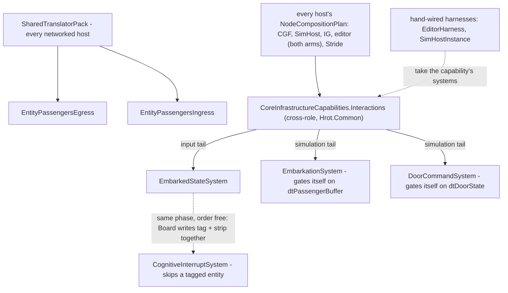
*What the pictures show that prose hid: the passenger's side has ONE writer function (`Embarkation.Board` / `Leave`) and two callers
— the deciding node right away, every node from the list it holds — so no node ever writes it from a second rule; the body is placed
only where its position is owned, because a write anywhere else would be overwritten by the owner's replicated position the next
frame; and NO host or role pack composes an interaction applier — one cross-role capability does, on every node that can own a live entity.*
*(⛔ SUPERSEDED `2026-10-12`: this graph first showed `CgfLogicPack` and `SimHostNodeBootstrapper` each registering the derivation,
with an "ordered before `CognitiveInterruptSystem`" edge — see §7.1d.)*

| claim the design rests on | code — how it IS | design — how it was MEANT |
|---|---|---|
| `ActorCapabilityState` never crosses the wire | ✅ Brain group (`HrotOwnershipGroups.cs:54`), but no translator names it (grep `Hrot/Network`, `Replication/`: 0) | ✅ Q-1: each node derives the passenger's side |
| a soldier's position is SimHost's | ✅ `SimTransform` in the MuscleGround group (`HrotOwnershipGroups.cs`, dtWorldPos) | ✅ R-170 |
| every brained entity carries an empty `PassengerBuffer` | ✅ `BehaviorTkbTranslator.cs:161` | — ⇒ the egress sends nothing for a list never filled |
| boarding fires `MobilityLost` | 🔴 ✅ `CognitiveInterruptSystem.cs` Pass B: any CanMove→cleared, no exception (true before I-2a too: the old `EmbarkExecutor` stripped it) | ⛔ "mobility lost" means damage, not a seat ⇒ fixed here |
| the animation reactor is unaffected | ✅ reacts to `CanPlayAnimations` / `CanAim` loss only | — |
| ordinal 131 is free | ✅ `AllDescriptors.cs` on `behaviors`, `origin/backend`, `origin/ui` (`2026-10-12`): last is 130 | — |

| decision | ⭐ lean | rejected (one line each) |
|---|---|---|
| the wire shape | `EntityPassengers` with eight scalar network-id fields (the `EntityWeaponAmmo` shape), keyed by the vehicle, Reliable + TransientLocal + KeepLast 1 | a sequence: no descriptor here carries one · entity handles: node-local |
| the owner gate | `PackKey(dtPassengerBuffer = 131)` in the BRAIN group (`Embarkation.OwnsVehicle` and the egress); a vehicle with no brain falls back to its creator | the vehicle's primary owner: the group exists so a role, not a node, owns it |
| a passenger the ingress does not know yet | hold the newest sample per vehicle and apply it once every id resolves | drop it: TransientLocal sends once, so a dropped sample would leave the list wrong until it next changed |
| restoring capabilities | CanMove/CanShoot back unless the passenger is dead | remembering exactly what was stripped: no reader needs it yet (I-2c can add it with its own field) |
| who places a leaving body | the node owning the passenger's POSITION (`PackKey(dtWorldPos = 2)`), at the hull column in leaving order | the vehicle's owner: its write is overwritten (above) |
| `MobilityLost` | `CognitiveInterruptSystem` skips an entity carrying `IsEmbarkedTag` | a separate "boarded" interrupt: nothing would read it |

| rail (I-2b acceptance) | where |
|---|---|
| a list published by the owner arrives on another node; a passenger not yet known holds the sample; the owner never takes its own back; an untouched empty list is never sent | `PassengerReplicationTests` (SimHost.Tests) |
| derived on a node that did not decide: tag + caps on boarding; untag + caps back + placed beside the hull on leaving, only where the position is owned | `EmbarkedStateSystemTests` (FDP) |
| boarding is not `MobilityLost` | `CognitiveInterruptSystem` suite |
| the two ordinals pinned to NED | a rail beside the door's |

#### 7.1d I-2b as built *(`2026-10-12`, behaviors lane)*

⭐ Built to §7.1c's three diagrams with no structural deviation: the classes, the sequence and the module graph above are the as-built.
What the build settled that the design left open:

| detail | as built | file |
|---|---|---|
| the wire sample | `EntityPassengers` — `EntityId` key, `Count`, `Passenger0..7` network ids; a passenger with no `NetworkIdentity` is left out | `SimDescriptors.cs`, `AllDescriptors.cs` (`dtPassengerBuffer = 131`) |
| the egress's "never filled" rule | skips a vehicle whose list it has never sent **and** whose list is empty; after that, any change (including to empty) is sent once | `EntityPassengersTranslators.cs` |
| the ingress hold | the NEWEST sample per vehicle waits in `_pending`; a later sample replaces it; it applies when the vehicle and every passenger resolve | same |
| a passenger moved straight to another vehicle | `EmbarkedStateSystem` re-tags it (boarding wins) — it does not leave and re-board | `EmbarkedStateSystem.cs` |
| the vehicle already gone | a tagged passenger whose vehicle no longer exists leaves where it stands (I-2c will kill it instead, R-271) | same |
| registration | ⭐ **one cross-role capability, `CoreInfrastructureCapabilities.Interactions`** (`Hrot.Common`, key `cap:infra:interactions`), declared in EVERY host's `NodeCompositionPlan` beside `UnitHierarchy` — CGF, SimHost, IG, the editor's two arms, Stride — and taken by the two hand-wired harnesses. It carries every interaction kind's OWNER-side system: the passenger derivation (input tail), and the appliers `DoorCommandSystem` (5d-1, moved out of `CgfLogicPack` on the user's "yes please") and I-2a's `EmbarkationSystem` (simulation tail). ⭐ A new interaction kind adds its owner-side system there — one place, never a host. (First built the same day as `…Embarkation`; renamed with Roslyn when doors joined.) 🔒 User, `2026-10-12`: *"any node that can own live entities (excluding ReplayBrowser …) should be able to use the features, so I hope you do no per-host initializations."* ⛔ SUPERSEDED the same day: the first build registered the derivation in `CgfLogicPack` and as a SimHost global system, and I-2a had the applier in `CgfLogicPack` only — per-host composition, which left IG and Stride unable to board | `CoreInfrastructureCapabilities.cs`, the six plans |
| frame order | ⭐ free inside the phase: `Board` writes the tag and strips CanMove in one call, so `CognitiveInterruptSystem` sees the tag whichever frame it notices the loss. ⛔ The design's "before `CognitiveInterruptSystem`" edge was not needed — and a `[UpdateBefore]` does nothing inside a togglable group (it runs its list in order), so it was removed | `EmbarkedStateSystem.cs` |
| ownership | `dtPassengerBuffer` ↔ `PassengerBuffer` in `NedOwnershipGroupBinding`; `PassengerBuffer` joins the BRAIN group | `NedOwnershipGroupBinding.cs`, `HrotOwnershipGroups.cs` |

| rail | where |
|---|---|
| the owner's list reaches the other node once every passenger is known (held before); an empty list empties it there; an untouched empty list is never sent; unchanged ⇒ said once | `PassengerReplicationTests.CE3110_I2b_TheOwnersList_…` (SimHost.Tests) |
| only the `dtPassengerBuffer` owner publishes / arbitrates; the owner drops its own sample | `PassengerReplicationTests.CE3110_I2b_OnlyTheDescriptorOwner…` |
| the toolkit's two ordinals are NED's descriptors | `PassengerReplicationTests.CE3110_I2b_TheToolkitsOrdinals_…` |
| a list that arrives tags + strips; an emptied list untags, gives caps back, places beside the hull ONLY where the position is owned; the deciding node is a no-op; a move re-tags; a dead passenger gets no caps back | `EmbarkedStateSystemTests` (FDP, 5) |
| boarding is not `MobilityLost` | `CognitiveInterruptSystemTests.CE3110_I2b_BoardingStripsCanMove_ButIsNotMobilityLost` |
| `dtPassengerBuffer` is in the Brain group's descriptor set | `RoleGroupOwnershipStrategyTests`, `TheDescriptorMapIsWiredTests` |
| the interaction appliers (doors, embarkation) are NOT pack content and resolve exactly once on both editor arms (an injected tier declaring it too de-duplicates by key); the Stride plan resolves it | `EditorCapabilitiesTests.CE3110_EmbarkationIsCrossRoleInfrastructure_ResolvedOnceOnEveryArm`, `CgfLogicPackTests`, `StrideCapabilitiesTests.MuscleGroundResolves` |

### 7.2 What "inside" means *(✅ ruled `2026-10-11`, R-271 — I-2c)*

🔒 *User: "Accepted the lean of what inside a vehicle mean. If vehicle gets destroyed, all inside die. Passenger needs a flag (carrier entity id,) on itself to be ignored by visibility queries so they do not need to check the passenger list. Some vehicles are open (like a helicopter without side doors), those are not hiding entities from being seen or shot, how to solve those?"*

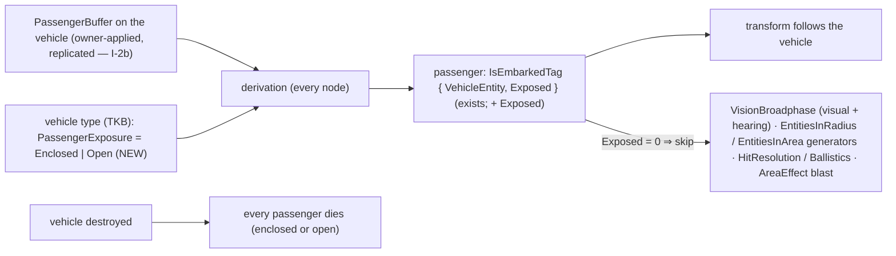

*What the picture shows that prose hid: the passenger answers "am I hidden?" from ITS OWN tag — the five systems that decide
"can this unit be seen, targeted or hit" (measured: `VisionBroadphase` serves both the visual and the acoustic sensor;
`EntitiesInRadiusGenerator`, `EntitiesInAreaGenerator`, `HitResolutionSystem`/`BallisticsSystem`, `AreaEffectSystem`) each skip
a tag with `Exposed = 0` and never read a passenger list.*

| decision | ⭐ lean / ruling | why |
|---|---|---|
| the passenger's own flag | ✅ ruled: the existing `IsEmbarkedTag { VehicleEntity }` IS that flag; it gains `Exposed` | already on the passenger, already carries the carrier's id |
| **open vehicles** *(✅ accepted 2026-10-11 — user: "open vehicles accepted")* | ⭐ a vehicle-type TKB field `PassengerExposure` (`Enclosed` default, `Open` for a door-less helicopter, a pickup bed, a motorcycle); the derivation copies it into the tag. `Exposed = 1` ⇒ carried but seen, targeted and hit like anyone | one per-type fact, read once at boarding; no per-query cost |
| may an exposed passenger fire? *(lean)* | ⛔ not in I-2c: CanShoot stays stripped; a later `PassengersMayFire` type field (door gunners) | keeps I-2c small; firing from a moving platform needs its own aim model |
| vehicle destroyed | ✅ ruled: every passenger dies, enclosed or open | — |
| finer than per vehicle *(later)* | per-seat exposure (a gunner's hatch open, the cabin closed) once seats exist | rejected now: there are no seats (capacity is a fixed 8) |

#### 7.2a I-2c — carried, hidden, dies with the vehicle *(build-state: BUILT `2026-10-12`, behaviors lane; R-271 — as built: §7.2b)*

📐 Measured `2026-10-12` (three sweeps + reads). ⚠ It **corrects §7.2's five-system list**: the hit is chosen in `RaycastSolverSystem` from the
**collider hash**, not in `HitResolutionSystem` (filtering there would hide the vehicle behind its own passenger); and the list missed the
line-of-sight occluders and the radius search, which also read the collider hash.

```mermaid
classDiagram
  class IsEmbarkedTag { <<existing, + Exposed>> VehicleEntity · byte Exposed }
  class OpenPassengerCabin { <<NEW, vehicle, id 366>> present only on an Open type (MobilityKill precedent) }
  class VehicleParametersDto { <<existing TKB, + field>> PassengerExposure Enclosed | Open (absent = Enclosed) }
  class VehicleKinematicsTkbTranslator { <<existing, + stamp>> Open ⇒ OpenPassengerCabin }
  class Embarkation { <<existing>> Board: Exposed = vehicle has OpenPassengerCabin }
  class EmbarkedStateSystem { <<existing, + carry + kill>> owner of the position: carry · owner of the health: lethal DamageAssessedEvent when the vehicle is destroyed }
  class PhysicalPresence { <<existing, widened>> IsHidden = UnitEntity OR enclosed passenger OR round in flight (CE-2163) · ExcludeHidden REMOVED }
  class SpatialHashSystem { <<existing, + door>> collider hash skips IsHidden }
  class CarKinematicsSystem { <<existing>> skips embarked · avoidance ignores embarked neighbours }
  class AreaEffectSystem { <<existing, + door>> blast skips IsHidden }
  class LosStrategies { <<existing, + door>> occluder lists skip IsHidden }
  class HealthApplicationSystem { <<existing, the one Health writer>> }
  VehicleKinematicsTkbTranslator ..> VehicleParametersDto : reads
  VehicleKinematicsTkbTranslator ..> OpenPassengerCabin : stamps
  Embarkation ..> OpenPassengerCabin : reads at boarding
  Embarkation ..> IsEmbarkedTag : writes
  PhysicalPresence ..> IsEmbarkedTag : reads Exposed
  SpatialHashSystem ..> PhysicalPresence
  AreaEffectSystem ..> PhysicalPresence
  LosStrategies ..> PhysicalPresence
  EmbarkedStateSystem ..> HealthApplicationSystem : DamageAssessedEvent
```
*What the picture shows that prose hid: "hidden" has ONE definition (`PhysicalPresence.IsHidden`) and every door that gathers candidates
calls it — the perception grid and the EQS area search (as before) plus three new doors: the collider hash (bullets, near misses, the radius
search, network raycasts, vehicle avoidance), the blast query and the line-of-sight occluder lists. And no new writer of `Health` appears: the
kill rides the existing damage event into the one writer.*

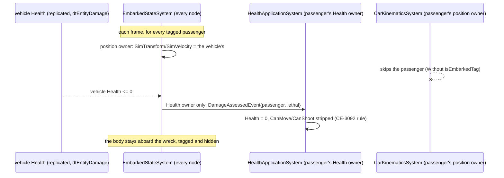

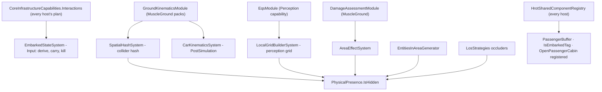
*What the picture shows that prose hid: the embarkation components were registered only by the CGF and SimHost registries, so IG — which runs
I-2b's passenger-list ingress — would apply an unregistered component (a latent I-2b defect, fixed here by moving them to the shared registry
every host calls). The carry needs no new system and no cross-group ordering: the derivation already visits every passenger each frame.*

| claim the build rests on | code — how it IS | design — how it was MEANT |
|---|---|---|
| perception + EQS area search already share ONE hidden check | ✅ `LocalGridBuilderSystem.cs:106`, `EntitiesInAreaGenerator.cs:66` via `PhysicalPresence` | ✅ `PhysicalPresence.cs:9-12` reserves I-2c's passenger there; Squad_Tactics §7.1 C-2 |
| bullets, near misses, radius search, avoidance read the collider hash | ✅ `SpatialHashSystem.cs:73-82`; `RaycastSolverSystem.cs:99-130`; `BallisticsSystem.cs:252`; `EntitiesInRadiusGenerator.cs:27`; `CarKinematicsSystem.cs:567` | ⚠ §7.2 named `HitResolutionSystem` — corrected here |
| the blast does not use any index | ✅ `AreaEffectSystem.cs:101` plain query | ✅ Building_Interiors §3k ("one query over live Health entities") |
| a boarded soldier keeps its collider and kinematics keeps writing it | ✅ `CombatTkbTranslator.cs:66-81`; `CarKinematicsSystem.cs:80-87` (no CanMove check) | ⛔ searched `docs/`, none — the carry is new |
| no parent-follow mechanism exists | ✅ swept (PartMetadata, turret parts, NetworkTransform): none writes a child's transform | ⛔ searched, none |
| Health has one writer, gated on owning Health | ✅ `HealthApplicationSystem.cs:87`; Health in the Brain group (`HrotOwnershipGroups.cs:53`) | ✅ Ownership_Groups §5.6 S8 |
| the vehicle's Health reaches every node | ✅ `EntityDamageEgress/IngressTranslator` (`dtEntityDamage`, SharedTranslatorPack) | ✅ |
| a per-type opt-in is a component present only when non-default | ✅ `MobilityKill` (`CombatTkbTranslator.cs:61`) | ✅ packs-1 §2.B |
| `HasComponent` of an unregistered type is false, double registration is harmless | ✅ `PhysicalPresence.IsHidden` / `AuthorityExtensions` call it unguarded; IG registers `Health` twice | — |

| decision | ⭐ lean (built) | rejected (one line each) |
|---|---|---|
| where "hidden" is decided | widen `PhysicalPresence.IsHidden`; every candidate door calls it per entity; `ExcludeHidden` (a query filter that cannot read `Exposed`) is removed | a second tag for enclosed passengers: two facts for one state · a check in `HitResolutionSystem`: the ray already chose the passenger |
| the collider hash | hidden passengers are not inserted — one door covers bullets, near misses, radius search, network raycasts and avoidance | five per-consumer skips |
| an exposed passenger in avoidance | stays in the hash (it can be seen and shot) but `CarKinematicsSystem` ignores embarked neighbours | removing it from the hash: it could not be hit |
| the carry | in `EmbarkedStateSystem`, on the passenger's position owner: position, rotation and velocity = the vehicle's (≤ one frame behind; the passenger is hidden or rides an open cabin) + `CarKinematicsSystem` skips embarked entities | a PostSimulation follow system: needs ordering across a togglable group and a kinematics module, which nothing provides |
| the kill | the passenger's Health owner publishes a lethal `DamageAssessedEvent` when the vehicle `IsDestroyed`; `HealthApplicationSystem` applies it (the death capabilities follow); the body stays aboard | writing Health directly: a second writer · removing the body: the `2026-09-13` user ruling, dead bodies stay in the world (`HealthApplicationSystem.cs`) |
| exposure | `VehicleParametersDto.PassengerExposure` (absent = Enclosed) → `OpenPassengerCabin` on the vehicle → `IsEmbarkedTag.Exposed` at boarding | reading the TKB at every boarding: the toolkit has no TKB access there |
| stale enemy memory of a passenger | left to decay (`ThreatEvaluationSystem` decays tracks) | purging on boarding: a sensor fact, not an embarkation one |

| rail (I-2c acceptance) | where |
|---|---|
| hidden = unit or ENCLOSED passenger; an exposed passenger is not hidden | `PhysicalPresenceTests` (FDP) |
| an enclosed passenger is not in the perception grid nor the collider hash; an exposed one is in both | `LocalGridBuilderSystemTests`, `SpatialHashSystem` rail (FDP) |
| a blast spares an enclosed passenger at the burst | `AreaEffectSystem` rail (FDP) |
| carried where the position is owned (position + velocity = the vehicle's), untouched elsewhere; kinematics leaves it alone | `EmbarkedStateSystemTests`, `CarKinematicsSystem` rail (FDP) |
| the vehicle destroyed ⇒ a lethal damage event for each live passenger whose Health this node owns, none for one it does not own | `EmbarkedStateSystemTests` (FDP) |
| an Open type stamps `OpenPassengerCabin`; boarding it sets `Exposed` | `VehicleKinematicsTkbTranslatorTests`, `EmbarkationTests` (FDP) |
| every host registers the embarkation components | `HrotSharedComponentRegistry` rail (SimHost.Tests) |

> ⭐ **CE-2163 (2026-10-14, backend):** a ROUND IN FLIGHT (`BallisticProjectile`) is hidden too — it carries a `PhysicsCollider` so the
> ballistics can move it, but it searches the doors, it is never a candidate in them. 📌 Measured live (`ua-fire-and-movement-pairs`, a
> per-frame avoidance trace on SimHost): every shot put a fresh round **1.000 m in front of the muzzle at ~800 m/s** in the collider hash,
> inside the shooter's 1.6 m anti-overlap shell ⇒ `RVOAvoidance` shoved him back at −6 m/s for that frame, and a man who only suppressed
> crept ~5 m a minute away from the enemy (fire and movement lost about a fifth of its gain). The same one line also takes rounds out of
> the EQS radius/area candidates, the LOS occluder lists, the blast and the perception grid, and stops them filling the fixed neighbour
> buffers (32 for avoidance, 64 for near misses). The maps call `IsEnclosedPassenger`, not `IsHidden`, so a visible round still draws.
> Rails: `SpatialHashSystemTests.CE2163_ARoundInFlight_IsNotInTheColliderHash` · `CarKinematicsSystemTests.CE2163_AStandingSoldier_WhoFires_IsNotPushedBackByHisOwnRounds` (red-proved).

> ⭐ **CE-1058 (2026-10-12, ui):** the MAPS follow the same rule — a hidden passenger has no 3-D body, box, 2-D symbol or card (`PhysicalPresence.IsEnclosedPassenger`); an exposed rider is drawn. 📄 DESIGN_Map_3D_Mode.md §3.5 as-built (`EntityBodyLayer3D` row).

#### 7.2b I-2c as built *(`2026-10-12`)*

⭐ Built to §7.2a's three diagrams; no structural deviation. What the build settled:

| detail | as built | file |
|---|---|---|
| the perception grid is INCREMENTAL | the count pass and the full rebuild skip hidden entities, and the incremental pass EVICTS one that became hidden — a boarding cancelled by a spawn keeps the visible count equal, so the count check alone would have left it in the grid | `LocalGridBuilderSystem.cs` |
| `ExcludeHidden` | removed; its two callers (grid builder, `EntitiesInAreaGenerator`) call `IsHidden` per entity | `PhysicalPresence.cs` |
| avoidance | the neighbour span is compacted (embarked neighbours dropped) before `RVOAvoidance` | `CarKinematicsSystem.cs` |
| the kill is said once | a per-system set keeps one lethal event per passenger (a duplicate would only re-floor Health at 0, but the damage egress would ship it twice); the TotalDamage is the passenger's current Health | `EmbarkedStateSystem.cs` |
| an unregistered component | `HasComponent` of a type a world never registered is false (precedent: `PhysicalPresence`, `AuthorityExtensions`), so the hidden check needs no guard | — |
| the TKB field | `PassengerExposure` is a `byte` enum whose 0 is `Enclosed`, so an absent field in older JSON / zips means enclosed (the `VehicleParametersDto` absent-safe rule) | `VehicleParametersDto.cs`, `InteractionComponents.cs` |
| ⭐ the latent I-2b defect | fixed: `PassengerBuffer` / `IsEmbarkedTag` / `OpenPassengerCabin` now in `HrotSharedComponentRegistry` (every host); `EmbarkationComponentRegistry` still registers them (idempotent) | `HrotSharedComponentRegistry.cs` |
| ⭐ a UNIT never boards or carries *(user, `2026-10-12`: "squad body-less commander … does not take any passengers slot, can not be carried" → "sounds good")* | `TryEmbark` refuses (`Invalid`) when the passenger OR the vehicle carries `UnitEntity` (R-272) — every brained entity, units included, gets an empty `PassengerBuffer` (`BehaviorTkbTranslator`), so without it a unit could be named as a vehicle. One check covers the applier and genesis (both go through `TryEmbark`); its members board, not it | `Embarkation.cs` |
| ⭐ riders and their carrier do not hide each other *(`2026-10-14`, backend — found by the weapon-systems split-cluster rail)* | an EXPOSED rider is a collider (seen and hit, as built above), so a gunner standing at his pickup's own position blinded the pickup's sight and the pickup his — a crewed technical saw nothing. `RideGroups` (`LosStrategies.cs`): a collider never blocks a line whose observer or target rides with it (its carrier, its rider, a co-rider), for sight, fragments and blast shadow — the rule the line of FIRE already had (`LineOfFire.RidesWith`). Rail `LosStrategyTests.WS4_ACarrierAndItsRiders_DoNotHideEachOther_AStrangerStillDoes`; as built in `DESIGN_Weapon_Systems.md` §9 "WS-4 riders" | `LosStrategies.cs` |
| not covered, recorded | ⚠ the Stride host's crowd kinematics (`CrowdAgentUpdateSystem`) is not taught to skip an embarked body (Stride not exercised here) · enemy `TargetMemory` of a passenger decays rather than purges · `HiddenTargetThrow.FriendlyInBurst` still counts a friend inside a vehicle (conservative: no grenade near a friendly APC) | — |

| rail | result |
|---|---|
| `PhysicalPresence` via `EmbarkedStateSystemTests.CE3110_I2c_BoardingAnOpenCabin_LeavesThePassengerExposed` · `LocalGridBuilderSystemTests.CE3110_I2c_…` (incl. the equal-count boarding) · `SpatialHashSystemTests.CE3110_I2c_…` · `AreaEffectSystemTests.CE3110_I2c_…` · `CarKinematicsSystemTests.CE3110_I2c_…` · `EmbarkedStateSystemTests` carry + kill · `VehicleKinematicsTkbTranslatorTests.CE3110_I2c_…` · `UnitCommanderTests.CE3110_I2c_…` (EQS area search) · `EmbarkationTests.CE3110_AUnitNeitherBoardsNorCarries` · `HrotSharedComponentRegistryTests.CE3110_…` | ✅ all green; red-proved by reverting each mechanism |

#### 7.2c A map graphic is not a body *(behaviors, `2026-10-20`; `CE-2324`; build-state: BUILT — as drawn)*

> 🔒 **User, `2026-10-20`:** *"the insurgents in the urban battle open fire also on 'Avenue E north' marker entity"* — a ROUTE
> (`TacGraphic_Route`, Friend, `uc-urban-battle`). 📐 The perception grid takes every entity with a `SimTransform`
> (`LocalGridBuilderSystem`); `PhysicalPresence.IsHidden` skipped only the body-less unit, the enclosed passenger and the round.

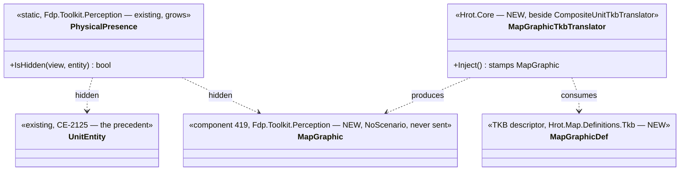
*What the picture shows that prose hid: it is CE-2125's own shape, a type-level fact stamped by a TKB translator on every node (the
creator and every ghost promotion) and read by the ONE rule every candidate door already calls — so no reader changes.*

| what | as built | why |
|---|---|---|
| which types | `TacGraphic_Route` (8802), `TacGraphic_Area` (8803), `TacGraphic_FireLine` (8801, a bare template now), `WeatherRegion` (8811), `StoneSource` (8812) carry `MapGraphicDef` | each is drawn on the map and has a position, and none is a thing in the world |
| ⛔ not a graphic | `Door` (8805), the obstacles (8806–8809) | physical: a door and an obstacle block sight and fire |
| ⛔ not touched | `TerrainZone` (8804, no template: a load directive with no force), `WorldEnvironment` / `Traffic` (no position) | never in the grid as a target |
| never a promotion wait | `MapGraphic` is neither `[PerInstanceValue]` nor ingressed ⇒ never mandatory (`MandatoryComponentResolver`) | the same as `UnitEntity` |
| a second fix | a NEUTRAL graphic (a weather region, a stone source) in the grid could hold a shot as a "neutral on the line" (AW-20) | gone with it |

### 7.3 I-2d — the AI can ask *(build-state: BUILT `2026-10-12` — as built §7.3a; live acceptance: Squad Tactics §5a.1, ui lane; HANDOFF_Embark_I2d_And_Unit_Orders.md §2 item 1, its STEER; R-282 (behaviors))*

#### 7.3.0 INVENTORY *(graph CLI `search_graph` `.*Embark.*` · `.*Disembark.*` · `.*DoorNodes.*` · `.*SquadManeuverRunner.*` · `.*DoorLocksmith.*`, + grep)*

| exists | where | role in I-2d |
|---|---|---|
| `EmbarkExecutor` (interaction action 1) — raises `EmbarkEntityCommand`, waits for the tag; **does not walk** (Running while out of range) | `Fdp.Toolkits/Behavior/Executors/EmbarkExecutor.cs:59-87` | reused unchanged; the node walks |
| `EjectPassengersExecutor` (action 3, the VEHICLE's) | same folder | not used by I-2d (a squad dismount is per passenger) |
| interaction action **2** reserved "for a per-passenger disembark action" | §7.1a, `BehaviorConstants.cs:111-126` | ⇒ `DisembarkExecutor` takes it |
| `DoorNodes.MoveToDoor` / `OperateDoor` — the shape: walk on the locomotion channel, then one action on the interaction channel, forward its answer once | `Fdp.Toolkits/Terrain/DoorNodes.cs` | ⭐ the template for the two nodes |
| `LocomotionMoveTo` — "THE one way a C# node moves its own unit" (CE-2092) | `Hrot.AI.Behaviors/Brains/LocomotionMoveTo.cs` | the nodes' walk ⇒ the nodes live in `Hrot.AI.Behaviors` |
| `Embarkation.DismountPoint` — beside the hull (radius + 1.5 m) | `Embarkation.cs:139` | the boarding point (seat 0 of 1) |
| boarding stays `CanInteract` (only CanMove / CanShoot stripped) | `Embarkation.cs:48` | ⇒ a passenger's interaction action runs aboard |
| ⭐ `2026-10-15` — a WEAPON SYSTEM's own Gunner seat strips only CanMove (`Embarkation.StrippedOn`) | `Embarkation.cs` | ⇒ its man, the weapon's controller, fires it; every other seat unchanged — [Weapon Systems §9 WS-6](designs/weapons/DESIGN_Weapon_Systems.md) |
| curated library behaviour pattern: `[BehaviorResolver]` from a `[BehaviorContract]` DTO into a blackboard of node params | `DoorLocksmithBehavior.cs` | the two library behaviours |
| a JSON-authored entity reference: `EntityRef` (network id, remapped on load, picked by the editor) | `Fdp.Toolkits/Replication/EntityRef.cs` | the vehicle in the params |

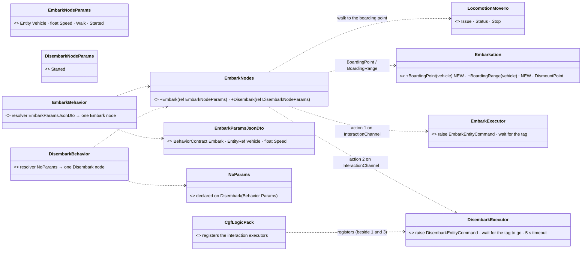
*What the picture shows that prose hid: nothing new writes embarkation state — both nodes end in an EXISTING command applied by the
EXISTING `EmbarkationSystem` on the vehicle's owner (§7.1b); the nodes only walk and ask, exactly as the door nodes do.*

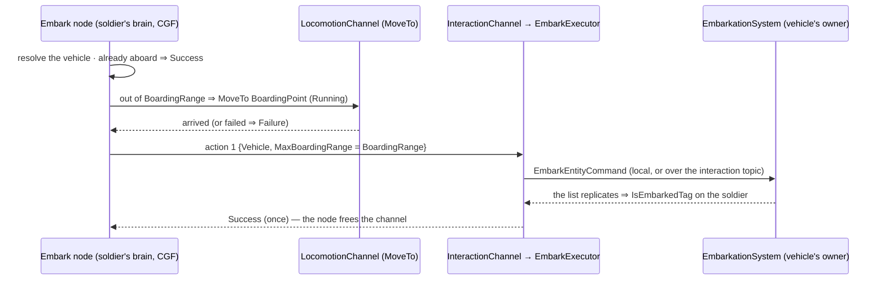

| decision | ⭐ chosen | rejected (one line each) |
|---|---|---|
| where the nodes live | `Hrot.AI.Behaviors` beside `PostureNodes` (they move the unit through `LocomotionMoveTo`, CE-2092) | FDP beside `DoorNodes`: it would copy the channel write a second time (DoorNodes already carries one) |
| how the node walks | to `Embarkation.BoardingPoint` (seat 0 beside the hull — the point a dismount stands on, so it is walkable when the road is) | to the vehicle's centre: inside the hull, off the navmesh ⇒ fails forever (S3 trap ③) |
| the executor's range | the node passes `BoardingRange` = hull + clearance + 1 m, so the executor's distance test agrees with where the node stopped | the executor's 3 m default: shorter than the boarding point of any hull over 0.5 m (a 3.5 m APC would never board) |
| per-passenger leaving | NEW `DisembarkExecutor` on the reserved action 2 (raise `DisembarkEntityCommand`, wait for the tag to go) | the node raising the command itself: §7's rule is "executors raise, the owner applies"; eject-all: the vehicle's action, and it empties a mixed load |
| `Disembark`'s params | ✅ **`NoParams`** (since the merge with CE-2134, `2026-10-12`: the contract is `[Behavior(Disembark, Params = typeof(NoParams))]` on the behaviour; `Embark` / `SquadDismount` declare their DTOs the same way). ⛔ SUPERSEDED: its own empty `DisembarkParamsJsonDto` with `[BehaviorContract]`, which B2 deleted | B2 (CE-2134) moved every contract onto the behaviour |

| rail | proves |
|---|---|
| `EmbarkNodesTests` (SimHost.Tests, one world, CGF pack's executors) | walk-then-board · already aboard ⇒ Success at once · a gone vehicle ⇒ Failure · disembark ⇒ beside the hull, capabilities back · not aboard ⇒ Success |
| `DisembarkExecutorTests` (Fdp.Toolkits.Tests, beside `EmbarkExecutorTests`) | raise once → the owner applies → Success; no answer ⇒ timeout Failure |
| `CgfLogicPackTests` | action 2 registered |
| CE-2130 conformance | the two behaviours name a contract DTO (P1/P2) |

#### 7.3a I-2d as built *(`2026-10-12`, ui lane, `CE-1056`)*

| file | what |
|---|---|
| `Hrot.AI.Behaviors/Brains/EmbarkNodes.cs` | the two shared nodes, as §7.3's class diagram: `Embark` walks with `LocomotionMoveTo` (re-issued when the boarding point moved > 2 m), then action 1; `Disembark` action 2; both forward the executor's answer once and hand the channel back |
| `Fdp.Toolkits/Behavior/Executors/DisembarkExecutor.cs` · `BehaviorConstants.ActionIdDisembark = 2` · registered in `CgfLogicPack` | raise `DisembarkEntityCommand` (vehicle from the passenger's own tag) once; Success when the tag is gone; 5 s timeout |
| `Embarkation.BoardingPoint` / `BoardingRange` (+ `BoardingSlack` 1 m; `HullRadius` factored out of `DismountPoint`) | where the walk stops and the matching executor range |
| `Hrot.AI.Behaviors/Brains/EmbarkBehaviors.cs` · `EmbarkParamsJsonDto` (`Hrot.Core`; Disembark takes `NoParams`) · `BehaviorNames.Embark` / `Disembark` | the library behaviours, `Library/Basic`, listed for infantry / insurgent / civilian |

| rail | result |
|---|---|
| `EmbarkNodesTests` (SimHost, 3) | walk → board through the owner · leave beside the hull · not aboard ⇒ Success · gone vehicle ⇒ Failure · the boarding point lies inside the boarding range |
| `EmbarkExecutorTests.CE1056_*` (FDP, 2) | the Disembark executor raises once, the owner applies, Success; not aboard ⇒ Success; no answer ⇒ timeout |

**Deviations from §7.3:** none in the classes or the sequence.

### 7.4 Carrying is a type fact — capacity, seats, the person carrier *(R-274 (behaviors); build-state: READY-TO-BUILD — B1–B6, C1–C3 approved `2026-10-13` (R-2009); behaviors lane; `CE-2151` (B), `CE-2152` (C, after R-263))*

🔒 *User, 2026-10-13: "B1-B6 approved. C1-C3 approved."*

🔒 *User, 2026-10-12 (AQ90 §0 B, C): "carrying capacity and seats (driver, gunner, passenger) belong to the vehicle type" — yes ·
"a soldier carrying or dragging a wounded comrade is the same embark mechanism with a 'human carrier' profile" — yes.*
📄 The rulings and the first measurements: [AQ90 §3](blueprints/Architect_Question_90_Unit_Orders_Carry_Capacity.md) rows B and C.

#### 7.4.0 INVENTORY *(graph CLI `search_graph` `.*PassengerBuffer.*` (22, `has_more:false`) · `.*Embark.*` · `.*Passenger.*` · `.*Seat.*` (7, none a seat) · `.*Carr(y|ier).*`, + grep, 2026-10-13)*

| what | where | what it means for carrying |
|---|---|---|
| `PassengerBuffer { Passengers[8], Count }`, `const Capacity = 8` | `InteractionComponents.cs:12-35` | capacity is a COMPILE-TIME constant on every carrier |
| every brained entity gets an empty `PassengerBuffer` | `BehaviorTkbTranslator.cs:161-162` | a soldier is a valid "vehicle" today (the gap R-274 closes) |
| the list is PACKED: `TryEmbark` appends, `Disembark` swap-removes | `Embarkation.cs:88-109` | a slot is NOT a seat today |
| the wire `EntityPassengers { Count, Passenger0..7 }`; egress reads `i < Count`, ingress appends | `SimDescriptors.cs:233-248`, `EntityPassengersTranslators.cs:60,144-147` | 8 is also the WIRE maximum; seat-indexed slots change both codecs |
| exposure per type: `VehicleParametersDto.PassengerExposure` → `OpenPassengerCabin` tag → `IsEmbarkedTag.Exposed` at boarding | `VehicleParametersDto.cs:89`, `VehicleKinematicsTkbTranslator.cs:81-85`, `Embarkation.cs:194` | the per-type precedent; no JSON or code template sets `Open` (grep, 0 hits) |
| carried, killed with a destroyed vehicle | `EmbarkedStateSystem.CarryAndKill` (`EmbarkedStateSystem.cs:86-115`) | "dies with the carrier" is unconditional today |
| crew, seats, roles | ⛔ none (`.*Seat.*` finds no seat; `Driver`/`Gunner` only in the possession camera) | the vehicle's own brain is its crew today |
| injury states (ok / wounded / incapacitated) | ⛔ not built — `Health { Current, Max }` only (R-263 decided) | who MAY be carried cannot be stated yet |
| TKB descriptors | 20 production `VehicleParametersDto` builders; the translator list is ONE (`TkbTranslatorSet.Base`, `TkbTranslatorSet.cs:89-106`) | a new descriptor needs one translator entry, every node |

#### 7.4.1 Classes

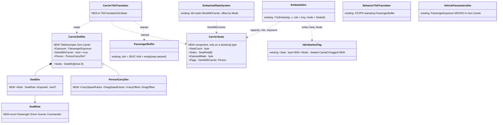

*What the picture shows that prose hid: ONE descriptor serves both rulings — a truck and a medic declare the same `Gen.Carrier`, the
medic with one seat and a `Person` block — so the person carrier is not a second mechanism; and the only existing classes that change
are the four that hard-code "8, packed, everyone, always dies".*

#### 7.4.2 Sequence — boarding a declared seat

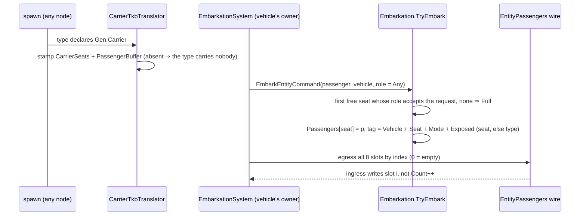

#### 7.4.3 Modules

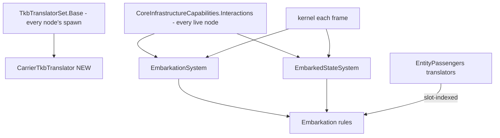

*What the picture shows that prose hid: nothing new is registered per host — the translator rides the one shared list and the
appliers already run in the cross-role `Interactions` capability, so R-275's "no per-host initialisation" holds by construction.*

#### 7.4.4 Decisions *(✅ B1–B6, C1–C3 approved 2026-10-13, R-2009; C4 is a measurement, the first step of C)*

| # | question | ⭐ lean | blast radius | what would change it |
|---|---|---|---|---|
| **B1** | where a type declares carrying | ⭐ a NEW descriptor `Gen.Carrier` on any type (vehicle or person), not fields on `VehicleParametersDto` | one DTO, one translator in `TkbTranslatorSet.Base` | if persons should never carry — but ruling C says they do |
| **B2** | `PassengerExposure` | ⭐ MOVE it into `Gen.Carrier` (type default) + a per-seat override; delete the `VehicleParametersDto` field — one producer, not two (R-132) | 1 field, 1 translator line; no data sets it (0 hits) | a staged TKB zip that sets it (none found in-repo) |
| **B3** | who gets a `PassengerBuffer` | ⭐ ONLY a type declaring `Gen.Carrier`; `BehaviorTkbTranslator` stops stamping it | every carrier TEMPLATE must declare it (the convoy truck, the test vehicles — the 20 builders are the list to walk) | keeping a default 8-seat carrier for every vehicle would keep old scenarios unchanged, but re-opens "every vehicle carries" |
| **B4** | seats | ⭐ slot = seat (no compaction); a request names a role (`Any` default); a Passenger seat takes anyone, a crew seat only its role; max 8 = the wire | `Embarkation` Board/Disembark/EjectAll, both passenger codecs, `DismountPoint` | — |
| **B5** | who drives when the driver seat is empty | ⭐ unchanged: the vehicle's brain drives (crew stay abstract); a later per-type `RequiresCrew` may stop it | none now | a scenario that needs a vehicle immobile without a driver |
| **B6** | per-seat exposure (a gunner's open hatch) | ⭐ yes, now — it is one bit per seat once slot = seat | `IsEmbarkedTag.Exposed` set from the seat | — |
| **C1** | the person carrier | ⭐ `Gen.Carrier` on the soldier type: one seat, `Exposure = Open`, `DiesWithCarrier = false`, a `Person` block (speed factors, offsets) | data on soldier templates | — |
| **C2** | carry vs drag | ⭐ one mechanism: a `Mode` on the request and the tag (`Carried` / `Dragged`) picks the offset and the speed factor | `IsEmbarkedTag`, `EmbarkedStateSystem` | — |
| **C3** | who may be carried | ⭐ only an INCAPACITATED soldier (R-263) ⇒ **C is built after the injury states**; until then `TryEmbark` onto a `Person` carrier refuses | none until R-263 | — |
| **C4** | where the speed factor applies | ⛔ **not measured**: the infantry locomotion speed source | C's build | the measurement, first step of C |

Rejected (one line each): **capacity as a field on `VehicleParametersDto`** — a person is not a vehicle and ruling C needs the same
field · **a separate "carry" interaction kind** — the user ruled it the same embark mechanism · **keep the packed list and store seat
in the tag only** — the wire could not say which seat is free, so two nodes would seat two people in one seat.

#### 7.4.5 Slices *(after approval)*

| slice | what | rails |
|---|---|---|
| **B-a** (`CE-2151`, ✅ BUILT 2026-10-13 — §7.4.6) | `Gen.Carrier` + `CarrierTkbTranslator` + `CarrierSeats`; capacity from the type; `PassengerBuffer` only on a declaring type; `PassengerExposure` moved; every carrier template declares it | a soldier has no buffer · a 2-seat type refuses the 3rd · exposure from the type · the feature suites `EmbarkNodesTests`, `Embarkation*`, the convoy live run |
| **B-b** (`CE-2151`, ✅ BUILT 2026-10-13 — §7.4.7) | seats: slot = seat, roles, per-seat exposure, slot-indexed codecs | a crew seat refuses a passenger · disembark leaves a hole the next board fills · wire round trip by slot |
| **C** (`CE-2152`; C-a ✅ BUILT 2026-10-13 — §7.4.9) | the person carrier — after R-263's injury states | carry/drag offsets, speed factor, survives the carrier's death |

#### 7.4.6 B-a as built *(`2026-10-13`, behaviors, `CE-2151`)*

As the class diagram, with the B-a half of it: `CarrierDefDto` (`Gen.Carrier`: `Seats`, `Exposure`; the `Person` block waits for C) ·
`SeatDto { Role, Exposed? }` · `SeatRole { Passenger, Driver, Gunner, Commander }` · `CarrierSeats { SeatCount, Roles[8], ExposedMask,
PassengerSeats }` (component 369) · `CarrierTkbTranslator` in `TkbTranslatorSet.Base` (and the two FDP example lists) stamps the buffer,
the seats (always rewritten — a type fact, never trusted from a save) and the open cabin; more than 8 seats throws at spawn ·
`Embarkation.CapacityOf` = the type's passenger seats (a hand-built buffer with no seats keeps 8), used by `TryEmbark` and the embark
executor · `BehaviorTkbTranslator` no longer stamps a buffer; `VehicleParametersDto.PassengerExposure` is gone.

⭐ **`2026-10-14` — the list is 12 wide** (Air Ops slice 6a F4; 🔒 user: *"extend the wire capacity to 10 seats or so instead of hacking the
seats? Isnt the descriptor sent only on change? No problem extending"* — measured: `EntityPassengersEgressTranslator` publishes only on
change). `PassengerBuffer.Capacity` 8 → **12**; `Modes` `ushort` → `uint` (2 bits × 12); `CarrierSeats.ExposedMask` and
`CarrierStations.StationMask` `byte` → `ushort`; a buffer with no declared seats keeps **8** (`PassengerBuffer.UndeclaredSeats` — no
undeclared vehicle's capacity moved); `WeaponSystems.MaxControlled` = Capacity + 1. Wire: `EntityPassengers.Passenger8…11` + `ModesHigh`
**appended** (R-169), seats 0–7 unchanged. ⚠ A recording made before it carries the 8-wide component. ~~"more than 8 seats throws"~~ —
now more than 12. Rails: `PassengerReplicationTests.F4_TheTwelfthSeat_AndItsMode_CrossTheWire`,
`CreateEntityRequestSystemTests.F4_APlacedDoorsOffBlackHawk_…`.

| carrier data | passenger seats |
|---|---|
| BDC `IFV_Bradley` / `Truck_HMMWV` (`NedTkbBuilder.WithCarrier`) | 6 / 3 |
| UrbanCombat `MilitaryAPC` / `CivilianCar` (Hrot catalogue and the FDP example's) | 8 / 4 |
| tanks, aircraft, soldiers | none — aircraft have no brain or flight model yet; crew seats come with B-b |

**Deviations:** ① crew stay abstract, so B-a declares passenger seats only (crew seats would hold nobody until B-b's role requests).
② ⛔ SUPERSEDED by B-b (§7.4.7): `GenesisMaterializationSystem.EnsureBuffer` gave a scenario-boarded vehicle a list when its type
declared none; it is gone. Rails: `CarrierTkbTranslatorTests` (6 — no Gen.Carrier ⇒ no
list; the 3rd boarding of a 2-seat type is Full; a crew seat is not passenger capacity; exposure + per-seat override; seats rewritten;
9 seats refused), the open-cabin rail moved there from `VehicleKinematicsTkbTranslatorTests`.

#### 7.4.7 B-b as built *(`2026-10-13`, behaviors, `CE-2151`)*

As the class and sequence diagrams (§7.4.1, §7.4.2), the B-b half. `Mode` and the `Person` block wait for C.

| piece | as built |
|---|---|
| the list | slot = seat; `Entity.Null` = empty; `Count` = occupied seats. `TryEmbark` writes `Passengers[seat]`, `Disembark` nulls the slot in place, and `EjectAll`, `SlotOf`, `EmbarkedStateSystem`, `SquadSensing` and the save extractor walk all 8 slots |
| choosing a seat | `Embarkation.FreeSeat(repo, vehicle, role)`: the first free seat of that role, else the first free PASSENGER seat, else −1. A plain boarding asks for `Passenger` (the default), so it never takes a crew seat. A list with no `CarrierSeats` (a hand-built world) has 8 passenger seats |
| the role on the request | `EmbarkEntityCommand.Role` → `TryEmbark(…, role)`. Across nodes it rides in `EmbarkInteractionPayload.Role` (one byte; `Reserved` kept) |
| the tag | `IsEmbarkedTag.Seat` (byte); `Exposed` = the seat's `ExposedMask` bit, else `OpenPassengerCabin`. `EmbarkedStateSystem` re-derives both on every node and re-tags when the seat moved |
| the wire | `EntityPassengers` egress writes `ids[seat]` (0 = empty) with `Count` = occupied. Ingress sets slot i for every non-zero id, so a hole stays a hole on every node |
| genesis | `EnsureBuffer` is gone (B3): a scenario that boards someone onto a type declaring no `Gen.Carrier` is refused and counted (`GenesisMaterializationSystem.RefusedBoardings`) |
| the executor | `EmbarkExecutor` fails at once when `FreeSeat(vehicle) < 0` (no free passenger seat) |

**Deviations:**
- ① **B4's "`Any` default" is `Passenger`.** Under "a Passenger seat takes anyone, a crew seat only its role", an `Any` request and a `Passenger` request accept exactly the same seats, so no `Any` value was added. A crew request prefers its own seat and falls back to a passenger seat; the design's "first free seat whose role accepts" would have put a driver in the back whenever a passenger seat had a lower index.
- ② **No template declares a crew seat yet.** B5 keeps crew abstract, so the seat roles are exercised only by rails.
- ③ **Save/load does not keep the seat.** The save keeps the occupants, not their seat or role, and genesis boards them as plain passengers. This is harmless while no template has a crew seat; it needs a seat field in `InitialPassengersIntent` once one does.

Rails (`CarrierSeatsTests`, 4): a plain boarding takes a passenger seat, never a crew seat; a crew request takes its own seat, else rides in back, else Full · leaving empties the seat in place and the next boarding fills it · exposure follows the seat, re-derived on a replica · `EjectAll` walks the holes. Elsewhere:
- `PassengerReplicationTests.CE2151_ASeatLeftEmpty_StaysAHoleOnEveryNode`
- `InteractionTransportTests` (the role crosses)
- `GenesisMaterializationSystemTests.CE2151_ANonCarrierNamedAsAVehicle_IsNotMadeACarrier`
- the packed-era fixtures updated in `EmbarkationTests`, `EmbarkExecutorTests` and `EditorAuthoringIntegrationTests` (a bare `Count = 8` no longer means full)

#### 7.4.8 C — the person carrier, detailed *(`2026-10-13`, behaviors, `CE-2152`; build-state: READY-TO-BUILD — C5–C10 approved 2026-10-13 (R-2011); built after [`DESIGN_Injury_States.md`](DESIGN_Injury_States.md) I-a)*

**Measured first (C4, the open row of §7.4.4):** a soldier's top speed is `VehicleParams.MaxSpeedFwd` (`VehicleClass.Pedestrian`), scaled
each frame on a LOCAL copy in `CarKinematicsSystem.UpdateVehicle:146-150` by `StanceSpeed.Factor` (standing 1, crouched 0.5, prone 0.2,
`StanceComponents.cs:95`). ⇒ the carry factor multiplies in the same place; nothing is written back. **The prerequisite is unbuilt and
had no row:** R-263's injury states exist only as a ruling (`.*Incapacit.*`: 0 symbols) — filed as `CE-2155`, designed in
[`DESIGN_Injury_States.md`](DESIGN_Injury_States.md).

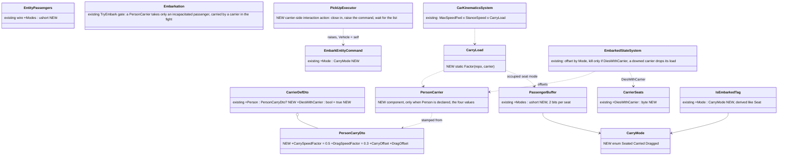

*What the picture shows that prose hid: the mode lives in the LIST, like the seat, so the tag stays derived on every node (B-b's
rule) and the two nodes that need it — the casualty's position owner (offset) and the carrier's kinematics owner (speed) — read it
without a second topic. And the carrier, not the casualty, starts the act: the only new behaviour piece is an action on the carrier.*

```mermaid
sequenceDiagram
  participant C as carrier brain (PickUpExecutor)
  participant O as EmbarkationSystem (carrier's owner)
  participant E as Embarkation.TryEmbark
  participant S as EmbarkedStateSystem (every node)
  participant K as CarKinematicsSystem (carrier's owner)
  C->>C: close in on the casualty
  C->>O: EmbarkEntityCommand(passenger = casualty, vehicle = self, mode = Dragged)
  O->>E: gate: PersonCarrier, casualty incapacitated, carrier in the fight
  E->>E: seat 0, Modes[0] = Dragged, carrier loses CanShoot
  S->>S: tag Mode = Dragged, casualty at carrier + DragOffset (where its position is owned)
  K->>K: top speed x stance x DragSpeedFactor
  Note over S: carrier downed: drop the casualty where it is (no kill, DiesWithCarrier = false)
```

| # | question | ⭐ lean | blast radius | what would change it |
|---|---|---|---|---|
| **C5** | where the mode lives | ⭐ in the list (`PassengerBuffer.Modes`, 2 bits a seat) and on the wire (`EntityPassengers.Modes`), the tag derived — like the seat | one field each; the two passenger codecs; the save extractor | — |
| **C6** | who starts a carry | ⭐ the CARRIER: a new interaction action `PickUp` (close in, raise `EmbarkEntityCommand` with `Vehicle = self`), and `Drop` = the existing disembark | one executor + its BTree/HSM node | a medic who treats in place (MED-2) — a different action, not a carry |
| **C7** | the carrier while carrying | ⭐ loses `CanShoot`, keeps `CanMove`; both back on `Drop` | `Embarkation` board/leave | doctrine that a dragger fires a pistol one-handed |
| **C8** | the speed factor | ⭐ `CarryLoad.Factor` beside `StanceSpeed` in `CarKinematicsSystem` (C4); data on `PersonCarrier` (defaults 0.5 carry, 0.3 drag) | one multiply on a local copy | — |
| **C9** | the carrier is hit while carrying | ⭐ `DiesWithCarrier = false` on a person: the casualty is DROPPED where it lies (no kill); a downed (incapacitated or dead) carrier drops it the same way | `EmbarkedStateSystem.CarryAndKill` | — |
| **C10** | where the casualty is drawn | ⭐ at the carrier's position plus the mode's offset, rotated by the carrier's heading (carried: on the shoulder; dragged: ~1 m behind); its pose is a later presentation item | `CarryAndKill` | — |

Rejected (one line each): **the mode in the tag only** — the tag is derived from the list on every node, so a mode stored nowhere else
would be lost on the next derivation · **a separate carry component pair (`CarriedBy` / `Carrying`)** — the user ruled it the same embark
mechanism (R-274) · **the casualty boards itself** — it is incapacitated and cannot act.

| slice | what | rails |
|---|---|---|
| **C-a** (`CE-2152`, after `CE-2155` I-a) | Person block + `PersonCarrier`; `CarryMode` on the command, list, wire and tag; the C3 gate; C7; C8; C9; C10; soldier templates declare one open seat | a healthy soldier cannot be carried · an incapacitated one can, by a carrier in the fight · speed × factor · offset by mode · carrier downed ⇒ casualty dropped, alive · mode round-trips the wire |
| **C-b** (✅ the actions BUILT 2026-10-13 — §7.4.10) | `PickUp` / `Drop` actions and nodes; squad casualty care (L4) uses them (Squad Tactics §7.4, awaiting K1–K6) | the carrier walks to the casualty and drags him to a point |

#### 7.4.9 C-a as built *(`2026-10-13`, behaviors, `CE-2152`)*

As the §7.4.8 class and sequence diagrams, with these names and these differences.

| piece | as built |
|---|---|
| the profile | `Gen.Carrier.Person` (`PersonCarryDto`: carry 0.5, drag 0.3, carried 0 m / dragged 1 m behind) + `DiesWithCarrier` (true by default). `CarrierDefDto.PersonCarrier()` = one open seat, `DiesWithCarrier = false`, the default Person block. `CarrierTkbTranslator` stamps `PersonCarrier` (component 371) and `CarrierSeats.PassengersSurvive` |
| who carries | the five soldier types that have `Gen.Injury` (BDC rifleman, the four UrbanCombat soldiers) |
| the mode | `CarryMode { Seated, Carried, Dragged }`; `PassengerBuffer.Modes` (2 bits a seat, `ModeOf` / `SetMode`), `IsEmbarkedTag.Mode` derived from it on every node, `EntityPassengers.Modes` on the wire, `EmbarkEntityCommand.Mode` and `EmbarkInteractionPayload.Mode` for the request |
| the gate (C3) | `Embarkation.TryEmbark(…, mode)`: onto a person carrier only an incapacitated passenger, by a carrier in the fight, else `Invalid`; a seated request is carried. Onto a vehicle the mode is always seated |
| the carrier's fire (C7) | `Board` strips the carrier's `CanShoot`; `Embarkation.ReleaseCarrier` gives it back when his list is empty, he is in the fight and not himself aboard (from `Disembark`, `EjectAll` and `EmbarkedStateSystem`'s leavers) |
| the speed (C8) | `CarryLoad.Factor` multiplies a person's top speed in `CarKinematicsSystem.UpdateVehicle`, beside the stance |
| the offset (C10) | `EmbarkedStateSystem.CarryAndKill`: the casualty stands at the carrier minus his flattened heading × the mode's distance |
| the drop (C9) | a person carrier who is not in the fight has his list emptied (`EjectAll`) on the node that owns it; the casualty is never killed with him, and stays down |

**Deviations:**
- ① **Offsets are distances behind the carrier**, not vectors. One number per mode is all a carry or drag needs.
- ② **`PassengersSurvive` is the stored flag** (0 = die, the zero default), so a hand-built `CarrierSeats` keeps the vehicle behaviour.
- ③ **`ReleaseCarrier` grants `CanShoot`** without remembering whether the type had it. The profile is declared only on soldier types, which do.
- ④ **The mode is not saved with a scenario**, like the seat: a casualty loaded from a save rides seated.
- ⑤ **Nothing starts a carry yet.** The trigger is C-b's `PickUp` action; until then the command is raised by a test or an operator.

Rails:
- `PersonCarrierTests` (5): only a man down is carried, and only by a carrier in the fight · carrying takes his fire and setting down gives it back · the casualty is held behind by mode · a downed carrier drops him alive · the profile is stamped from the type.
- `CarKinematicsSystemTests.CE2152_APersonCarrier_IsSlowedByWhatHeCarries` (3 cases).
- `PassengerReplicationTests.CE2152_TheCarryMode_TravelsWithTheSeat`.
- `InteractionTransportTests`: the mode crosses with the request.

#### 7.4.10 C-b — the carrier's actions *(`2026-10-13`, behaviors, `CE-2152`; build-state: BUILT (the actions) — the actions are C6 (approved, R-2011); the squad's use of them is [`DESIGN_Squad_Tactics.md`](designs/group-maneuvers/DESIGN_Squad_Tactics.md) §7.4, decisions awaiting the user)*

**INVENTORY** *(graph CLI `search_graph` `.*PickUp.*` (0) · `.*Casualt.*` (0, a doc section only) · `.*Embark.*` · `.*Disembark.*`, + grep for
`ActionId…` and the move nodes, 2026-10-13)*: the embark family is the whole prior art — `EmbarkExecutor` / `DisembarkExecutor` (the
PASSENGER's actions, ids 1 / 2), `EjectPassengersExecutor` (3), `EmbarkNodes.Embark` / `.Disembark` (walk, then one interaction action),
the library `Embark` / `Disembark` behaviours, all registered in `CgfLogicPack`'s interaction table. The plain move is
`CgfNodes.Action_WriteMoveToChannel` (the library `PersonMove`'s node). No carrier-side action exists; nothing raises a carry.

```mermaid
classDiagram
  class EmbarkEntityCommand { existing +Passenger +Vehicle +Mode }
  class DisembarkEntityCommand { existing +Passenger +Vehicle }
  class EmbarkationSystem { existing: the ONE applier, on the carrier's owner }
  class Embarkation { existing +LeavePoint(vehicle, passenger, seat, count) NEW: a person carrier lays him where he is }
  class PickUpExecutor { NEW id 9, on the CARRIER: in reach ⇒ raise EmbarkEntityCommand(casualty, self, mode); Success = his tag names self }
  class PutDownExecutor { NEW id 10, on the CARRIER: raise DisembarkEntityCommand(his load, self); Success = list empty }
  class CarryNodes { NEW shared nodes PickUp(casualty, mode, speed) · PutDown() }
  class CarryCasualtyBehavior { NEW library tree: Sequence(PickUp, Action_WriteMoveToChannel, PutDown) }
  class CarryCasualtyParamsJsonDto { NEW +Casualty : EntityRef +X +Y +Mode +Speed }
  class CgfNodes { existing Action_WriteMoveToChannel }
  class LocomotionMoveTo { existing Issue · Status · Stop }
  PickUpExecutor ..> EmbarkEntityCommand : raises, Vehicle = self
  PutDownExecutor ..> DisembarkEntityCommand : raises, Vehicle = self
  EmbarkationSystem ..> Embarkation
  CarryNodes ..> LocomotionMoveTo : the walk to him
  CarryNodes ..> PickUpExecutor : action 9
  CarryNodes ..> PutDownExecutor : action 10
  CarryCasualtyBehavior ..> CarryNodes
  CarryCasualtyBehavior ..> CgfNodes : the drag leg
  CarryCasualtyBehavior ..> CarryCasualtyParamsJsonDto : resolved from
```

*What the picture shows that prose hid: the two new executors are the carrier's MIRROR of the passenger's two — same commands, same one
applier — so nothing new writes embarkation state; and the drag leg is the existing move node, not a new one.*

```mermaid
sequenceDiagram
  participant B as carrier brain (CarryCasualty tree)
  participant N as CarryNodes
  participant L as LocomotionMoveTo
  participant X as PickUpExecutor / PutDownExecutor
  participant O as EmbarkationSystem (carrier's owner)
  B->>N: PickUp(casualty, Dragged)
  N->>L: Issue(walk to him) … Status Running
  N->>L: Stop (in reach — the channel is handed back, else the drag leg would read the old Success as "arrived")
  N->>X: action 9 on the interaction channel
  X->>O: EmbarkEntityCommand(casualty, self, Dragged)
  O-->>X: his IsEmbarkedTag names self ⇒ Success
  B->>B: Action_WriteMoveToChannel(the point) — slowed by CarryLoad, he trails 1 m behind
  B->>N: PutDown()
  N->>X: action 10
  X->>O: DisembarkEntityCommand(casualty, self)
  O-->>X: list empty ⇒ Success — he lies where he was held, still down
```

```mermaid
graph TD
  CGF[CgfLogicPack - registers the interaction executors] --> D[InteractionDispatcherSystem - every frame, on the brain's node]
  D --> PX[PickUpExecutor id 9]
  D --> DX[PutDownExecutor id 10]
  PX -.EmbarkEntityCommand.-> T[InteractionTransport - to the carrier's owner when it is another node]
  DX -.DisembarkEntityCommand.-> T
  T --> ES[EmbarkationSystem - Simulation phase, carrier's owner]
  BT[BrainTickSystem - every frame] --> NODES[CarryNodes in the CarryCasualty tree]
  NODES --> D
```

*The module picture's point: the new executors ride the SAME dispatcher table as `Embark` / `Disembark` (`CgfLogicPack`), so every host that
can board can carry; ⚠ a host with its own interaction table (`HeadlessDemoApp`, the FDP examples) gets neither — as today for Embark.*

| # | decision | ⭐ as built | why |
|---|---|---|---|
| **C-b1** | the drop point | a **person** carrier lays the casualty where he is held (his own position); a vehicle still stands passengers beside the hull | `DismountPoint` is a hull column on the carrier's RIGHT: for a soldier carrier it would jump the casualty sideways. ⛔ Corrects C9 (§7.4.8) "DROPPED where it lies", which C-a's code did not do (it used the hull column) |
| **C-b2** | pick-up reach | `CarryNodes.PickUpRange` = 1.5 m from the casualty; the walk aims at him with a 1 m arrival radius | both are soldiers' colliders (0.3 m); the walk must stop short of his body |
| **C-b3** | the mode | the request's; `Seated` is refused by the node (a person carrier forces `Carried` anyway) | the params DTO says `drag` or `carry`; drag is the default (under fire) |
| **C-b4** | a casualty already carried by someone else | `PickUp` fails at once | one seat, one carrier; the rules would refuse anyway |

**C-b as built** *(`2026-10-13`, behaviors — the action layer; the squad's use waits on Squad Tactics §7.4 K1–K6)*:

| piece | file |
|---|---|
| `PickUpExecutor` (id 9) · `PutDownExecutor` (id 10) · `PickUpParams` | `Fdp.Toolkits/Behavior/Executors/CarryExecutors.cs`; ids in `BehaviorConstants` |
| registered beside Embark / Disembark | `Hrot.CGF/CgfLogicPack.cs` interaction table |
| `Embarkation.LeavePoint` (C-b1) · `Embarkation.LoadOf` | `Disembark` and `EjectAll` stand a leaver at `LeavePoint` |
| `CarryNodes.PickUp` / `.PutDown` (shared nodes) | `Hrot.AI.Behaviors/Brains/CarryNodes.cs`; reuses `EmbarkNodes`' channel helpers (`Start` / `OwnsInteraction` / `Release`, now `internal`) |
| the library `CarryCasualty` (`Library/Infantry`) + `CarryCasualtyParamsJsonDto` (`casualty`, `x`, `y`, `carry`, `speed`) | `EmbarkBehaviors.cs` · `MapDefinitions/Behavior/` |

**Deviation:** the drag leg needs an explicit speed (the authored one, else 3 m/s) — a MoveTo with speed 0 never moves
(`CarKinematicsSystem` drives and arrives only with `TargetSpeed > 0`). The carry factor still applies, on the carrier's top speed.

Rails (in the feature's own suite, `EmbarkNodesTests`): `CE2152_PickUp_WalksToTheCasualty_ThenTakesHimThroughTheOwner` ·
`CE2152_TheCarrierDragsTheCasualtyToAPoint_AndPutsHimDownThere` (the C-b rail, node by node as the tree runs them) ·
`CE2152_PickUp_FailsForAManCarriedByAnother_AndForAManWhoIsNotDown`.

### 7.5 Team carry — a load two men carry: a stretcher, a two-man weapon *(R-2017 (behaviors); build-state: T-a BUILT `2026-10-14` (backend, §7.5.5) · T-b / T-c READY-TO-BUILD — T1–T7 approved `2026-10-14`; `CE-2175`)*

> 🔒 **User, `2026-10-14`:** *"What about the weapon to be carried by 2 men, is that in the plan, including demo scenario?"* · *"... becase we
> might need aomething like that for medics carrying stretcher with wounded soldier"* · on the lean: *"Approwed write it into Entity
> Interactions §7"*.

#### 7.5.0 INVENTORY *(graph CLI + grep, `2026-10-14`)*

| measured | where | so |
|---|---|---|
| a carry is ONE man: a `PersonCarrier` takes only an incapacitated man, into one open seat | `Embarkation.cs:107-111`, §7.4.8 C3 | the team carry is a second man ATTACHED to that one carry, not a new carry |
| `CarryMode` = `Seated 0 · Carried 1 · Dragged 2`, 2 bits a seat in `PassengerBuffer.Modes` and on the wire | `InteractionComponents.cs:42-47`, §7.4.8 C5 | value **3 is free** — `Stretcher` costs no wire shape |
| the speed is `CarryLoad.Factor` beside `StanceSpeed`; the offset by mode, and a downed carrier drops his load, in `EmbarkedStateSystem` | §7.4.8 C8–C10 | the pair reuses both places |
| a weapon system declares `Portable = None · OneMan · TwoMan` and a carry station on the soldier | Weapon Systems §5, W-G | a two-man weapon is the same team carry |
| no stretcher, litter or team-carry record | `search_code` / grep over `docs/`, `.dev/`, the code: none | new |

#### 7.5.1 Classes

```mermaid
classDiagram
  class CarryMode { existing enum: Seated · Carried · Dragged · +Stretcher = 3 ★ }
  class PassengerBuffer { existing +Assistant : Entity ★ the carrier's second man }
  class EntityPassengers { existing wire +Assistant : network id ★ appended }
  class EmbarkEntityCommand { existing +Assistant : Entity ★ appended }
  class IsAssistingTag { ★ derived on every node like IsEmbarkedTag: Carrier }
  class PersonCarryDto { existing +StretcherSpeedFactor = 0.6 ★ +AssistantOffset ★ (the rear handle, about 2 m behind) }
  class WeaponSystemDto { existing Portable TwoMan · CarrySpeedFactor }
  class Embarkation { existing TryEmbark gate +a team load needs a named, fit assistant ★ }
  class EmbarkedStateSystem { existing +places the assistant at the rear handle ★ +a team load is put down when either man is down ★ }
  class CarryLoad { existing Factor: +Stretcher, +a TwoMan weapon ★ }
  class TeamCarryNodes { ★ Hrot.AI.Behaviors: Stretcher (two men take a casualty) · the CarryWeapon team }
  PassengerBuffer --> CarryMode
  EmbarkEntityCommand ..> PassengerBuffer : Assistant
  IsAssistingTag ..> PassengerBuffer : derived from Assistant
  Embarkation ..> WeaponSystemDto : TwoMan
  Embarkation ..> IsAssistingTag
  EmbarkedStateSystem ..> PersonCarryDto : AssistantOffset
  CarryLoad ..> PersonCarryDto
  CarryLoad ..> WeaponSystemDto
  TeamCarryNodes ..> EmbarkEntityCommand : raises, Assistant set
```

*What the picture shows that prose hid: the team carry is ONE more field on the carry that already exists — the carrier still holds the
load in his one seat; the assistant is linked to it, derived on every node like the passenger tag, and placed at the rear handle by the
same system that places the load. A stretcher is a carry MODE, not an entity, so nothing is nested (no load inside a load inside a man).*

#### 7.5.2 Sequence — two men stretcher a casualty

```mermaid
sequenceDiagram
  participant N as TeamCarryNodes.Stretcher (the carrier's brain)
  participant O as EmbarkationSystem (carrier's owner)
  participant S as EmbarkedStateSystem (every node)
  participant K as CarKinematicsSystem (carrier's owner)
  N->>N: both men walk to the casualty (the assistant told to follow)
  N->>O: EmbarkEntityCommand(casualty, vehicle = carrier, mode = Stretcher, assistant)
  O->>O: gate: casualty down, carrier and assistant fit, the assistant within reach and carrying nothing
  O->>O: seat 0 = casualty (Stretcher), Assistant = the second man, both lose CanShoot
  S->>S: IsAssistingTag on the assistant, he stands at the rear handle, the casualty between them
  K->>K: top speed x stance x StretcherSpeedFactor
  Note over S: either man down: the load is put down where it is and the link drops
```

#### 7.5.3 Decisions — 🔒 approved `2026-10-14` (R-2017)

| # | decision | rejected |
|---|---|---|
| **T1** | a team carry = the existing one-man carry + an **assistant** linked to it (`PassengerBuffer.Assistant`, on the wire, `IsAssistingTag` derived on every node) | a load split into two halves, each man carrying one |
| **T2** | a **stretcher is a carry mode** (`CarryMode.Stretcher = 3`, free in the 2 bits), drawn between the two men | a stretcher entity with the casualty seated on it — a passenger of a passenger |
| **T3** | the assistant is PLACED at the rear handle (`AssistantOffset`) where his position is owned — the pair moves as one at the carrier's speed × `StretcherSpeedFactor` (0.6) or the weapon's `CarrySpeedFactor` | the assistant walking on his own and the carrier waiting for him (two moves to keep in step, a pair that drifts apart on a corner) |
| **T4** | the gate (`Embarkation`): a `Stretcher` carry and a `TwoMan` weapon need a named assistant — alive, not incapacitated, carrying nothing, aboard nothing, the carrier's side, within reach (2 m); a `OneMan` load refuses one | a behaviour-only rule — a possessed soldier would carry a two-man weapon alone |
| **T5** | both men lose `CanShoot` while carrying; both get it back on the put-down | — |
| **T6** | either man down (incapacitated or dead) ⇒ the load is PUT DOWN where it is (the casualty laid there, the weapon left `Stowed`) and the link drops; the team (or another) picks it up again | the stretcher continuing with one man |
| **T7** | at a weapon's firing point the assistant boards the weapon's loader seat (Weapon Systems §5) — the carry ends, the crew begins | — |

#### 7.5.4 Slices and rails

| # | lane | slice | rails |
|---|---|---|---|
| **T-a** | backend (with WS-2) | `CarryMode.Stretcher`; `Assistant` on the list, the wire and the command (appended — report, R-169); `IsAssistingTag`; the T4 gate; T3 placement and speed; T5; T6 | `EmbarkationTests`: a stretcher needs an assistant, a two-man weapon too, a one-man load refuses one · `EmbarkedStateSystemTests`: the assistant at the rear handle as the carrier turns; either man down ⇒ the load put down, the link gone · `CarKinematicsSystem` speed × 0.6 · the passenger codec round-trips `Assistant` |
| **T-b** | ui (with WS-5) | the stretcher drawn between the pair; a two-man weapon carried by the pair | frame rails |
| **T-c** | behaviors | `TeamCarryNodes.Stretcher`; the squad's casualty care may stretcher (two men free, no contact) instead of a drag; `LoadCasualty` puts a stretchered man into a vehicle; the `CarryWeapon` team for a `TwoMan` weapon; demos — medics stretcher a casualty in `ua-air-rescue`, a Kornet team in `ua-weapon-systems` | `CarryNodesTests` / `SquadManeuverTests` / `WeaponSystemNodesTests` |

#### 7.5.5 T-a as built *(backend, `2026-10-14`; STEER_Behaviors_To_Backend_Team_Carry.md)*

Built to §7.5.1 / §7.5.2; the class diagram holds. What the build settled:

| piece | as built | design |
|---|---|---|
| the link (T1) | `PassengerBuffer.Assistant` (Entity, `[ScenarioIgnore]` — not saved, as the mode is not) · `IsAssistingTag { Carrier }` (384, `NoScenario`), derived on every node by `EmbarkedStateSystem` from the list (named ⇒ `Embarkation.Assist`; no longer named ⇒ `ReleaseAssistant`) | T1 |
| the wire (R-169, APPENDED) | `EntityPassengers.Assistant` (network id; the ingress HOLDS the sample until the second man is known, as for a passenger) · `EmbarkEntityCommand.Assistant` · `EmbarkInteractionPayload.Assistant` (network id) — ⭐ the interaction codec gained optional `idsOut` / `idsIn` hooks that get the transport's `NetworkEntityMap` (`IInteractionCodec.ScanOutgoing` / `PublishIncoming` take it): the union's own rule ("any further entity is an explicit network-id field its codec maps") had no way to map before | T1 |
| the gate (T4) | `Embarkation.TryEmbark(..., assistant)`: a `Stretcher` carry or a `TwoMan` weapon onto a person ⇒ `FitAssistant` (alive, in the fight, not the carrier or the load, aboard nothing, carrying nothing, assisting nobody, the carrier's `ForceId` where both have one, within `AssistantReach` = 2 m); any other load with an assistant ⇒ `Invalid`; `Stretcher` onto a vehicle or with a weapon ⇒ `Invalid` | T4 |
| placement (T3) | where his position is owned: `AssistantBehindMetres` (2 m, `PersonCarryDto`) behind the carrier along his heading, his rotation and velocity; a stretcher's casualty half way (1 m). ⚠ name: `AssistantBehindMetres`, not `AssistantOffset` — it sits beside the existing `CarryBehindMetres` / `DragBehindMetres` | T3 |
| speed (T3) | `CarryLoad.Factor`: `Stretcher` × `StretcherSpeedFactor` (0.6) · ⚠ **any carried weapon × its OWN `CarrySpeedFactor`** (a two-man one is the pair's) — WS-2 had used the casualty's 0.5, so a soldier carrying a LAW ran at half speed | T3 |
| fire (T5) | both men lose `CanShoot` (the second man `CanMove` too — he is placed); a two-man weapon fills the carrier's hands as a casualty does (a one-man weapon still does not, WS-2); `ReleaseCarrier` keeps his fire off while an assistant is named | T5 |
| put down (T6) | `EmbarkedStateSystem` drops the load (`EjectAll`, on the node owning the list) when the carrier OR the named second man is down or gone; `EjectAll` and a person's `Disembark` drop the link and release him. ⚠ "a weapon left `Stowed`": a carried weapon is already stowed — nothing extra is written | T6 |
| rails | ⚠ in the person-carrier feature suite (`PersonCarrierTests.TA_*`: the gate, the rear handle as he turns + derived on another node, either man down, the speeds) rather than `EmbarkationTests` / `EmbarkedStateSystemTests` (T-1: the feature's own suite) · `PassengerReplicationTests.TA_TheSecondMan_TravelsWithTheList_HeldUntilHeIsKnown` · `InteractionTransportTests` (the stretcher request's `Assistant` crosses) | §7.5.4 |


### 7.6 Custody — search, detain, restrain *(backend, `CE-3256`, behaviors' BR-4 — [handoff](blueprints/batches/HANDOFF_Behaviors_To_Backend_Building_Clearing_Interactions.md); Building Clearing CB-19, R-2032; build-state: BUILT 2026-10-19)*

```mermaid
classDiagram
  direction LR
  class CustodyEvent { <<NEW FDP event 5015>> Entity Man · Entity By · CustodyVerb Verb · bool IsRemote }
  class CustodyVerb { <<NEW>> Search · Detain · Restrain · ReleaseCustody }
  class Custody { <<NEW FDP component 414, Brain group, dtCustody 148>> Detained · Restrained · Searched · Searching · SearchedBy local · SearchUntil local }
  class CustodyRules { <<NEW FDP static>> Owns · Ask · IsDetained · IsRestrained · InCustody · Complies · InReach }
  class CustodySystem { <<NEW, Interactions capability>> applies where the man's list is owned, times the 3 s search }
  class InteractionCodecs { <<EXISTING, + Custody case 13>> }
  class Embarkation { <<EXISTING>> Disembark }
  class CarryStations { <<EXISTING>> IsConcealed }
  class ThreatDanger { <<EXISTING, grows>> IsOutOfTheFight + detained or restrained }
  class AimAndFireExecutor { <<EXISTING, grows>> HoldOf: HoldRestrained }
  CustodyRules ..> CustodyEvent : publishes
  InteractionCodecs ..> CustodyEvent : carries to the owner
  CustodySystem ..> CustodyEvent : reads
  CustodySystem --> Custody
  CustodySystem ..> CustodyRules : Owns gate
  CustodySystem ..> Embarkation : Disembark the hidden weapons
  CustodySystem ..> CarryStations : IsConcealed
  ThreatDanger ..> Custody
  AimAndFireExecutor ..> Custody
```
*What the picture shows that prose hid:* the three verbs are ONE kind (`Custody`, the `Door` precedent: one kind with a verb), applied by ONE
system on the node that owns the man's passenger list — the node that can move his hidden weapons — and the result is ONE replicated
component every node reads.

```mermaid
sequenceDiagram
  participant S as soldier's brain (node A)
  participant W as interaction transport
  participant O as CustodySystem (the man's list owner, node B)
  participant R as dtCustody / dtPassengerBuffer (every node)
  S->>S: CustodyRules.Ask(man, soldier, Search)
  S->>W: CustodyEvent (man not owned here)
  W->>O: CustodyEvent IsRemote
  O->>O: within 1.5 m AND complying (hands up / on head) or restrained? else refused, counted
  O->>O: Searching = 1, SearchUntil = now + 3 s
  O->>O: each frame: still in reach and complying? else aborted
  O->>O: at 3 s: every thing in a CONCEALED station ⇒ Embarkation.Disembark (it lies at his feet, seen)
  O-->>R: Searched = 1 · the list without the weapon
  S->>W: CustodyEvent Detain / Restrain
  O-->>R: Detained / Restrained ⇒ out of the fight everywhere
```

| id | decision | ⭐ as built | rejected — one line each |
|---|---|---|---|
| **CU-1** | the kinds | ⭐ ONE kind `Custody` (13) with a verb — `Door`'s shape (one kind, a verb), one event, one codec, one handler | three kinds (the frame's literal wording): three events and codecs for one applier and one component |
| **CU-2** | who applies | ⭐ the node owning the man's `dtCustody` (`CustodyRules.Owns` = `HasAuthority(PackKey(148, 0))`, Brain group) — the same node that owns his passenger list, so it can move his hidden weapons; with no network authority (one node) it is always this node. ⛔ **SUPERSEDED as-built (2026-10-19):** the design said `Embarkation.OwnsVehicle` — it requires a `PassengerBuffer`, so a man carrying nothing could never be detained; the descriptor's own key is the same group with no such hole | his position's owner: cannot move his carried things |
| **CU-3** | the search | ⭐ the OWNER times it (3 s), checks reach (1.5 m) and compliance at the start AND every frame; at the end every concealed carried thing is put down (`Embarkation.Disembark`) — "made visible and laid down": it lies at his feet | a brain-local timer on the searcher: the result hidden in one brain (CB-19's rejected) |
| **CU-4** | compliance | ⭐ `ThreatDanger.ShowsHandsUp` (behaviors' `CE-2265` widens it to hands-on-head and restrained) OR already restrained | a pose check here: two readers of "complying" |
| **CU-5** | what detained / restrained mean | ⭐ `ThreatDanger.IsOutOfTheFight` counts either (not a target, not a threat); a RESTRAINED man's fire gate holds (`ActionReason.HoldRestrained` — hands tied); he still walks (the mover ignores it) | restrained ⇒ cannot move: the frame says he walks |
| **CU-6** | undoing it | ⭐ `ReleaseCustody` clears Detained and Restrained (any origin — the owner applies) | none: a detainee could never be let go |

| rail | |
|---|---|
| `CustodyTests` (Toolkits) | a search of a complying man with a hidden pistol puts the pistol down after 3 s, not before; a non-complying man is refused; the searcher walking off aborts it; Detain / Restrain set the flags, out of the fight; a restrained man's fire holds; Release clears |
| `InteractionTransportTests.CE3256_*` (SimHost) | the Custody case crosses to the man's owner with its verb and arrives marked remote; the owner's own ask is not sent |
| `BodyPartReplicationTests.CE3256_*` (SimHost) | `Custody` reaches the other node (detained, restrained, searched, searching) and reads in custody there; a release is a new sample; `CustodyDescriptorOrdinal` = `dtCustody` |
