<!--STATUS
state: LIVE
updated: 2026-11-11 (§11h — the editor's preview at 1 000 men measured on Windows, CE-4433; §11g — the brain at 1 000 / 3 000 men, CE-4395; §10 Part D 2026-11-04)
build-state: BUILDING — D1–D8 APPROVED 2026-11-04 (R-2083); tasks T1–T10 = CE-2382…CE-2391 (§7c); T1–T10 BUILT (§3.0a, §0a)
current-answer: §2 (the picture), §3 (A — rules at a cadence), §4 (B — rules UI only when watched), §5 (C — per-entity costs), §6 (decisions), §0e (garbage, per frame), §10 (D — map gizmos held in slices), §11h (the editor's preview frame, measured on Windows), §11g (the brain at 1 000 / 3 000 men — attribution, the parts fix, the 0.2 s decision cadence R-3085 as built §11g-3)
stale-below: none
known-rot: none
known-conflict: none
related-designs:
  - docs/DESIGN_Scale_Rig.md — OWNS the rig that measures §11g (scale-1, N men, the per-node budgets R-4192)
  - docs/DESIGN_Egress_Change_Detection.md — OWNS C4 / T10: egress change detection, its hazards and options
  - docs/DESIGN_Scenario_Rules.md — OWNS the rule kinds, ObjectiveHost, triggers (T1–T3), the per-player score (§00.13); this design only changes WHEN a rule ticks
  - docs/DESIGN_Rules_View_UI.md — OWNS the rules view and RV-7 (the Objectives tab); this design only changes how often its model is built
  - docs/DESIGN_Sensors_And_Doctrine.md — OWNS the SOP slot's cadence (5 Hz, staggered, woken; §G5, R-195) — the pattern part A reuses
  - docs/blueprints/DESIGN_Paused_And_Stepped_Execution.md — OWNS the EventAccumulator and the per-reader step window (§1a/§1b) — the mechanism part A reuses for exactly-once events
  - docs/UX/UX_Feature_Cross_Surface_Actions.md — OWNS the right-click menu; its ruling "serialise on right-click, not per Draw" (:158, :225) is what C3 builds
  - docs/DESIGN_Ownership_Groups_And_Grants.md — OWNS OwnershipRecomputeSystem's per-frame passes (S6, S8) that C5 gates
  - FDP/Engine/docs/FDP-FlightRecorder.md — OWNS the recorder (FDP-DES-001…011: page copy, sanitize, deltas, format v2); §5b C7 changes only how much of a changed delta page is written
  - docs/DESIGN_Replay_Time_Axis_And_Review.md — OWNS §12q/§12s (a chunk written only when its bytes moved, reset at a keyframe) — C7 keeps that rule
  - docs/designs/dds-to-ecs/DESIGN.md — OWNS egress; its "the translator skips unchanged chunks" (:468) is aspirational — C4 records why it is not taken here
-->

# Evaluation cost and cadence — why Crossfire is slow, and the fix

> **Tracker:** [CE-2381](blueprints/Blueprint_Issues_Tracker.md) (the general cost) · [CE-4259](blueprints/Blueprint_Issues_Tracker.md) (selecting a unit drops to ~1 FPS).
> 🔒 **User, `2026-11-04`:** *"it is a bit slow even when no entity is selected … the amount of entities is not so high, so it's weird"* ·
> *"Can we build one shared 'unit → its rules' index per frame only when somebody is actually watching it … Cant we evaluate the stuff not
> every frame, but once per few frames and with interleaving, does anything depend on every frame and fixed ordering evaluation? Note the
> system has to handle thousands entities … if there is anything what would help all entities, it would be welcome as well."*

## 0. What was measured

`showcase-crossfire`, `--mode all` under Xvfb, `HROT_FRAME_STATS=1`, `/diagnostics/architecture`, `dotnet-trace` (sampled thread time).

| | measured |
|---|---|
| loaded, paused | update ≈ 20 ms/frame |
| ▶ playing, nothing selected | update **≈ 85 ms at 10 s → ≈ 120–135 ms at 100 s** (≈ 7–10 FPS); UI ≈ 7, draw ≈ 1 |
| a soldier selected, Details open | `cgf_details` **40 → 80 ms/frame within 15 s**; frame 250–400 ms |
| the world | **365 entities** after macro expansion (the file has 85), **+1/s, nothing removed** (524 at 100 s): every respawn is `InsertMacro game/bot` = a new bot + a new ~14-rule score set — by design |
| `BrainTickSystem` | 20 → 25 ms; ≈ ¾ of it the RULE trees (`Points`, `Count`, `Best`, `MemberEvaluation`, `Trigger`), not the soldiers |
| egress ×4 worlds · recorder ×4 · ownership recompute ×4 | ≈ 15 · ≈ 8–11 · ≈ 7 ms |
| a per-T cached component type id (prototype) | ≈ 10 % of update early, nothing measurable at 100 s — the trace's "50 % in the type lookup" was mostly sampler bias |


### 0a. ✅ MEASURED AFTER T1–T9 *(`2026-11-04`, the same scripts as §0, runner rebuilt at `cb3f0f3bd`)*

| | before | after |
|---|---|---|
| ▶ playing, nothing selected — update at 10–20 s | 83–98 ms | **53–55 ms** |
| … at 100 s (524 entities) | 119–136 ms | **82–104 ms** |
| a soldier selected, Details open — `cgf_details` | 40 → 80 ms/frame | **≈ 1 ms/frame** (CE-4259: the selected frame rate = the unselected one) |
| `BrainTickSystem` (30 s / 100 s) | 20.1 / 25.2 ms | **5.9 / 9.9 ms** |
| `OwnershipRecomputeSystem` ×4 | 6.5 / 7.9 ms | **0.6 / 0.7 ms** |
| `RecorderTickSystem` ×4 · `CycloneEgressSystem` ×4 | 24 / 25 · 17 / 18 ms | 25 / 24 · 15 / 18 ms — ⚠ untouched by this design: **now the two largest costs** |

⚠ **Still open:** the round still slows as respawns add entities (the egress and the recorder are linear in them), and `--mode all` pays both
four times. ⇒ the next levers are the egress design ([DESIGN_Egress_Change_Detection.md](DESIGN_Egress_Change_Detection.md), E3 then E1) and the
recorder (not yet analysed).

### 0b. 📐 The EDITOR's main thread, measured *(`2026-11-04`, after CE-2392/2393; `dotnet-trace` sampled, 10 s at ~60 s of Crossfire, `--mode editor` under Xvfb)*

⭐ The realistic single-world case (user: one node per computer). Shares of the main thread, each sample given to the INNERMOST system (no group double count):

| what | share | note |
|---|---|---|
| native drawing — `EndDrawing` / swap (24 %), ImGui `RenderData` (9 %) | **≈ 33 %** | ⚠ **software OpenGL on this VM (Xvfb, no GPU)** — expect far less on a real GPU; not measured there |
| UI windows built (ImGui) | ≈ 6 % | |
| simulation update | **≈ 58 %** | ↓ split below |
| ↳ `BrainTickSystem` | 8.7 % | soldiers + rules |
| ↳ recorder (deltas 6.7 + keyframes 0.7) | 7.4 % | after CE-2392 |
| ↳ `StatelessGizmoSystem` — map gizmos per entity per frame | 6.4 % | `Seeable.OnMap` 2.6 (`HasPresenceItself`, `InstancesWithMembers`) |
| ↳ `OnDemandProvider.AcquireView` — a module's world copy (`SyncFrom`) | 4.4 % | managed tables 1.5, blueprint blackboards (16 KB / 4 KB per entity) 0.9 |
| ↳ `MacroExpansionSystem` — `MacroExpander.Flatten` per respawn | 3.6 % | each respawn expands a bot + its score set |
| ↳ `LiveTimelineSource.Step` — the live timeline's lanes | 3.5 % | `ValueChangeLane` boxes each value (`ComponentBox.Read` 1.9) |
| ↳ ~45 other sim systems, each < 1.5 % | ≈ 15 % | |

⇒ the four rows gizmos + view copy + macro flatten + timeline ≈ **18 %** — work that is not the simulation's own; the next levers.

### 0c. ✅ AS BUILT — four naive implementations removed *(CE-2394, `2026-11-04`; user: *"first find the reserves in how the stuff works now"* · R-2084 no allocation / no LINQ on the hot path)*

| where | was | now | design kept |
|---|---|---|---|
| `NativeChunkTable.SyncDirtyChunks` / `HasChanges` (the SoD copy for navigation, EQS, traffic; snapshots) | walked every chunk the table COULD have (1 000 000 / capacity: 250 000 for a 16 KB blackboard) | stops at `UsedChunkBound` = the highest chunk committed or carrying a version, on either side (grown by commit / version writes, reset by `Clear`) | `Fdp.Core.md` §"every payload mutation must bump": the version skip is unchanged; the entity index still syncs whole (`force`) |
| `ManagedComponentTable.SyncDirtyChunks` | two registry-lock lookups per table per sync | the per-T cached id | — |
| `Seeable.OnMap` (`DESIGN_Entity_Hierarchy_Views` §6) | recomputed by each of the ~5 per-entity projectors, every frame; its instance cache built a new pair list every frame | answered once per entity per frame (a byte + generation per slot, reset when the world version moves); the pair list reused | still the ONE function the map and ORBAT ask |
| `EntityClassTable.Chain` | filtered + LINQ-sorted into a new list per call, per entity per frame | built once per DIS type and kept (stable insertion sort = the old order); `ChainContains` for a yes/no; `ChargeMarker` / `VisualFamily` no longer `foreach` / `.Any` | the class table never changes after construction |
| `StatelessGizmoSystem` | walked every entity slot once PER RULE (~20) | one entity pass fills per-rule match lists (reused); each rule draws its list — the same order; the budget clock is a timestamp, not a `Stopwatch` object | gizmos-1 draw order |

📐 **Did they matter? — interleaved editor A/B, Crossfire** (user: *"maybe they are naive, but maybe they are harmless. Have you tried?"*):

| run | update 30–100 s (mean · median) | whole frame 30–100 s | update at 100 s |
|---|---|---|---|
| A without (`d076d9edc`) | 40.9 · 39.0 | 70.0 | 56.5 |
| B with (`2f9f6459f`) | 33.2 · 31.9 | 60.6 | 37.0 |
| A2 without | 39.6 · 38.0 | 68.5 | 49.9 |
| B2 with | 34.4 · 33.6 | 62.9 | 37.6 |

⇒ ✅ **≈ 6–7 ms less update (≈ 16 %), ≈ 7 ms shorter frame (≈ 11 %)** once the round runs — more than the trace's ≈ 7 % estimate (the
removed per-frame garbage is a likely share). The 10–20 s figures are within noise (25.8 / 32.4 without, 29.4 / 22.1 with).

### 0d. ✅ AS BUILT — the macro expander's staging world is reused *(CE-2396, `2026-11-04`)*

📐 Measured (temporary timing in `StagingEntityExtractor.Extract`, editor, Crossfire, 100 s): **32 expansions, 20.7 ms median (259 ms the first),
of which registering ~270 types 13.0 ms, reading the JSON 2.0 ms — and ≈ 93 MB allocated EACH** (every table's chunk bookkeeping sized for
1 000 000 entities, `PaddedVersion` 64 B per possible chunk: a 16 KB component ≈ 21 MB) ⇒ ≈ 3 GB of large-object-heap garbage per 100 s.
⭐ Now: the macro expander's extractor keeps one staging world and empties it after each use (`SoftClear`), registering again only when the
type set grew; `NativeChunkTable.Clear` walks only up to `UsedChunkBound`. The bookkeeping itself (every new world) is CE-2395 ②.
Rail `StagingEntityExtractorTests.CE2396_*` (red-proved: skip the empty ⇒ the next extraction returns the previous file's entity).

📐 **Per frame: no measurable change** (interleaved editor A/B, 30–100 s; user: *"isn't that respawn a marginal issue … not contributing to
per frame costs"* — right): update 30.4 / 33.7 without vs 28.8 / 35.2 with; p95 76 / 80 vs 72 / 83; worst frame 137 / 114 vs 99 / 110 —
within run-to-run noise. ⇒ kept for the ≈ 3 GB / 100 s of garbage it removes, ⛔ not claimed as a frame-time gain.

### 0e. 📐 WHERE THE GARBAGE COMES FROM — the editor, per frame *(`2026-11-04`; temporary allocation probes, not committed: `GC.GetAllocatedBytesForCurrentThread` around each system, each frame phase, the recorder's sections and the kernel's steps; Crossfire at 30–100 s)*

⭐ User: *"memory allocations causing the garbage collection pressure … is what kills the smoothness"* · *"focus on the systems"*.
📐 **≈ 53 MB/s of garbage (≈ 3.3 MB per frame at ~17 fps), 3–5 garbage collections per 10 s.**

| source | per frame | what allocates (read in the code) |
|---|---|---|
| **live timeline** (`HrotNodeContext.StepTimeline` → `TimelineFrameScanner`) | **≈ 730 KB** | 📐 the `objective.score` / `objective.state` / `rules.fired` lanes ≈ 230 KB each + `state.task` ≈ 53 KB: a rule writes its `ObjectiveStatus` every tick (mostly unchanged), the chunk version moves, and `ValueChangeLane` re-read every unit through a boxing read (`ComponentBox.Read`) · ✅ FIXED CE-2398: identical bytes are skipped before the box; same lane output |
| **UI windows** (`WindowManager.Render`) | **≈ 650 KB** | 📐 split by CE-2401 (`HROT_FRAME_STATS=1` now prints garbage per window): `editor_fdp_inspector` ≈ 320 (a label for every one of ≤ 1000 entities), `fdp_message_log` ≈ 185 (a 10 000-entry snapshot array + an index list per frame), `editor_fdp_events` ≈ 112 (a label for every one of 500 events) · ✅ FIXED CE-2403: `ImGuiRowClip` builds only on-screen rows; the lists are reused |
| **recorder — managed tables** (`RecordManagedTable`) | **≈ 480 KB** | per changed managed table: `new T?[16384]` (128 KB, large-object heap) + `new MemoryStream` + `ToArray()`  · ✅ FIXED CE-2397: one reused buffer per type, serialized into the frame's writer |
| editor subsystem's own update, outside the kernel | ≈ 400 KB | not yet split (`GizmoFramePanel.Publish`, `MapCanvas.Update`, …) |
| **SoD world copy** (`OnDemandProvider.AcquireView`, NavigationSolver + Eqs) | ≈ 300 KB | 📐 a pooled snapshot is `Clear`ed on release and re-synced on acquire, and each managed table re-allocated `new T[16384]` (128 KB, large-object heap) per chunk · ✅ FIXED CE-2399: the table keeps its emptied chunk arrays for the next sync |
| **recorder — unmanaged tables** | ≈ 160 KB | ⚠ CE-2392's `LastChunk` buffers (64 KB) are DROPPED on every keyframe and re-allocated per chunk  · ✅ FIXED CE-2397: a keyframe resets their length |
| world draw | ≈ 150 KB | not yet split |
| the other systems (~140) | ≈ 250 KB | 📌 ~25 systems allocate exactly 1.2 KB/frame: `repo.Query().With…().Build()` per frame (a `QueryBuilder` + an `EntityQuery`, 446 call sites); the scheduler's `ExecuteGroup` (`Stopwatch.StartNew`, `foreach` over an interface) · ✅ FIXED CE-2400: the repository rents one builder and keeps the query it built per filter (queries are immutable); `ExecuteGroup` uses a timestamp and an index loop |

⇒ ⭐ the systems the scheduler times are ≈ 0.8 MB of the 3.3 MB (the recorder is ≈ 0.65 MB of that); ⭐⭐ most garbage is the timeline, the UI and
the recorder's managed path.

### 0f. 📐 STARTUP, measured *(CE-2395, `2026-11-05`; cloud VM, Debug build, Xvfb — ⚠ not the user's Windows host)*

| | editor | `--mode all` |
|---|---|---|
| process start → the debug API answers | 4.5–5.0 s | 9.0–9.5 s |
| → `canOperate` | 7.6–8.7 s | 9.9–10.4 s |
| load Crossfire | 2.0–2.1 s | — |

📐 Where the editor's main thread goes (`dotnet-trace`, sampled, the first 12 s, inclusive):

| ms | what |
|---|---|
| **3 094** | the FIRST frames: `AiHotReloadCoordinator.DrainPendingCallbacks` → `AiAssetCatalogBuilder.RefreshFromAssembly` (the behaviours DLL loaded) |
| ↳ **1 725** | `BehaviorTreeAssetProjector.Project` → `DefaultValueAuthoring.TrySerialize` per variable of every C#-built tree (CE-1433) — ⭐ 1 235 of it is System.Text.Json building its type metadata on first use (the options ARE shared; it is the first sight of each type) |
| 2 818 | `SubsystemOrchestrator.Initialize` → `NodeBootPlan.Run` (incl. `FdpAutoSerializer.Build` 677) |
| 1 333 | `OpenLocalWindow` (GL context) |
| 1 075 | `EditorSubsystem.RegisterWindows` |
| ≈ 900 | `Attribute.GetCustomAttributes` + `Expression.Compile` + `DynamicMethod` spread over the above (the reflection the user suspected) |

⇒ ⚠ **on this host startup is ~8–10 s, not "enormous"** — the user's slowness is likely host-specific (cold disk / JIT, an antivirus scanning
each DLL, the Stride app, a Release/Debug difference) and needs ONE timing on that host before a fix is chosen.
⭐ Leans, largest first: **① the BTree catalogue serializes each variable's default on FIRST READ, not at projection** (≈ 1.7 s off the editor's
first frame; `BlackboardVariableEntry.DefaultValueJson` has 124 readers ⇒ a model change, not an overnight one) · **② one shared assembly /
type index** for the registries that each scan (the user's suspicion; ≈ 0.9 s of reflection here) · ③ the serializer builder's 0.7 s.

### 0g. ⭐ WHERE WE STAND — Crossfire, the programme's start vs now *(`2026-11-05`)*

📐 The editor (`--mode editor`, Xvfb, cloud VM), `showcase-crossfire` played 100 s, `HROT_FRAME_STATS` means over the last ~70 s; the
runner built from `1dc624053` (the approval of this design, before any of its code) and from `2379b92e7` (CE-2382…2406 — E1 not yet
built), run ALTERNATELY on the same machine (`scratchpad perf-ab.py`):

| run | frame mean | p50 | p95 | update | draw | ui | entities at 100 s |
|---|---|---|---|---|---|---|---|
| base 1 | 83.9 | 82.3 | 112.5 | 57.1 | 1.5 | 7.5 | 485 |
| now 1 | **49.8** | 48.7 | 64.4 | **24.7** | 1.4 | 6.8 | 487 |
| base 2 | 85.3 | 82.1 | 114.4 | 59.0 | 1.5 | 7.7 | 515 |
| now 2 | **53.5** | 51.8 | 72.5 | **27.6** | 1.5 | 6.9 | 540 |

⇒ ⭐ **frame 84.6 → 51.7 ms (≈ 12 → 19 fps, 1.64×); update 58 → 26 ms (2.2×); p95 113 → 68 ms.** ⚠ Still above 33 ms (30 Hz) — the
next levers: E1 (egress, §DESIGN_Egress_Change_Detection §5), and a stress target (§11, CE-2408).

## 1. INVENTORY (the queries this design rests on)

| question | query | result |
|---|---|---|
| any brain tick-rate / LOD / stagger mechanism? | `search_graph` `.*(Lod\|TickRate\|TickInterval\|Cadence\|Throttl\|Interleav\|Budget).*` Class/Method/Field | none for brains; per-system cadence gates (`SquadPerceptionMerge`, `CommanderUtility`, `RouteContext`), module `TargetFrequencyHz` (`ModuleHostKernel.cs:1318`), EQS `BudgetUnits`; ⭐ the SOP slot's cadence (`BrainTickSystem.cs:209–240`, found by grep of the design corpus) |
| any event history a slower reader can use? | `search_graph` `.*(EventHistory\|EventAccumulat\|Inbox\|Mailbox\|EventLog).*` Class/Interface | ⭐ **`EventAccumulator`** (`Fdp.Core/EventAccumulator.cs`) + per-reader step window (`EntityRepository.View.cs:109–141`, `SystemScheduler.cs:250–275`); attached to every kernel's live world (`ModuleHostKernel.cs:164`) |
| any per-frame memo? | `search_graph` `.*(FrameCache\|PerFrame\|FrameMemo\|OncePerFrame).*` | none (tests only) |
| rule code that reads one-frame events | grep `ReadEvents<\|ReadManagedEvents<` in `Brains/Objectives` | `MeasuresEvidence.cs:75,81,97,121,203` · `BountyBehavior.cs:105` · `NoHarmBehavior.cs:53` · `Verbs/CommandVerbs.cs:152` · (`ExercisePauseOnEndSystem.cs:43` — its own system) |
| rule code that integrates time | grep `f.Dt` | `HoldArea` `:67,:118` · `ClearArea` `:48` · `Measures` `:293` — `Dt` is *"seconds since this objective's last tick"* (`ObjectiveHost.cs:17,84`) |
| per-frame linear net-id scans | grep `FindEntityByNetworkId(` (42 production sites), classified by an explorer pass | ≈ 15 per-frame (rules UI, mission summary, HUD, route / air / drill behaviours) — the resolver's own ruling calls that a defect (`NetworkIdResolver.cs:24–30, 78–104`) |
| the right-click menu | read `ContextMenuProjectorGizmo`, `DebugPrimitiveBuffer.cs:531`, `GizmoMap…/DebugGizmoLayer.cs:186–282`, `MapEntityMenuHandler.cs:68` | built + FNV-hashed per entity per frame; consumed only on right-click (and by the remote viewer's publisher) |

⚠ `check_index_coverage` is not available through the CLI — the absences above are graph + grep, not a coverage proof.

## 2. The picture — who runs each frame, and what this design changes

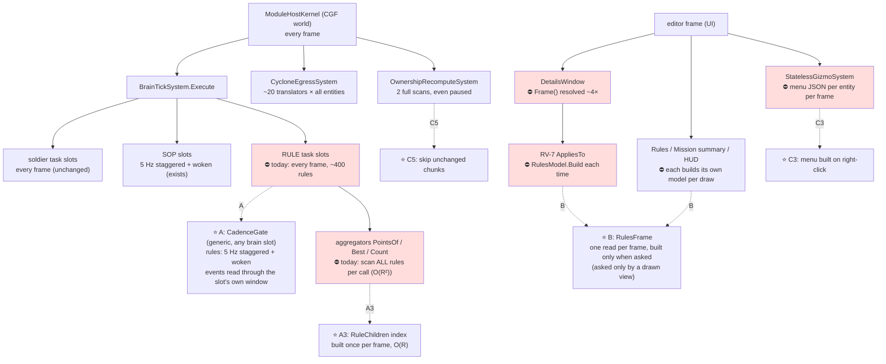

*What the picture shows that prose hides:* every red box runs whether or not anything changed, and two of them (the aggregators, RV-7)
are **quadratic** in a count that grows all round. The dashed arrows are this design; nothing in the soldiers' path changes.

## 3. Part A — rules evaluate at a cadence, interleaved, woken by what matters

### 3.0 Mechanism and policy — ⭐ the cadence is a BRAIN concept, not a rules one *(user, `2026-11-04`)*

> 🔒 **User:** *"isn't that gate / non-every-time brain ticking a generic concept, not tied to rules, so it might deserve a more generic name and
> more generic implementation?"*

| layer | what | where | knows about rules? |
|---|---|---|---|
| ⭐ **mechanism** | `Cadence` (when a brain slot ticks: period, next tick, wake, mode) · `BrainCadence` (the TASK slot's cadence on an entity) · `CadenceGate` (due? · open the slot's event window · after: next tick, stagger) | `FDP/Toolkits/Fdp.Toolkits/Behavior` (beside `BrainTickSystem`) | ⛔ no |
| ⭐ **users of the mechanism** | the TASK slot of any entity carrying `BrainCadence` · the **SOP slot** (its `SopNextTick` / `SopWake` become a `Cadence` inside `SopState`, ticked through the same gate — D7) · a later soldier / vehicle LOD (D6) | — | — |
| **policy** | WHICH brains get a cadence, with what period, and what wakes them | rules: `ObjectiveHost` (Hrot.AI.Behaviors) adds `BrainCadence` and sets the wakes of §3.3 · SOP: `BrainTickSystem` as today (5 Hz, woken by `SensorChangedEvent` / `BehaviorFinishedEvent`) | rules: yes — and only here |

⭐ **Anyone may wake a cadenced brain** by setting its `Wake` (a child rule waking its parent, an operator action, a future "enemy in sight" for a soldier) or by
setting its `NextTick` earlier (a trigger's `ExpectedAt`). ⭐ **A brain WITHOUT `BrainCadence` ticks every frame — exactly as today** (soldiers, vehicles).

### 3.0a ✅ AS BUILT — T1 / T2 / T3 *(behaviors, `2026-11-04`; CE-2382 `72e0f1f98`, CE-2383 `1609b80ce`, CE-2384 `a7fbfe66f`)*

| as designed (§3.0–§3.2, §7a) | ⭐ as built | why |
|---|---|---|
| a `BrainCadence` component (S1) | ⚠ **DEVIATION:** the task slot's cadence is FIELDS of `BehaviorState` — `Cadence` (`CadenceMode`, `EveryFrame = 0`), `CadenceWake`, `CadencePeriod`, `CadenceNextTick`, `CadencePolicy` | the behaviors component-id block 418–433 is FULL (`GlobalComponentIds.cs`); the loop already reads `BehaviorState` per brain (no extra lookup); it mirrors `SopState`'s `SopNextTick` / `SopWake`; a layout change has precedent (`RunSince`, CE-2080). The wire copies `BehaviorState` field-wise (`BrainIntentTranslators.cs:116`) |
| `CadenceGate.Due / OpenWindow / After` | `CadenceGate.Due / Next / KeepsWindow` (pure, `Fdp.Toolkit.Behavior/Cadence.cs`); the window open / close / reader lifetime live in `BrainTickSystem` (`OpenCadenceWindow`, `AfterCadencedTick`, `ReleaseCadenceReader`) | the window needs the repository's step-window API and the system's reader table |
| the policy writes the cadence from inside the tick | ⚠ **ADDED:** `CadencePolicies` — a policy id in `BehaviorState.CadencePolicy`; `BrainTickSystem` calls it AFTER each tick of its slot | the kinds have no common exit, and the mode must come from the status the tick LEFT (a trigger turning Waiting sleeps to its exact `ExpectedAt`); `ObjectiveHost.Enter` claims the slot (`RuleCadence.Own`) |
| rules `Periodic` at 5 Hz | rules are a TIMED SLEEP: to their next staggered 5 Hz tick or their own `ExpectedAt`, whichever is first (`RuleCadence.ModeOf`) | a holdFor end / deadline / delay / cooldown is hit exactly — better than D2's "≤ 0.2 s" for the known times |
| a slot becoming cadenced mid-tick | `AfterCadencedTick` runs after EVERY task tick (when the world keeps a history) and registers the reader at once | a policy's first tick turns the slot on; without this the events between that tick and the first cadenced one would be lost |
| no history | a world without an `EventHistory` ticks every brain every frame | a bare world (a unit rail) could not give the slot its window |
| `RuleWakeSystem` (S4) | as designed + `RuleEditSystem` and `SetObjectiveActive` wake their rule directly | an edit / a switch from another rule must not wait a period |
| `RuleChildren` (A3) | `RuleTree` (`Brains/Objectives/RuleTree.cs`): every rule, children by resolved parent, rules by resolved subject; ascending entity index; rebuilt on `GlobalVersion` or `Invalidate` (a new rule, a parent / subject change, Best's winner) | the same index serves the bounty lookup (by subject) and `RuleWakeSystem` |

⭐ Rails: `CadenceGateTests` (7, the mechanism; the SOP's 36 `SopSlotTests` green on the shared gate) · `ScenarioRulesTests.Cadence` (5, a 60 Hz world with the
kernel's event history: exactly-once shots / kills, a delay on its exact time, a parent within a frame, the close within 4 frames, Acting every frame /
closed asleep) · `ScenarioRulesTests.Score` `CE2384_*` (the index once per frame). ⚠ The `ScenarioRulesTests` harness keeps no history by default, so its
other 150 rails still tick every rule every frame (unchanged behaviour); `ObjWorld.WithHistory()` opts in.

### 3.1 Classes


*What the picture shows:* the mechanism (`Cadence`, `BrainCadence`, `CadenceGate`) sits in the generic behaviour toolkit and has no arrow to anything about
rules; the only rules-aware box is `ObjectiveHost`, which WRITES a cadence. The SOP slot points at the same `Cadence` — one implementation, two slots.

### 3.2 One frame

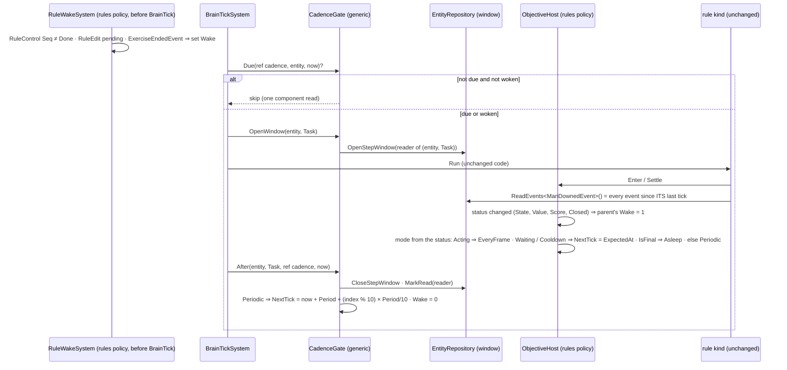

*What the sequence shows:* the rule's own code does not change — the window makes `ReadEvents` return everything since that rule's last
tick, so every kill, capture and hit is counted **exactly once** whatever the cadence (the CE-3293 step window, per slot instead of per system).
⭐ The generic gate never looks at a rule: waking the parent and choosing the mode are `ObjectiveHost`'s (policy), done from the shared
`ObjectiveStatus` — `TriggerState`, `IsFinal`, `ExpectedAt` (`ObjectiveStatus.cs:16, 62, 81, 94`) — so no rule kind needs code of its own.

### 3.3 The cadence per rule state — ⭐ the table the user asked for: *"does anything depend on every frame?"*

| rule / state | mode | why (code) |
|---|---|---|
| any rule, normal | **5 Hz, staggered by entity index** (period 0.2 s, phase `index % 10 × 0.02 s`, in SIM time ⇒ deterministic) | the SOP precedent (`BrainTickSystem.cs:240`) |
| measures reading events (`Count`, `HitRatio`, kills / deaths / captures / assists, `Bounty`, `NoHarm`) | 5 Hz **through the rule's window** | `MeasuresEvidence.cs:73–121`, `BountyBehavior.cs:105`, `NoHarmBehavior.cs:53` read *this frame's* events today — the window makes them read *since last tick* |
| time-integrating kinds (`HoldArea`, `ClearArea`, `Above` threshold) | 5 Hz | already correct at any cadence: `Dt` = since last tick (`ObjectiveHost.cs:84`); the sampled condition is assumed constant between ticks (≤ 0.2 s) |
| trigger **Armed / Holding** | 5 Hz | `holdFor` / `delay` are sim seconds (T3) — fire time rounds to ≤ 0.2 s; ⚠ a condition true for < 0.2 s may be missed (**D2**) |
| trigger **Waiting / Cooldown** | asleep, **woken at `ExpectedAt`** | the time is already known (`ObjectiveStatus.ExpectedAt`, V-2) ⇒ exact |
| trigger **Acting** (running its `do` list) | **every frame** | `CommandVerbs.cs:152` reads `MissionControlAckEvent` while Running (design :343) |
| a rule with a pending `RuleControl` / `RuleEdit` (UI Fire / Rearm / Reset / edit) | woken | an operator action must take effect next frame |
| exercise closing (`ExerciseResult` phase ≠ Running) | **every rule woken** | SR-116 close + awards must all settle |
| final (Achieved / Failed / Skipped, closed) | **asleep** until woken by Reset / edit | nothing changes it (`Frame.Evaluate` = false) |
| a composite whose CHILD's status changed | woken next frame | §3.4 |

### 3.4 Ordering — does anything depend on it?

⭐ **No design relies on same-frame order.** Today a parent sees a child's change in the same frame only if the child's entity index is
lower (query order) — incidental. With the cadence, **a child whose status changed wakes its parent** (`ObjectiveLinks.Parent`), so
propagation up a tree is ≤ 1 frame per level, never ≤ 0.2 s per level. ⚠ A **trigger whose `when` reads another rule's status** is not
woken by that change (its `when` is a compiled level predicate; finding its inputs is not cheap) ⇒ it reacts within ≤ 0.2 s (**D3**).

### 3.5 A3 — the aggregators stop being quadratic

`ObjectiveChildren.PointsOf` (`ObjectiveAggregators.cs:64`), `BestBehavior.Find` / `.Sibling`, `ObjectiveChildren.Of` each scan **every rule**
and resolve its parent, per call, per frame. ⇒ `RuleChildren`: a parent → children index built **once per frame on first use** (one pass
over `ObjectiveLinks`), every aggregator reads its span. O(R²) → O(R). ⭐ Independent of A1: it pays even at 60 Hz.

### 3.6 Who gets a cadence

⭐ **The mechanism is for any brain; THIS design's policy cadences rule entities only** (an entity carrying `ObjectiveStatus`): `BrainCadence` is
added by `ObjectiveHost.Enter` on first tick, exactly like `ObjectiveStatus` / `ObjectiveLinks` / `RuleControl` already are (`ObjectiveHost.cs:38–50`).
⛔ Soldiers' and vehicles' task slots get no `BrainCadence` here ⇒ they tick every frame as today; the only cost to them is one component-bit test per
brain per frame, beside the `IsFirstVisit` bit test the loop already makes (`BrainTickSystem.cs:172–177`; the visit order is unchanged, CE-3137).
⭐ A soldier / vehicle LOD later is a POLICY that adds `BrainCadence` (**D6**); the SOP slot moves onto the same gate (**D7**).

```csharp
// BrainTickSystem tier loop — the whole change for the task slot
if (!IsFirstVisit(repo, entity, t)) continue;                          // exists
bool cadenced = repo.HasComponent<BrainCadence>(entity);               // NEW — one bit test; 0 for soldiers / vehicles
if (cadenced && !CadenceGate.Due(ref repo.GetComponentRW<BrainCadence>(entity).Task, entity, now)) continue;
int prev = cadenced ? _gate.OpenWindow(repo, entity, Slot.Task) : -1;
try { Run(runner, repo, entity, behavior, def, dt); }                   // unchanged
finally { if (cadenced) _gate.After(repo, entity, Slot.Task, ref repo.GetComponentRW<BrainCadence>(entity).Task, now, prev); }
```

⚠ **A cadenced brain must measure time as "since my last tick", not the frame `dt`.** Rules already do (`ObjectiveHost.cs:84`). ⏳ To verify before
building: no rule asset contains a generic BTree node (a `Wait`) that integrates the frame `dt` — the trace showed one-node trees. ⚠ A soldier LOD
(D6) would have to settle this for every soldier node — a reason it is its own design.

## 4. Part B — the rules UI builds its model only when something drawn asks, once per frame

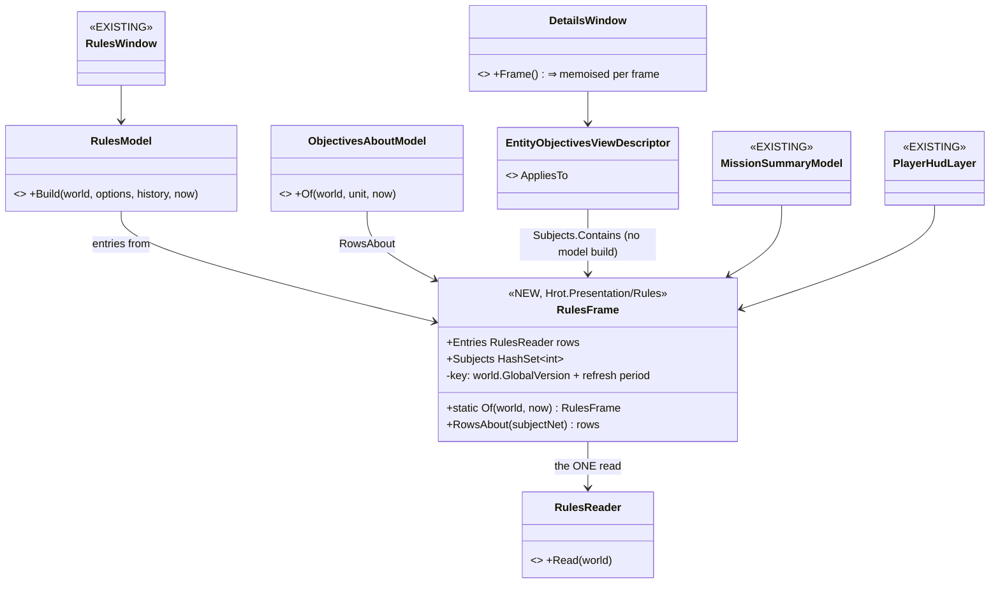

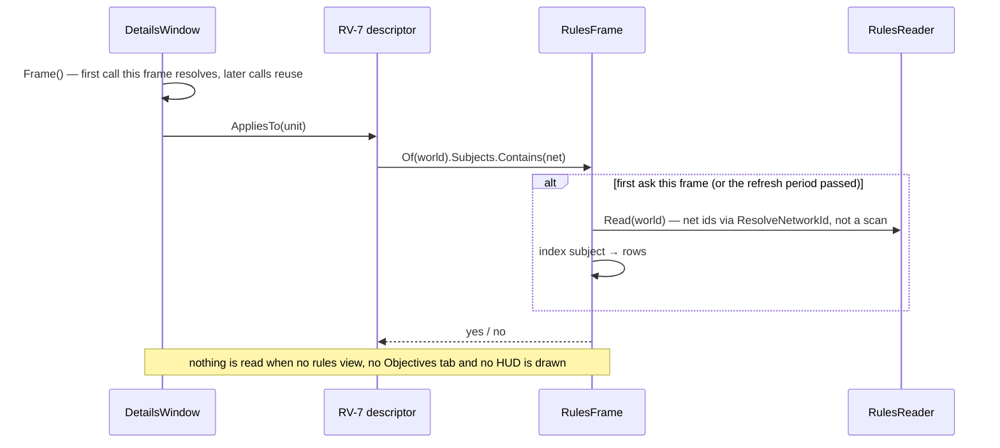

| | ⭐ rule |
|---|---|
| **B1 watched-only** | `RulesFrame.Of` is called only from a `Draw` / `AppliesTo` — so with the Rules window closed and no unit in Details, **nothing is built**. ⭐ The `RuleLeafSampler` precedent (2 Hz, only while the live-values view is shown; `DESIGN_Scenario_Rules.md:513`) |
| **B2 one read per frame** | the memo is keyed by the world's version: RV-7's AppliesTo, its Draw, the Rules window, the mission summary and the HUD share ONE `RulesReader.Read` (⭐ "one owner of a concept") |
| **B3 refresh period** | the memo also holds for **0.2 s wall** (**D4**) — a reader of words and colours does not need 60 Hz; a click or a selection change refreshes at once |
| **B4 `DetailsWindow.Frame()` once per frame** | its own comment says *"builds the context ONCE and asks the selector ONCE"* (`DetailsWindow.cs:292–296`); `ShowsFloatAndPin` → `CurrentDescriptor()` (`:537, :566, :684, :728`) re-resolves it — memoise per frame |
| **B5 no linear scans** | `RulesReader.MacroOf` (`RulesModel.cs:122`), `GroupOf` / `LinkOf` / `RowOf` (`:227, :245, :280`), `MissionSummaryModel` (6 sites), `AuthoredRules.cs:76`, `MessageDelivery.cs:34`, `PlayerHudLayer.cs:53, :237` → `ResolveNetworkId` (C2) |

## 5. Part C — what helps every entity (thousands)

| # | change | measured basis | design basis | owner | lean |
|---|---|---|---|---|---|
| **C1** | ⭐ `ComponentType<T>.ID` / `ManagedComponentType<T>.ID` cache the id per T (a static + a registry generation bumped by `Clear()`); today every component access takes a global lock + a `Dictionary<Type>` lookup (`ComponentType.cs:25, :53, :111`) | prototype: ≈ 10 % of update early | none (the comment *"JIT will inline this to a constant"* is false today) | backend | ✅ do — engine-wide, tiny |
| **C2** | ⭐ every PER-FRAME `FindEntityByNetworkId` (≈ 15 sites: rules UI, mission summary, HUD, `HrotRouteSource`, `CgfNodes:245`, `AirHolds:78,91`, `AirborneDrillBehaviors:116`) → `ResolveNetworkId` (the maintained map, same answer) | O(N) per call ⇒ O(N²) shapes | `NetworkIdResolver.cs:24–30, 78–104`: *"never on the tick"* — a per-frame scan is a defect | behaviors (AI) + ui (Presentation) | ✅ do — drop-in |
| **C3** | ⭐ the right-click menu is built **on right-click**: `ContextMenuProjectorGizmo.Draw` stops building + hashing JSON per entity per frame; the right-click handler (`GizmoMap…/DebugGizmoLayer.cs:265`) asks a resolver (net id → `MenuJsonFor`) — the path `MapEntityMenuHandler.MenuJsonOf` (`:68`) and `MenuShortcuts.Resolve` (`:76`) already use | ≈ 6 % of the frame | 🔒 user `2026-08-10`: *"Serialise on right-click, not per `Draw`"* (`UX_Feature_Cross_Surface_Actions.md:158, :225`) | ui | ✅ do; the remote viewer's publisher keeps per-frame JSON **only while a remote viewer is connected** (**D5**); ⚠ unverified: the layer's `Update` runs on the kernel's thread |
| **C4** | egress: gate the ~20 translators' full scans on chunk versions | ≈ 15 ms ×4 worlds | `dds-to-ecs/DESIGN.md:468` says it, ⛔ only `NavigationIntent` does it | backend | ⛔ **not in this design** — measured hazards: a T-only gate misses authority changes on the ROOT entity, heartbeats (GeoSpatial / NavigationStatus), multi-component descriptors, managed in-place writes, and `QueryDelta` checks one slot per header chunk (`EntityRepository.DeltaQuery.cs:118–120`). ⇒ its own backend design; C1 already makes each `HasAuthority` cheaper |
| **C5** | `OwnershipRecomputeSystem` `SyncPartClaims` + `ClaimLateRootComponents` skip entities with no structural change since its last run (`LastChangeTick` / header chunk version, as the recorder does, `RecorderSystem.cs:574–600`); the event pass stays | ≈ 2 ms × 4 worlds, every frame incl. paused; CE-3244: 4–7 ms at 300 civilians | `DESIGN_Ownership_Groups_And_Grants.md:446–449` (S6, S8) chose per-frame scans; no gate evaluated | backend | ✅ do — ⚠ `SetAuthority` does not stamp, covered because ownership changes arrive as `OwnershipUpdate` (the event pass) |
| C6 | `--mode all` runs 4 worlds in one process (each records, egresses, recomputes) | ≈ 30 ms | a deployment artefact | — | no action: on a cluster each node pays for one |


### 5a. ✅ AS BUILT — T4–T7, T9, T10 *(behaviors, `2026-11-04`)*

| task | as built | deviation / note |
|---|---|---|
| T4 CE-2385 `cb3f0f3bd` | `CadenceDrain` (per world, `Fdp.Toolkit.Behavior/Cadence.cs`): `BrainTickSystem` reports whether any cadenced window is open; `RecorderTickSystem` asks for a drain and defers a due checkpoint (beside CE-3316's in-flight deferral); the brain tick ticks every cadenced slot and reports; the checkpoint is written then. Capped at `MaxDrainDeferrals` = 3 frames | a flag handshake, not frame-stamped: the recorder's rail drives tick + recorder in one call |
| T5 CE-2386 `80bf1ef6e`, `877fe502e` | `DetailsWindow` keeps the draw's frame while drawing (one resolve per draw); RV-7's `AppliesTo` = `ObjectivesAboutModel.Any` (no model); its drawn rows refresh ≤ 5 Hz; the rules UI / summary / debrief / HUD resolve ids through the map | ⚠ **SCOPE CUT:** no `RulesFrame` memo and no 0.2 s throttle on the Rules / Mission Summary windows and the HUD — their frame rails drive `BuildAndPublish` directly, so a draw-path throttle risks stale reads after a click; with O(1) resolves one build per draw is O(rules). Revisit if measured |
| T6 CE-2387 `2fdea20f3` | `MenuResolver` on GizmoMap's layer (+ passthrough), set ONCE in `MapInteractionPack.BuildRenderLayer` to `MapEntityMenuHandler.MenuJsonOf`; `ContextMenuProjectorGizmo.Draw` emits nothing | D5 reduced: the remote Godot viewer is DEFERRED (U13) and Hrot publishes no intern strings — nothing consumes the per-frame JSON |
| T7 CE-2388 `ab7e306d3`, `877fe502e` | 15 per-frame `FindEntityByNetworkId` → `ResolveNetworkId` (AI behaviours, route source, rules UI, HUD, debrief) | the on-demand sites (clicks, API, load) are unchanged — the resolver's ruling allows the scan there |
| T9 CE-2390 `98da8f330` | both scans skip an entity whose `LastChangeTick` < the last run's version unless an event touched it (or its root) | `>=` keeps a non-ticking world scanning all; `ScannedLastRun` counter for rails |
| T10 CE-2391 `d53f730ba` | [DESIGN_Egress_Change_Detection.md](DESIGN_Egress_Change_Detection.md) | a design question, not a build |

### 5b. ✅ AS BUILT — the recorder and the table lookup *(behaviors, cross-lane into FDP core, `2026-11-04`; after §0a named them the largest)*

📐 Basis: `dotnet-trace` of Crossfire playing (`--mode all`, 4 worlds) — `RecorderTickSystem` = **26.8 %** of the main thread:
`Records()` 8.7 · `SanitizeScratchBuffer` 8.3 · memmove 4.3 · `FillLiveness` 3.7 · `ChunkBytesMoved` 3.2 · keyframe 1.7. Egress (12.8 %) is spread
over ~20 translators; its common part is `HasAuthority` (3.2 %), most of which is `GetComponentRO` / `HasComponent`.

| # | change | why it is safe |
|---|---|---|
| **C7** CE-2392 | ⭐ **R1** `Records()` reads a recordable `BitMask512` rebuilt only when `ComponentTypeRegistry.RecordableVersion` moves (a registration, `SetRecordable`, `Clear`) — it took the registry lock per table per frame. ⭐ **R2** a DELTA writes each changed component chunk's **used prefix** — `(min(capacity, MaxIssuedIndex+1) − startId) × size` bytes — copied with `CopyChunkToBuffer(chunk, dst, maxBytes)`, sanitized, compared (`ChunkBytesMoved` keeps a full buffer + length) and written at that length | the format already carries each chunk's length and `RestoreChunkFromBuffer` copies `min(length, chunk)`; the slots past `MaxIssuedIndex` were never issued (zero live), `MaxIssuedIndex` only grows (`EntityIndex.cs:124, :457, :626`) and a keyframe `Clear()`s the playback world (`PlaybackSystem.cs:60`) ⇒ playback is byte-identical for every issued slot. Keyframes and the entity-index chunks are unchanged (full chunk) |
| **C8** CE-2393 | ⭐ `EntityRepository.GetTable<T>` reads the **existing** id-indexed `_tableCache` (`EntityRepository.cs:26`, already filled for every table) by `ComponentType<T>.ID`, with an exact-type check; the `Dictionary<Type>` lookup is the miss path | ⭐ the seam existed and was under-used (only the by-id paths read it). A registry re-numbering (`Clear()` in tests) fails the type check ⇒ dictionary, as before. Every `GetComponentRO/RW` in every system gains |

📐 **Measured after (`b653a2d27`, same `perf4` run as §0a; `/diagnostics/architecture`, sums over the 4 worlds):**

| | before (same frame count) | after |
|---|---|---|
| `RecorderTickSystem` ×4, recent avg ≈ 1 000 frames | 27.1 ms | **9.0 ms** |
| … lifetime avg | 10.2 ms | **6.1 ms** (9.3 at 2 450 frames / 100 s) |
| `CycloneEgressSystem` ×4, recent | 12.9 ms | 11.3 ms — within run noise |
| frame `update` at 10–30 s · at 100 s | 53–55 · 82–104 ms | 54–56 · 81 ms — ⚠ **the frame did not move measurably early**: the recorder's recent average is dominated by keyframe spikes, not the steady frame. Still linear in entities |

📐 **A/B, `2026-11-04` — the same binary with and without CE-2392/2393, interleaved A B A B on one machine** (`perf4`, Crossfire, frame
`update` from `HROT_FRAME_STATS`; ⛔ the table above compared DIFFERENT runs and understated it):

| run | update 10–20 s | update 30–100 s (mean · median) | whole frame 30–100 s |
|---|---|---|---|
| A without | 50.1 | 87.9 · 92.2 | 110.7 |
| B with | 46.7 | 73.7 · 69.3 | 97.2 |
| A2 without | 53.4 | 79.7 · 80.7 | 102.3 |
| B2 with | 48.9 | 67.6 · 68.6 | 91.7 |

⇒ ✅ **≈ 13 ms (≈ 16 %) less update once the round is running, ≈ 4 ms early; the same direction in both pairs.** Kept.

📐 **The realistic case — the EDITOR** *(user, `2026-11-04`: "for checking recording performance, the editor is the best case … no network, but
a full recording of the full world and just one single recording per process")* — ⚠ `--mode all` above runs 4 worlds and 4 recorders on one
thread, which no deployment does. Same interleaved A/B, `ClusterRunner --mode editor`, Crossfire:

| run | update 10–20 s | update 30–100 s (mean · median) | `RecorderTickSystem` avg at 100 s | its max |
|---|---|---|---|---|
| A without | 27.3 | 43.5 · 41.7 | 8.05 ms | 172 ms |
| B with | 24.9 | 35.8 · 33.0 | 3.52 ms | 169 ms |
| A2 without | 33.3 | 40.2 · 40.2 | 7.08 ms | 159 ms |
| B2 with | 26.4 | 34.8 · 34.2 | 3.63 ms | 208 ms |

⇒ ✅ **the recorder ≈ 55 % cheaper (≈ 7.5 → 3.6 ms/frame), the update ≈ 6–8 ms (≈ 15 %) shorter.** ⛔ ~~*"What is left: the MAX — a 160–210 ms recorder frame: the keyframe … a visible hitch"*~~ — **WRONG, retracted the same day** (user:
*"isn't the keyframe … processed in a background thread?"*). The `max` column is the LIFETIME max of the system, i.e. most likely the FIRST
keyframe at startup (JIT, first-use allocations), not a recurring frame. ⭐ As built (FDP-DES-004, `AsyncRecorder.cs:228–259`, non-blocking by
default `RecordingConfiguration.Blocking = false`): compression and the write run on a worker; the main thread does only the synchronous copy
(DES-004 §2.1 — it must, or the sim tears the read) plus a wait for the previous frame's worker. 📐 Trace (`--mode all`, before CE-2392, tracer
overhead included): a keyframe's copy 22 ms median / 40 ms max per world, every 60 frames — **1.7 % of the main thread, against ≈ 25 % for the
deltas**. ⇒ keyframes are not the recorder's cost; not a lever now.
has a 160–210 ms recorder frame: the keyframe (full pages, every table, synchronous). One frame in ~10 fps is a visible hitch; it is the next
recorder lever, not the per-frame cost.

⛔ **E3 not built — measured against its premise.** Hoisting a translator's own dirty / cache check before `HasAuthority` only saves work on
OWNED unchanged entities; on a replica (3 of the 4 worlds hold each entity as a replica in `--mode all`) the replica has no
`EgressPublicationState` / cache entry, so the cheap check passes and `HasAuthority` still runs — the hoist ADDS work there. ⇒ C8 (cheaper
reads under `HasAuthority`) instead; E1 stays the real fix ([DESIGN_Egress_Change_Detection.md](DESIGN_Egress_Change_Detection.md) §3).

## 6. Decisions — ✅ APPROVED on the leans (R-2083)

🔒 **User, `2026-11-04`:** *"D1–D8 approved on your leans, break it into tasks, and start working on those - just you, no other lanes"*

| # | question | ⭐ lean | what would change it |
|---|---|---|---|
| **D1** | rule period | **0.2 s (5 Hz)**, the SOP's | a rule that must react faster ⇒ per-kind override (`EveryFrame` mode exists) |
| **D2** | a trigger condition true for < 0.2 s may be missed | **accept** — conditions are levels (positions, counts, statuses); a one-frame pulse is an event, and events are counted exactly-once via the window | an authored trigger on a sub-0.2 s level |
| **D3** | a trigger reading another rule's status reacts within ≤ 0.2 s (not woken) | **accept** | a chain of N triggers where N × 0.2 s matters ⇒ wake triggers on any status change (cheap to add later) |
| **D4** | the rules UI refresh | **once per frame, at most every 0.2 s wall**; a click / selection refreshes at once | an instructor wanting live 60 Hz numbers |
| **D5** | the remote (Godot) viewer's per-entity menu JSON | **only while a remote viewer is connected** (watched-only, like B1) | the remote viewer moving to request/reply on right-click |
| **D6** | soldiers' task slots at a cadence too | **not now** — a separate "brain LOD" design (distance to the camera / to the enemy) | a thousands-soldier scenario measured slow in `BrainTickSystem` after A |
| **D7** | fold the SOP's own cadence (`SopNextTick`, `SopWake`) onto the generic `CadenceGate` (§3.0) | **yes, in the same batch** — one cadence implementation (ruling 9); `SopState` keeps its fields (S2) | — |
| **D8** | a restore while a rule's window is open loses that window's events (§6a) | ⭐ **revised `2026-11-04`: DRAIN AT A CHECKPOINT** — a frame that writes a requested checkpoint keyframe wakes every rule first, so no window is open in it; periodic keyframes are not drained | a branch from a periodic keyframe measured to matter ⇒ drain those too (a 1 Hz all-rules frame) |

### 6a. D8 explained — what a restore loses, and why the lean changed

📐 **How a restore works today** ([DESIGN_Checkpoint_And_Dry_Run_Restore.md](DESIGN_Checkpoint_And_Dry_Run_Restore.md)): a checkpoint is a keyframe the flight recorder writes (R-3044; periodic ones every 60 frames, `RecorderTickSystem.cs:21`, a requested one replaces that interval's, `:128–134`). A restore puts the keyframe back, `Restart`s the event history (`ModuleHostKernel.cs:584`) and re-delivers only the checkpoint frame's unconsumed bus events (CE-3316, `ReferenceCheckpointHandler.PutBack` `:214–221`). ⭐ A rule's blackboard (its tally) is in the keyframe.

**What A adds:** each rule is up to 0.2 s behind the bus — its window holds the events since ITS last tick. Those are in the event history only, not in the keyframe. ⇒ on a restore, **for each rule, the events between its last tick and the checkpoint are gone**: the world shows the man dead (`Health` is in the keyframe) but his killer's *Kills*, *Streak*, *Bounty* and the victim's *Deaths* never count it. Each rule has its own phase, so some lose ~0.18 s, some nothing.

| consequence | |
|---|---|
| a score off by one kill / capture / hit, and what follows from it (streak, bounty claim, an award's winner, a trigger on a count) | only when such an event falls in that ≤ 0.2 s before the checkpoint |
| ⛔ **the restored run is no longer the straight run** | the restore-equivalence oracle (R1, CE-3299 B5) would go red on a scoring scenario — that equality is the restore design's own goal |
| ✅ not affected | state-read rules (`HoldArea`, census counters, level triggers) re-read the world; replays (rules do not tick in replay); a dry run's Play capture (rules have not ticked in the edited world) |

⭐ **Drain at a checkpoint:** when a checkpoint is requested the recorder already waits a frame for a quiet moment (§1l, `SlotRunInFlight`); in that frame the gate wakes every rule, each reads and empties its window, and the keyframe is written after them. The original run drains too, so the restored run equals it. Cost: one frame at today's all-rules cost per requested checkpoint. ⚠ A restore or branch from a PERIODIC keyframe would still lose ≤ 0.2 s; draining those as well costs one all-rules frame per second (a small periodic hitch) — kept as the fallback.

## 7. Claim table — what the design rests on

| claim | code (how it IS) | design (how it was MEANT) |
|---|---|---|
| rules are brains ticked by `BrainTickSystem`'s tier loop | ✅ `BrainTickSystem.cs:166–200` | ✅ `DESIGN_Scenario_Rules.md` §00.5 (one runtime, R-4109 :1028) |
| a cadence + stagger + wake already exists for a slot | ✅ `BrainTickSystem.cs:221–245` | ✅ `DESIGN_Sensors_And_Doctrine.md` G5, R-195 |
| `Dt` is since the rule's last tick | ✅ `ObjectiveHost.cs:17, 84` | ⛔ searched, not stated in a design |
| a per-reader event window exists and every live world has one | ✅ `EventAccumulator.cs`, `EntityRepository.View.cs:109–141`, `ModuleHostKernel.cs:164` | ✅ `DESIGN_Paused_And_Stepped_Execution.md` §1a–§1b |
| hundreds of readers are affordable | ✅ readers are two arrays; retention is one pass (`EventAccumulator.cs:229–241, 320–376`) | ⛔ the design sized it for systems, not entities — ⚠ measure in the rail (§8) |
| exactly six rule sites read one-frame events | ✅ grep, §1 | ✅ `DESIGN_Scenario_Rules.md:343, :846` |
| the aggregators scan every rule per call | ✅ `ObjectiveAggregators.cs:64–76` | ⛔ not stated |
| RV-7 rebuilds the model in `AppliesTo`, `Frame()` ~4×/frame | ✅ trace + `DetailsWindow.cs:537, 566, 684, 728` | ✅ `DESIGN_Rules_View_UI.md` §6b (cost note added `2026-11-04`) |
| per-frame net-id scans are a defect | ✅ 15 sites | ✅ `NetworkIdResolver.cs:24–30, 78–104` |
| the menu should be built on right-click | ✅ `DebugGizmoLayer.cs:186–282` | ✅ 🔒 `UX_Feature_Cross_Surface_Actions.md:158, :225` |
| the type-id lookup is a lock + dictionary per access | ✅ `ComponentType.cs:25, 53, 111` | ⛔ none |

## 7a. Build specification — the seams the diagrams leave implicit *(added `2026-11-04`, "what is missing to make it buildable?")*

| # | seam | ⭐ specified as | basis |
|---|---|---|---|
| S1 | **`BrainCadence` plumbing** | unmanaged, `[ComponentId]` = next free `GlobalComponentIds` entry, `[DataPolicy(DataPolicy.NoScenario)]` (recorded — a restore must keep `NextTick`; not saved in a scenario), registered beside `SopState` (`CognitiveComponentRegistry.cs:47`); no translator (brain-node local, like `SopState`) | `SopState.cs:15–18`; CLAUDE.md "recorded ⇒ unmanaged" |
| S2 | **`SopState` keeps its layout** | the gate's API takes `ref double nextTick, ref byte wake` (and a period), so the SOP calls it with its existing `SopNextTick` / `SopWake` — ⛔ no field change | `SopState` is in the BrainIntent ownership group (`NedOwnershipGroupBinding.cs:74`) and recorded — a layout change buys nothing |
| S3 | **reader lifetime** | registered on a slot's first cadenced tick (`RegisterReaderAtCurrentFrame`); released when the entity dies (`DestructionOrder`, as the dedup cache is pruned, `BrainTickSystem.cs:158`), when its mode goes `Asleep` (re-registered on wake — an asleep rule must not pin the history), and all at once on `WorldEpoch.Moved`; the accumulator's own `Restart` resets positions | `EventAccumulator.cs:320–376`; "a stopped reader no longer pins the history" (`:15–17`) |
| S4 | **`RuleWakeSystem`** (rules policy, Hrot.AI.Behaviors, before `BrainTickSystem`) | sets `Wake` on a rule with `RuleControl.Seq ≠ Done` (an operator Fire / Rearm / Reset / Activate) or a pending `RuleEdit`; on `ExerciseEndedEvent` / a phase change wakes every rule; gated on the `RuleControl` table's version so a quiet frame costs O(1) | `RuleControl.cs:21–31`; `ScenarioVerbs.cs:157` |
| S5 | **drain at a checkpoint** (D8) | the recorder raises "checkpoint pending" (the frame it already waits, §1l `SlotRunInFlight`); that frame `RuleWakeSystem` wakes every cadenced slot; the keyframe is written in its PostSimulation, after them | `DESIGN_Checkpoint_And_Dry_Run_Restore.md` §1l; `RecorderTickSystem.cs:128–134` |
| S6 | **timed BTree nodes are safe** | `Wait` / `Cooldown` use absolute time (`ctx.Time - startTime`, `Interpreter.cs:556+`) ⇒ a cadenced tree keeps their timing; ⚠ the only risk is a hand-written C# node that integrates the frame `dt` — rule kinds do not (`ObjectiveHost.cs:84`) | measured `2026-11-04` |
| S7 | **`RulesFrame` refresh** | key = (world, `GlobalVersion`) and ≥ 0.2 s wall since the last build; `Invalidate()` from a click / selection change; the HUD's `includeAuthored: false` read is a second key of the same memo | §4 B2–B3 |
| S8 | **`DetailsWindow.Frame()` once per frame** | memoised on a frame counter the host passes (the window is ImGui-free by design, `DetailsWindow.cs:416`) | §4 B4 |
| S9 | **C3 thread** | in the raylib loop the gizmo layer's `Update` and the kernel run on one thread (`Program.cs:648` loop) ⇒ the resolver may read the world; ⏳ the Stride host to be checked in its build step | explorer pass `2026-11-04` |

### 7b. Rails — in each feature's OWN suite (T-1)

| part | suite | new rails |
|---|---|---|
| A, mechanism | `SopSlotTests` (the SOP's cadence moves onto the gate — its 6 rails must stay green) + a `CadenceGateTests` beside `BrainTickSystem`'s tests | due / skip / wake / stagger; window exactly-once across a skipped frame; a brain without `BrainCadence` ticks every frame (soldiers unaffected) |
| A, rules policy | `ScenarioRulesTests` / the objectives' own test classes | same totals and awards at the cadence as at 60 Hz (400 synthetic rules); trigger Waiting woken at `ExpectedAt`; Acting every frame; parent woken by a child; close settles all; red-proofs per §8 |
| A3 | the aggregators' tests | linear cost 100 vs 1000 rules |
| B | `RulesModelTests`, `TheObjectivesViewTests`, `RulesWindowFrameRail` (`xvfb-run -a`) | a counting rail: no Rules / Objectives / HUD drawn ⇒ `RulesReader.Read` never called; one read per frame with all of them drawn |
| C3 | `MenuOrdersTests`, `HostOnlyWiringTests` | the right-click resolves the same JSON `MenuJsonFor` gave per frame |
| D8 / S5 | the restore-equivalence oracle (R1, CE-3299 B5) | a scoring scenario restores to the same run with a kill in the last 0.2 s before the checkpoint |
| all | the live Crossfire script (§0) | §8's numbers |

### 7c. Tasks — by lane *(a proposal; the user splits)*

| # | task | lane | depends on |
|---|---|---|---|
| T1 | `Cadence` / `BrainCadence` / `CadenceGate` + the tier-loop gate + per-slot windows (S1–S3, S6); SOP moved onto it (D7, S2) | behaviors | D1, D7 |
| T2 | the rules policy: `ObjectiveHost` adds `BrainCadence`, modes from the status, parent wake; `RuleWakeSystem` (S4) | behaviors | T1, D2, D3 |
| T3 | `RuleChildren` per-frame index (A3) | behaviors | — (independent, can go first) |
| T4 | drain at a checkpoint (S5) | behaviors + backend (recorder) | T2, D8 |
| T5 | `RulesFrame` + `DetailsWindow.Frame()` memo + the rules UI's scans → `ResolveNetworkId` (B, S7, S8) | ui | D4 |
| T6 | the right-click menu on right-click (C3, S9) | ui | D5 |
| T7 | per-frame `FindEntityByNetworkId` → `ResolveNetworkId`, AI side (C2) | behaviors | — |
| T8 | per-T component type id cache (C1) | backend | — |
| T9 | `OwnershipRecomputeSystem` structural-change gate (C5) | backend | — |
| T10 | egress change detection — a DESIGN, not a build (C4) | backend | — |

## 8. Acceptance

| | done when |
|---|---|
| A | a rail with 400 synthetic rules (16 score sets + triggers): `BrainTickSystem` rule time ≤ ⅙ of today's; **every kill / capture / hit counted exactly once** at the cadence vs at 60 Hz (same totals, same awards); a woken trigger fires on the same sim time ± 0.2 s; a closing exercise settles every rule in one frame; red-proofs: window off ⇒ events lost; parent wake off ⇒ composite lags |
| A3 | `PointsOf` / `Best` cost linear in rules (a rail at 100 vs 1000 rules) |
| B | Crossfire with a unit selected holds its unselected frame rate ± 10 % (CE-4259's own criterion), 2-D and 3-D; with no rules view open, `RulesReader.Read` is not called (a counting rail) |
| C1–C3, C5 | each its own rail + the live Crossfire run; C1 red-proof: `Clear()` without the generation bump ⇒ a re-registered type keeps a stale id |
| all | the live Crossfire run (the script of §0) reports update at 100 s ≤ ½ of today's, and the growth slope roughly halved or better |

## 9. Rejected — one line each

- **Slowing the whole brain module** (`TargetFrequencyHz` < 60, `ModuleHostKernel.cs:1318`) — slows soldiers with rules and runs everything on one frame, not interleaved.
- **Simply skipping frames** — loses kills and captures (`MeasuresEvidence` reads this frame's events).
- **A central per-frame "evidence router" system writing each measure's tally** — moves the tally out of the behaviour's blackboard and changes every measure kind; the per-rule window keeps their code as is.
- **Waking a measure only when an event names its men** — saves more, but needs a men-of-subject lookup per event; the window at 5 Hz already makes the measures ≈ 12× cheaper.
- **A second reader / index beside `RulesReader`** — two owners of one concept (ruling 9); `RulesFrame` memoises the one reader.
- **Egress chunk gating here (C4)** — real but hazardous; its own backend design.

## 10. Part D — the map's per-entity gizmos refresh a SLICE per frame and HOLD the rest *(CE-2402, `2026-11-04`)*

⭐ User: *"the map gizmos … are mostly for debugging … if there is something we can save by reducing the update rate of the gizmos … it could be
adaptive, that for big amount of entities we can update at less frequency"* · *"first find the reserves in how the stuff works now"* (done: §0c).

**INVENTORY** — `search_graph` `.*(TimeSlice|Throttl|Interleav|Cadence|Budget).*` over `Fdp.Toolkits/Diagnostics` + grep `MaxGizmoFrameMs`:
⭐ `DataDrivenGizmoSystem._timeSliceOffset` (`:426–467`) and `StatelessGizmoSystem.MaxGizmoFrameMs` — a wall-clock budget that STOPS
drawing when spent (the rest of the entities simply do not draw that frame ⇒ flicker); 📐 no production site sets either (grep: only the
`GlobalDebugSettings.MaxGizmoFrameMs` field, read by nothing). `DebugPrimitiveBuffer` (`EndFrame` clears; lifetime > 0 re-injects) —
the store a held primitive goes back into. Corpus: no design rules a gizmo refresh rate (searched `docs/` + `.dev/`, *gizmo* × *cadence /
interleave / throttle / reduced rate*).

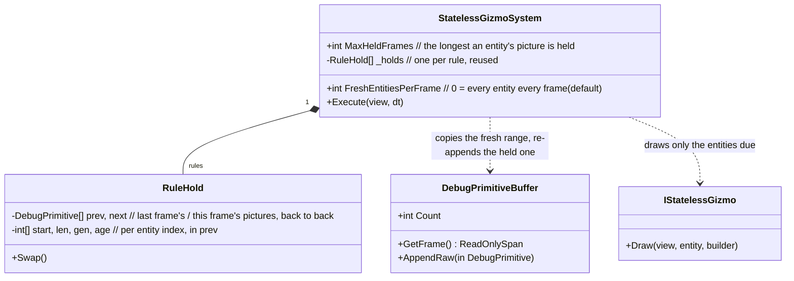
*What the picture shows that prose hid: the held picture is RE-EMITTED into the same buffer, in the same rule order and entity order —
so the hit-test (CE-259r: stateless first), the draw order and the layer filter see a frame indistinguishable from a full one.*

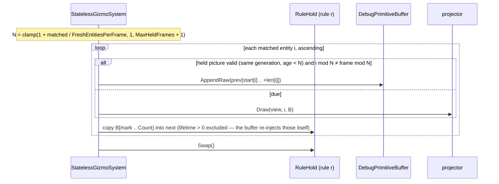

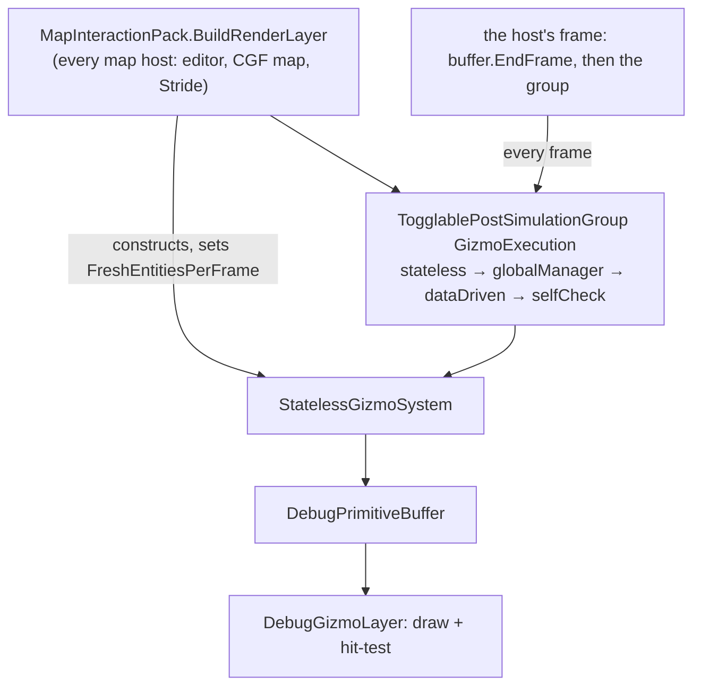
*What it shows: one constructor reaches every map host, so the refresh policy is set in ONE place; the group still runs every frame — only
how many projectors run inside it changes.*

| ⭐ rule | why |
|---|---|
| ⭐⭐ **off by default (`FreshEntitiesPerFrame = 0`)**; the map pack turns it on | ⭐ tests and every other host keep exact per-frame behaviour |
| ⭐⭐ **adaptive by count**: ≤ `FreshEntitiesPerFrame` matched ⇒ every frame; more ⇒ period N grows, capped by `MaxHeldFrames + 1` | the user's "for big amount of entities … less frequency" |
| ⭐⭐ **a new / re-generated / newly matched entity is always fresh; a gone one vanishes at once** | ⛔ a held picture never outlives its entity |
| ⭐ **interleaved by entity index** (`i mod N = frame mod N`), never "all every Nth frame" | ⭐ the cost is spread, so no spike frame |
| ⭐ **visibility is asked every frame** (global per rule, per entity) — a hidden one is neither drawn nor held | ⛔ toggling a layer off never shows a stale picture |
| ⛔ **the sim, the stateful gizmos (`DataDrivenGizmoSystem`, tools, selection) and input are untouched** | the held part is the per-entity overlay only (avatars, labels, routes) |

Rejected: **the existing budget slicing** (`MaxGizmoFrameMs`) — sheds by not drawing ⇒ flicker, and the shed set depends on wall-clock ·
**render the map to a texture at a reduced rate** — the map's camera would lag; a ui-lane change of the renderer · **skip the whole group on
some frames** — the buffer is cleared every frame, so the map would blink, and the tools' hit-test would miss.

## 11. The STRESS target — 1000 thinking soldiers + objectives + 5000 SUMO cars at 30 Hz *(CE-2408, `2026-11-05`)*

⭐ User: *"we need artificial stress test with 1000 thinking entities and with some objectives and around 5000 sumo cars to set a real
target - 30 hz frames to keep looking for improvements."*

**Prior art (explorer sweep, `2026-11-05`):** `scripts/perf-civilians.py` (CE-3222, N civilians, `/diagnostics/architecture`, R-3029's
regression ceiling) is the template; demo-city is the only terrain with a SUMO net; a scenario turns traffic on with one TKB 8850 entity
carrying `TrafficDemand`; SumoSharp adds at most `CarSpawnPerStep` (5) cars a step, so 5000 cars took ~500 s to fill; the largest runs
so far were 500 civilians and 200 cars.

| piece | built as |
|---|---|
| the scenario | `scripts/perf-stress.py` writes `scenarios/tests/perf-stress` (deterministic): 2 sides × 62 squads × 8 men (TKB 302 + 2002, the Crossfire soldier) on demo-city's streets, `SquadDefend` on six points, health 100 000 (the fight stays a constant load) · six `HoldArea` + two `Counter` + a kick-off `Trigger` (a FIXED rule set) · `TrafficDemand { TargetCars 5000, CarSpawnPerStep 200 }` |
| `TrafficDemand.CarSpawnPerStep` | APPENDED (R-169) to the component, the `EntityTrafficDemand` wire and both translators; `TrafficSession` passes it to SumoSharp (0 = its default 5) |
| the run | one node per process (orchestrator, cgf, simhost, traffic — `scripts/cluster-node.sh`), load, play, wait for the fill, measure |
| ⭐ the TARGET | each node's **work per frame** — the sum of its leaf systems' recent averages (the scheduler's own profiler) — **≤ 33.3 ms**: that node alone holds 30 Hz on its own machine. ⚠ On the 4-core cloud VM the nodes share cores, so the achieved frames per wall second is printed but is NOT the target |

### 11a. 📐 BASELINE — the first valid run *(`2026-11-05`, cloud VM 4 cores; `python3 scripts/perf-stress.py`)*

⚠ The first run found a CRASH, not a number: the recorder's fixed 32 MB frame buffer overflowed on the keyframe and the CGF node died
(fixed: CE-2409). The second run held real time (68.3 s of sim in 68.7 s of wall; CGF 7 499 entities, SimHost 4 187, traffic 4 786):

| node | work / frame (target ≤ 33.3) | largest systems (ms / frame) |
|---|---|---|
| **CGF** | **2 008** (0.9 frames/s achieved) | `CalloutSystem` **870** · `StressSystem` **425** · `WeaponDispatcherSystem` 208 · `BrainTickSystem` 187 · `RecorderTickSystem` 66 · `TrafficMirrorSystem` 59 |
| SimHost | 334 (4.1 frames/s) | `TrafficMirrorSystem` 70 · `CycloneEgressSystem` 57 · `RecorderTickSystem` 43 · `FireProcessingSystem` 35 · `CarKinematicsSystem` 13 |
| traffic | 188 (6.5 frames/s) | `TrafficMirrorSystem` 109 · `CycloneEgressSystem` 27 · `RecorderTickSystem` 24 |

⇒ ⭐ **the target is ~60× away on the brain node.** ⭐ Two systems are 65 % of it and look quadratic in the soldiers (`CalloutSystem`,
`StressSystem`) — the first levers; then the weapon dispatcher and the brains; `TrafficMirrorSystem` is the largest on the other two nodes.

### 11b. 📐 The levers so far — each found by a trace, each a per-frame index in place of a whole-world scan per question *(`2026-11-05`)*

⭐ Method: `python3 scripts/perf-stress.py --trace <dir>` records 15 s of `dotnet-trace` per node; the CGF's thread is split by caller.
⭐ The pattern every lever so far had: **a question asked per soldier per frame, answered by scanning the whole world** — quadratic in the
soldiers. ⭐ The answer each time: one per-frame index, every candidate re-checked LIVE, so no rule's filter goes stale.

| | the scan | share of the CGF thread | became |
|---|---|---|---|
| CE-2410 | `WeaponMountQuery.EnumerateMounts` (callouts' grenade count, the weapon dispatcher, the throw choice) | 44 % | a per-world mount index (owners counting-sorted) |
| CE-2410 | `UnderFire.FriendNear` (callouts' earshot, stress "alone") | 9 % | the shared frame grid (below) |
| CE-2411 | `LineOfFire.BlockedByFriendly` / `BlockedByNeutral` (every shot) | 18 % | the shared frame grid, walked along the line |
| CE-2414 | `DoorStates.Of` + `CloudTable.Build` per sight / fire query (each walked every entity) | ~15 % of SimHost | per-thread tables held for the frame by one `FrameStamp` check (a write within the frame rebuilds) |
| CE-2413 | `TrafficReplicas.NearestAnchor2` (AQ93's vicinity band: every SUMO car × every HROT body, every node) | ~20 % of the traffic node | the shared frame grid, 350 m cells, `AnyWithin` (yes/no, first hit) |
| CE-2412 | `UnitSensors.Of` (the SOPs' danger-area check) — and the other "parts of this parent" scans | 11.5 % | ⭐ one shared parts-by-parent index (§11c) |
| CE-3427 | ⭐ the SAME pattern inside every EQS sight / hearing solve, found on scale-1 (6 911 doors, 10 000 entities): `DoorStates.Of`'s hit check walked every door entity · `ScenarioTime.TryClock` and `WeatherField` walked the whole entity index FOUR times per weather sample | ~97 % of a sensor solve (470 → 11 µs) | the door table's hit is O(1) while `StructuralChanges` holds · the clock and the weather's entities found once per thread per (frame, structure) — 📄 [Scale Rig §6.2](DESIGN_Scale_Rig.md) |

| run | CGF work / frame | top systems |
|---|---|---|
| baseline (§11a) | **2 008 ms** | Callout 870 · Stress 425 · WeaponDispatcher 208 · BrainTick 187 |
| after CE-2410 | **1 067 ms** | WeaponDispatcher 308 · BrainTick 218 · Callout 169 · TrafficMirror 77 · Recorder 73 |
| after CE-2411 ⚠ | **1 067 ms** | Callout **376** · BrainTick 226 · Recorder 101 · TrafficMirror 59 · egress 51 · WeaponDispatcher **47** |

| ⭐ after CE-2412 | **599 ms** (3.4× the baseline) | BrainTick 113 · TrafficMirror 79 · Recorder 73 · WeaponDispatcher 57 · egress 54 · Callout 41 — SimHost 506 (FireProcessing 100, TrafficMirror 97, egress 90), traffic 362 (TrafficMirror 180) |

| ⭐ after CE-2413 + CE-2414 | **468 ms** (4.3× the baseline) | BrainTick 91 · Recorder 75 · egress 55 · WeaponDispatcher 43 · Stress 27 · Callout 23 — SimHost **309** (egress 84, Recorder 58, FireProcessing **20**), traffic 239 (TrafficMirror 76 — SUMO's own pose resolve now, egress 57, Recorder 43) |

⭐ After CE-2414 the top of every node is the PER-ENTITY INFRASTRUCTURE — egress (55–84 ms) and the recorder (43–75 ms) — plus the brains'
real work; no remaining whole-world scan was found by the traces. ⚠ The entity counts differ run to run (CGF 6 900–8 100) as the fight and
the traffic fill vary — compare runs by the shape, not the last digit.

⭐ The brain node no longer has one dominant scan: its top six are 41–113 ms each. ⭐ `TrafficMirrorSystem` is now in the top two on EVERY node
(79 / 97 / 180 ms) — the next lever. ⚠ One run before this one was INVALID: the cluster clock stopped at ~4.5 s for two minutes (the traffic
node's `TrafficStepping` circuit opened on Timeout / StillRunning; the CGF's time-sync RTTs reached 250–350 ms); the re-run on the same
commit held real time. Not reproduced — recorded on CE-2408 as an intermittent to watch.

⚠ The CE-2411 run: the line of fire went 308 → 47 ms, but `CalloutSystem` rose 169 → 376 — the trace puts it in CE-2410's private mount index
REBUILDING PER CALL (its "a mount or part table written this frame" check was true all frame on this world). ⇒ CE-2412 retires it onto the
parts index, which rebuilds per part ADDED, not per write. (That run also shared the VM's cores with a test build.)

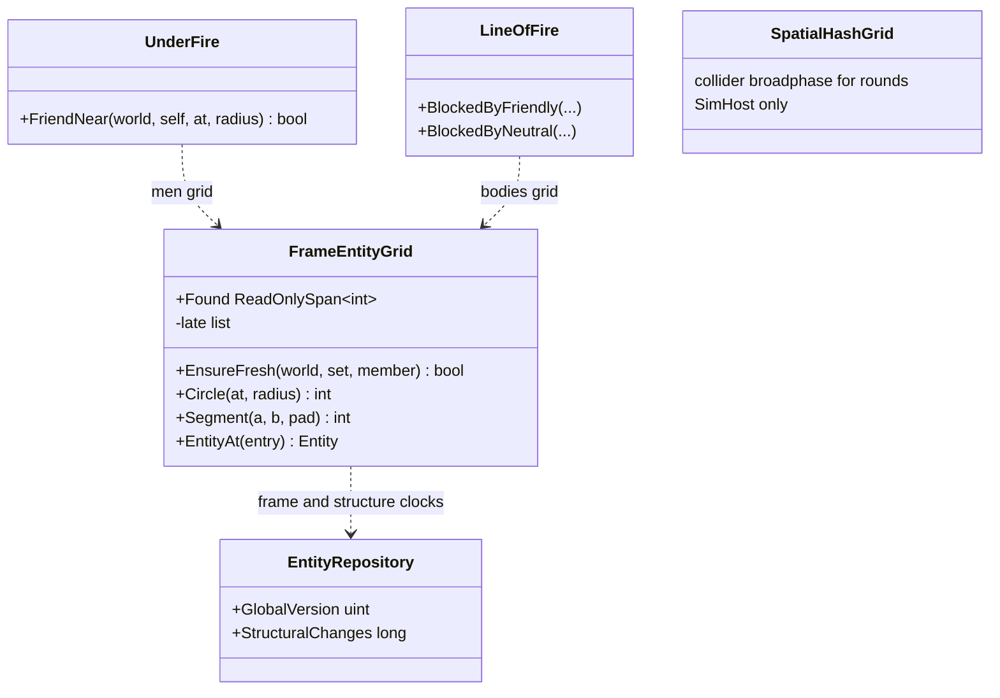
*What the picture shows that prose hid: the two rules share ONE grid type (ruling 9), and the CarKinem `SpatialHashGrid` stays beside it
deliberately — a different contract (fixed extent with a capacity, hidden passengers left out, SimHost only), named in its doc.*

| ⭐ `FrameEntityGrid` (CE-2411) — the contract | |
|---|---|
| rebuilt | when `GlobalVersion` moves (once per frame) |
| within the frame | when `EntityRepository.StructuralChanges` (NEW, CE-2411: moves on every `LastChangeTick` stamp and on destroy) moved, the entities structurally changed this frame are looked at; a member the build did not place joins a LATE list every walk checks — ⛔ not a rebuild per creation (a shot or a call adding a component would rebuild 7 500 bodies) |
| a candidate | every member within the walk's reach; the caller re-reads it live (alive, components, position, force, state) |
| ⚠ the frame's | the CELL a member sits in: a member moved within the frame is found within the caller's slack (`MovedSlackMetres` = 4 m) |
| no allocation | once grown (rails assert it) |

⚠ **Superseded in part `2026-11-05`:** the user ruled ONE grid type — CE-2415 (unify with the CarKinem broadphase; the differing sets become filters).

Rejected: **`SpatialHashSystem` on the CGF** — its set differs (hidden passengers out, out-of-extent dropped), so the hold-fire answers would
change; and it is a host-plan change. **A rebuild on every structural change** — the measured CGF frame adds components while it fires.
**A third private grid** — two copies of one mechanism.

### 11c. The parts index — ONE answer to "the parts of this parent" *(CE-2412, `2026-11-05`)*

📐 INVENTORY (grep `ParentEntity.Equals(` / `==` outside tests; `search_graph .*(PartsOf|ChildrenOf|PartIndex|ChildIndex|Parts)$`): **15 scan
sites** over every part of the world per call, and **two private indexes** (CE-2410's `MountIndex`, CE-3242's `SensorChildFactory.ChildIndex`).
⭐ `PartMetadata` is the one part link the designs use for mounts (Weapon Layers, 2000 + index), turrets and sensors (Sensors & Doctrine, 1000 + i).

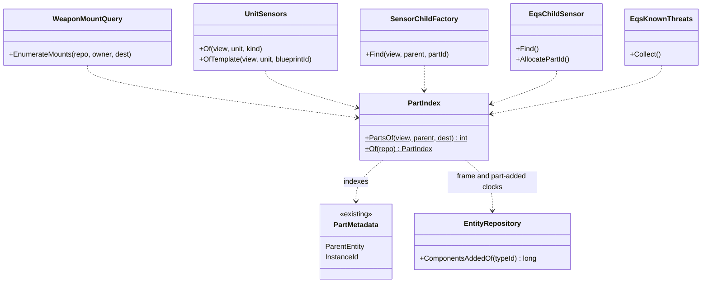
*What the picture shows that prose hid: five askers, one index, and both private indexes gone — each asker keeps only its own filter
(a mount, a sensor kind, a template, a run's stamp).*

| ⭐ the contract | |
|---|---|
| order | lowest `InstanceId` first, ties in entity order — what each scan's "lowest id wins" / "first match" kept |
| rebuilt | once per frame, and when a `PartMetadata` is ADDED (the NEW `EntityRepository.ComponentsAddedOf(typeId)`) — a part created this frame is found at once; a load that creates parts rebuilds per part, not per question |
| every hit | re-checked live: alive, still `PartMetadata`, still this parent |
| ⚠ a re-parent by VALUE write | leaves the old parent at once, joins the new one next frame — 📐 no production writer re-parents (every writer adds) |
| a snapshot view | the fallback scan, in the same order — the one copy of it |
| not yet moved | `UtilityScorer` (its candidate order feeds tie-breaks — moving it needs its own rail), `TurretParts`, `BehaviorOwnedParts`, `HearingExplain`, the debug API, `SimHostApp`, the EQS config ingress — not per-frame on the stress world |

Rejected: **a change check on the tables** (CE-2410's) — a table written every frame rebuilt it per call (the CE-2411 run).
**Keeping `ChildIndex` beside it** — two indexes of one relation. **A rebuild on every structural change** — the frame adds components while it runs.

### 11d. Queries — measured by FREQUENCY × COST at high entity counts, not by kind *(`2026-11-05`)*

🔒 User: *"The right measure is how often each query is called and how much it hurts with high entity counts. We do not need to optimize
for marginal cases."* ⇒ ⭐ **Decision: fix the queries that are HOT (many calls per frame, or a big share of the main thread); the general
"skip empty chunks" engine change is DEFERRED** — re-measure after the hot sites are fixed; it pays only if the once-per-frame tail is then
what remains.

📐 **How measured** — the CE-2408 stress world at `5e03eafff` (~5 600–8 000 entities per node): ① `dotnet-trace`, every sample inside
`EntityEnumerator.MoveNext` / `Current` / `QueryBuilder.Build` charged to the method running the query (main thread = the frame);
② a throwaway counter (not committed) per caller: calls per frame, entities walked, entities matched. ⚠ Walked counts a FULL walk; a lookup
that stops at its first match (the scenario clock, the global weather) walks far less — the trace showed those cost ~nothing.

| | main thread in the query walk | the shape |
|---|---|---|
| CGF | **20.5 %** | a long tail — the largest single caller 1.8 % |
| SimHost | 12.2 % | a long tail — the largest 0.5 % |
| traffic | 15.6 % | ~40 egress translators, one walk each per frame, most matching 0 |

| ⭐ hot — fix per site | calls / frame | matched / call | main thread | the fix |
|---|---|---|---|---|
| `ObjectiveCensus.MenOfSideInside` (HoldArea) | 1.3 | 1 600 | **1.8 %** | one census per frame, not per objective |
| `BehaviorOwnedParts.Release` | **16** | 0.6 | 0.6 % | the parts index (CE-2412's "not yet moved") |
| `PartIndex` rebuilds | **9** | 2 000 | 0.75 % | parts are ADDED ~9× per frame (behaviour-owned sensors) — find the churn |
| `Callouts.SaidNearby` | 8 | 250 | 0.3 % | the frame grid |
| `CycloneEgressSystem.ProcessForcePublish` | 6 | **0** | 0.6 % | nothing to force most frames — skip the walk |
| `ExerciseResult.PhaseOf` | 1.9 | **0** | 0.5 % | cache per frame |
| `EqsResultIngressTranslator.PollIngress` | 7.5 | 1 260 | — | measure next |

| ⛔ marginal — leave | why |
|---|---|
| the scenario clock / global weather lookups (30 and 18 calls / frame on SimHost) | early exit at the first match: ~0 in the trace |
| the once-per-frame system queries (each 0.1–0.5 %) | one walk per frame each; only the engine-wide change would remove them together — deferred |
| the editor-only UI adapters in the stress run (`RepositoryAdapter`, `ScenarioOrbatAdapter`, gizmos) | not on a headless node |

**The engine-wide option, kept for later:** component tables keep no per-chunk population (only the entity index does,
`EntityIndex.cs:103-177, 483-634`), so skipping empty chunks needs a count kept on every add / remove / destroy / restore / snapshot copy —
and ⚠ an under-count drops entities from queries silently. Worth it only if the tail is what remains after the hot sites.

### 11e. 📐 Where the three big costs go *(`2026-11-05`, the CE-2408 stress world at `5e03eafff`; user: "spend the effort on egress, the recorder and the brain tick")*

Each system's main-thread samples, split by what the innermost frame is doing (`dotnet-trace`; the system's ms/frame from `perf-stress.py`).

| system (ms / frame) | where its time goes | ⭐ the fix it points at |
|---|---|---|
| **Recorder** (CGF 96, SimHost 74, traffic 62) | ~60 % `FillLiveness` + reading every entity's metadata through the write accessor (`GetRefRW` → `EnsureChunkAllocated`, `IsChunkCommitted`); on SimHost +17.5 % copying `SpawnLevelRequest` chunks | ⭐ `FillLiveness` runs once per CHANGED CHUNK OF EVERY TABLE, recomputing the same entities' liveness again and again (`RecorderSystem.cs:223, 258, 366, 489, 520, 568`) ⇒ compute it ONCE per frame for every entity, slice it per chunk — exact, local to the recorder |
| **Brain tick** (CGF 91–135) | ~30 % the objective census (`HoldAreaBehavior.CaptureBySide` → `ObjectiveCensus.MenOfSideInside`: every positioned entity, per objective, per side); 38 % of the whole tick is query walking | ⭐ the census asks the grid for the men inside the area's bounds (§11d) |
| **Egress** (CGF 80, SimHost 109, traffic 78) | 32–44 % the query walk (~90 translators, each walking every entity once per frame, most matching few or none); 32–34 % the native DDS send (real work); serialization ~0 | ⚠ the walk is the once-per-frame TAIL §11d deferred — concentrated here: ~90 walks / frame / node. ⭐ Either the engine-wide "skip chunks with none of the query's rarest component" (§11d) or egress walking the entities ONCE for all translators. A user decision |

⭐ **Measured and kept `2026-11-05` (CE-2416), the user's rule — "measure before and after, keep only what really helps":** the recorder's
liveness once per frame — 3–8× cheaper per entity on every node (A/B on one binary, off / on / off / on); the census on the grid — 12.6×
on the SAME calls (grid 246 ms vs scan 3 104 ms over 1 633 calls, 0 mismatches; the run-level brain tick follows the fight too much to decide
by). ⚠ 1 000 soldiers now gets the brain EJECTED at load (one frame over the 5 s heartbeat, CE-2417), so the A/B ran at 700. Egress (option
b, one walk for every translator) is next — designed first, measured the same way.

### 11f. 📐 Before / after, the whole programme *(`2026-11-05`; base `5858663d4` = before CE-2410…2418, head `a1e149cb6`; 700 soldiers, 5 base + 5 head runs alternating, all valid; medians)*

⛔ **RETRACTED: the first version of this section** compared head against HEAD — `scripts/cluster-node.sh` runs
`/home/user/HROT/…/Hrot.ClusterRunner.dll` unless `HROT_RUNNER_DLL` says otherwise, so running `perf-stress.py` from a base WORKTREE only
regenerated the scenario: every "base" run was the head binary, hence "no whole-node gain". ⭐ **A cross-commit comparison sets
`HROT_RUNNER_DLL=<worktree>/Hrot/Runner/Hrot.ClusterRunner/bin/Debug/net8.0/Hrot.ClusterRunner.dll` for the base side** (and checks a running
node's command line). The one-binary on/off A/Bs (§11e, CE-2416, CE-2418) were never affected.

| node, work per frame | base | head | |
|---|---|---|---|
| ⭐ **CGF (the brain)** | **1 463 ms** · 339 µs / entity | **487 ms** · 77 µs / entity | ⭐ **3.0× per frame, 4.4× per entity** (head carries MORE entities: 5 000–6 400 vs 4 100–5 300) |
| SimHost | 223 ms · 70 µs / entity | 317 ms · 56 µs / entity | 1.26× per entity — ⚠ per frame it is HIGHER because the head's world is busier: a 3× faster brain fights more (fire processing / raycasts enter the top six only on the head) |
| Traffic | 224 ms · 79 µs / entity | 195 ms · 50 µs / entity | 1.6× per entity |

| system (median ms per frame) | base | head | lever |
|---|---|---|---|
| CGF `CalloutSystem` | **705** | **37** | 19× — CE-2410 friend grid |
| CGF `StressSystem` | **345** | **37** | 9× — CE-2410 / CE-2411 frame grid |
| CGF `BrainTickSystem` | 158 | 93 | 1.7× — CE-2412 parts index, CE-2416 census |
| CGF / Traffic `RecorderTickSystem` | 52 / 35 | 23 / 8 | 2–4× — CE-2416 |
| Traffic `TrafficMirrorSystem` | 108 | 78 | 1.4× — CE-2413 vicinity on the grid |
| CGF / Traffic egress | 46 / 41 | 38 / 33 | 1.2× per frame on a busier world (per entity: CE-2418's A/B) |
| CGF `WeaponDispatcherSystem` | *(below the top six — the base brain fought little at 0.7 frames/s)* | 48 | |

⇒ ⭐ **the brain went from 0.7 to ~2 frames/s at 700 soldiers.** Still far from 30 Hz: what dominates now is the brain tick (93), egress
(38 CGF, 73 SimHost), the traffic mirror (78 Traffic, 38 SimHost, 33 CGF), the weapon dispatcher (48) and the callouts / stress (~37 each).

#### 11f-2. 📐 Why SimHost looked SLOWER at 700 — the old world never fought *(census, `perf-stress.py --census`)*

⚠ At 700 soldiers SimHost's frame was 223 → 317 ms (old → new) while its entity count roughly doubled. ⭐ The census (entities grouped by
component set, each node) says why — the two worlds were not doing the same thing:

| SimHost at 700 soldiers | old (3 runs) | new (3 runs) |
|---|---|---|
| sensors evaluated (`SensorEvalState`) | **0 of 1 376** | all |
| projectiles · short-lived effects · munition ghosts | **0 · 0 · 0** | ~300 · ~340 · 490–726 |
| soldiers moving / under fire (`PathTrace`, `UnderFire`) | none | yes |
| sensor parts · doors · soldiers | 1 376 · 507 · ~690 | the same |
| mirrored SUMO cars | 19 / 19 / 176 | 120 / 434 / 2 217 — ⚠ swings by run in both versions (cars within 350 m of any collider, rounds included) |

⇒ ⭐ **the old brain (0.7–0.9 frames/s) never got the fight going within the run, so the old SimHost idled.** Proved at 150 soldiers, where the
old brain is fast enough: the old SimHost then fights normally (300 / 302 sensors evaluated, 331 projectiles, soldiers moving) — no
functional difference — and **like for like, SimHost is 358 → 177 ms per frame (2.0×) on a similar world (3 838 vs 3 640 entities); CGF
345 → 194 ms, Traffic 179 → 109 ms** (one run each).

| ⚠ found on the way — pre-existing, not changed by this work | |
|---|---|
| munition ghosts pile up | `GhostTimeoutSystem.MAX_GHOST_AGE` = 3 600 FRAMES ("60 seconds at 60 Hz") — at ~3 frames/s that is ~20 min; and `GeoSpatialIngressTranslator` / `MapEntitySymbolIngressTranslator` / `EntityInfoIngressTranslator` create ghosts with tick 0. A round's late position sample makes a ghost that lingers |
| car mirroring around rounds | rounds are colliders without `ReplicationRoute` ⇒ the vicinity rule (`TrafficReplicas`) mirrors every car within 350 m of a flying round — as designed (a round must be able to hit the car), but a cost lever |

### 11g. 📐 The BRAIN at 1 000 and 3 000 men — attributed, and the quadratic term removed *(CE-4395, backend `2026-11-10`; [handoff](blueprints/batches/HANDOFF_Coordinator_To_Backend_Brain_Cost_1000.md))*

⭐ Measured with the scale rig ([Scale Rig](DESIGN_Scale_Rig.md), `scale-1`, two sides fighting, Release, this 4-core VM) and `QueryTimings` slots
added for it: the whole tick (`brain.Execute`), each behaviour's run (`brain.task:<name>`, `brain.sop:<name>`), each utility decision and input
(`utility.decision:*`, `utility.input:*`), the parts index and the suspected walks. Inclusive times; **per brain tick** (the slots' ms per frame ÷
the ticks per frame — the brain runs on time-advancing frames only, 0.44–0.47 per counted frame).

**INVENTORY** (graph + grep, `2026-11-10`): `search_graph name_pattern=".*(ComponentsAdded|AddedThis|AddLog|LogAdds|AddedSince|NewlyAdded).*"` →
2 (`EntityRepository.ComponentsAddedOf`, an unrelated trace field) ⇒ no add log existed; `search_code "new PartMetadata"` + grep → 6 writers
(`TurretParts`, `CombatTkbTranslator`, `SensorChildFactory`, `EqsChildSensor`, `PersonalRouteAuthoringSystem`, `EqsSensorConfigIngressTranslator`);
grep `BehaviorOwnedParts.Release` → called by `BehaviorIngressSystem` at every run end, rails `EqsModuleTests`, `TkbSensorTests`, `HillAttack*`.
⚠ `check_index_coverage` is not available through the CLI — the counts are what the index holds.

| per brain tick, ms | 1 000 men | 3 000 men | grows | where |
|---|---|---|---|---|
| **the whole tick** (`brain.Execute`) | **20.0** | **171** | 8.5× | `BrainTickSystem.cs` `Execute` |
| `CombatPosture` runs (count × µs) | 313 × 48 = 15.1 | 2 214 × 67 = 149 | **7× the runs** — more men in contact | the fight, not an algorithm: per run ~flat once the walks below are gone |
| — `Combat posture` decision | 6.1 | 41 | with the runs | `StarterPack/CombatPostureDecision.cs` — `EnemyStrengthRatio` ×5 options, `EqsTopScore` ×3, `HealthFraction` ×5, per decision |
| — `Threat ranking` (≈ 7 contacts × 2.2 µs) | 5.0 | 33 | with the runs | `UtilityScorer.cs` `EvaluateCandidates` — `ContactThreatLevel` → `ThreatDanger.Of` per contact |
| — `Attack approach` | 2.1 | 25 | with the runs | |
| ⛔ **`parts.rebuild`** (rebuilds × µs) | 3.7 × 295 µs = 1.1 | **62 × 729 µs = 45** | **31×** — (parts added in the tick) × (every part) | `PartIndex.cs` `EnsureFresh`: every `PartMetadata` ADDED within the frame rebuilt the whole index |
| ⛔ **`OwnedParts.Release`** | 13 × 101 µs = 1.3 | 81 × 279 µs = 23 | (run ends) × (every entity) | `BehaviorOwnedPart.cs` `ReleaseCore`: a walk over every entity per run end |
| ⛔ `Callouts.SaidNearby` | 66 × 25 µs = 1.7 | 300 × 62 µs = 19 | (callouts) × (every entity) | `Hrot.AI.Behaviors/Brains/Callouts.cs:116` — a new query built and walked per call |
| SOP slots (`TickSopSlots`) | 1.3 | 8.4 | linear | |
| `SweepStaleDedupEntries` | 0.34 | 0.85 | linear (one walk a tick) | |

⭐ **The superlinear terms were the WALKS** — each a per-event scan of every entity, done more often as more men fight: the parts rebuild
(31×), `Release`, `SaidNearby`. The rest grows with the number of men in contact, at a flat cost per man.

#### 11g-1. ✅ AS BUILT — the parts added within a frame are TAKEN IN, not rebuilt for; `Release` reads the index

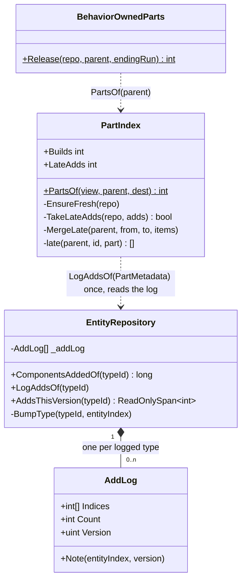
*What the picture shows that prose hid:* the log lives in the REPOSITORY (the one place every add passes, `BumpType`), opt-in per type, and the
index only READS it — a writer of `PartMetadata` (six of them) changes nothing.

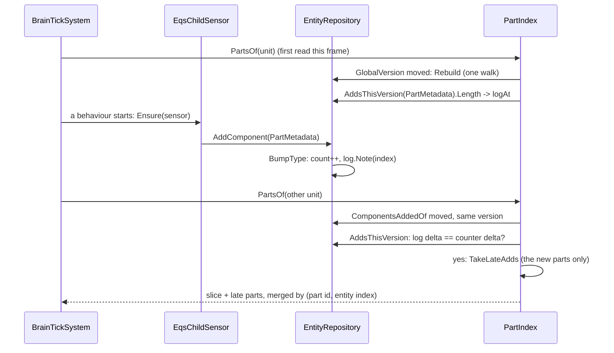
*What it shows:* the exactness guard — the log is trusted only when it accounts for EVERY add the counter saw; otherwise (a type not logged, a
version set back by playback) the index rebuilds exactly as before.

| ⭐ rule kept | how |
|---|---|
| ⛔ behaviour unchanged | a read returns what a build would: late parts merge in the build's order (part id, ties by entity index — the walk's order); `Release` destroys in ENTITY order, so the LIFO free list recycles the same indices as the walk did |
| R-2084 no hot-path allocation | the log and the merge buffer grow, never per call; `Release` collects into a stack span (was a `new Entity[4]` per call) |
| the version | the log is per `GlobalVersion`; `SetGlobalVersion` / `ResetGlobalVersion` clear it |

**Rails** — in the features' own suites (T-1): `PartIndexTests.CE4395_PartsAddedWithinTheFrame_AreTakenInWithoutABuild_AndAnswerAsTheScan`
(🔴 red-proved: the log ignored ⇒ the build count moves; the tie-break dropped ⇒ a part on a recycled index sorts wrong) ·
`CE4395_AVersionSetBack_FallsBackToABuild` · `EqsModuleTests.BehaviorOwnedParts_Release_DestroysInEntityOrder_SoIndicesRecycleAsTheWalkDid`
(🔴 red-proved: the sort dropped ⇒ the next entity takes the other index).

**Measured after** (the parts fix alone; `Release` still the walk): 3 000 men — `brain.Execute` **171 → 130 ms** per tick, `parts.rebuild`
45 → 0.9 ms, `PartsOf` 52 → 8 ms; 1 000 men — rebuilds 3.7 → 1 per tick, the tick unchanged within the fight's noise (20.5 ms): at 1 000 the
walks were small and the utility decisions are the cost.

#### 11g-2. ✅ APPROVED (R-3085) — a CADENCE for the combat decisions *(user, `2026-11-10`: "Yes, 0.2 seconds is very much acceptable."; behaviors informed — [note](blueprints/batches/NOTE_Backend_To_Behaviors_Brain_Cost.md))*

📐 At 1 000 men the tick is 20 ms, and **~13 ms of it is three utility decisions** (`Combat posture`, `Threat ranking`, `Attack approach`)
re-scored by every fighting man on **every** brain tick (§3.6 left soldiers at every frame — D6 "not now"). ⛔ No exact speed-up reaches the
10 ms frame (R-4192) from there: the remaining exact levers (a per-decision input memo — `EnemyStrengthRatio` is read five times per decision;
`ThreatDanger` per contact) are worth ~3–4 ms, and a memo needs a purity contract the readers do not have (`Measures.cs` readers write
`ObjectiveStatus`).

| option | effect at 1 000 | behaviour |
|---|---|---|
| ⭐ **lean: the combat decisions at the SOP cadence** — re-scored every 0.2 s, staggered by entity index, and at once when woken (`SensorChangedEvent`: a new contact, a hit, a near miss) — the D1–D8 mechanism (§3.0) and the pattern R-195 gave the SOP slot | the decision cost ÷ ~6 at 30 Hz ⇒ ~2 ms; the tick ≈ 9 ms | ⚠ **changes timing**: a posture change can land up to 0.2 s later when nothing woke the man. Decision-log stamps move; scenario conditions should hold (they test outcomes, not frames) |
| exact memo per decision (+ `ThreatDanger` per tick) | −3–4 ms | none — but needs a reader purity contract (behaviors') |
| parallel scoring (P-1) | ÷ cores, in principle | ⛔ the decisions run inside the BTree tick, interleaved with writes — a redesign of the runner |

⇒ **Lean: the cadence**, as behaviors' D-design already allows, after the user says the 0.2 s latency is acceptable. What would change it: a
scenario whose pass depends on a same-frame posture switch (the regression would show it).

##### 11g-3. ✅ AS BUILT — the decision declares its cadence; the scorer keeps the last result *(CE-4395)*

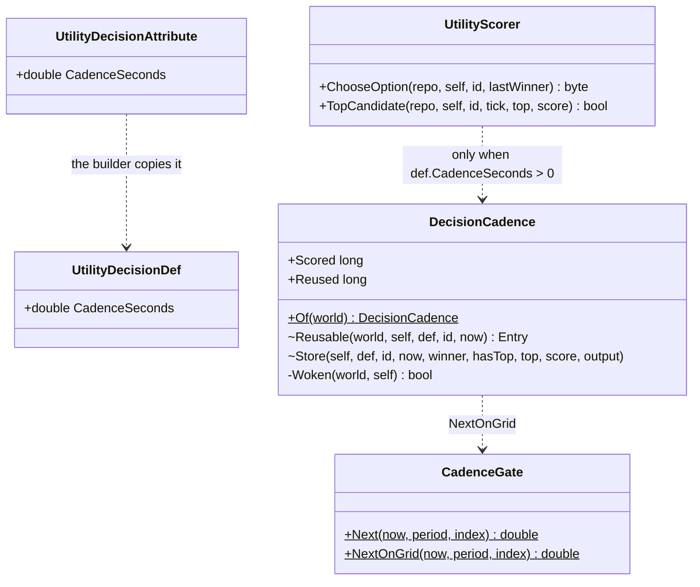
*What the picture shows that prose hid:* the cadence is DATA on the decision (three starter decisions set it) and ONE mechanism in the scorer —
no tree, node, blackboard layout or second scheduler changes; every caller of the two scorer entry points (the `ChooseOption` node, `TopThreat`,
the debug views) gets the same answer. `CadenceGate.NextOnGrid` sits beside `Next` because `Next` adds the stagger on every tick (a steady
0.2–0.38 s interval) — kept for the SOP and task slots, reported to behaviors.

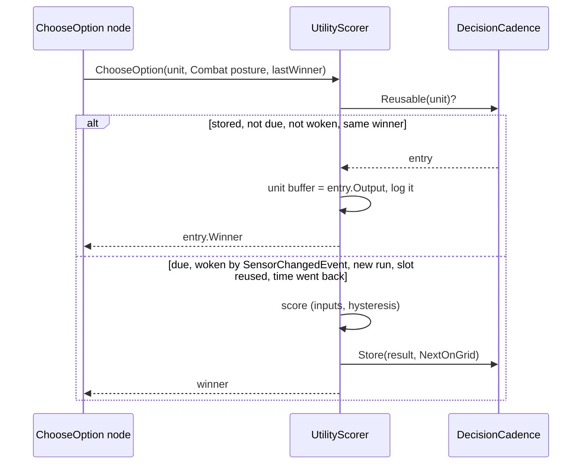

| ⭐ | |
|---|---|
| what readers see | between scorings the unit's `UtilityResultBuffer` and `UtilityDecisionLog` are written back exactly as the last scoring wrote them — the debug views, the blueprint bridge and the brain journal read the same records, less often refreshed |
| a restore / seek | the store is not recorded; time going back re-scores at once (no stale result crosses a restore) |
| a bare world (no `GlobalTime`) | every call scores, as before — unit rails unchanged |
| R-2084 | a reuse allocates nothing (rail: 100 calls, 0 B); an entry is allocated once per unit and decision |

| ⚠ **the residual risk — a branch that FINISHES on a stale choice** | the tree re-scored the choice on the same tick the chosen branch could finish (the `ChooseOption` arm runs before the work arm in the `Parallel`). Now a branch that finishes while nothing woke the man (no `SensorChangedEvent`) sees the choice up to 0.2 s old — 📌 `TacticsTreesTests.CE3084_OutOfSight_…`: arriving at a flank ENDS the order unless the sighting from the flank (perception's `Acquired`, `ActiveSensorTracksUpdateSystem.cs:95`) wakes the decision first. In production the sighting comes with that event, so it re-scores. ⭐ The scenario regression at this head is the guard; if a scenario shows it, the tree-level fix is behaviors' (re-score when the running branch completes) |
| the rails that moved | `TacticsTreesTests`: 11 waits of 3–4 ticks after a new EQS answer became one cadence period (`Decide`, 14 × 16 ms); the flank rail publishes the `Acquired` its sighting would bring. The assertions did not change |

**📐 Measured with the cadence** (`30a45c708`, the same rig, this 4-core VM):

| per brain tick | before (§11g-1) | with the cadence |
|---|---|---|
| **1 000 men — the whole tick** | **20.5 ms** | **10.5 ms** (profiler: 10.2 ms) |
| — `Combat posture` scorings / runs | 280 / 280 | 153 / 446 |
| — `Threat ranking` candidate scorings | 2 430 | 253 |
| **3 000 men — the whole tick** | 130 ms | **102 ms** |

⚠ **Why 3 000 gains less — the cadence is in SIM time and the sim keeps real time** (real-time factor 1.0): the CGF frame is 290 ms at 3 000 men,
so each brain tick advances ~0.66 s of sim time and every tick is already past its 0.2 s — every call re-scores, as specified. At 1 000 (63 ms
frames, ~0.13 s a tick) about a third re-score; on the budget's 60 Hz frame (R-4192) it is ~1 in 12. ⇒ the saving grows as the frame shrinks.
Wakes are rare (`cadence.wake:<kind>` counters: ~0.6 a frame at 3 000 — Hit, SniperFire, SquadUnderFire, Acquired); they are not what keeps
3 000 scoring.

**Rails:** `UtilityScorerTests.CE4395_ACadencedDecision_IsScoredOncePerPeriod_AndAtOnceWhenWoken` (🔴 red-proved: reuse disabled ⇒ the read
count moves) · `CE4395_TheCombatDecisions_AreCadencedAt0_2s_AndNothingElseIs`.

##### 11g-4. B-3 — the brain's garbage *(CE-4395, `44bdcf2d7`; the brain and decision slots record bytes)*

| per frame, 1 000 men | before | after |
|---|---|---|
| **`BrainTickSystem`** | **35 KB** (32 of it `utility.input:EnemyStrengthRatio` → `ThreatDanger.OwnStrength` → `Armament.LethalInHand`) | **8.5 KB** |

| the cause | the fix |
|---|---|
| `PersonHands.HoldsLethal` walked the hands through a CAPTURING lambda — a closure and a delegate per call | `Holding` is ONE walk with a struct visitor (the `Func` overload adapts to it); `HoldsLethal` passes a struct |
| `CombatTkb.WarheadOf` → `ParameterResolver.Warhead` built its PROVENANCE TEXT (interpolated) on every call and the caller threw it away | one lookup core with no text; `WarheadOnly` for per-frame readers, `Warhead` keeps the text for `/tkb/resolve` |

Rail: `PersonHandsTests.CE4395_LethalInHand_AllocatesNothing_AndAnswersAsBefore` (🔴 red-proved twice: the closure back → 62 KB, the text back → 82 KB).

⚠ **Left — the march's ORDER traffic** (`SquadMarch` 7.2 KB a frame): 📐 probed — ~930 B per order re-issued to a follower as the lead walks
(27 orders over 60 walking ticks, 25 KB; 0 B on a tick that issues none). An order is a managed `AssignTacticalIntentEvent` with JSON parameters
— allocation on a CHANGE, by that event's design, frequent only because 125 squads march at once. ⇒ zero needs an unmanaged order event:
behaviors' contract, not done here (noted to behaviors).

### 11h. 📐 MEASURED ON WINDOWS — the EDITOR'S PREVIEW at 1 000 men *(CE-4433, ui, `2026-11-11`; [status](blueprints/batches/STATUS_Ui_Windows_Preview_Frame.md))*

⭐ The user's machine, Release, hidden, uncapped; the scale rig (1 000 men, 50 vehicles, 10 aircraft) played in the editor's **preview** (continuous clock). The kernel's frame
by part is a new opt-in instrument, `KernelFrameTimings` (`HROT_FRAME_STATS=1`, 0 B warm).

| 3-D mid | playing | paused | the sim on the drawing thread |
|---|---|---|---|
| frame | **98.8 ms (10 fps)** | 32.4 ms (31 fps) | — |
| synchronous sim (EditorSim: systems + Tick + playback) | 38.7 | 0.9 | **37.8** — brains **9.8**, weapons 7.3, stress 5.7, callouts 3.7, threat 2.0, squads 1.7, ~25 small ≈ 12 |
| PostSimulation phase | 10.3 | 0.8 | **9.5** — drone impacts 2.0, car kinematics 1.7, fire 1.4, map layers 1.1 |
| snapshot copies for the background EQS + navigation (`OnDemandProvider.cs:67` `SyncFrom`) | 8.3 | — | **8.3** (~6.5 ms per copy) |
| Input phase · gizmos · traffic copy · harvests | — | — | 3.6 · 2.1 · 0.8 · 0.8 |
| **total** | kernel 74.6 | 11.6 | **63.0** |

⭐ **D6 measured:** soldiers and vehicles `Periodic` (experimental switch `HROT_SOLDIER_CADENCE`, default off; woken by `SensorChangedEvent`): the brain tick falls
**9.8 → 5.4 ms at 0.2 s** (2.5 ms at 0.1 s) and the frame 98.8 → 91.8 ms. ⇒ **at 1 000 men in the editor the brains are a sixth of the sim's drawing-thread cost;
the other CGF systems are ~3× the brains.** ⚠ A cadenced tick receives ONE frame's dt (`BrainTickSystem` → `Run(…, deltaTime)`): BTree Wait / Cooldown measure sim time
and stay right, an HSM timer (`HsmRunner.cs:217`) runs slow — D6, when built, must pass the time since the slot's last tick.
⭐ The lean handed to the coordinator: the synchronous sim off the drawing thread (the UI then runs at the paused ~30 fps), meanwhile the named non-brain costs.

## 13. ⏳ The editor's preview frame at 1 000 men — option (c): the simulation on a worker, the drawing from a snapshot *(coordinator, `2026-11-11`; decision input for CE-4433 — NOT ruled)*

🔒 User, `2026-11-11`: *"a big 3d map frame rate drop when i unpaused"* · *"Same with the UI. Unresponsive when complex sim running."* · *"can we actually
render the 3D in different thread than the one which is calculating the main tick"* · *"the IMGUI needs to write back … then we would have to switch
into command buffers. Correct?"*. The measurement is CE-4433 (Windows, hidden); this section holds what was measured in CODE (grep counts, not the graph) so
the decision has its cost table when the numbers land.

| fact | where |
|---|---|
| ONE loop on the main thread: `orchestrator.Update` (simulation AND map preparation) → `DrawWorldAll` → `rlImGui` panels | `Program.cs:703-722` |
| the window, its GL context and ImGui live on the main thread ⇒ the 3-D draw and ImGui STAY together; the SIMULATION is what can move | `RaylibPresentationShell.cs:35, :139` |
| preview Play is CONTINUOUS — no wait on background jobs (stepped mode's wait, Time Architecture §17, is not the cause) | `MasterSyncController.cs:189-192`; `ModuleHostKernel.cs:678-683` |
| the brain writes the live world in place (~100 `GetComponentRW` sites) and refuses a snapshot ⇒ it stays on the simulation side, untouched by (c) | `BrainTickSystem.cs:146-149` |

**The write side of (c) — how the UI writes the world today:**

| kind | count | under (c) |
|---|---|---|
| bus events (orders, delete, assign …) | ~96 | unchanged (already commands; whether the bus delivers at once or next frame — ⛔ not verified) |
| ONE routed path: `Edits.Submit`, `IEntityComponentWriter`, `RequestEntityCreation`, JSON patch | ~69 calls | creation is already a request; the paths' DIRECT branch (this node owns it) is queued — one change per path |
| the Details forms: `IInspectableSession.SetComponent` → `RepositoryAdapter` (reflection write) | 1 seam | queued at the seam — every form edit follows |
| direct writes to SIMULATION state bypassing the paths | ~24 sites / ~15 files — drag / rotate / group previews of `SimTransform` + `VehicleState` (6), `TerrainBlockOps` (5), route / polyline gizmos (2), `ParamUsage` / `MacroArgs` / `WeatherEdit` (4), `BrainSettings` / `PlayableOps` / `OccurrenceSlotWriter` (5), `SelectionInteractionSystem` destroy (1), debug API / verifier (2) | each a queued edit; the previews become a drawn ghost, only the commit queued |
| direct writes to UI-ONLY state — selection (6), map display (2), menu / form / browser singletons (~10), visual-effect entities (~22) | ~40 | moved to the drawing side (a presentation world / store), no command |

**The read side:** hit-testing, selection, gizmos and panels read an `ISimulationView` already — they read the published snapshot (one step old), and
the map-preparation systems move from the simulation kernel into a drawing kernel.

⇒ (c) is a moderate, mostly mechanical change on the UI side (three seams queued, ~24 sites converted, ~40 moved), plus the kernel split and the
snapshot copy (CE-4433 P-2 measures it). ⛔ Decided only after CE-4433: (a) interleaving soldiers (§3 D6) and (b) cutting the named non-brain cost may be enough.

### 13.1 Option (c) in the kernel's own terms *(coordinator, `2026-11-11`; read against FDP-DES-012 `FDP/Engine/docs/FDP-GDB-SoD-unified.md` §2–§7 and the ModuleHost user guide ch. 6)*

🔒 User, `2026-11-11`: *"the worker thread, which is owning the main world, in my understanding doesn't fit to the kernel's idea of how we tick and how
we create snapshots. How could we align it with that?"*

| the kernel's model (DES-012) | what (c) does with it |
|---|---|
| World A (live) is owned by ONE thread — the one that ticks the kernel; synchronous modules read / write it directly ("Rendering preparation" is listed as a Direct user, guide ch. 6) | ⭐ unchanged — the whole kernel (World A, its synchronous modules, its providers, its harvest) runs on the simulation thread; "Main Thread" in the kernel's docs means *the kernel's thread*, which stops being the GL thread |
| replicas: World B (GDB, synced every frame — recorder, network), World C (SoD / shared, on demand — AI) — DES-012 §2.3 already names **UI** a World C consumer | ⭐ the PRESENTATION becomes one more reader of a replica — but a SELF-PACED one: the render loop leases the latest published snapshot each frame and releases it, instead of the kernel dispatching it as a module |
| readers never write: they emit COMMANDS, validated on World A before they apply (DES-012 §3.3, optimistic concurrency) | ⭐ the UI's writes become exactly that (§13's write table) — with preconditions (the dragged unit still alive, the edited component unchanged) |
| a busy replica is NOT synced — "the Host SKIPS the sync" until the reader releases it (DES-012 §2, frames 2–4) | ⭐ for a reader that holds a view every frame, ONE buffer would never sync ⇒ the presentation needs a real double / triple buffer: the kernel syncs a free buffer and publishes it; the render thread always takes the newest complete one |

**What the kernel does NOT have yet** (the actual work): ① a published-snapshot handoff for an EXTERNAL reader — ⚠ `DoubleBufferProvider` holds ONE replica synced in place at the sync point (`DoubleBufferProvider.cs:63-66`), safe only because FrameSynced readers are joined before the next sync; the guide's two-replica swap is not what the code does; ② ~~a PRESENTATION kernel on the GL thread~~ ⛔ withdrawn the same day (13.2 — ONE kernel, no duplicated monitoring / diagnostics): the map-preparation systems (gizmos, styling, layer assignment) run today as Synchronous / Direct systems in the simulation's kernel — they move to a kernel of their own whose live world holds only UI state (selection, display, effects — §13's ~40 UI-only writes) and which reads the leased replica as its `ISimulationView`; ③ hardware input: systems that poll the window's input must stay on the GL thread (⛔ not yet measured which do); ④ command validation for the UI's queued edits.

### 13.2 ONE kernel, not two *(coordinator, `2026-11-11`; ⛔ SUPERSEDED by 13.3 the same day — the user's shape puts the kernel on the worker)*

🔒 User, `2026-11-11`: *"having a second kernel would mean that everything there will be twice. The monitoring, diagnostics. It's not exactly what I
would like to have. Is that necessary?"* — ⭐ **No.** The same split inside the ONE kernel:

| piece | in the one kernel |
|---|---|
| the kernel's `Update` | stays on the window thread, every drawn frame — one scheduler, one profiler, one diagnostics surface |
| the SIMULATION modules (brains, Muscle, recorder, network …) | dispatched by the kernel as ONE run on a worker — like today's asynchronous modules, but with EXCLUSIVE access to World A for the run (not a snapshot); the kernel never touches World A while the run is in flight |
| the step boundary (when the run finishes) | on the kernel's frame: apply the queued UI commands (validated, DES-012 §3.3), publish the replica (double / triple buffer), start the next run |
| the PRESENTATION modules (map preparation, interaction, input) | run every frame on the window thread against the latest published replica (`ISimulationView`) — a new role a module DECLARES, like `ExecutionPolicy` today |
| UI-only state (selection, map display, effects, the drag ghost) | a presentation-side STORE (data only — no kernel, no modules, no diagnostics of its own), keyed by the simulation entity |

⇒ the new thing is ONE kernel feature — "the simulation pipeline as an exclusive off-thread run, presentation modules on the replica" — not a second
instance of anything. ⛔ Not designed in DES-012 (its World A is ticked on the kernel's own thread); it would be a new section there if (c) is chosen.

### 13.3 ⭐ The user's shape — the kernel on a worker, the presentation as a PULLED module on a leased snapshot *(user, `2026-11-11`; supersedes 13.2 — not ruled)*

🔒 User, `2026-11-11`: *"There is a worker thread that ticks the kernel. The kernel owns the world A … it can take a snapshot at the synchronization point.
This snapshot is used by the presentation thread, which is the main application thread. The systems that prepare the gizmo stuff are running on an
asynchronous module of the kernel looping at … different frequency than the kernel's main tick … if there is no new snapshot, it runs again with the
old one … This might be a new Kernel strategy."*

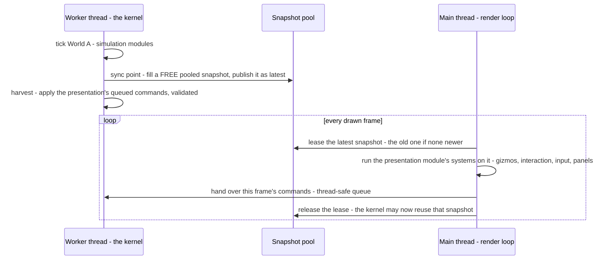

| piece | today | new |
|---|---|---|
| the kernel ticked by ONE thread that owns World A | ✅ any thread | the worker's loop, paced by the clock |
| a snapshot at the sync point | ✅ providers + `SnapshotPool` | ⚠ never overwritten while leased — `DoubleBufferProvider` overwrites its one replica in place (`:63-66`); use pooled snapshots with a lease |
| an async module on a snapshot, writing commands | ✅ DES-012 §3.3, harvested by the kernel | ⭐ **the new strategy: THREAD-AFFINE, PULLED** — run on the main thread by the render loop, at its rate, not dispatched to the pool by the kernel |
| re-run on the same snapshot | ✅ by the lease | the snapshot's accumulated events consumed once (a first-run flag) |
| one registry, one profiler, one diagnostics | ✅ one kernel | timings accepted from the main thread |
| UI-only state (selection, display, effects, ghost) | written on World A today (~40 sites, §13) | a presentation-owned data store keyed by entity — no kernel |
| ImGui panels (read World A directly, 12 files) | — | read the leased snapshot |

### 13.4 ⭐ The proof of concept — measured `2026-11-11` *(coordinator; worktree branch `poc/threaded-kernel`, project `FDP/Examples/Fdp.Examples.ThreadedKernel`; cloud VM, 4 cores, Xvfb software GL — the DRAW cost is not representative, the threading is)*

🔒 User, `2026-11-11`: *"the Windows run cannot tell … how cheap it is for 5000 or 10,000. Can we try making an experimental proof of concept? … minimalistic
UI … The goal would be how we can move the kernel to a worker thread while keeping the application thread for the presentation module."*

**What it is:** the REAL `ModuleHostKernel` with one synchronous simulation module (busy-work "brains" per entity, movement, a 512 B payload per
entity rewritten every tick, a `Bounce` event) ticked on a worker; a `SnapshotPort` (publish into a FREE pooled repository at the Export phase,
lease / release by the main thread); a presentation `IEcsModule` pulled by the render loop (map preparation + picking / dragging) on the leased
snapshot; drags go back as `EntityCommandBuffer`s played on the worker's next Input phase. `--mode single` runs the SAME modules with the kernel
ticked inside the frame — today's shape — as the baseline.

| entities | brain work | **threaded** main fps (p50 ms) | **single** main fps (p50 ms) | sim tick ms | publish ms | drag → visible ms (threaded / single) |
|---|---|---|---|---|---|---|
| 1 000 | 200 | **218** (3.8) | 128 (7.4) | 3.6 | 0.08 | 14 / 8 |
| 5 000 | 200 | **131** (7.1) | 38 (25.9) | 17 | 0.36 | 31 / 27 |
| 10 000 | 200 | **84** (11.2) | 21 (47.1) | 32 | 1.0 | 61 / 51 |
| 20 000 | 200 | **76** (13.7) | — (not run) | — | 1.8 | — |
| 50 000 | 200 | **69** (14.9) | 4.9 (203) | 191 | 3–7 | 311 / 202 |
| 10 000 | 2 000 (heavy) | **93** (12.0) | 2.5 (391) | 408 | 1.4 | 528 / 396 |

⇒ ⭐ **the main thread's frame no longer depends on the simulation**: a 400 ms tick leaves the UI at 93 fps (today's shape: 2.5 fps). What still
grows with the entity count on the main thread is the DRAWING of every point (software GL here) — the real renderer's cost, not the threading's.
⭐ **The snapshot publish is cheap**: 0.08 ms at 1 000, ~1 ms at 10 000, 3–7 ms at 50 000 entities with 512 B each — on the worker.
⭐ **An edit lands one simulation tick later** (drag → visible ≈ 1–1.5 ticks): the price, and the reason a pending / ghost state is drawn.

**What the PoC found — the troubles, measured:**

| # | finding | consequence for the real thing |
|---|---|---|
| T-1 | ✅ the kernel runs on a non-main thread with NO change — no thread-affinity checks anywhere in Fdp.Core / ModuleHost | the move itself is free |
| T-2 | ⛔ **events must NOT ride on a snapshot** — run 2 lost 8–45 of ~5 000 events: when two publishes fall between two main frames, only the newest is leased and the skipped one's events vanish. ✅ Fixed: events queue for the READER and are taken once per frame (6 432 / 6 432 at 5 000, 6 199 / 6 199 at 20 000, 5 417 / 5 417 at 50 000) | the port keeps a per-reader event queue; "one snapshot = its events" is wrong |
| T-3 | ⛔ the accumulator's read API (`ReadWindow` — a reused buffer "valid until the next capture", `EventAccumulator.cs:396-412`) is kernel-thread-only | events are copied on the WORKER at publish; the main thread never touches the accumulator |
| T-4 | ⚠ an `EntityQuery` is bound to ONE repository — the presentation rebuilds its queries per new snapshot (an allocation per publish, not per frame) | a query cache per pooled snapshot, or a re-bindable query |
| T-5 | ⚠ `DoubleBufferProvider` syncs one replica in place — unusable for a self-paced reader; the PoC needed its own pool + leases | the kernel feature: a published, leased snapshot (2–3 pooled) |
| T-6 | ⚠ a command whose target died in between throws in `Playback` (caught in the PoC) | validation before apply (DES-012 §3.3) |
| T-7 | memory: 2–3 full copies of the world (latest + leased + free) | ~3× World A — RAM is not the constraint (DES-012) |

**Two modes — one code path, two schedulings** *(user's question, `2026-11-11`)*: the PoC's `single` and `threaded` run the SAME modules; only
who ticks the kernel differs. ⇒ lean: the presentation ALWAYS reads `ISimulationView` and writes commands; the HOST chooses — **inline** (tests,
frame rails, headless nodes, HTTP-driven CI: tick → publish (zero-copy: the live world) → present, one thread, deterministic) or **threaded** (the
windowed editor / player). ⛔ Rejected: choosing by entity count at runtime — two behaviours to keep right, the threaded one exercised only at scale.
**The HTTP debug API:** its 77 `RunOnMainThread` routes already marshal to "the main/simulation thread" (`MainThreadJobQueue`) — in threaded mode
the queue drains at the WORKER's tick boundary (answers at sim rate); routes that touch UI state (map layers, camera, film, screenshots) need a
second queue drained by the presentation — each route labelled once. **Tests:** 71 files tick a kernel directly — unaffected; 118 frame-rail files
run inline.

⏭ Not covered by the PoC: the ~40 HROT UI-state writes and ~24 direct simulation writes (§13), stepped / deterministic mode on the worker, the time
controller's ACK path, the profiler fed from the main thread, managed (Tier 2) components (immutability is already the rule).

### 13.5 ⭐ Pros and cons — option (c), the kernel on a worker *(coordinator, `2026-11-11`; from the PoC §13.4 and ui's Windows measurement §11h — not ruled)*

🔒 User, `2026-11-11`: *"document how it works … and what are the pros and cons of this approach"*. How it works: §13.3 (the shape) and the PoC's
README (`FDP/Examples/Fdp.Examples.ThreadedKernel/README.md`, branch `poc/threaded-kernel`).

| ✅ pros | evidence |
|---|---|
| ⭐ **the UI and the camera stop depending on the simulation** — today every input waits a 100 ms frame, often two (§11h P-3: 98.8 ms playing vs 32.4 ms paused, 63 ms of it simulation) | PoC: a 408 ms tick leaves the UI at 93 fps (today's shape 2.5 fps) |
| ⭐ **it scales with the scenario, not against it** — 5 000 or 10 000 entities slow the SIMULATION, not the editor | PoC 1 000 → 50 000 entities: UI 218 → 69 fps (that fall is the drawing of every point), today's shape 128 → 4.9 fps |
| **the simulation gets the cores the UI used to steal** — the drawing no longer interleaves with the tick | the worker's tick ran at the same cost in both modes (PoC) |
| **the kernel needs no change to be ticked off the main thread** | PoC T-1: no thread-affinity checks in Fdp.Core / ModuleHost |
| **one code path, two schedulings** — inline (tests, rails, headless, CI) or threaded (the windowed editor / player); tests keep their determinism | PoC `--mode single` vs `threaded` run the same modules |
| it follows the kernel's OWN model (DES-012): World A on one thread, readers on replicas, writes as commands | §13.1 |

| ⛔ cons and costs | evidence / size |
|---|---|
| ⭐ **an edit lands one simulation tick later** — at a 400 ms tick a drag is visible ~0.5 s after the release; the UI must show a pending / ghost state | PoC drag → visible ≈ 1–1.5 ticks (14 ms at 1 000, 528 ms at a 408 ms tick) |
| ⭐ **the UI's writes must all become commands** — 3 shared seams queued, ~24 direct simulation writes converted, ~40 UI-state writes moved to a presentation store | §13's write table |
| **a full-world snapshot per tick, on the worker** — cheap in the PoC (1 ms at 10 000 entities), but a REAL HROT copy is heavier: ui measured ~6.5 ms per background module's mask at 1 000 men; the drawn world's mask is larger ⇒ likely ~10 ms added to each tick (to measure) | §11h P-2; PoC §13.4 |
| **2–3 copies of the world in memory** (latest, leased, free) | PoC T-7 |
| **new kernel pieces**: a published leased snapshot (the double buffer overwrites in place), a per-reader event queue (events lost when riding on a snapshot — PoC T-2), queries re-bound per snapshot, command validation, the profiler fed from the main thread | PoC T-2…T-6 |
| **the HTTP debug API splits** — 77 routes labelled sim-side or UI-side; sim-side answers at the tick's rate | §13.4 |
| **what the UI shows is one tick old** — a selected unit's values, a hover readout; fine for a 30 Hz sim, visible at 2 Hz | inherent |
| not yet proven: stepped / deterministic mode and the time controller's ACKs on the worker; the real presentation's ~40 UI-state writes; Windows numbers for the threaded mode | §13.4 ⏭ |

**Alternatives, one line each (from §11h):** (a) interleaving soldiers' brains — ~4 ms of 63, and the dt fault (HSM timers run slow) first;
(b) cutting the named non-brain costs — a long tail (~25 systems of 0.4–7 ms; the 8.3 ms of snapshot copies cannot convoy as built), 30–40 % for weeks
of work, and it does not change the shape: a bigger scenario brings the freeze back.
⇒ **Lean (coordinator and ui agree): (c)**, with (b)'s cheap items meanwhile. ⏳ For the user to rule; then an architect-question document and a
kernel design section in FDP-DES-012 before any build.

**Headless hosts are not a second architecture** *(user, `2026-11-11`: "headless mode, meaning no presentation and likely no snapshots … Isn't it the
second architecture you warned against?")* — ⛔ No. The warning was against TWO PRESENTATION paths (one reading World A directly, one a snapshot) or a
switch by entity count. A headless node (CGF, SimHost, orchestrator, CI) runs the SAME simulation modules on the SAME kernel and simply registers NO
presentation module ⇒ the snapshot port is never created and nothing is published — by construction, not by a mode flag. It ticks on its own thread,
drains the HTTP job queue there, and costs exactly what it costs today; the background modules' own snapshots (EQS, navigation) are unchanged.
⚠ The one check during the §13 migration: UI state that lives on World A entities today (e.g. `MapDisplayComponent`) must not be READ by simulation or
egress code before it moves to the presentation store — else moving it changes every host alike.

### 13.6 Where the gizmos' and UI's WORKING MEMORY lives — today vs (c) *(coordinator, `2026-11-11`; measured by grep over Hrot.Presentation, Fdp.Presentation, the toolkit's gizmo code)*

🔒 User, `2026-11-11`: *"If the gizmos or UIs need its own working memory, where is this one stored? Now in the current design and in the POC, what
will be the difference?"*

| today | examples | under (c) |
|---|---|---|
| ① components on World A entities | `SelectionStateComponent` (6 writes), `MapDisplayComponent` (2) | ⛔ a snapshot is read-only ⇒ into the presentation STORE, keyed by entity |
| ② World A singletons the presentation writes | `CanvasContextMenuState`, `IOrderForm` | into the store |
| ③ ⚠ side tables keyed by the WORLD OBJECT — `ConditionalWeakTable<EntityRepository, …>` in **21 files** (`MapUiStates.cs:16-21` rubber band, RTS mode, canvas, hat arbiter; `MissionPresentationGizmo`, `KillFeed`, `PlayerMessages`, `ViewTelemetry`, `EntityFacts`, `GameScore`, `AuthoredRules` …) | "presentation state, never replicated, saved or recorded … keyed by the world both are given" (`MapUiStates.cs:8-12`) | ⛔⛔ **the silent trap**: under (c) the view is a different POOLED snapshot each publish (2–3 rotate) ⇒ the state would reset or flip between copies with no error ⇒ re-key to the host's PRESENTATION CONTEXT; a threaded-mode rail that the band / RTS mode / hat arbiter survive several publishes |
| ④ fields on the gizmo / system objects | the drag gizmo's `_isDragging`, cached arrays | unchanged (created once with the host); ⚠ cached QUERIES are bound to one repository — rebuilt per snapshot (PoC T-4) |

The PoC: ONE `UiStore`, created with the presentation module and handed to its systems — independent of whichever snapshot is leased; the snapshot stays
read-only, only commands go back. ⇒ (c)'s cost grows by: re-key 21 side-table files (small each, silent if missed).
