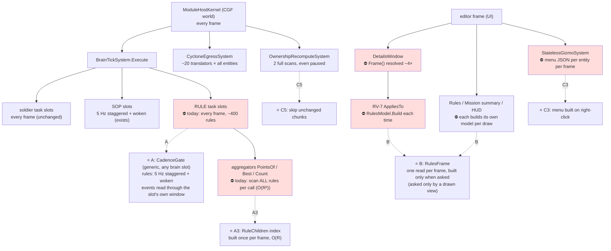
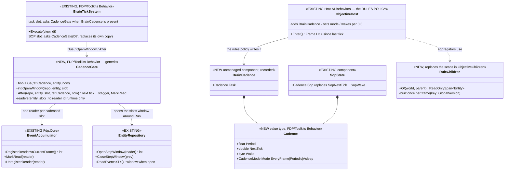
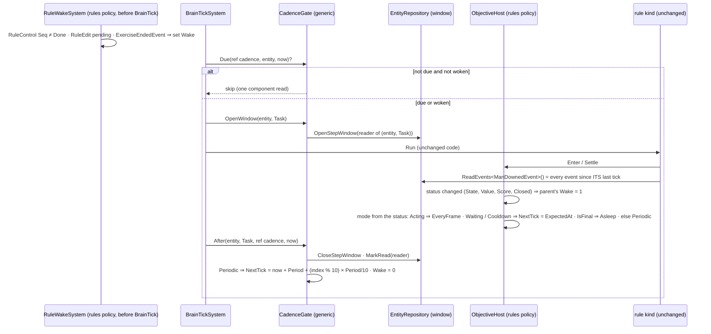
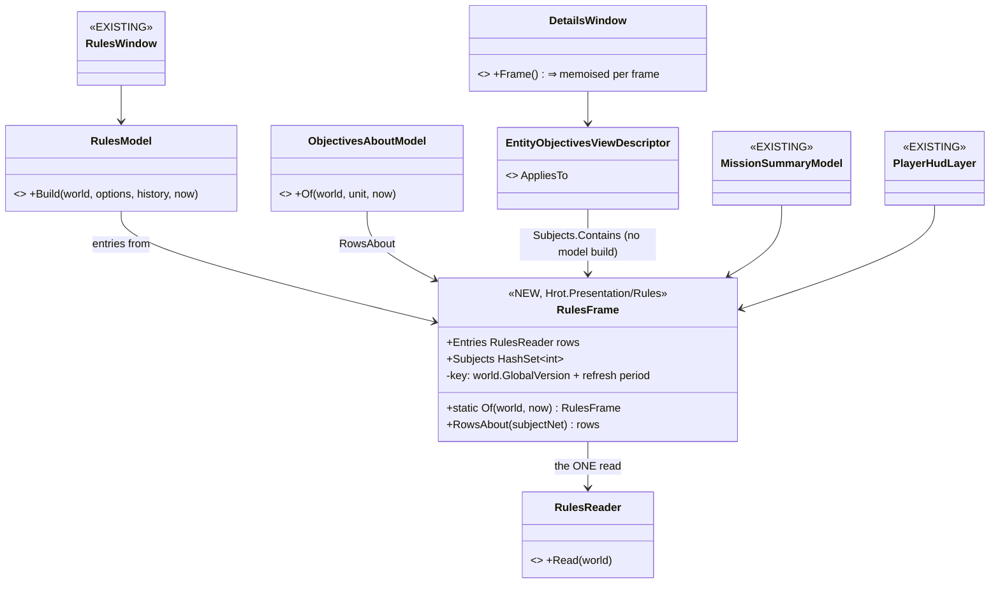
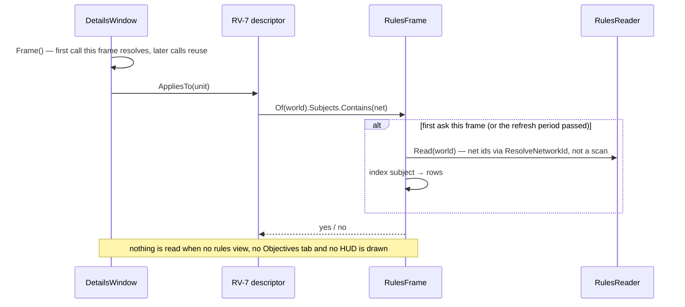

<!--STATUS
state: LIVE
updated: 2026-11-04 (§3.0: the cadence is a generic BRAIN mechanism — Cadence / BrainCadence / CadenceGate; rules are one policy)
build-state: BUILDING — D1–D8 APPROVED 2026-11-04 (R-2083); tasks T1–T10 = CE-2382…CE-2391 (§7c); T1–T10 BUILT (§3.0a, §0a)
current-answer: §2 (the picture), §3 (A — rules at a cadence), §4 (B — rules UI only when watched), §5 (C — per-entity costs), §6 (decisions)
stale-below: none
known-rot: none
known-conflict: none
related-designs:
  - docs/DESIGN_Egress_Change_Detection.md — OWNS C4 / T10: egress change detection, its hazards and options
  - docs/DESIGN_Scenario_Rules.md — OWNS the rule kinds, ObjectiveHost, triggers (T1–T3), the per-player score (§00.13); this design only changes WHEN a rule ticks
  - docs/DESIGN_Rules_View_UI.md — OWNS the rules view and RV-7 (the Objectives tab); this design only changes how often its model is built
  - docs/DESIGN_Sensors_And_Doctrine.md — OWNS the SOP slot's cadence (5 Hz, staggered, woken; §G5, R-195) — the pattern part A reuses
  - docs/blueprints/DESIGN_Paused_And_Stepped_Execution.md — OWNS the EventAccumulator and the per-reader step window (§1a/§1b) — the mechanism part A reuses for exactly-once events
  - docs/UX/UX_Feature_Cross_Surface_Actions.md — OWNS the right-click menu; its ruling "serialise on right-click, not per Draw" (:158, :225) is what C3 builds
  - docs/DESIGN_Ownership_Groups_And_Grants.md — OWNS OwnershipRecomputeSystem's per-frame passes (S6, S8) that C5 gates
  - FDP/Engine/docs/FDP-FlightRecorder.md — OWNS the recorder (FDP-DES-001…011: page copy, sanitize, deltas, format v2); §5b C7 changes only how much of a changed delta page is written
  - docs/DESIGN_Replay_Time_Axis_And_Review.md — OWNS §12q/§12s (a chunk written only when its bytes moved, reset at a keyframe) — C7 keeps that rule
  - docs/designs/dds-to-ecs/DESIGN.md — OWNS egress; its "the translator skips unchanged chunks" (:468) is aspirational — C4 records why it is not taken here
-->

# Evaluation cost and cadence — why Crossfire is slow, and the fix

> **Tracker:** [CE-2381](blueprints/Blueprint_Issues_Tracker.md) (the general cost) · [CE-4259](blueprints/Blueprint_Issues_Tracker.md) (selecting a unit drops to ~1 FPS).
> 🔒 **User, `2026-11-04`:** *"it is a bit slow even when no entity is selected … the amount of entities is not so high, so it's weird"* ·
> *"Can we build one shared 'unit → its rules' index per frame only when somebody is actually watching it … Cant we evaluate the stuff not
> every frame, but once per few frames and with interleaving, does anything depend on every frame and fixed ordering evaluation? Note the
> system has to handle thousands entities … if there is anything what would help all entities, it would be welcome as well."*

## 0. What was measured

`showcase-crossfire`, `--mode all` under Xvfb, `HROT_FRAME_STATS=1`, `/diagnostics/architecture`, `dotnet-trace` (sampled thread time).

| | measured |
|---|---|
| loaded, paused | update ≈ 20 ms/frame |
| ▶ playing, nothing selected | update **≈ 85 ms at 10 s → ≈ 120–135 ms at 100 s** (≈ 7–10 FPS); UI ≈ 7, draw ≈ 1 |
| a soldier selected, Details open | `cgf_details` **40 → 80 ms/frame within 15 s**; frame 250–400 ms |
| the world | **365 entities** after macro expansion (the file has 85), **+1/s, nothing removed** (524 at 100 s): every respawn is `InsertMacro game/bot` = a new bot + a new ~14-rule score set — by design |
| `BrainTickSystem` | 20 → 25 ms; ≈ ¾ of it the RULE trees (`Points`, `Count`, `Best`, `MemberEvaluation`, `Trigger`), not the soldiers |
| egress ×4 worlds · recorder ×4 · ownership recompute ×4 | ≈ 15 · ≈ 8–11 · ≈ 7 ms |
| a per-T cached component type id (prototype) | ≈ 10 % of update early, nothing measurable at 100 s — the trace's "50 % in the type lookup" was mostly sampler bias |


### 0a. ✅ MEASURED AFTER T1–T9 *(`2026-11-04`, the same scripts as §0, runner rebuilt at `cb3f0f3bd`)*

| | before | after |
|---|---|---|
| ▶ playing, nothing selected — update at 10–20 s | 83–98 ms | **53–55 ms** |
| … at 100 s (524 entities) | 119–136 ms | **82–104 ms** |
| a soldier selected, Details open — `cgf_details` | 40 → 80 ms/frame | **≈ 1 ms/frame** (CE-4259: the selected frame rate = the unselected one) |
| `BrainTickSystem` (30 s / 100 s) | 20.1 / 25.2 ms | **5.9 / 9.9 ms** |
| `OwnershipRecomputeSystem` ×4 | 6.5 / 7.9 ms | **0.6 / 0.7 ms** |
| `RecorderTickSystem` ×4 · `CycloneEgressSystem` ×4 | 24 / 25 · 17 / 18 ms | 25 / 24 · 15 / 18 ms — ⚠ untouched by this design: **now the two largest costs** |

⚠ **Still open:** the round still slows as respawns add entities (the egress and the recorder are linear in them), and `--mode all` pays both
four times. ⇒ the next levers are the egress design ([DESIGN_Egress_Change_Detection.md](DESIGN_Egress_Change_Detection.md), E3 then E1) and the
recorder (not yet analysed).

### 0b. 📐 The EDITOR's main thread, measured *(`2026-11-04`, after CE-2392/2393; `dotnet-trace` sampled, 10 s at ~60 s of Crossfire, `--mode editor` under Xvfb)*

⭐ The realistic single-world case (user: one node per computer). Shares of the main thread, each sample given to the INNERMOST system (no group double count):

| what | share | note |
|---|---|---|
| native drawing — `EndDrawing` / swap (24 %), ImGui `RenderData` (9 %) | **≈ 33 %** | ⚠ **software OpenGL on this VM (Xvfb, no GPU)** — expect far less on a real GPU; not measured there |
| UI windows built (ImGui) | ≈ 6 % | |
| simulation update | **≈ 58 %** | ↓ split below |
| ↳ `BrainTickSystem` | 8.7 % | soldiers + rules |
| ↳ recorder (deltas 6.7 + keyframes 0.7) | 7.4 % | after CE-2392 |
| ↳ `StatelessGizmoSystem` — map gizmos per entity per frame | 6.4 % | `Seeable.OnMap` 2.6 (`HasPresenceItself`, `InstancesWithMembers`) |
| ↳ `OnDemandProvider.AcquireView` — a module's world copy (`SyncFrom`) | 4.4 % | managed tables 1.5, blueprint blackboards (16 KB / 4 KB per entity) 0.9 |
| ↳ `MacroExpansionSystem` — `MacroExpander.Flatten` per respawn | 3.6 % | each respawn expands a bot + its score set |
| ↳ `LiveTimelineSource.Step` — the live timeline's lanes | 3.5 % | `ValueChangeLane` boxes each value (`ComponentBox.Read` 1.9) |
| ↳ ~45 other sim systems, each < 1.5 % | ≈ 15 % | |

⇒ the four rows gizmos + view copy + macro flatten + timeline ≈ **18 %** — work that is not the simulation's own; the next levers.

## 1. INVENTORY (the queries this design rests on)

| question | query | result |
|---|---|---|
| any brain tick-rate / LOD / stagger mechanism? | `search_graph` `.*(Lod\|TickRate\|TickInterval\|Cadence\|Throttl\|Interleav\|Budget).*` Class/Method/Field | none for brains; per-system cadence gates (`SquadPerceptionMerge`, `CommanderUtility`, `RouteContext`), module `TargetFrequencyHz` (`ModuleHostKernel.cs:1318`), EQS `BudgetUnits`; ⭐ the SOP slot's cadence (`BrainTickSystem.cs:209–240`, found by grep of the design corpus) |
| any event history a slower reader can use? | `search_graph` `.*(EventHistory\|EventAccumulat\|Inbox\|Mailbox\|EventLog).*` Class/Interface | ⭐ **`EventAccumulator`** (`Fdp.Core/EventAccumulator.cs`) + per-reader step window (`EntityRepository.View.cs:109–141`, `SystemScheduler.cs:250–275`); attached to every kernel's live world (`ModuleHostKernel.cs:164`) |
| any per-frame memo? | `search_graph` `.*(FrameCache\|PerFrame\|FrameMemo\|OncePerFrame).*` | none (tests only) |
| rule code that reads one-frame events | grep `ReadEvents<\|ReadManagedEvents<` in `Brains/Objectives` | `MeasuresEvidence.cs:75,81,97,121,203` · `BountyBehavior.cs:105` · `NoHarmBehavior.cs:53` · `Verbs/CommandVerbs.cs:152` · (`ExercisePauseOnEndSystem.cs:43` — its own system) |
| rule code that integrates time | grep `f.Dt` | `HoldArea` `:67,:118` · `ClearArea` `:48` · `Measures` `:293` — `Dt` is *"seconds since this objective's last tick"* (`ObjectiveHost.cs:17,84`) |
| per-frame linear net-id scans | grep `FindEntityByNetworkId(` (42 production sites), classified by an explorer pass | ≈ 15 per-frame (rules UI, mission summary, HUD, route / air / drill behaviours) — the resolver's own ruling calls that a defect (`NetworkIdResolver.cs:24–30, 78–104`) |
| the right-click menu | read `ContextMenuProjectorGizmo`, `DebugPrimitiveBuffer.cs:531`, `GizmoMap…/DebugGizmoLayer.cs:186–282`, `MapEntityMenuHandler.cs:68` | built + FNV-hashed per entity per frame; consumed only on right-click (and by the remote viewer's publisher) |

⚠ `check_index_coverage` is not available through the CLI — the absences above are graph + grep, not a coverage proof.

## 2. The picture — who runs each frame, and what this design changes



*What the picture shows that prose hides:* every red box runs whether or not anything changed, and two of them (the aggregators, RV-7)
are **quadratic** in a count that grows all round. The dashed arrows are this design; nothing in the soldiers' path changes.

## 3. Part A — rules evaluate at a cadence, interleaved, woken by what matters

### 3.0 Mechanism and policy — ⭐ the cadence is a BRAIN concept, not a rules one *(user, `2026-11-04`)*

> 🔒 **User:** *"isn't that gate / non-every-time brain ticking a generic concept, not tied to rules, so it might deserve a more generic name and
> more generic implementation?"*

| layer | what | where | knows about rules? |
|---|---|---|---|
| ⭐ **mechanism** | `Cadence` (when a brain slot ticks: period, next tick, wake, mode) · `BrainCadence` (the TASK slot's cadence on an entity) · `CadenceGate` (due? · open the slot's event window · after: next tick, stagger) | `FDP/Toolkits/Fdp.Toolkits/Behavior` (beside `BrainTickSystem`) | ⛔ no |
| ⭐ **users of the mechanism** | the TASK slot of any entity carrying `BrainCadence` · the **SOP slot** (its `SopNextTick` / `SopWake` become a `Cadence` inside `SopState`, ticked through the same gate — D7) · a later soldier / vehicle LOD (D6) | — | — |
| **policy** | WHICH brains get a cadence, with what period, and what wakes them | rules: `ObjectiveHost` (Hrot.AI.Behaviors) adds `BrainCadence` and sets the wakes of §3.3 · SOP: `BrainTickSystem` as today (5 Hz, woken by `SensorChangedEvent` / `BehaviorFinishedEvent`) | rules: yes — and only here |

⭐ **Anyone may wake a cadenced brain** by setting its `Wake` (a child rule waking its parent, an operator action, a future "enemy in sight" for a soldier) or by
setting its `NextTick` earlier (a trigger's `ExpectedAt`). ⭐ **A brain WITHOUT `BrainCadence` ticks every frame — exactly as today** (soldiers, vehicles).

### 3.0a ✅ AS BUILT — T1 / T2 / T3 *(behaviors, `2026-11-04`; CE-2382 `72e0f1f98`, CE-2383 `1609b80ce`, CE-2384 `a7fbfe66f`)*

| as designed (§3.0–§3.2, §7a) | ⭐ as built | why |
|---|---|---|
| a `BrainCadence` component (S1) | ⚠ **DEVIATION:** the task slot's cadence is FIELDS of `BehaviorState` — `Cadence` (`CadenceMode`, `EveryFrame = 0`), `CadenceWake`, `CadencePeriod`, `CadenceNextTick`, `CadencePolicy` | the behaviors component-id block 418–433 is FULL (`GlobalComponentIds.cs`); the loop already reads `BehaviorState` per brain (no extra lookup); it mirrors `SopState`'s `SopNextTick` / `SopWake`; a layout change has precedent (`RunSince`, CE-2080). The wire copies `BehaviorState` field-wise (`BrainIntentTranslators.cs:116`) |
| `CadenceGate.Due / OpenWindow / After` | `CadenceGate.Due / Next / KeepsWindow` (pure, `Fdp.Toolkit.Behavior/Cadence.cs`); the window open / close / reader lifetime live in `BrainTickSystem` (`OpenCadenceWindow`, `AfterCadencedTick`, `ReleaseCadenceReader`) | the window needs the repository's step-window API and the system's reader table |
| the policy writes the cadence from inside the tick | ⚠ **ADDED:** `CadencePolicies` — a policy id in `BehaviorState.CadencePolicy`; `BrainTickSystem` calls it AFTER each tick of its slot | the kinds have no common exit, and the mode must come from the status the tick LEFT (a trigger turning Waiting sleeps to its exact `ExpectedAt`); `ObjectiveHost.Enter` claims the slot (`RuleCadence.Own`) |
| rules `Periodic` at 5 Hz | rules are a TIMED SLEEP: to their next staggered 5 Hz tick or their own `ExpectedAt`, whichever is first (`RuleCadence.ModeOf`) | a holdFor end / deadline / delay / cooldown is hit exactly — better than D2's "≤ 0.2 s" for the known times |
| a slot becoming cadenced mid-tick | `AfterCadencedTick` runs after EVERY task tick (when the world keeps a history) and registers the reader at once | a policy's first tick turns the slot on; without this the events between that tick and the first cadenced one would be lost |
| no history | a world without an `EventHistory` ticks every brain every frame | a bare world (a unit rail) could not give the slot its window |
| `RuleWakeSystem` (S4) | as designed + `RuleEditSystem` and `SetObjectiveActive` wake their rule directly | an edit / a switch from another rule must not wait a period |
| `RuleChildren` (A3) | `RuleTree` (`Brains/Objectives/RuleTree.cs`): every rule, children by resolved parent, rules by resolved subject; ascending entity index; rebuilt on `GlobalVersion` or `Invalidate` (a new rule, a parent / subject change, Best's winner) | the same index serves the bounty lookup (by subject) and `RuleWakeSystem` |

⭐ Rails: `CadenceGateTests` (7, the mechanism; the SOP's 36 `SopSlotTests` green on the shared gate) · `ScenarioRulesTests.Cadence` (5, a 60 Hz world with the
kernel's event history: exactly-once shots / kills, a delay on its exact time, a parent within a frame, the close within 4 frames, Acting every frame /
closed asleep) · `ScenarioRulesTests.Score` `CE2384_*` (the index once per frame). ⚠ The `ScenarioRulesTests` harness keeps no history by default, so its
other 150 rails still tick every rule every frame (unchanged behaviour); `ObjWorld.WithHistory()` opts in.

### 3.1 Classes



*What the picture shows:* the mechanism (`Cadence`, `BrainCadence`, `CadenceGate`) sits in the generic behaviour toolkit and has no arrow to anything about
rules; the only rules-aware box is `ObjectiveHost`, which WRITES a cadence. The SOP slot points at the same `Cadence` — one implementation, two slots.

### 3.2 One frame



*What the sequence shows:* the rule's own code does not change — the window makes `ReadEvents` return everything since that rule's last
tick, so every kill, capture and hit is counted **exactly once** whatever the cadence (the CE-3293 step window, per slot instead of per system).
⭐ The generic gate never looks at a rule: waking the parent and choosing the mode are `ObjectiveHost`'s (policy), done from the shared
`ObjectiveStatus` — `TriggerState`, `IsFinal`, `ExpectedAt` (`ObjectiveStatus.cs:16, 62, 81, 94`) — so no rule kind needs code of its own.

### 3.3 The cadence per rule state — ⭐ the table the user asked for: *"does anything depend on every frame?"*

| rule / state | mode | why (code) |
|---|---|---|
| any rule, normal | **5 Hz, staggered by entity index** (period 0.2 s, phase `index % 10 × 0.02 s`, in SIM time ⇒ deterministic) | the SOP precedent (`BrainTickSystem.cs:240`) |
| measures reading events (`Count`, `HitRatio`, kills / deaths / captures / assists, `Bounty`, `NoHarm`) | 5 Hz **through the rule's window** | `MeasuresEvidence.cs:73–121`, `BountyBehavior.cs:105`, `NoHarmBehavior.cs:53` read *this frame's* events today — the window makes them read *since last tick* |
| time-integrating kinds (`HoldArea`, `ClearArea`, `Above` threshold) | 5 Hz | already correct at any cadence: `Dt` = since last tick (`ObjectiveHost.cs:84`); the sampled condition is assumed constant between ticks (≤ 0.2 s) |
| trigger **Armed / Holding** | 5 Hz | `holdFor` / `delay` are sim seconds (T3) — fire time rounds to ≤ 0.2 s; ⚠ a condition true for < 0.2 s may be missed (**D2**) |
| trigger **Waiting / Cooldown** | asleep, **woken at `ExpectedAt`** | the time is already known (`ObjectiveStatus.ExpectedAt`, V-2) ⇒ exact |
| trigger **Acting** (running its `do` list) | **every frame** | `CommandVerbs.cs:152` reads `MissionControlAckEvent` while Running (design :343) |
| a rule with a pending `RuleControl` / `RuleEdit` (UI Fire / Rearm / Reset / edit) | woken | an operator action must take effect next frame |
| exercise closing (`ExerciseResult` phase ≠ Running) | **every rule woken** | SR-116 close + awards must all settle |
| final (Achieved / Failed / Skipped, closed) | **asleep** until woken by Reset / edit | nothing changes it (`Frame.Evaluate` = false) |
| a composite whose CHILD's status changed | woken next frame | §3.4 |

### 3.4 Ordering — does anything depend on it?

⭐ **No design relies on same-frame order.** Today a parent sees a child's change in the same frame only if the child's entity index is
lower (query order) — incidental. With the cadence, **a child whose status changed wakes its parent** (`ObjectiveLinks.Parent`), so
propagation up a tree is ≤ 1 frame per level, never ≤ 0.2 s per level. ⚠ A **trigger whose `when` reads another rule's status** is not
woken by that change (its `when` is a compiled level predicate; finding its inputs is not cheap) ⇒ it reacts within ≤ 0.2 s (**D3**).

### 3.5 A3 — the aggregators stop being quadratic

`ObjectiveChildren.PointsOf` (`ObjectiveAggregators.cs:64`), `BestBehavior.Find` / `.Sibling`, `ObjectiveChildren.Of` each scan **every rule**
and resolve its parent, per call, per frame. ⇒ `RuleChildren`: a parent → children index built **once per frame on first use** (one pass
over `ObjectiveLinks`), every aggregator reads its span. O(R²) → O(R). ⭐ Independent of A1: it pays even at 60 Hz.

### 3.6 Who gets a cadence

⭐ **The mechanism is for any brain; THIS design's policy cadences rule entities only** (an entity carrying `ObjectiveStatus`): `BrainCadence` is
added by `ObjectiveHost.Enter` on first tick, exactly like `ObjectiveStatus` / `ObjectiveLinks` / `RuleControl` already are (`ObjectiveHost.cs:38–50`).
⛔ Soldiers' and vehicles' task slots get no `BrainCadence` here ⇒ they tick every frame as today; the only cost to them is one component-bit test per
brain per frame, beside the `IsFirstVisit` bit test the loop already makes (`BrainTickSystem.cs:172–177`; the visit order is unchanged, CE-3137).
⭐ A soldier / vehicle LOD later is a POLICY that adds `BrainCadence` (**D6**); the SOP slot moves onto the same gate (**D7**).

```csharp
// BrainTickSystem tier loop — the whole change for the task slot
if (!IsFirstVisit(repo, entity, t)) continue;                          // exists
bool cadenced = repo.HasComponent<BrainCadence>(entity);               // NEW — one bit test; 0 for soldiers / vehicles
if (cadenced && !CadenceGate.Due(ref repo.GetComponentRW<BrainCadence>(entity).Task, entity, now)) continue;
int prev = cadenced ? _gate.OpenWindow(repo, entity, Slot.Task) : -1;
try { Run(runner, repo, entity, behavior, def, dt); }                   // unchanged
finally { if (cadenced) _gate.After(repo, entity, Slot.Task, ref repo.GetComponentRW<BrainCadence>(entity).Task, now, prev); }
```

⚠ **A cadenced brain must measure time as "since my last tick", not the frame `dt`.** Rules already do (`ObjectiveHost.cs:84`). ⏳ To verify before
building: no rule asset contains a generic BTree node (a `Wait`) that integrates the frame `dt` — the trace showed one-node trees. ⚠ A soldier LOD
(D6) would have to settle this for every soldier node — a reason it is its own design.

## 4. Part B — the rules UI builds its model only when something drawn asks, once per frame





| | ⭐ rule |
|---|---|
| **B1 watched-only** | `RulesFrame.Of` is called only from a `Draw` / `AppliesTo` — so with the Rules window closed and no unit in Details, **nothing is built**. ⭐ The `RuleLeafSampler` precedent (2 Hz, only while the live-values view is shown; `DESIGN_Scenario_Rules.md:513`) |
| **B2 one read per frame** | the memo is keyed by the world's version: RV-7's AppliesTo, its Draw, the Rules window, the mission summary and the HUD share ONE `RulesReader.Read` (⭐ "one owner of a concept") |
| **B3 refresh period** | the memo also holds for **0.2 s wall** (**D4**) — a reader of words and colours does not need 60 Hz; a click or a selection change refreshes at once |
| **B4 `DetailsWindow.Frame()` once per frame** | its own comment says *"builds the context ONCE and asks the selector ONCE"* (`DetailsWindow.cs:292–296`); `ShowsFloatAndPin` → `CurrentDescriptor()` (`:537, :566, :684, :728`) re-resolves it — memoise per frame |
| **B5 no linear scans** | `RulesReader.MacroOf` (`RulesModel.cs:122`), `GroupOf` / `LinkOf` / `RowOf` (`:227, :245, :280`), `MissionSummaryModel` (6 sites), `AuthoredRules.cs:76`, `MessageDelivery.cs:34`, `PlayerHudLayer.cs:53, :237` → `ResolveNetworkId` (C2) |

## 5. Part C — what helps every entity (thousands)

| # | change | measured basis | design basis | owner | lean |
|---|---|---|---|---|---|
| **C1** | ⭐ `ComponentType<T>.ID` / `ManagedComponentType<T>.ID` cache the id per T (a static + a registry generation bumped by `Clear()`); today every component access takes a global lock + a `Dictionary<Type>` lookup (`ComponentType.cs:25, :53, :111`) | prototype: ≈ 10 % of update early | none (the comment *"JIT will inline this to a constant"* is false today) | backend | ✅ do — engine-wide, tiny |
| **C2** | ⭐ every PER-FRAME `FindEntityByNetworkId` (≈ 15 sites: rules UI, mission summary, HUD, `HrotRouteSource`, `CgfNodes:245`, `AirHolds:78,91`, `AirborneDrillBehaviors:116`) → `ResolveNetworkId` (the maintained map, same answer) | O(N) per call ⇒ O(N²) shapes | `NetworkIdResolver.cs:24–30, 78–104`: *"never on the tick"* — a per-frame scan is a defect | behaviors (AI) + ui (Presentation) | ✅ do — drop-in |
| **C3** | ⭐ the right-click menu is built **on right-click**: `ContextMenuProjectorGizmo.Draw` stops building + hashing JSON per entity per frame; the right-click handler (`GizmoMap…/DebugGizmoLayer.cs:265`) asks a resolver (net id → `MenuJsonFor`) — the path `MapEntityMenuHandler.MenuJsonOf` (`:68`) and `MenuShortcuts.Resolve` (`:76`) already use | ≈ 6 % of the frame | 🔒 user `2026-08-10`: *"Serialise on right-click, not per `Draw`"* (`UX_Feature_Cross_Surface_Actions.md:158, :225`) | ui | ✅ do; the remote viewer's publisher keeps per-frame JSON **only while a remote viewer is connected** (**D5**); ⚠ unverified: the layer's `Update` runs on the kernel's thread |
| **C4** | egress: gate the ~20 translators' full scans on chunk versions | ≈ 15 ms ×4 worlds | `dds-to-ecs/DESIGN.md:468` says it, ⛔ only `NavigationIntent` does it | backend | ⛔ **not in this design** — measured hazards: a T-only gate misses authority changes on the ROOT entity, heartbeats (GeoSpatial / NavigationStatus), multi-component descriptors, managed in-place writes, and `QueryDelta` checks one slot per header chunk (`EntityRepository.DeltaQuery.cs:118–120`). ⇒ its own backend design; C1 already makes each `HasAuthority` cheaper |
| **C5** | `OwnershipRecomputeSystem` `SyncPartClaims` + `ClaimLateRootComponents` skip entities with no structural change since its last run (`LastChangeTick` / header chunk version, as the recorder does, `RecorderSystem.cs:574–600`); the event pass stays | ≈ 2 ms × 4 worlds, every frame incl. paused; CE-3244: 4–7 ms at 300 civilians | `DESIGN_Ownership_Groups_And_Grants.md:446–449` (S6, S8) chose per-frame scans; no gate evaluated | backend | ✅ do — ⚠ `SetAuthority` does not stamp, covered because ownership changes arrive as `OwnershipUpdate` (the event pass) |
| C6 | `--mode all` runs 4 worlds in one process (each records, egresses, recomputes) | ≈ 30 ms | a deployment artefact | — | no action: on a cluster each node pays for one |


### 5a. ✅ AS BUILT — T4–T7, T9, T10 *(behaviors, `2026-11-04`)*

| task | as built | deviation / note |
|---|---|---|
| T4 CE-2385 `cb3f0f3bd` | `CadenceDrain` (per world, `Fdp.Toolkit.Behavior/Cadence.cs`): `BrainTickSystem` reports whether any cadenced window is open; `RecorderTickSystem` asks for a drain and defers a due checkpoint (beside CE-3316's in-flight deferral); the brain tick ticks every cadenced slot and reports; the checkpoint is written then. Capped at `MaxDrainDeferrals` = 3 frames | a flag handshake, not frame-stamped: the recorder's rail drives tick + recorder in one call |
| T5 CE-2386 `80bf1ef6e`, `877fe502e` | `DetailsWindow` keeps the draw's frame while drawing (one resolve per draw); RV-7's `AppliesTo` = `ObjectivesAboutModel.Any` (no model); its drawn rows refresh ≤ 5 Hz; the rules UI / summary / debrief / HUD resolve ids through the map | ⚠ **SCOPE CUT:** no `RulesFrame` memo and no 0.2 s throttle on the Rules / Mission Summary windows and the HUD — their frame rails drive `BuildAndPublish` directly, so a draw-path throttle risks stale reads after a click; with O(1) resolves one build per draw is O(rules). Revisit if measured |
| T6 CE-2387 `2fdea20f3` | `MenuResolver` on GizmoMap's layer (+ passthrough), set ONCE in `MapInteractionPack.BuildRenderLayer` to `MapEntityMenuHandler.MenuJsonOf`; `ContextMenuProjectorGizmo.Draw` emits nothing | D5 reduced: the remote Godot viewer is DEFERRED (U13) and Hrot publishes no intern strings — nothing consumes the per-frame JSON |
| T7 CE-2388 `ab7e306d3`, `877fe502e` | 15 per-frame `FindEntityByNetworkId` → `ResolveNetworkId` (AI behaviours, route source, rules UI, HUD, debrief) | the on-demand sites (clicks, API, load) are unchanged — the resolver's ruling allows the scan there |
| T9 CE-2390 `98da8f330` | both scans skip an entity whose `LastChangeTick` < the last run's version unless an event touched it (or its root) | `>=` keeps a non-ticking world scanning all; `ScannedLastRun` counter for rails |
| T10 CE-2391 `d53f730ba` | [DESIGN_Egress_Change_Detection.md](DESIGN_Egress_Change_Detection.md) | a design question, not a build |

### 5b. ✅ AS BUILT — the recorder and the table lookup *(behaviors, cross-lane into FDP core, `2026-11-04`; after §0a named them the largest)*

📐 Basis: `dotnet-trace` of Crossfire playing (`--mode all`, 4 worlds) — `RecorderTickSystem` = **26.8 %** of the main thread:
`Records()` 8.7 · `SanitizeScratchBuffer` 8.3 · memmove 4.3 · `FillLiveness` 3.7 · `ChunkBytesMoved` 3.2 · keyframe 1.7. Egress (12.8 %) is spread
over ~20 translators; its common part is `HasAuthority` (3.2 %), most of which is `GetComponentRO` / `HasComponent`.

| # | change | why it is safe |
|---|---|---|
| **C7** CE-2392 | ⭐ **R1** `Records()` reads a recordable `BitMask512` rebuilt only when `ComponentTypeRegistry.RecordableVersion` moves (a registration, `SetRecordable`, `Clear`) — it took the registry lock per table per frame. ⭐ **R2** a DELTA writes each changed component chunk's **used prefix** — `(min(capacity, MaxIssuedIndex+1) − startId) × size` bytes — copied with `CopyChunkToBuffer(chunk, dst, maxBytes)`, sanitized, compared (`ChunkBytesMoved` keeps a full buffer + length) and written at that length | the format already carries each chunk's length and `RestoreChunkFromBuffer` copies `min(length, chunk)`; the slots past `MaxIssuedIndex` were never issued (zero live), `MaxIssuedIndex` only grows (`EntityIndex.cs:124, :457, :626`) and a keyframe `Clear()`s the playback world (`PlaybackSystem.cs:60`) ⇒ playback is byte-identical for every issued slot. Keyframes and the entity-index chunks are unchanged (full chunk) |
| **C8** CE-2393 | ⭐ `EntityRepository.GetTable<T>` reads the **existing** id-indexed `_tableCache` (`EntityRepository.cs:26`, already filled for every table) by `ComponentType<T>.ID`, with an exact-type check; the `Dictionary<Type>` lookup is the miss path | ⭐ the seam existed and was under-used (only the by-id paths read it). A registry re-numbering (`Clear()` in tests) fails the type check ⇒ dictionary, as before. Every `GetComponentRO/RW` in every system gains |

📐 **Measured after (`b653a2d27`, same `perf4` run as §0a; `/diagnostics/architecture`, sums over the 4 worlds):**

| | before (same frame count) | after |
|---|---|---|
| `RecorderTickSystem` ×4, recent avg ≈ 1 000 frames | 27.1 ms | **9.0 ms** |
| … lifetime avg | 10.2 ms | **6.1 ms** (9.3 at 2 450 frames / 100 s) |
| `CycloneEgressSystem` ×4, recent | 12.9 ms | 11.3 ms — within run noise |
| frame `update` at 10–30 s · at 100 s | 53–55 · 82–104 ms | 54–56 · 81 ms — ⚠ **the frame did not move measurably early**: the recorder's recent average is dominated by keyframe spikes, not the steady frame. Still linear in entities |

📐 **A/B, `2026-11-04` — the same binary with and without CE-2392/2393, interleaved A B A B on one machine** (`perf4`, Crossfire, frame
`update` from `HROT_FRAME_STATS`; ⛔ the table above compared DIFFERENT runs and understated it):

| run | update 10–20 s | update 30–100 s (mean · median) | whole frame 30–100 s |
|---|---|---|---|
| A without | 50.1 | 87.9 · 92.2 | 110.7 |
| B with | 46.7 | 73.7 · 69.3 | 97.2 |
| A2 without | 53.4 | 79.7 · 80.7 | 102.3 |
| B2 with | 48.9 | 67.6 · 68.6 | 91.7 |

⇒ ✅ **≈ 13 ms (≈ 16 %) less update once the round is running, ≈ 4 ms early; the same direction in both pairs.** Kept.

📐 **The realistic case — the EDITOR** *(user, `2026-11-04`: "for checking recording performance, the editor is the best case … no network, but
a full recording of the full world and just one single recording per process")* — ⚠ `--mode all` above runs 4 worlds and 4 recorders on one
thread, which no deployment does. Same interleaved A/B, `ClusterRunner --mode editor`, Crossfire:

| run | update 10–20 s | update 30–100 s (mean · median) | `RecorderTickSystem` avg at 100 s | its max |
|---|---|---|---|---|
| A without | 27.3 | 43.5 · 41.7 | 8.05 ms | 172 ms |
| B with | 24.9 | 35.8 · 33.0 | 3.52 ms | 169 ms |
| A2 without | 33.3 | 40.2 · 40.2 | 7.08 ms | 159 ms |
| B2 with | 26.4 | 34.8 · 34.2 | 3.63 ms | 208 ms |

⇒ ✅ **the recorder ≈ 55 % cheaper (≈ 7.5 → 3.6 ms/frame), the update ≈ 6–8 ms (≈ 15 %) shorter.** ⛔ ~~*"What is left: the MAX — a 160–210 ms recorder frame: the keyframe … a visible hitch"*~~ — **WRONG, retracted the same day** (user:
*"isn't the keyframe … processed in a background thread?"*). The `max` column is the LIFETIME max of the system, i.e. most likely the FIRST
keyframe at startup (JIT, first-use allocations), not a recurring frame. ⭐ As built (FDP-DES-004, `AsyncRecorder.cs:228–259`, non-blocking by
default `RecordingConfiguration.Blocking = false`): compression and the write run on a worker; the main thread does only the synchronous copy
(DES-004 §2.1 — it must, or the sim tears the read) plus a wait for the previous frame's worker. 📐 Trace (`--mode all`, before CE-2392, tracer
overhead included): a keyframe's copy 22 ms median / 40 ms max per world, every 60 frames — **1.7 % of the main thread, against ≈ 25 % for the
deltas**. ⇒ keyframes are not the recorder's cost; not a lever now.
has a 160–210 ms recorder frame: the keyframe (full pages, every table, synchronous). One frame in ~10 fps is a visible hitch; it is the next
recorder lever, not the per-frame cost.

⛔ **E3 not built — measured against its premise.** Hoisting a translator's own dirty / cache check before `HasAuthority` only saves work on
OWNED unchanged entities; on a replica (3 of the 4 worlds hold each entity as a replica in `--mode all`) the replica has no
`EgressPublicationState` / cache entry, so the cheap check passes and `HasAuthority` still runs — the hoist ADDS work there. ⇒ C8 (cheaper
reads under `HasAuthority`) instead; E1 stays the real fix ([DESIGN_Egress_Change_Detection.md](DESIGN_Egress_Change_Detection.md) §3).

## 6. Decisions — ✅ APPROVED on the leans (R-2083)

🔒 **User, `2026-11-04`:** *"D1–D8 approved on your leans, break it into tasks, and start working on those - just you, no other lanes"*

| # | question | ⭐ lean | what would change it |
|---|---|---|---|
| **D1** | rule period | **0.2 s (5 Hz)**, the SOP's | a rule that must react faster ⇒ per-kind override (`EveryFrame` mode exists) |
| **D2** | a trigger condition true for < 0.2 s may be missed | **accept** — conditions are levels (positions, counts, statuses); a one-frame pulse is an event, and events are counted exactly-once via the window | an authored trigger on a sub-0.2 s level |
| **D3** | a trigger reading another rule's status reacts within ≤ 0.2 s (not woken) | **accept** | a chain of N triggers where N × 0.2 s matters ⇒ wake triggers on any status change (cheap to add later) |
| **D4** | the rules UI refresh | **once per frame, at most every 0.2 s wall**; a click / selection refreshes at once | an instructor wanting live 60 Hz numbers |
| **D5** | the remote (Godot) viewer's per-entity menu JSON | **only while a remote viewer is connected** (watched-only, like B1) | the remote viewer moving to request/reply on right-click |
| **D6** | soldiers' task slots at a cadence too | **not now** — a separate "brain LOD" design (distance to the camera / to the enemy) | a thousands-soldier scenario measured slow in `BrainTickSystem` after A |
| **D7** | fold the SOP's own cadence (`SopNextTick`, `SopWake`) onto the generic `CadenceGate` (§3.0) | **yes, in the same batch** — one cadence implementation (ruling 9); `SopState` keeps its fields (S2) | — |
| **D8** | a restore while a rule's window is open loses that window's events (§6a) | ⭐ **revised `2026-11-04`: DRAIN AT A CHECKPOINT** — a frame that writes a requested checkpoint keyframe wakes every rule first, so no window is open in it; periodic keyframes are not drained | a branch from a periodic keyframe measured to matter ⇒ drain those too (a 1 Hz all-rules frame) |

### 6a. D8 explained — what a restore loses, and why the lean changed

📐 **How a restore works today** ([DESIGN_Checkpoint_And_Dry_Run_Restore.md](DESIGN_Checkpoint_And_Dry_Run_Restore.md)): a checkpoint is a keyframe the flight recorder writes (R-3044; periodic ones every 60 frames, `RecorderTickSystem.cs:21`, a requested one replaces that interval's, `:128–134`). A restore puts the keyframe back, `Restart`s the event history (`ModuleHostKernel.cs:584`) and re-delivers only the checkpoint frame's unconsumed bus events (CE-3316, `ReferenceCheckpointHandler.PutBack` `:214–221`). ⭐ A rule's blackboard (its tally) is in the keyframe.

**What A adds:** each rule is up to 0.2 s behind the bus — its window holds the events since ITS last tick. Those are in the event history only, not in the keyframe. ⇒ on a restore, **for each rule, the events between its last tick and the checkpoint are gone**: the world shows the man dead (`Health` is in the keyframe) but his killer's *Kills*, *Streak*, *Bounty* and the victim's *Deaths* never count it. Each rule has its own phase, so some lose ~0.18 s, some nothing.

| consequence | |
|---|---|
| a score off by one kill / capture / hit, and what follows from it (streak, bounty claim, an award's winner, a trigger on a count) | only when such an event falls in that ≤ 0.2 s before the checkpoint |
| ⛔ **the restored run is no longer the straight run** | the restore-equivalence oracle (R1, CE-3299 B5) would go red on a scoring scenario — that equality is the restore design's own goal |
| ✅ not affected | state-read rules (`HoldArea`, census counters, level triggers) re-read the world; replays (rules do not tick in replay); a dry run's Play capture (rules have not ticked in the edited world) |

⭐ **Drain at a checkpoint:** when a checkpoint is requested the recorder already waits a frame for a quiet moment (§1l, `SlotRunInFlight`); in that frame the gate wakes every rule, each reads and empties its window, and the keyframe is written after them. The original run drains too, so the restored run equals it. Cost: one frame at today's all-rules cost per requested checkpoint. ⚠ A restore or branch from a PERIODIC keyframe would still lose ≤ 0.2 s; draining those as well costs one all-rules frame per second (a small periodic hitch) — kept as the fallback.

## 7. Claim table — what the design rests on

| claim | code (how it IS) | design (how it was MEANT) |
|---|---|---|
| rules are brains ticked by `BrainTickSystem`'s tier loop | ✅ `BrainTickSystem.cs:166–200` | ✅ `DESIGN_Scenario_Rules.md` §00.5 (one runtime, R-4109 :1028) |
| a cadence + stagger + wake already exists for a slot | ✅ `BrainTickSystem.cs:221–245` | ✅ `DESIGN_Sensors_And_Doctrine.md` G5, R-195 |
| `Dt` is since the rule's last tick | ✅ `ObjectiveHost.cs:17, 84` | ⛔ searched, not stated in a design |
| a per-reader event window exists and every live world has one | ✅ `EventAccumulator.cs`, `EntityRepository.View.cs:109–141`, `ModuleHostKernel.cs:164` | ✅ `DESIGN_Paused_And_Stepped_Execution.md` §1a–§1b |
| hundreds of readers are affordable | ✅ readers are two arrays; retention is one pass (`EventAccumulator.cs:229–241, 320–376`) | ⛔ the design sized it for systems, not entities — ⚠ measure in the rail (§8) |
| exactly six rule sites read one-frame events | ✅ grep, §1 | ✅ `DESIGN_Scenario_Rules.md:343, :846` |
| the aggregators scan every rule per call | ✅ `ObjectiveAggregators.cs:64–76` | ⛔ not stated |
| RV-7 rebuilds the model in `AppliesTo`, `Frame()` ~4×/frame | ✅ trace + `DetailsWindow.cs:537, 566, 684, 728` | ✅ `DESIGN_Rules_View_UI.md` §6b (cost note added `2026-11-04`) |
| per-frame net-id scans are a defect | ✅ 15 sites | ✅ `NetworkIdResolver.cs:24–30, 78–104` |
| the menu should be built on right-click | ✅ `DebugGizmoLayer.cs:186–282` | ✅ 🔒 `UX_Feature_Cross_Surface_Actions.md:158, :225` |
| the type-id lookup is a lock + dictionary per access | ✅ `ComponentType.cs:25, 53, 111` | ⛔ none |

## 7a. Build specification — the seams the diagrams leave implicit *(added `2026-11-04`, "what is missing to make it buildable?")*

| # | seam | ⭐ specified as | basis |
|---|---|---|---|
| S1 | **`BrainCadence` plumbing** | unmanaged, `[ComponentId]` = next free `GlobalComponentIds` entry, `[DataPolicy(DataPolicy.NoScenario)]` (recorded — a restore must keep `NextTick`; not saved in a scenario), registered beside `SopState` (`CognitiveComponentRegistry.cs:47`); no translator (brain-node local, like `SopState`) | `SopState.cs:15–18`; CLAUDE.md "recorded ⇒ unmanaged" |
| S2 | **`SopState` keeps its layout** | the gate's API takes `ref double nextTick, ref byte wake` (and a period), so the SOP calls it with its existing `SopNextTick` / `SopWake` — ⛔ no field change | `SopState` is in the BrainIntent ownership group (`NedOwnershipGroupBinding.cs:74`) and recorded — a layout change buys nothing |
| S3 | **reader lifetime** | registered on a slot's first cadenced tick (`RegisterReaderAtCurrentFrame`); released when the entity dies (`DestructionOrder`, as the dedup cache is pruned, `BrainTickSystem.cs:158`), when its mode goes `Asleep` (re-registered on wake — an asleep rule must not pin the history), and all at once on `WorldEpoch.Moved`; the accumulator's own `Restart` resets positions | `EventAccumulator.cs:320–376`; "a stopped reader no longer pins the history" (`:15–17`) |
| S4 | **`RuleWakeSystem`** (rules policy, Hrot.AI.Behaviors, before `BrainTickSystem`) | sets `Wake` on a rule with `RuleControl.Seq ≠ Done` (an operator Fire / Rearm / Reset / Activate) or a pending `RuleEdit`; on `ExerciseEndedEvent` / a phase change wakes every rule; gated on the `RuleControl` table's version so a quiet frame costs O(1) | `RuleControl.cs:21–31`; `ScenarioVerbs.cs:157` |
| S5 | **drain at a checkpoint** (D8) | the recorder raises "checkpoint pending" (the frame it already waits, §1l `SlotRunInFlight`); that frame `RuleWakeSystem` wakes every cadenced slot; the keyframe is written in its PostSimulation, after them | `DESIGN_Checkpoint_And_Dry_Run_Restore.md` §1l; `RecorderTickSystem.cs:128–134` |
| S6 | **timed BTree nodes are safe** | `Wait` / `Cooldown` use absolute time (`ctx.Time - startTime`, `Interpreter.cs:556+`) ⇒ a cadenced tree keeps their timing; ⚠ the only risk is a hand-written C# node that integrates the frame `dt` — rule kinds do not (`ObjectiveHost.cs:84`) | measured `2026-11-04` |
| S7 | **`RulesFrame` refresh** | key = (world, `GlobalVersion`) and ≥ 0.2 s wall since the last build; `Invalidate()` from a click / selection change; the HUD's `includeAuthored: false` read is a second key of the same memo | §4 B2–B3 |
| S8 | **`DetailsWindow.Frame()` once per frame** | memoised on a frame counter the host passes (the window is ImGui-free by design, `DetailsWindow.cs:416`) | §4 B4 |
| S9 | **C3 thread** | in the raylib loop the gizmo layer's `Update` and the kernel run on one thread (`Program.cs:648` loop) ⇒ the resolver may read the world; ⏳ the Stride host to be checked in its build step | explorer pass `2026-11-04` |

### 7b. Rails — in each feature's OWN suite (T-1)

| part | suite | new rails |
|---|---|---|
| A, mechanism | `SopSlotTests` (the SOP's cadence moves onto the gate — its 6 rails must stay green) + a `CadenceGateTests` beside `BrainTickSystem`'s tests | due / skip / wake / stagger; window exactly-once across a skipped frame; a brain without `BrainCadence` ticks every frame (soldiers unaffected) |
| A, rules policy | `ScenarioRulesTests` / the objectives' own test classes | same totals and awards at the cadence as at 60 Hz (400 synthetic rules); trigger Waiting woken at `ExpectedAt`; Acting every frame; parent woken by a child; close settles all; red-proofs per §8 |
| A3 | the aggregators' tests | linear cost 100 vs 1000 rules |
| B | `RulesModelTests`, `TheObjectivesViewTests`, `RulesWindowFrameRail` (`xvfb-run -a`) | a counting rail: no Rules / Objectives / HUD drawn ⇒ `RulesReader.Read` never called; one read per frame with all of them drawn |
| C3 | `MenuOrdersTests`, `HostOnlyWiringTests` | the right-click resolves the same JSON `MenuJsonFor` gave per frame |
| D8 / S5 | the restore-equivalence oracle (R1, CE-3299 B5) | a scoring scenario restores to the same run with a kill in the last 0.2 s before the checkpoint |
| all | the live Crossfire script (§0) | §8's numbers |

### 7c. Tasks — by lane *(a proposal; the user splits)*

| # | task | lane | depends on |
|---|---|---|---|
| T1 | `Cadence` / `BrainCadence` / `CadenceGate` + the tier-loop gate + per-slot windows (S1–S3, S6); SOP moved onto it (D7, S2) | behaviors | D1, D7 |
| T2 | the rules policy: `ObjectiveHost` adds `BrainCadence`, modes from the status, parent wake; `RuleWakeSystem` (S4) | behaviors | T1, D2, D3 |
| T3 | `RuleChildren` per-frame index (A3) | behaviors | — (independent, can go first) |
| T4 | drain at a checkpoint (S5) | behaviors + backend (recorder) | T2, D8 |
| T5 | `RulesFrame` + `DetailsWindow.Frame()` memo + the rules UI's scans → `ResolveNetworkId` (B, S7, S8) | ui | D4 |
| T6 | the right-click menu on right-click (C3, S9) | ui | D5 |
| T7 | per-frame `FindEntityByNetworkId` → `ResolveNetworkId`, AI side (C2) | behaviors | — |
| T8 | per-T component type id cache (C1) | backend | — |
| T9 | `OwnershipRecomputeSystem` structural-change gate (C5) | backend | — |
| T10 | egress change detection — a DESIGN, not a build (C4) | backend | — |

## 8. Acceptance

| | done when |
|---|---|
| A | a rail with 400 synthetic rules (16 score sets + triggers): `BrainTickSystem` rule time ≤ ⅙ of today's; **every kill / capture / hit counted exactly once** at the cadence vs at 60 Hz (same totals, same awards); a woken trigger fires on the same sim time ± 0.2 s; a closing exercise settles every rule in one frame; red-proofs: window off ⇒ events lost; parent wake off ⇒ composite lags |
| A3 | `PointsOf` / `Best` cost linear in rules (a rail at 100 vs 1000 rules) |
| B | Crossfire with a unit selected holds its unselected frame rate ± 10 % (CE-4259's own criterion), 2-D and 3-D; with no rules view open, `RulesReader.Read` is not called (a counting rail) |
| C1–C3, C5 | each its own rail + the live Crossfire run; C1 red-proof: `Clear()` without the generation bump ⇒ a re-registered type keeps a stale id |
| all | the live Crossfire run (the script of §0) reports update at 100 s ≤ ½ of today's, and the growth slope roughly halved or better |

## 9. Rejected — one line each

- **Slowing the whole brain module** (`TargetFrequencyHz` < 60, `ModuleHostKernel.cs:1318`) — slows soldiers with rules and runs everything on one frame, not interleaved.
- **Simply skipping frames** — loses kills and captures (`MeasuresEvidence` reads this frame's events).
- **A central per-frame "evidence router" system writing each measure's tally** — moves the tally out of the behaviour's blackboard and changes every measure kind; the per-rule window keeps their code as is.
- **Waking a measure only when an event names its men** — saves more, but needs a men-of-subject lookup per event; the window at 5 Hz already makes the measures ≈ 12× cheaper.
- **A second reader / index beside `RulesReader`** — two owners of one concept (ruling 9); `RulesFrame` memoises the one reader.
- **Egress chunk gating here (C4)** — real but hazardous; its own backend design.
