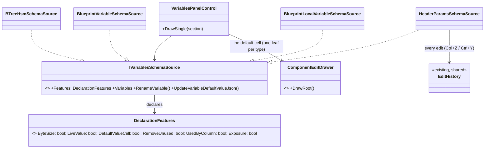
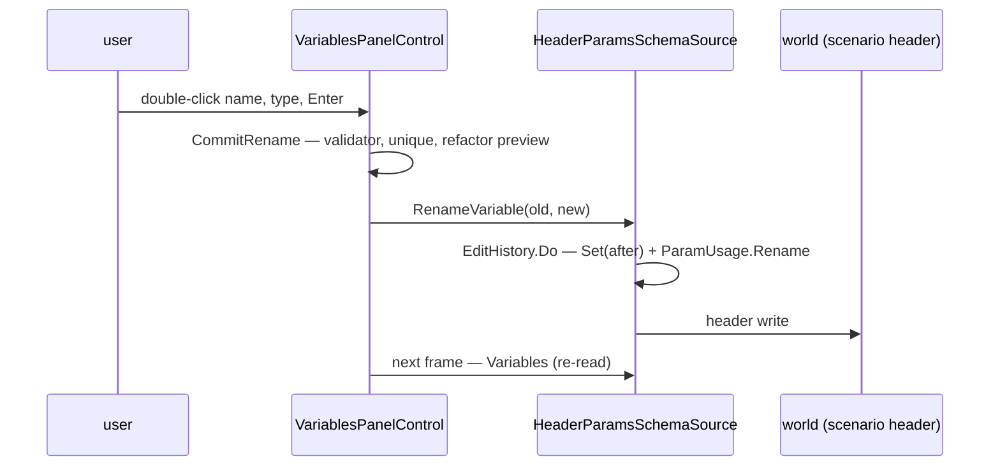
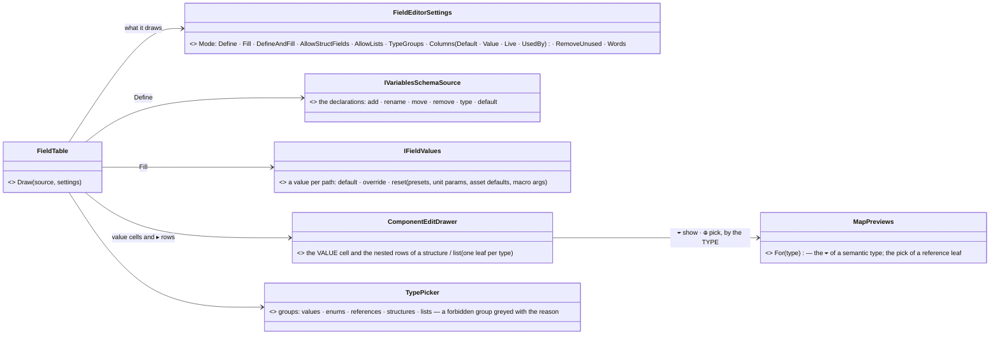
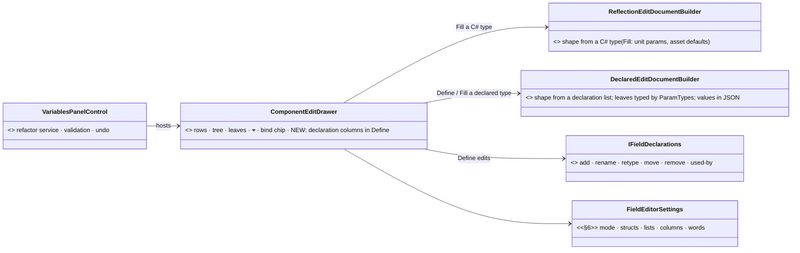

<!--STATUS
state: LIVE
build-state: BUILT 2026-11-05 (approved by the user 2026-11-05: "CE-4254 approved."; as-built in §5)
updated: 2026-11-05
current-answer: §2 (decision) and §3 (the two defects first) · §6.0 D0 merge into StructEdit (lean, awaiting the user) · §6 DESIGN: the shared field editor — one table, two modes, substructures, settings + mockup (2026-11-07)
stale-below: nothing
known-rot: none
known-conflict: none
related-designs:
  - docs/UX/DESIGN_Scenario_Presets.md — §5e: the presets' look is built into THIS shared table for every host
  - docs/DESIGN_Macro_Authoring_Editor.md — the scenario / macro PARAMETERS (MA-5): the declarations this editor edits for one host
  - docs/DESIGN_Rules_View_UI.md — §7.5a: the shared EditHistory every host's edits push to (CE-4218 / CE-4219)
  - docs/DESIGN_Orders_Params_Entity_Classes.md — R-3001: StructEdit edits a params DTO's default VALUES (the leaf editors the default cell reuses)
-->
# DESIGN — one field-declaration editor *(CE-4254, ui)*

🔒 User, `2026-11-03`: *"This should be a generic panel for editing structure fields. And the blackboard variables, they are just one
specialization of that generic structure field editor."* — and, for scenario parameters: no *Remove unused*, no byte size, an editable
**default value**, Ctrl+Z / Ctrl+Y instead of buttons, and a rename that sticks.

## 0. INVENTORY *(queries run `2026-11-05`)*

| query | result |
|---|---|
| `search_graph name_pattern=".*SchemaSource.*" label=Interface` | **1** — `IVariablesSchemaSource` (`Hrot/Editor/Hrot.Editor.AiShared/Blackboard/VariablesPanelControl.cs:12`) |
| `search_graph name_pattern=".*SchemaSource.*" label=Class` + grep `: IVariablesSchemaSource` | **4** — `BTreeHsmSchemaSource` (`VariablesPanelControl.cs:101`), `BlueprintVariableSchemaSource` (`BlueprintVariablesWindow.cs:46`), `BlueprintLocalVariableSchemaSource` (`BlueprintLocalVariableSchemaSource.cs:34`), `HeaderParamsSchemaSource` (`Hrot/Subsystems/Hrot.Editor/Scenario/HeaderParamsSchemaSource.cs:25`) |
| `search_graph name_pattern=".*VariablesPanel.*" label=Class` | **2** — `VariablesPanelControl` (the table, `:178-767`), `VariablesPanelSection` (`:168`) |
| `search_graph name_pattern=".*(FieldDecl\|Declaration).*" label=Class` | compiler / migration types (`BlueprintDeclaration`, `DeclarationList`, `StructFieldDecl` …) — ⛔ none is an editor |

⇒ ⭐ **The generic editor already exists — it is `VariablesPanelControl` over `IVariablesSchemaSource`** (four sources). What is missing is
that every source gets EVERY blackboard affordance: the control decides them, not the source. ⚠ Coverage of the graph could not be checked
(`check_index_coverage` is not in the CLI); the grep agrees on the four.

## 1. What the parameters host gets today, and why

| the user sees | 📐 measured cause |
|---|---|
| *[ Remove unused ]* | drawn when any row `IsUnused` (`VariablesPanelControl.cs:334`) — every source |
| a byte-size column | `row.ByteSize` drawn unconditionally (`:556`) — a blackboard layout fact |
| a grey, uneditable *Value* | the column is the blackboard's **LIVE** runtime value (BATCH-11, `:560`) — read-only by design; parameters have no live value, they need the **default** |
| Undo / Redo buttons | drawn by the host (`ParametersDrawer`, ex-`ParametersWindow`), not by the control |
| rename reverts on Enter | ⏳ not yet root-caused — §3 |

## 2. Decision

*What the picture shows: no new panel and no new seam — one capability record on the existing seam decides each affordance, so a source
cannot inherit a blackboard column it never asked for.*

| ⭐ decision | why |
|---|---|
| **one `DeclarationFeatures` record on `IVariablesSchemaSource`, no default body** | the seam's own rule (`:44`: *"no default body — every implementer answers"*); the control draws a column or button only when its feature is on |
| blackboard sources = today's set (byte size, live value, remove unused, exposure) | ⛔ no behaviour change for BTree / HSM / Blueprint |
| parameters = **default-value cell** + a read-only **used by N** column (`ParamUsage.CountAll`) — no byte size, no live value, no *Remove unused* | the user's list; *used by N* answers *"which is not used"* without a bulk delete |
| the default cell is the **StructEdit leaf** for the field's type (the `ParamArgsTable` / `DefaultValueAuthoring` path, CE-4141) | one editor per type everywhere (R-3001), committed through `UpdateVariableDefaultValueJson` |
| **Ctrl+Z / Ctrl+Y** on the focused panel over the source's history; the buttons go | the user's ask; the timeline panel's chord precedent (CE-1364 T3) |

**Rejected:** a new `FieldDeclarationPanel` — the inventory shows the generic control exists; a second table would be the duplicate.
**Rejected:** subclassing the control per host — capabilities are data on the source, not a type hierarchy.
**Rejected:** hiding columns by host name — exactly the "decided in the control" defect this fixes.

## 3. The two defects first *(build step 1, before any feature)*

*What the sequence shows: three places the rename can be lost — the control returns early (validator / uniqueness), the source refuses
(its `Refuse` text not drawn), or the header write does not reach what `Variables` re-reads next frame.*

⭐ A frame rail drives the real gesture (double-click, type, Enter) on the Details ▸ Scenario ▸ Parameters section and asserts the source's
declaration name — it decides which of the three; the fix follows the measurement. The *Value* cell needs no root-causing (§1: it is the
live column by design) — the default cell of §2 replaces it for this host.

## 4. Acceptance

A parameter can be renamed (Enter keeps it), its default edited in place by its type's leaf, Ctrl+Z / Ctrl+Y undo / redo both, no byte
size, no *Remove unused*, a *used by N* column; the three blackboard hosts draw exactly as before (their existing frame rails unchanged).

## 5. As-built *(ui, `2026-11-05`)*

| design said | built |
|---|---|
| §3 three suspects for the lost rename | ⭐ **suspect (a).** A frame rail driving the real gesture (double-click, type, Enter) KEEPS a valid name — the control, the source and the header re-read are fine (b, c refuted; `SetKeyboardFocusHere` every frame does not eat Enter). `CommitRename` returned silently for a name `BlackboardNameValidator` refuses (space, hyphen, leading digit) or a duplicate ⇒ "reverts on Enter". Now `VariablesPanelControl.RenameRefusal` is drawn red under the table. |
| `DeclarationFeatures` has `Exposure` | the control branches on no exposure affordance, so the record carries what it DOES branch on: `MemoryBudget · ByteSize · LiveValue · DefaultValueCell · UsedByColumn · RemoveUnused` (`Blackboard` / `Parameters` presets); `MemoryBudget` was added — the parameters table also drew *Memory: 0 / 0 B*. |
| the default cell is the StructEdit leaf, via the ParamArgsTable path | `ParamArgsTable.DrawCell(row, onSet)` — the one-cell form sharing `PrepareRow` / `CommitIfDirty` with the table row; the control owns one table built from an `IComponentEditService` provider (`ParametersDrawer` is handed the editor's, else builds the shared facet service). |
| Ctrl+Z / Ctrl+Y | `ParametersDrawer.HandleUndoChords` — while the drawer's window is focused and no text field is active; Ctrl+Shift+Z = redo. Buttons removed; the refusal line stays. |

## 6. ⭐⭐ THE SHARED FIELD EDITOR — one table, two modes, substructures; hosts differ only by SETTINGS *(DESIGN `2026-11-07`, backend — awaiting the user)*

> 🔒 User, `2026-11-07`: *"the shared parameters editor in its generic form needs to support substructures, so the fields are not just plain data
> types but also another structures. While for scenario parameters apparently we are limiting the parameter list to plain data types, so this is a
> setting for the shared editor, and there might be other differences."* · *"I would like to have a design for it … visual design which shows
> different alternatives with substructures and without it, so it's absolutely clear what that editor should look like and work like. and how it is
> specialized for scenario parameter editing."* · *"it is desired to have one shared editor which looks nice."*

🖼 **[`docs/UX/field-editor-visual.svg`](UX/field-editor-visual.svg)** *(generated by `scripts/gen-field-editor-mockup.py`)* — A the generic form with
substructures and a list (DEFINE) · B the same table filling values (FILL) · C the scenario-parameters specialization (flat, the preset's values)
· D the blackboard (the same table + a Live column) · E the one Type picker · F the settings per host.

> 🔒 User, `2026-11-07` (revision): *"item in the parameter list should support semantic types. That means if there is a world position, we
> should be able to either see it on the map or click it on the map in editing mode."* · *"the type names that are now displayed in ovals … plain
> colored text will do."* · *"in the Blackboard view, there is no more any limitation for 128 bytes … Same for the byte size of the parameters …
> it could be removed from the Blackboard, which should … move it much closer to the other editing. So the Blackboard parameter editing is
> probably not different from any other structure editing."

**INVENTORY** *(`2026-11-07`)*: the declaration table `VariablesPanelControl` over `IVariablesSchemaSource` (4 sources, §0) — FLAT; the value forms
`ParamArgsTable` (one-field holders, flat) and `ParamsDefaultsForm` / `BehaviorParamsForm` (a StructEdit session over a params type); ⭐ StructEdit's
`ComponentEditDrawer` (`FDP/Engine/Fdp.Presentation/ImGui/Editing/ComponentEditDrawer.cs` — `DrawRoot` / `DrawEditNode`) ALREADY draws a type as a
TREE: nested containers, lists with add / remove, the bind chip, one leaf drawer per type (R-3001). ⚠ the graph index is stale for these files
(§0 of the presets design) — grep is the answer; coverage unchecked.

*What the picture shows that prose hid: the table adds the DECLARATION columns (name, type, used by, bytes) around StructEdit's tree — it does not
walk a type itself. So a structure or a list expands the same way in every host, and in the unit's Details ▸ AI it already does.*

### 6.0 ⭐⭐⭐ D0 — ONE solution: **StructEdit gains the DEFINE view** *(user question `2026-11-07`; lean — awaits the user)*

> 🔒 User: *"How does it all relate to the struct edit … one of them is used for editing the values, the struct edit, while this … is allowing for
> defining the structures. But I feel there is an overlap … shouldn't we actually extend the struct edit or somehow unify and merge both so we have
> just one solution which allows editing structures from both point of views, like defining and filling?"*

| measured `2026-11-07` | StructEdit | the declaration table (`VariablesPanelControl`) |
|---|---|---|
| edits | VALUES of a typed object | the LIST of fields (name · type · default · comment) |
| shape from | the C# type — `EditNode.ClrType`, one builder `ReflectionEditDocumentBuilder` behind the pluggable `IEditDocumentBuilder` | the declarations (no C# type) |
| draws | ROWS into a table the HOST opens (`ComponentEditDrawer.cs:55`, *"inside a two-column BeginTable"*) | its OWN table (`VariablesPanelControl.cs:483`) — and one StructEdit session PER ROW for the default cell (`DefaultValueAuthoring`) |
| nesting · lists · leaves per type · ⌖ · bind chips | ✅ | ⛔ flat |
| add / rename / retype / remove · used-by · refactor | ⛔ | ✅ (`IVariablesSchemaSource`) |

*What it shows: one row-drawer for both views. Define is StructEdit drawing a document whose SHAPE comes from declarations, with the name and type
cells editable; Fill is today's StructEdit. The declaration table stops being a table.*

| | ⭐ lean | rejected |
|---|---|---|
| **D0** | ⭐ **merge into StructEdit**: a second document builder (`DeclaredEditDocumentBuilder`, shape from declarations) + declaration columns in `ComponentEditDrawer` driven by callbacks (the existing schema seam) — StructEdit stays generic (no Hrot logic: used-by and refactor are callbacks) | ⛔ **leave both** — two tables, two looks, the ugly one stays · ⛔ **the field table wraps StructEdit** (the first §6 draft) — two components would still each own "a row" |
| order | ① the declared builder + Define columns in StructEdit, rails · ② scenario parameters on it (the presets editor) · ③ the blackboards · ④ `ParamArgsTable` / `ParamsDefaultsForm` / `BehaviorParamsForm` become plain StructEdit hosts · ⑤ `VariablesPanelControl`'s table deleted | each step keeps its hosts' frame rails green |

⇒ D1–D11 below are unchanged in WHAT they ask; "the table" in them now means StructEdit's drawer. ⚠ Measure first: whether an `EditNode`
can carry a JSON-backed binding for a leaf with no owning C# object (the declared builder's one hard question).

| # | ⭐ decision — lean | why / rejected |
|---|---|---|
| **D1** | ⭐ a structure field references a **NAMED type**; its nested rows show and fill VALUES; its fields are edited where the type is defined (*Open type ↗* — greyed *"defined in code"* until CE-3376) | ⛔ an inline anonymous structure — two hosts would define the same shape twice (R-174) and nothing could reuse it |
| **D2** | ⭐ a **list** is a row that expands into `[0] [1] …` items with *Add item* / delete per item | the StructEdit list leaf already does this |
| **D3** | ⭐ TWO modes on ONE table: **Define** (names, types, defaults editable) and **Fill** (names and types fixed, grey; values only) — and **Define+Fill** for scenario parameters (the declarations plus the shown preset's values) | ⛔ two components for "declare" and "fill" — the hosts would drift apart in look |
| **D4** | ⭐ the value cell: default = grey but editable; changed = amber bar + ↺; a CLOSED structure says *● N changed* | the presets mockup's look (presets §5a), for every host |
| **D5** | ⭐ every difference is a SETTING (F in the mockup); words too (*Add parameter* / *Add field*) | ⛔ a host name tested in the table (§2) |
| **D6** | ⭐ one Type picker for every host; a group the host forbids is GREYED with the reason, never hidden | AQ108 §5a — gates say why |
| **D7** | ⭐ errors on the row that caused them (a red line under it); Delete refused while used, naming the count | today a refusal is one line above the table |
| **D9** | ⭐ a **SEMANTIC** type (a place, an area, an entity — what `MapPreviews.For(type)` knows) carries the map in its value cell: **⌖ show on map** (teal; hover previews, click pins — always, read-only and live included) and **⊕ pick on the map** (when the cell is editable) | ⭐ both EXIST — the ⌖ (`DESIGN_Show_On_Map.md`, U-10) and the pick of `ReferenceLeafDrawers`; the table only hosts StructEdit's leaf, so every host gets them. ⛔ no table-level map code |
| **D10** | ⭐ the type is plain TEXT in its kind's colour (grey value · teal enum · blue semantic · violet structure · orange list) | the user: ovals are hard in ImGui and add nothing |
| **D11** | ⭐ the blackboard is the SAME table: no byte column, no memory budget; its only extra is the **Live** column | the user: the old 128-byte limit is gone (~16 KB now); ⇒ `DeclarationFeatures.ByteSize` / `MemoryBudget` are removed, not kept as settings |
| **D8** | ⭐ fold, in this order: the look + settings into `VariablesPanelControl` (the 4 define hosts) → `ParamArgsTable` and `ParamsDefaultsForm` become FILL-mode hosts (presets §5d) → `BehaviorParamsForm` | ⭐ each step keeps the frame rails of the hosts it touches green |

| host | mode | structs / lists | columns |
|---|---|---|---|
| scenario parameters | Define+Fill | ⛔ off | Value (the preset) · Used by |
| macro instance args · scenario preset values | Fill | ⛔ off | Value |
| BTree / HSM blackboard · Blueprint variables ×2 | Define | ⛔ off today | Live (no bytes, no budget — D11) |
| a unit's behaviour params · a behaviour asset's defaults | Fill | ✅ on | Value |
| a params asset (CE-3376, not designed) | Define | ✅ on | Default · Used by |

⚠ **Measure before building:** whether `ComponentEditDrawer` can draw ONE field's subtree as rows of an outer table (today it owns its own
"Property | Value" table, `:18`) — if not, the split it needs is the first step of D8.
