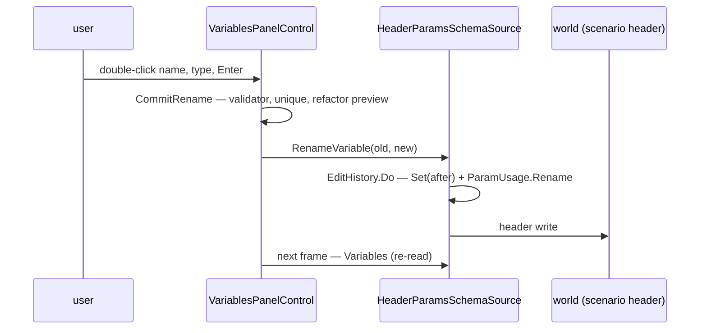

<!--STATUS
state: LIVE
build-state: BUILT 2026-11-05 (approved by the user 2026-11-05: "CE-4254 approved."; as-built in §5)
updated: 2026-11-05
current-answer: §2 (decision) and §3 (the two defects first) · §6 PLANNED: substructures + host settings (2026-11-07)
stale-below: nothing
known-rot: none
known-conflict: none
related-designs:
  - docs/UX/DESIGN_Scenario_Presets.md — §5e: the presets' look is built into THIS shared table for every host
  - docs/DESIGN_Macro_Authoring_Editor.md — the scenario / macro PARAMETERS (MA-5): the declarations this editor edits for one host
  - docs/DESIGN_Rules_View_UI.md — §7.5a: the shared EditHistory every host's edits push to (CE-4218 / CE-4219)
  - docs/DESIGN_Orders_Params_Entity_Classes.md — R-3001: StructEdit edits a params DTO's default VALUES (the leaf editors the default cell reuses)
-->
# DESIGN — one field-declaration editor *(CE-4254, ui)*

🔒 User, `2026-11-03`: *"This should be a generic panel for editing structure fields. And the blackboard variables, they are just one
specialization of that generic structure field editor."* — and, for scenario parameters: no *Remove unused*, no byte size, an editable
**default value**, Ctrl+Z / Ctrl+Y instead of buttons, and a rename that sticks.

## 0. INVENTORY *(queries run `2026-11-05`)*

| query | result |
|---|---|
| `search_graph name_pattern=".*SchemaSource.*" label=Interface` | **1** — `IVariablesSchemaSource` (`Hrot/Editor/Hrot.Editor.AiShared/Blackboard/VariablesPanelControl.cs:12`) |
| `search_graph name_pattern=".*SchemaSource.*" label=Class` + grep `: IVariablesSchemaSource` | **4** — `BTreeHsmSchemaSource` (`VariablesPanelControl.cs:101`), `BlueprintVariableSchemaSource` (`BlueprintVariablesWindow.cs:46`), `BlueprintLocalVariableSchemaSource` (`BlueprintLocalVariableSchemaSource.cs:34`), `HeaderParamsSchemaSource` (`Hrot/Subsystems/Hrot.Editor/Scenario/HeaderParamsSchemaSource.cs:25`) |
| `search_graph name_pattern=".*VariablesPanel.*" label=Class` | **2** — `VariablesPanelControl` (the table, `:178-767`), `VariablesPanelSection` (`:168`) |
| `search_graph name_pattern=".*(FieldDecl\|Declaration).*" label=Class` | compiler / migration types (`BlueprintDeclaration`, `DeclarationList`, `StructFieldDecl` …) — ⛔ none is an editor |

⇒ ⭐ **The generic editor already exists — it is `VariablesPanelControl` over `IVariablesSchemaSource`** (four sources). What is missing is
that every source gets EVERY blackboard affordance: the control decides them, not the source. ⚠ Coverage of the graph could not be checked
(`check_index_coverage` is not in the CLI); the grep agrees on the four.

## 1. What the parameters host gets today, and why

| the user sees | 📐 measured cause |
|---|---|
| *[ Remove unused ]* | drawn when any row `IsUnused` (`VariablesPanelControl.cs:334`) — every source |
| a byte-size column | `row.ByteSize` drawn unconditionally (`:556`) — a blackboard layout fact |
| a grey, uneditable *Value* | the column is the blackboard's **LIVE** runtime value (BATCH-11, `:560`) — read-only by design; parameters have no live value, they need the **default** |
| Undo / Redo buttons | drawn by the host (`ParametersDrawer`, ex-`ParametersWindow`), not by the control |
| rename reverts on Enter | ⏳ not yet root-caused — §3 |

## 2. Decision

*What the picture shows: no new panel and no new seam — one capability record on the existing seam decides each affordance, so a source
cannot inherit a blackboard column it never asked for.*

| ⭐ decision | why |
|---|---|
| **one `DeclarationFeatures` record on `IVariablesSchemaSource`, no default body** | the seam's own rule (`:44`: *"no default body — every implementer answers"*); the control draws a column or button only when its feature is on |
| blackboard sources = today's set (byte size, live value, remove unused, exposure) | ⛔ no behaviour change for BTree / HSM / Blueprint |
| parameters = **default-value cell** + a read-only **used by N** column (`ParamUsage.CountAll`) — no byte size, no live value, no *Remove unused* | the user's list; *used by N* answers *"which is not used"* without a bulk delete |
| the default cell is the **StructEdit leaf** for the field's type (the `ParamArgsTable` / `DefaultValueAuthoring` path, CE-4141) | one editor per type everywhere (R-3001), committed through `UpdateVariableDefaultValueJson` |
| **Ctrl+Z / Ctrl+Y** on the focused panel over the source's history; the buttons go | the user's ask; the timeline panel's chord precedent (CE-1364 T3) |

**Rejected:** a new `FieldDeclarationPanel` — the inventory shows the generic control exists; a second table would be the duplicate.
**Rejected:** subclassing the control per host — capabilities are data on the source, not a type hierarchy.
**Rejected:** hiding columns by host name — exactly the "decided in the control" defect this fixes.

## 3. The two defects first *(build step 1, before any feature)*

*What the sequence shows: three places the rename can be lost — the control returns early (validator / uniqueness), the source refuses
(its `Refuse` text not drawn), or the header write does not reach what `Variables` re-reads next frame.*

⭐ A frame rail drives the real gesture (double-click, type, Enter) on the Details ▸ Scenario ▸ Parameters section and asserts the source's
declaration name — it decides which of the three; the fix follows the measurement. The *Value* cell needs no root-causing (§1: it is the
live column by design) — the default cell of §2 replaces it for this host.

## 4. Acceptance

A parameter can be renamed (Enter keeps it), its default edited in place by its type's leaf, Ctrl+Z / Ctrl+Y undo / redo both, no byte
size, no *Remove unused*, a *used by N* column; the three blackboard hosts draw exactly as before (their existing frame rails unchanged).

## 5. As-built *(ui, `2026-11-05`)*

| design said | built |
|---|---|
| §3 three suspects for the lost rename | ⭐ **suspect (a).** A frame rail driving the real gesture (double-click, type, Enter) KEEPS a valid name — the control, the source and the header re-read are fine (b, c refuted; `SetKeyboardFocusHere` every frame does not eat Enter). `CommitRename` returned silently for a name `BlackboardNameValidator` refuses (space, hyphen, leading digit) or a duplicate ⇒ "reverts on Enter". Now `VariablesPanelControl.RenameRefusal` is drawn red under the table. |
| `DeclarationFeatures` has `Exposure` | the control branches on no exposure affordance, so the record carries what it DOES branch on: `MemoryBudget · ByteSize · LiveValue · DefaultValueCell · UsedByColumn · RemoveUnused` (`Blackboard` / `Parameters` presets); `MemoryBudget` was added — the parameters table also drew *Memory: 0 / 0 B*. |
| the default cell is the StructEdit leaf, via the ParamArgsTable path | `ParamArgsTable.DrawCell(row, onSet)` — the one-cell form sharing `PrepareRow` / `CommitIfDirty` with the table row; the control owns one table built from an `IComponentEditService` provider (`ParametersDrawer` is handed the editor's, else builds the shared facet service). |
| Ctrl+Z / Ctrl+Y | `ParametersDrawer.HandleUndoChords` — while the drawer's window is focused and no text field is active; Ctrl+Shift+Z = redo. Buttons removed; the refusal line stays. |

## 6. ⭐⭐ Planned — SUBSTRUCTURES, and the differences are host SETTINGS *(user, `2026-11-07`; not built)*

> 🔒 *"the shared parameters editor in its generic form needs to support substructures, so the fields are not just plain data types but also another
> structures. While for scenario parameters apparently we are limiting the parameter list to plain data types, so this is a setting for the shared
> editor, and there might be other differences."*

| ⭐ rule | |
|---|---|
| ⭐⭐ a field whose type is a STRUCTURE is a row that EXPANDS (chevron) into its own fields — values, defaults, overrides and ↺ per nested field, at any depth | 📐 today the table is flat: a struct-typed field is one row, its fields cannot be seen or edited there |
| ⭐⭐ what a host allows is a SETTING on `DeclarationFeatures`, like the columns — e.g. `AllowStructFields`, and the type list the *Type* combo offers | ⭐ scenario parameters: off (plain values, enums and map references — `ParamTypes.All`); a params-asset host (CE-3376): on |
| ⭐ further differences go the same way — one setting per difference, never a per-host copy of the table | ⛔ a host name tested in the control is the defect §2 removed |
| ⭐ the look is the presets mockup (`docs/UX/scenario-presets-visual.svg`, presets design §5e) for every host | |
