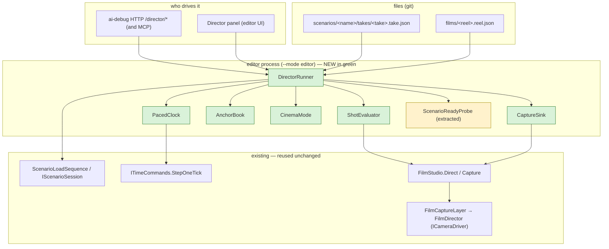
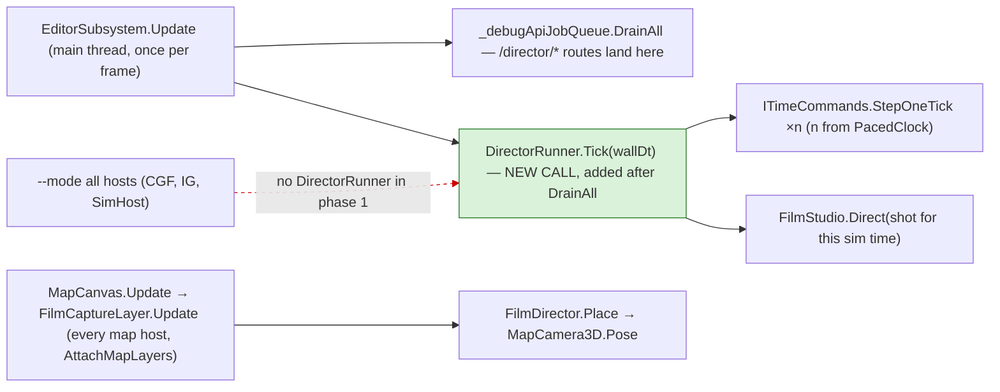
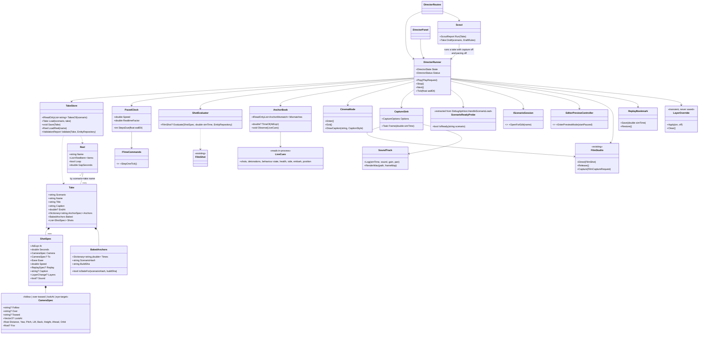
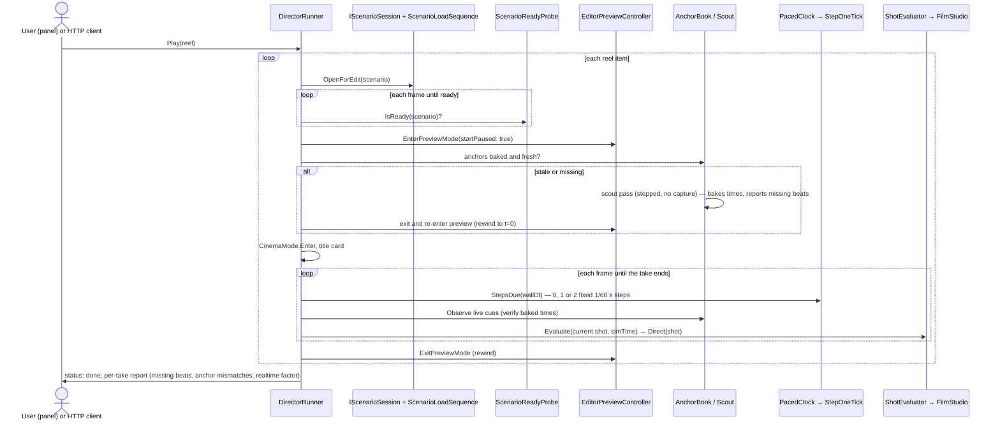
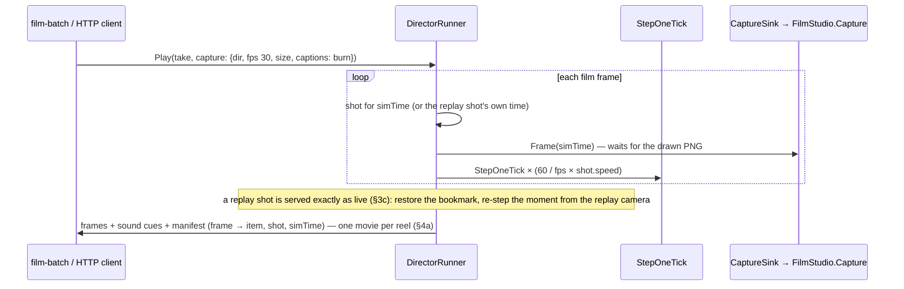
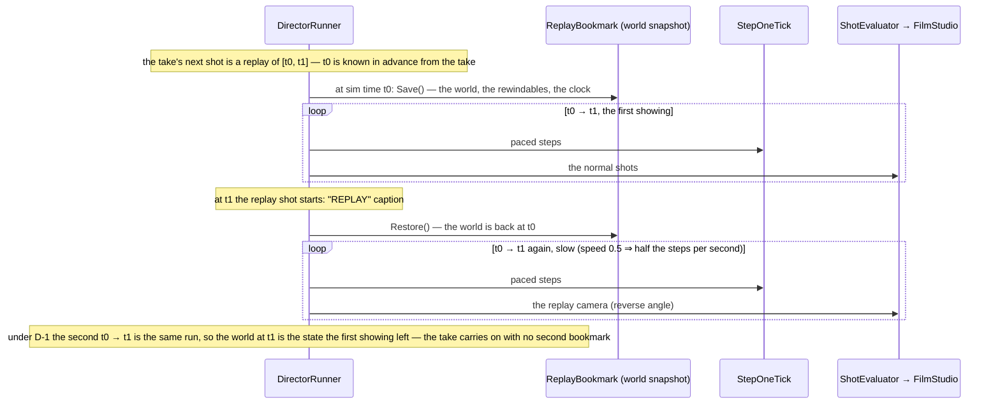

<!--STATUS
state: LIVE
build-state: DESIGN
updated: 2026-10-21 (second pass — the user's rulings on sound and overlays (R-4059, R-4060), instant replays live (§3c), a reel is one movie (§4a); first version same day)
current-answer: §1 the picture · §2 classes · §3 sequences · §4 the formats and routes · §5 the decisions (leans for approval) · §6 phases and acceptance
stale-below: none
known-rot: none
known-conflict: none — R-3032 ("the scene alone") is amended by R-4060 for takes that turn layers on; R-1004 / AU-3 (sound only while possessed) by R-4059
related-designs:
  - DESIGN_Map_3D_Mode.md §6ab — OWNS the film camera this drives (FilmStudio, FilmDirector as an ICameraDriver, FilmCaptureLayer, the /film routes); this design adds WHO holds the script and WHEN the shot changes
  - RUNBOOK_Filming.md — OWNS film.py / film-events.py as built (CE-3289); D-9 makes them thin clients of this
  - PLAN_Feature_Films.md — OWNS WHAT to film (the clip list, the director's grammar §1a, the gaps); its clips.json is the seed of the takes here
  - blueprints/DESIGN_Time_Architecture.md — OWNS the clock (Continuous = wall-clock dt; Stepping = fixed dt) that D-1 rests on
  - DESIGN_Cgf_Scenario_Session_Slice.md — OWNS IScenarioSession (OpenForEdit, LoadedScenarioName) the runner loads through
  - DESIGN_Cluster_Load_Phase.md §9 — OWNS ScenarioLoadSequence (Idle first, then the load)
  - DESIGN_Remote_Map_Control.md — OWNS remote map commands over DDS (CMD_SET_VIEW); a network path, not a script path — not reused (§5)
  - designs/group-maneuvers/DESIGN_Demo_City_Showcase.md — OWNS the one-scenario showcase; its acts become takes here
  - designs/audio/DESIGN_FPS_Audio.md — OWNS the sound (our spatializer, AU-1…AU-10; CE-1137 camera sound in 3-D); §4c here adds the 2-D ear, the switches and the film's sound track
  - DESIGN_Terrain_Combat_Tuning.md §5e — OWNS the map layers (LayerControlDto rows, two sets per view, saved to the user's file); §4b here adds the transient override and the HTTP route
-->

# Film director — play scripted camera takes, a playlist of scenarios, live or to film

🔒 **User, 2026-10-21:** *"It would be very useful to have the video filming instructions (what scenario, what scenes, what camera view,
what time.. everything necessary) so that i can run these on my machine in real time, without stepping, a pre-step to overnight filming …
some harness that follows the loaded scenario, waits for it being loaded, then following the instructions, then go to another scenario in
the list; also allowing each scenario to be replayed like that (with the camera cuts) individually; maybe it could be a feature of the
editor itself"* · *"i expect multiple versions of different scenarios"* · *"controlled via ai debug http of course"* · *"and also from some
ui panel for the user without ai debug http"* · *"it will be implemented by the backend"*.

🔒 **User, 2026-10-21 (second pass):** *"We should play the audio even in non-FPS mode. The UI should have a menu option to turn sounds on
and off. FPS mode always has sounds. Overlays like labels optional, Default is off. the subtitles and camera zooms on certain concrete thing
can Replace the need for the labels. But another interesting point is to demonstrate the use of those overlays and different helpers. So it
could be great if the script controlling the movie can turn them on or off. And the same capability would be great from AI debug HTTP,
turning those tactical map symbols on or off, as the user can do today from the UI."* · *"I would like to use this built-in feature in the
editor to replay the clips before I start overnight rendering of all the movies. Note that I need to also concatenate multiple different
scenario takes together into a movie showing multiple features."*

**Words used here.** A **take** is one scenario's camera script: its shots, cuts, anchors and captions. A **reel** is a playlist of
takes. The **director** is the editor feature that plays them: on screen in real time, or frame by frame to a film.

## 1. The picture



*What the picture shows that prose hides: the director adds no new camera and no new clock. It decides WHICH shot is held (through the
existing `FilmStudio` mailbox) and WHEN the sim steps (through the existing `StepOneTick`). The HTTP routes and the panel are two remotes
for the same runner.*

### 1a. Who calls what each frame — the module view



*The one new edge is `EditorSubsystem.Update → DirectorRunner.Tick`. ⛔ The red dashed edge is deliberate: `--mode all` hosts have no
runner in phase 1 (D-8), although every map host already has a `FilmCaptureLayer` and would obey a held shot.*

## 2. Classes



*What the class picture forces: the over-the-shoulder and orbit math lives ONCE, in `ShotEvaluator`. Today it lives in `film.py`
(`_shot_for`), outside the engine. D-9 moves it in, and `film.py` becomes a client.*

## 3. Sequences

### 3a. A reel, live on screen — the user's machine, real time



*The decision the picture makes visible: the sim never plays in `Continuous` mode. The director paces fixed steps against the wall
clock, so the live show and the overnight film are the same run frame for frame (D-1).*

### 3b. The same take, to film (overnight) — and a replay shot



### 3c. The instant replay — how it works, live and on film



*What the picture shows: one snapshot per replay, taken BEFORE the moment, because the take says in advance where the replay starts. A
replay replays the window that just ended (D-16), so re-stepping it lands the world exactly where it was.*

**In plain words.** A replay shows a moment that has just happened a second time, from another angle and usually slowed down, then the
action carries on. Time cannot run backwards, so the director keeps a bookmark: just before the moment it saves the world, lets the moment
play, then puts the saved world back and plays the same seconds again with the replay camera. Because every run is stepped identically
(D-1), the second showing is the same as the first, and when it ends the world is back where it was. Live in the editor it costs a fraction
of a second for the restore; on film it costs nothing extra.

⛔ **The one unknown:** whether a mid-run restore brings back EVERYTHING a run depends on (brains, path requests in flight, sensor caches,
random numbers). The preview rewind already restores the world at t = 0 (`EditorPreviewController`, CE-3156), but mid-run is unmeasured.
⇒ backend's first task is a rail: snapshot at t, run 5 s → A; restore, run 5 s → B; **A must equal B**. If it fails before it is fixed,
the fallback is **rewind to t = 0 and fast-step to t0** (both exist), with a "REPLAY" card on screen while it catches up.

## 4. Formats and routes

**A take** — `scenarios/<scenario>/takes/<take>.take.json` (`main` is the default take). The shot keys are `clips.json`'s, which are
`film.py`'s plan keys plus `to`, `ease`, `speed`, `replay` (`{"from": "fire-1"}` — the window it replays ends where the shot starts), `caption`,
`layers` (`{"on": [...], "off": [...]}`, §4b) and `sound` (§4c). A take may also carry `layers` and `sound` at its top level, for the whole take.

```json
{
  "title": "Panic, then shelter",
  "caption": "Gunfire panics the civilians; they run to the open house, open its door and hide inside",
  "anchors": {"fire": {"on": "shot", "n": 1}, "door": {"on": "near", "who": "Civilian 1", "point": [105, 100], "within": 3}},
  "baked": {"times": {"fire": 2.35, "door": 14.9}, "scenarioHash": "…", "buildSha": "…"},
  "endAt": "door+5",
  "shots": [
    {"at": "fire-2", "seconds": 3, "lookAt": [105, 75, 1], "distance": 55, "yaw": 90, "pitch": -22},
    {"at": "fire-0.3", "seconds": 3, "follow": "Civilian 2", "distance": 9, "yaw": 60, "pitch": -8, "to": {"distance": 6}, "ease": "inOut"}
  ]
}
```

### 4a. A reel is a movie — several scenarios' takes in one film

🔒 *"I need to also concatenate multiple different scenario takes together into a movie showing multiple features."* — ✅ **that is what a
reel is.** `films/<reel>.reel.json`:

```json
{
  "title": "HROT — civilians and crowds",
  "transition": "fade",
  "items": [
    {"scenario": "ua-civ-shelter",     "take": "main", "title": "Panic and shelter"},
    {"scenario": "ua-civ-contagion",   "take": "main"},
    {"scenario": "ua-civ-provocation", "take": "main", "from": "arrive-6", "to": "riot+5"},
    {"scenario": "ua-civ-provocation", "take": "wide", "title": "The same riot, from above"}
  ]
}
```

| | |
|---|---|
| **live** | the items play one after another; while the next scenario loads, a title card is on screen, so the load is never seen |
| **to film** | `POST /director/play {reel, capture}` writes **ONE movie**: the frames are numbered across all items, a fade or a title card between items, a chapter mark per item (ffmpeg metadata), one sound track |
| **mixing** | any scenario, any take, the same scenario twice with different takes, part of a take (`from` / `to`, anchors or shot numbers) |
| **many movies** | a reel per film: `features.reel.json` (everything, in CAPABILITIES order), one per chapter, one per audience — they share the takes |

**Several versions of one scenario** (🔒 *"multiple version of different scenarios"*): a variant is its own scenario folder
(`ua-eject` · `ua-shootdown-eject`), so it carries its own `takes/`. One scenario can hold several takes (`main`, `short`, `wide`). A reel
names `scenario + take`. ⭐ **"Save As" and "new from" must copy `takes/`** with the scenario.

**HTTP** — on the editor's ai-debug host, main-thread jobs like every other route, each with a `DebugApiRouteDocs` entry (so MCP gets
them):

| route | does |
|---|---|
| `GET /director/takes?scenario=` · `GET /director/reels` | list |
| `GET` / `PUT /director/take/{scenario}/{take}` | read / save a take (authoring by an agent) |
| `POST /director/play` `{scenario, take}` or `{reel}` + `{speed?, loop?, capture?: {dir, fps, size, supersample, captions}}` | start |
| `POST /director/stop` · `/next` · `/pause` · `/resume` | transport |
| `GET /director/status` | state, reel item, shot index, sim time, realtime factor, missing beats, anchor mismatches |
| `POST /director/scout` `{scenario, take}` | bake the anchors; the report doubles as a scenario health check |
| `POST /director/draft` `{scenario, rules?}` | an automatic take from the scout's events (backend tip 3, D-10) |
| the existing `/film/shot`, `/film/capture` | unchanged — a held shot still works by hand |
| ⭐ `GET /map/layers?view=2d\|3d` · `POST /map/layers {view, on: [...], off: [...]}` | the tactical map layers, by the same row names the Layers panel shows — **exactly what a user's click does**, saved like one (§4b, R-4060) |
| ⭐ `GET /audio` · `POST /audio {sound: true\|false, master?, muted?}` | the Sound switch and volume, as the menu sets them (§4c, R-4059) |

### 4b. Layers — overlays and helpers, from the take, the HTTP API and the panel (R-4060)

- **Names.** A layer is named as the Layers panel names it, `Group.Row` from `LayerControlDto` (`Ai.VisionCones`, `Ai.Contacts`,
  `Fire.Traces`, `Units.Cards`, …). `GET /map/layers` lists them with their display names and hover text, so a take author or an agent
  never guesses.
- **A take starts clean.** 🔒 *"Overlays like labels optional, Default is off."* While a take plays, the filmed view shows the scene alone
  unless the take turns layers on: at the top (for the whole take) or per shot (`"layers": {"on": ["Ai.VisionCones"]}` to show what a
  sentry sees, then off again). Captions and close shots do the explaining in most clips.
- ⭐ **The take's layers are a TRANSIENT override**, laid over the user's own set and dropped when the take ends. ⛔ They are never written
  to the settings registry, because `LayerControlSets` saves that registry to the user's file: a take must not change the user's map.
- **The HTTP route is the user's click**, persisted the same way (`LayerControlSets.Write`), so an agent can set up the map as a person
  would. The panel and the route cannot disagree: one registry, one set per view.

### 4c. Sound — in every view, and in the films (R-4059)

- 🔒 *"We should play the audio even in non-FPS mode … a menu option to turn sounds on and off. FPS mode always has sounds."*
- **Already built** (CE-1137): Settings ▸ Sound plays the scene from the **3-D** camera outside FPS (`AudioLayer.cs:82-84`,
  `AudioPreferences.CameraSound`). **Missing:** the **2-D** map has no ear (`view.Is3D ? … : null`). ⭐ Lean: the 2-D ear stands at the
  view's centre, as high as half the visible width, so a wide view hears only the loud things — the same spatializer, no new rule.
- **FPS** plays sound whatever the switch says (as today). **A take** may set `"sound": false` for a silent shot; default on.
- **The films get a sound track.** A captured frame takes ~0.8 s, so the device's output cannot be recorded. ⭐ Instead the mixer, while
  capturing, **logs every sound it starts** (sim time, sound, gain and pan from the director's camera), and after the pass the engine
  **renders the WAV offline** from the same sound files and generated placeholders, slow motion included, which ffmpeg muxes into the
  movie. One mixer, one spatializer, live and on film.

**The panel** — *View › Director*: pick a reel or a scenario's take · Play / Stop / Next · *Replay this take* · Prepare (scout) ·
speed · a row per item with its last report (✅ / ⚠ mismatch / ⛔ beat missing). It calls the same `DirectorRunner` methods the routes
call.

## 5. Decisions — leans for the user's approval (✅ = already ruled)

| # | question | ⭐ lean | rejected, one line each |
|---|---|---|---|
| **D-1** | how real time plays | ⭐ **paced stepping**: the runner steps fixed 1/60 s ticks as the wall clock allows (at most 2 per frame), so the run is identical to the stepped film and the scout | `Continuous` play: dt from the wall clock (`MasterSyncController.cs:177-186`), so cuts land late and the AI differs run to run |
| **D-2** | where takes live | ⭐ **beside the scenario**, `takes/*.take.json` — a variant carries its own | in `scenario.json`: presentation in the replicated world document, and the R-260 camera entity is adopted once at load · one central manifest: variants lose their takes |
| **D-3** | when a cut happens | ⭐ **baked anchor times** from a scout pass (exact under D-1), **verified live** by in-process cues; a take is re-scouted when the scenario hash or build changes | live cues alone: cannot cut BEFORE an event (`fire-0.5`), which is the director's main move |
| **D-4** | instant replays | ⭐ **live and on film, by a bookmark** (§3c): save the world just before the moment, restore it, re-step the moment from the replay camera. ⭐ First task: the restore rail; until it passes, **rewind to t = 0 and fast-step** behind a "REPLAY" card | film-only replays: the user previews the clips in the editor before the overnight run, and a preview without its replays is not the clip · a second film pass spliced in: twice the render time for the same frames |
| **D-5** | overlays per shot — backend tip 4 | ✅ **RULED (R-4060):** off by default; a take or a shot turns layers on and off by name, as a transient override (§4b) | — |
| **D-6** | titles, captions, sound — tip 5 | ⭐ captions **drawn by `CinemaMode`**, on screen and burned into captured frames. ⭐ **Sound** in every view when Sound is on (R-4059); the films get a track **rendered offline from the mixer's cue log** (§4c) | `ffmpeg drawtext` only: the live show would have none · recording the device: a captured frame takes ~0.8 s, so the sound would be stretched ~50× |
| **D-7** | rendering speed — tip 2 | ⭐ **`CinemaMode` hides the panels and gizmos** while directing: the map fills the window. Measure the per-frame gain on entry | keep the panels: ~0.8 s per film frame, mostly the panels |
| **D-8** | which hosts | ⭐ **the editor** (`--mode editor`), the runbook's preferred host | `--mode all` now: one perspective on screen, real-time cuts overshoot; later, if a clip must prove the wire |
| **D-9** | `film.py` / `film-events.py` | ⭐ **thin clients** of `/director/*`: one camera-math implementation | keep both: two copies of the over-the-shoulder math that rot apart |
| **D-10** | automatic plans — tip 3 | ⭐ `/director/draft` writes a take from the scout's events (a shot fired → over the shooter 0.5 s before, then the target), **for a human to edit** | fully automatic films: the grammar (PLAN §1a) needs judgement the rules lack |
| **D-11** | "is it loaded?" | ⭐ **extract** `HandleScenarioLoad`'s measured edge logic into `ScenarioReadyProbe`; the route and the runner share it | a new "loaded" event: none exists, and the edge logic is already measured. `LoadedScenarioName` is set when the load is SENT (`EditorScenarioSession.cs:82`), not when it is built |
| **D-12** | moving the camera | ⭐ through `FilmStudio` (the director's `ICameraDriver`) only | writing the scenario's camera entity: it would be saved into the scenario (`DESIGN_Map_3D_Mode.md` §6i) · `DESIGN_Remote_Map_Control` `CMD_SET_VIEW`: an IG-only DDS path |
| **D-13** | the map layers over HTTP — R-4060 | ✅ **RULED:** `GET/POST /map/layers`, the same rows and the same persistence as the panel's click | — |
| **D-14** | the 2-D ear — R-4059 | ⭐ at the view's centre, half the visible width up | no sound in 2-D: the user asked for sound outside FPS, not only in 3-D |
| **D-15** | several scenarios in one film | ⭐ **a reel is the movie** (§4a): one capture, frames numbered across items, a transition and a chapter mark per item, one sound track | a movie per take joined afterwards: the joins, titles and sound would be a second tool to keep in step |
| **D-16** | what a replay may replay | ⭐ **only the window that just ended** (`replay.from` → the shot's start), so one bookmark suffices and the run continues exactly | any earlier window: a second bookmark at "now" and a restore back to it — more state, no grammar needs it (PLAN §1a ⑤) |

### 5a. Claim table — what the leans rest on

| claim | code — how it IS | design — how it was MEANT |
|---|---|---|
| a held shot follows its unit every frame, paused or not | ✅ `Film.cs` `FilmDirector.Place` (resolves `Follow` per frame) | ✅ `DESIGN_Map_3D_Mode.md` §6ab |
| every map host already carries the film layer | ✅ `MapInteractionPack.cs:553`; attached by Editor, CGF, IG, SimHost, ReplayBrowser | ✅ §6ab |
| real-time play takes dt from the wall clock | ✅ `MasterSyncController.cs:177-186`; only `Step` uses `fixedDelta` (`:349`) | ✅ `DESIGN_Time_Architecture.md` |
| stepped editor runs are identical | ⚠ CE-202 measured 600 steps identical (`DESIGN_Subsystem_Composition_Unification.md`), and that doc admits its first claim was vacuous | ✅ the runbook §0 measured frame-exact cuts in the editor |
| the editor's step path | ✅ `EditorTimeTransportFacade.Step` → `ITimeCommands.StepOneTick`, the same as `/sim/step` | ✅ AS-11 |
| one step per frame at most on the master | ✅ `/sim/step` comment CE-105 (`DebugApiHost.cs`) | — ⇒ D-1 caps at 2 per frame and **measures** it; if the master retires only 1, real time needs ≥ 60 fps rendering, and the realtime factor says so |
| no "loaded" event exists | ✅ searched; readiness is the edge poll in `HandleScenarioLoad` | ⛔ searched `docs/`, none found |
| a mid-run snapshot restore re-steps identically | ⛔ **not measured** — D-4's first task is the rail; the fallback (rewind to 0 + fast-step) is built from parts that exist | ⛔ none found |
| the preview rewinds the world to t = 0 | ✅ `EditorPreviewController` (snapshot + `IPreviewRewindable`s, the clock restored CE-3156) | ✅ `DESIGN_Deterministic_Network_Ids.md` §4 |
| sound from the 3-D camera outside FPS is built | ✅ `AudioLayer.cs:82-84`, `AudioPreferences.CameraSound`, the menu at `LocalWindowController.cs:254` (CE-1137) | ✅ `designs/audio/DESIGN_FPS_Audio.md` |
| the 2-D map has no ear | ✅ `AudioLayer.cs:82` (`view.Is3D ? new Ear(…) : null`) | — |
| the user's layer set is saved to their file | ✅ `LayerControlSets` (`LayerControlGizmo.cs:230-290`) ⇒ a take's layers must not be written there | ✅ `DESIGN_Terrain_Combat_Tuning.md` §5e |
| no HTTP route reaches the layers or the sound | ✅ the editor's route list: only `/panels*` touch the UI | — |

## 6. Phases and acceptance — for backend

| phase | builds | accepted when |
|---|---|---|
| **1** | `Take`/`Reel`/`TakeStore` + validation (unknown names listed) · `ShotEvaluator` (follow, over-toward, lookAt, orbit, `to` + ease, fov) · `PacedClock` · `DirectorRunner` (load → ready → preview → play → exit → next, title cards between items) · `ScenarioReadyProbe` extracted · `/director/play\|stop\|next\|status\|takes\|reels` · the panel · ⭐ `LayerOverride` + `/map/layers` · ⭐ `/audio` + the 2-D ear | a reel of 3 takes from 3 scenarios plays unattended in the editor; cuts land within one frame of the baked times; a take's layers never reach the user's settings file; `realtimeFactor` reported |
| **2** | `Scout` + `AnchorBook` (bake, live verify, staleness) · `/director/scout` · the report · ⭐ the restore rail, then `ReplayBookmark` (or the rewind fallback) | the scout of a take finds every anchor or names the missing one; a changed scenario is re-scouted; a replay shows the same moment again and the take continues identically |
| **3** | `CaptureSink` (+ `speed`) · a reel → ONE movie with transitions and chapters · `SoundTrack` (cue log + offline WAV) · `CinemaMode` (panels off, captions) · `film.py` as a client | the overnight run films a reel of several scenarios into one movie with sound; the measured per-frame time with panels off |
| **4** | `/director/draft` (automatic takes to edit) | — |

⭐ **Seed data:** `docs/films/clips.json` splits into one `main.take.json` per scenario (55 takes), and a `films/features.reel.json` lists
them in CAPABILITIES chapter order.

## 7. INVENTORY — what exists, measured before designing

```
scripts/cbm.sh search_graph name_pattern=".*(Film|Director|Playlist|Showcase|Cinematic).*" label=Class  → total 15, has_more false
    → MissionDirectorSystem, UrbanCombat.ScenarioDirector, Showcase* (an FDP example), EvacDirector (SUMO): none a camera director.
    ⚠ FilmStudio / FilmDirector / FilmCaptureLayer are NOT in the graph (it predates CE-3289); found by grep in Hrot.Presentation/Map3D/Film.cs
scripts/cbm.sh search_graph name_pattern=".*Camera.*" label=Class  → total 24: MapCamera3D, CameraPose, MapCamera (2-D), MapCameraLayer,
    MapCameraTkb, MapCameraView(port), FpsCameraDriver, CameraBookmarkStore (Stride, saved poses), Stride camera controllers
scripts/cbm.sh search_graph name_pattern=".*(ScenarioSession|ScenarioLoad|Preview).*" label=Class  → total 53: EditorScenarioSession,
    ScenarioLoadSequence, ScenarioLoadStep, Reference*LoadHandler, EditorPreviewController, PreviewStateBracket, PreviewParticipants, …
corpus sweep (docs/ then .dev/): "playlist", "cinematic", "camera path", "kiosk", "presentation mode" → none found
check_index_coverage is not available through the CLI ⇒ these totals are not proof of completeness
```

*Reused as is:* `FilmStudio`, `FilmDirector`, `FilmCaptureLayer`, `ITimeCommands`, `IScenarioSession`, `ScenarioLoadSequence`,
`EditorPreviewController`, the debug job queue. *Prior art:* `CameraBookmarkStore` (Stride) saves poses, not timed shots.
