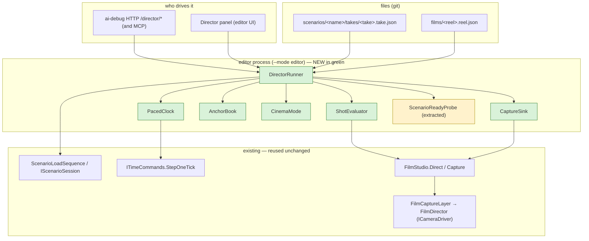
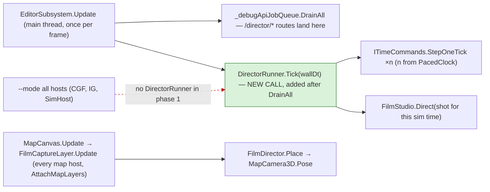
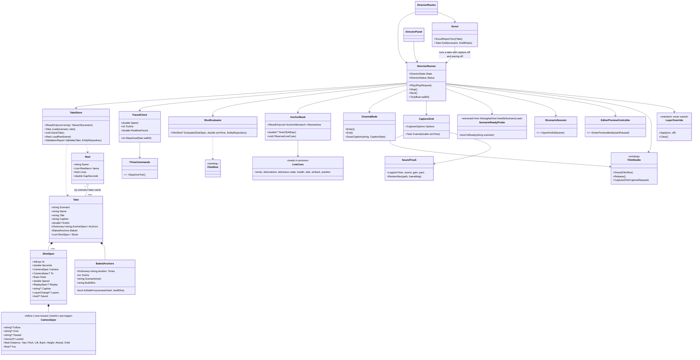
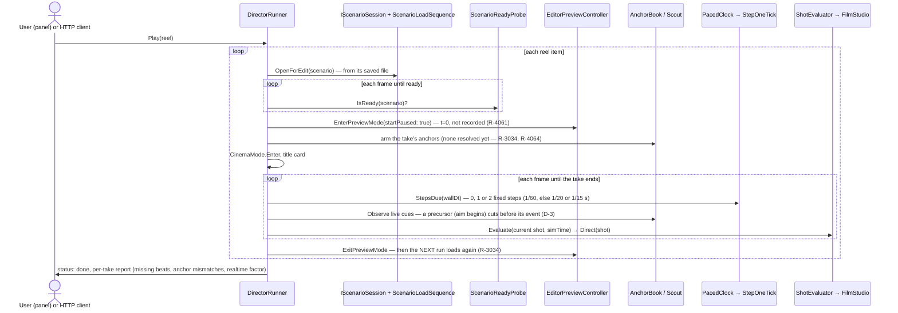
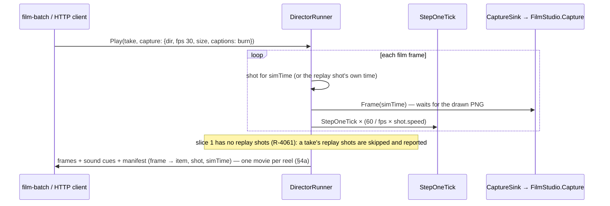
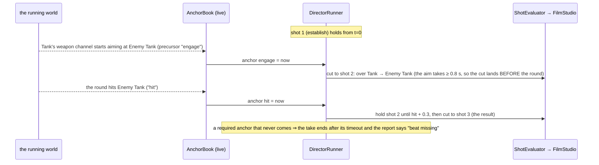
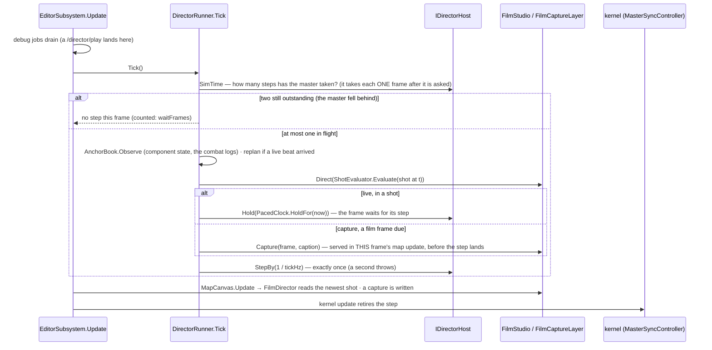

<!--STATUS
state: LIVE
build-state: BUILT (slice 1 = phases 1–3, CE-4038, ui lane, 2026-10-21 — §8) · was READY-TO-BUILD (approved 2026-10-21, R-4062) · ⭐ RE-DISPATCHED 2026-10-21 to the UI lane (R-3038): docs/blueprints/batches/HANDOFF_Backend_To_Ui_Film_Director.md — the backend dispatch (HANDOFF_Coordinator_To_Backend_Film_Director.md) is superseded
updated: 2026-10-21 (AS BUILT §8 — CE-4038 slice 1 by the ui lane: the runner, its five seams, the routes, the panel, the take store, the seeded takes, the 2-D ear and the sound track; eight deviations from §2) · 2026-10-21 (sixth pass — R-3038: a take is scripted in TIME on a stepped run that repeats; one stepping cadence — exactly one step per rendered frame — for the scout, the live show and the capture; built by the ui lane; 'filmed = scouted' waits for CE-3293 S5) · 2026-10-21 (fifth pass — backend R-3034: scenarios are not deterministic; every run loads again, never a rewind; D-3 cuts on live cues + precursors; B0 withdrawn · coordinator R-4064: shots held `until` the next event, the scout measures reliability, capture retakes, final films later from a RECORDING (§3d, §3e). Fourth pass — R-4061 amended: slice 1 plays in the editor's PREVIEW (a live run from the saved file is less tested); NO instant replays in slice 1, later from a live run's recording (§3c). Second pass — the user's rulings on sound and overlays (R-4059, R-4060), instant replays live (§3c), a reel is one movie (§4a); first version same day)
current-answer: §8 AS BUILT (CE-4038 slice 1 — what was built and where it deviates) · §0 FIRST (R-3038 overrides §3d and D-3 for stepped runs) · §1 the picture · §2 classes · §3 sequences · §4 the formats and routes · §5 the decisions (leans for approval) · §6 phases and acceptance
stale-below: none
known-rot: §2's Scout, CaptureSink, CinemaMode, LayerOverride and SoundTrack.Log boxes are SUPERSEDED by §8.3 (as built). §3d and D-3 (fifth pass, LIVE cues on runs that differ — R-4064) are SUPERSEDED for stepped runs by §0 (R-3038); §2/§6's scout-baked anchors are correct again. D-1's "at most 2 per frame" is superseded by §0's one-step-per-frame rule.
known-conflict: none — the determinism question ("I still believe we could make this deterministic") is RULED by R-3038; the mechanism is DESIGN_Paused_And_Stepped_Execution.md (CE-3293).
related-designs:
  - blueprints/DESIGN_Paused_And_Stepped_Execution.md — OWNS stepped-run event delivery (CE-3293): the determinism this director's stepped takes rely on
  - DESIGN_Map_3D_Mode.md §6ab — OWNS the film camera this drives (FilmStudio, FilmDirector as an ICameraDriver, FilmCaptureLayer, the /film routes); this design adds WHO holds the script and WHEN the shot changes
  - RUNBOOK_Filming.md — OWNS film.py / film-events.py as built (CE-3289); D-9 makes them thin clients of this
  - PLAN_Feature_Films.md — OWNS WHAT to film (the clip list, the director's grammar §1a, the gaps); its clips.json is the seed of the takes here
  - blueprints/DESIGN_Time_Architecture.md — OWNS the clock (Continuous = wall-clock dt; Stepping = fixed dt) that D-1 rests on
  - DESIGN_Cgf_Scenario_Session_Slice.md — OWNS IScenarioSession (OpenForEdit, LoadedScenarioName) the runner loads through
  - DESIGN_Cluster_Load_Phase.md §9 — OWNS ScenarioLoadSequence (Idle first, then the load)
  - DESIGN_Remote_Map_Control.md — OWNS remote map commands over DDS (CMD_SET_VIEW); a network path, not a script path — not reused (§5)
  - designs/group-maneuvers/DESIGN_Demo_City_Showcase.md — OWNS the one-scenario showcase; its acts become takes here
  - designs/audio/DESIGN_FPS_Audio.md — OWNS the sound (our spatializer, AU-1…AU-10; CE-1137 camera sound in 3-D); §4c here adds the 2-D ear, the switches and the film's sound track
  - DESIGN_Terrain_Combat_Tuning.md §5e — OWNS the map layers (LayerControlDto rows, two sets per view, saved to the user's file); §4b here adds the transient override and the HTTP route
-->

# Film director — play scripted camera takes, a playlist of scenarios, live or to film

🔒 **User, 2026-10-21:** *"It would be very useful to have the video filming instructions (what scenario, what scenes, what camera view,
what time.. everything necessary) so that i can run these on my machine in real time, without stepping, a pre-step to overnight filming …
some harness that follows the loaded scenario, waits for it being loaded, then following the instructions, then go to another scenario in
the list; also allowing each scenario to be replayed like that (with the camera cuts) individually; maybe it could be a feature of the
editor itself"* · *"i expect multiple versions of different scenarios"* · *"controlled via ai debug http of course"* · *"and also from some
ui panel for the user without ai debug http"* · *"it will be implemented by the backend"*.

🔒 **User, 2026-10-21 (second pass):** *"We should play the audio even in non-FPS mode. The UI should have a menu option to turn sounds on
and off. FPS mode always has sounds. Overlays like labels optional, Default is off. the subtitles and camera zooms on certain concrete thing
can Replace the need for the labels. But another interesting point is to demonstrate the use of those overlays and different helpers. So it
could be great if the script controlling the movie can turn them on or off. And the same capability would be great from AI debug HTTP,
turning those tactical map symbols on or off, as the user can do today from the UI."* · *"I would like to use this built-in feature in the
editor to replay the clips before I start overnight rendering of all the movies. Note that I need to also concatenate multiple different
scenario takes together into a movie showing multiple features."*

🔒 **User, 2026-10-21 (third pass), on instant replays:** *"oh you meant using the recorded scenario and replaying it? that is a great
ides, would require functional recording and replay which i am not sure if it works properly, not tried; also the editor preview is not
recorderded by design (but we not need to use the preview feature of the editor, but the full live run instead, which does the recording)"* ·
*"In the first slice no such instant replays, but later, yes"* · (fourth pass) *"live play from saved worls snapshot is even more untested
feature so i would avoid it for now. we do not want instant replay in slice 1 so preview mode will do just fine."*

**Words used here.** A **take** is one scenario's camera script: its shots, cuts, anchors and captions. A **reel** is a playlist of
takes. The **director** is the editor feature that plays them: on screen in real time, or frame by frame to a film.

🔒 **User, 2026-10-21 (the step rate):** *"clip can run on 15Hz if faster stepping does not work"* · *"(or 20)"*

🔒 **User, 2026-10-21 (fifth pass):** *"scenarios are not deterministic by design. this might be quite an issue for planning clips"* ·
*"which might lead to the replay from recording path"*. ⭐ Canon since 2026-09-04: *"the scenario is not deterministic, entities do not
go the same ways"* (`RUNBOOK_Cluster_Debugging_Over_Http.md` §8).

## 0. ⭐⭐⭐ SIXTH PASS — R-3038: a take is scripted in TIME, on a stepped run that repeats

🔒 **User, `2026-10-21`:** *"it needs to rely on determinism, otherwise we could not specify when what cut should take place and at which
time the camera should be at what direction or not."* · *"Yes, write it and write a handoff to the UI line."*

| | fifth pass (R-4064, superseded for stepped runs) | ⭐ **sixth pass (R-3038)** |
|---|---|---|
| when a cut happens | on a live cue in the run being shown | ⭐ **at the script's time** — anchors baked by the scout are exact, because the filmed run IS the scouted run |
| the scout | a reliability measurement over N differing runs | ⭐ **one run, stepped like the film**, that bakes the anchor times; a second scout run that differs is a **determinism defect** to report, not a statistic |
| retakes | repeat a run whose beat is missing | ⛔ not a remedy — a missing beat on a repeated run is a defect (report it with both runs' state) |
| live cues and precursors | the cut mechanism | ⭐ kept as the **verification**: capture checks each baked anchor fires at its time and the report names any that drift |
| the stepping cadence | paced, up to 2 steps per frame | ⭐⭐ **EXACTLY ONE STEP PER RENDERED FRAME, for every run that must repeat — the scout, the live show, the capture.** Never zero, never two. Real time is kept by **holding the frame** until the step is due, not by skipping or doubling steps |
| the step size | 1/60 s, or 20 / 15 Hz when 60 cannot keep up (R-4063) | the same — ⚠ **but one take keeps ONE step size across its scout and every film of it**; a step-size change is a new scout |
| every run | loads from the file (R-3034) | unchanged |

⭐ **Why the cadence rule** (`DESIGN_Paused_And_Stepped_Execution.md` §10 F1): a system that runs every frame reacts on the frame after a
step, so whether a paused frame comes before the next step changes the run. ⛔ Rejected: the kernel forbidding two steps on consecutive
frames — it halves the top step rate (a 60 Hz live show would need 120 fps).

⭐ **What it depends on:** stepped runs repeat only once **CE-3293 S5** lands (step-only systems receive every event since the last step).
Until then the director is built and tested on single runs; *"the filmed run equals the scouted run"* is accepted after S5 — measured on
three loads stepped once per frame, identical at every cut.

🔒 **User, 2026-10-21 (approval):** *"lets write a note to backend to implement that"* — the design as summarized, slice 1 = phases 1–3.

**Two modes, one runner** — 🔒 *"the frame by frame feature is usefull for ai driven mode while running in the cloud VM, i need also the
live mode with no saving screenshot images, jus rendering on the screen"*:

| | ⭐ **live** (the default) | **capture** |
|---|---|---|
| for | you, watching in the editor on your machine | an AI or the overnight run, headless on a cloud VM (Xvfb) |
| clock | paced fixed steps, real time (D-1) | one fixed step per film frame, as fast as the renderer allows |
| output | the screen only — ⛔ **no images saved** | PNG frames + sound cues → one MP4 per take or reel |
| started by | the panel's Play, or `POST /director/play` with **no** `capture` | `POST /director/play` with `capture: {dir, fps, size, …}` |

Both play the same take with the same cuts, so a live run is the preview of the film.

## 1. The picture



*What the picture shows that prose hides: the director adds no new camera and no new clock. It decides WHICH shot is held (through the
existing `FilmStudio` mailbox) and WHEN the sim steps (through the existing `StepOneTick`). The HTTP routes and the panel are two remotes
for the same runner.*

### 1a. Who calls what each frame — the module view



*The one new edge is `EditorSubsystem.Update → DirectorRunner.Tick`. ⛔ The red dashed edge is deliberate: `--mode all` hosts have no
runner in phase 1 (D-8), although every map host already has a `FilmCaptureLayer` and would obey a held shot.*

## 2. Classes



*What the class picture forces: the over-the-shoulder and orbit math lives ONCE, in `ShotEvaluator`. Today it lives in `film.py`
(`_shot_for`), outside the engine. D-9 moves it in, and `film.py` becomes a client.*

## 3. Sequences

### 3a. A reel, live on screen — the user's machine, real time



*The decision the picture makes visible: the sim never plays in `Continuous` mode — the director paces fixed steps against the wall
clock (D-1). ⛔ **SUPERSEDED `2026-10-21` (R-3034): the live show and the film are NOT the same run** — scenarios are not deterministic
(measured, CE-3291), so every run is its own run, opened from the file, and cuts follow what happens in THAT run (D-3). The scout pass
and its rewind are gone from this picture.*

### 3b. The same take, to film (overnight) — and a replay shot



### 3b-i. Preview, not a live run — slice 1 (R-4061 as amended)

| | ⭐ preview (slice 1) | live run (the later replay slice) |
|---|---|---|
| the world it starts from | the editor's world in memory — ⭐ which the runner has just opened from the saved file, so it IS the file | the saved scenario file, by a production load (`DESIGN_Cluster_Load_Phase.md` §8) |
| recorded | no, by design | yes — what replays from a recording would need |
| after it | ⭐ **every run loads again (R-3034)** — ⛔ never Stop-and-rewind: a rewind leaks brain and perception state (measured, CE-3291) | another run = another load |
| network ids | the same on every load (`DESIGN_Deterministic_Network_Ids.md` §4) | allocated by the load |
| how tested | filming already uses it (RUNBOOK §0). ⛔ Two runs are NOT the same run (R-3034, CE-3291) — nothing may rest on it | 🔒 *"even more untested"* — avoided for now |

### 3d. Runs differ — so the cut follows THIS run's events (R-4064)

⛔ **A time measured on one run is not the time on the next.** 🔒 Runs are not deterministic by design (RUNBOOK §8), and the trial scout
already showed it: `ua-civ-melee`'s blow at 4.25 s in the editor's preview, against ~8.6 s recorded from a cluster run. ⇒ **no cut may rest
on a baked time.**



*What the picture shows: anticipation without knowing the future — a cut is triggered by a PRECURSOR the world exposes (aiming begins, a
behaviour starts, a vehicle closes on a point), and a shot is held UNTIL the next event. No time from another run is used.*

| | how it works now |
|---|---|
| **a shot's start** | `at` is an event of THIS run + an offset ≥ 0 (`"engage"`, `"hit+0.3"`), or a fixed time for an establishing shot |
| **anticipation** | ⭐ **precursor anchors**: `engage` (the shooter's aim phase begins — `ActionStatus.Weapon` "Aiming", its `Progress`/`Needed` giving the lead, as backend measured; `AimAndFireExecutor.AimState` underneath, ≥ 0.8 s before the round), `task` (a behaviour begins), `near` (closing on a point or a unit), `countdown` (a charge or a release cue armed) |
| **a shot's end** | `until` an event (+ offset) or `seconds` as the cap — a shot is HELD to the next beat, never cut by a clock that may be wrong |
| ⛔ **negative offsets** (`fire-0.5`) | not possible live; in capture they become exact only from a RECORDING (§3e). The seeded takes are rewritten to precursors |
| **the scout** | ⭐ becomes a **reliability measurement**: N runs (3 by default) → per beat: happened k of N, and its time spread. A beat under N of N is flagged unreliable — a finding for the scenario's lane |
| **capture** | ⭐ **retakes**: if a required beat does not happen, the run is repeated (up to `retakes`, default 3) and the first good run is kept — as a film crew reshoots |
| **paced stepping (D-1)** | kept, for a fixed dt independent of the render rate (R-143), ⛔ **no longer for identical runs** |
| **every run loads again** | 🔒 *"do not use rewind, always load again"* (R-3034): a re-run, a retake or the scout's next run is a fresh load, never the preview's rewind |

### 3e. Later — shoot, then edit, from a RECORDING (the user's path)

🔒 *"which might lead to the replay from recording path."* ⭐ The final films come from a recorded run: **shoot** (a live, recorded run;
retake until the beats happen) → **scout the recording** (its events are fixed now) → **edit**: play the recording back with the take's
cuts, where leads (`fire-0.5`), slow motion and instant replays are seeks into a run that no longer changes. The live, event-driven slice
(§3d) stays the way to review on screen.

⚠ **Untried (user):** record → playback fidelity, and drawing the recording with its types (the Replay Browser draws unknown boxes today,
`DESIGN_Map_3D_Mode.md` §6b). ⇒ that slice starts by measuring both — the same questions §3c lists for replays, which it now also serves.

### 3c. Instant replays — LATER, from the live run's recording (R-4061)

🔒 *"In the first slice no such instant replays, but later, yes."* ⇒ ⭐ **slice 1 skips a take's replay shots** (the format keeps
`replay`, and the report names each one skipped).

**What a replay is.** The moment that just happened, shown again from another angle and usually slowed, then the action carries on.

**The basis the user prefers: the recording.** Slice 1 plays in the preview, which is not recorded (D-17); the replay slice would
play a full LIVE run instead, which is recorded (a new exercise per load, `node_N.fdp` per node). A replay would then show the recorded seconds `[t0, t1]` from the replay camera, while the
live run waits, and resume. ⚠ **Not tried yet** (user): whether a recording plays back faithfully. ⇒ ⭐ **the replay slice starts by
measuring it**: record a take, play `[t0, t1]` back, compare positions, effects and deaths with the live run.

| the questions that slice must answer first | why it matters |
|---|---|
| does playback show what the live run showed (types, effects, deaths)? | ⚠ measured limit: the Replay Browser draws replayed entities as unknown boxes, it sets no TKB (`DESIGN_Map_3D_Mode.md` §6b) |
| can the recording be shown while the live run is paused, then the live world come back untouched? | the live world must not be driven by the playback (cluster replay drives the live world: `DESIGN_Time_Architecture.md` §12) |
| on film: replay from the recording, or re-film the window in a second pass? | both are possible; the recording is cheaper if it is faithful |

⭐ **Kept as the fallback:** an in-memory bookmark of the world before the moment, restored and re-stepped (the earlier proposal). It needs
no recording, but a mid-run restore is unmeasured.

## 4. Formats and routes

**A take** — `scenarios/<scenario>/takes/<take>.take.json` (`main` is the default take). The shot keys are `clips.json`'s, which are
`film.py`'s plan keys plus `to`, `ease`, `speed`, `replay` (`{"from": "fire-1"}` — the window it replays ends where the shot starts; ⚠ skipped in slice 1, §3c), `caption`,
`layers` (`{"on": [...], "off": [...]}`, §4b) and `sound` (§4c). A take may also carry `layers` and `sound` at its top level, for the whole take, and **`tickHz`** (60 default; 20 or 15 when 60 cannot keep up in
real time, D-1). ⭐ The baked anchors record the `tickHz` they were scouted at, and a different rate re-scouts.

```json
{
  "title": "Panic, then shelter",
  "caption": "Gunfire panics the civilians; they run to the open house, open its door and hide inside",
  "anchors": {"fire": {"on": "shot", "n": 1}, "door": {"on": "near", "who": "Civilian 1", "point": [105, 100], "within": 3}},
  "baked": {"times": {"fire": 2.35, "door": 14.9}, "scenarioHash": "…", "buildSha": "…"},
  "endAt": "door+5",
  "shots": [
    {"at": "fire-2", "seconds": 3, "lookAt": [105, 75, 1], "distance": 55, "yaw": 90, "pitch": -22},
    {"at": "fire-0.3", "seconds": 3, "follow": "Civilian 2", "distance": 9, "yaw": 60, "pitch": -8, "to": {"distance": 6}, "ease": "inOut"}
  ]
}
```

### 4a. A reel is a movie — several scenarios' takes in one film

🔒 *"I need to also concatenate multiple different scenario takes together into a movie showing multiple features."* — ✅ **that is what a
reel is.** `films/<reel>.reel.json`:

```json
{
  "title": "HROT — civilians and crowds",
  "transition": "fade",
  "items": [
    {"scenario": "ua-civ-shelter",     "take": "main", "title": "Panic and shelter"},
    {"scenario": "ua-civ-contagion",   "take": "main"},
    {"scenario": "ua-civ-provocation", "take": "main", "from": "arrive-6", "to": "riot+5"},
    {"scenario": "ua-civ-provocation", "take": "wide", "title": "The same riot, from above"}
  ]
}
```

| | |
|---|---|
| **live** | the items play one after another; while the next scenario loads, a title card is on screen, so the load is never seen |
| **to film** | `POST /director/play {reel, capture}` writes **ONE movie**: the frames are numbered across all items, a fade or a title card between items, a chapter mark per item (ffmpeg metadata), one sound track |
| **mixing** | any scenario, any take, the same scenario twice with different takes, part of a take (`from` / `to`, anchors or shot numbers) |
| **many movies** | a reel per film: `features.reel.json` (everything, in CAPABILITIES order), one per chapter, one per audience — they share the takes |

**Several versions of one scenario** (🔒 *"multiple version of different scenarios"*): a variant is its own scenario folder
(`ua-eject` · `ua-shootdown-eject`), so it carries its own `takes/`. One scenario can hold several takes (`main`, `short`, `wide`). A reel
names `scenario + take`. ⭐ **"Save As" and "new from" must copy `takes/`** with the scenario.

**HTTP** — on the editor's ai-debug host, main-thread jobs like every other route, each with a `DebugApiRouteDocs` entry (so MCP gets
them):

| route | does |
|---|---|
| `GET /director/takes?scenario=` · `GET /director/reels` | list |
| `GET` / `PUT /director/take/{scenario}/{take}` | read / save a take (authoring by an agent) |
| `POST /director/play` `{scenario, take}` or `{reel}` + `{speed?, loop?, capture?: {dir, fps, size, supersample, captions}}` | start — **without `capture` it plays live on screen and saves nothing**; with it, it renders frame by frame to files |
| `POST /director/stop` · `/next` · `/pause` · `/resume` | transport |
| `GET /director/status` | state, reel item, shot index, sim time, realtime factor, missing beats, anchor mismatches |
| `POST /director/scout` `{scenario, take}` | bake the anchors; the report doubles as a scenario health check |
| `POST /director/draft` `{scenario, rules?}` | an automatic take from the scout's events (backend tip 3, D-10) |
| the existing `/film/shot`, `/film/capture` | unchanged — a held shot still works by hand |
| ⭐ `GET /map/layers?view=2d\|3d` · `POST /map/layers {view, on: [...], off: [...]}` | the tactical map layers, by the same row names the Layers panel shows — **exactly what a user's click does**, saved like one (§4b, R-4060) |
| ⭐ `GET /audio` · `POST /audio {sound: true\|false, master?, muted?}` | the Sound switch and volume, as the menu sets them (§4c, R-4059) |

### 4b. Layers — overlays and helpers, from the take, the HTTP API and the panel (R-4060)

- **Names.** A layer is named as the Layers panel names it, `Group.Row` from `LayerControlDto` (`Ai.VisionCones`, `Ai.Contacts`,
  `Fire.Traces`, `Units.Cards`, …). `GET /map/layers` lists them with their display names and hover text, so a take author or an agent
  never guesses.
- **A take starts clean.** 🔒 *"Overlays like labels optional, Default is off."* While a take plays, the filmed view shows the scene alone
  unless the take turns layers on: at the top (for the whole take) or per shot (`"layers": {"on": ["Ai.VisionCones"]}` to show what a
  sentry sees, then off again). Captions and close shots do the explaining in most clips.
- ⭐ **The take's layers are a TRANSIENT override**, laid over the user's own set and dropped when the take ends. ⛔ They are never written
  to the settings registry, because `LayerControlSets` saves that registry to the user's file: a take must not change the user's map.
- **The HTTP route is the user's click**, persisted the same way (`LayerControlSets.Write`), so an agent can set up the map as a person
  would. The panel and the route cannot disagree: one registry, one set per view.

### 4c. Sound — in every view, and in the films (R-4059)

- 🔒 *"We should play the audio even in non-FPS mode … a menu option to turn sounds on and off. FPS mode always has sounds."*
- **Already built** (CE-1137): Settings ▸ Sound plays the scene from the **3-D** camera outside FPS (`AudioLayer.cs:82-84`,
  `AudioPreferences.CameraSound`). **Missing:** the **2-D** map has no ear (`view.Is3D ? … : null`). ⭐ Lean: the 2-D ear stands at the
  view's centre, as high as half the visible width, so a wide view hears only the loud things — the same spatializer, no new rule.
- **FPS** plays sound whatever the switch says (as today). **A take** may set `"sound": false` for a silent shot; default on.
- **The films get a sound track.** A captured frame takes ~0.8 s, so the device's output cannot be recorded. ⭐ Instead the mixer, while
  capturing, **logs every sound it starts** (sim time, sound, gain and pan from the director's camera), and after the pass the engine
  **renders the WAV offline** from the same sound files and generated placeholders, slow motion included, which ffmpeg muxes into the
  movie. One mixer, one spatializer, live and on film.

**The panel** — *View › Director*: pick a reel or a scenario's take · Play / Stop / Next · *Replay this take* · Prepare (scout) ·
speed · a row per item with its last report (✅ / ⚠ mismatch / ⛔ beat missing). It calls the same `DirectorRunner` methods the routes
call.

## 5. Decisions — leans for the user's approval (✅ = already ruled)

| # | question | ⭐ lean | rejected, one line each |
|---|---|---|---|
| **D-1** | how real time plays | ⛔ **SUPERSEDED IN PART by §0 (R-3038): exactly one step per rendered frame, the frame held to real time — never 2 per frame.** ⭐ **paced stepping**: the runner steps fixed 1/60 s ticks as the wall clock allows (at most 2 per frame), (⛔ SUPERSEDED `2026-10-21`: *"so the run is identical to the stepped film and the scout"* — R-3034, scenarios are not deterministic; pacing still gives a fixed step and real time) ⭐ **If 60 Hz cannot keep up** (the master retires one step per frame and the renderer is under 60 fps), the take runs at a **coarser fixed step: 20 Hz, else 15 Hz** (`tickHz`), one step per rendered frame — still real time; live, scout and capture use the same rate | `Continuous` play: dt from the wall clock (`MasterSyncController.cs:177-186`), so cuts land late and the AI differs run to run |
| **D-2** | where takes live | ⭐ **beside the scenario**, `takes/*.take.json` — a variant carries its own | in `scenario.json`: presentation in the replicated world document, and the R-260 camera entity is adopted once at load · one central manifest: variants lose their takes |
| **D-3** | when a cut happens | ⛔ **SUPERSEDED for stepped runs by §0 (R-3038): at the script's time, anchors baked by a scout stepped like the film; live cues verify.** ~~REVISED `2026-10-21` (R-3034): LIVE CUES in the run being shown.~~ A cut AT an event fires on its cue; a cut BEFORE an event (`fire-0.5`) fires on its **precursor** — the shooter's aim phase beginning (`ActionStatus.Weapon` "Aiming", with `Progress`/`Needed` giving the lead), a launch committed, a mover's arrival from its remaining path. A take's times are a fallback (a cut with no cue). A scout pass, if kept, only DRAFTS a take (D-10) — its times are approximate  ⭐ **Coordinator, R-4064:** a shot is held **`until`** its next event; the scout measures **reliability** (N runs: k of N, time spread) and drafts; capture **retakes** a run whose required beat is missing (§3d) | ⛔ baked anchors replayed exactly (the earlier lean): rested on two runs being the same run — measured false (CE-3291), ruled not a goal (R-3034) · post-hoc editing of a capture: one camera per run, nothing to cut to |
| **D-4** | instant replays | ✅ **RULED (R-4061): none in slice 1; later, from the live run's recording** (§3c), after measuring that playback is faithful; the in-memory bookmark is the fallback | — |
| **D-5** | overlays per shot — backend tip 4 | ✅ **RULED (R-4060):** off by default; a take or a shot turns layers on and off by name, as a transient override (§4b) | — |
| **D-6** | titles, captions, sound — tip 5 | ⭐ captions **drawn by `CinemaMode`**, on screen and burned into captured frames. ⭐ **Sound** in every view when Sound is on (R-4059); the films get a track **rendered offline from the mixer's cue log** (§4c) | `ffmpeg drawtext` only: the live show would have none · recording the device: a captured frame takes ~0.8 s, so the sound would be stretched ~50× |
| **D-7** | rendering speed — tip 2 | ⭐ **`CinemaMode` hides the panels and gizmos** while directing: the map fills the window. Measure the per-frame gain on entry | keep the panels: ~0.8 s per film frame, mostly the panels |
| **D-8** | which hosts | ⭐ **the editor** (`--mode editor`), the runbook's preferred host | `--mode all` now: one perspective on screen, real-time cuts overshoot; later, if a clip must prove the wire |
| **D-9** | `film.py` / `film-events.py` | ⭐ **thin clients** of `/director/*`: one camera-math implementation | keep both: two copies of the over-the-shoulder math that rot apart |
| **D-10** | automatic plans — tip 3 | ⭐ `/director/draft` writes a take from the scout's events (a shot fired → over the shooter 0.5 s before, then the target), **for a human to edit** | fully automatic films: the grammar (PLAN §1a) needs judgement the rules lack |
| **D-11** | "is it loaded?" | ⭐ **extract** `HandleScenarioLoad`'s measured edge logic into `ScenarioReadyProbe`; the route and the runner share it | a new "loaded" event: none exists, and the edge logic is already measured. `LoadedScenarioName` is set when the load is SENT (`EditorScenarioSession.cs:82`), not when it is built |
| **D-12** | moving the camera | ⭐ through `FilmStudio` (the director's `ICameraDriver`) only | writing the scenario's camera entity: it would be saved into the scenario (`DESIGN_Map_3D_Mode.md` §6i) · `DESIGN_Remote_Map_Control` `CMD_SET_VIEW`: an IG-only DDS path |
| **D-17** | the run the director plays | ✅ **RULED (R-4061, amended; R-3034): the editor's PREVIEW** in slice 1 — opened from the saved file, entered paused; ⛔ **never rewound — every run loads again** (R-3034) | a full live run: 🔒 *"even more untested"*; it returns with the replay slice, which needs its recording |
| **D-18** | the final films | ⭐ **later from a recording** (§3e): shoot, scout the recording, edit — exact leads, slow motion and replays | rendering only live runs: every lead is a guess and a missed beat costs a whole run |
| **D-13** | the map layers over HTTP — R-4060 | ✅ **RULED:** `GET/POST /map/layers`, the same rows and the same persistence as the panel's click | — |
| **D-14** | the 2-D ear — R-4059 | ⭐ at the view's centre, half the visible width up | no sound in 2-D: the user asked for sound outside FPS, not only in 3-D |
| **D-15** | several scenarios in one film | ⭐ **a reel is the movie** (§4a): one capture, frames numbered across items, a transition and a chapter mark per item, one sound track | a movie per take joined afterwards: the joins, titles and sound would be a second tool to keep in step |
| **D-16** | what a replay may replay *(the replay slice)* | ⭐ **only the window that just ended** (`replay.from` → the shot's start), so one bookmark suffices and the run continues exactly | any earlier window: a second bookmark at "now" and a restore back to it — more state, no grammar needs it (PLAN §1a ⑤) |

### 5a. Claim table — what the leans rest on

| claim | code — how it IS | design — how it was MEANT |
|---|---|---|
| a held shot follows its unit every frame, paused or not | ✅ `Film.cs` `FilmDirector.Place` (resolves `Follow` per frame) | ✅ `DESIGN_Map_3D_Mode.md` §6ab |
| every map host already carries the film layer | ✅ `MapInteractionPack.cs:553`; attached by Editor, CGF, IG, SimHost, ReplayBrowser | ✅ §6ab |
| real-time play takes dt from the wall clock | ✅ `MasterSyncController.cs:177-186`; only `Step` uses `fixedDelta` (`:349`) | ✅ `DESIGN_Time_Architecture.md` |
| ~~stepped editor runs are identical~~ | ⛔ **overturned by R-4064**: 🔒 runs are not deterministic by design (RUNBOOK §8, 2026-09-04); the trial scout: the melee blow at 4.25 s (editor) vs ~8.6 s (cluster). CE-202's 600-step identity does not carry to a whole scenario | ⛔ |
| a precursor of a shot is observable | ✅ the weapon channel's `AimState` (`AimAndFireExecutor.cs:778`: target, elapsed aim time) — ⚠ to be exposed to the director in-process (no HTTP field is needed) | ✅ `DESIGN_Peek_And_Fire.md` (aim 0.8 s when seen, P7) |
| the editor's step path | ✅ `EditorTimeTransportFacade.Step` → `ITimeCommands.StepOneTick`, the same as `/sim/step` | ✅ AS-11 |
| one step per frame at most on the master | ✅ `/sim/step` comment CE-105 (`DebugApiHost.cs`) | — ⇒ D-1 caps at 2 per frame and **measures** it; if the master retires only 1, the take drops to 20 Hz or 15 Hz steps (🔒 user) |
| a step's size is chosen by whoever asks for it | ✅ `StepTimeIntent { DeltaSeconds }` (`TimeLocalEvents.cs:19`); `IntentTimeCommands.StepOneTick` sends `_fixedStepSeconds` ⇒ the runner can send 1/20 s or 1/15 s with no engine change | — |
| ⭐ two previews of one take, stepped alike, are the same take (D-1's premise; B0) | ⛔ **NOT A GOAL — R-3034** (🔒 *"scenarios are not deterministic! do not expect that"*). 🔴 measured false `2026-10-21` (CE-3291): at 15 Hz on `ua-tank-ammo` the first load after boot plays differently, two reloads agree in behaviour to 25 s then drift 4 cm, a rewind's result depends on what ran before (blind M1, or shots 10 ticks early), and instance counters make no two runs byte-identical. ⇒ CE-4038 stopped at B0 (rail `DeterminismRails.A_take_played_again_*`, red) | — |
| the sim behaves the same at a 1/20 s or 1/15 s step | ⛔ **not measured**: movers, guided rounds and hit tests were tuned at 1/60 s. ⇒ the scout at that rate is the check; B0 runs at the chosen rate too | — |
| no "loaded" event exists | ✅ searched; readiness is the edge poll in `HandleScenarioLoad` | ⛔ searched `docs/`, none found |
| a mid-run snapshot restore re-steps identically | ⛔ **not measured** — D-4's first task is the rail; the fallback (rewind to 0 + fast-step) is built from parts that exist | ⛔ none found |
| a live run is recorded per node | ✅ seen in CE-4033: `/tmp/FDP_Temp/exercises/<id>/node_1.fdp` | — |
| the preview rewinds to t = 0 and reruns with the same ids — ⛔ **not used (R-3034): a rewind leaks brain/perception state, CE-3291** | ✅ `EditorPreviewController` (snapshot + `IPreviewRewindable`s; the clock restored, CE-3156) | ✅ `DESIGN_Deterministic_Network_Ids.md` §4 |
| a recording plays back faithfully | ⛔ **not tried** (user) — the replay slice measures it first | — |
| sound from the 3-D camera outside FPS is built | ✅ `AudioLayer.cs:82-84`, `AudioPreferences.CameraSound`, the menu at `LocalWindowController.cs:254` (CE-1137) | ✅ `designs/audio/DESIGN_FPS_Audio.md` |
| the 2-D map has no ear | ✅ `AudioLayer.cs:82` (`view.Is3D ? new Ear(…) : null`) | — |
| the user's layer set is saved to their file | ✅ `LayerControlSets` (`LayerControlGizmo.cs:230-290`) ⇒ a take's layers must not be written there | ✅ `DESIGN_Terrain_Combat_Tuning.md` §5e |
| no HTTP route reaches the layers or the sound | ✅ the editor's route list: only `/panels*` touch the UI | — |

## 6. Phases and acceptance — for the ui lane (R-3038)

⚠ **Read through §0:** phase 1's first item becomes *"two runs stepped once per frame are identical at every cut"* — a REPORT now, a GATE once CE-3293 S5 lands; phase 2's scout bakes exact times; retakes give way to a determinism report.

| phase | builds | accepted when |
|---|---|---|
| **1** | ⭐ first: **measure how much two previews of one take differ** (a report, not a gate — R-4064) · `Take`/`Reel`/`TakeStore` + validation (unknown names listed) · `ShotEvaluator` (follow, over-toward, lookAt, orbit, `to` + ease, fov) · `PacedClock` · `DirectorRunner` (load → ready → preview → play → exit → next, title cards between items) · `ScenarioReadyProbe` extracted · `/director/play\|stop\|next\|status\|takes\|reels` · the panel · ⭐ `LayerOverride` + `/map/layers` · ⭐ `/audio` + the 2-D ear | a reel of 3 takes from 3 scenarios plays unattended in the editor; each cut fires on its event in that run; a take's layers never reach the user's settings file; `realtimeFactor` reported |
| **2** | `AnchorBook` (live anchors incl. precursors `engage` / `countdown`, `until`) · `Scout` (N runs: per beat k of N and the time spread) · `/director/scout` · retakes in capture | a take cuts on its events in every run; the scout report flags each unreliable beat |
| **3** | `CaptureSink` (+ `speed`) · a reel → ONE movie with transitions and chapters · `SoundTrack` (cue log + offline WAV) · `CinemaMode` (panels off, captions) · `film.py` as a client | the overnight run films a reel of several scenarios into one movie with sound; the measured per-frame time with panels off |
| **4** | `/director/draft` (automatic takes to edit) | — |
| **5** *(later, R-4061, R-4064)* | **shoot, then edit, from a recording** (§3e): measure record → playback fidelity and typed drawing first; then exact leads, slow motion and instant replays from the recording | a replay shows the moment again and the take continues untouched |

⭐ **Seed data:** `docs/films/clips.json` splits into one `main.take.json` per scenario (55 takes), and a `films/features.reel.json` lists
them in CAPABILITIES chapter order.

## 7. INVENTORY — what exists, measured before designing

```
scripts/cbm.sh search_graph name_pattern=".*(Film|Director|Playlist|Showcase|Cinematic).*" label=Class  → total 15, has_more false
    → MissionDirectorSystem, UrbanCombat.ScenarioDirector, Showcase* (an FDP example), EvacDirector (SUMO): none a camera director.
    ⚠ FilmStudio / FilmDirector / FilmCaptureLayer are NOT in the graph (it predates CE-3289); found by grep in Hrot.Presentation/Map3D/Film.cs
scripts/cbm.sh search_graph name_pattern=".*Camera.*" label=Class  → total 24: MapCamera3D, CameraPose, MapCamera (2-D), MapCameraLayer,
    MapCameraTkb, MapCameraView(port), FpsCameraDriver, CameraBookmarkStore (Stride, saved poses), Stride camera controllers
scripts/cbm.sh search_graph name_pattern=".*(ScenarioSession|ScenarioLoad|Preview).*" label=Class  → total 53: EditorScenarioSession,
    ScenarioLoadSequence, ScenarioLoadStep, Reference*LoadHandler, EditorPreviewController, PreviewStateBracket, PreviewParticipants, …
corpus sweep (docs/ then .dev/): "playlist", "cinematic", "camera path", "kiosk", "presentation mode" → none found
check_index_coverage is not available through the CLI ⇒ these totals are not proof of completeness
```

*Reused as is:* `FilmStudio`, `FilmDirector`, `FilmCaptureLayer`, `ITimeCommands`, `IScenarioSession`, `ScenarioLoadSequence`,
the debug job queue. *Prior art:* `CameraBookmarkStore` (Stride) saves poses, not timed shots.

## 8. ⭐ AS BUILT — CE-4038 slice 1 (phases 1–3), ui lane, `2026-10-21`

⭐ Built against §1–§4 under §0 (R-3038). The design had **19 classes and 4 sequences** (§3a, §3b, §3d, §3e); what was built matches
§1's module view and §1a's one new edge exactly, and deviates from §2 in the eight places named in §8.3 — each SUPERSEDES the part of
§2 it names. ⛔ §3d (live cues as the cut mechanism) stays superseded by §0: live cues are the FALLBACK when a take has no fresh bake.

### 8.1 Classes as built

```mermaid
classDiagram
  class DirectorRunner {
    +Play(PlayRequest) problems
    +Stop() Next() Pause() Resume() SetSpeed()
    +Tick() once per frame
    -StepOnce() the ONE step, throws on a second
    +Status() JsonObject
    +Reports ItemReport[]
  }
  class PlayRequest {
    +Reel Reel
    +double Speed
    +CaptureOptions? Capture
    +bool Scout
    +bool Bake
    +Inline takes
  }
  class ItemReport {
    +status found missing mismatches
    +realtimeFactor steps waitFrames
    +maxStepsInAFrame maxRetiredInAFrame
    +maxStepsInAFrame frames
    +CutSnapshot[] Cuts
  }
  class IDirectorHost {
    <<interface>>
    +LoadScenario() IsOperatingEdit EntityCount
    +EnterPreview() ExitPreview() Pause()
    +StepBy(seconds) SimTime WallNow Hold()
  }
  class EditorDirectorHost
  class ICinema { <<interface>> +Enter() Exit() Card() Caption() }
  class EditorCinema
  class ILayerOverride { <<interface>> +Apply(on, off) Clear() }
  class EditorLayerOverride
  class IFrameSink { <<interface>> +Frame() Card() }
  class FilmFrameSink
  class IDirectorSound { <<interface>> +SetTakeSound() BeginLog() EndLog() Reset() }
  class EditorDirectorSound
  class PacedClock { +HoldFor(wall) +Stepped(wall) +RealtimeFactor }
  class TakeTimeline { +Plan(take, anchorTime, from, to) +At(t) +Next(t) }
  class AnchorBook { +Observe(world, units, t) +TimeOf(anchor) +Mismatches(t) }
  class ShotEvaluator { +Evaluate(shot, t, units) FilmShot }
  class WorldUnits { +Resolve(name) +PositionOf(id) }
  class TakeStore { +Load() Save() LoadReel() Validate() CopyTakes() ScenarioHash() }
  class TakeJson { +ParseTake() WriteTake() ParseShot() ParseReel() }
  class ScenarioReadyProbe { +Observe(state, count, elapsed) }
  class DirectorWindow
  class DebugApiHost_Director { <<partial>> }
  class SoundTrack { +Started() Stopped() RenderWav() }
  class RecordingAudioOutput
  class AudioDirector { <<static>> TakeSound Recorder }
  class LayerControlGizmo { <<existing>> +SetOverride() ClearOverride() SetRows() }
  class WindowManager { <<existing>> +Cinema }
  class FilmStudio { <<existing>> }
  class AudioLayer { <<existing>> +Ear2D() }

  DirectorRunner --> IDirectorHost
  DirectorRunner --> ICinema
  DirectorRunner --> ILayerOverride
  DirectorRunner --> IFrameSink
  DirectorRunner --> IDirectorSound
  DirectorRunner --> PacedClock
  DirectorRunner --> TakeTimeline
  DirectorRunner --> AnchorBook
  DirectorRunner --> ScenarioReadyProbe
  DirectorRunner ..> ShotEvaluator
  DirectorRunner ..> FilmStudio
  DirectorRunner "1" *-- "many" ItemReport
  EditorDirectorHost ..|> IDirectorHost
  EditorDirectorHost --> TakeStore
  EditorCinema ..|> ICinema
  EditorCinema --> WindowManager
  EditorLayerOverride ..|> ILayerOverride
  EditorLayerOverride --> LayerControlGizmo
  FilmFrameSink ..|> IFrameSink
  FilmFrameSink --> FilmStudio
  EditorDirectorSound ..|> IDirectorSound
  EditorDirectorSound --> AudioDirector
  AudioLayer --> AudioDirector
  AudioLayer --> RecordingAudioOutput
  RecordingAudioOutput --> SoundTrack
  ShotEvaluator --> WorldUnits
  AnchorBook --> WorldUnits
  TakeStore ..> TakeJson
  DirectorWindow --> DirectorRunner
  DebugApiHost_Director --> DirectorRunner
  DebugApiHost_Director --> LayerControlGizmo
  DebugApiHost_Director ..> ScenarioReadyProbe : /scenario/load shares it
```



*What the picture shows that prose hid: every editor dependency is behind an interface the runner owns (host, cinema, layers, frames,
sound), so the rails drive the runner frame by frame with a fake editor — and the panel and the routes reach the SAME runner. The pure
parts (formats, shot math, clock, timeline, anchors) live in `Hrot.Presentation` (`Map3D/Director/`); the runner and its editor adapters
in `Hrot.Editor` (`Director/`).*

### 8.2 One frame, as built — the stepping rule



*What the picture shows: a step is never asked for twice in a frame, and never with two already outstanding — so the master cannot be
handed two to take at once (§0's rule holds whatever the master does). 📐 **Measured in the editor, `2026-10-21`: the master takes a step
ONE FRAME after it is asked for** (the step intent crosses the orchestration bus); keeping one in flight makes the KERNEL step every frame.
⛔ SUPERSEDED the same day: "wait for each step to land before the next" — with that lag it stepped every OTHER frame (109 of 109 steps
waited on the first live run), a paused frame between every two steps — the very interleaving §0 forbids. A capture is taken in the same frame BEFORE that frame's step
lands, so the picture is the state at the film frame's sim time.*

### 8.3 Deviations from §2 — each SUPERSEDES the §2 box it names

| §2 had | as built | why |
|---|---|---|
| `Scout` (a class) | ⭐ a **mode** of the runner (`PlayRequest.Scout`, `/director/scout`); `Bake=false` measures without writing | §2's own edge said the scout *runs a take with capture and pacing off* — one runner, one stepping path; a second class would be a second loop |
| `CaptureSink` (a class) | the runner's capture branch + `IFrameSink` (`FilmFrameSink` over `FilmStudio.Capture`); cards and captions are `FilmCaptureRequest` fields drawn by `FilmText` | the capture IS the frame loop; only the mailbox is a seam |
| `CinemaMode` | `ICinema` / `EditorCinema` over `WindowManager.Cinema` (menu bar, panels and status bar not drawn; frame overlays still are) + a frame overlay for the card and caption; Esc stops | the window manager already owns what is drawn |
| `LayerOverride` | `ILayerOverride` over `LayerControlGizmo.SetOverride` / `ClearOverride` (a third set laid over the two, ⛔ never written); `SetRows` is the route's user click | the gizmo owns the mask; a second owner would race it |
| `SoundTrack.Log` | `RecordingAudioOutput` wraps the layer's output while `AudioDirector.Recorder` is set (a `NullAudioOutput` when the machine has no device); `RenderWav` maps each cue to the FILM timeline (gaps skipped, slow motion stretched) | the output is the one place every started sound passes |
| — (not in §2) | ⭐ `TakeTimeline` — shots laid out in sim time (film.py's plan rule: a shot starts at its `at` or when the last ends), trims, unresolved anchors, skipped replays | the runner, the scout and the panel needed one answer to "which shot is held now" |
| — | ⭐ `WorldUnits` / `IShotWorld` — names to network ids, positions | shared by the shot math, the anchors and validation |
| `AnchorBook.Observe(LiveCues)` | `Observe(world, units, t)` reading `ShotLog` / `DetonationLog` (kept beside the world) and component state (`SimTransform`, `EntityInfo`, `Health`, `BehaviorState`, `IsEmbarkedTag`, `Gesture`) | ⛔ no `repo.Bus.Read` (touch point 1, CE-3293 S3) |

⭐ **Also built:** `/film/shot {spec, t}` (D-9 — film.py sends its plan as take shots, the engine evaluates them; `film.py --take` films a
saved take through the director) · `POST /director/play` takes an inline take (played, never saved) · the Director panel (View ›
Director: reel or take, Play / Prepare / Stop / Next / Pause, speed, a row per take with Replay) · "Save As" copies `takes/`
(`EditorScenarioSession.SaveAs`) · the 2-D ear (`AudioLayer.Ear2D`: the view's centre, half the visible width up, looking north) · the
`FilmDirector` reads the newest shot when the camera updates (a cut lands the same frame) · every cut's world in the report (B0′).

### 8.4 Measured, and what is not yet

| claim | as built — how it IS | status |
|---|---|---|
| one step per rendered frame | `StepOnce` throws on a second; `maxStepsInAFrame` and the kernel's own `maxRetiredInAFrame` reported; rails `CE4038_AReelOfThreeScenarios_PlaysLive_OneStepPerFrame_HeldToRealTime` (🔴 red-proven) and `CE4038_WithTheMasterOneFrameBehind_TheKernelStillStepsEveryFrame` (the editor's measured lag) | ✅ |
| live play holds real time | the same rail: ×1.00 ± 5 % on a 120 fps fake renderer, the frame held · 📐 the editor on the cloud VM (Xvfb + llvmpipe, ~20–25 fps): **×0.27–0.41 at 60 Hz · ×0.72–1.00 at 20 Hz · ×0.86–1.00 at 15 Hz**, one step per frame at the kernel in every take, 0 waits — ⇒ R-4063's fallback is what the VM needs | ✅ (rails, VM) · ⚠ a desktop not measured |
| B9 — the panels' cost | 📐 VM, live: 65 → 46 ms per frame with the panels off (×1.4); the renderer, not the panels, is the cost there | ✅ measured (VM) |
| a take's layers never reach the user's file | `GZH011_Tests.CE4038_ATakesLayers_AreNeverWritten_AndTheRouteIsTheUsersClick` (🔴 red-proven) | ✅ |
| FPS always sounds | `AudioTests.CE4038_ATakesSoundSwitch_RulesTheCamera_NeverFirstPerson_AndACaptureRecordsWithNoDevice` (🔴 red-proven) | ✅ |
| filmed = scouted (B0′) | `Hrot.SystemTests.DirectorIdentityRails` — two scouts, every cut compared; a REPORT now, `HROT_DIRECTOR_IDENTITY_GATE=1` after CE-3293 S5 · 📐 `2026-10-21`: `ua-tank-ammo`, two loads in one process, one step per frame ⇒ **identical at every cut** (beats 9.150 / 17.883 s both runs) — ⚠ one take, one process; §0's acceptance is three loads, after S5 | ⏳ S5 |
| the sound track of an OGG clip | ⛔ `WavReader` reads PCM WAV only — a clip from an `.ogg` file is left out of the film's track (the generated placeholders are all in) | ⛔ a known gap |
| a 20 / 15 Hz take behaves as at 60 Hz | ⛔ not measured — the scout at that rate is the check (§5a row) | ⛔ open |
