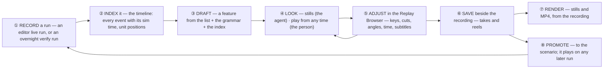
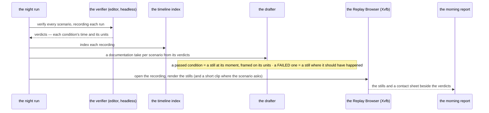
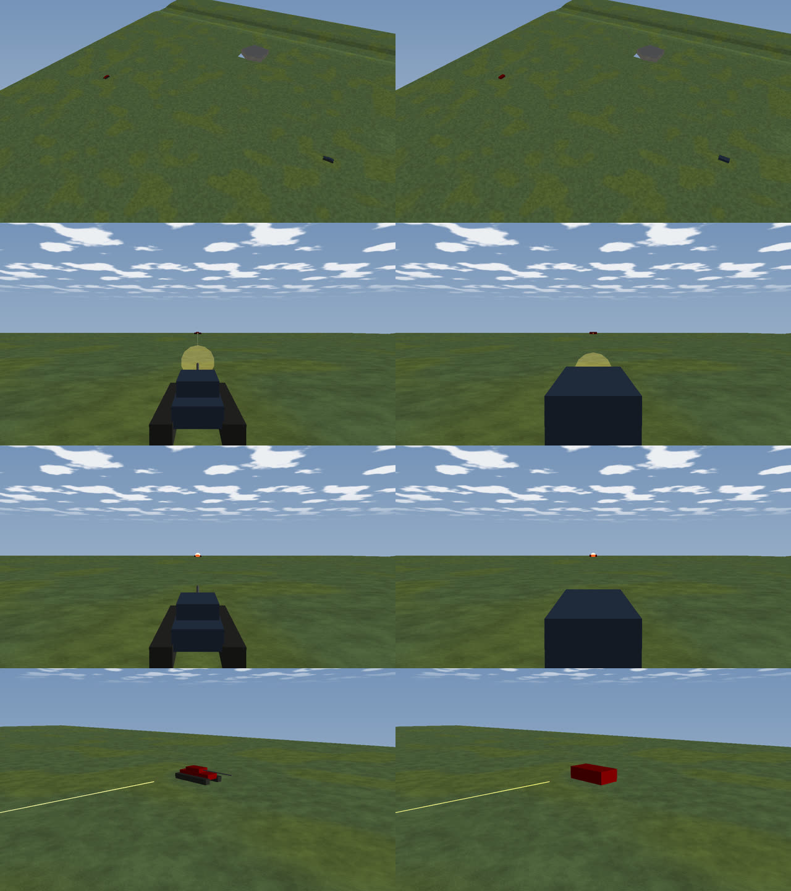
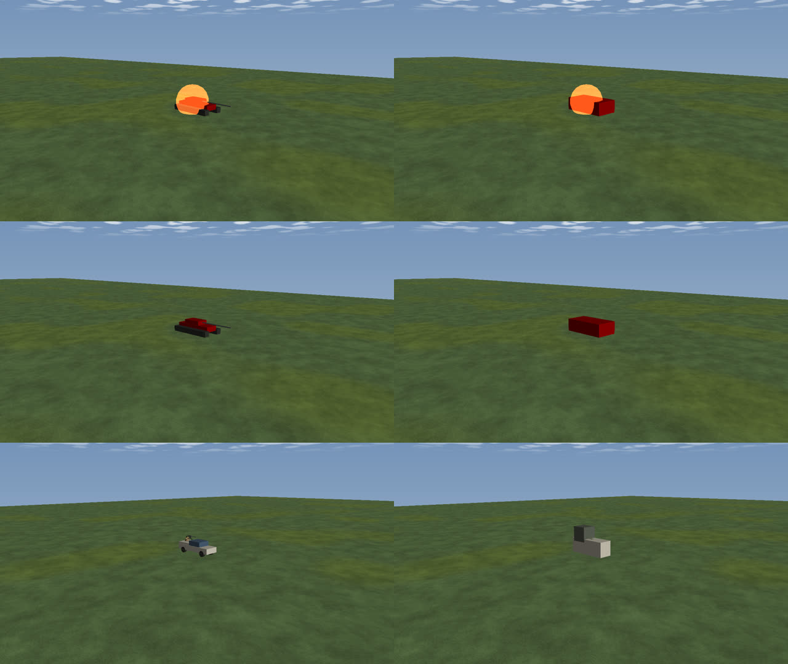

<!--STATUS
state: LIVE
build-state: DESIGN — ⭐ the INTENT of the whole film process; APPROVED 2026-10-27 (R-4091). The build plan is DESIGN_Director_Timeline_Editor.md §11 (phases P0–P6)
updated: 2026-10-27 (§6 measured: a replay matches the live run in time, place and effects; the bodies are boxes without the TKB; a frame costs 0.26 s in the RB vs 0.32 s live) · 2026-10-27 (first version — coordinator, from the user's statement of need and approval the same day)
current-answer: the whole document — §1 the workflow, §2 the principles, §3 who does what, §4 the overnight documentation, §5 where each part is built
stale-below: nothing
known-rot: none
known-conflict: DESIGN_Film_Director.md §0 / §3 cut and render films by STEPPING a live run (R-3038) — this design keeps that for LIVE preview only; films are cut and rendered from RECORDINGS (§2 F-1). Film Director's §3e already pointed here
related-designs:
  - DESIGN_Director_Timeline_Editor.md — §11 OWNS the build plan (INVENTORY, classes, sequences, leans CR-1…CR-12, phases P0–P6); §2 the tracks, §5 the take format, §9 / §9c the timeline index and its lanes
  - DESIGN_Film_Director.md — OWNS the take and reel formats, DirectorRunner, the stepping rule for live runs (R-3038), capture and the sound track
  - PLAN_Feature_Films.md — OWNS WHAT to film (the clip list → takes and reels) and the director's GRAMMAR (§1a) the drafter follows
  - DESIGN_Scenario_Regression.md — OWNS the verify runs and checks.json, whose verdicts are the documentation's shot list (§4 here)
  - DESIGN_Replay_Browser_Debug_Http.md — OWNS the Replay Browser's HTTP routes the agent drives
  - DESIGN_Replay_Time_Axis_And_Review.md — OWNS the sim axis and seeking by recorded sim time
  - RUNBOOK_Filming.md — how to run it today
-->

# Film production — from a recorded run to a film, for demonstration and for documentation

🔒 **User, `2026-10-27` — the need, verbatim:**

> *"I need you as an AI agent to be able (have all the means) to prepare the movie clips as you already did before by analyzing the
> interesting points in the scenario run to demonstrate a feature. Maybe using the Scout or maybe by analyzing the event on the time line of
> a recorded scenario (which was not available before) or something, based on the list of features to film (prepared already as takes and
> reels) and your general knowledge of filming of interesting effect and features. Then I would like to be able to play these prepared movie
> clips and check what they look like, using a deterministic run in the editor or replay run in the replaybrowser. Then I want to be able to
> run those clips in the replay browser from the recording and adjust the camera timing, camera cuts, position and viewing angles, subtitles
> and their timing, and stuff like that to my liking, and be able to save that as takes and reels for the recording and to promote these to a
> live scenario so the filming can be repeated any time if scenario timing or conditions change. This feature is not just for demonstrating,
> but also for automatic documenting of regression test scenarios that are running overnight. So the interesting points from that scenarios
> can be documented by taking snapshots or short movie clips. … The adjusting phase in the replay browser is critical because adjusting
> cannot be done easily in a living scenario, as I would need to rerun the scenario from the beginning all the time, which takes time, while
> in the replay browser I can simply seek to any time and start the replay of the take from whatever time. So it's easy to iterate the
> change and see and change and see."*

🔒 **User, `2026-10-27`:** *"approved, do the measurements first, then update the tasks and plans, then note to lanes"* · *"And please record
the intention of how this whole process should work as a design, so we can always return back to it."*

## 1. The workflow — one picture

*What the picture shows that prose hid:* the loop ④ ⇄ ⑤ — where all the iteration happens — never re-runs a scenario. A live run appears
only to MAKE a recording (①), and after a promote, to make the next one, on which the same take finds its moments again (⑧ → ①).

| step | what happens | why it is cheap now |
|---|---|---|
| ① record | any live run records itself; an overnight verify run records with `--verify-replay` | — |
| ② index | the recording's timeline index: shots, hits, blasts, spawns, deaths, behaviour changes, orders, reports, decisions, each with its frame and **sim time**; cached beside the recording | one pass at ~13× real time, reopened in ~1 ms (Director Timeline §9a) |
| ③ draft | the **drafter** turns a feature (its caption, its moments) into a take: establish → set-up → the moment → consequence → replay (PLAN_Feature_Films §1a), framed from the units' known positions | the moments are a QUERY on the index, not a scout run |
| ④ look | the agent renders a **contact sheet** of stills and reads it; the person plays the take **from any time**, loops a shot | a still is one seek and one frame |
| ⑤ adjust | camera keys (fly the map camera, K, *update key from view*), cut / fly / dip, time segments (speed ramps, skips, instant replays), subtitles and their timing — and **an edit plays on the next loop, no save** | seeking a recording, not re-running a scenario |
| ⑥ save | takes and reels beside the recording | — |
| ⑦ render | stills and MP4 rendered from the recording | no stepping of a live run |
| ⑧ promote | the take is copied to its scenario; its keys are already tied to events, so it holds when timing changes | promote is a copy (§2 F-4) |

## 2. The principles — what makes it work

| # | principle | it gives |
|---|---|---|
| **F-1** | ⭐ **A recording is the film's SOURCE; a live run PRODUCES recordings.** Films are cut and rendered from recordings. A deterministic editor run stays for watching a promoted take live | seeking, slow motion, replays and cheap iteration — none of which a live run can do (§2a) |
| **F-2** | ⭐ **One director, every host.** The same runner, take session, Director window and tracks in the editor and the Replay Browser, wired by one registrar; only the host differs (a live run steps, a recording seeks) | no feature that works in one host and not the other (R-4068) |
| **F-3** | ⭐ **Iterate without saving or re-running.** The director plays the take being edited, from any time, in a loop | *"change and see and change and see"* |
| **F-4** | ⭐ **Keys are tied to EVENTS.** A key is stored as the nearest event before it plus an offset (*"the Tank's 2nd shot + 0.4 s"*), shown on the key; a fixed time only when no event precedes it | promote is a copy, and a take survives a run whose timing changed |
| **F-5** | **One way to find a moment, live and recorded.** Event moments are queries on the timeline index — the live index on a live run, the recording's index on a recording; state moments (*near*, *health*, *task* …) observe the world | a promoted take finds its moments on a live run with the code that found them on the recording |
| **F-6** | ⭐ **The agent and the person use the same tools.** The drafter, the takes, the stills and the renders are engine features reached from the Replay Browser's panels AND its HTTP routes | what the agent drafts, the person can adjust, and the reverse |
| **F-7** | ⭐ **Documentation is the same pipeline with a generated take** (§4) | 103 regression scenarios documented without authoring a shot by hand |
| **F-8** | **Measure before relying on it.** Whether a replay looks like the live run, and what a rendered frame costs, are measured (Director Timeline §11 P0) before F-1 binds | — |

### 2a. What a recording makes possible — the "more attractive" part

| | from a recording | why live cannot |
|---|---|---|
| **anticipation** | the camera is framed where the action WILL be: the shooter and the target are known before the shot, and every unit's path in the shot's window ⇒ both stay in frame for the whole shot, with room ahead of a moving subject | live does not know the future |
| **instant and multi-angle replay** | the moment again, from the reverse angle or from above, slowed — a time segment that goes back | a live run cannot go back (R-3034) |
| **speed ramps** | 4× through the approach with an on-screen clock, 1× into the moment, 0.25× on the impact | live slow motion must step less; skipping is impossible |
| **smooth camera paths** | a follow camera damped over the KNOWN path, eased flights between keys | live follow cameras react after the fact |
| **cheap stills** | one seek, one frame | every still steps the whole run |

## 3. Who does what

| step | the agent (HTTP / MCP) | the person (the Replay Browser) |
|---|---|---|
| ① record | a verify run with `--verify-replay`, or a live load + play | an editor live run, or open an overnight one |
| ② index | `GET /timeline/lanes`, `/timeline/events`, and unit positions over time | the Event Timeline |
| ③ draft | `POST /director/draft {recording, feature}` → a take, then edits it with its own judgement of what films well | right-click an event → *"Draft a shot sequence here"* |
| ④ look | `POST /director/stills` → PNGs it reads; a contact sheet per take | Play from the cursor; loop a shot |
| ⑤ adjust | `POST /director/take` with `recording=` | the tracks, K, *update key from view*, drag, the inspector |
| ⑥ save | the same route | Save |
| ⑦ render | `POST /director/play {recording, take or reel, capture}` | Render… |
| ⑧ promote | `POST /director/promote` | Promote… (lists what each key is tied to) |

⭐ The feature list stays where it is: the takes and reels seeded from `docs/films/clips.json` (PLAN_Feature_Films §1, §5) say WHAT to
show; the drafter and the agent decide HOW, by the grammar.

## 4. Overnight documentation of the regression scenarios

*What the picture shows that prose hid:* nothing is authored by hand — `checks.json` already names every scenario's moments and their units,
so the documentation's shot list exists the moment a scenario has checks. ⭐ Stills by default; a short clip only where a scenario opts in
(render time). ⛔ Not a gate: no image is compared.

## 5. Where each part is built

| part | owning design | status `2026-10-27` |
|---|---|---|
| the build plan, INVENTORY, classes, sequences, leans CR-1…CR-12, phases P0–P6 | [Director Timeline Editor §11](DESIGN_Director_Timeline_Editor.md) | DESIGN, approved |
| the timeline index and its lanes | Director Timeline §9 / §9c | BUILT (no position track yet) |
| the take format, keys, time segments, the Camera and Time tracks | Director Timeline §5, §10 | BUILT in the editor (segments not yet played) |
| the runner, reels, capture, sound, the live stepping rule | [Film Director](DESIGN_Film_Director.md) | BUILT in the editor |
| the feature list and the grammar | [PLAN_Feature_Films](PLAN_Feature_Films.md) §1, §1a, §5 | 55 takes, reels |
| verify runs, checks, recordings of verify runs | [Scenario Regression](DESIGN_Scenario_Regression.md) | BUILT |
| the Replay Browser's routes | [Replay Browser Debug HTTP](DESIGN_Replay_Browser_Debug_Http.md) | BUILT (no `/director/*` there yet) |

## 6. Measured `2026-10-27` — is a recording a good film source? (F-8, Director Timeline §11 P0)

📐 `ua-tank-ammo`, one live run in the WINDOWED editor (Xvfb, llvmpipe) stepped to the beats and recorded; then its recording opened in the
WINDOWED Replay Browser, sought by sim time, and filmed with the SAME camera at the same sim times. Script: `filmmeasure.py` (coordinator's
scratchpad; the shape is §3's agent steps over today's routes — `/scenario/load/live`, `/sim/step`, `/replay`, `/replay/seek {atSimSeconds}`,
`/film/shot`, `/film/capture`).

| question | measured | verdict |
|---|---|---|
| does every seek land on its sim time? | 7 of 7 exactly (1, 8.95, 9.25, 17.7, 18.1, 25, 40 s — the status read back the target) | ✅ |
| are the units where they were, at the same moment? | every framing matches pixel for pixel in placement | ✅ |
| do the EFFECTS replay? | ✅ the muzzle glow (8.95 s), the round in flight (9.25 s), the tracer line (17.7 s), the blast on the T-72 (18.1 s) — all present, same place, same moment | ✅ the effects come from the recorded events |
| do the BODIES look the same? | ⛔ **no** — the Replay Browser draws every vehicle as a plain box: no hull, turret, tracks or gun on the tanks, no crew on the technical | ⛔ the RB has no TKB (R-4069) ⇒ **P0's first item, and the one that decides whether a film from a recording is watchable** |
| a film frame's cost (step + capture over HTTP, 1280×720) | editor live **0.32 s** (0.29–0.38) · Replay Browser **0.26 s** (0.24–0.30), 30 frames each | ⭐ the RB is ~20 % cheaper; the renderer dominates both. `features` (632 s × 30 fps) ≈ **82 min** from the RB vs ~101 min stepped live — both well inside a night |
| real-time playback in the RB | **25.8 fps** at 1× (a 2200×1200 window, software GL) | ✅ smooth enough to judge a take while adjusting |
| does a recording know its scenario? | ⛔ no — `Description` empty, `CustomTags` empty (the meta of this run) | P0 |
| ⚠ found | the run recorded **14 268 frames / 75 MB for 41 s of sim** (15 min of wall clock, paused between HTTP steps): the recorder writes frames while paused | for backend to rule: needed for the Wall axis, or waste (a kept film recording's size) |

## INVENTORY

⭐ The enumeration behind this design is Director Timeline §11c (`search_graph` `.*ReplayDirectorHost.*` → 0, `.*FilmGraphic.*` → 0,
`.*Director.*Host.*` → `IDirectorHost` + `EditorDirectorHost`; two read-only surveys + grep, load-bearing rows re-read). ⚠ Coverage cannot
be checked through the CLI.
