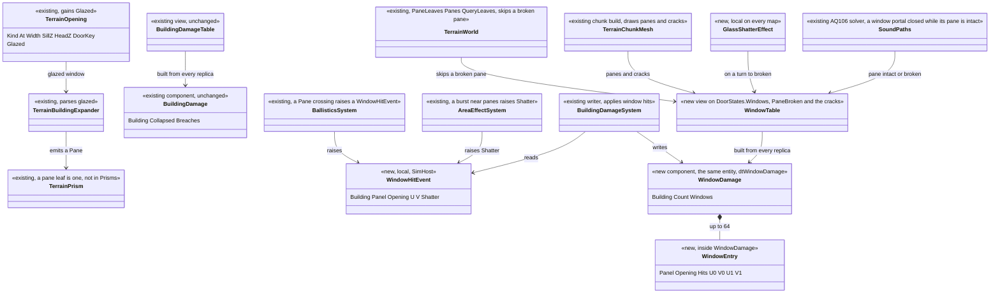
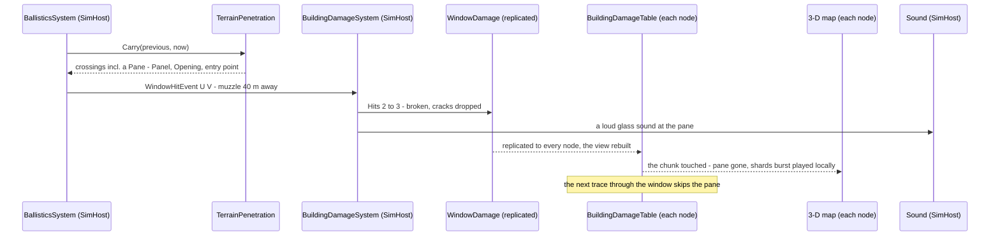
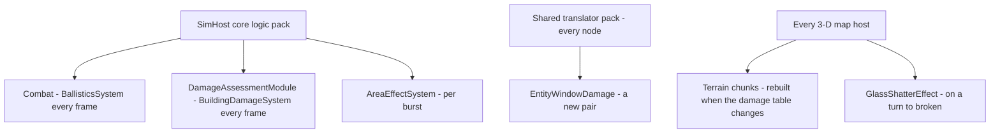

<!--STATUS
state: LIVE
updated: 2026-11-18
tracker: CE-5026 (row) · slices CE-5032…CE-5034
build-state: BUILDING — GW-1 and GW-2 BUILT `2026-11-18` (as-built folded into D-2, D-3, D-7, D-8 and §4); GW-3 (the look, ui) and the two scenarios to build — ✅ D-1…D-10 APPROVED by the user `2026-11-18` ("approved", R-5068; D-10 the user's own rule); mockup docs/UX/glass-windows.svg
current-answer: §0 the user's rulings · §1 inventory · §2 the proven solution · §3 decisions · §4 UML · §5 the look · §6 slices · §7 acceptance
stale-below: nothing
known-rot: none
superseded-inline: D-2's first form (a `TerrainPrismKind.Pane` prism) and D-3's first lean (window entries APPENDED to `BuildingDamage`) — moved to §⛔ HISTORY
known-conflict: none
related-designs:
  - DESIGN_Building_Interiors.md — OWNS the *.building.json template and its openings (doors, windows); this adds the window's `glazed` flag and the PANE
  - DESIGN_Vehicle_Breaching.md — OWNS building damage (`BuildingDamage`, breaches, collapse; B-*): the window state is a SEPARATE `WindowDamage` on the SAME per-building damage entity (the same owner, save, lifecycle)
  - blueprints/Architect_Question_106_Sound_Paths.md — OWNS sound through openings (R-3050, BUILT): a glazed window is one of its portals, closed while intact
  - DESIGN_Visual_Effects.md — §10 OWNS the impact marks a round leaves on each face (VE-I step 2, `RoundImpactNotification`); a pane's crack is NOT one of them (it is state), the round's puff still is
  - DESIGN_Node_Roles_And_Policies.md — §3.0a OWNS who may query the terrain (SimHost's roles only; every map only draws it): every glass rule runs on SimHost
  - DESIGN_Terrain_Base_Edits.md — the generator that writes enterable houses (and their windows) for the editor tools; its windows are glazed by the same default
  - DESIGN_Thermal_Drivers.md — TD-9's `glass` thermal class is the pane's material class for the image generator
-->

# DESIGN — glass in windows: panes that crack and shatter (CE-5026)

## 0. The user's rulings *(`2026-11-18`, verbatim)*

- *"how could we deal with glass windows, from the point of view a soldier standing behind it and shatering the glass (turning into empty hole window) when the
  soldier first time fires through it (or another bullet from outside) or when the window receives more than 2 hits. I guess the building would need a
  component describing which window is broken."*
- *"crack shouldnt change visibility"*
- *"terrain on other nodes is just for 3d map rendering shoudl not be queried in any simulation way. replication just updates the terrain copy (on all map enabled
  nodes) so that 3d map renders same stuff"* (= [Node Roles §3.0a](DESIGN_Node_Roles_And_Policies.md), `2026-10-25`)
- *"if we replicate the hits per window, we could store also crack location and render cracks out of it"*
- *"approved. building break which removes the wall should of course remove the window glass"*
- *"windows shall be shattered from nearby bigger explosion (pressure) or nearby little fragmentation explosion (grenade). separate component for window destruction. not causing navmesh rebakes. sound attenuation yes but this is tricky - any broken window would let sound into a building"*

## 1. INVENTORY *(measured `2026-11-18`; graph: `search_graph name_pattern=".*(Window|Opening|Glass|Pane|Glaz).*" label=Class` ⇒ 437 (window-manager / UI noise; the terrain ones below), `search_graph name_pattern=".*(BuildingDamage|Breach|DoorStates|FelledTrees).*" label=Class` ⇒ 39, `search_graph name_pattern=".*(Decal|Impact|BulletHole|Scorch|Mark).*" label=Class` ⇒ no wall-mark class (marks are effect entities); grep for `glass`, `decal`, `Openings`, `TerrainPenetration.Carry`; ⚠ index coverage cannot be checked through the CLI)*

| piece | where | what it is today | for glass |
|---|---|---|---|
| a window | `TerrainOpening` (`TerrainBuildings.cs:8, 20-31`: kind `Door` / `Window` / `Gap`, `At`, `Width`, `SillZ`, `HeadZ`) in a `TerrainWallPanel.Openings` | ⛔ a pure HOLE: the panel is expanded into solid pieces AROUND it (`TerrainBuildingExpander.ExpandPanelPieces`), so a trace crosses nothing there | ⭐ gains `Glazed`; a glazed window gets a PANE piece |
| the `glass` material | `Terrain/Data/materials.json:18` — sight 1.0, 30 mm RHA / m, 20 dB, blocks movement, thermal class `glass` | used by no window | ⭐ the pane's material |
| a round's flight | `BallisticsSystem.cs:255` → `TerrainPenetration.Carry` (`:42-80`): each crossing loses `resistance × path`; an `Entry` / `Exit` / `Stop` `RoundImpact` with the face normal per crossing | runs on SimHost | ⭐ a PANE crossing is a window hit |
| the other `Carry` callers | `LineOfFire.cs:105`, `AimPoint.cs:183`, `ThrowArc.cs:105`, `ShotLog.cs:138`, `HitResolutionSystem.cs:142` | planning / logging / hit checks | ⭐ see a 1 cm pane: ≈ 0.3 mm loss — no decision changes (D-5) |
| a skipped piece | `TerrainWorld.cs:681, 867, 1018`: `felled.Felled(prism)` — a felled trunk skipped at QUERY time by the view's damage | the precedent | ⭐ a BROKEN pane is skipped the same way |
| building damage | `BuildingDamage` (`BuildingDamage.cs:37-75`; `int Building`, `Collapsed`, 16 breaches × 21 B ≈ 342 B), one entity per building, owned by the deciding node, recorded, replicated (`EntityBuildingDamage`), saved by label (`TerrainObjectsSection.cs:219-231`), remapped by label | the per-building runtime damage | ⭐ the window state rides the SAME entity, in its own component (D-3) |
| its writer | `BuildingDamageSystem` (`BuildingDamageEvent`, `DamageAssessmentModule`, SimHost) | breaches from bursts | ⭐ also writes window hits |
| its view | `BuildingDamageTable` on `DoorStates.Damage`, built when the records change | read by queries and the drawing | ⭐ gains the broken-pane set and the cracks |
| sound through openings | `SoundPaths.ThroughOpenings` (`Perception/Sensors/SoundPaths.cs:56-80`, AQ106 / R-3050, BUILT): every opening of `BuildingLayout` is a PORTAL node, CLOSED (pays the door material's dB) or OPEN (free); a straight line pays each crossed piece's material dB | a window portal is always open today | ⭐ CLOSED while its pane is intact (glass 20 dB), OPEN once broken (D-5) |
| impact marks | `EffectSpawnSystem` (`Hrot.Presentation/Effects/EffectSystems.cs:20-40, 396-401`): a LOCAL effect entity per `RoundImpactNotification` (`Lifespan`, recorded, never replicated, capped) | wall / roof / ground marks | the round's PUFF stays this; ⛔ a crack is not (D-6) |
| the chunk drawing | `TerrainWorldQuery.BuildChunk(..., damage)` (`TerrainWorldQuery.cs`), `ChunksTouchedBy` via `DamagedBuildings.Touched` | rebuilds the chunks a damage change touches | ⭐ draws panes and cracks; a window change touches its chunk |

## 2. The proven solution, and what we take

| the problem class | how games / sims do it | here |
|---|---|---|
| breakable glass in a networked sim | the glass is a thin, see-through, shoot-through collider; its DAMAGE STATE (cracks, broken) is authoritative on the server and replicated as compact state; the client draws cracks from that state and plays the shatter VFX / audio locally on the state change (Source-engine breakable glass, Battlefield / Arma destruction) | ⭐ ADOPT: the pane is a terrain piece, the state lives in the building's replicated damage, every map draws from it, the shatter burst is a local effect on the change |
| crack decals | client-side decals at the hit point (lost on a late join) **or** a few hit positions in the replicated state | ⭐ the latter (🔒 user): ≤ 2 positions per pane, so a late joiner and a replay see every crack |
| how many hits a pane takes | a fixed count per glass type | ⭐ 3 (🔒 user: "more than 2 hits"); a man firing out breaks it at once |

## 3. Decisions — ✅ APPROVED `2026-11-18` (🔒 user: *"approved"*, R-5068)

| # | question | ⭐ lean | why |
|---|---|---|---|
| **D-1** | which windows have glass | a `glazed` flag on a window opening, ⭐ default **true** for a `Window` (templates, the importer's and the editor's generator), never for a `Door` / `Gap`; a template may say `"glazed": false` (a broken-out ruin, a barn) | static terrain: every node's copy has it, nothing to replicate |
| **D-2** | what IS the pane | ⭐ **AS BUILT (GW-1):** a thin pane LEAF (1 cm, the `glass` material) per glazed window, built by `TerrainWorld.PaneLeaves` beside the door leaves — ⛔ NOT in `Prisms`; the queries walk `QueryLeaves` (door leaves, then panes) and label the crossing `pane` (`TerrainWorld.PaneKind`), `Panes[i]` names its (panel, opening) | ⭐ only the sight / fire / sound traces see it: a prism would have reached 26 prism readers (the navmesh hash, Bepu physics, cover, the chunk mesh…), each needing to ignore it. The leaf costs the same as a door's. ⭐ A `pane` crossing is no barrier, never meets a hull, casts no blast shadow (`AreaEffect.TerrainShadow`), spares no wall or door (`AreaEffectSystem`) and leaves no decal (`TerrainPenetration.Carry`) |
| **D-3** ✏ *revised `2026-11-18` (user: "there is almost 100 free component ids … is it better to reuse damage component for windows? are the records different or similar?")* | where the window state lives | ⭐ a SEPARATE unmanaged component **`WindowDamage`** on the SAME per-building damage entity: `Building` + `Count` + up to **64** entries `{Panel (int), Opening (byte), Hits (byte: 0..2, 3 = broken), U0 V0 U1 V1 (Half)}` ≈ 14 B each (≈ 900 B); its own descriptor `dtWindowDamage` in the shared pack; saved in the building's existing `terrainObjects` entry as a `"windows"` field. ⭐ **AS BUILT (GW-2):** `WindowDamage` (id 487; `dtWindowDamage` 245; `WindowHitEvent` 5111, `WindowBrokenEvent` 5112) — u, v are BYTES (0..255, ≈ 5 mm on a 1.2 m pane; deterministic and no Half on the wire), entries `{Panel int, Opening, Hits, U0, V0, U1, V1 byte}` = 10 B ⇒ ≈ 650 B; EVERY damage entity is born carrying one (a creation request holds both; an older entity gains it on its first hit, with its final value); the save row is `[panel, opening, hits, u0, v0, u1, v1]` (panel within the building) | the two records share IDENTITY (key building → panel → opening, the deciding node, the label save, the lifecycle — a removed building takes both, Base Edits D-4) but not MEANING (a breach is geometry: navmesh, obstacles, cover, the wall drawing; a window is a 3-level state + two points: the pane skip and its drawing) nor RHYTHM (breaches at blasts; windows at every round through glass). One record would re-send every breach (≈ 900 B) and rebuild the breach view per glass hit, and the two capacities would compete under 1024 B. Cost: one component id + one ordinal, fixed at dispatch |
| **D-4** ✏ *revised `2026-11-18`* | the rules (SimHost only, Node Roles §3.0a) | a round crossing an unbroken pane ⇒ **+1 hit, its crack (u, v) kept**; the **3rd hit ⇒ broken**; a round whose MUZZLE is within **1.5 m** of the pane ⇒ **broken at once** (a man firing out); ⭐ an EXPLOSION breaks every unbroken pane within EITHER radius (🔒 user: *"shattered from nearby bigger explosion (pressure) or nearby little fragmentation explosion (grenade)"*): ① **pressure** — `blastPerCbrtKg × ∛kg` of the warhead's explosive (the cube-root scaling the crater and the felled-tree rules use; a big charge reaches far, through walls — the pressure wave), ② **fragments** — within `fragmentShatterM` of a fragmenting warhead (`FragmentRadiusM > 0`) AND with a clear line from the burst to the pane (a fragment must reach it); starter values in `glass.json` beside `trees.json` (e.g. 6 m × ∛kg ⇒ a 0.2 kg grenade 3.5 m, a 89 kg bomb 27 m; fragments 8 m) ⭐ **AS BUILT — a man firing OUT pushes his BARREL through the opening:** 📐 measured on `gw-fire-out`, the Window Rifleman's muzzle stood 0.28 m OUTSIDE the wall, so his rounds never crossed the pane; ⇒ on each round's first segment `BallisticsSystem` also tests the stretch from the shooter's chest to the muzzle, and a pane on it within 1.5 m of the muzzle shatters (`ShatterPanesAtTheMuzzle`, once per round: `TerrainFlags` bit 1) | 🔒 the user's rules; ONE place decides (the area effect step that already measures blast and fragment radii — `AreaEffectSystem`) |
| **D-5** ✏ *revised `2026-11-18`* | what an unbroken pane changes | ⛔ **no visibility** (🔒 user) — sight passes it as air (`glass` sight 1.0); a round passes, losing ≈ 0.3 mm; ⭐ **SOUND**: the room-to-room solver (AQ106, R-3050, BUILT — `SoundPaths.ThroughOpenings`, `SoundPaths.cs:56-80`) already treats every opening as a PORTAL node that is either CLOSED (pays the door material's dB) or OPEN (free); a glazed window becomes a portal that is CLOSED while its pane is intact (paying `glass`'s 20 dB) and OPEN once broken ⇒ 🔒 *"any broken window would let sound into a building"* holds BY CONSTRUCTION — the solver finds the cheapest way in, and one broken window is it; the straight line (v1) pays the pane's 20 dB too, and nothing once broken | one sound path, the portal graph that already exists; ⛔ no special case for glass |
| **D-6** | cracks | ⭐ **drawn from the replicated `U`/`V`** (🔒 user) on every map node: a crack-star decal in the pane's plane per kept hit (≤ 2); a broken pane keeps none, so its cracks vanish with it | ⛔ SUPERSEDED: local crack marks with a ≥ 10 cap |
| **D-7** | broken | the pane piece is SKIPPED at query time by the view's damage (⭐ **AS BUILT:** `DoorStates.Windows` — a `WindowTable` of its own, `PaneBroken(panel, opening)`, the `FelledTrees` shape and cache — ⛔ NOT a part of `BuildingDamageTable`: a glass hit would then hand out a new breach table and re-bake obstacles) exactly as a felled trunk; the window is an open hole again — today's behaviour; ⭐ **no navmesh rebake** (🔒 user): a window is no passage (its sill), and `WindowDamage` is not in the navmesh's damage hash (`TerrainResidency.DamageHashes` mixes only passage breaches and collapse, `:767-784`) — a test pins it | the felled-tree precedent |
| **D-8** | the shatter itself | on SimHost a LOUD sound event at the pane (AI hearing, the one sound path — ⭐ **AS BUILT:** `BuildingDamageSystem` publishes `WindowBrokenEvent` when a pane turns broken, `SoundEmissionSystem.HearGlass` appends a 150 m sound of no known source class; a breach's break is silent, D-10); on EVERY map node a shard-burst EFFECT played locally when its view sees the window turn broken (a state change, so a late joiner plays none) | VFX / audio local, state replicated (§2) |
| **D-9** | full record | 64 damaged windows per building; a 65th evicts the OLDEST cracked-not-broken entry (its cracks vanish); a broken entry is never evicted; all 64 broken ⇒ the new hit is not recorded (logged) | ⚠ measure on full-1 before raising — a building with > 64 shot windows is a rare, long fight |

| **D-10** 🔒 *user, `2026-11-18`* | a building break that removes the wall | ⭐ **the glass goes with the wall** (🔒 *"building break which removes the wall should of course remove the window glass"*): the pane is a piece OF ITS PANEL, so wherever the wall is gone it is gone BY CONSTRUCTION — ① a breach whose passage overlaps the window: the panel is re-expanded through the ONE gap merge (`StaticObstacles.WithGaps`, `:219`, shared with the drawing `DamagedBuildings`) and a window swallowed by a gap gets no pane; ② a breach the shot crosses: the pane piece carries its `Panel`, so `CrossingBreached` (`TerrainWorld.cs:723`) skips it like the wall around it; ③ a COLLAPSED building: every piece of it, its panes included, is skipped (`dmg.Collapsed`). ⭐ And the STATE agrees: `BuildingDamageSystem`, writing a breach that overlaps a window, marks that window BROKEN in `WindowDamage` (its cracks dropped; no shard burst — the breach's own debris is the effect), so the sound portal opens and every reader sees one truth | ⛔ no second "glass removed by breach" rule: one gap merge decides wall and pane alike |

## 4. UML

### 4.1 Classes — existing and new

*What the picture shows that prose hid:* ONE new component and descriptor, but NO new writer, entity or view — `WindowDamage` sits on the
building's damage entity beside `BuildingDamage`, written by the same system and read through the same table; `BuildingDamage` itself is unchanged.

### 4.2 Sequence — the third round through a pane

*What it shows:* only SimHost decides (§0, Node Roles §3.0a); every other node only REDRAWS from the replicated record — the burst is played where
the state changed, so no node needs the event.

### 4.3 Modules — who registers it, who calls it each frame

*What it shows:* the rules sit only in SimHost's pack; the drawing sits in every map host and reads only replicated state.

## 5. The look — mockup [`UX/glass-windows.svg`](UX/glass-windows.svg) *(generated by `scripts/gen-glass-windows-mockup.py`)*

| state | drawn |
|---|---|
| intact | a pale-blue translucent pane in the frame, a faint sheen |
| 1 hit / 2 hits | a crack star per kept hit at its (u, v): a white impact dot, radial lines, two broken rings — on both faces of the pane |
| broken | the open hole (as today), a few shards left in the frame; at the moment it breaks a local shard burst outward and down |
| a man inside firing out | the pane he fires through breaks on his first shot |

⛔ The mockup specifies only the pane, its cracks and its shatter; the house and the map are context, unchanged. No UI panel changes (the
window state is not authored; the building damage's existing views list it).

## 6. Slices *(proposed)*

| slice | lane | builds | rails |
|---|---|---|---|
| **GW-1** ([CE-5032](blueprints/Blueprint_Issues_Tracker.md)) the pane | terrain | ✅ BUILT `2026-11-18`: `TerrainOpening.Glazed` (default true for a window); `TerrainWorld.PaneLeaves` / `Panes` / `QueryLeaves` (D-2 as built); the spatial index covers the panes | ✅ `GlassPaneTests`: a glazed window's trace crosses a 1 cm `glass` pane; sight unchanged; sound −20 dB; a gap, a door, `glazed: false` have none; no hull, no shadow, no decal; a breach over the window or a collapse takes it, a breach beside does not; the index finds it |
| **GW-2** ([CE-5033](blueprints/Blueprint_Issues_Tracker.md)) the state + rules | terrain | ✅ BUILT `2026-11-18` (rails `WindowDamageTests`, `EntityWindowDamageTranslatorTests`, `SoundPathsTests.CE5033_*`; ✅ both scenarios §7 PASS, judged by the new `window` cue — DESIGN_Scenario_Regression §3) — `WindowDamage` (component + `dtWindowDamage` translators + the `"windows"` save field) on the damage entity; `glass.json` (pressure and fragment radii); the window portal's closed / open by its pane in `SoundPaths.ThroughOpenings`; `WindowHitEvent` from `BallisticsSystem` / `AreaEffectSystem`; `BuildingDamageSystem` rules D-4, D-9; `PaneBroken` skip | 2 rounds ⇒ 2 cracks at their (u, v), the 3rd ⇒ broken and skipped; a muzzle at 1 m ⇒ broken on the first; a bomb breaks panes within its pressure radius, a grenade within its fragment radius only with a clear line; a broken window lets a shot outside be heard inside louder (an open portal); a window change triggers NO navmesh rebake; a breach over a window removes its pane and marks it broken (D-10); a collapse removes every pane; a replica receives the same entries byte for byte; save → load keeps them |
| **GW-3** ([CE-5034](blueprints/Blueprint_Issues_Tracker.md)) the look | ui | panes and cracks in the chunk build from the table; the shatter burst + the glass sound's playback | frame rails against the mockup (R-4146) |

## 7. Acceptance *(R-4277)*

| scenario | expect rows |
|---|---|
| ✅ `gw-shoot-the-window` (`scenarios/tests/`, PASS `2026-11-18`) | three riflemen fire at a man (hold fire) 1.6 m behind House A's ground-floor east window: one crack (2.5 s), two cracks, the pane still whole (2.55 s), broken (2.7 s); he never fires; they keep firing at him (the glass hides nothing). 📐 Cast notes: a ground-floor window (a street-level shot at a man upstairs meets the wall BELOW the sill — the aim is at his visible hips); three riflemen, because one man behind glass steps aside after the second crack; sampled every 0.05 s |
| ✅ `gw-fire-out` (`scenarios/tests/`, PASS `2026-11-18`) | the bt-window-duel cast: the pane is whole before anyone fires; the Window Rifleman's first shot out (12.27 s) breaks the pane he fires through (12.5 s) |
| existing `bd-destruction` | unchanged breaches and collapse (`BuildingDamage` is untouched) |

## ⛔ HISTORY

- **D-3, first lean (`2026-11-18`, superseded the same day):** the window entries APPENDED to `BuildingDamage` (40 entries, ≈ 900 B with the breaches),
  argued by "no new component id: the space is nearly full" (the header of `GlobalComponentIds.cs:35`). ⛔ Overturned: ids are free (user), and the two
  records differ in meaning and write rate — see D-3.
- **D-2, first form (`2026-11-18`, superseded by the GW-1 build the same day):** the pane as a `TerrainPrismKind.Pane` PRISM emitted by `ExpandPanelPieces`.
  ⛔ Measured at build: 26 files read `Prisms` (navmesh damage hashes, Bepu physics, cover, the chunk mesh), each would have had to ignore it; a leaf beside the door
  leaves reaches only the traces.
