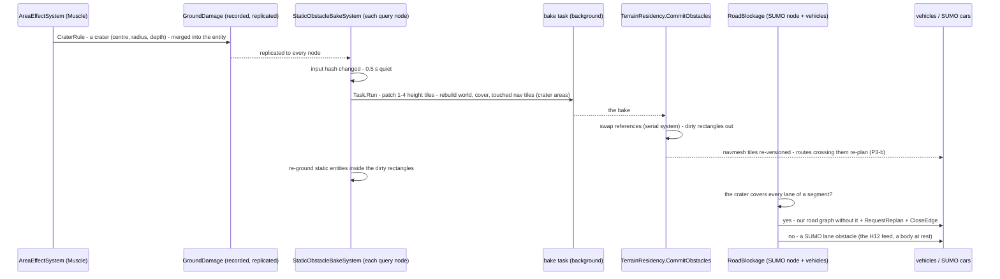
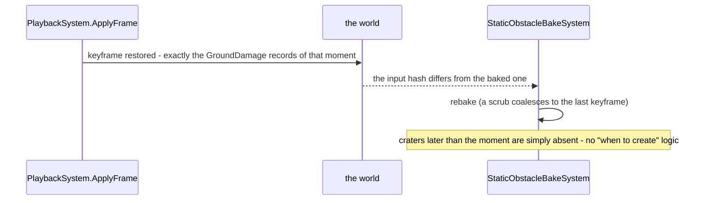
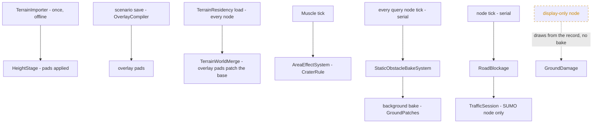

<!--STATUS
state: LIVE
build-state: READY-TO-BUILD P-1…P-4 — ✅ APPROVED 2026-11-14 (R-4228 G-1…G-3, R-4229 G-7…G-10, R-4230 G-12, R-4231 road corridors G-21…G-25); P-5 the ground-shaping tool and P-6 ditches ✅ approved in principle, ⚠ their UI mockup before dispatch; §4d binds the later terrain-editor design
updated: 2026-11-14
current-answer: the whole file — §1 the request, §2 INVENTORY, §3 the diagrams, §4 decisions, §4a the ground-shaping tool (P-5), §4b road corridors at import (P-1), §4c ditches (P-6), §4d ready for the terrain editor, §5 slices, §6 acceptance
stale-below: nothing
known-rot: none
known-conflict: DESIGN_Terrain_Height.md TH-C ("a building stands on the LOWEST ground under its footprint") — overturned for a building that carries a pad, once G-2 is ruled
related-designs:
  - DESIGN_Terrain_Height.md — OWNS the height grid (TH-A/TH-B), its tiles (§9, CE-4365) and TH-C; this design adds the pad and the patched tiles
  - DESIGN_Terrain_Authoring.md — OWNS TA-4 (flatten under houses is required), L-5 (the house's pad field), S-5, and §18 the compiled overlay every node loads; P-2 here is its S-5
  - DESIGN_Terrain_Import_UTM.md — OWNS the importer (§11) every pipeline goes through, and §8 runtime destruction (breaches, collapses) whose path the crater rides
  - designs/navig-2/Navigation_Design_v2_0.md — OWNS R-218 (geometry changes are copy-on-write navmesh rebuilds) and §14 P3 (re-plan on changed tiles)
  - DESIGN_Peek_And_Fire.md — §9 P-7a OWNS the obstacle bake (a scenario entity that IS terrain, baked on every node) the patches and blockers extend
  - DESIGN_Terrain_From_OSM.md — OWNS the OSM pipeline that writes the input set (heights, roads with NetElevation, buildings)
  - blueprints/Architect_Question_93_Sumo_Traffic_Node.md — OWNS the SUMO traffic node; §15 the external bodies SUMO's cars brake for (SumoSharp H12)
  - DESIGN_Terrain_World.md — §11 the woods navmesh area priced per mover, the precedent G-9 follows
  - DESIGN_Visual_Effects.md — CH-1 the crater decal sized by explosive mass (kept; the crater record adds the ground)
-->

# DESIGN — ground patches (house pads, craters) and road blockage

## 1. The request

🔒 User, `2026-11-14`: *"when we place a building into a slope, it is halfway hidden in the slope. What would it take to flatten the terrain surface
below the building?"* · *"what about the crater left behind a bomb explosion? This is a runtime change to the height matrix"* · *"How will the
craters work during replay? If we seek …"* · *"Sumo Sharp allows placing some obstacles on the road network so that sumo cars are forced to avoid
this place"* · *"how would vehicles detect the obstacle?"* · *"write the design now"*. Tracker: [CE-4403](blueprints/Blueprint_Issues_Tracker.md)
(pads), [CE-4590](blueprints/Blueprint_Issues_Tracker.md) (road blockage), [CE-4591](blueprints/Blueprint_Issues_Tracker.md) (craters); feeds
CE-4402 (low doors on a slope).

## 2. INVENTORY *(2026-11-14, `coordinator`)*

| query | total | found |
|---|---|---|
| `scripts/cbm.sh search_graph '{"name_pattern":".*(Height(Field\|Map\|Grid)\|Elevation\|TerrainWorld\|TerrainEdit\|TerrainPatch\|TerrainOverlay\|Ground(Height\|Grid)).*","label":"Class"}'` | 13 | `TerrainHeightGrid` (+ `TerrainHeightTiles`, 256² posts a tile, read-only), `TerrainWorld` (`Height { init; }`), `TerrainWorldMesh`, `TerrainWorldParser`, `TerrainWorldQuery`, `TerrainWorldLosStrategy`, `CachedGroundHeight`, `BepuHeightGridProbe` (a SPIKE, not production) — ⛔ no patch / pad / crater class |
| `… '{"name_pattern":".*(Closure\|Block(ed\|age)\|LaneClos\|Obstacle\|Incident\|Avoid\|Reroute\|EdgeCost).*","file_pattern":"*Sumo*"}'` | 12 | SumoSharp `ObstacleStore`, `ObstacleHandle`, `ExternalObstacle`, `ExternalBodyFeed` (+ `LaneObstacle`), `RerouteDriver`, `RerouteEdgeWeights` |
| `… '{"name_pattern":".*(RoadNetworkEdit\|RoadBlock\|Wreck\|Passab\|Traversab\|AgentType\|NavAgent\|VehicleNav\|AreaCost\|Crossable).*"}'` | 3 | `NavAgentProfile`, `WreckSpawnSystem`, (Stride's intent system) — ⛔ no road-blockage class |
| grep the import order | — | `TerrainImporter`: `HeightStage.Run` (`:71`) → buildings `BuildingTemplateGenerator.Generate` (`:92`) → vegetation; every pipeline (OSM, random `RandomTerrainPipeline.WriteGroundInputSet` → importer) passes through it; `NetElevation` lives in `Hrot.Terrain.InputSet` (shared); the OSM pipeline elevates its net BEFORE standing the buildings (`OsmTerrainPipeline.cs:102-123`) |
| grep where a building stands | — | TH-C: no explicit `baseZ` ⇒ `grid.LowestUnder(footprint)` (`TerrainWorldParser.cs:93-94, 175`) |
| grep the runtime terrain change | — | `StaticObstacleBakeSystem` (`StaticObstacleBake.cs:36-42, 186-195`): records hashed each frame, 0.5 s quiet, `Task.Run` bake (world + cover `TerrainResidency.cs:600` + touched navmesh tiles), `CommitObstacles` (`:618-634`) swaps references in a serial system; `BuildingDamage` (breaches, collapses) rides it, replicated (`dtBuildingDamage`), saved, seek-safe (UTM §8.3–§8.6, rails `Recorded_ALiveRepositorySeeked…`, `ASeekIntoALiveWorld_…`) |
| grep the overlay merge | — | `TerrainWorldMerge` keeps the BASE's `Height` (`:14, :99`) — heights are never patched |
| grep the house pad | — | `TerrainBlock.Pad`, `FeatureKinds.House(…, pad, …)` — carried, unused (Terrain Authoring L-5) |
| grep vehicle passability | — | navmesh areas priced per mover: woods = area 3, `DoorAwareQueryFilter` infantry ×1.5 · tracked ×4 · wheeled closed (`NavDoorways.cs:35`); a wreck already closes a gate to the `Vehicle` layer (`WreckBlocksStreetScenarioTests` ④⑤); moving vehicles re-plan on a changed tile (P3-b `TileSequenceAtPlan`) |
| grep the road graph | — | `PathfindingSolverSystem`: `NavRoadGraph` = Dijkstra over road segments, blind to obstacles, never stale (`:215-247`); only `BridgeClosureSystem` cuts segments (`RoadNetworkEdit.Without` + `RequestReplan`) and closes SUMO edges (`TrafficSession.SetClosedEdges` → `Engine.CloseEdge`) |
| grep what SUMO hears | — | `TrafficBodies.cs:83`: only bodies with a locomotion — a vehicle ⇒ lane obstacles on every lane its footprint overlaps (H12), a person ⇒ a crowd disc; ⛔ a `StaticObstacle` is skipped. SumoSharp also has `Engine.AddObstacle(lane, …, latPos, width)` |
| grep the crater today | — | a decal only (`EffectTkbCatalog` `DecalLarge`, 4.5 m, CH-1) |
| grep the 3-D ground | — | `TerrainChunks3D`: chunks rebuilt by DIRTY rectangles (`:102-144`, `DirtyMarginMetres`), objects marked `Stale` |
⚠ Graph coverage not checkable through the CLI.

| the proven solution | adopted / adapted / rejected — why (measured here) |
|---|---|
| a building PAD by cut-and-fill with a blended skirt (city builders, GIS site grading) | ✅ adopted — the 1 m grid makes a per-house pad exact; the skirt keeps doors reachable and slopes under the navmesh's limit |
| deformable terrain as copy-on-write chunks swapped atomically | ✅ adopted — R-218 already rules it; the 256² height tiles make it a 1–4 tile copy |
| per-agent area costs on one navmesh (Recast areas + query filters) | ✅ adopted — the woods already do it (CE-4369) |
| a per-frame obstacle scan in the movement code | ⛔ rejected — a second obstacle representation; planners would still route into it |

## 3. The design

### 3.1 Classes

*What it shows that prose hid: ONE patch function serves three moments (import, load, runtime) and ONE road step serves every blocker (bridge,
roadblock, wreck, crater); the only new state is one recorded component (`GroundDamage`) — everything else is a derivation of existing state.*

### 3.2 A bomb on a road, during a live run

*What it shows: the ground, the navmesh and the roads all follow ONE record, each node deriving its own view; nothing scans records per frame,
and nothing new crosses the wire but the record.*

### 3.3 Seek in a replay

*What it shows: replay needs nothing new — the breach path already proves it (UTM §8.6 #8, #9).*

### 3.4 Who runs what, each frame

*What it shows: pads cost nothing at run time (import and load only); craters cost one background bake per burst of blasts; the dashed edge — a
display-only node never bakes (the B-12 gate), it draws the crater from the record.*

## 4. Decisions — ✅ APPROVED `2026-11-14` (user: *"Approved"* — R-4228, R-4229, R-4230)

| # | lean | why | rejected |
|---|---|---|---|
| **G-1** | ONE `GroundPatches.Apply` over the height TILES for every moment: import, overlay load, runtime | ruling 9; a pad and a crater are the same operation with two shapes | three flatteners (importer, merge, bake) |
| **G-2** ⭐ | **a house carrying a pad stands ON its pad**; TH-C stays for walls, fences and houses without a pad | the user's complaint; TH-C chose the lowest ground only because nothing levelled the ground | today's lowest ground WITHOUT levelling (buries the uphill side) |
| G-3 | ⭐ **the pad's height = the house's EXISTING base: the LOWEST ground under its footprint (TH-C's height) — the ground is CUT down to it, never filled**; the skirt = 4 m smoothstep from the pad up to the natural ground; the cut capped at 3 m (a steeper site stays partly cut into the slope; a retaining wall is a later item); overlapping skirts blend by weight into one terrace; patches in canonical (key) order. 🔒 User, `2026-11-14`: *"why would I define the height of the house or the pad? Couldn't we take it automatically from the lowest part?"* | nothing moves: every building, door, interior floor and saved scenario keeps the height it has today — only the uphill ground is dug away; no field to author | ⛔ the MEAN under the footprint (the first lean — it moves every house on a slope up or down, re-heights saved content) · an authored height (nobody should set it) · the highest (deep cuts everywhere) |
| G-4 | **at import**: `TerrainImporter` reads the buildings FIRST, `HeightStage` applies their pads before the store is written, the buildings stand at their pad, and `NetElevation` (shared, `Hrot.Terrain.InputSet`) re-elevates the road net over the flattened store | every pipeline passes the importer — one place; roads must follow the pads | flattening in the OSM pipeline (misses the random and scale terrains) |
| G-5 | **scenario-placed houses** (Terrain Authoring S-5): the house IS an entity — `TerrainFeature {Kind House, Template, HeadingDeg, Pad}` + its `SimTransform`; the pad is NOT an entity: it is that house's footprint at its base height. At SAVE the `OverlayCompiler` expands it (`FeatureExpander.House`: `baseZ` = the lowest base ground under the footprint, unchanged) into the overlay: the building AND a pad part (footprint, `baseZ`, skirt); `TerrainWorldMerge` patches the base's tiles; the editor's live bake shows it while editing. ⭐ **Always automatic, no per-house knob**; the `Pad` field stays unused for a house. ⭐ **ONE pad rule:** the block fit's *Level houses on pads* (`TerrainBlock.LevelPads`, today writing the ground at the house's CENTRE, `FeatureExpander.cs:150`) uses the same base height | §18: compile at save, load everywhere; 📐 measured `2026-11-14`: two pad rules exist today (block: centre height; single house: none) | an authored pad / `PadMode` (withdrawn the same day — the user: nobody should set it) · patching at every node's load from the feature |
| G-6 | `TerrainHeightTiles.WithTiles(replaced)`: a new store sharing every untouched tile with its base (copy-on-write, R-218) | a crater copies ~1 MB of a 121 MB grid | copying the whole grid per bake |
| G-7 | **a crater is a RECORD**: `GroundDamage` (unmanaged, capacity 16, recorded, replicated, saved like `BuildingDamage`), decided by the MUSCLE in `AreaEffectSystem` from the warhead's explosive mass by `CraterRule` + `craters.json` (data: radius, depth, rim by kg, none below a threshold, none on water or a building floor) | the breach path, proven: replicated, saved, seek-safe | heights over the wire · a crater per node from the detonation event (a missed event diverges) |
| G-8 | **seek**: nothing new — the restored records rebake (§3.3); the ground lags a seek by one bake, the decal does not | measured on breaches | a "crater timeline" |
| **G-9** ⭐ | **passability by navmesh AREA, priced per mover** (the woods precedent): two areas, `CraterSmall` / `CraterLarge` (the threshold in `craters.json`, lean 3 m radius); infantry ×1.0 (a crater is cover — the EQS may value it later), **tracked: small ×3, large closed; wheeled: both closed** | one mechanism every planner already uses | a per-frame record scan in the movement code |
| G-10 | **road blockage — one step** (`RoadBlockage`, generalising `BridgeClosureSystem`): every static blocker (a collapsed bridge, a `StaticObstacle` — roadblock, wreck — and a crater) is mapped to the road it lies on: **every lane of a segment covered ⇒ the segment is cut from OUR road graph (`RoadNetworkEdit.Without` + `RequestReplan`) and `CloseEdge`d in SUMO; part of it ⇒ a SUMO lane obstacle** fed as a body at rest through the existing H12 feed (`ExternalBodyFeed` already maps a footprint to lane obstacles); removed ⇒ re-opened | one closure path (the bridge's) for every blocker; the H12 feed needs no new SUMO call | a crater-only SUMO path · `Engine.AddObstacle` directly (a second feed beside H12) |
| G-11 | **re-grounding**: after a commit, entities at rest inside the bake's dirty rectangles take the new ground height (a moving one re-samples by itself) | a soldier must not float over a crater or stand inside a new pad | — |
| **G-12** ⭐ | **the order**: P-1 pads at import (CE-4403) → P-2 road blockage (CE-4590, fixes today's roadblocks) → P-3 scenario pads (S-5) → P-4 craters (CE-4591) | P-1 fixes the buried towns now; P-2 fixes a live defect; P-4 reuses P-1's function and P-2's step | craters first |

⚠ Said: (a) the lag — a blast-to-navmesh delay of 0.5 s + one bake (≈ 4.3 s warm on scale-1, CE-4418); a vehicle already at the crater may enter
it; accepted, measured in P-4's demo; an emergency stop only if the demo shows it matters. (b) The commit's cost and the UI copy's hand-over in the
threaded editor are UNMEASURED — P-4 times the swap under a barrage and traces it. (c) The road graph's segment ↔ SUMO edge mapping is the
bridge's (T-7b); a crater mid-segment closes the whole segment.

## 4a. The ground-shaping tool — authored terrain, not damage *(P-5; user `2026-11-14`)*

🔒 User, `2026-11-14`: *"Doesn't this capability lead to something like a terrain height editor? … flatten or rise some part of the terrain during the
scenario editing phase"* · *"the terrain editing tool is not a crater. Usually it can be used for rising whole hills … which doesn't mean that that
creates an obstacle for the roads … the sumo navmesh would need to follow the heights, instead of placing a blocker"* · *"Yes, write it to the design"*.

📐 Measured `2026-11-14`: our navmesh is rebaked from the current world (follows) · our road graph stores heights RELATIVE to the ground
(`RoadNode.AboveGround`, `RoadHeights.Nominal` + `SurfaceZ`, TH-L — follows by itself) · ⛔ SUMO's net carries ABSOLUTE z written once at import
(`NetElevation`, AQ93 E2b / R-4025) and SUMO's own sim, the road scene and SumoSharp's `TerrainField` read the file — ⛔ it does NOT follow · SUMO's
car-following has no slope term (only z matters) · *Save terrain as* COPIES the base folder, heights and net included (`TerrainBake.SaveAs` →
`CopyTree`) — ⛔ a saved terrain would lose every pad and shape.

| | **crater** (runtime damage, P-4) | **ground shape** (authored terrain, P-5) |
|---|---|---|
| record | `GroundDamage` — recorded, replicated | a scenario `TerrainFeature` kind **Ground** + its polygon (`EditablePolyline`) — compiled into the overlay at save |
| our navmesh | crater AREAS priced per mover (G-9) | the new heights only — the slope limit decides |
| our road graph | a fully covered segment cut (G-10) | nothing — it follows the ground |
| SUMO | `CloseEdge` / a lane obstacle (G-10) | the net's z RE-ELEVATED over the shaped heights |

| # | lean (✅ approved in principle) | why | rejected |
|---|---|---|---|
| **G-14** | **a Ground feature** (`TerrainFeature.Kind = Ground`, the fields overloaded by kind as every kind does): a polygon + a mode — **Level to Z · Raise by dZ · Lower by dZ · Crater** (`Template` = the mode, `Pad` = Z / dZ) — + a skirt width; drawn like a wood or water (the existing area tools, U-7); edited in Details; live-baked in the editor like a house (§18e B) | the same entity / compile / live path as every terrain feature | a separate height-brush tool with its own storage |
| **G-15** | **never a blocker**: a Ground feature feeds neither the road-blockage step nor a navmesh area | authored terrain changes the ground; it does not damage the road | — |
| **G-16** | **SUMO follows by RE-ELEVATING the net** with the ONE `NetElevation` over the shaped heights: the compile writes an elevated net copy into the overlay when a shape touches a road (the SUMO node loads it instead of the base's); *Save terrain as* re-elevates the new terrain's net | SUMO's sim reads z from the file — a host drape would not reach its pedestrians and poses | the flat-net drape (`TrafficDrape`, a fallback for flat nets only) |
| **G-17** | **a crater never re-elevates SUMO** — it closes or narrows the road instead (G-10) | the two must stay apart: damage blocks, authoring reshapes | — |
| **G-18** | **the order of patches: ground shapes → house pads on the shaped ground → runtime craters**; a shape blends AROUND every building footprint + skirt (it never pushes the ground into a house — an imported house has a fixed `baseZ`); trees follow (their chunks rebuild from the current ground) | no buried house; one deterministic stack | re-basing imported houses (their interiors and keys move) |
| **G-19** | **steepness is shown, not enforced**: the tool reports the steepest road grade a shape creates and warns over ~15 % | SUMO ignores slope; our off-road vehicles meet the navmesh slope limit | refusing a shape |
| **G-20** | ⭐ ***Save terrain as* WRITES the patched height store and re-elevates the net** (pads, shapes) instead of copying the base's — part of P-3 | without it a saved terrain loses every pad (measured: `CopyTree`) | — |

⚠ Open: the elevated net copy's size for the city battle's net (measured in P-5; written only when a shape touches a road). ⚠ The UI (the Ground
pick, the mode chips, the Details form, the grade warning) needs its MOCKUP before dispatch (R-4143).

## 4b. Road corridors at import — the road levelled across, the third shape *(P-1; ✅ R-4231, user `2026-11-14`: "Corridor patch at import, yes, All leans accepted")*

🔒 User, `2026-11-14`: *"the sumo road network is going along a hill on the steep part, and we want the road surface to be horizontal … the road basically
needs to flatten the terrain under it … automatically during terrain import phase, both for osm import and random terrain import … It is the same
flattening like for the houses, just along a line. And it is not happening during scenario editing."*

📐 Measured: every pipeline passes `TerrainImporter`, which writes the store (`HeightStage`, `:71`) and then COPIES the net unchanged (D1, `:79-85`); the
net's z was written earlier by the OSM pipeline / the synth writer over the UNLEVELLED ground (`NetElevation`), which KEEPS a z a point already has;
the net gives every lane a width (demo-city: 4.0 m roads, 2.0 m walks, 6.4 m) and every junction an outline; the road ribbon is drawn at its
centreline z, level across — today it cuts into the uphill side and floats over the downhill side; our road graph is ground-relative (follows).

| # | ✅ ruled | why |
|---|---|---|
| **G-21** | the importer reads the net BEFORE writing the store; per EDGE a `GroundPatch {Line, Corridor}`: the centreline profile = the ground along it, SMOOTHED over ~30 m (the 30 m DEM's ripple out, the real grade kept); LEVEL ACROSS the edge's full width (all its lanes + a 1 m shoulder); a 3 m skirt (cut uphill, fill downhill); a junction levelled flat at its z | the same patch along a line; one place for OSM and random |
| **G-22** | bridges and tunnels are skipped (the valley under a bridge stays) | — |
| **G-23** | the corridor cut / fill is capped at ~6 m — beyond it the road keeps the natural cross-slope (no canyon) | real roads cut deep; a cap stops a pathological carve |
| **G-24** | **road corridors are LOCKED** for every later patch: a house's skirt, a scenario shape, a ditch never alter a corridor cell (a shape that RAISES a hill across a road re-levels the touched corridors with the same function at compile, before re-elevating the net — G-16) | the road stays level whatever is added around it |
| **G-25** | after the store is written, the importer **re-elevates the net** from it (`NetElevation`, forced to overwrite the old z) and writes that net instead of a copy; the vehicles' road graph is read from it as today | SUMO, the drawn road and our road graph agree; nothing at run time |

## 4c. Ditches — a lowered line the author draws; cover and an obstacle *(P-6; user `2026-11-14`)*

🔒 User, `2026-11-14`: *"What about a ditch. It can be also some kind of terrain flattening feature drawn or made along a line that is edited by the
author of the scenario and can serve as a cover point for soldiers."*

📐 Measured: sight and fire are blocked by the ground (`TerrainWorld.cs:552`, TH-D: the trace over the height grid) ⇒ a man prone in a ditch IS hidden
by the ground itself; ⛔ the automatic cover points come only from building / wall prisms (`TerrainCoverProvider`) ⇒ nobody would SEEK a ditch.

| # | lean | why | rejected |
|---|---|---|---|
| **G-26** | **a Ditch feature**: `TerrainFeature.Kind = Ditch` + its `EditablePolyline` (an open line, the existing line tool like a wall, U-7), width, depth, bank slope; a `GroundPatch {Line, Lower}` — the corridor shape lowered; compiled into the overlay, live-baked | the same family and tools as walls and woods | a ditch as a prism (it is ground, not a wall) |
| **G-27** | **a ditch gives COVER POINTS**: `TerrainCoverProvider` gains a second source — ground-cover from Obstacle-class patches: along a ditch's banks a point every `Spacing`, facing out, stance by depth (≥ 1.5 m stand · ≥ 0.9 crouch · ≥ 0.45 prone — the wall rule); a crater's rim the same | the EQS finds it like any wall; the sight blocking is already real (TH-D) | a ditch-only cover search |
| **G-28** | **a ditch is an OBSTACLE-class patch**: a navmesh area priced per mover by width × depth (the crater rule, `craters.json` beside a ditch table): infantry passes (a small cost); an anti-tank ditch (≥ ~3 m wide, ≥ ~1.5 m deep) closes tracked and wheeled; a shallow one closes wheeled only | it is what a ditch is for | a terrain-class patch (no area — vehicles would drive through an anti-tank ditch) |
| **G-29** | a ditch NEVER cuts a road corridor (G-24) — it stops at the corridor; a roadside ditch runs beside it | no hidden road closure; a culvert is a later item | — |

## 4d. Ready for the terrain editor — what this design fixes NOW so later tools fit *(user `2026-11-14`)*

🔒 User, `2026-11-14`: *"we might need some tool to define where the forest area is … create walls along a defined line … plant trees and various
obstacles … These deserve a new design with a lot of thinking what would be the user-friendly way … it can have consequences to how we handle the
flattening … so we can make ready for these terrain editing features once they come"*.

📐 Measured: the FEATURES already exist — Terrain Authoring T-2 / U-7 (CE-4429, done): wood / scrub (area), tree (click), wall / fence / hedge (line),
water (area), bridge (line), clutter (click), area scatter; each a `TerrainFeature` (+ `EditablePolyline`), expanded by the ONE `OverlayExpansion`
in the compile and the live overlay. ⇒ the later design is about the USER-FRIENDLY way (CE-4594), not new machinery. What it must find ready:

| # | ⭐ fixed now (binds P-1…P-6 and the later editor) | why |
|---|---|---|
| **G-30** | **one family**: every authored ground change (Ground area, Ditch line, later berm = Line + Raise) is a `TerrainFeature` kind beside wood / wall / tree — the same pick catalogue, the same point / line / area tools, the same compile and live bake | the editor design then adds tools, never a second storage |
| **G-31** | **ONE `GroundPatch` with three shapes** (Area · Line · Disc) and **two classes**: TERRAIN (level, raise, lower, road corridor, berm — heights only) · OBSTACLE (crater, ditch — heights + a navmesh area per mover + cover points; a crater also the road-blockage step) | a new ground feature picks a shape and a class; nothing else is added |
| **G-32** | **the stack, in priority order**: road corridors (import, locked) → house pads (import) → ground shapes → ditches → scenario house pads → craters (runtime); a later patch never alters a locked cell | deterministic on every node; the road stays level |
| **G-33** | ⭐ **the compile EXPANDS every other feature against the PATCHED ground**: ground patches first, then walls / fences / hedges (their base along the patched line, `GroundAlong`), trees and clutter (the patched ground), houses (pad on the patched ground) | a wall drawn over a new hill must stand on the hill, not inside it — the one ordering rule the later editor relies on |
| **G-34** | woods and scatter areas follow the shaped ground automatically (their chunks rebuild from the current ground, §18e U-6) | — |

## 5. Slices

| slice | row | builds | lane |
|---|---|---|---|
| **P-1** | CE-4403 | G-1…G-4 + **the road corridors G-21…G-25** — `GroundPatch` / `GroundPatches`, the importer's order, `NetElevation` after; a demo terrain re-imported (`scale-rig-scale-1-1000`'s hills) | backend |
| **P-2** | CE-4590 | G-10 — `RoadBlockage` (the bridge folded in), static blockers into the H12 feed, our road graph cut + re-plan | backend (traffic) |
| **P-3** | CE-4403 (S-5) | G-5, G-6, G-20 (*Save terrain as* writes the patched store + re-elevates the net) — the overlay's pads, `TerrainWorldMerge` patching, `WithTiles` | backend |
| **P-6** | CE-4593 | G-26…G-29 — the Ditch feature, its cover points (`TerrainCoverProvider` ground-cover source, craters too), its navmesh area; the line tool + Details (mockup first) | backend + ui |
| **P-5** | CE-4592 | G-14…G-19 — the Ground feature, its live bake, the overlay's elevated net copy; the UI pick + Details + grade warning (mockup first) | backend + ui |
| **P-4** | CE-4591 | G-6…G-9, G-11 — `GroundDamage`, `CraterRule` + `craters.json`, the bake + nav areas + filter prices, re-grounding, the wire, save; a barrage demo | backend (+ ui: the 3-D ground chunks of a dirty rectangle rebuild, `TerrainChunks3D`) |

## 6. Acceptance

1. **P-1**: on the hilly scale terrain no house's uphill wall is below the ground at its door; every door's sill is within 0.3 m of the ground
   outside it (CE-4402's case passes); a pad over the 3 m cap keeps TH-C; the road net's z equals the store's under every road point.
2. **P-2**: `RoadblockBlastScenarioTests` / `WreckBlocksStreetScenarioTests` gain: a SUMO car stops or swerves at a partial blocker, re-routes
   round a full one; a road-graph vehicle re-plans round it; clearing it (CE-6003) re-opens both.
3. **P-3**: a scenario house on a slope stands on its pad on every node (the overlay hash equal), and in the editor while authoring: placing it
   brings the building AND its levelled ground in ONE live bake (Terrain Authoring §18e B; ≈ 5 s warm on scale-1, faster on a small terrain);
   moving it restores the old slope (the world is always base + the current patches); the 3-D view rebuilds only the touched chunks off the
   frame (`TerrainChunks3D.Adopt`, U-6 — its 8 m margin covers the 4 m skirt; the pad part's dirty rectangle = footprint + skirt); the 2-D map
   draws no heights, nothing to rebuild. ⚠ Not yet measured: what a single placed house shows during the wait (a block shows its outline,
   U-3) — P-3 measures it and, if the house is invisible meanwhile, keeps its ghost drawn until the bake commits. 🔒 User, `2026-11-14`:
   *"when I am placing the house, I will see it buried into the hill. But after a while … will I see the terrain flattened?"*
4. **P-4**: a bomb on open ground makes a crater on every query node within one bake; a wheeled vehicle routes round it, a tracked one through a
   small one; seek before / after the blast shows / removes it; a scenario saved after the blast reloads it; `HROT_PARALLEL_SIM=1` +
   `HROT_READ_CHECK=1` + `stepped-hash.py --threads 1,4,8` equal; the swap's time measured under a barrage.

## 7. Design docs checked

Terrain Height TH-C — applies, overturned for pads (G-2) · Terrain Authoring TA-4 / L-5 / S-5 / §18 — applies, P-1 / P-3 · Terrain Import UTM §8
(breaches) / §11 (importer) — applies, P-4's path and P-1's place · Navigation v2 R-218 / §14 P3 — applies, copy-on-write + re-plan · Peek and
Fire §9 P-7a — applies, the bake · Terrain World §11 (woods area) — applies, G-9's precedent · AQ93 §15 (SUMO bodies) — applies, G-10's feed ·
Visual Effects CH-1 — applies, the decal stays · Structure Damage S4 (a cratered runway is unusable) — does not apply yet: no runway consumer in v1.
