<!--STATUS
state: LIVE
build-state: READY-TO-BUILD after §9 — the critical review's decisions are RULED (R-4232…R-4235, 2026-11-14) and §9.5 re-cuts the slices with every fix; ⭐ where §9 and an earlier row disagree, §9 wins. Was: READY-TO-BUILD P-1…P-4 — ✅ APPROVED 2026-11-14 (R-4228 G-1…G-3, R-4229 G-7…G-10, R-4230 G-12, R-4231 road corridors G-21…G-25); P-5 the ground-shaping tool and P-6 ditches ✅ approved in principle, their mockup UX/ground-shaping-and-ditches.svg (2026-11-14); §4d binds the later terrain-editor design
updated: 2026-11-14
current-answer: ⭐ §9 the critical review (read FIRST — it overrides the rows it names) · the whole file — §1 the request, §2 INVENTORY, §3 the diagrams, §4 decisions, §4a the ground-shaping tool (P-5), §4b road corridors at import (P-1), §4c ditches (P-6), §4c-1 crater cover and foxholes, §4d ready for the terrain editor, §5 slices, §6 acceptance
stale-below: nothing
known-rot: none
known-conflict: DESIGN_Terrain_Height.md TH-C ("a building stands on the LOWEST ground under its footprint") — overturned for a building that carries a pad, once G-2 is ruled
related-designs:
  - DESIGN_Vehicle_Breaching.md — builds on P-0, R-4232 and P-2 here: a crushed roadblock re-opens its road; a breach is read at query time
  - PLAN_Dynamic_Terrain.md — OWNS the programme's task list (P-0…P-6 here, B-1…B-6 there), its order and its gates
  - UX/ground-shaping-and-ditches.svg — the mockup of P-5 and P-6 (the Earthworks picks, the Ground area, the Ditch, the Foxhole)
  - DESIGN_Terrain_Height.md — OWNS the height grid (TH-A/TH-B), its tiles (§9, CE-4365) and TH-C; this design adds the pad and the patched tiles
  - DESIGN_Terrain_Authoring.md — OWNS TA-4 (flatten under houses is required), L-5 (the house's pad field), S-5, and §18 the compiled overlay every node loads; P-2 here is its S-5
  - DESIGN_Terrain_Import_UTM.md — OWNS the importer (§11) every pipeline goes through, and §8 runtime destruction (breaches, collapses) whose path the crater rides
  - designs/navig-2/Navigation_Design_v2_0.md — OWNS R-218 (geometry changes are copy-on-write navmesh rebuilds) and §14 P3 (re-plan on changed tiles)
  - DESIGN_Peek_And_Fire.md — §9 P-7a OWNS the obstacle bake (a scenario entity that IS terrain, baked on every node) the patches and blockers extend
  - DESIGN_Terrain_From_OSM.md — OWNS the OSM pipeline that writes the input set (heights, roads with NetElevation, buildings)
  - blueprints/Architect_Question_93_Sumo_Traffic_Node.md — OWNS the SUMO traffic node; §15 the external bodies SUMO's cars brake for (SumoSharp H12)
  - DESIGN_Terrain_World.md — §11 the woods navmesh area priced per mover, the precedent G-9 follows
  - DESIGN_Visual_Effects.md — CH-1 the crater decal sized by explosive mass (kept; the crater record adds the ground)
-->

# DESIGN — ground patches (house pads, craters) and road blockage

## 1. The request

🔒 User, `2026-11-14`: *"when we place a building into a slope, it is halfway hidden in the slope. What would it take to flatten the terrain surface
below the building?"* · *"what about the crater left behind a bomb explosion? This is a runtime change to the height matrix"* · *"How will the
craters work during replay? If we seek …"* · *"Sumo Sharp allows placing some obstacles on the road network so that sumo cars are forced to avoid
this place"* · *"how would vehicles detect the obstacle?"* · *"write the design now"*. Tracker: [CE-4403](blueprints/Blueprint_Issues_Tracker.md)
(pads), [CE-4590](blueprints/Blueprint_Issues_Tracker.md) (road blockage), [CE-4591](blueprints/Blueprint_Issues_Tracker.md) (craters); feeds
CE-4402 (low doors on a slope).

## 2. INVENTORY *(2026-11-14, `coordinator`)*

| query | total | found |
|---|---|---|
| `scripts/cbm.sh search_graph '{"name_pattern":".*(Height(Field\|Map\|Grid)\|Elevation\|TerrainWorld\|TerrainEdit\|TerrainPatch\|TerrainOverlay\|Ground(Height\|Grid)).*","label":"Class"}'` | 13 | `TerrainHeightGrid` (+ `TerrainHeightTiles`, 256² posts a tile, read-only), `TerrainWorld` (`Height { init; }`), `TerrainWorldMesh`, `TerrainWorldParser`, `TerrainWorldQuery`, `TerrainWorldLosStrategy`, `CachedGroundHeight`, `BepuHeightGridProbe` (a SPIKE, not production) — ⛔ no patch / pad / crater class |
| `… '{"name_pattern":".*(Closure\|Block(ed\|age)\|LaneClos\|Obstacle\|Incident\|Avoid\|Reroute\|EdgeCost).*","file_pattern":"*Sumo*"}'` | 12 | SumoSharp `ObstacleStore`, `ObstacleHandle`, `ExternalObstacle`, `ExternalBodyFeed` (+ `LaneObstacle`), `RerouteDriver`, `RerouteEdgeWeights` |
| `… '{"name_pattern":".*(RoadNetworkEdit\|RoadBlock\|Wreck\|Passab\|Traversab\|AgentType\|NavAgent\|VehicleNav\|AreaCost\|Crossable).*"}'` | 3 | `NavAgentProfile`, `WreckSpawnSystem`, (Stride's intent system) — ⛔ no road-blockage class |
| grep the import order | — | `TerrainImporter`: `HeightStage.Run` (`:71`) → buildings `BuildingTemplateGenerator.Generate` (`:92`) → vegetation; every pipeline (OSM, random `RandomTerrainPipeline.WriteGroundInputSet` → importer) passes through it; `NetElevation` lives in `Hrot.Terrain.InputSet` (shared); the OSM pipeline elevates its net BEFORE standing the buildings (`OsmTerrainPipeline.cs:102-123`) |
| grep where a building stands | — | TH-C: no explicit `baseZ` ⇒ `grid.LowestUnder(footprint)` (`TerrainWorldParser.cs:93-94, 175`) |
| grep the runtime terrain change | — | `StaticObstacleBakeSystem` (`StaticObstacleBake.cs:36-42, 186-195`): records hashed each frame, 0.5 s quiet, `Task.Run` bake (world + cover `TerrainResidency.cs:600` + touched navmesh tiles), `CommitObstacles` (`:618-634`) swaps references in a serial system; `BuildingDamage` (breaches, collapses) rides it, replicated (`dtBuildingDamage`), saved, seek-safe (UTM §8.3–§8.6, rails `Recorded_ALiveRepositorySeeked…`, `ASeekIntoALiveWorld_…`) |
| grep the overlay merge | — | `TerrainWorldMerge` keeps the BASE's `Height` (`:14, :99`) — heights are never patched |
| grep the house pad | — | `TerrainBlock.Pad`, `FeatureKinds.House(…, pad, …)` — carried, unused (Terrain Authoring L-5) |
| grep vehicle passability | — | navmesh areas priced per mover: woods = area 3, `DoorAwareQueryFilter` infantry ×1.5 · tracked ×4 · wheeled closed (`NavDoorways.cs:35`); a wreck already closes a gate to the `Vehicle` layer (`WreckBlocksStreetScenarioTests` ④⑤); moving vehicles re-plan on a changed tile (P3-b `TileSequenceAtPlan`) |
| grep the road graph | — | `PathfindingSolverSystem`: `NavRoadGraph` = Dijkstra over road segments, blind to obstacles, never stale (`:215-247`); only `BridgeClosureSystem` cuts segments (`RoadNetworkEdit.Without` + `RequestReplan`) and closes SUMO edges (`TrafficSession.SetClosedEdges` → `Engine.CloseEdge`) |
| grep what SUMO hears | — | `TrafficBodies.cs:83`: only bodies with a locomotion — a vehicle ⇒ lane obstacles on every lane its footprint overlaps (H12), a person ⇒ a crowd disc; ⛔ a `StaticObstacle` is skipped. SumoSharp also has `Engine.AddObstacle(lane, …, latPos, width)` |
| grep the crater today | — | a decal only (`EffectTkbCatalog` `DecalLarge`, 4.5 m, CH-1) |
| grep the 3-D ground | — | `TerrainChunks3D`: chunks rebuilt by DIRTY rectangles (`:102-144`, `DirtyMarginMetres`), objects marked `Stale` |
⚠ Graph coverage not checkable through the CLI.

| the proven solution | adopted / adapted / rejected — why (measured here) |
|---|---|
| a building PAD by cut-and-fill with a blended skirt (city builders, GIS site grading) | ✅ adopted — the 1 m grid makes a per-house pad exact; the skirt keeps doors reachable and slopes under the navmesh's limit |
| deformable terrain as copy-on-write chunks swapped atomically | ✅ adopted — R-218 already rules it; the 256² height tiles make it a 1–4 tile copy |
| per-agent area costs on one navmesh (Recast areas + query filters) | ✅ adopted — the woods already do it (CE-4369) |
| a per-frame obstacle scan in the movement code | ⛔ rejected — a second obstacle representation; planners would still route into it |

## 3. The design

### 3.1 Classes

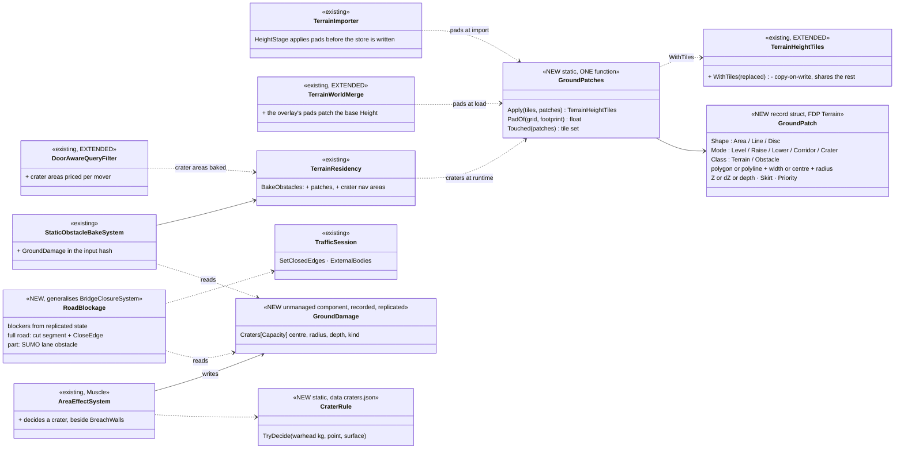
*What it shows that prose hid: ONE patch function serves three moments (import, load, runtime) and ONE road step serves every blocker (bridge,
roadblock, wreck, crater); the only new state is one recorded component (`GroundDamage`) — everything else is a derivation of existing state.*

### 3.2 A bomb on a road, during a live run

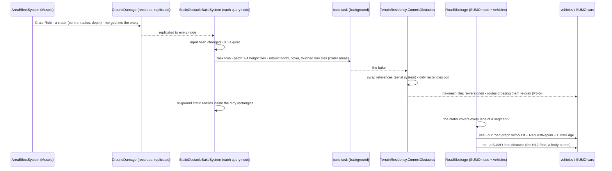
*What it shows: the ground, the navmesh and the roads all follow ONE record, each node deriving its own view; nothing scans records per frame,
and nothing new crosses the wire but the record.*

### 3.3 Seek in a replay

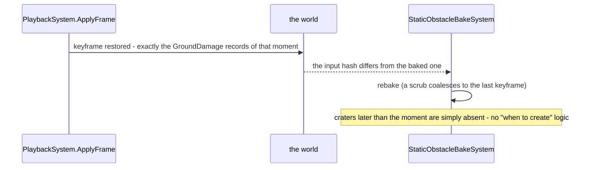
*What it shows: replay needs nothing new — the breach path already proves it (UTM §8.6 #8, #9).*

### 3.4 Who runs what, each frame

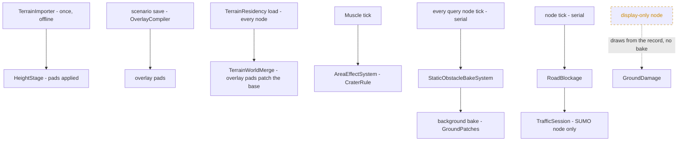
*What it shows: pads cost nothing at run time (import and load only); craters cost one background bake per burst of blasts; the dashed edge — a
display-only node never bakes (the B-12 gate), it draws the crater from the record.*

## 4. Decisions — ✅ APPROVED `2026-11-14` (user: *"Approved"* — R-4228, R-4229, R-4230)

| # | lean | why | rejected |
|---|---|---|---|
| **G-1** | ONE `GroundPatches.Apply` over the height TILES for every moment: import, overlay load, runtime | ruling 9; a pad and a crater are the same operation with two shapes | three flatteners (importer, merge, bake) |
| **G-2** ⭐ | **a house carrying a pad stands ON its pad**; TH-C stays for walls, fences and houses without a pad | the user's complaint; TH-C chose the lowest ground only because nothing levelled the ground | today's lowest ground WITHOUT levelling (buries the uphill side) |
| G-3 | ⭐ **the pad's height = the house's EXISTING base: the LOWEST ground under its footprint (TH-C's height) — the ground is CUT down to it, never filled**; the skirt = 4 m smoothstep from the pad up to the natural ground; the cut capped at 3 m (a steeper site stays partly cut into the slope; a retaining wall is a later item); overlapping skirts blend by weight into one terrace; patches in canonical (key) order. 🔒 User, `2026-11-14`: *"why would I define the height of the house or the pad? Couldn't we take it automatically from the lowest part?"* | nothing moves: every building, door, interior floor and saved scenario keeps the height it has today — only the uphill ground is dug away; no field to author | ⛔ the MEAN under the footprint (the first lean — it moves every house on a slope up or down, re-heights saved content) · an authored height (nobody should set it) · the highest (deep cuts everywhere) |
| G-4 | **at import**: `TerrainImporter` reads the buildings FIRST, `HeightStage` applies their pads before the store is written, the buildings stand at their pad, and `NetElevation` (shared, `Hrot.Terrain.InputSet`) re-elevates the road net over the flattened store | every pipeline passes the importer — one place; roads must follow the pads | flattening in the OSM pipeline (misses the random and scale terrains) |
| G-5 | **scenario-placed houses** (Terrain Authoring S-5): the house IS an entity — `TerrainFeature {Kind House, Template, HeadingDeg, Pad}` + its `SimTransform`; the pad is NOT an entity: it is that house's footprint at its base height. At SAVE the `OverlayCompiler` expands it (`FeatureExpander.House`: `baseZ` = the lowest base ground under the footprint, unchanged) into the overlay: the building AND a pad part (footprint, `baseZ`, skirt); `TerrainWorldMerge` patches the base's tiles; the editor's live bake shows it while editing. ⭐ **Always automatic, no per-house knob**; the `Pad` field stays unused for a house. ⭐ **ONE pad rule:** the block fit's *Level houses on pads* (`TerrainBlock.LevelPads`, today writing the ground at the house's CENTRE, `FeatureExpander.cs:150`) uses the same base height | §18: compile at save, load everywhere; 📐 measured `2026-11-14`: two pad rules exist today (block: centre height; single house: none) | an authored pad / `PadMode` (withdrawn the same day — the user: nobody should set it) · patching at every node's load from the feature |
| G-6 | `TerrainHeightTiles.WithTiles(replaced)`: a new store sharing every untouched tile with its base (copy-on-write, R-218) | a crater copies ~1 MB of a 121 MB grid | copying the whole grid per bake |
| G-7 | **a crater is a RECORD**: `GroundDamage` (unmanaged, capacity 16, recorded, replicated, saved like `BuildingDamage`), decided by the MUSCLE in `AreaEffectSystem` from the warhead's explosive mass by `CraterRule` + `craters.json` (data: radius, depth, rim by kg, none below a threshold, none on water or a building floor) | the breach path, proven: replicated, saved, seek-safe | heights over the wire · a crater per node from the detonation event (a missed event diverges) |
| G-8 | **seek**: nothing new — the restored records rebake (§3.3); the ground lags a seek by one bake, the decal does not | measured on breaches | a "crater timeline" |
| **G-9** ⭐ | **passability by navmesh AREA, priced per mover** (the woods precedent): two areas, `CraterSmall` / `CraterLarge` (the threshold in `craters.json`, lean 3 m radius); infantry ×1.0 (a crater is cover — the EQS may value it later), **tracked: small ×3, large closed; wheeled: both closed** | one mechanism every planner already uses | a per-frame record scan in the movement code |
| G-10 | **road blockage — one step** (`RoadBlockage`, generalising `BridgeClosureSystem`): every static blocker (a collapsed bridge, a `StaticObstacle` — roadblock, wreck — and a crater) is mapped to the road it lies on: **every lane of a segment covered ⇒ the segment is cut from OUR road graph (`RoadNetworkEdit.Without` + `RequestReplan`) and `CloseEdge`d in SUMO; part of it ⇒ a SUMO lane obstacle** fed as a body at rest through the existing H12 feed (`ExternalBodyFeed` already maps a footprint to lane obstacles); removed ⇒ re-opened | one closure path (the bridge's) for every blocker; the H12 feed needs no new SUMO call | a crater-only SUMO path · `Engine.AddObstacle` directly (a second feed beside H12) |
| G-11 | **re-grounding**: after a commit, entities at rest inside the bake's dirty rectangles take the new ground height (a moving one re-samples by itself) | a soldier must not float over a crater or stand inside a new pad | — |
| **G-12** ⭐ | **the order**: P-1 pads at import (CE-4403) → P-2 road blockage (CE-4590, fixes today's roadblocks) → P-3 scenario pads (S-5) → P-4 craters (CE-4591) | P-1 fixes the buried towns now; P-2 fixes a live defect; P-4 reuses P-1's function and P-2's step | craters first |

⚠ Said: (a) the lag — a blast-to-navmesh delay of 0.5 s + one bake (≈ 4.3 s warm on scale-1, CE-4418); a vehicle already at the crater may enter
it; accepted, measured in P-4's demo; an emergency stop only if the demo shows it matters. (b) The commit's cost and the UI copy's hand-over in the
threaded editor are UNMEASURED — P-4 times the swap under a barrage and traces it. (c) The road graph's segment ↔ SUMO edge mapping is the
bridge's (T-7b); a crater mid-segment closes the whole segment.

## 4a. The ground-shaping tool — authored terrain, not damage *(P-5; user `2026-11-14`)*

🔒 User, `2026-11-14`: *"Doesn't this capability lead to something like a terrain height editor? … flatten or rise some part of the terrain during the
scenario editing phase"* · *"the terrain editing tool is not a crater. Usually it can be used for rising whole hills … which doesn't mean that that
creates an obstacle for the roads … the sumo navmesh would need to follow the heights, instead of placing a blocker"* · *"Yes, write it to the design"*.

📐 Measured `2026-11-14`: our navmesh is rebaked from the current world (follows) · our road graph stores heights RELATIVE to the ground
(`RoadNode.AboveGround`, `RoadHeights.Nominal` + `SurfaceZ`, TH-L — follows by itself) · ⛔ SUMO's net carries ABSOLUTE z written once at import
(`NetElevation`, AQ93 E2b / R-4025) and SUMO's own sim, the road scene and SumoSharp's `TerrainField` read the file — ⛔ it does NOT follow · SUMO's
car-following has no slope term (only z matters) · *Save terrain as* COPIES the base folder, heights and net included (`TerrainBake.SaveAs` →
`CopyTree`) — ⛔ a saved terrain would lose every pad and shape.

| | **crater** (runtime damage, P-4) | **ground shape** (authored terrain, P-5) |
|---|---|---|
| record | `GroundDamage` — recorded, replicated | a scenario `TerrainFeature` kind **Ground** + its polygon (`EditablePolyline`) — compiled into the overlay at save |
| our navmesh | crater AREAS priced per mover (G-9) | the new heights only — the slope limit decides |
| our road graph | a fully covered segment cut (G-10) | nothing — it follows the ground |
| SUMO | `CloseEdge` / a lane obstacle (G-10) | the net's z RE-ELEVATED over the shaped heights |

| # | lean (✅ approved in principle) | why | rejected |
|---|---|---|---|
| **G-14** | **a Ground feature** (`TerrainFeature.Kind = Ground`, the fields overloaded by kind as every kind does): a polygon + a mode — **Level to Z · Raise by dZ · Lower by dZ · Crater** (`Template` = the mode, `Pad` = Z / dZ) — + a skirt width; drawn like a wood or water (the existing area tools, U-7); edited in Details; live-baked in the editor like a house (§18e B) | the same entity / compile / live path as every terrain feature | a separate height-brush tool with its own storage |
| **G-15** | **never a blocker**: a Ground feature feeds neither the road-blockage step nor a navmesh area | authored terrain changes the ground; it does not damage the road | — |
| **G-16** | **SUMO follows by RE-ELEVATING the net** with the ONE `NetElevation` over the shaped heights: the compile writes an elevated net copy into the overlay when a shape touches a road (the SUMO node loads it instead of the base's); *Save terrain as* re-elevates the new terrain's net | SUMO's sim reads z from the file — a host drape would not reach its pedestrians and poses | the flat-net drape (`TrafficDrape`, a fallback for flat nets only) |
| **G-17** | **a crater never re-elevates SUMO** — it closes or narrows the road instead (G-10) | the two must stay apart: damage blocks, authoring reshapes | — |
| **G-18** | **the order of patches: ground shapes → house pads on the shaped ground → runtime craters**; a shape blends AROUND every building footprint + skirt (it never pushes the ground into a house — an imported house has a fixed `baseZ`); trees follow (their chunks rebuild from the current ground) | no buried house; one deterministic stack | re-basing imported houses (their interiors and keys move) |
| **G-19** | **steepness is shown, not enforced**: the tool reports the steepest road grade a shape creates and warns over ~15 % | SUMO ignores slope; our off-road vehicles meet the navmesh slope limit | refusing a shape |
| **G-20** | ⭐ ***Save terrain as* WRITES the patched height store and re-elevates the net** (pads, shapes) instead of copying the base's — part of P-3 | without it a saved terrain loses every pad (measured: `CopyTree`) | — |

⚠ Open: the elevated net copy's size for the city battle's net (measured in P-5; written only when a shape touches a road). ⭐ **The UI's mockup:
[UX/ground-shaping-and-ditches.svg](UX/ground-shaping-and-ditches.svg)** (`2026-11-14`, R-4143) — panels A–C and F. It adds three things the
design did not draw: a 7th Add Entity group **Earthworks** (Level / Raise / Lower / Crater / Ditch / Anti-tank ditch / Foxhole, each tile naming
its tool and its class, G-31); a **tint of the height CHANGE** on the 2-D map while drawing (the 2-D map draws no heights today — new); and an
*Effect* read-out in Details (grade, area, what is kept out, newest-wins, the SUMO line). Crater in Details saves a crater RECORD (V-14).

## 4b. Road corridors at import — the road levelled across, the third shape *(P-1; ✅ R-4231, user `2026-11-14`: "Corridor patch at import, yes, All leans accepted")*

🔒 User, `2026-11-14`: *"the sumo road network is going along a hill on the steep part, and we want the road surface to be horizontal … the road basically
needs to flatten the terrain under it … automatically during terrain import phase, both for osm import and random terrain import … It is the same
flattening like for the houses, just along a line. And it is not happening during scenario editing."*

📐 Measured: every pipeline passes `TerrainImporter`, which writes the store (`HeightStage`, `:71`) and then COPIES the net unchanged (D1, `:79-85`); the
net's z was written earlier by the OSM pipeline / the synth writer over the UNLEVELLED ground (`NetElevation`), which KEEPS a z a point already has;
the net gives every lane a width (demo-city: 4.0 m roads, 2.0 m walks, 6.4 m) and every junction an outline; the road ribbon is drawn at its
centreline z, level across — today it cuts into the uphill side and floats over the downhill side; our road graph is ground-relative (follows).

| # | ✅ ruled | why |
|---|---|---|
| **G-21** | the importer reads the net BEFORE writing the store; per EDGE a `GroundPatch {Line, Corridor}`: the centreline profile = the ground along it, SMOOTHED over ~30 m (the 30 m DEM's ripple out, the real grade kept); LEVEL ACROSS the edge's full width (all its lanes + a 1 m shoulder); a 3 m skirt (cut uphill, fill downhill); a junction levelled flat at its z | the same patch along a line; one place for OSM and random |
| **G-22** | bridges and tunnels are skipped (the valley under a bridge stays) | — |
| **G-23** | the corridor cut / fill is capped at ~6 m — beyond it the road keeps the natural cross-slope (no canyon) | real roads cut deep; a cap stops a pathological carve |
| **G-24** | **road corridors are LOCKED** for every later patch: a house's skirt, a scenario shape, a ditch never alter a corridor cell (a shape that RAISES a hill across a road re-levels the touched corridors with the same function at compile, before re-elevating the net — G-16) | the road stays level whatever is added around it |
| **G-25** | after the store is written, the importer **re-elevates the net** from it (`NetElevation`, forced to overwrite the old z) and writes that net instead of a copy; the vehicles' road graph is read from it as today | SUMO, the drawn road and our road graph agree; nothing at run time |

## 4c. Ditches — a lowered line the author draws; cover and an obstacle *(P-6; user `2026-11-14`)*

🔒 User, `2026-11-14`: *"What about a ditch. It can be also some kind of terrain flattening feature drawn or made along a line that is edited by the
author of the scenario and can serve as a cover point for soldiers."*

📐 Measured: sight and fire are blocked by the ground (`TerrainWorld.cs:552`, TH-D: the trace over the height grid) ⇒ a man prone in a ditch IS hidden
by the ground itself; ⛔ the automatic cover points come only from building / wall prisms (`TerrainCoverProvider`) ⇒ nobody would SEEK a ditch.

| # | lean | why | rejected |
|---|---|---|---|
| **G-26** | **a Ditch feature**: `TerrainFeature.Kind = Ditch` + its `EditablePolyline` (an open line, the existing line tool like a wall, U-7), width, depth, bank slope; a `GroundPatch {Line, Lower}` — the corridor shape lowered; compiled into the overlay, live-baked | the same family and tools as walls and woods | a ditch as a prism (it is ground, not a wall) |
| **G-27** | **a ditch gives COVER POINTS**: `TerrainCoverProvider` gains a second source — ground-cover from Obstacle-class patches: along a ditch's banks a point every `Spacing`, facing out, stance by depth (≥ 1.5 m stand · ≥ 0.9 crouch · ≥ 0.45 prone — the wall rule); a crater's rim the same | the EQS finds it like any wall; the sight blocking is already real (TH-D) | a ditch-only cover search |
| **G-28** | **a ditch is an OBSTACLE-class patch**: a navmesh area priced per mover by width × depth (the crater rule, `craters.json` beside a ditch table): infantry passes (a small cost); an anti-tank ditch (≥ ~3 m wide, ≥ ~1.5 m deep) closes tracked and wheeled; a shallow one closes wheeled only | it is what a ditch is for | a terrain-class patch (no area — vehicles would drive through an anti-tank ditch) |
| **G-29** | a ditch NEVER cuts a road corridor (G-24) — it stops at the corridor; a roadside ditch runs beside it | no hidden road closure; a culvert is a later item | — |

⭐ **Mockup: [UX/ground-shaping-and-ditches.svg](UX/ground-shaping-and-ditches.svg)** panels D (the Ditch, its Details: presets, width, depth,
bank slope, the cover / vehicle read-outs) and E (the Foxhole: a click + heading, four all-round points per V-29, the coarse-grid warning).

## 4c-1. Crater cover after the gases clear, and foxholes *(user `2026-11-14`)*

🔒 User, `2026-11-14`: *"soldiers can use the crater as a cover as well after some time when the gases from the explosion have already
ventilated. Also, please think about foxholes … Foxhole is basically just a very short ditch in this case, and maybe not so deep."*

📐 Measured: an HE blast leaves NO timed hazard (`AreaEffectSystem.cs:100-125` requests a cloud only for `Irritant` and venting smoke rounds) ·
cover points are built once with the bake and immutable (`TerrainCoverProvider`) · infantry walks ≤ 60° and steps 0.4 m, vehicles ≤ 20° and 0.3 m
(`RecastNavmeshBaker.cs:68-89`) · the height grid is 1 m on imported terrains, coarser on older `.asc` ones.

| # | lean | why | rejected |
|---|---|---|---|
| **G-35** | **a crater becomes cover after its gases clear**: each crater entry carries `BornAt` (sim time, recorded ⇒ replay agrees); its rim cover points carry `AvailableAt = BornAt + coverAfterSeconds` (by size, `craters.json`, e.g. 60 s) and the cover query skips a point before it — the ground still hides a man already in it (TH-D) | data, not a new hazard system; the immutable provider stays immutable | a gas cloud per HE blast (a second hazard system for one delay) |
| **G-36** | **a foxhole is a Ditch preset**: *Foxhole* ≈ 2 m long × 1.5 m wide × 1.0 m deep, placed by a CLICK with a heading (the point tool) — a short Line·Lower patch; ONE cover point facing its heading, stance by depth (≈ 1 m ⇒ crouch); defending squads take their posts from cover points ⇒ they use foxholes with no new behaviour; a line of fighting positions is the terrain-editor design's (CE-4594) | the same feature, the same patch; the posts already come from cover | a separate foxhole kind |
| **G-37** | **the honest limit**: at 1 m posts a foxhole is a ≈ 3 × 3 m dip with sloped sides — coarse, but it blocks sight and gives cover; on a grid coarser than ~1.5 m the tool warns it will not form; a finer local inset is the separate sparse-inset idea (CE-4012), not here | the user accepted the coarseness | carving below the grid's resolution |
| **G-38** | **passability by slope, no special case**: a dip / foxhole's walls (~45°) are walkable for infantry (≤ 60°) and closed to vehicles (≤ 20°) by the bake itself; only a ditch or crater big enough to matter gets a priced obstacle area (G-28, G-9) | the navmesh already says it | an obstacle area for every small hole |

## 4d. Ready for the terrain editor — what this design fixes NOW so later tools fit *(user `2026-11-14`)*

🔒 User, `2026-11-14`: *"we might need some tool to define where the forest area is … create walls along a defined line … plant trees and various
obstacles … These deserve a new design with a lot of thinking what would be the user-friendly way … it can have consequences to how we handle the
flattening … so we can make ready for these terrain editing features once they come"*.

📐 Measured: the FEATURES already exist — Terrain Authoring T-2 / U-7 (CE-4429, done): wood / scrub (area), tree (click), wall / fence / hedge (line),
water (area), bridge (line), clutter (click), area scatter; each a `TerrainFeature` (+ `EditablePolyline`), expanded by the ONE `OverlayExpansion`
in the compile and the live overlay. ⇒ the later design is about the USER-FRIENDLY way (CE-4594), not new machinery. What it must find ready:

| # | ⭐ fixed now (binds P-1…P-6 and the later editor) | why |
|---|---|---|
| **G-30** | **one family**: every authored ground change (Ground area, Ditch line, later berm = Line + Raise) is a `TerrainFeature` kind beside wood / wall / tree — the same pick catalogue, the same point / line / area tools, the same compile and live bake | the editor design then adds tools, never a second storage |
| **G-31** | **ONE `GroundPatch` with three shapes** (Area · Line · Disc) and **two classes**: TERRAIN (level, raise, lower, road corridor, berm — heights only) · OBSTACLE (crater, ditch — heights + a navmesh area per mover + cover points; a crater also the road-blockage step) | a new ground feature picks a shape and a class; nothing else is added |
| **G-32** | **the stack, in priority order**: road corridors (import, locked) → house pads (import) → ground shapes → ditches → scenario house pads → craters (runtime); a later patch never alters a locked cell | deterministic on every node; the road stays level |
| **G-33** | ⭐ **the compile EXPANDS every other feature against the PATCHED ground**: ground patches first, then walls / fences / hedges (their base along the patched line, `GroundAlong`), trees and clutter (the patched ground), houses (pad on the patched ground) | a wall drawn over a new hill must stand on the hill, not inside it — the one ordering rule the later editor relies on |
| **G-34** | woods and scatter areas follow the shaped ground automatically (their chunks rebuild from the current ground, §18e U-6) | — |

## 5. Slices

| slice | row | builds | lane |
|---|---|---|---|
| **P-1** | CE-4403 | G-1…G-4 + **the road corridors G-21…G-25** — `GroundPatch` / `GroundPatches`, the importer's order, `NetElevation` after; a demo terrain re-imported (`scale-rig-scale-1-1000`'s hills) | backend |
| **P-2** | CE-4590 | G-10 — `RoadBlockage` (the bridge folded in), static blockers into the H12 feed, our road graph cut + re-plan | backend (traffic) |
| **P-3** | CE-4403 (S-5) | G-5, G-6, G-20 (*Save terrain as* writes the patched store + re-elevates the net) — the overlay's pads, `TerrainWorldMerge` patching, `WithTiles` | backend |
| **P-6** | CE-4593 | G-26…G-29 + G-36…G-38 (the Foxhole preset) — the Ditch feature, its cover points (`TerrainCoverProvider` ground-cover source, craters too), its navmesh area; the line tool + Details (mockup first) | backend + ui |
| **P-5** | CE-4592 | G-14…G-19 — the Ground feature, its live bake, the overlay's elevated net copy; the UI pick + Details + grade warning (mockup first) | backend + ui |
| **P-4** | CE-4591 | G-6…G-9, G-11, G-35 (crater cover after `coverAfterSeconds`) — `GroundDamage`, `CraterRule` + `craters.json`, the bake + nav areas + filter prices, re-grounding, the wire, save; a barrage demo | backend (+ ui: the 3-D ground chunks of a dirty rectangle rebuild, `TerrainChunks3D`) |

## 6. Acceptance

1. **P-1**: on the hilly scale terrain no house's uphill wall is below the ground at its door; every door's sill is within 0.3 m of the ground
   outside it (CE-4402's case passes); a pad over the 3 m cap keeps TH-C; the road net's z equals the store's under every road point.
2. **P-2**: `RoadblockBlastScenarioTests` / `WreckBlocksStreetScenarioTests` gain: a SUMO car stops or swerves at a partial blocker, re-routes
   round a full one; a road-graph vehicle re-plans round it; clearing it (CE-6003) re-opens both.
3. **P-3**: a scenario house on a slope stands on its pad on every node (the overlay hash equal), and in the editor while authoring: placing it
   brings the building AND its levelled ground in ONE live bake (Terrain Authoring §18e B; ≈ 5 s warm on scale-1, faster on a small terrain);
   moving it restores the old slope (the world is always base + the current patches); the 3-D view rebuilds only the touched chunks off the
   frame (`TerrainChunks3D.Adopt`, U-6 — its 8 m margin covers the 4 m skirt; the pad part's dirty rectangle = footprint + skirt); the 2-D map
   draws no heights, nothing to rebuild. ⚠ Not yet measured: what a single placed house shows during the wait (a block shows its outline,
   U-3) — P-3 measures it and, if the house is invisible meanwhile, keeps its ghost drawn until the bake commits. 🔒 User, `2026-11-14`:
   *"when I am placing the house, I will see it buried into the hill. But after a while … will I see the terrain flattened?"*
0. **P-0** *(added `2026-11-14`)*: the height store's tiles are separate arrays — patching one tile copies that tile only, and a steady read
   allocates 0 B (a rail, R-2084); the bake publishes its dirty rectangles on EVERY host (editor, cluster node, display node — a rail each), and
   only the navmesh tiles and 3-D chunks inside them rebuild; under a barrage (a breach or crater every 0.5 s for 30 s) the bake still commits
   within the latency cap (a rail).
4. **P-4** *(⚠ corrected `2026-11-14` to R-4232 / R-4233 — it said "a tracked one through a small one")*: a bomb on open ground makes a crater
   whose ground height, sight, fire and cover answers come from the `CraterIndex` in the SAME tick on every terrain-holding node (a standalone
   brain included); EVERY vehicle routes round it, infantry crosses; the navmesh and the 3-D mesh follow within one bake; seek before / after the
   blast shows / removes it; a scenario saved after the blast reloads it; the rim is cover only after `coverAfterSeconds`; `HROT_PARALLEL_SIM=1` +
   `HROT_READ_CHECK=1` + `stepped-hash.py --threads 1,4,8` equal; the swap's time measured under a barrage.
5. **P-5** *(added `2026-11-14`)*: a Ground area raising a hill 5 m across a road: the road's corridor re-levels (G-24), our road-graph vehicles
   drive it with no blocker, and after save + reload SUMO's net z equals the store's under every road point (V-25); the grade read-out warns over
   15 %; a house inside the area keeps its pad (an island, V-28); two overlapping shapes — the newest wins; the editor shows it in ONE live bake;
   the frame matches [the mockup](UX/ground-shaping-and-ditches.svg) (R-4146).
6. **P-6** *(added `2026-11-14`)*: an anti-tank ditch closes every vehicle route across it and infantry crosses; a man prone in a 1 m ditch is
   hidden by the ground from a shooter on the level at 100 m (TH-D); the cover query finds the ditch's floor points, a pair facing each bank
   (V-30); a ditch drawn across a road stops at the corridor (G-29); a Foxhole gives its all-round points and a defending squad takes its posts
   in foxholes with no new behaviour (V-29); on a 2 m grid the tool warns that a foxhole will not form (G-37); the frames match the mockup.

## 7. Design docs checked

Terrain Height TH-C — applies, overturned for pads (G-2) · Terrain Authoring TA-4 / L-5 / S-5 / §18 — applies, P-1 / P-3 · Terrain Import UTM §8
(breaches) / §11 (importer) — applies, P-4's path and P-1's place · Navigation v2 R-218 / §14 P3 — applies, copy-on-write + re-plan · Peek and
Fire §9 P-7a — applies, the bake · Terrain World §11 (woods area) — applies, G-9's precedent · AQ93 §15 (SUMO bodies) — applies, G-10's feed ·
Visual Effects CH-1 — applies, the decal stays · Structure Damage S4 (a cratered runway is unusable) — does not apply yet: no runway consumer in v1.

## 9. ⛔ The critical review — `2026-11-14` *(three independent reviewers + the coordinator; the surprising claims re-verified by the coordinator)*

🔒 User, `2026-11-14`: *"take a fresh view on the whole design from different perspectives and try to find gaps and flaws"*. Perspectives: distributed
correctness (determinism, replication, replay, threads) · the terrain pipeline and every height consumer · the author, the AI, the viewer, performance.
✔ = re-verified by the coordinator in code; ✓ = verified by a reviewer; ? = reasoned, not verified.

### 9.1 The runtime crater path (P-4) — the deepest problems

| # | finding | evidence | consequence | lean |
|---|---|---|---|---|
| V-1 ✔ | **a barrage STARVES the bake**: every signature change resets the 0.5 s quiet timer | `StaticObstacleBake.cs:166-167` | impacts < 0.5 s apart postpone every crater until the shelling stops; gaps of 0.5–5 s run back-to-back 4–5 s bakes on every query node | a maximum latency (bake after ≤ N s however busy) |
| V-2 ✓ | **the crater's effect lands at a WALL-CLOCK tick**: R-244 allows the debounce only because it "decides nothing the simulation computes"; a crater changes sight (TH-D), the navmesh, cover and re-grounding | `StaticObstacleBake.cs` `Execute` / `Finish`; R-243, R-244 | the 1 / 4 / 8-thread stepped hash cannot be equal (P-4's own acceptance) | ⭐ **D-1 below**: the simulation's TRUTH is analytic over the record; the bake is only a cache |
| V-3 ✔ | **only the editor publishes dirty rectangles** | `StaticObstacleBake.cs:250-254`, set in `EditorNodeBootstrapper.cs:386` | on the player and every non-editor host each crater rebuilds the WHOLE 3-D terrain (a pop) | publish on every host |
| V-4 ✓ | craters are not in `DirtyRegions` (prisms, building damage, overlay parts only) | `TerrainResidency.cs` `DirtyRegions` | the incremental navmesh reuses the crater's tiles unchanged | add `GroundDamage` to it |
| V-5 ✔ | **copy-on-write tiles are not possible as stored**: ONE contiguous `float[]` + a slot map | `TerrainHeightTiles.cs:20-21` | "copy ~1 MB" is really ~121 MB per bake per node; also the grid's block maxima (the sight skip) and MinZ / MaxZ (the woods' nav volumes, part of every woods tile's cache key) must be recomputed | per-tile arrays (or base + an overflow array) on the hot indexer, a 0 B rail; recompute the touched blocks only |
| V-6 ✓ | **display nodes, the Replay Browser and a player never get crater heights** (the B-12 gate: only a node with a navmesh factory bakes damage) | `TerrainResidency.cs:562` | replicated soldiers (Muscle z) draw sunk below flat ground; "draws the crater from the record" has no mechanism | split the gate: heights on every terrain-holding node, nav and cover on the Muscle / editor |
| V-7 ✓ | `GroundDamage` has no KEY, OWNER, MERGE, ORDER, SAVE SECTION or past-16 rule | `BuildingDamage` precedent: one entity per (building, node), content-sorted union | two Muscles' overlapping craters combine order-dependently; a barrage needs hundreds | one entity per (deciding node, grid cell), content-sorted, a commutative combine (`min` of the profiles), a save section + scenario merge rule |
| V-8 ✓ | re-grounding (G-11) writes entities the node may not own (loaded obstacles are owned by the loader, R-4196), moving an obstacle re-triggers its own bake, and fights replay | `SignatureOfWorld` hashes position | one crater ⇒ two bakes; replay writes | re-ground only OWNED non-obstacle entities, in a sim system, never in replay; bake obstacle prisms on the patched ground instead |
| V-9 ✓ | a crater loaded from a save is not lifecycle-gated (R-243) | UTM §8.6 ⚠(b) | a saved scenario starts ~4 s crater-less, by machine speed | Constructing until the terrain module acks |
| V-10 ? | the crater profile's float maths could differ by an ulp across OS / processes | — | nodes disagree on heights | + − × ÷ √ only; a cross-platform golden rail |
| V-11 ✓ | the crater DECAL is fixed 4.5 m and lives 300 s (the 81 mm mortar too) | `EffectTkbCatalog.cs:130, :169` | a bare dip after 5 min; the decal at the old height floats / z-fights | size it from the record, keep it while the crater exists, on the patched ground |
| V-12 ? | a vehicle at rest re-grounded INTO a closed crater area is stranded (its start polygon filtered out) | `DoorAwareQueryFilter` | a stuck vehicle, failing path requests | an immobilised-or-recover rule |
| V-13 ✓ | the cover query has no clock (`ICoverProvider.GetCoverPointsInRadius`), `CoverPoint` is 28 B with 2 spare | EQS | G-35's delay cannot be applied | an interface change, named in P-4 |
| V-14 ✓ | an AUTHORED crater (G-14 mode) contradicts G-15 / G-31 | §4a vs §4d | a pre-shelled field is decoration | an authored crater = a saved `GroundDamage` record (obstacle class) |

### 9.2 Roads and SUMO (P-1, P-2)

| # | finding | evidence | consequence | lean |
|---|---|---|---|---|
| V-15 ✔ | **no bridge / tunnel data**: netconvert runs without `--osm.all-attributes` / layer; `NetRoadNetwork.Read` filters only internal edges; the only "bridge" in the city-battle net is OUR placed bridge (`bridge-<guid>`) | `NetconvertRoadBuilder.cs:33-42`; `city-battle-ground.net.xml` | G-22 cannot skip a real bridge: a corridor fills the valley under it, carves a tunnel's line, two corridors fight at an overpass | keep `bridge` / `tunnel` / `layer` (netconvert option or the input set) + a precedence rule for crossing corridors |
| V-16 ✓ | **corridor banks become WALLS**: a smoothstep's steepest slope is 1.5 × depth ÷ width; 6 m over 3 m ≈ 72° (infantry 60°, vehicles 20°) | `RecastNavmeshBaker.cs:68-87` | roads split the navmesh; uphill doors unreachable (CE-4402 again) | the skirt WIDTH from the depth (≤ ~45°) |
| V-17 ✓ | **corridor vs house at import is undefined**: a house's `baseZ` is set on the UNLEVELLED ground (`BuildingRules.Finish`); a corridor's fill buries a roadside house, its cut leaves it floating; houses may sit on a corridor (placement avoids only a block's own lanes) | `BuildingRules.cs:525-528`, `FeatureExpander.cs:144-146` | buried / floating houses beside roads | ⭐ **D-3 below** |
| V-18 ✔ | **the road graph has no SUMO edge id, one direction, one lane** | `NetRoadNetwork.cs:28-60` | "every lane of a segment covered" and "close the SUMO edge" cannot be evaluated for imported roads | the importer writes edge ids + both directions' lanes into `roads.json` |
| V-19 ✓ | **closure is one-way**: `BridgeClosureSystem` is monotonic, resets on every `TerrainWorld` swap ✔ (`:65`), returns early in replay, removes segments with nothing to add back | `BridgeClosureSystem.cs:15, 60, 65, 90-100` | a barrage flaps SUMO closures and storms re-plans; a cleared roadblock never re-opens our road graph; after a seek closures are stale | rebuild the published road network from the base whenever the blocker SET changes; key by blocker content, not world identity |
| V-20 ✓ | **road-graph routes ignore a partly covered road** (`TileSequenceAtPlan = 0`), and `RoadHeights.Nominal` takes the HIGHER of the node line and the ground — it keeps the road over a crater like a valley under a bridge | `PathfindingSolverSystem.cs:241-246`, `RoadHeights.cs:27-34` | a truck drives into a crater; §4a's "the road graph follows by itself" is false for LOWERED ground | a closing crater on a road cuts the segment for that mover class; `RoadHeights` takes the patched surface where a ground patch lies |
| V-21 ✓ | `NetElevation` keeps existing z (junctions too) and assumes the grid's origin; the importer places the net by an anchor | `NetElevation.cs:50, 94-103`; `TerrainImporter.cs:76` | re-elevation silently does nothing, or offsets | a force option + the anchor |
| V-22 ? | a 30 m-smoothed profile meets a flat junction with a step | — | a lip at every junction | pin the profiles' ends to the junction's z |
| V-23 ✓ | the overlay's single net slot already holds the bridge net | `OverlayCompiler.cs:122-150` | G-16's elevated copy must build on it | build on the bridge net |
| V-24 ✓ | SUMO re-routes round ANY obstacle on a car's route ahead | `Engine.cs:4948-4975` | a "partial" blocker diverts routed traffic anyway | accept (only un-routed / local cars swerve); a crater body needs a synthetic id that never collides |
| V-25 ✓ | live editing: the SUMO net cache is loaded once with the terrain | `SumoNetTerrainLoader.cs:17-57` | while editing, cars and the road ribbon stay at the old z until save + reload | accept and SAY it, or reload the net cache on a live bake that touched a road |

### 9.3 Migration, authoring, AI

| # | finding | evidence | consequence | lean |
|---|---|---|---|---|
| V-26 ✓ | **re-importing a terrain changes its content hash**: an overlay refuses a base whose hash differs | `TerrainResidency.cs:240-245` (C-5) | every scenario saved on that terrain stops loading until re-saved; recordings need the old terrain kept; corridors also move road / ground z | ⭐ **D-4 below** |
| V-27 ✓ | `TerrainFeature` has 4 value fields; adding fields broke old recordings once (`Seed`) | `TerrainBlock.cs:35-58` | Ground / Ditch / Foxhole cannot carry width, depth, skirt, mode, heading | a sibling unmanaged `GroundFeature` component |
| V-28 ✓ | **overlap order is invisible to the author** ("canonical key order"); Level / Lower over a road undefined; raising a hill under a town leaves each house in a pit and each road as a trench | G-3, G-18, G-24 | unpredictable results, no warning | draw order (newest wins) + the live preview shows house / road islands + Level / Lower re-level the corridors like Raise |
| V-29 ✓ | **soldiers would not use foxholes as G-36 claims**: `SquadDefend` asks for cover posts only with an engagement area; `CoverTowardTest` drops a one-direction foxhole for a threat from elsewhere; posts are planned ONCE (a crater's later cover is never picked up) | `SquadDefendBehavior.cs:505-554` | foxholes and craters ignored by most defences | all-round foxhole points; a cover stage for the all-round defence; re-plan when the cover set changes |
| V-30 ✓ | a ditch's cover points by "the wall rule" stand 0.75 m OUTSIDE the outline, facing the hole | `TerrainCoverProvider.cs:77-115` | the man is on the lip, uncovered | points on the floor, a pair facing each bank, stance from floor-to-lip |
| V-31 ✓ | **tracked and wheeled share ONE vehicle navmesh** baked at 20° / 0.3 m / 1.8 m; area ids are fixed classes | `RecastNavmeshBaker.cs:77-87`, `NavDoorways.cs:145-211` | G-9's "tracked through a small crater" is unachievable (a > 20° crater wall is already a hole for both); "priced by width × depth" is a few quantised ids at most | ⭐ **D-2 below** |
| V-32 ✓ | the bake rebuilds the WHOLE cover provider and Bepu index each time | `TerrainResidency.cs:596-600` | a barrage costs every query node seconds of a core per bake | dirty-rectangle cover / index (and D-1 removes most bakes) |

### 9.4 The decisions the review raises — ✅ RULED `2026-11-14` (R-4232…R-4235)

| # | decision | ⭐ lean | why | rejected |
|---|---|---|---|---|
| **D-1** ✅ R-4232 | **where the simulation's truth about a crater lives** | ⭐ **ANALYTIC over the record** — 🔒 user: *"D1, yes … the grid would need to be created also for a standalone brain"*. ⭐ The index (measured `2026-11-14`): NOT the collider hash (`SpatialHashSystem` / `SpatialGridData` — colliders only, rebuilt every frame, read by rounds, near misses, avoidance: a crater there would be HIT and AVOIDED as a body) but a **`CraterIndex`** world singleton — cell → craters, rebuilt only when the `GroundDamage` set changes, keyed by the same cell as the record entities (V-7); built by ONE system in the shared infrastructure every terrain-holding node composes ⇒ the editor and the multiplayer server (one world for brain and muscle) share it by construction, a standalone brain builds its own from the replicated records: `GroundHeightAt`, the sight / fire ground trace and the cover answer add the craters of the replicated `GroundDamage` records (a cell grid of discs, a pure deterministic function) — immediate, the same at any thread count, on every node incl. the Brain and display nodes (heights for drawing); the BAKE becomes a cache for the navmesh and the 3-D mesh only | removes V-2 (wall-clock truth), most of V-1 / V-32 (no bake needed for sim truth), V-6 (every node computes it), V-9; the proven pattern (dynamic decals / deformation as data over a static base) | the bake as truth (non-deterministic timing; a barrage starves it) |
| **D-2** ✅ R-4233 | **tracked vs wheeled over craters** | ⭐ **all vehicles avoid crater and ditch areas** (🔒 user: *"no vehicle goes through the craters … it's generally avoided if it's possible"*) (one Vehicle layer as baked); infantry crosses; a TRACKED layer is a later item if the user wants it (it doubles the vehicle bake) | the measured layer cannot express it; quantised areas are enough for "vehicles no, infantry yes" | a tracked layer now (cost before need) |
| **D-3** ✅ R-4234 | **a road corridor next to / under a house at import** | ⭐ **TOLERANT — corridors YIELD to buildings** (🔒 user: *"houses are located very close to the roads, which shouldn't create data import errors, because this is a real world situation … the import needs to be tolerant"*): the road is level across its OWN width; between its edge and a façade the ground is a straight RAMP from the road edge's z to the house's `baseZ` (a pavement, never a wall or a step); the house keeps its `baseZ` (R-4228); a footprint OVERLAPPING the road's width (old towns, OSM drift) leaves the road its natural cross-slope there and is COUNTED in the import report as information — ⛔ never an error | houses never buried / floating; roads still level across their own width | re-basing houses after the corridors (interiors move) |
| **D-4** ✅ R-4235 | **migration of re-imported terrains** | ⭐ **a re-import is a NEW terrain version**: the old one is kept by hash (recordings replay on it, as kept grounds already are); a batch step re-compiles every scenario on that terrain (open + save = re-compile the overlay) and reports the ones it could not | C-5's hash check stays a guard, never a surprise | silently re-basing old overlays |

⚠ Coverage: the reviewers' absence claims rest on grep (the graph CLI has no coverage check); the coordinator re-verified V-1, V-3, V-5, V-15, V-18, V-19's reset.

### 9.5 The slices, re-cut with every fix *(binding — a slice is done only when its V-rows are)*

| slice | rows | the fixes it carries |
|---|---|---|
| **P-0** (new, first) | — | **the height store's tiles as separate arrays** (or base + an overflow array) with a 0 B steady-read rail; `TerrainHeightGrid` recomputes only the touched blocks' maxima and MinZ / MaxZ (V-5) · the bake's dirty rectangles published on EVERY host (V-3) |
| **P-1** pads + road corridors at import | CE-4403 | G-1…G-4, G-21…G-25 + V-15 (bridge / tunnel / layer kept from OSM; a precedence rule for crossing corridors) · V-16 (the skirt width from the depth, ≤ ~45°) · **D-3** (tolerant: the ramp to the façade, overlaps reported as information) · V-18 (the importer writes SUMO edge ids + both directions into `roads.json`) · V-21 (`NetElevation` force + the anchor) · V-22 (profile ends pinned to junctions) · **D-4** (a re-import is a new version; the batch re-compile) |
| **P-2** road blockage | CE-4590 | G-10 + V-19 (the published road network REBUILT from the base whenever the blocker set changes — re-opens, survives a seek, keyed by content not world identity; the bridge folded in) · V-20 (a closing blocker cuts the segment for its mover class) · V-24 (synthetic ids for record-borne bodies) |
| **P-3** scenario pads + *Save terrain as* | CE-4403 (S-5) | G-5, G-6, G-20 + V-23 (the elevated net built on the bridge net) · V-25 (said: the SUMO net follows a live shape only after save + reload) |
| **P-4** craters | CE-4591 | G-7…G-9, G-11, G-35 + **D-1** (`CraterIndex`; ground height, sight, fire and cover answer analytically from it on every node; the bake only for the navmesh and the mesh) · **D-2** (every vehicle avoids crater areas) · V-1 (a maximum bake latency) · V-4 (`GroundDamage` in `DirtyRegions`) · V-6 (every terrain-holding node draws craters from the index) · V-7 (one entity per deciding node × cell, content-sorted, `min` combine, a save section, a scenario-merge rule) · V-8 (re-ground only owned non-obstacle entities, never in replay) · V-9 (Constructing until acked) · V-10 (+ − × ÷ √ only; a cross-platform golden) · V-11 (the decal sized and kept by the record) · V-12 (a vehicle caught in a new crater: immobilised) · V-13 (the cover query takes the clock) · V-14 (an authored crater = a saved `GroundDamage`) · V-20 (`RoadHeights` takes the patched surface) · V-32 (cover / index by dirty rectangle) |
| **P-5** ground shapes | CE-4592 | G-14…G-19 + V-27 (a sibling unmanaged `GroundFeature` component) · V-28 (draw order — newest wins; the live preview shows house / road islands; Level / Lower re-level corridors like Raise) |
| **P-6** ditches + foxholes | CE-4593 | G-26…G-29, G-36…G-38 + V-29 (all-round foxhole points; a cover stage in the all-round defence; re-plan when the cover set changes) · V-30 (cover points on the ditch FLOOR, a pair facing each bank) |

### 9.6 As built — P-0 *(`terrain` lane, `2026-11-14`, CE-4596)*

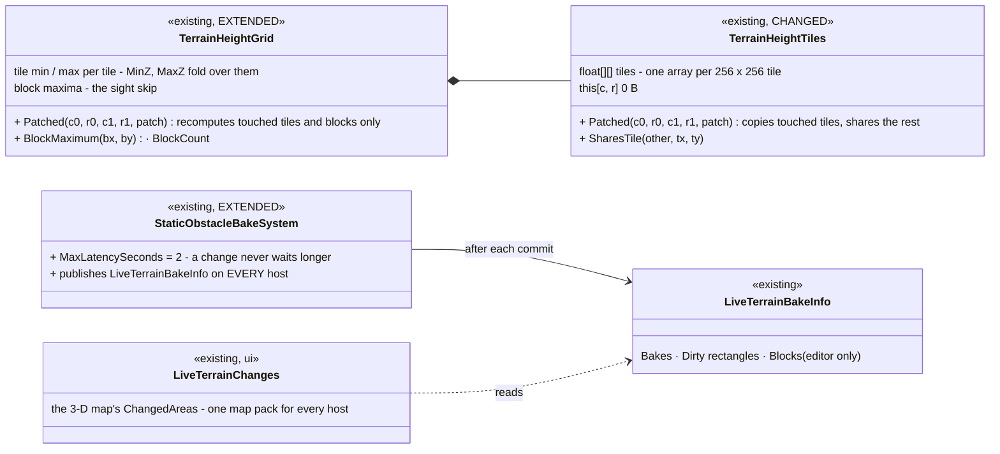
*What it shows that prose hid: the dirty rectangles were already computed on every host (`TerrainResidency.DirtyRegions`), and the 3-D map that
reads them is the ONE map pack every host builds (`MapInteractionPack`) — only the publication was editor-gated. So V-3 is one gate removed, not a
new path. The height store's patch is the primitive P-1, P-3, P-4 and P-5 call; nothing patches heights at runtime yet.*

| claim | code — as built | design |
|---|---|---|
| a patch copies only the touched tiles | `TerrainHeightTiles.Patched` clones the tile index and the touched tiles; `SharesTile` proves the rest are the same arrays | V-5 |
| the sight skip and MinZ / MaxZ follow a patch | `TerrainHeightGrid.Patched` — per-tile min / max recomputed for touched tiles, folded; block maxima for touched blocks (a boundary post belongs to the block before it too) | V-5 |
| a steady read allocates nothing | `this[c, r]` = `_tiles[t][i]`; rail `HeightStoreTests.CE4596_ReadingAPatchedGrid_AllocatesNothing` | R-2084 |
| dirty rectangles on every host | `StaticObstacleBakeSystem.Finish` publishes `LiveTerrainBakeInfo` with no `LiveOverlay` gate; the map pack wires `LiveTerrainChanges` on every host | V-3 |
| a barrage cannot starve the bake | `MaxLatencySeconds` (2 s) from the frame a change is first seen | V-1 |
| a crater's own dirty rectangle and heights | ⛔ not here — P-4 (`GroundDamage` in `DirtyRegions`, V-4) and P-1 / P-3 (pads) call `Patched` | §9.5 |

⭐ **Lane decision (for the user's review):** [R-5003](blueprints/RULINGS.md) the latency cap is 2 s (four quiet periods; a scale-1 bake is ~4–5 s,
so under a barrage a node bakes about back-to-back — the design's "bake after ≤ N s however busy" with N chosen here).

Rails: `HeightStoreTests.CE4596_*` (a patch shares every untouched tile; a patched grid has a fresh grid's blocks and range, the lowered peak
included; 0 B reads), `StaticObstacleBakeTests.CE4596_*` (a barrage still bakes within the cap; a host with no live overlay publishes the dirty
rectangles). ⚠ The rails stand for the cluster and display hosts by construction (one system, no host gate left); there is no per-host rail.

### 9.7 As built — P-1, part 1: house pads at import *(`terrain` lane, `2026-11-14`, CE-4403)*

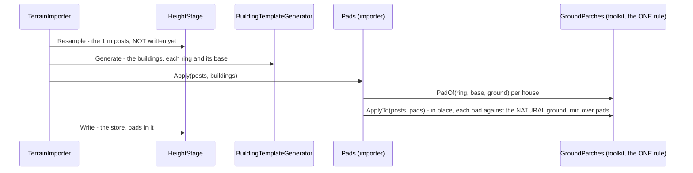
*What it shows that prose hid: the store is written AFTER the buildings now — the only reordering — and the importer holds no levelling code of its
own: it calls the toolkit rule P-3 and P-4 will call through the copy-on-write grid (`GroundPatches.Apply` → `TerrainHeightGrid.Patched`).*

| claim | code — as built | design |
|---|---|---|
| one rule for every moment | `GroundPatches.Target` (per post), `ApplyTo` (in place, import), `Apply` (copy-on-write, runtime) | G-1 |
| a pad = the house's own base; cut, never fill; cut ≤ 3 m | `PadOf`, `Target` | G-2, G-3, R-4228 |
| the bank a cut adds is ≤ 45° | skirt = max(4 m, 1.5 × the cut) | V-16 |
| patches combine order-free | each measured against the NATURAL ground, minimum over them (📌 a rail caught the sequential form differing by 0.11 m with the order) | G-3 "canonical order" |
| the importer writes the store after the buildings | `HeightStage.Resample` / `Write`, `Pads.Apply`; report `pads: N house pads, posts cut, skirts widened` | G-4 |
| road corridors, net re-elevation, bridges / tunnels, D-3, D-4 | ⛔ not yet — part 2 | G-21…G-25, V-15, V-18, V-21, V-22 |

⭐ **Lane decision (for the user's review):** [R-5009](blueprints/RULINGS.md) overlapping skirts combine by the MINIMUM over the pads, each against the natural
ground (G-3 said "blend by weight into one terrace") — order-free and the same on every node; a deeper neighbour's cut wins where they overlap.
⚠ **CE-4402 (the low door on scale-1)** needs the scale terrains RE-IMPORTED (D-4: a new terrain version); not done here — the committed terrains are
unchanged until then.

Rails: `ImporterTests.CE4403_*` (a house on a 0.2 slope stands on its pad, ground ≤ 0.3 m at its uphill door, the slope past the skirt, untouched far
away, the house keeps its base; a 0.5 slope gets a wider skirt and a 3 m cap) — red-proved; `HeightStoreTests.CE4403_TheGroundPatchRule_*` (in place ≡
copy-on-write, either order, never above the ground).

### 9.8 As built — P-1, part 2: road corridors at import *(`terrain` lane, `2026-11-14`, CE-4403)*

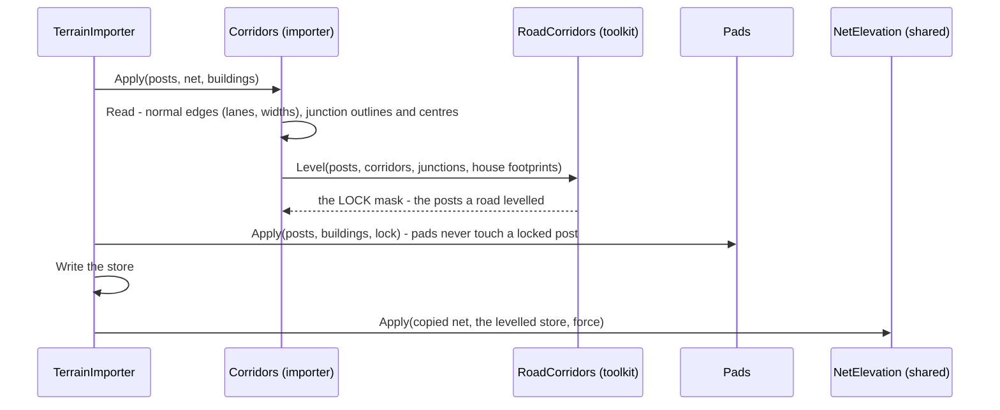
*What it shows that prose hid: the roads go FIRST and hand a lock to the pads (G-24), and the net is re-elevated from the very store that ships — so
SUMO, the drawn road and the ground agree by construction (G-25). `NetElevation` gained one switch (`force`); every other caller keeps its behaviour.*

| claim | code — as built | design |
|---|---|---|
| per edge: smoothed profile, level across width + shoulder, 3 m skirt | `RoadCorridors.Level`: profile = a 30 m moving average of the ground along the reference line (the mean of the outer lanes), half-width = lanes / 2 + 1 m, skirt max(3 m, 1.5 × depth) | G-21, V-16 |
| ends pinned to the junctions | the profile's ends pulled to each junction's ground over 15 m | V-22 |
| junctions flat | each outline at its centre's ground | G-21 |
| cut / fill capped at 6 m | a post deeper than 6 m keeps the natural ground (counted) | G-23 |
| overlapping corridors | the NEAREST road decides a post; a junction over every corridor | — |
| houses tolerated | a post inside a house footprint is never levelled — the road keeps its cross-slope there, a report line (information) | D-3, R-4234 |
| corridors locked | `GroundPatches.ApplyTo(…, locked)` | G-24 |
| the net re-elevated from the store | `NetElevation.Apply(…, force: true)`, net − anchor = local | G-25, V-21 |
| bridges / tunnels skipped | ⛔ the net carries no such data (V-15): the 6 m cap is the guard (a valley under a bridge is deeper) | G-22 |
| D-3's straight ramp to a façade | ⚠ approximated: the road's skirt and the pad's skirt meet; no explicit ramp | D-3 |
| road graph edge ids, both directions | ⛔ not here — P-2's (V-18) | V-18 |
| a re-import is a new terrain version | ⛔ not here — D-4 is a tooling step on its own; the committed terrains are unchanged until re-imported | D-4 |

⭐ **Lane decisions (for the user's review):** [R-5010](blueprints/RULINGS.md) with no bridge / tunnel data the 6 m cap is the bridge guard (no
`--osm.all-attributes` netconvert change now); [R-5011](blueprints/RULINGS.md) where corridors overlap the nearest road decides, a junction over all;
[R-5012](blueprints/RULINGS.md) D-3's ramp is the two skirts meeting (no ramp primitive); D-4 (versioned re-import) and V-18 (edge ids) are left to their
own steps.

Rails: `ImporterTests.CE4403_ARoadAcrossASlope_IsLevelAcrossItsWidth_AndTheNetSitsOnTheStore` (level across, the slope past the skirt, every net point on
the store — §6 item 1's last clause), `CE4403_HousesByTheRoad_AreTolerated_AndThePadsNeverAlterTheRoad` (D-3 reported, never an error; the lock) —
both red-proved (no corridors ⇒ both red).

### 9.9 As built — P-2: road blockage *(`terrain` lane, `2026-11-14`, CE-4590)*

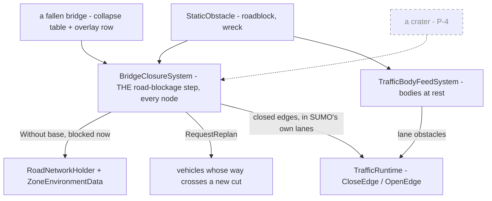
*What it shows that prose hid: ONE step owns every closure and it is a FUNCTION of the blocker set (the published net is always the base without what is
blocked now), so re-opening and seeking need no code of their own; partial coverage needs no step at all — SUMO's existing lane-obstacle feed takes the
obstacle as a body.*

| claim | code — as built | design |
|---|---|---|
| one step for every blocker | `BridgeClosureSystem` (name kept: the bridge was its first blocker — a Roslyn rename later is cosmetic) takes fallen bridges AND every active `StaticObstacle` | G-10 |
| rebuilt from the base; re-opens | the system keeps its own copy of the base (the holder frees retired graphs); `RoadNetworkHolder.Version` tells its own publish from a new base; publishes `Without(base, blocked)` only when the set changes | V-19 |
| a road is cut only when fully covered | `RoadBlockage.ClosedSegments`: a station where every point across the lanes' width lies in a blocker | G-10, V-20 |
| SUMO closed in its own lanes | `RoadBlockage.ClosedEdges` over `TrafficNetCache.Model` — every lane covered at the SAME fraction; no road-graph ↔ SUMO id map needed | V-18 (need removed) |
| partial cover ⇒ lane obstacle | `TrafficBodyFeedSystem.AddObstacles`: each obstacle a chain of squares at rest (any heading), NEGATIVE synthetic ids | G-10, V-24 |
| a replay | the net follows the replayed blockers; no vehicle is re-planned | — |
| per mover class (a closing blocker for one class only) | ⛔ not here — our road graph has one class; craters (P-4) bring the class question | V-20 |
| a crater as a blocker; `RoadHeights` over lowered ground | ⛔ P-4 | V-20 |

⭐ **Lane decisions (for the user's review):** [R-5013](blueprints/RULINGS.md) each net is judged in its own geometry (V-18's edge ids are not written);
[R-5014](blueprints/RULINGS.md) obstacles go to SUMO as chains of squares at rest with negative ids; a road is cut only where a blocker spans its full width.

Rails: `BridgeClosureTests.CE4590_*` (a barrier cuts a road and its removal re-opens it, red-proved; a half-road car leaves it open; SUMO edges close only
with every lane covered at one station; obstacles fed as bodies at rest) + the four T-7b rails unchanged, the 0 B steady frame included.

### 9.10 As built — P-3: scenario house pads, *Save terrain as* *(`terrain` lane, `2026-11-14`, CE-4597)*

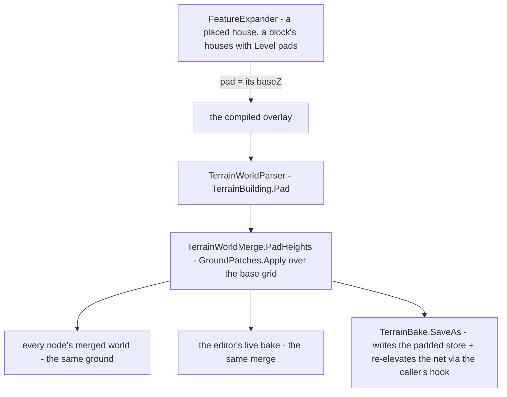
*What it shows that prose hid: the pad is not a new overlay part — it is a FLAG on the house the overlay already carries, and the merge every host already
runs applies it; so every node, the live editor and *Save terrain as* get the same ground by construction.*

| claim | code — as built | design |
|---|---|---|
| a placed house always stands on a pad; ONE pad rule | `FeatureExpander.House` writes `"pad"` = its `baseZ` always; a block's houses when *Level houses on pads* is on (was the ground at the house's CENTRE) | G-5 |
| the pad is applied where the overlay merges, every node the same | `TerrainBuilding.Pad` (parser) → `TerrainWorldMerge.PadHeights` → `GroundPatches.Apply` (copy-on-write) | G-5, G-6 |
| a bridge, an imported house | carry no `"pad"` — untouched (an imported house's pad is in the store, P-1) | — |
| *Save terrain as* keeps every pad | ④c: the merged (padded) grid is WRITTEN over the copied store (`.heights` or `.asc`); the net re-elevated through `reElevateNet` (the editor / random generator pass `NetElevation.Apply(…, force)`) — on the bridge net when there is one (it was copied just before) | G-20, V-23 |
| live editing and SUMO | the live bake merges the same way (pads appear while editing); SUMO's net follows only after save + reload | V-25 (said) |
| a road corridor next to a placed house | ⚠ the runtime pad does not know the import's corridor lock (G-24): a pad's skirt may lower a road's edge; a road under a placed house is the author's | G-24 |

⭐ **Lane decision (for the user's review):** [R-5018](blueprints/RULINGS.md) the pad is a FLAG on the house (its feature's `"pad"`), applied at merge — not a separate
pad part in the overlay (G-5 said "a pad part"); the FDP save takes the net re-elevation as a caller's hook (FDP cannot see `Hrot.Terrain.InputSet`).

Rails: `TerrainWorldMergeTests.CE4597_*` (a pad house cut into the base, a no-pad house untouched, the base unchanged), `TerrainBakeTests.CE4597_*` (the saved
store keeps the pad, the net hook called on the saved net) — red-proved (no ④c ⇒ red).

### 9.11 As built — P-4, parts 1 + 2: the crater record, the cratered ground, the bake, the navmesh and the roads *(`terrain` lane, `2026-11-14`, CE-4591)*

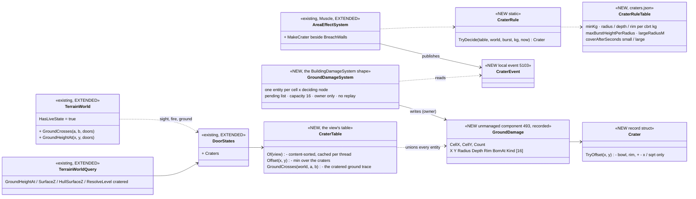
*What it shows that prose hid: the design's "`CraterIndex` world singleton" is a TABLE ON THE VIEW (`DoorStates.Craters`), beside the breaches — the seam every
sight / fire / ground caller already passes; nothing new is threaded through the ~30 callers, and a background snapshot sees ITS tick's craters.*

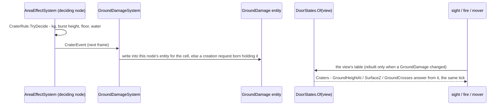
*What it shows: no bake sits between the record and the simulation's answer (D-1) — the bake (part 2) only caches it for the navmesh and the 3-D mesh.*

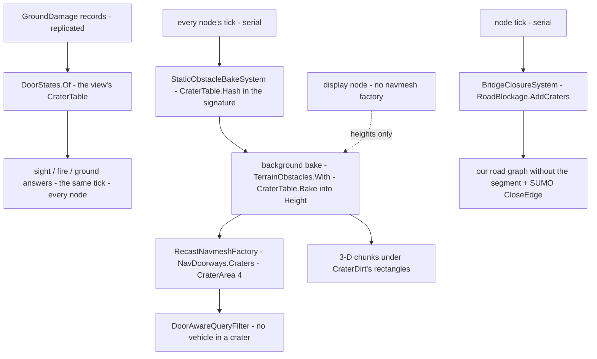
*What it shows that prose hid: the craters reach the simulation by ONE edge (the view's table) and everything else — navmesh, mesh, roads — by derivations
that may lag; a display node runs the bake for the HEIGHTS (V-6) and nothing reads a navmesh there.*

| claim | code — as built | design |
|---|---|---|
| a crater is decided once, by the deciding node, from the warhead's charge | `AreaEffectSystem.MakeCrater` → `CraterRule.TryDecide` (`craters.json`: cube-root sizes, none below 0.5 kg, none for an air burst higher than half the radius, none on a building's floor or on water); the record is what crosses the wire (V-10: only the decider takes a cube root) | G-7 |
| one entity per (cell, deciding node), content-sorted union | `GroundDamageSystem` (the `BuildingDamageSystem` shape: pending list, capacity 16 ⇒ a second entity, owner-only, never in a replay); `CraterTable.Of` sorts by content and drops exact duplicates | V-7 |
| the combine is commutative | the ground offset at a point is the MINIMUM of the offsets of the craters whose disc holds it — two records in either order give the same bits | V-7 |
| the truth is analytic, the same tick, on every node | `TerrainWorldQuery.GroundHeightAt / SurfaceZ / HullSurfaceZ / ResolveLevel` and the terrain's ground trace (`TerrainWorld.GroundCrosses` — sight, `QuerySight`, `QueryFire`) read `DoorStates.Craters`; with no crater near the line the grid's own walk answers, unchanged | D-1 |
| the profile is the same on every node | `Crater.TryOffset`: a parabolic bowl from −depth to +rim at the radius, a linear rim to 0 at 1.4 × the radius; + − × ÷ √ only | V-10 |
| 0 B a steady frame | `CraterTable.Of` hands back the same table while no `GroundDamage` was written or added (the `BuildingDamageTable` stamp) | R-2084, R-220 |
| ⭐ part 2 — the bake CACHES the craters, on every node | `StaticObstacleBakeSystem` adds the view's `CraterTable.Hash` to its input signature on EVERY node (a display node too — V-6); `TerrainResidency.BakeObstacles(…, craters)` → `TerrainObstacles.With(…, craters)`: the derived world's `Height` = `CraterTable.Bake(bare)` (copy-on-write tiles, every post = bare post + offset — order-free), `BareHeight` = the ground without them, `HeightCraters` = which | D-1, V-6, G-6 |
| ⭐ never counted twice | the simulation's answers read `BareHeight` (`SimHeight`, `BareGroundHeightAt`) + the VIEW's craters; a reader with no view (the mesh, the navmesh, `CachedGroundHeight`, the woods) reads the cached `Height` — so the truth is immediate and a crater the view no longer holds (a seek back) is gone the same tick, while the cache lags one bake | D-1, G-8 |
| ⭐ the dirty rectangle is the crater's disc | `TerrainResidency.CraterDirt`: every crater added since the last committed bake, and every one gone, adds its changed disc's box — only those navmesh tiles and 3-D chunks rebuild | V-4 |
| ⭐ every vehicle keeps out, infantry crosses | `NavDoorways.Craters` — a 12-gon volume round each baked crater's changed disc, area `CraterArea` (4), marked after the woods; `DoorAwareQueryFilter.PassFilter` refuses it to a mover that cannot open doors (every vehicle layer); infantry's cost is plain. The volumes are part of each tile's cache key (as the woods') | D-2 R-4233, G-9 |
| ⭐ a crater across a road cuts it | `BridgeClosureSystem` re-judges when the view's crater table changes; `RoadBlockage.AddCraters` adds each BOWL (radius, a 16-gon) to the blockers — a bowl spanning every lane closes the segment in our graph and the SUMO edge; a record gone re-opens it | G-10 |
| ⭐ the record crosses the wire | `dtGroundDamage` (184, no group — the decider keeps it): `EntityGroundDamageEgressTranslator` / `…IngressTranslator` (the breach pair's shape; a crater's centre is terrain-local, nothing to resolve), `EntityGroundDamage { EntityId, CellX, CellY, List<DdsCrater> }` — Reliable, TransientLocal, KeepLast(1): a late joiner gets every crater; the replica's view answers the cratered ground at once | G-7, D-1 |
| ⚠ said, not built | a crater over PART of a road is no SUMO lane obstacle (V-24 wants a synthetic body id); SUMO cars keep the lane, our vehicles keep out by the navmesh | V-24 |

⭐ **Lane decisions (for the user's review):** [R-5019](blueprints/RULINGS.md) the `craters.json` starting values; [R-5020](blueprints/RULINGS.md) the "index" is
the VIEW's table on `DoorStates` (R-219: a world singleton is shared by every background snapshot), and `HasLiveState` is now true for every world (a
crater can land anywhere); [R-5021](blueprints/RULINGS.md) a crater on a crater does not deepen it (the minimum — the commutative combine V-7 asks for).

Rails: `CraterTests` — the rule, the profile and the commutative table, the same-tick ground height, a man in the crater hidden by its rim (sight and fire),
0 B steady, the burst → record chain and the capacity rule; `CraterBakeTests` — the bake caches the crater (read once, not twice), a vehicle routes round it
and infantry crosses, a display node bakes it, its disc is the dirty rectangle, a seek back restores the ground; `BridgeClosureTests.CE4591_*` — a crater across a
road cuts it, a small one beside it does not, a seek back re-opens it; `EntityGroundDamageTranslatorTests` — the ordinal pinned, the sample round-trips byte for
byte and the replica's view is cratered. Not yet (part 3): the save section, cover after
`coverAfterSeconds` (G-35 / V-13), the decal (V-11), re-grounding (V-8 / V-12), `RoadHeights` (V-20), the stepped hash.
