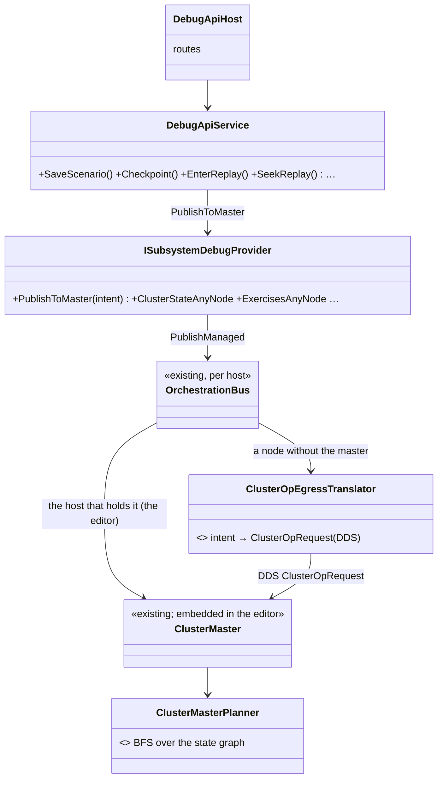
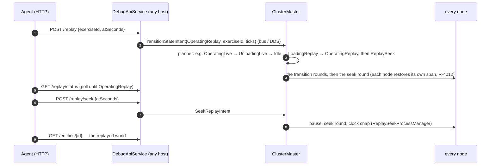
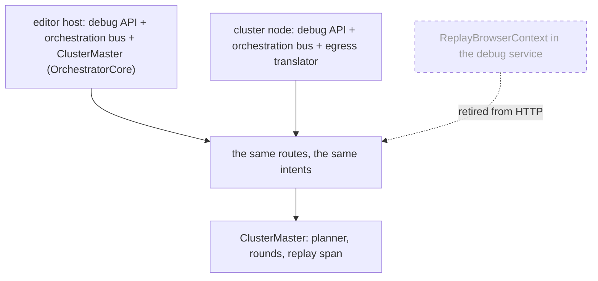

<!--STATUS
state: LIVE
updated: 2026-10-26
build-state: BUILT (A: CE-3326, B2: CE-3325) — the as-built tables in §3 and §6 say where it deviates
current-answer: §3 (the route table) and §4 (UML). §2 is the inventory it was drawn from.
stale-below: nothing.
known-rot: none yet.
known-conflict: CE-259an (tracker) leaned "do NOT rewire /replay/load — improve the signposting"; SUPERSEDED by the user's rulings in §1
  (R-3052…R-3055). docs/designs/ai-debug-api/DESIGN.md Group I ("replay isolation (mandatory)") is HISTORICAL and is overturned here.
  docs/blueprints/Architect_Question_86_Editor_Runs_The_Orchestrator_Core.md:68 says the editor lacks ReplayMasterModule /
  LiveBranchProcessManager — measured FALSE: OrchestratorCore.cs:144-151 builds both and the editor runs that core (EditorSubsystem.cs:2387).
related-designs:
  - docs/DESIGN_Scenario_Regression.md — §10 the replay harness (CE-4045): checks THIS replay path scenario by scenario — live vs playback, seek, branch (RH-1)
  - docs/MCP_Integration.md — owns the ai-debug HTTP surface and its Group U rule ("publish the host-agnostic intent to whichever ClusterMaster
    the host owns"); THIS document extends that rule from the two load routes to every state/storage route
  - docs/DESIGN_Agent_Shared_View.md — owns the readers of one unit (brain, journal, selection, search); §3 here moves their REPLAY twins from the
    editor sandbox onto the replayed world
  - docs/designs/cluster-master-cqrs-1/DESIGN.md — owns the master's intents (TransitionStateIntent, SeekReplayIntent, …) this surface publishes
  - docs/DESIGN_Checkpoint_And_Dry_Run_Restore.md — owns what a CHECKPOINT is (a named keyframe of the live recording, R-3044) and the dry run
  - docs/DESIGN_Director_Timeline_Editor.md — TE-19 (R-4071): one transport; cluster replay seek is the existing ReplaySeek round
  - docs/blueprints/Architect_Question_93_Sumo_Traffic_Node.md — E5: the traffic mirror in replay (the TrafficCar half of R-3052)
-->

# ⭐⭐⭐ The ai-debug HTTP surface drives the CLUSTER MASTER — on every host, the editor included

## 1. The rulings *(user, `2026-10-26`)*

> 🔒 *"If ai debug http api does not support cluster wide replay, we must extend it. Basically the editor is just single node cluster so the api
> should be possible to use in generic way. No editor specific stuff in ai debug http please, all needs to go through cluster master controller
> (editor has one embedded as well)."*
> 🔒 *"Preview runs should not be recorded by design, only live runs are."*
> 🔒 *"replay and seek and lots of others already go via cluster so no need to emphasize the cluster like cluster/replay/seek but just
> replay/seek - this need to apply to loading scenario and saving and checkpointing etc. No specific shortcuts. Entering a replay should not
> need cluster/transition, the cluster state machine handles the intermediate transitions automatically."*
> 🔒 *"Record traffic car, do not rebuild map every frame there can be thousands of traffic cars and pedestrians."*

## 2. INVENTORY — what each route did before this design *(grep + reading every handler, then the graph once it indexed)*

| graph query *(`scripts/cbm.sh search_graph`, `2026-10-26`)* | total | what it settled |
|---|---|---|
| `name_pattern:".*DebugProvider.*"`, `label:Interface` | 1 | ⭐ ONE provider seam (`ISubsystemDebugProvider`) — the place the master control belongs |
| `name_pattern:".*Preview(Controller\|Handler\|Adapter).*"`, `label:Class` | 8 | ⭐ ONE dry-run handler (`ReferencePreviewHandler`, D14); `EditorPreviewAdapter` / `EditorPreviewController` are the editor's local shortcuts to it — the HTTP surface no longer uses them |
| `name_pattern:".*ReplayBrowser.*"`, `label:Class` | 5 | the sandbox (`ReplayBrowserContext`) and the separate offline viewer (`ReplayBrowserSubsystem`) — the viewer is kept; the debug service's own sandbox world is retired |
| `name_pattern:".*RecordReplayController.*"`, `label:Class` | 2 | ⭐ ONE recorder per node (`EcsRecordReplayController`) — it now names the file it replays |
| `search_code "WorldEpoch.Moved"` | ~75 users | why B1 (a seek counting as a restore) is a finding, not a build |

⚠ `check_index_coverage` is not available through the CLI, so coverage could not be checked.

| route | before | through the master? |
|---|---|---|
| `POST /scenario/load/edit`, `/scenario/load/live` | `TransitionStateIntent` (HN-029) | ✅ |
| `POST /scenario/save` | editor: `_editorLogic.SaveScenarioAs` (`DebugApiService.cs:1346`); others: `RequestSaveScenarioJsonAnyNode` | ⛔ editor shortcut |
| `POST /preview/enter`, `/preview/exit` | `IPreviewController` → `ReferencePreviewHandler.TriggerLoadingPreview` directly (`EditorPreviewAdapter.cs:55`) | ⛔ editor only, bypasses `OperatingPreview` |
| `POST /checkpoint`, `/checkpoint/restore` | the same preview snapshot under another name (`DebugApiService.cs:2514`) | ⛔ editor only; ⛔ a different thing than the cluster's checkpoint (`TakeCheckpointIntent` = a named keyframe, R-3044) |
| `POST /recording/start`, `/recording/stop` | editor preview recording (`DebugApiService.cs:2674`); live mode unimplemented (ADA-I-D01) | ⛔ editor only; ⛔ records a preview (R-3053) |
| `POST /replay/load`, `/seek`, `/step`, `/unload`, `GET /replay/status`, `/entities`, brain, journal, history, selection, search | an isolated `ReplayBrowserContext` in the editor's debug service (`DebugApiHost.cs:1081-1160`) | ⛔ a second replay world |
| entering a cluster replay | only `POST /cluster/transition {target:"OperatingReplay"}` | ✅ but by state name |
| seeking a cluster replay | ⛔ no route (only the operator panel / test harness send `ClusterOpType.ReplaySeek`) | — |
| `POST /sim/play`, `/pause`, `/step`, `/timescale` | `ITimeTransport` (cluster time ops on nodes) | ✅ |
| the master's intents | ✅ ALL exist and ALL cross from any node: `ClusterOpEgressTranslator.cs:55-214` forwards Transition, Storage(Save), Take/Collect/RestoreCheckpoint, SeekReplay, Cancel, Dump, time | — |
| the provider seam | one delegate PER intent (`ISubsystemDebugProvider.RequestTransition`, `RequestCancel`, `RequestSaveScenarioJson`, `RequestDiagnosticDump`) + an editor twin of each in `DebugApiService` | ⚠ grows per route |
| the planner | BFS over the state graph (`TransitionPlanner.CalculateShortestPath`), a `ReplaySeek` step appended for a replay with a moment | ✅ intermediate states are automatic |

## 3. THE DESIGN — the route table

| route | publishes / reads | replaces |
|---|---|---|
| `POST /scenario/load/edit {name}` · `/scenario/load/live {name}` | `TransitionStateIntent` (unchanged) | — |
| `POST /scenario/save {name}` | `ExecuteStorageOpIntent{SaveScenario}` on EVERY host | the editor's `SaveScenarioAs` shortcut |
| `POST /preview/enter` · `/preview/exit` | `TransitionStateIntent{OperatingPreview}` / back to `OperatingEdit` — the planner's dry run; ⛔ never recorded (R-3053) | `IPreviewController` from HTTP |
| `POST /checkpoint {label}` | `TakeCheckpointIntent` (a keyframe of the LIVE recording, R-3044) | the preview-snapshot `/checkpoint` |
| `POST /checkpoint/restore {label}` | `RestoreCheckpointIntent` | the preview-snapshot restore |
| `GET /exercises` | the master's exercise inventory (what can be replayed) | — (new) |
| ⭐ `POST /replay {exerciseId, atSeconds?}` | `TransitionStateIntent{OperatingReplay, exerciseId, targetWallTicks}` — from ANY state; the planner plans the way (R-3055) | `/cluster/transition` for this purpose; `/replay/load` |
| ⭐ `POST /replay/seek {atSeconds}` | `SeekReplayIntent` (the operator timeline's round, TE-19) | the sandbox seek |
| `POST /replay/stop` | `TransitionStateIntent{Idle}` | `/replay/unload` |
| `GET /replay/status` | the master's state + the replay span (`ReplayAnchorWallTicks`, duration, the clock) | the sandbox status |
| `POST /sim/play`, `/pause`, `/step`, `/timescale` | unchanged — during a replay they drive the replay clock | `/replay/step` |
| reading a replay | the ORDINARY readers (`/entities`, `/entities/{id}/brain`, `/journal`, `/selection`, `POST /search`) read the replayed world | `/replay/entities…`, `/replay/selection`, `/replay/search` |
| `GET /entities/{id}/journal/history` | one scan of THIS node's own recording of the current exercise | the sandbox's whole-file history |
| ⛔ `POST /recording/start`, `/recording/stop` | **retired** — a live run records on every node (R-4000); a preview never does (R-3053) | — |
| `POST /cluster/transition`, `/cluster/cancel`, `GET /cluster/roster` | kept: the operator's raw primitives — ⛔ no workflow needs them | — |

⭐ **One seam replaces the per-intent delegates:** `ISubsystemDebugProvider.Master` = an `IClusterMasterControl` on this host's orchestration
bus. On a node that is not the master the intent leaves through `ClusterOpEgressTranslator`; the editor's own master reads the same bus. ⇒ ⛔ no
route has an editor arm.

⭐ **AS-BUILT `2026-10-26` (CE-3326)** — and where it deviates from the table above:

| as built | why |
|---|---|
| ⚠ the seam is **typed**, `IClusterMasterControl` (`Transition` · `SeekReplay` · `Storage` · `TakeCheckpoint` · `RestoreCheckpoint` · `Cancel` · `Dump`), not `PublishToMaster(object)` | ⭐ the provider's own rule: the debug host may ask the master to act, never inject arbitrary events into a control plane. One implementation, `OrchestrationBusMasterControl`; it replaces `RequestTransition` · `RequestCancel` · `RequestDiagnosticDump` · `RequestSaveScenarioJson` and their four `…Via` factories. ⭐ The orchestrator and the traffic node now also save and dump (they lacked the delegates) |
| `POST /checkpoint` makes a label when given none and returns it; `POST /checkpoint/restore` requires one | ⭐ `ClusterMaster.StartRestore` refuses a restore with no label, and an unnamed checkpoint is named after the master's wall time, which the caller cannot know |
| `GET /entities/{id}/journal/history` and `POST /replay/search` scan **this node's replay recording**, read-only (`EcsRecordReplayController.ActiveReplayFilePath` → provider `ReplayRecordingPath`, no any-node fallback) | ⭐ a journal is in the recording of the node that runs the brain. Wired on the editor and CGF (where brains run); ⚠ SimHost / IG name none yet — a search there answers *"not in a replay"* |
| ⭐ **UNIFIED `2026-10-26`** (user: *"there should not be differences between editor and cgf"*) — `GET /exercises` reads the master's inventory from DDS `AssetInventoryTopic` on EVERY node: the slave translator (`NodeOpSlaveTranslator`) ingests it, the node's `ClusterSlave.KnownExercises` keeps it, `SubsystemDebugProvider.ExercisesFrom` serves it (CGF, SimHost, IG, traffic); the editor/orchestrator/ExCon read the same inventory from their core's cache. ⭐ `POST /replay` with no exercise publishes `Guid.Empty` on every host and the **MASTER** resolves it (`ClusterMaster.ResolveReplayExercise`: the live run in progress, else the newest finished one) — the R-3049 rule for a live load, applied to a replay | ⛔ SUPERSEDED: the first build read a cached inventory in the debug layer, so CGF answered 503 and refused `/replay` without an id; then a debug-layer `ActiveExerciseId` default — both removed |
| every publishing route takes `waitForReady` (preview, replay, stop) and then polls the cluster state | ⭐ the same contract as the scenario loads |
| ⭐⭐ **SHARED CODE `2026-10-26`** (user: *"not just unified but using shared code … nodes cannot get different stuff by construction"*) — every ECS node (CGF, SimHost, IG, traffic) builds its debug surface through ONE factory, `EcsNodeDebugProvider.For(name, perspective, () => HrotNodeContext, extras)`: world, entity map, TKB, master, cluster state, exercises, replay recording (the shared `ReferenceReplayLoadHandler` on the node's `ClusterSlave`), ownership transfer + descriptor map (when NED replication runs), architecture — all derived from the context. Only the genuine differences are extras: a time drive (not IG), a gizmo feed, an extraction service, a mission editor. Rail `TheDebugProvidersDoNotUnderReportTests.AnEcsNode_BuildsItsDebugSurfaceThroughTheOneSharedFactory` (red-proof: the old hand-written traffic provider fails it) | ⛔ SUPERSEDED: four hand-written providers of ~15 arguments each, which had drifted — the traffic node offered no save or dump, only CGF named its replay recording |
| ⭐ **ONE WIRE MAPPING `2026-10-26`** — `TransitionPayloadDto.From` / `ToIntent` are the only encoding and decoding of a transition (node egress, the master's translator, its request adapter, the operator panel). 📌 Measured: `POST /replay {atSeconds:30}` sent from CGF entered at 0 — `TargetWallTicks` was not on the wire and three hand-written decoders each dropped fields. After: the master logs *"seeking every node to 300000000 ticks"*, CGF's clock reads 30. Rail `TranslatorDtoTests.ATransition_CrossesTheWireWhole` | the editor and orchestrator never saw it: they publish on the master's own bus |
| ⚠ **FINDING, not built** — `GET /replay/status`'s `durationSeconds` is the master's aggregate (the prepare round's span) and is held only by a host with the core's cache: a number on the orchestrator/editor, `null` on CGF/SimHost/IG | ⭐ lean: carry the replay span on the master's `ClusterStateTopic` (every node already reads it into its `ClusterSlave`), the same path the state takes — proposed, not built |
| ⚠ **FINDING, not built** — the bootstrap itself is still not one path: SimHost, IG, traffic (and Stride) build through `NodeBootstrapper`; **CGF** (`CgfSubsystem.cs:1207`) and the **editor** (`EditorSubsystem.cs:1876`) compose their cluster handlers themselves (both through the shared `EcsHostClusterHandlers.Compose`, so the handler SET is shared, the composition around it is not) | a CGF/editor move onto `NodeBootstrapper` touches their whole Initialize — proposed to the user, not folded into this change |
| ⚠ `POST /scenario/save` no longer copies film takes (`EditorScenarioSession.SaveAs` did) | the take copy is an editor-session step, not a cluster save — reported to ui (§7) |

## 4. UML

*What the picture shows that prose hid:* there is ONE path from a route to the master, and the editor differs only in which arrow leaves the
bus — the editor's master sits on the bus itself.

*What it shows:* the debug service no longer owns a replay world; the dashed box is what leaves the HTTP surface (the in-process verifier,
CE-4045, may keep using the class).

## 5. The rejected alternatives *(one line each)*

- **Keep the sandbox beside the cluster replay** — two replay worlds answering one question (CE-259an); ⛔ the user's "no editor specific stuff".
- **`/cluster/replay/seek` names** — the cluster is the only way anything happens; naming it on some routes implies others are not (R-3054).
- **A wrapper route per state transition** — the planner already plans paths; one intent per operation (R-3055).
- **Rebuild the traffic replica map every frame** — thousands of cars and pedestrians (R-3052); derived only when the world is replaced.

## 6. The traffic replica map *(R-3052; AQ93 E5)*

⭐ **AS-BUILT `2026-10-26`** *(B2, approved)* — `TrafficCar` is recorded (`NoScenario`, no longer `Transient`); `TrafficReplicas` keeps its
`(owner, handle) → entity` and `(owner, networkId) → entity` dictionaries as an index and `Rebuild()`s them from the world's `TrafficCar` +
`NetworkAuthority` (+ `NetworkIdentity` for a pedestrian) — destroying nothing — **once** per world put back: on `WorldEpoch.Moved` (a load, a
checkpoint restore) and on the first frame after the replay gate (CE-4048) lifts. ⛔ Never per frame (`Rebuilds` is pinned by a rail). The
first live frame reconciles the rebuilt index with the wire.

| ⚠ deviation from the approved wording | why |
|---|---|
| the trigger is **the gate lifting**, not each replay **seek** | ⭐ while the node restores its recording the mirror writes nothing (CE-4048), so an index rebuilt at every seek would never be read; the one moment it is needed is when live frames resume over the restored world. ⛔ It also needed no hook into `EcsRecordReplayController._afterSeek` |
| B1 *(a seek counting as a `WorldEpoch` restore)* is **not built** | ⚠ a finding: ~75 systems and translators clear per-id caches on `WorldEpoch.Moved` (mostly egress) — whether a replay seek should move them is unmeasured; filed, not decided here |

| rail *(`Hrot.Traffic.Tests/TrafficRuntimeTests`)* | pins |
|---|---|
| `R3052_AfterTheWorldWasPutBack_TheBookIsRekeyedFromTheRecordedCars_AndNoCarGetsASecondReplica` | the book follows the restored entity; one entity per network id |
| `R3052_WhenTheReplayGateLifts_TheMirrorRekeysOnce_AndReconcilesTheRestoredReplicas` | one rebuild at the lift, none per frame, no doubled car |

## 7. Cross-lane

- **ui** — the readers in `DESIGN_Agent_Shared_View.md` §6b (CE-1265/1266) lose their `/replay/…` twins (the ordinary readers answer during a
  replay); the editor's own Play/Stop preview uses the same `IPreviewController` shortcut — the UI half of "no shortcuts", proposed to ui.
- **coordinator** — the replay verifier (CE-4045) uses `ReplayBrowserContext` in code, not over HTTP: unaffected.
- **MCP** — the catalog and skill regenerate in the same commit (R-1030).

## 8. Acceptance

A five-process cluster (orchestrator · CGF · SimHost · IG · traffic) and the editor, the SAME script against both: load `Recipes/demo-city`
live → play 60 s → `POST /replay` at 30 s → read a car replica and a unit → `POST /replay/seek` 10 s → read again → `POST /replay/stop`.
⛔ No `/cluster/…` call and no editor-only route in the script.

⭐ **MEASURED `2026-10-26` — the five-process cluster** *(orchestrator · CGF · SimHost · IG · traffic, domain 47; script
`run-c.sh`, no `/cluster/…` call)*:

| step | answer |
|---|---|
| `POST /scenario/load/live Recipes/demo-city` → `/sim/play`, 60 s | Live; CGF 546 entities (27 SUMO replicas), SimHost 535 |
| `POST /checkpoint {label:"run-c"}` | published, label returned |
| `POST /replay {atSeconds:30}` on **CGF** | ⚠ refused then: *"Name the exercise"* — the asymmetry the user rejected; ⭐ unified since (§3 as-built: the master resolves it) |
| 1st run: `POST /replay {atSeconds:30}` on the orchestrator | ⛔ **found a defect**: the default picked an OLDER exercise — the master lists one only when the run ENDS. ⭐ Fixed: from Live the default is the running exercise (`ActiveExerciseId`) |
| 2nd run: the same request | ⭐ ONE request Live → `OperatingReplay` of the run just played; CGF's clock at **30.0 s**, paused, its recording `node-400/…/node_400.fdp`; orchestrator `durationSeconds` 80.6 |
| replayed world | CGF 545 entities with **26 `TrafficCar`-tagged** replicas (B2: before, the replayed bodies carried no tag); no duplicate network id (id 0 = local parts, as in live) |
| `POST /replay/seek {atSeconds:45}` | clock **45.0 s**; 30 replicas (the recording's own set at 45 s) |
| `POST /replay/stop` | Idle |

⭐ **MEASURED `2026-10-26` — the editor (a one-node cluster), the same routes** *(script `run-c-editor.sh`)*:

| step | answer |
|---|---|
| live load → play 45 s → `/checkpoint` → `POST /replay {atSeconds:20}` (no exercise named, from Live) | ⭐ ONE request into `OperatingReplay` of the run just played |
| 1st run | ⛔ **found two defects, both fixed:** the recording carried TWO wall-clock bases (frames 1.7e8 … 6.39e17 ticks ⇒ a replay "63 928 598 528 s" long). ① the scenario load snapped the wall clock to 0 while every resume re-anchors it to the real clock — `OrchestratorCore.LoadedClock` (load = the real clock); ② `RecorderTickSystem` stamped a frame whose clock read 0 with the calendar clock — now the frame-locked clock only, monotonic |
| after both fixes | span `639285989791610359..639285990276805715` = **48.6 s**; the seek rounds land exactly at zero + 20 s and zero + 30 s (`NodeReplaySeek … restoredWallTicks`), the master clock logs sim 20.000 / 30.000, paused |
| `/preview/enter` / `/preview/exit` (from Edit) | reached `OperatingPreview`, then `OperatingEdit` |
| ⚠ open, ui (the editor's own state) | `GET /replay/status`'s `sim` (the editor's `EditorTimeTransportFacade`) reads 48.0 s after entering at 20 s and 29.4 s after the seek to 30 s, `isPaused:false` — not the master clock; and `inPreview` is `true` in Live/Replay and `false` in Preview. Reported to ui |
