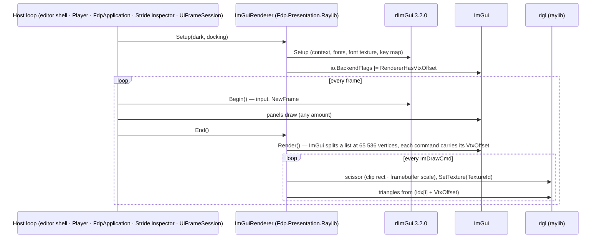

<!--STATUS
state: LIVE
build-state: BUILT (ui, 2026-11-12, CE-1495)
updated: 2026-11-12
current-answer: §2 (the render path) · §3 (what changed vs rlImGui) · §4 (verification) · §5 (the OSM preview's level of detail)
stale-below: nothing
related-designs:
  - DESIGN_Rules_View_UI.md §6d — CE-4223, the FIRST "Too many vertices in ImDrawList" crash (the Timeline panel's dashes); fixed inside one panel — this design is the fix for EVERY panel
  - DESIGN_Terrain_From_OSM.md §6 — the OSM wizard, whose map preview (OsmMapView) is the SECOND crash; its level of detail is §5 here
  - projects/FDP/Core/Fdp.Presentation.md — the project overview of the assembly that holds ImGuiRenderer (FdpApplication, HiddenWindow)
  - DESIGN_Map_3D_Mode.md — OWNS HiddenWindow (CE-4386), the other thing every frame passes through (BeginFrame / EndFrame around the same End call)
-->

# DESIGN — the ONE ImGui draw-data renderer *(ui, CE-1495)*

## 1. Why

🔴 `rlImGui` 3.2.0's `End()` renders with `RenderTriangles(count, idxStart, idxBuffer, vtxBuffer, tex)` and **never adds `ImDrawCmd.VtxOffset`**, so it cannot say `RendererHasVtxOffset`; ImGui therefore asserts
*"Too many vertices in ImDrawList using 16-bit indices"* at 65 536 vertices in ONE window's draw list and the editor dies. 📌 Twice: CE-4223 (the Timeline panel's dashes — fixed inside that panel) and the OSM wizard's map preview
(right after the download — thousands of buildings). ⭐ A fix inside each panel cannot be complete; the renderer is the one place every panel passes through.

**INVENTORY** *(prior art, `2026-11-12`)* — `scripts/cbm.sh search_graph '{"name_pattern":".*(ImGuiRenderer|RaylibPresentationShell|FdpApplication|UiFrameSession|PlayerApplication|StrideInspectorWindow).*","label":"Class"}'` → 11 (the hosts and their tests; no class
renders draw data itself — `IImGuiRenderer` in `ImGui/Renderers/` is the per-type *widget* renderer registry, unrelated). grep `rlImGui\.(Begin|End|Setup)`: the editor shell (`RaylibPresentationShell`, `Program`), `PlayerApplication`, `FdpApplication`, `StrideInspectorWindow`, `UiFrameSession`,
`ReplayBrowserSubsystemTests` — all routed through `ImGuiRenderer`; left on rlImGui (not HROT hosts): `GizmoMap.Presentation/GizmoViewerFrontend`, `FDP/Examples/*`, `FDP/ExtDeps/*/demos`, `tools/ui-probe`. `check_index_coverage` is not available through the CLI — coverage not checked.

## 2. The render path — one place, every host

*What the picture shows that prose hides:* **`Begin` stays rlImGui's, `End` is ours** — input, fonts and the font texture are not duplicated; only the render step moved. ⭐ A host that skips `Setup` still gets the flag from `End` on its second frame.

## 3. What is the same, what changed

| | |
|---|---|
| ⭐ same as rlImGui 3.2.0 (decompiled, mirrored) | rlgl immediate mode (`Begin(Triangles)`, `CheckRenderBatchLimit(3)`), scissor maths with the Y flip and the HiDPI / macOS framebuffer scale, texture id → `SetTexture`, `Color4f` from the `ColorConvertU32ToFloat4` arithmetic (so rlgl's float → byte truncation matches bit for bit), the user callback |
| 🔴 changed | `vertices + cmd.VtxOffset`, the backend flag |
| ⭐ added | `ImGuiRenderer.LastRenderTicks / LastRenderBytes / LastVertexCount` (`FrameStats` prints the render ms) |
| ⭐ fallback | `HROT_IMGUI_RENDERER=rlimgui` ⇒ rlImGui's own `End` (no flag; a list over 65 536 asserts again) |

## 4. Verification *(CE-1495)*

`ImGuiRendererFrameRail` — 50 000 rectangles (200 000 vertices) in one window render without the assert, and rectangles past vertex 65 536 are read back in their own colour; the flag is on the context; the render step allocates 0 B.
⭐ The visualisation is unchanged, measured two ways (the table is in the CE-1495 tracker row): **A/B in the harness** — `HROT_IMGUI_AB=<dir>` draws every frame of every rail twice over the same scene (ours, rlImGui's) and compares pixels: 6 884 frames, 0 differing (a 1 px vertex shift flags 37/37); and **screenshots** — 55 classes, 318 PNGs, `HROT_IMGUI_RENDERER=rlimgui` vs the new renderer: 303 pixel-identical, the other 15 are rails that are not deterministic on the old renderer either.

## 5. The OSM preview's level of detail *(`OsmMapView`)*

A renderer that splits lists makes the crash impossible; it does not make 6 000 buildings cheap. So the preview also degrades by level of detail, in the draw order areas → roads → walls → trees → buildings:

| rule | |
|---|---|
| a feature entirely off the visible part (box ∩ canvas) is skipped | its bounds are kept per feature in the web-Mercator unit square, so the test is four multiplies |
| a building or area under **2 px** is ONE filled rectangle (4 vertices) | not triangles plus an outline (~44 anti-aliased vertices) |
| a street point within 1 px of the last drawn one is skipped | |
| dashes (rail, the box outline) are generated for the visible part only, ≤ 64 per segment | the CE-4223 `TimelinePanel` approach, allocation-free (`OsmMapView.DashLine`) |
| cumulative vertex caps per layer (`AreaCap` 8 k … `RectCap` 46 k) | a layer over its cap is dropped (areas) or becomes rectangles (buildings), counted in `DroppedForBudget` |
| many trees (> 300 visible) are 3 px squares | |

⭐ Hot path: points are projected from cached unit-square positions (no `sin` / `log` / `pow` per point per frame); 0 B per steady frame (`DrawListVertexRail`).
