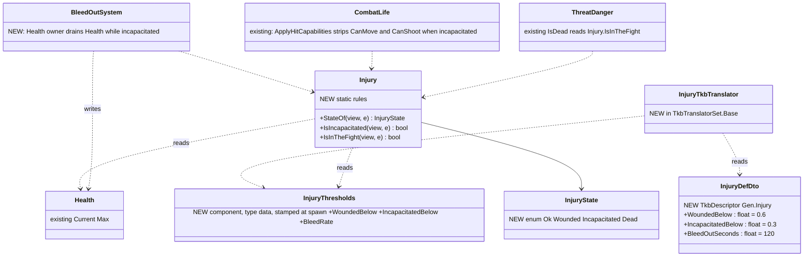
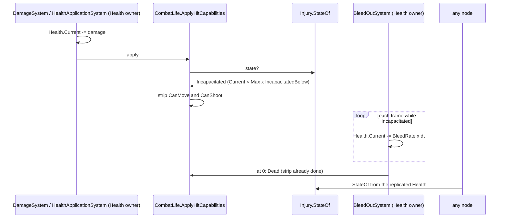
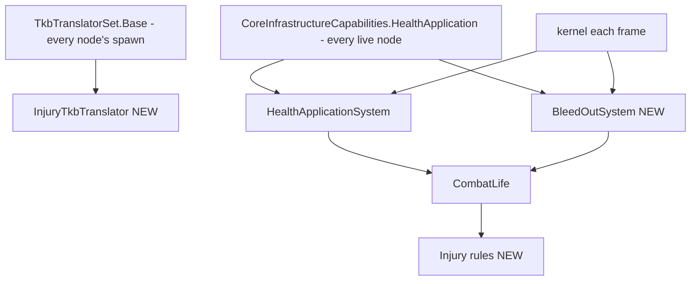

<!--STATUS
state: LIVE
updated: 2026-10-13
build-state: BUILT (I-a) — I1–I6 approved 2026-10-13 (R-2011); behaviors lane; CE-2155; I-b wounded SPEED built 2026-10-14 (ui, CE-1082: WoundedSpeedFactor 0.6, DESIGN_Map_3D_Mode §6m); wounded AIM still open
current-answer: §8 I-a as built · §3 classes · §4 sequence · §5 modules · §6 decisions (leans) · §7 slices
stale-below: nothing
known-rot: ⛔ 2026-10-20 (live, user) — §6 I4 "units stop shooting him" does NOT hold: TopThreat / AimAndFire / several posture nodes test CombatLife.IsAlive (Health > 0), not Injury.IsInTheFight, and a downed man's aim height stays standing — CE-2318. And a man down is still moved and turned by collision avoidance — CE-2321. · none
known-conflict: none
related-designs:
  - OVERVIEW_Rules_And_Demos.md — the INDEX of the rules and demos built across the behaviour designs (rule → what implements it → demo); this design OWNS the rows that cite it
  - designs/hit-location/DESIGN_Body_Parts_And_Hit_Location.md — OWNS hit location: limb wounds derived from PartDamage like the states here from Health (HL-7), filling this file's open wounded AIM
  - docs/DESIGN_Map_3D_Mode.md §6m — DRAWS the wounded limp and the incapacitated figure, and builds slice I-b (WoundedSpeedFactor 0.6)
  - OVERVIEW_Behaviour_Building_Blocks.md — §8a OWNS the one-table summary of what a behaviour can rely on from these states
  - DESIGN_Operations_Behaviour_Catalogue.md — §10.1 D1 OWNS the RULING (R-263): four human states + bleed-out, the vehicle damage states; this file is the human half's build design
  - DESIGN_Entity_Interactions.md — §7.4.8 OWNS the person carrier (CE-2152), the first consumer: only an incapacitated soldier may be carried (R-2009 C3)
  - designs/packs-1/DESIGN.md — §2.B OWNS the opt-in MobilityKill and "death always stops" (CE-3092), which the incapacitated row extends
  - DESIGN_Decision_Layer.md — §3.3f OWNS CE-3090's "wounded" (a HealthFraction curve today), which this state can later replace
  - DESIGN_Visual_Effects.md — §7 OWNS how the dead LOOK (reads CombatLife.IsDestroyed); an incapacitated figure is a later presentation item
  - designs/group-maneuvers/DESIGN_Squad_Tactics.md — L4 OWNS casualty care (buddy aid, moving the casualty), which waits for these states
  - docs/DESIGN_Civilians_And_Crowd_Control.md — CV-6 adds a STORED EffectState (stunned, irritated, knocked down) — the full-health stun case rule I1 names.
-->

# Injury states — ok · wounded · incapacitated · dead *(R-263 D1; CE-2155)*

🔒 *User, 2026-10-11 (catalogue §10.1 D1): "humans: the four injury states + bleed-out, as leaned"* — the lean being *"wounded = slower,
worse aim; incapacitated = no move/fire, needs aid"*.

## 1. Why now

The person carrier (CE-2152, approved C3) may carry only an INCAPACITATED soldier, and that state does not exist. Squad tactics' casualty
care (L4) and the medic and panic entries (MED-1/2/3, IND-5, CIV-3) wait on it too.

## 2. INVENTORY *(graph CLI `search_graph` `.*Injur.*` (9, blast radius only) · `.*Incapacit.*` (0) · `.*Casualt.*` (0) · `.*Wound.*` (21, none a state) · `.*CombatLife.*` (1) · `.*HealthState.*` (IG's retired one), + grep for `Current <= 0`, 2026-10-13)*

| what exists | where | what it means here |
|---|---|---|
| `Health { Current, Max }`, replicated in the Brain group | `Combat/Components/Health.cs:18-21`; CE-523 | the one input; a state derived from it needs NO new wire |
| `CombatLife.IsAlive / IsDestroyed / ApplyHitCapabilities` — "the ONE rule" for death and hit effects | `Combat/CombatLife.cs:22-62` | the home for the state test and the incapacitated capability strip |
| both damage paths call `ApplyHitCapabilities` | `DamageSystem.cs:83`, `HealthApplicationSystem.cs:105` | one call site per path already exists |
| opt-in `MobilityKill { BelowFraction }` strips `CanMove` below a fraction | packs-1 §2.B, CE-3092 | the precedent for a per-type health threshold |
| "dead" read raw (`Current <= 0`) outside `CombatLife` | `ThreatDanger.IsDead:33`, `AliveFilterTest.cs:33`, `AreaEffectSystem.cs:105`, `Possession.cs:224` | four readers decide "still a target / threat" — each needs a call on incapacitated (I4) |
| "wounded" = a `HealthFraction` curve in the posture decision | `CombatPostureDecision.cs:42-65` (CE-3090) | works today; NOT replaced by this design |
| infantry top speed scaled per frame by stance | `CarKinematicsSystem.UpdateVehicle:146-150` | where a wounded speed factor would multiply (a later slice) |
| healing | ⛔ none (grep `Current +=` on `Health`: 0) | nothing restores health, so states move in one direction only |

## 3. Classes

*What the picture shows that prose hid: the state is a FUNCTION of replicated `Health` and type data — no stored state, no new topic — so
every node agrees on it by construction, and the only writer added is the bleed-out drain on the node that already owns `Health`.*

## 4. Sequence — a hit that incapacitates, then bleed-out

## 5. Modules

*What the picture shows that prose hid: the drain rides the cross-role `HealthApplication` capability built in CE-2144 (R-2008), so every
node that applies damage also bleeds — and only the `Health` owner writes, by the same authority gate.*

## 6. Decisions *(✅ I1–I6 approved 2026-10-13, R-2011)*

🔒 *User, 2026-10-13: "I1-I6 approved, C5-C10 approved, go ahead with CE-2155"*

| # | question | ⭐ lean | blast radius | what would change it |
|---|---|---|---|---|
| **I1** | where the state lives | ⭐ DERIVED from `Health` + per-type thresholds (no stored state, no wire) | one rules class; all nodes agree for free | a state that cannot be read off health (e.g. stunned at full health) |
| **I2** | thresholds | ⭐ per type via a NEW `Gen.Injury` descriptor; a type without it has no wounded/incapacitated band (today's behaviour: ok until dead) | soldier templates opt in; vehicles never declare it | wanting it on every human without data — then default it in `BehaviorTkbTranslator` |
| **I3** | bleed-out | ⭐ the `Health` owner drains linearly from `IncapacitatedBelow` to 0 over `BleedOutSeconds`; reaching 0 is ordinary death | `BleedOutSystem` in `HealthApplication` | stabilisation by a medic (MED-2) — a later "stabilised" flag stops the drain |
| **I4** | is an incapacitated soldier a threat / target | ⭐ NOT a threat (`ThreatDanger.IsDead` → `!Injury.IsInTheFight`), and the alive-filter skips him, so units stop shooting him; area effects and possession still see him alive | 2 readers changed, 2 kept | a doctrine of "make sure" fire on the downed |
| **I5** | wounded effects (slower, worse aim) | ⭐ NOT in the first slice — CE-3090's `HealthFraction` curve already shapes behaviour; a speed/aim factor is slice I-b | none now | a scenario that needs wounded soldiers visibly slower |
| **I6** | incapacitated capabilities | ⭐ strip `CanMove` and `CanShoot` in `ApplyHitCapabilities` (the one rule), regardless of `MobilityKill` | one branch in `CombatLife` | — |

Rejected (one line each): **a stored, replicated `InjuryState` component** — a second producer of what `Health` already says, which could
disagree with it (R-132) · **per-body-part wounds** — ruled out in D1 (cost, little behaviour gain) · **thresholds as global constants** —
a civilian and a soldier would bleed alike; D1 lists civilians as casualties too.

## 7. Slices

| slice | what | rails |
|---|---|---|
| **I-a** (`CE-2155`, ✅ BUILT 2026-10-13 — §8) | `Gen.Injury` + translator + `InjuryThresholds`; `Injury` rules; `ApplyHitCapabilities` strips at incapacitated; `BleedOutSystem`; I4's two readers; soldier templates declare it | a hit below the band strips move and fire but leaves him alive · bleed-out reaches 0 in `BleedOutSeconds` on the owner only · a replica reads the same state · an incapacitated contact has danger 0 · no `Gen.Injury` ⇒ unchanged behaviour |
| **I-b** | wounded speed / aim factors (I5) | ⭐ SPEED built `2026-10-14` (ui, CE-1082): `Gen.Injury.WoundedSpeedFactor` (0.6, user-approved) → `InjuryThresholds` → `Injury.SpeedFactor`, multiplied in `CarKinematicsSystem` beside stance and carry (it scales the TOP speed). AIM still open. 📄 DESIGN_Map_3D_Mode.md §6m |

## 8. I-a as built *(`2026-10-13`, behaviors, `CE-2155`)*

As §3–§5. `InjuryDefDto` (`Gen.Injury`) → `InjuryTkbTranslator` (in `TkbTranslatorSet.Base` and the two FDP example lists) →
`InjuryThresholds` (component 370, always rewritten from the type; a band that cannot be read throws at spawn) · `Injury.StateOf /
IsIncapacitated / IsInTheFight` (`Combat/Injury.cs`) · `CombatLife.ApplyHitCapabilities` strips move and fire at incapacitated (I6) ·
`BleedOutSystem` in the `HealthApplication` capability, behind `HealthApplicationSystem`, same authority gate (I3) · declared on BDC
`Infantry_Rifleman` (`NedTkbBuilder.WithInjury`) and the four UrbanCombat soldier types.

| deviation / finding | why |
|---|---|
| ① `ThreatDanger.IsDead` **renamed** `IsOutOfTheFight` (Roslyn, 5 sites) and given I4's meaning | its three callers — `HaveLiveTarget`, `ThreatInSight` and the squad's own-strength sum — all meant "out of the fight"; with `ThreatDanger.Of` and the EQS `AliveFilterTest` that makes **4 readers changed**. Kept: `AreaEffectSystem` (a blast still hits a man down) and `Possession` (an operator still holds a downed unit). The design said "2 changed, 2 kept"; the count was of files, not readers |
| ② bleed applied in **1-second steps**, not per frame | `Health` is published on change (`EntityDamageEgressTranslator`), so a per-frame drain would send one sample per frame per casualty |
| ③ ⭐ **found and fixed: `Embarkation.Leave` gave move and fire back to any ALIVE passenger** | an incapacitated casualty set down would have stood up armed. It now restores only to someone in the fight. Not in the §2 inventory — found by listing every writer that GRANTS capabilities (one: this) |
| ④ `InjuryThresholds.BleedPerSecond` (a health fraction a second) instead of `BleedOutSeconds` | the drain reads it every step; the translator does the division once |
| ⑤ the FDP UrbanCombat example's own catalogue (`DemoTkbSetup`) does **not** declare `Gen.Injury` | a self-contained FDP demo with its own validator; absence = ok until dead, so it is unchanged |
| ⑥ ⭐ **the band is 0.3, not the lean's 0.25** *(user, 2026-10-13: "go with 0.3")* | at 0.25 a 100-HP soldier under 25-damage rifle fire went 75 → 50 → 25 → 0 and was never down; at 0.3 the third hit puts him down. Measured blast radius: 14 scenarios hold banded soldiers (all `bt-*` / `ua-*`, 100 HP); hill-attack and the convoy do not; 50-HP and 25-HP soldiers are unchanged. ⛔ SUPERSEDED: "left for the user" |
| ⑦ 📐 **measured live, `CE-3094` `ua-universal-soldier` (2026-10-13): two hostiles land three rounds inside a second, 100 → 25 HP** | on CGF (the Health owner, which runs his brain) `StateOf` = Incapacitated, `CanMove`/`CanShoot` stripped, the cover node's moves fail and he stays where he fell (24.75 HP after one bleed step) until a later round kills him. ⭐ **The strip is on the Health owner only, exactly like death**: SimHost's copy keeps `CanMove`/`CanShoot` and stops because the owner's `LocomotionDispatcherSystem` sends the stop (`NavigationIntent` None, `CE-3091`); a replica reads the state through `StateOf`. The scenario rail's CE-3092 check ("a wounded man keeps moving") now measures the WOUNDED window only (asserted when he stays wounded ≥ 3 s). ⚠ A live "does not move while down" check was tried and dropped: with the strip removed it stayed green, so it proved nothing — the strip's proof is the unit rail `InjuryTests` |

Rails — `InjuryTests` (8):
- the state read off health and the band
- a hit below the band strips move and fire but leaves him alive
- no `Gen.Injury` ⇒ ok until dead
- bleed-out on the owner only, in steps, wounded do not bleed
- a replica reads the same state
- an incapacitated contact has danger 0 and is filtered as a target
- a casualty set down stays down
- an unreadable band is refused at spawn

Plus `LiveSimulationPlanRails` pins `BleedOutSystem` second on every live node, and the two editor sequence rails gained it.
