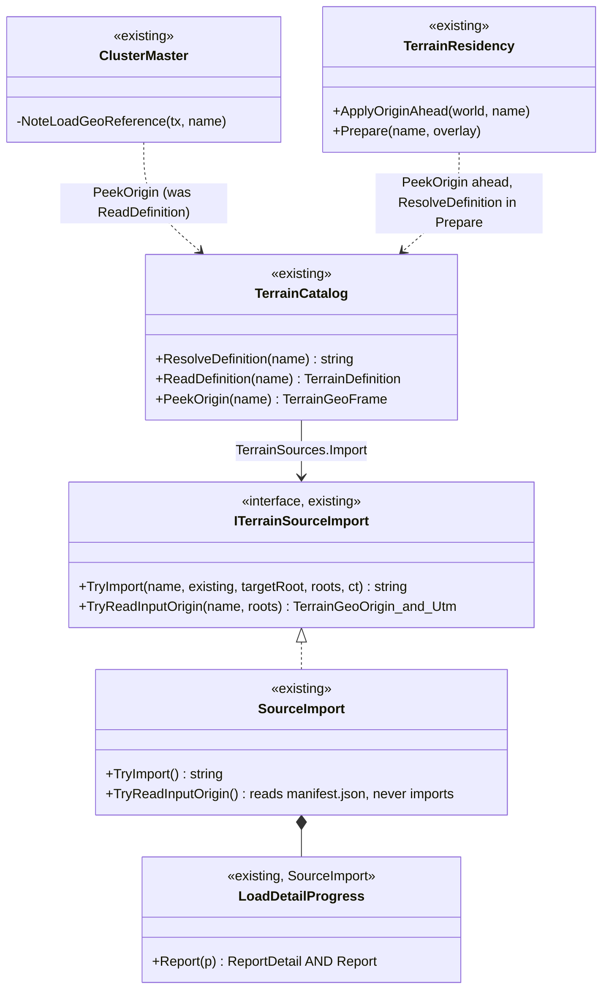
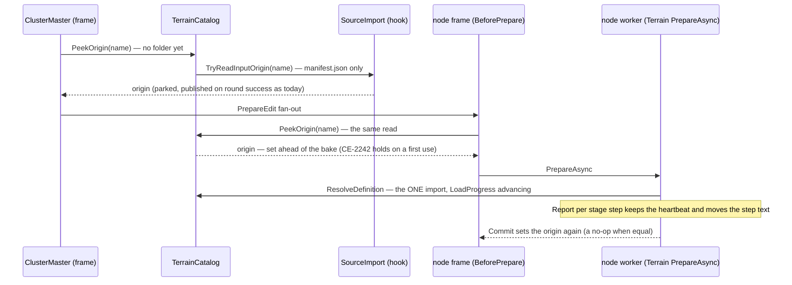
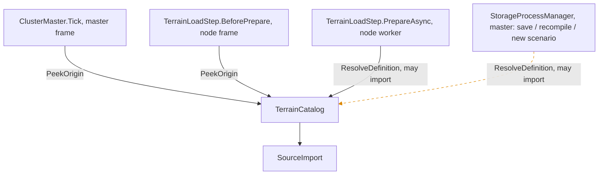

<!--STATUS
state: LIVE
build-state: DESIGN v2 — not dispatched (user, 2026-11-26: "write it as a design, do not send to backend"); revised after the independent review (§8)
updated: 2026-11-26 (v2 after the independent review: the origin from the INPUT SET, no aggregator, no wire change) · 2026-11-26 (v1, terrain lane — CE-5060)
current-answer: §2 the decision (v2) · §3 the UML · §4 the claim table · §5 the preconditions · §6 acceptance · §8 the review and what was done with each finding
stale-below: ## ⛔ HISTORY — v1 (the nodes report the origin in a LoadPrepareResult, a LoadGeoAggregator) — SUPERSEDED by the review: do not quote it
known-rot: none
known-conflict: none — v2 keeps DESIGN_Geo_Origin.md §4 ⑨ / ⑩ as they are (the master still reads; the node still reads ahead); only the READ changes, to one that cannot import
related-designs:
  - DESIGN_Geo_Origin.md — OWNS where the origin comes from and §4 ⑨ (the origin set ahead of the bake on a world boundary, CE-2242) and ⑩ (the master publishes); this changes WHO reads the load's origin for ⑩, and what ⑨ does on a first use
  - blueprints/Architect_Question_107_NED_Wire_Frame_And_Names.md — OWNS the retained GeoReference topic and its publisher (the master); unchanged here: still the master, still on round success
  - DESIGN_Terrain_Import_UTM.md §13 — OWNS the import on first use (CE-11037/11039/11061) and CE-5060, the defect this design removes
  - DESIGN_Cluster_Load_Phase.md — OWNS the load transaction, ILoadPartProvider.BeforePrepare / PrepareAsync / Commit and the per-node LoadProgress (§12) the stall check and the heartbeats read
-->
# No terrain import on the master or the node's frame — the load's origin read from the INPUT SET (CE-5060)

## 1. The problem (measured `2026-11-26`)

📐 A probe in `TerrainCatalog.ResolveDefinition` on a `stechovice-battle` editor load: the terrain is resolved **four** times.

| # | caller | thread | `LoadProgress.Current` | can import? |
|---|---|---|---|---|
| ① | `ClusterMaster.NoteLoadGeoReference` (`ClusterMaster.GeoReference.cs:50`) ← `ExecuteTransitionTrajectory` (`ClusterMaster.cs:1731`) | **master, frame** | ⛔ none — no load step exists yet, the gate still open | ⭐ **yes — and it is FIRST** |
| ② | `TerrainLoadStep.BeforePrepare` → `TerrainResidency.ApplyOriginAhead` (`TerrainResidency.cs:982`) | node, **frame** | set | yes, if ① did not |
| ③ | `TerrainLoadStep.PrepareAsync` → `TerrainResidency.Prepare` (`TerrainResidency.cs:200`) | node, **worker** | set | yes, if ①② did not |
| ④ | `StaticObstacleBakeSystem` → `TerrainResidency.ExpansionBase` | node, worker | none | no (imported by then) |

⇒ a first-use or stale import (CE-11037 / CE-11061) runs in ①: on the master's frame thread, minutes long, before any progress source exists — so the director's 30 s stall check fails the load (CE-5060), and the master's frame (its heartbeat processing, its HTTP) is blocked for the whole import. ① exists only to read the terrain's ORIGIN for the `GeoReference` it publishes when the round succeeds (AQ107 C, `DESIGN_Geo_Origin.md` §4 ⑩).

## 2. Decision (v2)

⭐ **One import-free read of a terrain's ORIGIN — `TerrainCatalog.PeekOrigin(name)` — used by BOTH frame-thread readers (① the master's `NoteLoadGeoReference`, ② the node's `ApplyOriginAhead`):** the current terrain folder's `terrain.json` when there is one; else, through the import hook, the origin of the terrain's committed INPUT SET — `Utm.ToGeodetic(e0 + minX, n0 + minY)` from its `manifest.json` (`frame.utm` + `bounds`), exactly what the importer writes (`TerrainFolderWriter.cs:104`, `TerrainImporter.cs:76`). ⇒ ① and ② never import; the load's one import runs in ③ (`TerrainResidency.Prepare`, the node's worker), inside the Terrain step where the progress shows. Precondition (§5): the import keeps the node's heartbeat and the stall check moving.

| rejected | the one fact |
|---|---|
| v1 — nodes report the origin in a `LoadPrepareResult`, a `LoadGeoAggregator` publishes | ⛔ review §8 ①②: the master keeps ONE aggregator per op (`ClusterMaster.cs:2266`; `PrepareLive` is `LiveBranchAggregator`'s), and the DDS decoder drops an unknown load result (`NodeOpMasterTranslator`: `PrepareEdit` → `default: null`) — it would work in the editor and fail in the multi-node case it was built for; and ② would still have no origin on a first use (CE-2242) |
| the master reads the import's `terrain.json` without importing | fails where the master's machine never holds the import (a master-only dev-checkout machine, a read-only NAS — review §8 ⑤); the input set does not have that gap: it is committed (git) or beside a terrain root (`SourceImport.FindSet`) |
| a progress around ① | the gate is not loading yet (measured); the master's frame stays blocked for minutes |

## 3. The UML (v2)

### 3.1 Classes

*What the picture shows that prose hid:* no new type crosses a process — the change is one catalog read (`PeekOrigin`) and one hook method (`TryReadInputOrigin`), both in the two classes that already own a terrain's resolve and import; the wire, the aggregators and `DESIGN_Geo_Origin.md` §4 ⑨ ⑩ stay as they are.

### 3.2 Sequence — a world-boundary load, first use on this machine

*What the picture shows:* both frame-thread readers get the origin in milliseconds on a first use, so the ahead-of-bake rule (⑨) keeps working; only the worker imports.

### 3.3 Modules — who calls the terrain catalog during a load

*Caption:* the orange dashed edge is OUT of this design's scope and still imports on the master — the overlay compile at save, the recompile and the blank new scenario (`StorageProcessManager.cs:245`, `:276`, `:340`; review §8 ⑥) — filed as its own row.

## 4. Claim table (v2)

| the decision rests on | code — how it IS | design — how it was MEANT to be |
|---|---|---|
| ① is the load's first resolve and the one that imports | ✅ measured probe (§1); `ClusterMaster.cs:1731` | ✅ `DESIGN_Geo_Origin.md` §4 ⑩ (the master reads the header) |
| the origin is a pure function of the input set's manifest | ✅ `TerrainFolderWriter.cs:104` (`Utm.ToGeodetic(frame.E0 + swX, frame.N0 + swY)`), `TerrainImporter.cs:76` (`swX = m.MinX`); Stechovice's `manifest.json` carries `frame.utm` + `bounds` | ✅ `DESIGN_Terrain_Import_UTM.md` (origin = the set's south-west corner) |
| a read of `manifest.json` cannot import | ✅ `TryReadInputOrigin` is new and reads one JSON file | — |
| the master can see the input set where it cannot see the import | ✅ `SourceImport.FindSet` (beside every catalog root, then the repository) | ✅ `DESIGN_Terrain_Import_UTM.md` §13 (git keeps the INPUT) |
| the import on the worker keeps the heartbeat | ⛔ **NOT today** — `ReportDetail` does not advance the count (`LoadProgress.cs:50–63`); only the navmesh baker's per-tile `Report()` does (review §8 ③) ⇒ precondition §5 | `DESIGN_Cluster_Load_Phase.md` §12 ("all loaders need to report progress") |
| two nodes on one machine: the second waits on the import lock | ⛔ the wait (`SourceImport.AcquireLock`, `Sleep(50)`) reports nothing ⇒ precondition §5 | — |
| the proven solution | read the immutable SOURCE of a derived value instead of producing the derived artefact on the critical path — adopt: the origin depends on the input only | — |

## 5. Preconditions (part of the build, not "measure first")

| # | precondition | why |
|---|---|---|
| P1 | `SourceImport.LoadDetailProgress.Report` also calls `Fdp.Core.LoadProgress.Report()` | the heartbeat (both sources) and the director's count move during every stage, not only the navmesh |
| P2 | the import-lock wait reports progress (`ReportDetail("import: waiting for another import", …)` + `Report()` per poll) | N nodes on one machine on a first use: N−1 wait silently and would be ejected |
| P3 | the catalog passes the load's cancellation into `TryImport` (today `default`, `TerrainCatalog.cs:88,93`) | a cancelled load stops importing and frees the lock (review §8 ⑩) |
| P4 | the master's existing rails (`ClusterMasterFanOutTests` AQ107C, `:356–405`, `:490–515`) stay green — they read a NAS terrain FOLDER, which `PeekOrigin` reads first | v2 keeps the master's read; only its fallback is new |

## 6. Acceptance

| rail | asserts |
|---|---|
| `TerrainCatalogTests.CE5060_PeekOrigin_*` | a folder ⇒ its origin; no folder + an input set ⇒ the manifest's origin, equal to what the import then writes; ⛔ the hook's import count stays 0 |
| `SourceImportTests.CE5060_TheImport_AdvancesTheLoadsCount` | every stage advances `LoadProgress` (`MovedWithin(1 s)` true through a stage), and a lock waiter advances it too |
| `TerrainLoadStepTests.CE2242_*` on a FIRST use | the origin is set ahead of the bake with no terrain folder yet |
| `ClusterMasterFanOutTests` AQ107C | unchanged, green |
| `scripts/scenario-regression.sh stechovice-battle` with no import on the machine | passes the load (the step text moves through the import) |

## 7. INVENTORY

| query | total | what it found |
|---|---|---|
| `search_graph name_pattern ".*GeoReference.*" label Class` | 2 | `OrchestrationMessages.GeoReference` (the wire), `GeoReferencePublishedEvent` |
| `… ".*GeoReference.*" label Interface` | 0 | — |
| `… ".*GeoOrigin.*" label Class` | 2 | `RecordingMetadata.GeoOriginRecord`, `TerrainDefinition.TerrainGeoOrigin` |
| `… ".*PrepareResult.*" label Class` | 1 | `ReplayPrepareResult` — no load result type exists |
| `… ".*LoadPhase.*Result.*" label Class` | 0 | — |
| `… ".*Aggregator.*" label Class` | 12 | the master's 9 + 3 unrelated — none for a load (v1's premise; v2 needs none) |
| `… ".*Aggregator.*" label Interface` | 2 | `INodeResponseAggregator`, a blackboard one (unrelated) |
| grep `ResolveDefinition(` / `ReadDefinition(` on a load | 4 resolves | §1 (a probe, not committed); ⭐ the review found 3 more on the master off the load path (`StorageProcessManager.cs:245,276,340`) |
| grep the input set's origin | 1 writer | `TerrainFolderWriter.WriteTerrainJson` (`:104`) — no reader of the manifest's origin exists yet (`TryReadInputOrigin` is new) |

⚠ `check_index_coverage` is not available through the CLI — the absence claims rest on the graph plus grep, not a coverage check.

## 8. Independent review *(a fresh agent, read-only, given the design and the code; `2026-11-26`)*

**Verdict: unsound as written (v1)** — the goal right, the transport and the aggregation wrong. ⭐ Spot-verified here before acting: the decoder's `default: null` (`NodeOpMasterTranslator.cs:286`, with two earlier fixes of the same bug in its comments), the origin as a function of the manifest (`TerrainFolderWriter.cs:104`, `TerrainImporter.cs:76`), the manifest's `frame` + `bounds`.

| # | severity | finding | done |
|---|---|---|---|
| ① | BLOCKING | one aggregator per op: a `PrepareLive` one replaces `LiveBranchAggregator` (CE-3312 regresses) | v1 dropped — v2 has no aggregator |
| ② | BLOCKING | the DDS decoder drops an unknown load result (`PrepareEdit` → `null`; `PrepareLive` → a default `LiveBranchResult`) — v1 works only in-process | v1 dropped — v2 crosses no process |
| ③ | BLOCKING | the import reports only `ReportDetail`, which does not advance the count — a stage > ~5 s stops the beats and the master ejects the node; lock waiters report nothing | §5 P1, P2 (preconditions) |
| ④ | IMPORTANT | Q1's mitigation impossible: off-frame steps run in one `Task.Run`, no frame callback before `Commit`; ⭐ the origin is a function of the input set's manifest — read it import-free and Q1 disappears | ⭐ adopted: v2's decision |
| ⑤ | IMPORTANT | the rejected "master reads without importing" was over-stated: it fails only on a master-only dev machine or a read-only NAS — and the input-set read fixes those too | §2 table corrected |
| ⑥ | IMPORTANT | the master also resolves (and may import) at save, recompile and new scenario (`StorageProcessManager.cs:245,276,340`) — "the only path" was false | §3.3 caption; tracker row filed |
| ⑦ | MINOR | the world-boundary rule and "names no terrain ⇒ `Frame=None`" | v2 keeps `NoteLoadGeoReference` as it is (both rules stay) |
| ⑧ | MINOR | the replay's tie rule is the earliest first frame, not the lowest id | moot in v2 |
| ⑨ | MINOR | the AQ107C master rails would break under v1 | §5 P4 — v2 keeps them |
| ⑩ | MINOR | the catalog passes `default` cancellation into the import | §5 P3 |

Confirmed by the review: the §1 lines; load rounds DO run the aggregators (`GenericTransactionTracker`, `ClusterMaster.cs:1768–1777`, `:2607`); `LoadPhaseChain.PrepareAsync` returns null; the import is synchronous under a lock per target root. ⚠ Not determined: each import stage's length without an advance.

## ⛔ HISTORY — v1 (SUPERSEDED `2026-11-26` by the review above; do not quote)

v1 had each node return its terrain's geo frame in a new `LoadPrepareResult`, aggregated by a new `LoadGeoAggregator` (`PrepareEdit` / `PrepareLive`), the master publishing the aggregate and never resolving the terrain; the node's ahead read used an import-free `PeekDefinition` (no origin on a first use — its open Q1). Killed by §8 ① ② (one aggregator per op; the DDS decoder drops an unknown load result) and ④ (no frame point before `Commit`).
